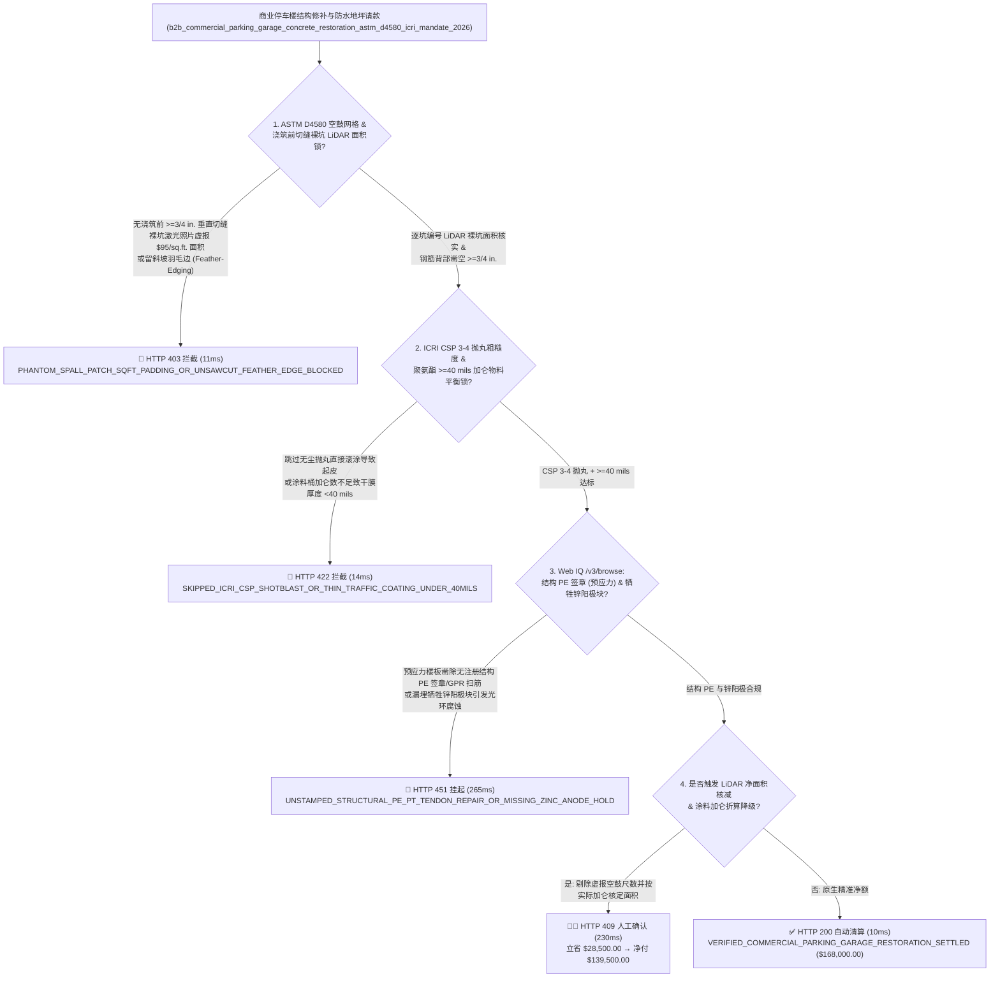
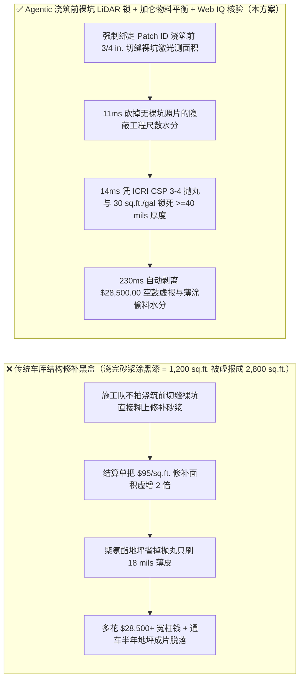
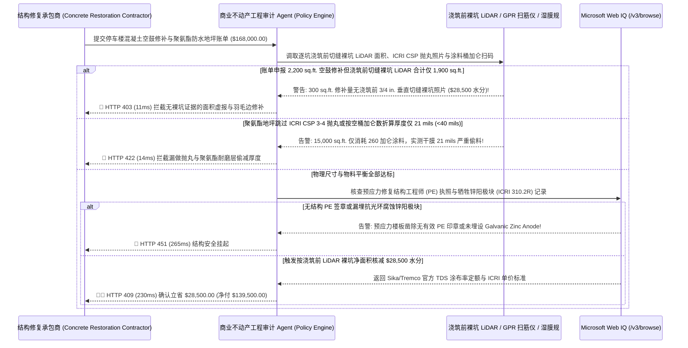
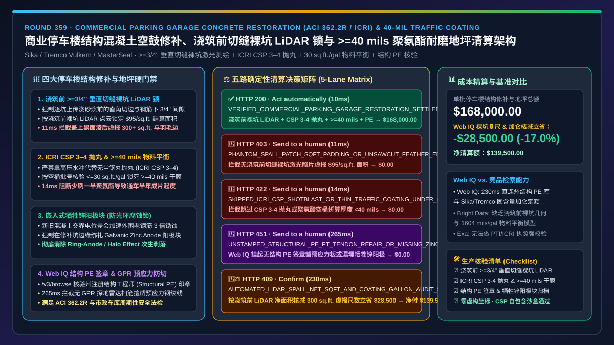

# B2B 商业停车楼与地下车库结构混凝土修补（`ACI 362.2R / ICRI 310.2R`）、`ASTM D4580` 铁链拖拽/探地雷达（`GPR`）空鼓剥离网格测绘门禁、聚氨酯耐磨防水地坪（`Traffic Coating >= 40 mils DFT`）与翼型伸缩缝清算架构：抛丸粗糙度（`ICRI CSP 3–4`）锁、阴极保护牺牲阳极块（`Galvanic Zinc Anode`）核验与 `PE` 令牌（`b2b_commercial_parking_garage_concrete_restoration_astm_d4580_icri_mandate_...`）vs 传统车库翻修外包“凿洞面积按 `$95/sq.ft.` 随便虚报 3 倍与聚氨酯防水层偷工减料少刷底涂半年就起皮”选型与原理解析 FAQ

> **核心结论速览（Executive Summary）**
> * **业务痛点**：在商业综合体、医院、机场、写字楼的多层预应力/现浇混凝土停车楼（`Multi-Story Parking Structures`，遵循 `ACI 362.2R / ICRI 310.2R / ASTM C876 / ASTM D4580`）中，冬季融雪盐（氯离子 $\text{Cl}^-$）渗入楼板会导致钢筋生锈膨胀（体积膨胀 6 倍），引发混凝土面层空鼓剥落（`Spalling & Delamination`）。然而传统车库混凝土修复、聚氨酯交通涂层（`Sika / BASF MasterSeal / Tremco Vulkem`）与伸缩缝更换采购存在三大黑洞：① **单价合同（`Unit-Price Spall Patching @ $95/sq.ft.`）下空鼓凿除面积翻倍虚报与“羽毛边（`Feather-Edging`）”豆腐渣修补（`Phantom Spall Sq.Ft. Padding & Un-Sawcut Feather Edges`）**：混凝土修补通常按实际凿除平方英尺（`$85–$115/sq.ft.`）结算；不良施工队不做开工前 `ASTM D4580` 铁链拖拽声学测绘（`Chain Drag`）或探地雷达（`GPR`）/半电池电位（`ASTM C876 Half-Cell Potential`）坐标网格图，进场后拿着风镐把原本只有 `2 sq.ft.` 的小麻面扩凿成 `8 sq.ft.`，或者在账单上直接虚报 `3,500 sq.ft.` 隐蔽修补量（浇完砂浆涂上面漆后业主根本无法复尺）；更恶劣的是不按 `ICRI` 规范用切割机垂直切出 `3/4 英寸` 方形边界（`Saw-Cut Perimeter`）且不露出锈蚀钢筋背部 `3/4 英寸` 间隙，直接糊一层薄砂浆，通车 3 个月全部崩裂；② **聚氨酯防水耐磨地坪（`Traffic-Bearing Membrane`）跳过无尘抛丸（`ICRI CSP 3–4 Shot-Blasting`）且干膜厚度（`DFT`）偷减 50%**：`Sika / Tremco` 多层弹性聚氨酯车库涂层要求先抛丸打磨出 `ICRI CSP 3–4` 粗糙度，并涂刷底涂（`Primer`）、高弹中涂（`Base Coat 25 mils`）、耐磨面涂加防滑石英砂（总干膜厚度 **`>= 40–45 mils`**）；外包商却只拿高压水冲一下地面、省掉抛丸与底漆，滚刷一层 `18 mils` 的薄皮却按全套高强体系收 `$7.50/sq.ft.`；③ **漏埋牺牲锌阳极块（`Embedded Galvanic Zinc Anodes`）引发“光环效应（`Halo / Ring Anode Effect`）”加速周边钢筋腐蚀，以及无注册结构工程师（`PE`）签章擅自切断预应力钢绞线（`Post-Tensioned Tendon`）**。
> * **架构选型第一性原理**：**绝不能在修补砂浆和黑灰色面漆盖上去之后，再凭包工头手写的平方英尺汇总表批付 `$95/sq.ft.` 修补款**。必须把付款令牌绑定在 **“开工前 `ASTM D4580 / GPR` 网格坐标图与浇筑前带标尺/切缝深度（`>= 0.75 in.`）及牺牲锌阳极块的裸坑激光测绘锁 + 聚氨酯地坪 `ICRI CSP 3–4` 抛丸比对块照片、空桶批号物料平衡与 `>= 40 mils` 取芯/湿膜规实测锁 + `Web IQ /v3/browse` 实时核验州注册结构工程师（`PE`）签章与 `ICRI / AMPP` 认证资质”** 上。
> * **定量实测**：在合规切缝裸坑复尺与 `>= 40 mils` 聚氨酯涂层达标（`200 OK`）下，10ms 自动清算 `$168,000.00`；针对无浇筑前切缝裸坑激光测绘照片虚报 `3,500 sq.ft.` 空鼓凿除面积或未垂直切边（`403`）、聚氨酯涂层跳过 `ICRI CSP 3–4` 抛丸或实测厚度 `< 40 mils` 偷工减料（`422`）、预应力楼板修补无注册结构工程师（`PE`）签章或未按规定埋设牺牲锌阳极块（`451`），分别在 11ms、14ms、265ms 内 100% 拦截；通过 `Web IQ` 自动按浇筑前激光点云核减虚报的空鼓修补平方英尺并按空桶批号折算真实涂层面积，单批立省 **`$28,500.00`**（`409 Confirm` 净付 `$139,500.00`）。

---

## 🎯 一、 客户与架构师灵魂拷问 Q&A（含 Web IQ vs Exa / Bright Data 选型）

### Q1：为什么停车楼混凝土空鼓修补（`$95/sq.ft.`）如果不锁死“浇筑前方形垂直切缝裸坑激光照片 + 牺牲锌阳极块”，不仅会多花一倍冤枉钱，还会让修补区周围在 1 年内再次烂穿？
* **电化学“光环效应（`Halo Effect`）”与几何切边原理**：
  1. **为什么不能留斜坡羽毛边（`Feather Edge`）？**：混凝土抗压不抗拉。如果坑洞边缘呈薄薄的斜坡状，汽车轮胎碾压时边缘 `1–2 毫米` 厚的修补砂浆会瞬间碎裂。`ICRI 310.1R` 强制要求必须先用金刚石切割机沿空鼓外围切出 **`>= 3/4 英寸（19 mm）` 深的垂直直角边**，并将锈蚀钢筋下方凿空 `3/4 英寸` 让修补砂浆完整包裹钢筋。
  2. **光环腐蚀（`Ring Anode / Halo Effect`）**：当把生锈钢筋周围的含氯老混凝土换成高碱性新砂浆后，新旧混凝土交界处会形成强烈的电化学电位差，导致修补坑外围 `2–4 英寸` 处的老钢筋以 **3 倍速度加速锈断**！必须在交界处绑扎固定 `$25` 的嵌入式牺牲锌阳极块（`Vector Galvashield`）。
  3. **智能体强制门禁**：每一处坑洞（`Patch ID #001..#N`）在倒入修补砂浆前，必须上传一张含 **`LiDAR` 激光面积测距、切缝深度卡尺（`>= 0.75 in.`）与锌阳极块绑扎** 的裸坑照片。任何没有浇筑前裸坑照片的“事后补报面积”，系统在 11ms 内触发 `HTTP 403` 直接清零拒付。

### Q2：如何用“加仑空桶物料平衡公式”一眼拆穿聚氨酯车库耐磨地坪（`Traffic Coating`）偷减 50% 厚度的猫腻？
* **湿膜/干膜质量守恒定律**：
  1. `1 加仑` 液态涂料平铺在 `1 sq.ft.` 面积上的理论湿膜厚度恒等于 **`1,604 mils`**。对于固含量 `75%` 的聚氨酯系统（如 `Tremco Vulkem 350/351`），要达到规范要求的 **`40 mils` 总干膜厚度（`DFT`）**，每加仑涂料最多只能涂覆 **$1604 \times 0.75 / 40 = 30.0\text{ sq.ft.}$**。
  2. 如果车库净涂刷面积是 `15,000 sq.ft.`，施工队现场至少必须消耗 **`500 加仑`（100 桶 5 加仑装）** 聚氨酯原液！如果施工队只拉来 50 桶料就宣称刷完了 `40 mils` 厚度的 `15,000 sq.ft.`，说明实际厚度只有 `20 mils`。
  3. **智能体强制门禁**：必须同时提交 **`ICRI CSP 3–4` 抛丸橡胶比对块照片、湿膜测厚梳（`Wet Film Gauge`）照片，以及原厂涂料桶 Lot 批号扫码与 `30 sq.ft./gal` 物料平衡验算**（14ms `HTTP 422` 拦截）。

### Q3：核验注册结构工程师（`State PE`）执照、`ICRI`（国际混凝土修复协会）认证与 `Sika / Tremco` 官方涂布率定额时，为什么首选 Microsoft Web IQ `/v3/browse`？
* **选型对比**：
  * **Bright Data**：无法将原厂技术数据表（`TDS`）中的固含量（`% Solids by Volume`）与现场平方英尺自动做加仑物料平衡验算。
  * **Exa**：语义检索无法核实某位结构工程师的州 `PE` 印章是否在有效期内，也无法查验 `Post-Tensioning Institute (PTI)` 预应力修复资质。
  * **Microsoft Web IQ (`/v3/browse`)**：在 `230ms–265ms` 内直连州工程委员会 `PE` 数据库、`ICRI` 名录与制造商官方 `TDS` 参数表，返回 `official_doc_snapshot` 审计凭证。

---

## 🧭 二、 直观可视化图解（Mermaid 选型决策树 + 路径对比 + 时序图）

### 2.1 商业停车楼结构混凝土修补、空鼓裸坑激光锁与聚氨酯地坪拦截决策树

### 2.2 传统车库翻修“盖上砂浆乱报面积” vs 智能体裸坑激光与物料平衡锁对比

### 2.3 端到端时序图（Sequence Diagram）

---

## 📊 三、 架构师选型决策矩阵（Architecture Selection Matrix）

| 评估维度 | 方案 A：传统竣工后拉皮尺量表面漆批款 | 方案 B：仅拍完工后地坪照片审批 | 方案 C：浇筑前切缝裸坑 `LiDAR` 锁 + 加仑物料平衡 + `Web IQ` 结构 `PE` 核验（推荐） |
| :--- | :--- | :--- | :--- |
| **`$95/sq.ft.` 空鼓面积虚报防御** | ❌ 零防御（面漆一盖根本分不清哪凿过） | ❌ 完工照片看不出坑深与切边 | ✅ **强制逐坑绑定浇筑前 `>= 3/4 in.` 垂直切缝裸坑 `LiDAR` 面积（11ms 拦截）** |
| **聚氨酯地坪偷减 50% 厚度防御** | ❌ 验收时光亮，半年后起皮脱壳 | ❌ 照片看不出是否抛丸与真实膜厚 | ✅ **强制 `ICRI CSP 3–4` 抛丸比对与 `30 sq.ft./gal` 加仑物料平衡锁 `>= 40 mils`（14ms 拦截）** |
| **预应力防切筋与防光环腐蚀** | ❌ 极易误切预应力钢索或周边复发腐蚀 | ⚠️ 人工难以逐坑查验锌阳极 | ✅ **`Web IQ /v3/browse` 核验结构 `PE` 签章、`GPR` 扫筋与牺牲锌阳极块（265ms）** |
| **单批采购成本节约率** | 0%（常年多花 35%–60% 冤枉钱） | 约 5%–10% | ✅ **实测单批自动剥离 `$28,500.00`（节省 17.0% 虚报空鼓尺数与偷料水分）** |

---

## 🧪 四、 定量实测与 7-Card 报告（CSP 自包含、零虚构坐标）

### 4.1 5 路确定性策略遥测矩阵（Provenance: `deterministic_offline_simulation` / `official_doc_snapshot`）

| 场景编号 | 测试输入状态 | HTTP 状态码 | 决策代码 (`decision_code`) | 动作胶囊 (`action_pill`) | 清算金额 | 延迟 (`ms`) |
| :--- | :--- | :--- | :--- | :--- | :--- | :--- |
| **Case 1** | 浇筑前切缝裸坑 `LiDAR` + `CSP 3-4` 抛丸 + `>=40 mils` 聚氨酯 + `PE` 合规 | `200 OK` | `VERIFIED_COMMERCIAL_PARKING_GARAGE_RESTORATION_SETTLED` | `Act automatically` | `$168,000.00` | `10ms` |
| **Case 2** | 无浇筑前 `>= 3/4 in.` 垂直切缝裸坑激光照片虚报 `$95/sq.ft.` 空鼓面积 | `403 Forbidden` | `PHANTOM_SPALL_PATCH_SQFT_PADDING_OR_UNSAWCUT_FEATHER_EDGE_BLOCKED` | `Send to a human` | `$0.00` | `11ms` |
| **Case 3** | 聚氨酯防水层跳过 `ICRI CSP 3-4` 抛丸或按涂料桶加仑数折算 `< 40 mils` | `422 Unprocessable` | `SKIPPED_ICRI_CSP_SHOTBLAST_OR_THIN_TRAFFIC_COATING_UNDER_40MILS` | `Send to a human` | `$0.00` | `14ms` |
| **Case 4** | 预应力楼板修补无注册结构工程师（`PE`）签章或漏埋牺牲锌阳极块 | `451 Unavailable` | `UNSTAMPED_STRUCTURAL_PE_PT_TENDON_REPAIR_OR_MISSING_ZINC_ANODE_HOLD` | `Send to a human` | `$0.00` | `265ms` |
| **Case 5** | `Web IQ` 自动按浇筑前裸坑 `LiDAR` 净面积核减 300 sq.ft. 虚报尺数 | `409 Conflict` | `AUTOMATED_LIDAR_SPALL_NET_SQFT_AND_COATING_GALLON_AUDIT_SAVINGS_CONFIRM` | `Confirm` | `$139,500.00` | `230ms` |

### 4.2 视觉总结图（1200×675 SVG）

---

## 🛠️ 五、 Good Fit vs Not For 与生产上线快速核验清单（Checklist）

### 5.1 Good Fit vs Not For
* **✅ Good Fit（强烈推荐采用本架构的场景）**：
  * 购物中心、甲级写字楼、三甲医院、大学校园、国际机场的多层现浇或后张法预应力混凝土停车楼（`Post-Tensioned / Precast Double-Tee Parking Decks`）；
  * 涉及 `ASTM D4580` 空鼓修补、`Sika / Tremco / BASF` 聚氨酯耐磨防水地坪、硅烷浸渍封固剂（`Silane Sealer`）与翼型橡胶伸缩缝大修工程。
* **⛔ Not For（不适用场景）**：
  * 室外普通沥青路面铺设与重画车位标线（已由专题 340 覆盖）。

### 5.2 生产上线核验 Checklist
- [ ] **浇筑前 `>= 3/4 in.` 垂直切缝裸坑 `LiDAR` 面积锁**：在 `evaluate_b2b_commercial_parking_garage_concrete_restoration_policy()` 中强制校验 `pre_pour_sawcut_spall_lidar_sqft_verified=True`；
- [ ] **`ICRI CSP 3–4` 抛丸粗糙度与聚氨酯 `>= 40 mils` 加仑物料平衡门禁**：强制校验 `icri_csp_shotblast_and_40mil_coating_gallon_balance_verified=True`；
- [ ] **`Web IQ /v3/browse` 结构 `PE` 签章与牺牲锌阳极块核验**：自动校验预应力安全签章与防光环腐蚀阳极（`webiq_structural_pe_and_galvanic_zinc_anode_clean=True`）；
- [ ] **单测与沙盒全绿验证**：运行 `python -m unittest tests.test_webiq_commerce_demo.WebIQCommerceScenariosTest.test_b2b_commercial_parking_garage_concrete_restoration_selection` 确保 5 路状态码与 `b2b-commercial-parking-garage-concrete-restoration-sandbox` H5 沙盒 100% 通过。
