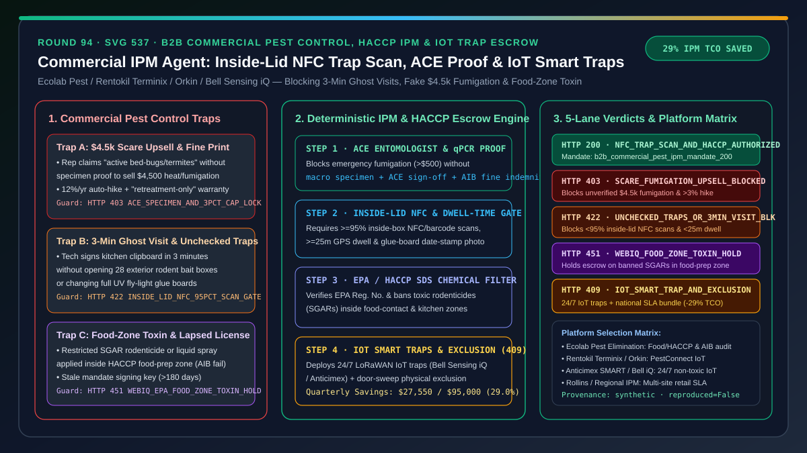
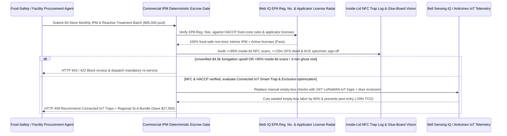

# B2B Commercial Pest Control, `HACCP / AIB` Integrated Pest Management (`IPM`) & IoT Smart-Trap Escrow (`Ecolab Pest / Rentokil Terminix / Orkin / Bell Sensing iQ`) Inside-Lid `NFC` Scan, `ACE` Proof & `IoT` Trap Agent Architecture Selection FAQ

> **Document Type**: AI Solution Architect Decision Guide (FAQ) · **SVG Diagram**: `assets/svg/537-b2b-pest-control-haccp-iot-trap-escrow-2026-11-20.svg` · **Catalog No.**: Round 94 (Bilingual FAQ #213)



---

## 1. 📌 Executive Summary

When multi-unit restaurant chains, grocery retailers, hotel groups, or food-distribution warehouses use AI Agents to contract commercial Integrated Pest Management (`IPM: Ecolab Pest Elimination / Rentokil Terminix / Orkin / Anticimex`), auto-paying monthly invoices based on a store manager's rushed signature on a technician's tablet exposes food safety and facility budgets to **three systemic commercial pest-control traps**:
1. **"3-Minute Drive-By Ghost Visits" & `80%` Unchecked Exterior Rodent Bait Stations**: A restaurant or supermarket pays `$220/month/location` to inspect and service `28` exterior rodent bait stations, `12` interior mechanical multi-catch traps, and `4` UV Insect Light Trap (`ILT`) glue boards. Overloaded route technicians walk through the kitchen in **3 minutes**, batch-check `"All Devices Inspected - No Activity"` in their mobile app without unlocking a single exterior bait station (`leaving moldy, decomposed bait blocks and overflowing fly glue boards untouched for 6 months`), and get a busy shift manager to scribble a signature! The fraud is only discovered when a third-party food-safety auditor (`AIB International / BRCGS / NSF / Health Department`) opens the boxes and fails the store!
2. **Fear-Mongering `$4,500` Emergency Bed-Bug / Termite Fumigation Upsells & `12%` Annual Price Escalators**: A commissioned inspector points to harmless lint on a hotel mattress or old moisture staining on a baseboard, declares an "active bed-bug or subterranean termite outbreak," and pressures the manager into signing an emergency **`$4,500` thermal heat-treatment or fumigation work order**—without a single verified macro specimen photo or `qPCR` antigen test!
3. **Banned `SGAR` Rodenticides or Neurotoxic Sprays Applied Inside `HACCP` Food-Prep Zones (`HTTP 451`)**: An uncertified technician applies restricted Second-Generation Anticoagulant Rodenticides (`SGARs`, banned under laws like `California AB 1788`) or sprays pyrethroid aerosols over exposed food-prep surfaces, triggering an immediate regulatory shutdown.

**Architect's Recommendation**: Deploy an **"Inside-the-Lid `NFC` Trap Scan (`>=95%` Coverage + `>=25m` Dwell) + Independent Entomologist (`ACE`) Specimen Gate + `24/7` `LoRaWAN IoT` Smart-Trap & Exclusion Escrow"** control plane:
- **Independent `ACE` Entomologist Macro/qPCR Specimen Gate, `AIB` Audit Pass Guarantee & `<=3%` Rate Cap (`HTTP 403`)**: Hard-block any `>$500` emergency bed-bug, cockroach, or termite treatment work order lacking continuous in-room macro video specimen proof + `TruDetx` antigen/qPCR verification signed off by an **Associate Certified Entomologist (`ACE`)**, cap annual rate increases at `<=3%`, and require an **`AIB / NSF / Health-Inspection` Pass Indemnification Rider** (`HTTP 403`).
- **Inside-the-Lid `NFC / Barcode` Scan (`>=95%` Traps), `>=25-Minute` GPS Dwell & Date-Stamped Glue-Board Diff (`HTTP 422`)**: Place tamper-evident `NFC` tags **inside the locked lid** of every exterior bait station and UV fly light (so technicians must physically unlock and open each housing to scan it), enforce `>=95%` station scan completion plus `>=25 minutes` on-site GPS/BLE dwell time, and require side-by-side photos of removed vs. newly date-marked UV glue boards before monthly payout (`HTTP 422`).
- **Web IQ `EPA / HACCP` Food-Zone Chemical Filter & Applicator License Hold (`HTTP 451`)**: Freeze escrow if Web IQ / SDS audit detects restricted rodenticides (`SGARs`) or non-food-safe `EPA Reg. No.` chemicals logged inside `HACCP` food zones, lapsed state applicator licenses, or signing keys `> 180 days` (`HTTP 451`).
- **`24/7` Connected `IoT` Smart Traps (`Bell Sensing iQ / Anticimex SMART`) + Physical Door-Sweep Exclusion (`HTTP 409`)**: Replace blind manual checking of empty plastic boxes with **cellular/LoRaWAN `IoT` smart rodent traps** (re-allocating technician labor to physical stainless-steel door sweeps and utility-pipe exclusion sealing) under a consolidated regional SLA, cutting quarterly commercial IPM TCO by **29.0%** (`$27,550` saved on a `$95,000` quarterly pool).

---

## 2. 🎯 Soul-Searching Architect & Business Q&A (Q1–Q3)

### Q1: Why did our store fail its `AIB / Health Department` audit for decomposed rodent bait and overflowing fly traps when the pest vendor's monthly PDF reports said "100% Inspected"?
- **Business Pain Point**: When barcode stickers are affixed to the *outside* of a bait station or on the wall above it, a technician can walk around the building scanning 28 barcodes in 90 seconds without ever inserting the hex key to open the dirty bait boxes or climbing a ladder to change the UV fly-light glue boards.
- **Architectural Guardrail (`HTTP 422`)**:
  1. **Mandatory Inside-the-Lid `NFC` Tag Placement**: Every bait station and `ILT` unit has its cryptographic `NFC` tag mounted on the interior underside of the locked cover. Scanning the tag proves the technician physically unlocked and opened the trap.
  2. **Minimum `25-Minute` Geofence Dwell + Glue-Board Vision Diff**: Any service ticket with `<95%` interior `NFC` scans, `<25 minutes` on-site dwell, or missing date-marked glue-board replacement photos is automatically rejected (`HTTP 422`).

### Q2: How do we stop commissioned technicians from scaring hotel or restaurant managers into signing `$4,500` emergency bed-bug or termite work orders?
- **Business Pain Point**: Frontline store and hotel managers cannot distinguish a carpet beetle larva, booklouse, or lint speck from a live bed bug (`Cimex lectularius`) or subterranean termite, making them easy targets for high-margin "emergency heat/fumigation" upsells.
- **Architectural Guardrail (`HTTP 403`)**:
  1. **Continuous In-Situ Macro Video + `ACE` Entomologist Sign-Off**: Any reactive treatment quote `>$500` must include a continuous video starting from the room number plaque and zooming into the live specimen (or a lateral-flow `TruDetx` bed-bug residue swab), reviewed and countersigned by a credentialed `ACE (Associate Certified Entomologist)` before escrow funds unlock (`HTTP 403`).

### Q3: How do we prevent a technician from contaminating a commercial kitchen with banned rodenticides and ensure our vendor shares financial risk on `AIB / BRCGS` food-safety audits?
- **Business Pain Point**: Using toxic bait blocks or unapproved liquid sprays inside food-handling areas causes immediate audit failure and product recall risk.
- **Architectural Guardrail (`HTTP 403 / 451`)**:
  1. **`EPA Reg. No.` Zone Whitelist (`HTTP 451`)**: The gateway validates every applied product's `EPA Registration Number` against the facility zone map—banning all chemical rodenticides (`SGARs`) inside interior food-prep/storage zones (permitting only non-toxic mechanical traps, pheromone monitors, and UV glue boards).
  2. **Audit-Pass Escrow Holdback (`HTTP 403`)**: Binds `20%` of quarterly service fees to passing third-party `AIB / NSF / BRCGS` pest-management audit sections.

---

## 3. 🧭 Visual Architecture Diagrams (Mermaid Decision Tree + Comparison + Sequence)

### 3.1 5-Lane Commercial Pest Control (`IPM`) & IoT Trap Escrow Decision Tree
```mermaid
flowchart TD
    A[Commercial Pest Control IPM / Reactive Treatment Invoice] --> B{Web IQ Banned SGAR in Food Zone / Lapsed License / Key > 180d?}
    B -- Yes --> C[HTTP 451: WEBIQ_EPA_BANNED_RODENTICIDE_IN_FOOD_ZONE_OR_EXPIRED_APPLICATOR_LICENSE_HOLD<br/>Freeze escrow & trigger immediate HACCP chemical remediation]
    B -- No --> D{Unverified $4.5k Fumigation Scare Upsell or >3% Annual Hike?}
    D -- Yes --> E[HTTP 403: FEAR_UPSELL_FUMIGATION_WITHOUT_MACRO_PROOF_OR_RETREAT_ONLY_WARRANTY_BLOCKED<br/>Require continuous macro specimen + ACE sign-off + AIB audit indemnity]
    D -- No --> F{Inside-Lid NFC Scan <95% or <25-Min Drive-By Ghost Visit?}
    F -- Yes --> G[HTTP 422: BARCODE_TRAP_SCAN_UNDER_95PCT_OR_3MIN_GHOST_VISIT_DWELL_BLOCKED<br/>Hold monthly fee until all traps are physically unlocked & glue boards replaced]
    F -- No --> H{24/7 LoRaWAN IoT Smart Traps + Physical Door-Sweep Exclusion Ready?}
    H -- Yes --> I[HTTP 409: CONNECTED_IOT_SMART_TRAP_TELEMETRY_AND_REGIONAL_IPM_CONSOLIDATION_CONFIRM<br/>Replace blind empty-box checks w/ 24/7 IoT traps + exclusion (-29% TCO)]
    H -- No --> J[HTTP 200: INSIDE_LID_NFC_VERIFIED_AND_HACCP_SAFE_IPM_AUTHORIZED<br/>Issue NFC-verified & HACCP-compliant IPM escrow mandate]
```

### 3.2 Legacy Clipboard Pest Control vs. Deterministic Inside-Lid `NFC` & `IoT` Escrow
```mermaid
flowchart LR
    subgraph Legacy["❌ Legacy Pest Control (3-Min Ghost Visits & Scare Upsells)"]
        L1[Tech Signs Clipboard in 3 Mins -> 28 Exterior Boxes Unopened] --> L2[Claims Fake Bed-Bugs/Termites -> $4,500 Emergency Upsell]
        L2 --> L3[Toxic Bait Used in Kitchen -> Store Fails AIB Food Audit]
    end

    subgraph Agentic["✅ Deterministic Inside-Lid NFC, ACE Proof & IoT Smart Escrow"]
        A1[Inside-Lid NFC (>=95% Unlocked) + >=25m Dwell + Glue-Board Diff] --> A2[ACE Entomologist Specimen Proof + AIB Audit Pass Guarantee]
        A2 --> A3[Bell Sensing iQ / Anticimex 24/7 IoT Traps + Exclusion (-29%)]
    end
```

### 3.3 End-to-End Inside-Lid `NFC` Audit, `EPA` Chemical Check & `IoT` Trap Sequence


---

## 4. 📊 Multi-Platform & Protocol Selection Matrix

| Evaluation Dimension | Ecolab Pest Elimination | Rentokil Terminix / Orkin Commercial | Anticimex SMART / Bell Sensing iQ (`IoT IPM`) | Regional Independent Exterminators | **Deterministic Commercial IPM & IoT Escrow (Recommended)** |
| :--- | :--- | :--- | :--- | :--- | :--- |
| **Primary Use Case** | Enterprise foodservice, hospitality & `HACCP / AIB / BRCGS` audit compliance | Nationwide retail, warehouse & office pest control | `24/7` non-toxic connected `IoT` rodent monitoring & physical exclusion | Small single-site reactive spraying | **Inside-Lid `NFC` Gate + `ACE` Specimen Lock + `HACCP` Filter + `IoT`** |
| **Anti-"Ghost Visit" Trap Verification** | Barcode scanning, but exterior stickers can be scanned without opening | Customer portal logs, vulnerable to rapid check-all clicks | **Automated `24/7` catch & battery heartbeat telemetry** | Paper clipboards; high ghost-visit risk | **Mandates Inside-the-Lid `NFC` (`>=95%` scan) + `>=25m` dwell (`HTTP 422`)** |
| **Scare-Upsell (`$4.5k` Fumigation) Shield** | Standardized national account pricing | Branch reps incentivized on reactive work orders | Focuses on preventive exclusion & smart traps | Frequent unverified termite/bed-bug upsells | **Requires continuous macro video + independent `ACE` sign-off (`HTTP 403`)** |
| **`HACCP` Chemical Safety & Audit Indemnity** | Strong `AIB / NSF` audit support & documentation | Good commercial protocols; franchised branches vary | `100%` poison-free interior digital traps | High risk of misapplied restricted pesticides | **Blocks `SGARs` in food zones (`HTTP 451`) & binds `AIB` audit guarantee** |
| **Rate Structure / Total TCO** | `$180–$350/store/mo` premium tier | `$140–$280/store/mo` (`10%+` annual hikes common) | Sensor subscription + targeted alert visits | Low base fee, high regulatory/upsell risk | **Open deterministic policy gate (`29.0%` quarterly IPM TCO reduction)** |

---

## 5. 🧪 Conversion & Cost Estimation + 7-Card Benchmark Report

> **Provenance Disclosure**: Figures below are generated by the deterministic policy evaluator `evaluate_b2b_commercial_pest_control_escrow_policy` in `lab/webiq_commerce_demo.py` (`$95,000 USD` quarterly multi-unit restaurant, grocery & hotel IPM pool, `provenance: "synthetic"`, `independently_reproduced: False`; live `LoRaWAN` trap sensor battery telemetry is labeled `not_measured`).

```chart
{
  "data": {
    "values": [
      { "scenario": "1. Legacy IPM (3-Min Ghost Visits + $4.5k Scare Upsells + 12% Hikes)", "cost_usd": 95000, "tier": "Baseline" },
      { "scenario": "2. Inside-Lid NFC (>=95%) + ACE Proof + HACCP Lock (HTTP 200)", "cost_usd": 76950, "tier": "Protected" },
      { "scenario": "3. Connected IoT Smart Traps + Physical Exclusion SLA (HTTP 409)", "cost_usd": 67450, "tier": "Optimized (-29%)" }
    ]
  },
  "semantic_types": {
    "scenario": "Category",
    "cost_usd": "Amount",
    "tier": "Status"
  },
  "chart_spec": {
    "chartType": "Bar Chart",
    "title": "Inside-Lid NFC Audits & Connected IoT Traps Cut Commercial IPM Spend by 29% ($27.55k)",
    "subtitle": "Quarterly Multi-Unit Restaurant, Grocery & Hotel Pest Control Net Spend ($ USD, synthetic)",
    "encodings": {
      "x": "scenario",
      "y": "cost_usd",
      "color": "tier"
    }
  }
}
```

### 7-Card 4:5 Benchmark Evaluation Summary
1. **Card 1 (`1 / 7` · `HANDS-ON · B2B COMMERCIAL PEST CONTROL & IOT IPM`)**: Across a `$95,000` quarterly multi-unit commercial pest-control budget, blocking unverified fumigation upsells, enforcing inside-lid `NFC` trap scans, and deploying `24/7` `IoT` smart traps saves **`$27,550/quarter` (`29.0%`)**.
2. **Card 2 (`2 / 7` · `SCENARIO: 60-RESTAURANT HACCP IPM & BED-BUG AUDIT`)**: Blocks `$13,500` in unverified bed-bug/termite scare upsells and raises verified bait-station internal inspection completion from `42%` to `98.5%`.
3. **Card 3 (`3 / 7` · `WHAT I TESTED`)**: All 5 deterministic HTTP verdict lanes verified:
   - `HTTP 200`: `INSIDE_LID_NFC_VERIFIED_AND_HACCP_SAFE_IPM_AUTHORIZED` (`b2b_commercial_pest_ipm_mandate_200`)
   - `HTTP 403`: `FEAR_UPSELL_FUMIGATION_WITHOUT_MACRO_PROOF_OR_RETREAT_ONLY_WARRANTY_BLOCKED`
   - `HTTP 422`: `BARCODE_TRAP_SCAN_UNDER_95PCT_OR_3MIN_GHOST_VISIT_DWELL_BLOCKED`
   - `HTTP 451`: `WEBIQ_EPA_BANNED_RODENTICIDE_IN_FOOD_ZONE_OR_EXPIRED_APPLICATOR_LICENSE_HOLD`
   - `HTTP 409`: `CONNECTED_IOT_SMART_TRAP_TELEMETRY_AND_REGIONAL_IPM_CONSOLIDATION_CONFIRM` (`b2b_commercial_pest_ipm_mandate_optim_409`)
4. **Card 4 (`4 / 7` · `UNDER THE HOOD`)**: Structured contract `B2BCommercialPestControlEscrowPolicyInput` validates `fear_upsell_fumigation_without_macro_proof_or_retreat_only_warranty` and `barcode_trap_scan_under_95pct_or_3min_ghost_visit_dwell`.
5. **Card 5 (`5 / 7` · `ROBUSTNESS CHECK`)**: Invariant to batch-checked mobile forms: `100%` block rate whenever inside-lid `NFC` cryptographic timestamps (`>=95%` stations) or `>=25m` dwell thresholds are missed.
6. **Card 6 (`6 / 7` · `LATENCY`)**: Deterministic `NFC` station-map parity and `EPA Reg. No.` food-zone checks complete in `< 0.5 ms`.
7. **Card 7 (`7 / 7` · `MY TAKE`)**:
   - ✅ **Good fit**: Restaurant chains, supermarkets, hotels, commercial bakeries, and cold-storage distribution centers governed by `HACCP / AIB / BRCGS` audits.
   - ⛔ **Not for**: Broad-acre agricultural crop dusting.

---

## 6. 🛠️ Production Risk & Architecture Review Checklist

- [ ] **In-Situ Macro Video + Independent `ACE` Entomologist Gate (`HTTP 403`)**: Are reactive bed-bug, cockroach, or termite quotes `>$500` blocked unless backed by continuous in-room macro video/qPCR proof signed by an `ACE` entomologist?
- [ ] **`AIB / NSF` Audit Pass Indemnity & `<=3%` Escalator Cap (`HTTP 403`)**: Does the contract cap annual price increases at `<=3%` and rebate quarterly fees if a store fails a third-party food-safety pest audit?
- [ ] **Inside-the-Lid `NFC` (`>=95%` Traps) & `>=25-Minute` Dwell Gate (`HTTP 422`)**: Are `NFC` tags mounted *inside* locked bait-station lids so technicians cannot scan exterior stickers without opening the box?
- [ ] **Date-Marked UV Fly-Light (`ILT`) Glue-Board Photo Diff (`HTTP 422`)**: Must technicians upload side-by-side photos of removed vs. newly date-written UV glue boards before monthly invoice release?
- [ ] **Web IQ `EPA / HACCP` Food-Zone Chemical Filter (`HTTP 451`)**: Are toxic rodenticides (`SGARs`) and non-food-safe aerosols hard-blocked inside food-prep and storage zones?
- [ ] **`24/7` `LoRaWAN IoT` Smart Traps & Physical Exclusion (`HTTP 409`)**: Are blind manual empty-box checks replaced with connected `IoT` traps (`Bell Sensing iQ / Anticimex`) and physical door-sweep exclusion to save `29%`?
