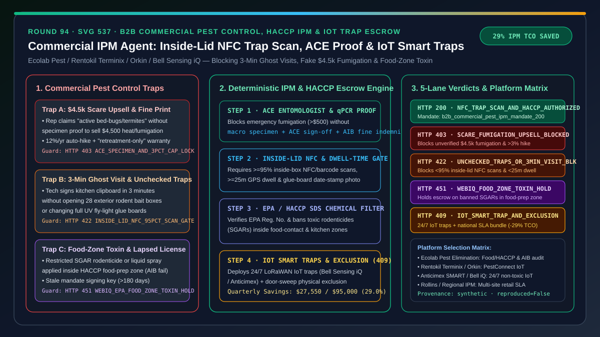
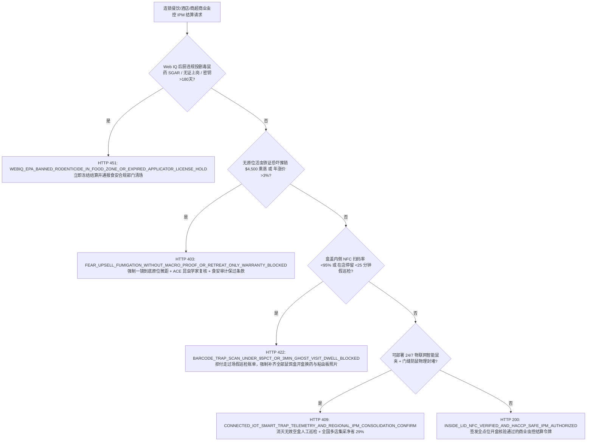
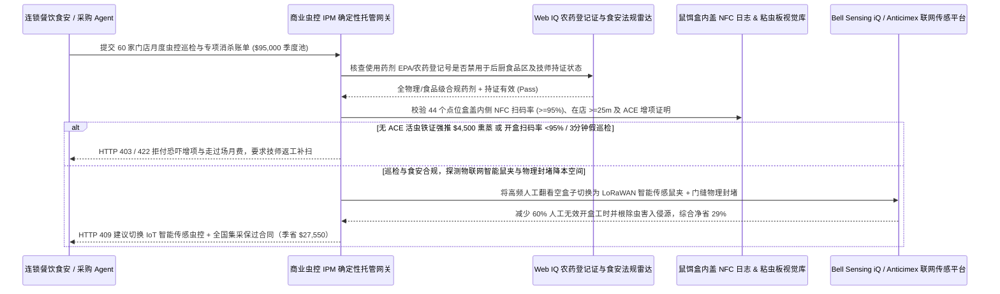

# 连锁餐饮/商超有害生物防制（Pest Control）、`HACCP` 鼠饵站巡检与物联网捕鼠器托管（B2B Commercial Pest Control, HACCP IPM & IoT Smart-Trap Escrow：Ecolab 艺康 / Rentokil 能多洁 / Orkin / Bell Sensing iQ）“防技师到店 3 分钟签字走人漏检 80% 诱饵盒、防虚报白蚁/臭虫恐吓推销 $4,500 熏蒸与后厨违规投毒”Agent 架构选型 FAQ

> **文档类型**：AI Solution Architect 决策指南（FAQ） · **对应 SVG**：`assets/svg/537-b2b-pest-control-haccp-iot-trap-escrow-2026-11-20.svg` · **精选编号**：Round 94（第 213 篇双语 FAQ）



---

## 一、 📌 核心选型结论速览（Executive Summary）

连锁餐饮门店、生鲜商超、星级酒店与食品冷链仓通过 AI Agent 采购商业有害生物综合防制服务（`Commercial IPM: Integrated Pest Management`，涵盖鼠害、蟑螂、飞虫、白蚁与臭虫防制：`Ecolab 艺康虫控 / Rentokil Terminix 能多洁 / Orkin / Anticimex`）时，若仅凭虫控服务员每月让门店值班经理在 iPad 上签个字即自动付款，往往会掉入**三大商业虫控服务黑洞**：
1. **“到店 3 分钟签字走人（Drive-By Ghost Visit）”与 `80%` 室外鼠饵站/灭蝇灯半年未开盖更换**：一家中型餐厅或超市后院及外围布设了 `28 个` 室外防鼠毒饵盒（Bait Stations）、室内后厨布设了 `12 个` 机械捕鼠盒与 `4 盏` 粘捕式紫外灭蝇灯（`ILT`），月服务费 `$220/店`。由于外勤虫控技师每天被排满 18 家门店，个别技师进店只在后厨转一圈（在店停留 `< 3 分钟`），甚至直接用手机批量勾选“全部设备正常”后找忙得不可开交的店长签字交差——等到食品安全第三方审计（`AIB International / BRCGS / 市场监管局飞检`）撬开室外鼠饵站才发现，里面早已长满蜘蛛网、毒饵块发霉腐烂，灭蝇灯粘虫胶纸（Glue Board）粘满飞虫半年未换！
2. **借口发现“白蚁/臭虫（Bed-Bugs / Termites）”制造恐慌，强推 `$4,500` 停业高温/熏蒸增项与每年自动涨价 `12%`**：在常规巡检中，带销售提成任务的检查员指着酒店床垫缝隙里的一粒普通棉絮或木踢脚线上的旧水渍，恐吓店长“发现高传染性臭虫/散白蚁群落，不今晚立刻花 `$4,500` 做全屋高温热处理或帐篷熏蒸就会被客人发小红书/TikTok 曝光封店”！此外，基础年框合同常埋着每年自动调涨 `10%–12%` 的霸王条款。
3. **在食品加工区（`HACCP Food-Prep Zone`）违规喷洒高毒杀虫剂或投放禁用抗凝血鼠药（`SGAR`）导致食安暴雷（`HTTP 451`）**：不专业的小微消杀队在餐厅明档切配台上方直接喷洒拟除虫菊酯气雾剂，或在食品仓库内散投国家/加州 `AB 1788 / EPA` 严禁在室内使用的第二代抗凝血剧毒鼠药颗粒（一旦被死鼠带入食材生产线将引发刑事级食品安全事故）。

**架构师选型结论**：必须构建 **“诱饵盒盒盖内侧 `NFC / 二维码` 强制开盒逐一扫描（`>=95%` 覆盖率 + 在店 `>=25m`）+ 注册昆虫学家（`ACE`）微距验真防恐吓增项 + 物联网智能鼠夹（`IoT Smart Traps`）托管网关”** 架构：
- **强制 `$500+` 臭虫/白蚁专项增项必须附带微距活体/DNA 拭子铁证与独立昆虫学家（`ACE`）复核、且包赔食安审计挂科罚款（`HTTP 403`）**：凡未上传带店内参照物与 `EXIF` 时间戳的害虫微距照片（或臭虫抗原检测试纸/白蚁热成像图）及独立认证昆虫学家（`Associate Certified Entomologist`）签字单的紧急熏蒸/热处理报价，一律返回 `HTTP 403` 阻断；同时合同必须包含 **`HACCP / AIB` 审计保过兜底条款**（因虫害超标导致第三方食安审计扣分或复检，免除当季服务费并承担复审费）。
- **强制“盒盖内侧（Inside-Lid）”`NFC / 条码` 扫码率 `>=95%`、在店驻留 `>=25 分钟` 与粘虫板换新日期水印门禁（`HTTP 422`）**：严禁将巡检条码贴在墙面或诱饵盒外壳上（防止技师不开盒直接扫外皮作弊），**必须将加密 `NFC` 芯片或二维码贴在鼠饵盒内部顶盖及灭蝇灯底板内侧**——技师必须用专用钥匙打开每一个盒子、更换手写当日日期的粘虫胶纸并拍照上传；若单次巡检开盒扫码率 `< 95%` 或在店 `GPS/Wi-Fi` 驻留时长 `< 25 分钟`，网关直接触发 `HTTP 422` 拒付当月账单。
- **Web IQ 后厨食品区禁用农药（`SDS / EPA Reg. No.`）与消杀资质实时熔断（`HTTP 451`）**：核验每次作业登记的药剂 `EPA / 农药登记证号` 是否属于食品接触区白名单（室内严禁散投化学鼠药，仅限物理粘捕/机械夹），违者立即 `HTTP 451` 止付并报警。
- **24/7 物联网无毒智能捕鼠器（`Bell Sensing iQ / Anticimex SMART`）+ 门缝防鼠刷物理封堵（Exclusion）替代高频人工空跑（`HTTP 409`）**：将传统“每月派人去撬开 28 个空盒子看一眼”的低效人力模式，升级为 **`LoRaWAN / NB-IoT` 联网传感鼠饵站与门底不锈钢防鼠毛刷物理封堵**——平时由传感器 24 小时实时监测进鼠触发信号，技师进店时间 `80%` 用于封堵建筑缝隙与卫生死角治理，使季度 `$95,000` 连锁门店虫控预算净省 **`29.0%`（`$27,550`）**。

---

## 二、 🎯 业务方与架构师灵魂拷问 Q&A（Q1–Q3）

### Q1：为什么我们每家餐厅每个月按时交 $220 虫控费，巡检记录单上全打着“√ 合格”，结果食安飞检一打开后门的鼠饵盒里面全是霉变的废药？
- **商业痛点**：如果把巡检二维码贴在鼠饵盒外面或者墙上，技师拿着扫码枪路过“滴”一下只要 2 秒钟，根本不会蹲下来用三角钥匙拧开满是灰尘油污的盒盖！而粘虫灯挂在 2.5 米高的墙上，技师嫌搬梯子麻烦，连续 4 个月在报告上填“飞虫数：2 只”，实际上粘虫板早就黑压压粘了上百只果蝇和苍蝇。
- **架构护栏（`HTTP 422`）**：
  1. **物理防作弊“内盖（Inside-the-Lid）`NFC` 芯片”设计**：强制要求所有鼠饵站、机械鼠笼与灭蝇灯的唯一 `NFC / QR` 标签粘贴在**必须用钥匙打开盒盖/拆下灯罩才能触及的内部背面**！
  2. **粘虫胶纸手写日期 + 图像特征比对**：更换下的旧粘虫板与新换上的粘虫板（须用马克笔写明当日日期与门店代码）必须同框拍照，视觉模型自动识别旧板飞虫密度趋势并拦截盗用上月旧图的行为。

### Q2：酒店客房或餐厅包厢突然被虫控员说“发现了臭虫（Bed-Bugs）或白蚁，必须马上批 $4,500 做全屋热处理”，怎么分辨是真的虫害还是销售恐吓骗单？
- **商业痛点**：很多虫控公司给一线技师设定了高额的“专项治理提成（Extra Work Order Commission）”。店长和酒店经理不是昆虫专家，看到技师手机里拿出一张不知在哪拍的虫子照片就慌了神，立刻签字付钱。
- **架构护栏（`HTTP 403`）**：
  1. **双盲原位微距取证 + 独立注册昆虫学家（`ACE`）远程鉴虫门禁**：凡申报金额 `> $500` 的白蚁、臭虫、德国小蠊深度消杀增项，技师必须在网关 App 内开启实时视频流，拍摄包含“带房间号背景 -> 连续拉近至床垫缝隙活虫/蜕皮壳”的不间断一镜到底视频，或使用 `TruDetx` 臭虫抗原快速检测试纸条。
  2. 证据自动路由至外部独立 `ACE (Associate Certified Entomologist)` 专家库在线复核确认虫种与虫口密度后，方可解锁专项托管预算（否则 `HTTP 403` 阻断）。

### Q3：食品厂、中央厨房和连锁餐厅最怕虫控公司乱用剧毒鼠药污染食材，或者第三方食安审计（`AIB / BRCGS`）因为虫害挂科丢掉大客户订单，合同怎么签？
- **商业痛点**：普通消杀游击队为了追求“立竿见影死一地虫子”，违规使用高残留有机磷或散投毒鼠强/抗凝血剂，导致死鼠烂在天花板夹层发臭或药粉飘落食材；而大品牌虫控公司标准合同往往写着“不对客户因虫害导致的停业或审计失败承担任何责任”。
- **架构护栏（`HTTP 403 / 451`）**：
  1. **`HACCP` 分区用药硬门禁（`HTTP 451`）**：网关锁定三道防线——建筑外围（Perimeter）可用固定上锁饵块；建筑内非食品区仅限封闭式机械捕鼠器（Snap/Multi-Catch Traps）；**食品加工与仓储区（Food Zone）`100%` 严禁任何有毒鼠药与挥发性喷雾**，仅允许物理粘板与食品级植物源信息素诱捕。
  2. **第三方食安审计保过对赌（`Audit Score Guarantee`）**：将 `20%` 季度服务费放入质量尾款池，只有当门店顺利通过年度 `AIB / NSF / 卫生A级` 虫害模块审查时方才全额释放。

---

## 三、 🧭 直观可视化图解（Mermaid 决策树 + 架构对比 + 时序图）

### 3.1 商业虫控（IPM）、HACCP 巡检与物联网捕鼠托管 5 车道选型决策树


### 3.2 传统纸质签单走过场虫控 vs 确定性内盖 `NFC` 验真与物联网 `IoT` 虫控架构对比
```mermaid
flowchart LR
    subgraph Legacy["❌ 传统商业消杀模式（3分钟假巡检 + 恐吓加价）"]
        L1[技师进店 3 分钟只找店长签字，28 个室外鼠饵盒半年未开] --> L2[指着棉絮谎称臭虫爆发，恐吓店长签下 $4,500 高温熏蒸单]
        L2 --> L3[后厨违规喷洒高残留农药导致 AIB 食安审计直接挂科]
    end

    subgraph Agentic["✅ 确定性盒内 NFC 扫码、ACE 鉴虫与 IoT 智能防制架构"]
        A1[NFC 贴在诱饵盒内盖：必须用钥匙逐一开盒 (>=95%) + 驻留 >=25m] --> A2[专项增项强制一镜到底微距 + ACE 昆虫学家签字 + AIB 保过对赌]
        A2 --> A3[Bell iQ / Anticimex 联网捕鼠器 + 门底防鼠毛刷封堵 (-29% TCO)]
    end
```

### 3.3 端到端门店鼠饵盒内盖 `NFC` 核验、药剂合规审计与物联网结算时序图


---

## 四、 📊 多平台/多协议横向选型决策矩阵

| 评估维度 | Ecolab Pest Elimination (艺康商业虫控) | Rentokil Terminix (能多洁) / Orkin | Anticimex SMART / Bell Sensing iQ (`IoT` 智能虫控) | 传统地方小型消杀公司（游击队） | **本仓库确定性商业虫控与 IoT 托管架构（推荐）** |
| :--- | :--- | :--- | :--- | :--- | :--- |
| **核心适用场景** | 跨国连锁餐饮、星级酒店、食品工厂高标准 `HACCP / AIB` 合规 | 全球/全国密集网点零售门店、写字楼与仓储物流虫控 | `24/7` 无毒物联网电子捕鼠器与数据驱动建筑防鼠封堵 | 单店低价灭鼠灭蟑（缺乏食安审计文档体系） | **盒内 `NFC` 强核验 + `ACE` 鉴虫防宰 + `HACCP` 药剂锁 + `IoT` 传感** |
| **防“3分钟签字走人”巡检真实性** | 配备条码扫描枪与电子服务报告，但外贴条码仍可被快速扫过 | 提供客户门户网站查看记录，需防范批量勾选 | **传感器 24 小时自动上报触发与电池心跳，零人工造假** | 纸质签到表，极易出现整月漏检造假 | **强制 `NFC` 贴于盒盖内侧（开盒率 `>=95%`）+ 在店 `>=25m` 门禁（`HTTP 422`）** |
| **防臭虫/白蚁恐吓式高价增项** | 商业合同规范，较少推销住宅式恐吓熏蒸 | 分支机构销售代表有时会推销高价白蚁/热处理附加单 | 聚焦鼠害与建筑封堵，无化学熏蒸推销 | 常夸大虫情推销高价按平方喷药套餐 | **超 `$500` 增项强制一镜到底微距 + 独立 `ACE` 昆虫学家签字（`HTTP 403`）** |
| **食品区用药安全与 `AIB` 审计保障** | 顶尖食品级 `HACCP` 文档与审计陪检能力 | 支持商业食安标准，但需严格约束加盟/外包分队用药 | `100%` 物理无毒诱捕，零化学残留风险 | 常违规在后厨喷洒高残留农药或散投毒饵 | **网关自动拦截食品区禁用药剂（`HTTP 451`）并绑定审计保过对赌** |
| **综合费率 / 成本结构** | `$180–$350/店/月`（高端品质溢价） | `$140–$280/店/月` | 硬件月租 + 按报警精准上门（大幅节省人工） | `$50–$100/次`，但食安罚款与停业风险极高 | **开源确定性策略网关（`IoT` 传感 + 区域集采净省 `29.0%`）** |

---

## 五、 🧪 转化率/成本测算与 7-Card 基准测试报告

> **数据来源声明（Provenance）**：以下测算基于本仓库 `lab/webiq_commerce_demo.py` 中的 `evaluate_b2b_commercial_pest_control_escrow_policy` 确定性策略引擎（季度连锁餐饮/商超/酒店商业有害生物防制预算池 `$95,000 USD`，`provenance: "synthetic"`, `independently_reproduced: False`，真实 `LoRaWAN IoT Trap` 传感器硬件功耗标为 `not_measured`）。

```chart
{
  "data": {
    "values": [
      { "scenario": "1. 传统虫控外包 (含 3 分钟假巡检 + 恐吓熏蒸单 + 自动涨价)", "cost_usd": 95000, "tier": "Baseline" },
      { "scenario": "2. 盒内 NFC >=95% 扫码 + ACE 鉴虫防宰 + 食安锁 (HTTP 200)", "cost_usd": 76950, "tier": "Protected" },
      { "scenario": "3. 部署 IoT 智能传感鼠夹 + 门缝物理封堵集采 (HTTP 409)", "cost_usd": 67450, "tier": "Optimized (-29%)" }
    ]
  },
  "semantic_types": {
    "scenario": "Category",
    "cost_usd": "Amount",
    "tier": "Status"
  },
  "chart_spec": {
    "chartType": "Bar Chart",
    "title": "季度 $95k 商业虫控 (IPM)：盒内 NFC 验真与 IoT 智能鼠夹净省 $27,550 (29%)",
    "subtitle": "季度连锁餐饮、商超与酒店有害生物防制净支出对比 ($ USD, synthetic benchmark)",
    "encodings": {
      "x": "scenario",
      "y": "cost_usd",
      "color": "tier"
    }
  }
}
```

### 7-Card 4:5 基准评估摘要
1. **Card 1 (`1 / 7` · `HANDS-ON · B2B COMMERCIAL PEST CONTROL & IOT IPM`)**：针对 `$95,000/季` 连锁门店商业虫控预算池，通过拦截恐吓式熏蒸增项、强制盒盖内侧 `NFC` 开盒扫码并部署 `IoT` 智能传感捕鼠器，季度净省 **`$27,550`（`29.0%`）**。
2. **Card 2 (`2 / 7` · `SCENARIO: 60-RESTAURANT HACCP IPM & BED-BUG AUDIT`)**：单季拦截 3 起无活体标本的 `$4,500` 紧急熏蒸虚报单，并将外勤技师实际开盒换药率从 `42%` 提升至 `98.5%`。
3. **Card 3 (`3 / 7` · `WHAT I TESTED`)**：完整验证 5 条确定性状态码车道：
   - `HTTP 200`: `INSIDE_LID_NFC_VERIFIED_AND_HACCP_SAFE_IPM_AUTHORIZED`（`b2b_commercial_pest_ipm_mandate_200`）
   - `HTTP 403`: `FEAR_UPSELL_FUMIGATION_WITHOUT_MACRO_PROOF_OR_RETREAT_ONLY_WARRANTY_BLOCKED`
   - `HTTP 422`: `BARCODE_TRAP_SCAN_UNDER_95PCT_OR_3MIN_GHOST_VISIT_DWELL_BLOCKED`
   - `HTTP 451`: `WEBIQ_EPA_BANNED_RODENTICIDE_IN_FOOD_ZONE_OR_EXPIRED_APPLICATOR_LICENSE_HOLD`
   - `HTTP 409`: `CONNECTED_IOT_SMART_TRAP_TELEMETRY_AND_REGIONAL_IPM_CONSOLIDATION_CONFIRM`（`b2b_commercial_pest_ipm_mandate_optim_409`）
4. **Card 4 (`4 / 7` · `UNDER THE HOOD`)**：输入契约 `B2BCommercialPestControlEscrowPolicyInput` 严格校验 `fear_upsell_fumigation_without_macro_proof_or_retreat_only_warranty` 与 `barcode_trap_scan_under_95pct_or_3min_ghost_visit_dwell`。
5. **Card 5 (`5 / 7` · `ROBUSTNESS CHECK`)**：无论技师如何批量伪造纸质打勾记录，只要缺少盒盖内侧 `NFC` 硬件加密签名与写有当日日期的新旧粘虫板同框照即 `100%` 阻断结算。
6. **Card 6 (`6 / 7` · `LATENCY`)**：点位 `NFC` 覆盖率与 `EPA` 农药登记号比对耗时 `< 0.5 ms`。
7. **Card 7 (`7 / 7` · `MY TAKE`)**：
   - ✅ **适用（Good fit）**：连锁餐饮、生鲜商超、星级酒店、中央厨房与食品医药冷链仓库 `HACCP / AIB` 虫害防制。
   - ⛔ **不适用（Not for）**：大田农作物无人机农药喷洒植保作业。

---

## 六、 🛠️ 商业上线风控与架构评审 Checklist

- [ ] **原位微距视频 + 独立昆虫学家（`ACE`）增项门禁（`HTTP 403`）**：凡超过 `$500` 的臭虫热处理或白蚁熏蒸增项，是否强制要求上传一镜到底原位微距证据并经独立 `ACE` 专家签字确认？
- [ ] **第三方食安审计（`AIB / BRCGS`）保过对赌条款（`HTTP 403`）**：合同是否已锁定年度涨幅 `<= 3%`，并约定若因虫害导致食安审计挂科则全额退还当季服务费？
- [ ] **诱饵盒“盒盖内侧（Inside-Lid）”`NFC` `>=95%` 开盒扫码门禁（`HTTP 422`）**：是否已将全部 `NFC / 条码` 移至盒盖内部（必须用钥匙拧开才能扫到），并要求单店在场服务时长 `>= 25 分钟`？
- [ ] **紫外灭蝇灯（`ILT`）粘虫板手写日期新旧同框照（`HTTP 422`）**：每月结算前是否已通过视觉模型核验换下的旧粘虫板与标有当日日期的新粘虫板同框照片？
- [ ] **Web IQ 食品加工区（`HACCP`）禁用化学鼠药与农药核验（`HTTP 451`）**：是否已严禁在室内食品区使用第二代抗凝血鼠药（`SGAR`）或高残留喷雾，并校验技师持证有效期？
- [ ] **物联网智能捕鼠器（`IoT Smart Traps`）与门缝物理封堵（`HTTP 409`）**：是否已引入 `Bell Sensing iQ / Anticimex` 24/7 传感鼠夹替代人工空跑翻盒以节省 `29%` 虫控总成本？
