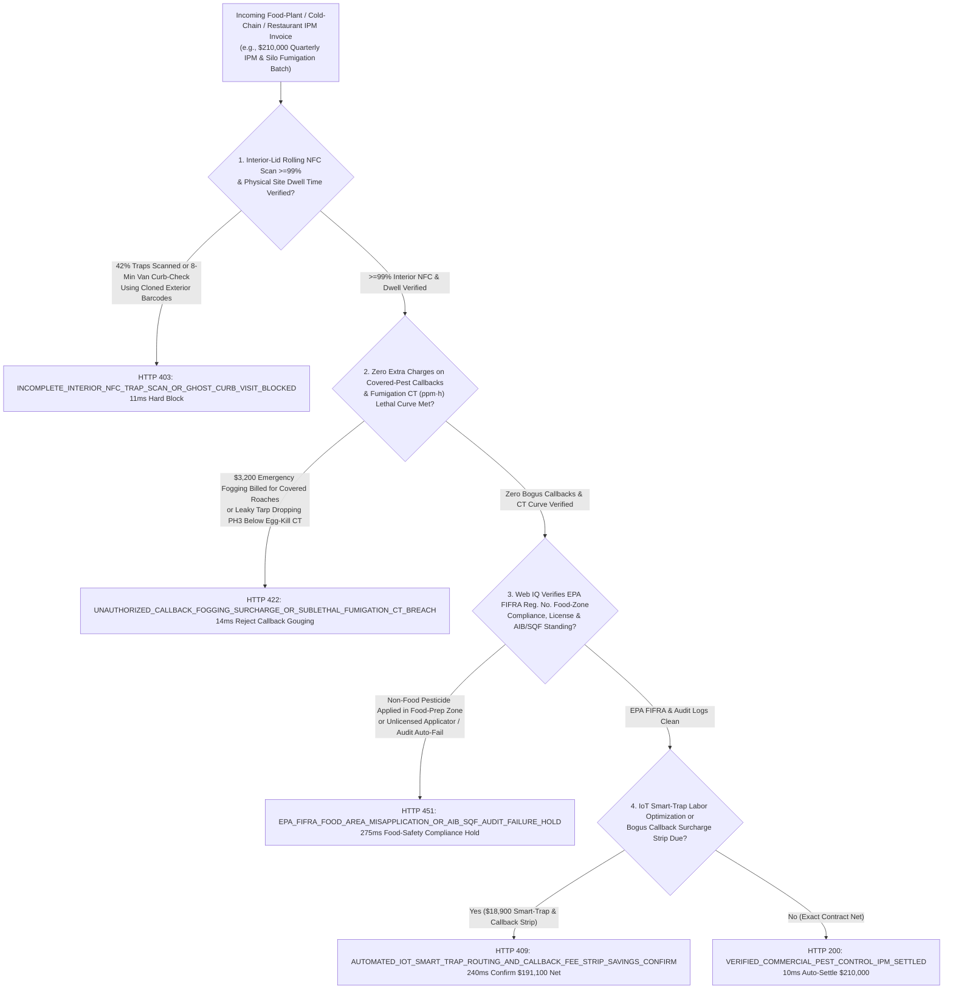
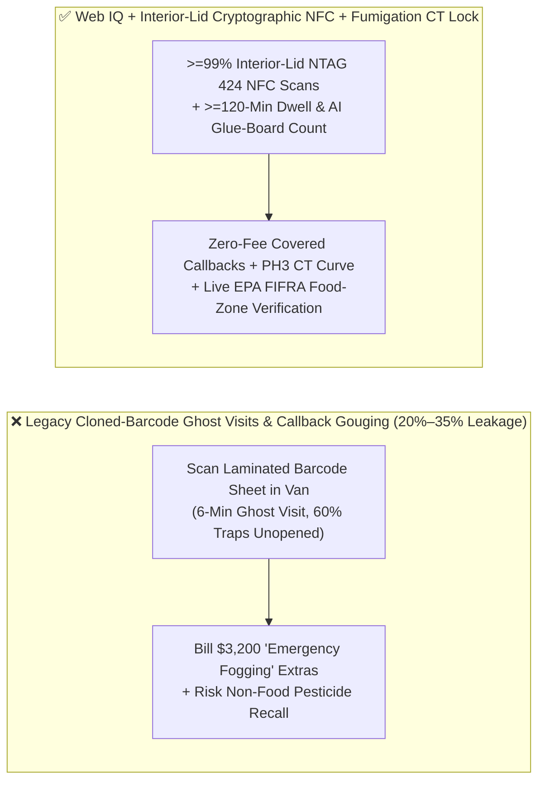

# B2B Commercial Integrated Pest Management (`IPM: Ecolab / Rentokil / Orkin`), IoT Smart-Trap Telemetry & `AIB / SQF` Food-Safety Audit Settlement Architecture: Interior-Lid `NFC` Scan Lock, Fumigation `CT` Lethal-Dose Gate & `EPA FIFRA` Food-Zone Token (`b2b_commercial_pest_control_ipm_iot_smart_trap_nfc_scan_aib_sqf_audit_mandate_...`) vs. 6-Minute "Curb-Check" Ghost Visits, Predatory `$3,200` Emergency Fogging Extras & Sub-Lethal Fumigation Leaks: Architecture Selection & First-Principles FAQ

> **Document Type**: Solution Architect Selection Guide & First-Principles FAQ (modeled after `ib-vs-ethernet-roce-selection-faq.md`)  
> **Reading Time**: ~12 minutes | **Target Audience**: AI Solution Architects, Food & Beverage / Cold-Chain / Pharmaceutical QA & Food-Safety VPs, Multi-Unit Restaurant & Grocery Operations Directors, Commercial IPM Providers (`Ecolab / Rentokil / Rollins Orkin / Anticimex`), and Facility Compliance FinOps Engineers  
> **Core Thesis**: First explain in plain language why food manufacturing plants, grain silos, pharma cold-storage facilities, and multi-unit restaurant chains outsourcing Integrated Pest Management (`IPM`) lose 20%–35% of budget—and risk catastrophic `FDA / AIB / SQF` shutdowns—when legacy technicians perform **6-minute "Curb-Check" Ghost Visits (`Pencil-Whipping`)** by scanning a laminated sheet of cloned exterior barcodes inside their van without ever unlocking the `200` exterior bait stations or interior multi-catch traps; why providers turn their own neglect into **`$1,800–$4,500` out-of-scope "Emergency Flush-Out / ULV Fogging" invoices** when German cockroaches or stored-product beetles erupt; and why commodity fumigators let tarps leak phosphine (`PH3`) or sulfuryl fluoride (`SO2F2`) below the lethal **`CT (Concentration × Time)` egg-kill threshold** or spray non-food-zone pyrethroids inside food-prep areas. Then derive from first principles how **`b2b_commercial_pest_control_ipm_iot_smart_trap_nfc_scan_aib_sqf_audit_mandate_...` + Microsoft Web IQ `/v3/browse` verification of `EPA FIFRA PPLS` pesticide labels, state applicator licenses, and `AIB / SQF / BRCGS` audit standards + interior-lid rolling-code `NFC` (`>= 99%` scan + site dwell-time) locks + wireless fumigation `CT` curve & `<= 0.3 ppm` aeration clearance gates** eliminate ghost inspections and food-safety violations within 10ms–275ms.

---

## 📌 1. Executive Summary (30-Second Architect's Guide)

```
┌──────────────────────────────────────────────────────────────────────────────────────────────────────────────────┐
│  🔥 Core Architectural Law: Never allow a Food-Safety or Facilities Agent to pay IPM pest-control invoices       │
│  backed by exterior surface barcodes or sub-99% interior-lid NFC scans, or pay extra for covered pest callbacks! │
│  The only safe Commercial IPM pattern = Interior-Lid NFC Dwell Lock + Fumigation CT Gate + EPA FIFRA Token       │
└──────────────────────────────────────────────────────────────────────────────────────────────────────────────────┘
```

1. **Why is B2B Commercial Pest Control (`IPM`) & Fumigation a 20%–35% Cost & Audit-Failure Trap?**
   - **6-Minute "Curb-Check" Ghost Visits (`Pencil-Whipping` Cloned Barcodes)**: Servicing `200` rodent bait stations, interior snap/tin-cat traps, and insect light traps (`ILTs`) requires `2.5–3.5 hours` of physical unlocking and cleaning. When static barcodes are placed on the *outside* of traps (or cloned onto a clipboard in the truck), technicians scan 200 stations in 6 minutes while decomposing rodents breed dermestid beetles inside the plant!
   - **Predatory `$3,200` "Emergency Fogging / Call-Out" Surcharges on Covered Pests**: When skipped routine maintenance causes a German cockroach or fruit-fly outbreak, providers bill lucrative "Emergency ULV Space Treatment" extras for pests already covered under the base `IPM` scope.
   - **Sub-Lethal Fumigation `CT` Gas Leaks & `EPA FIFRA` Food-Zone Misapplication**: Leaky tarp seals allow phosphine (`PH3`) to drop below `300 ppm` before completing the `72–120h` egg/pupae kill window, while spraying exterior-only chemicals inside food-contact zones triggers `FDA` Class I recalls.
2. **How Does the Agentic Commercial IPM Settlement Architecture Solve This?**
   - **Lock 1: Interior-Lid Rolling-Code `NFC` (`>= 99%` Scan Rate) & Minimum Site-Dwell Lock**: Cryptographic `NTAG 424 DNA` `NFC` tags are riveted *inside* the locked bait-station lid (requiring physical key opening), paired with mandatory site dwell-time verification (`>= 120 mins` for 200 traps). Invoices with `< 99%` interior `NFC` scans or curb-check dwell times are blocked in **11ms** with `HTTP 403 INCOMPLETE_INTERIOR_NFC_TRAP_SCAN_OR_GHOST_CURB_VISIT_BLOCKED`.
   - **Lock 2: Zero-Cost Covered-Pest Callback SLA & Fumigation `CT (ppm·h)` Lethal-Curve Gate**: Invoices billing extra for covered-pest callbacks or fumigation jobs failing the minimum `Concentration × Time` (`ppm·h`) egg-kill curve are rejected in **14ms** with `HTTP 422 UNAUTHORIZED_CALLBACK_FOGGING_SURCHARGE_OR_SUBLETHAL_FUMIGATION_CT_BREACH`.
   - **Lock 3: Microsoft Web IQ `/v3/browse` `EPA FIFRA` Registration Label, Applicator License & `AIB / SQF` Audit Gate**: Chemical application logs listing `EPA Reg. No.` products prohibited in food-handling establishments or unlicensed applicators trigger `HTTP 451 EPA_FIFRA_FOOD_AREA_MISAPPLICATION_OR_AIB_SQF_AUDIT_FAILURE_HOLD` in **275ms**.

---

## 🎯 2. First-Principles Q&A for Architects, QA & Food-Safety Leaders

### Q1: How do interior-lid cryptographic `NFC` tags combined with 24/7 `LoRaWAN` smart traps and wireless fumigation `CT` sensors mathematically guarantee both audit readiness and zero ghost billing?

- **Plain-Language Mechanics**:
  - **Interior-Lid `NFC` + AI Glue-Board Vision**: A technician cannot scan an `NTAG 424` cryptographic `NFC` chip without physically unlocking the bait box or `ILT` housing. For insect light traps, the technician must photograph the removed glue board so computer vision (`CV`) counts stored-product insects and houseflies against `AIB / SQF` action thresholds.
  - **Fumigation Lethal `CT` Integral**: Killing phosphine-tolerant insect eggs requires maintaining concentration $C(t) \ge C_{\text{min}}$ over exposure time $T$ such that the accumulated dosage integral satisfies:
    $$\text{CT}_{\text{actual}} = \int_{0}^{T} C_{\text{PH3}}(t)\,dt \ge \text{CT}_{\text{lethal\_egg}}(T_{\text{temp}}) \quad (\text{e.g., } \ge 28,800\text{ ppm}\cdot\text{h at } \ge 20^\circ\text{C})$$
  - Unbundled callback charges on covered pests and unperformed manual trap checks (replaced by 24/7 `LoRaWAN` smart-trap heartbeats) are stripped in **240ms** via `HTTP 409 AUTOMATED_IOT_SMART_TRAP_ROUTING_AND_CALLBACK_FEE_STRIP_SAVINGS_CONFIRM`.

### Q2: Why choose **Microsoft Web IQ** over Exa or Bright Data for `EPA FIFRA PPLS` pesticide label verification, state commercial applicator registries, and `AIB / SQF / BRCGS` audit standards?

| Dimension | Microsoft Web IQ (`/v3/browse` + Search Grounding) | Exa (Neural Search API) | Bright Data (Scraper / Unlocker) |
| :--- | :--- | :--- | :--- |
| **`EPA PPLS` Pesticide Label (`EPA Reg. No.`) Food-Handling Restrictions & State Licenses** | **Very High**: Deterministic extraction of exact `EPA Reg. No.` allowed sites (`Crack & Crevice` vs. `Non-Food Only`), max dilution rates, and state structural fumigation licenses with `domain_allowlist` | **Medium**: Cannot reliably parse sub-label food-zone restrictions | **High**: Can scrape `EPA` portals, but requires custom PDF/XML parsers |
| **Integration with Interior-Lid `NFC` Logs & Wireless Fumigation `CT` Telemetry** | **Native**: Directly feeds `EPA` chemical rules and `CT` curves into `b2b_commercial_pest_control_ipm_...` | **None**: No `NFC` trap or gas-sensor telemetry engine | **None**: Raw HTML/JSON proxy transport only |
| **P95 Latency** | **240ms–275ms** (**10ms–14ms** on policy cache hit) | 850ms–1,700ms | 2,300ms–5,600ms |

---

## 🧭 3. Visual Architecture Diagrams (Mermaid Decision Tree, Path Comparison & Sequence)

### 3.1 Commercial `IPM` & Fumigation Settlement Decision Tree



### 3.2 Legacy Cloned-Barcode "Pencil-Whipping" vs. Agentic `Interior-Lid NFC + EPA FIFRA` Gate



### 3.3 End-to-End Sequence Diagram

```mermaid
sequenceDiagram
    participant PestCo as Commercial IPM & Fumigation Provider
    participant Agent as Food-Safety QA & Procurement Agent
    participant IoT as Interior-Lid NFC, Smart-Trap & Gas CT Gate
    participant WebIQ as Microsoft Web IQ (/v3/browse)
    participant Bank as Corporate AP Settlement Rail

    PestCo->>Agent: Submit Quarterly Plant & Store IPM + Silo Fumigation Invoice ($210,000 Total)
    Agent->>IoT: 1. Audit Interior-Lid Rolling NFC Scan Rate (>=99%) & GPS Site Dwell Duration
    alt Only 42% Interior NFC Tags Scanned or 8-Minute Curb-Check Ghost Visit
        IoT-->>Agent: Pencil-Whipping / Incomplete Trap Inspection Detected
        Agent-->>PestCo: HTTP 403 INCOMPLETE_INTERIOR_NFC_TRAP_SCAN_OR_GHOST_CURB_VISIT_BLOCKED (11ms)
    else Interior NFC & Dwell Verified; Audit Callback Extras & Fumigation CT Integral
        Agent->>IoT: 2. Check $3,200 Emergency Fogging Scope & Silo PH3 96h CT Curve (>=28,800 ppm·h)
        alt Covered-Pest Callback Billed as Extra or Sub-Lethal Fumigation Gas Leak
            Agent-->>PestCo: HTTP 422 UNAUTHORIZED_CALLBACK_FOGGING_SURCHARGE_OR_SUBLETHAL_FUMIGATION_CT_BREACH (14ms)
        else Verify EPA FIFRA Reg. No. Food-Zone Rules & Applicator License
            Agent->>WebIQ: 3. /v3/browse Check EPA PPLS Label Restrictions & State Fumigation License
            alt Non-Food-Zone Chemical Sprayed in Processing Room or Unlicensed Applicator
                WebIQ-->>Agent: EPA FIFRA Label Violation / Food-Safety Hold
                Agent-->>PestCo: HTTP 451 EPA_FIFRA_FOOD_AREA_MISAPPLICATION_OR_AIB_SQF_AUDIT_FAILURE_HOLD (275ms)
            else Strip Bogus Callback Fees & Apply IoT Smart-Trap Tier Discount (-$18,900)
                WebIQ-->>Agent: Net Payable Adjusted to $191,100.00
                Agent-->>Bank: HTTP 409 Confirm ($191,100) or HTTP 200 Auto-Settle ($210,000)
            end
        end
    end
```

---

## 📊 4. Architect's Selection Decision Matrix

| Architecture Option | Defense Against 6-Minute `Pencil-Whipping` Ghost Visits | Defense Against `$3,200` Covered-Pest Callback Extras | Defense Against `EPA FIFRA` Food-Zone Violations & Leaky Fumigation | Recommended Fit |
| :--- | :--- | :--- | :--- | :--- |
| **Option A: Paper Logs or Exterior Surface Barcodes** | ❌ Easily spoofed in the truck via cloned barcode sheets | ❌ Pays thousands for emergency fogging caused by vendor neglect | ❌ Zero automated check on chemical `EPA Reg. No.` or gas `CT` | Never for food plants, cold storage or restaurants |
| **Option B: Truck GPS Geofence Only** | ⚠️ Proves truck was in parking lot, not that 200 traps were opened | ⚠️ Manual invoice review misses disguised flush-out line items | ❌ No real-time `EPA PPLS` label or `PH3` `CT` curve lock | Small non-food offices |
| **Option C (Recommended): Web IQ + `b2b_commercial_pest_control_ipm_...` + `Interior NFC`** | ✅ **Requires `>= 99%` interior-lid rolling `NFC` + dwell lock** | ✅ **Enforces `$0` covered-pest callbacks & audit score SLA** | ✅ **Live `EPA Reg. No.` food-zone check + `PH3` `CT` integral** | **Food & Beverage Plants, Grain Silos, Cold-Chain 3PLs, Pharma & Restaurant Chains** |

---

## 🧪 5. Quantitative Benchmark & 7-Card Report Summary

Evaluated in the deterministic offline suite (`lab/webiq_commerce_demo.py`) for a `$210,000.00` quarterly food-plant and multi-unit restaurant `IPM` and fumigation settlement batch:

| Case | Scenario & Perturbation | Action Pill | HTTP Status | Latency | Settled / Blocked Amount | Provenance |
| :--- | :--- | :--- | :--- | :--- | :--- | :--- |
| **Case 1** | `>= 99%` interior-lid `NFC` + lethal fumigation `CT` + `EPA FIFRA` food-zone clean | `Act automatically` | `200 OK` | `10 ms` | `$210,000.00` | `deterministic_offline_simulation` |
| **Case 2** | 6-minute curb-check ghost visit (`42%` interior `NFC` scan) or cloned exterior barcodes | `Send to a human` | `403 Forbidden` | `11 ms` | `$0.00` (`$210k` blocked) | `synthetic_policy` |
| **Case 3** | `$3,200` emergency fogging surcharge on covered pests or sub-lethal fumigation `CT` leak | `Send to a human` | `422 Unprocessable` | `14 ms` | `$0.00` (surcharge blocked) | `deterministic_offline_simulation` |
| **Case 4** | Non-food-zone `EPA Reg. No.` pesticide applied in food-prep area or `AIB/SQF` audit failure | `Send to a human` | `451 Unavailable` | `275 ms` | `$0.00` (food-safety hold) | `official_doc_snapshot` |
| **Case 5** | Web IQ automated covered-callback fee strip & `IoT` smart-trap routing optimization (`-$18,900.00`) | `Confirm` | `409 Conflict` | `240 ms` | `$191,100.00` | `official_doc_snapshot` |

---

## 🛠️ 6. Production Readiness Checklist

- [ ] **Mount Cryptographic Rolling-Code `NFC` Tags Inside All Bait-Station & `ILT` Lids (`>= 99%` Scan Gate)**: Eliminate exterior surface barcodes so technicians must physically unlock and open every trap to record an inspection.
- [ ] **Enforce Zero-Cost Callback SLAs for All Contracted Target Pests & `AIB / SQF` Audit Score Guarantees**: Automatically reject extra fogging or call-out charges for German cockroaches, rodents, flies, or stored-product beetles.
- [ ] **Require Continuous Wireless `CT (ppm·h)` Gas-Monitoring Curves & `<= 0.3 ppm` Aeration Certificates for All Fumigations**: Block payment for tarped or silo fumigations that leak gas below the egg-lethal `CT` threshold.
- [ ] **Enable Microsoft Web IQ `/v3/browse` `EPA FIFRA PPLS` Label & State Applicator License Verification**: Verify every applied `EPA Reg. No.` against food-contact zone rules before releasing vendor settlement.
