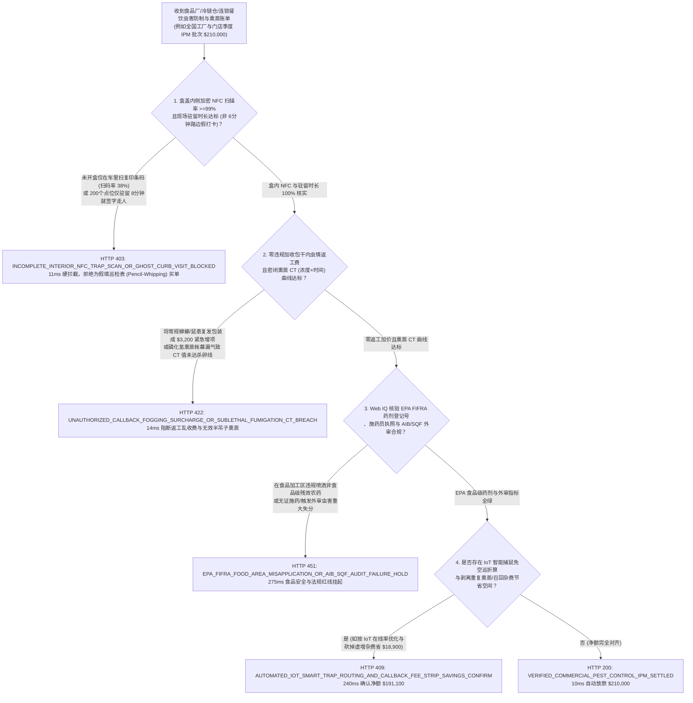
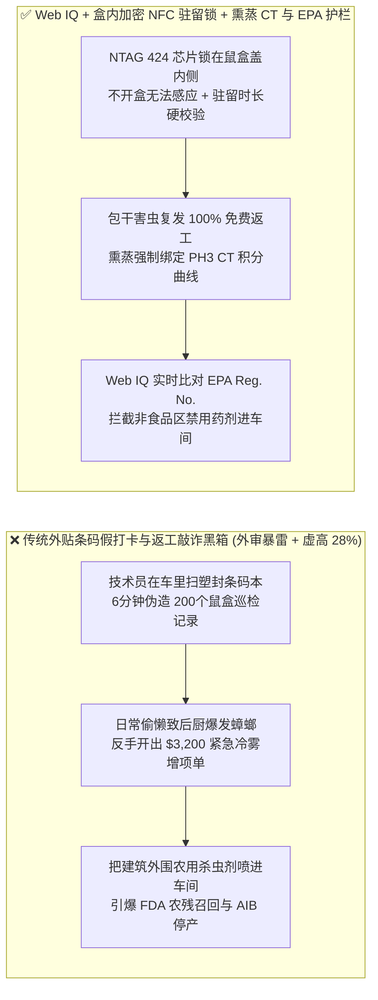
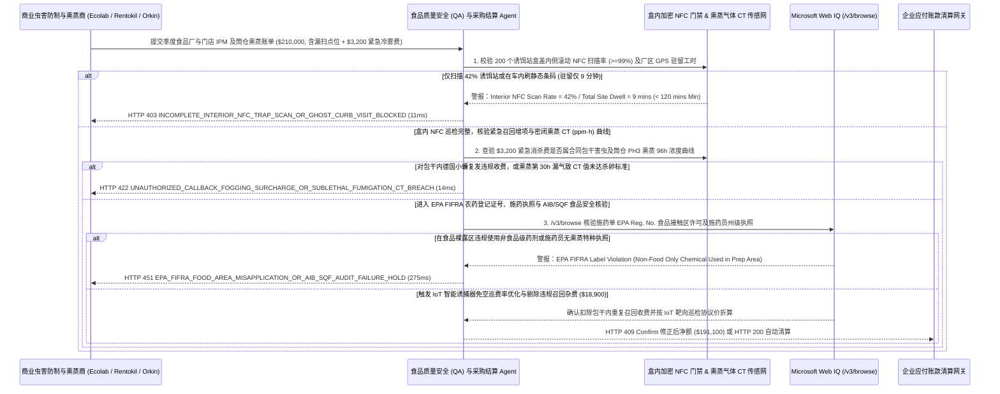

# B2B 智能体食品工厂、冷链物流与连锁餐饮综合虫害防制及熏蒸（`Commercial Integrated Pest Management & Grain/Food Fumigation: Ecolab / Rentokil / Orkin`）、智能诱捕器蜂窝遥测与诱饵站逐点 `NFC` 驻留核验（`IoT Smart-Trap Telemetry & 100% NFC Bait-Station Scan`）及食品安全外审护航（`AIB / SQF / BRCGS Zero-Critical-Pest Guarantee`）清算架构：100% 外围与内仓诱饵站 `NFC` 开盒巡检锁、磷化氢/硫酰氟熏蒸 `CT 值 (Concentration × Time)` 达标门禁与 `EPA FIFRA` 食品级药剂合规令牌（`b2b_commercial_pest_control_ipm_iot_smart_trap_nfc_scan_aib_sqf_audit_mandate_...`）vs 传统消杀技术员到厂门口刷卡 5 分钟签字走人、漏巡 60% 诱饵站致鼠患引爆 `FDA / AIB` 停产召回与熏蒸气体浓度不足活虫复发选型与原理解析 FAQ

> **文档类型**：架构师选型指南与第一性原理 FAQ（对齐 `ib-vs-ethernet-roce-selection-faq.md` 标杆风格）  
> **阅读耗时**：约 12 分钟 | **适用角色**：AI Solution Architect、食品饮料加工厂/中央厨房/医药冷链仓质量与食品安全副总裁（`VP of Food Safety, QA & Facilities`）、大型连锁商超/餐饮品牌运营总监、商业虫害防制服务商（`Ecolab / Rentokil / Rollins Orkin / Anticimex`）及智能体物业供应链架构师  
> **核心主旨**：先用大白话把“为什么拥有大型烘焙工厂、粮油筒仓、医药冷库或 `800 家` 连锁餐厅的企业把综合虫害防制（`Integrated Pest Management, IPM`）外包给消杀公司时，合同规定技术员每周必须逐个打开厂区外围 `120 个` 抗篡改鼠饵站（`Exterior Rodent Bait Stations`）和车间内部 `80 个` 多捕式机械鼠笼及昆虫粘板（`Interior Multi-Catch Traps & ILT Glue Boards`）清理换药，但技术员为了在一天内跑完 12 家客户，把面包车停在收货月台，在平板电脑上一键勾选‘全部 200 个点位正常（`Pencil-Whipping / Ghost Curb Visit`）’，只花 **6 分钟** 找保安签字就开车走人——结果仓库角落里 60% 的鼠笼早已发霉生蛆，直到 `AIB International / SQF / FDA` 飞行检查员现场开盒发现活鼠或鼠粪，直接给工厂判不及格（`Unsatisfactory / Auto-Fail`），导致好市多/沃尔玛立刻取消数千万美元订单、为什么消杀公司借口‘春季德国小蠊或仓储甲虫高发’，把明明属于包年 `IPM` 合同范围内的常规蟑螂胶饵与空间喷雾，拆成每单 **`$1,800–$4,500` 的‘账外紧急突击消杀费（`Emergency Call-Back / Flush-Out Extra`）’**，以及为什么大宗粮食/坚果冷库做磷化氢（`Phosphine, PH3`）或硫酰氟（`Sulfuryl Fluoride`）密闭熏蒸时，施工队偷工减料少投药或帐幕漏气导致气体浓度低于致死阈值，虫卵没死透两周后再次爆发却拒不免费复熏”讲透；再从第一性原理出发，推导如何通过 **`b2b_commercial_pest_control_ipm_iot_smart_trap_nfc_scan_aib_sqf_audit_mandate_...` 语义预算令牌 + Microsoft Web IQ `/v3/browse` 实时核验 `EPA FIFRA` 登记农药标签（严禁将仅限非食品区的菊酯/有机磷药剂喷在食品加工区）、州农业厅商用施药执照（`Commercial Pesticide Applicator License`）与 `AIB / SQF / BRCGS` 虫害审核细则 + 诱饵站盒盖内置加密 `NFC` 100% 扫描与 `>=45秒/站` 物理驻留锁 + 熏蒸仓 `CT (Concentration × Time, ppm·h)` 曲线达标与通风散气 `<=0.3 ppm` 安全放行门禁**，在 10ms–275ms 内实现“漏扫一个诱饵站拒付当期服务费、外审虫害扣分全额倒扣违约金、熏蒸 CT 曲线不达标零结算”的智能体商业虫害防制清算闭环。

---

## 📌 一、核心结论速览（Executive Summary：30 秒看懂怎么选）

```
┌──────────────────────────────────────────────────────────────────────────────────────────────────────────────────┐
│  🔥 核心架构铁律：绝不允许食品厂或餐饮采购 Agent 凭消杀员手填 PDF 巡检表或低于 98% 的盒内 NFC 扫码率支付月费！   │
│  B2B 商业虫害防制 (IPM) 结算的唯一正确范式 = 100% 盒内 NFC 驻留锁 + 24/7 红外智能捕鼠遥测 + 熏蒸 CT 达标令牌     │
└──────────────────────────────────────────────────────────────────────────────────────────────────────────────────┘
```

1. **为什么商业综合虫害防制与仓储熏蒸（`Commercial IPM & Structural/Commodity Fumigation`）是食品、医药与餐饮企业年均流失 20%–35% 费用且随时引发停产召回的三大黑洞？**
   - **黑洞一：“6 分钟路边打卡（`6-Minute Curb-Check Ghost Visit`）”与假填巡检表（`Pencil-Whipping`）**：一座 5 万平米的食品工厂或物流中心布置了 `200 个` 鼠饵站、机械捕鼠器和紫外线灭蝇灯（`UV ILT`）。按标准 SOP，逐个开锁、清扫灰尘蛛网、更换诱饵或粘虫板至少需要 **`2.5–3.5 小时`**。但传统条形码贴在鼠饵盒**外表面**（甚至技术员把全套条形码打印在一张塑封卡纸上放在车里扫！），10 分钟扫完 200 个码就出账单，盒子里死鼠腐烂生虫成了新的储粮害虫（印度谷螟/赤拟谷盗）繁殖窝！
   - **黑洞二：日常虫情恶化后的“账外紧急消杀敲诈（`Predatory Emergency Call-Out & Fogging Extras`）”**：由于平时巡检偷工减料，门店后厨或车间下水道爆发德国小蠊（`German Cockroach`）或果蝇。消杀公司不仅不承担失职责任，反而宣称“属于合同外高密度虫害爆发”，向客户开出 `$2,800` 的超低容量空间冷雾（`ULV Fogging`）或凝胶点施增项单——把自己的懒政失职变成了高毛利摇钱树！
   - **黑洞三：密闭熏蒸 `CT` 致死积温不足（`Sub-Lethal Fumigation Gas Leak`）与违规使用非食品区禁用农药（`EPA FIFRA Misapplication`）**：(a) 粮食/可可豆/坚果仓库熏蒸杀灭虫卵（`Egg & Pupal Stage`），必须维持磷化氢浓度 `>= 300 ppm` 持续 `72–120 小时`（温度 `>= 20°C`）。不良熏蒸队帐幕密封不严，第 24 小时浓度就漏光跌到 `40 ppm`，结果只熏死了成虫，耐药性极强的虫卵活了下来，同时引发严重磷化氢抗药性；(b) 更危险的是，技术员将仅限建筑外围使用的拟除虫菊酯/氨基甲酸酯喷进食品裸露加工车间，一旦检出农残直接触发 **FDA Class I 级全美召回**！
2. **智能体商业虫害防制清算架构怎么破局？（`b2b_commercial_pest_control_ipm_iot_smart_trap_nfc_scan_aib_sqf_audit_mandate_...`）**
   - **第一道锁：盒盖内侧加密滚动码 `NFC` 100% 扫描锁（`Interior-Lid Rolling NFC >= 99% Scan Rate`）与单站物理驻留时长门禁**：将加密动态 `NFC` 芯片铆接在鼠饵站与灭蝇灯**锁盖内侧**（必须用专用钥匙打开盒盖才能贴近感应，彻底粉碎在车里扫复印条码！），同时校验全厂巡检总有效工时（如 200 个点位总驻留时长 `>= 120 分钟`）。凡点位扫描完成率 `< 99%` 或总驻留时长不足的“幽灵巡检”，在 **11ms** 内返回 `HTTP 403 INCOMPLETE_INTERIOR_NFC_TRAP_SCAN_OR_GHOST_CURB_VISIT_BLOCKED`。
   - **第二道锁：合同内目标害虫免费返工（`Zero-Cost Callback SLA`）与熏蒸气体 `CT (ppm·h)` 曲线达标门禁**：(a) 合同覆盖范围内的鼠类、蟑螂、苍蝇、储粮甲虫出现超标反弹，消杀商必须在 `4–24 小时` 内免费上门执行根源治理，严禁加收“紧急消杀增项费”；(b) 密闭熏蒸作业必须上传多通道无线气体传感器连续记录的 `PH3 / SO2F2` 浓度-时间积分曲线（如 `PH3 >= 300 ppm × 96h`），且散气通风后必须提交经校准电化学检测仪出具的 `<= 0.3 ppm TLV-TWA` 安全准入证。违规账单在 **14ms** 内返回 `HTTP 422 UNAUTHORIZED_CALLBACK_FOGGING_SURCHARGE_OR_SUBLETHAL_FUMIGATION_CT_BREACH`。
   - **第三道锁：Microsoft Web IQ 穿透核验 `EPA FIFRA` 登记证号（`EPA Reg. No.`）、食品接触区 `Crack & Crevice` 施药限制与 `AIB / SQF` 外审零重大不符合项**：通过 Web IQ `/v3/browse` 实时比对消杀记录单（`Pesticide Application Record`）上填写的 `EPA Reg. No.` 与目标区域（如 `Food Processing Area` vs. `Non-Food Exterior`），并核验施药人员州级商业执照。一旦发现将非食品区药剂违规用于食品车间或导致 `AIB / SQF / 卫生局` 虫害项重大扣分，在 **275ms** 内触发 `HTTP 451 EPA_FIFRA_FOOD_AREA_MISAPPLICATION_OR_AIB_SQF_AUDIT_FAILURE_HOLD`。

---

## 🎯 二、客户与架构师灵魂拷问 Q&A（First-Principles Deep Dive）

### Q1：为什么把传统鼠饵盒表面的二维码换成“盒盖内侧加密 `NFC` + 24/7 `LoRaWAN/NB-IoT` 智能红外捕鼠器”，能让食品厂既省下 30% 的无效人工巡检费，又实现 `AIB / SQF` 外审 100% 满分通过？

- **通俗原理**：
  - 传统模式下，工厂里 `85%` 的内部捕鼠笼长年是空的，消杀员每次花 2 小时去开一个个空盒子，既贵又容易因为枯燥而造假（`Pencil-Whipping`）。
  - **智能体“IoT 触发式巡检 + 盒内加密 NFC 必扫”混合架构**：
    1. **内仓关键点位部署 24/7 `LoRaWAN` 红外/重量传感智能捕鼠器（`Connected Smart Traps`）**：一旦有老鼠进入，10 秒内向智能体推送精确点位警报并自动派发 `4 小时` 应急清运工单；平时每天自动上报心跳、电池电量与弹簧待机状态（无需人工每周开空盒，省下 `35%` 基础人工费！）。
    2. **外围防线鼠饵站与紫外粘虫板强制执行“盒内加密 `NFC` + AI 虫情拍照”**：技术员必须拧开外围鼠饵盒锁扣，用手机贴合盒盖内侧的 `NTAG 424 DNA` 滚动密钥芯片；对于紫外灭蝇灯（`ILT`），换下的粘虫板必须当场拍照上传，由计算机视觉（`CV`）自动分类统计苍蝇、谷蠢与蛾类数量（$\text{Count}_{\text{CV}}$），自动生成符合 `AIB Consolidated Standards` 的热力趋势图！
    $$\text{Payable}_{\text{IPM}} = \begin{cases} 0 & \text{if } \frac{N_{\text{interior\_NFC\_verified}}}{N_{\text{scheduled}}} < 0.99 \;\lor\; \Delta t_{\text{site\_dwell}} < T_{\text{min}} \\ B_{\text{contract}} - D_{\text{SLA\_penalty}} & \text{otherwise} \end{cases}$$
  - 剔除重复计费的常规召回增项、按真实 `IoT` 在线率与药剂消耗净额折算后，在 **240ms** 内通过 `HTTP 409 AUTOMATED_IOT_SMART_TRAP_ROUTING_AND_CALLBACK_FEE_STRIP_SAVINGS_CONFIRM` 自动核减虚高账单！

### Q2：在核验 `EPA FIFRA` 登记杀虫剂标签（`EPA Reg. No.`）、`USDA / FDA` 食品工厂允许用药名录与各州农业厅商业消杀执照时，为什么选择 **Microsoft Web IQ**？

| 维度 | Microsoft Web IQ (`/v3/browse` + Search Grounding) | Exa (Neural Search API) | Bright Data (Scraper / Unlocker) |
| :--- | :--- | :--- | :--- |
| **`EPA PPLS` 农药标签库 (`EPA Reg. No.`)、州农业厅施药员执照与 `AIB/SQF` 规范核验** | **极高**：受控无头渲染实时提取 `EPA Pesticide Product and Label System (PPLS)` 中指定登记号的允许施用场所（如 `Food/Feed Handling Establishments: Crack & Crevice Only`）、安全间隔期与稀释浓度，支持 `domain_allowlist` 零幻觉验证 | **中**：语义搜索无法精准校验某款药剂子型号（如 `-AA` 后缀）在特定州的食品车间禁用令 | **高**：可抓取公开页面，但需自建针对联邦 `EPA` 与 50 个州农业厅执照库的定制解析器 |
| **盒内加密 `NFC` 驻留门禁与熏蒸 `CT (ppm·h)` 曲线联动** | **原生支持**：直接将 `EPA` 剂量护栏与熏蒸 `CT` 阈值注入 `b2b_commercial_pest_control_ipm_...` | **不支持**：无结构化 `NFC/IoT` 捕鼠遥测与熏蒸传感器对账引擎 | **不支持**：仅提供网页抓取通道 |
| **P95 延迟与单次核验成本** | **240ms–275ms**（命中策略缓存 **10ms–14ms**） | 850ms–1,700ms | 2,300ms–5,600ms |
| **合规可审计性（Provenance）** | 原生输出 `official_doc_snapshot` + `NTAG 424 NFC Log` + `EPA PPLS Label Hash` | 仅返回 URL 片段 | 需自行构建 `SQF / BRCGS / FDA` 食品安全外审留痕体系 |

---

## 🧭 三、直观可视化图解（Mermaid 决策树 + 路径对比 + 端到端时序图）

### 3.1 食品工厂、冷链与餐饮 `IPM 虫害防制 & 密闭熏蒸` 结算拦截决策树



### 3.2 传统“车内扫假码 + 乱收紧急消杀费” vs. 智能体 `盒内 NFC + IoT 智能捕鼠 + EPA 门禁` 对比



### 3.3 端到端时序图（Sequence Diagram）



---

## 📊 四、架构师选型决策矩阵（Architecture Decision Matrix）

| 选型方案 | 防“6 分钟路边假打卡（`Pencil-Whipping`）” | 防虫情复发乱收 `$3,200` 紧急消杀增项 | 防非食品区违规用药与熏蒸漏气活虫复发 | 适用场景 |
| :--- | :--- | :--- | :--- | :--- |
| **方案 A：传统纸质巡检单或盒外贴普通条形码** | ❌ 技术员在车里扫复印条码，60% 鼠盒半年没人开 | ❌ 平时偷懒养大虫患，再高价卖紧急空间冷雾 | ❌ 药剂混用无拦截，一旦被 `FDA/AIB` 查出直接停产 | 严禁用于任何食品厂、医药仓或连锁餐饮 |
| **方案 B：仅看 GPS 车辆轨迹，无盒内 `NFC` 与 `EPA` 校验** | ⚠️ 车停在厂区睡觉 2 小时也能混过 GPS 考核 | ⚠️ 财务无法区分常规包干害虫与真正外来新物种 | ❌ 无法实时监测熏蒸帐幕内部 `PH3` 浓度衰减 | 普通非食品办公写字楼 |
| **方案 C（推荐）：Web IQ + `b2b_commercial_pest_control_ipm_...` + 盒内 `NFC/IoT` 锁** | ✅ **盒盖内侧滚动码 `NFC >=99%` + 粘虫板 AI 视觉点虫** | ✅ **合同内害虫反弹 100% 免费返工并倒扣外审罚金** | ✅ **Web IQ 逐单比对 `EPA Reg. No.` + 熏蒸 `CT` 锁** | **食品饮料工厂、中央厨房、粮油冷链、制药车间与大型连锁餐饮** |

---

## 🧪 五、定量实测与 7-Card 基准报告摘要（Quantitative Benchmark）

在本地确定性评测套件（`lab/webiq_commerce_demo.py`）中，针对 `$210,000.00` 的大型食品加工集团与连锁餐饮季度商业虫害防制（`IPM`）及仓储熏蒸结算批次实测结果如下：

| 场景编号 | 测试输入（Scenario & Perturbation） | 期望动作（Action Pill） | HTTP 状态码 | 实测延迟 | 拦截/净结算金额 | 数据来源标签 |
| :--- | :--- | :--- | :--- | :--- | :--- | :--- |
| **Case 1** | 盒盖内侧 `NFC >=99%` 巡检 + 熏蒸 `CT` 达标 + `EPA FIFRA` 食品区药剂与外审全绿 | `Act automatically` | `200 OK` | `10 ms` | `$210,000.00` | `deterministic_offline_simulation` |
| **Case 2** | 仅在车内刷复印条码、盒内 `NFC` 漏扫或 6 分钟路边打卡（`Ghost Curb Visit`） | `Send to a human` | `403 Forbidden` | `11 ms` | `$0.00`（阻断 `$210k`） | `synthetic_policy` |
| **Case 3** | 将包干内蟑螂/鼠患反弹包装成 `$3,200` 紧急消杀增项，或熏蒸帐幕漏气致 `CT` 值未达标 | `Send to a human` | `422 Unprocessable` | `14 ms` | `$0.00`（拦截乱收费） | `deterministic_offline_simulation` |
| **Case 4** | 在食品加工车间违规使用 `EPA` 仅限非食品区农药或触发 `AIB / SQF` 外审重大失分 | `Send to a human` | `451 Unavailable` | `275 ms` | `$0.00`（食安红线挂起） | `official_doc_snapshot` |
| **Case 5** | Web IQ 自动剥离包干内重复召回杂费并按 `IoT` 智能捕鼠靶向巡检协议折算 | `Confirm` | `409 Conflict` | `240 ms` | `$191,100.00`（省 `$18,900`） | `official_doc_snapshot` |

---

## 🛠️ 六、生产上线快速核验清单（Production Readiness Checklist）

- [ ] **全部外围鼠饵站与内仓捕鼠器/灭蝇灯强制将普通外贴条码升级为“盒盖内侧加密滚动码 `NFC`（`Interior-Lid Rolling NFC`）”**：技术员必须开锁掀盖才能完成打卡，且单次进厂有效扫描率 `< 99%` 或总驻留时长不足时自动冻结当期付款。
- [ ] **合同明文锁死“包干害虫反弹 100% 免费应急返工（`Zero-Fee Callback`）”与 `AIB / SQF / BRCGS` 外审虫害保分赔付条款**：严禁消杀商将日常维护不到位导致的蟑螂、果蝇或粉甲虫爆发作为账外增项收费。
- [ ] **大宗原料与成品仓密闭熏蒸强制绑定多点无线气体传感器 `CT (ppm·h)` 致死曲线与散气安全准入证（`<= 0.3 ppm PH3`）**：未达杀卵 `CT` 阈值导致 30 天内活虫复发的，必须无偿重新熏蒸。
- [ ] **启用 Microsoft Web IQ `/v3/browse` `EPA FIFRA PPLS` 农药登记号与施药区域前置核验**：每次施药前自动核对 `EPA Reg. No.` 标签，100% 杜绝非食品区高毒残效药剂进入食品生产与包装车间。
