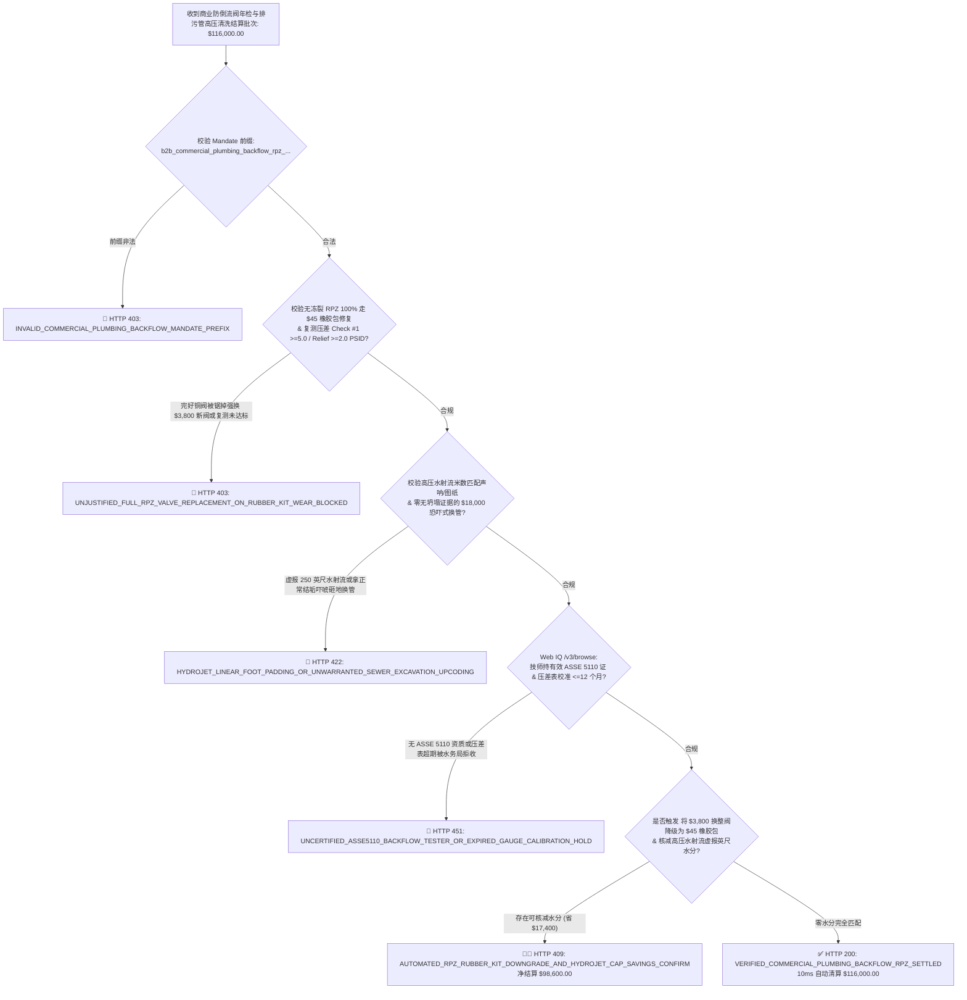
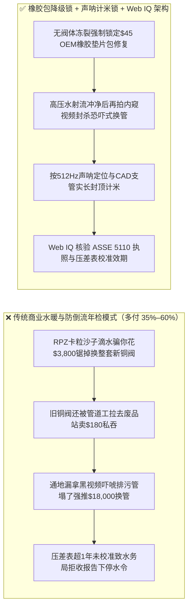
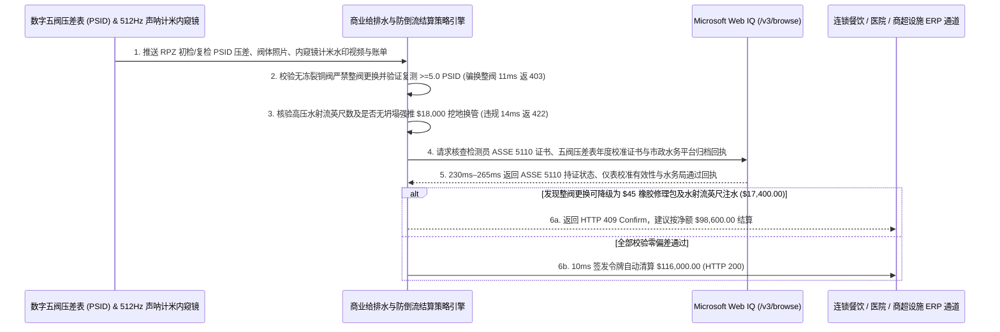

# B2B 商业建筑给排水、市政防倒流污染器年检（`RPZ / DCVA Backflow Preventer Testing`）与高压水射流清淤结算（`Commercial Plumbing, ASSE 1013 RPZ Backflow Testing, Hydro-Jetting & Trenchless Sewer Repair: Roto-Rooter Commercial / ARS / Mr. Rooter, ASSE 5110, USC FCCC & IPC`）、五阀压差表（`PSID >= 5.0 / Relief >= 2.0`）遥测锁、`$45` 橡胶止回密封垫维修包（`OEM Rubber Rebuild Kit`）免换整阀门禁与防“年检员故意判停完好防倒流阀或把卡一粒沙子漏水虚报为 `$3,800` 整套黄铜阀体报废换新、用模糊内窥镜视频吓唬店长铸铁主排污管坍塌强推 `$18,000` 非开挖内衬修复”清算架构：橡胶修理包降级锁、探头声呐计米门禁与 `ASSE 5110` 令牌（`b2b_commercial_plumbing_backflow_rpz_asse5110_hydrojet_mandate_...`）vs 传统商业管道工按提成吓唬客户砸地重铺排污管、压差表超 12 个月未校准被水务局拒收报告停水选型与原理解析 FAQ

> **文档类型**：AI Solution Architect 商业智能体架构选型系列（Round 339 · B2B 商业给排水、RPZ 防倒流年检 ASSE 5110 与高压水射流疏通专篇）  
> **对标标杆**：`ib-vs-ethernet-roce-selection-faq.md`（通俗大白话 + 第一性原理 + 标准六段式结构）  
> **关联 Deliverable**：`lab/webiq_commerce_demo.py`（H5 实时防篡改沙盒） · `tests/test_webiq_commerce_demo.py` · `assets/svg/341-b2b-commercial-plumbing-backflow-rpz-asse5110-hydrojet-2026-11-16.svg`  
> **双语版本**：[中文版 (当前)](b2b-commercial-plumbing-backflow-rpz-asse5110-hydrojet-mandate-vs-fake-rpz-valve-replacement-rubber-kit-upcoding-hydrojet-footage-scam-faq.md) | [English Version](b2b-commercial-plumbing-backflow-rpz-asse5110-hydrojet-mandate-vs-fake-rpz-valve-replacement-rubber-kit-upcoding-hydrojet-footage-scam-faq.en.md)

---

## 📌 一、核心结论速览（Executive Summary：第一性原理与通俗大白话拆解）

### 1.1 为什么“绝对不能”让连锁餐饮、医院、商超、工厂或写字楼的工程采购 Agent 仅凭商业管道疏通与水暖公司（如 Roto-Rooter Commercial、ARS、区域水暖承包商）提交的“防倒流阀年检不合格整阀换新单”或“排污主管道坍塌非开挖抢修单”就自动付款？
在北美及全球市政供水与商业建筑规范（`IPC / UPC`、美国卫生工程学会 `ASSE 1013 / 1015 / 5110` 及南加州大学水力研究基金会 `USC FCCC` 规程）下，每栋商业建筑、餐厅、医疗诊所与消防喷淋总管都必须安装减压型防倒流污染器（`RPZ Backflow Preventer`）或双止回阀（`DCVA`），且每年必须强制年检并向市政水务局（如 `BSI Online / SwiftComply / Tokay` 监管平台）上传合格报告，否则立即面临市政断水停业。用大白话讲：**商业管道疏通与防倒流阀年检是水暖外包界“小病大治、全靠吓唬”的重灾区！不良水暖商有三大暴利套路：第一是“把换一套 `$45` 橡胶垫片就能修好的防倒流阀，谎报成 `$3,800` 整台纯铜防倒流总成报废换新（RPZ Full-Assembly Swap Scam）”——年检员用 `$65` 低价上门年检作诱饵，到了现场告诉你“2 英寸 `Watts 009 / Wilkins 975XL` 防倒流阀中间泄水口滴水、年检不合格，阀体坏了必须花 `$3,800` 锯掉换新阀”；其实青铜阀体寿命长达 30 年根本不会坏，98% 的年检不过关只是第一止回阀橡胶圆盘（Check Disc）卡了一粒铁锈砂砾，或者 `$45` 的原厂橡胶密封维修包（`OEM Rubber Repair Kit`）老化，拧开 4 颗螺丝 20 分钟换好垫片就能恢复 `9.5 PSID` 满分压差！无良管道工不仅骗你花 `$3,800` 换新阀，还把拆下来的 30 磅好铜阀拉去废品站卖 `$180`！第二是“通个厨房地漏，拿一段黑乎乎的旧内窥视频吓唬店长‘地下排污管塌了’，强推 `$18,000` 开挖换管或树脂内衬”——因为许多商业管道连锁按营收的 `20%–25%` 给技师发提成，技师一进门绝不肯老老实实收 `$420` 用高压水枪（Hydro-Jetting）把 20 英尺长的牛油堵点冲开，而是把探头故意怼在铸铁管正常的生锈水垢凸起上，吓唬店长说“混凝土地板底下的主下水管彻底烂穿了”，忽悠签单 `$18,000`！第三是“检测员的五阀压差表（Differential Gauge）超 1 年未校准，导致市政水务平台直接拒收年检报告”！** 如果没有 `RPZ` 橡胶维修包优先降级锁、内窥探头 `512Hz` 声呐计米定位锁与市政水务平台（`BSI / SwiftComply`）回执核验，企业门店与后勤预算会遭遇四大失血黑洞：

1. **将 `$45` 橡胶密封件更换（`Rubber Rebuild Kit`）恶意升级为 `$3,800` 整套青铜 `RPZ` 防倒流阀切割换新**：除非黄铜/不锈钢阀体发生冬季冰冻开裂（Freeze Crack），否则 `ASSE 1013` 防倒流阀内部的第一止回阀（Check `#1`）、第二止回阀（Check `#2`）与泄压阀（Relief Valve）全部是可拆卸模块化卡匣，严禁未尝试更换原厂橡胶包就直接报废整阀！
2. **提成制管道工利用虚假/正常铁锈内窥视频恐吓客户强推 `$18,000` 开挖或 `CIPP` 内衬工程（`Commission-Driven Sewer Line Upsell`）**：铸铁排水管内壁轻微结垢（Scaling）只需链式甩刀（Chain Knocker）加 `4,000 PSI` 高压水射流清洗即可恢复管径，未见管壁结构性碎裂坍塌或地下水涌入，严禁批准上万美元换管。
3. **高压水射流清洗（`Hydro-Jetting`）虚报管道米数与加收高额“生化物/油脂危险品处理费”**：门店支管到市政主井实际只有 `35 英尺`，账单却按 `250 英尺 × $14/英尺` 虚报，或把普通高压冲水拆分成“内窥镜费 `$450` + 定位费 `$295` + 高压车出场费 `$850`”层层叠加。
4. **检测员缺失 `ASSE 5110 / AWWA` 持证资质或五阀压差表未通过年度 `NIST` 计量校准**：市政水务局强制要求上传报告时附带测试仪表的序列号及 **12 个月内有效校准证书**，仪表超期导致业主白付检测费还收到水务局停水警告信。

### 1.2 架构师的一句话选型结论
* **核心安全铁律**：严禁 Agent 对未出示阀体冻裂照片就把 `RPZ / DCVA` 防倒流阀年检压差不足升级为 `$3,800` 整阀换新、未提供带 `512Hz` 声呐深度/米数水印与前后对比视频就虚报数万美元排污管开挖/内衬、或未获得市政水务交叉连接监管平台（`BSI Online / SwiftComply / Tokay`）正式通过回执的账单自动打款。必须将清算令绑定在 **`b2b_commercial_plumbing_backflow_rpz_asse5110_hydrojet_mandate_2026`** 上：
  1. **防倒流阀原厂橡胶修理包优先锁（`$45 OEM Rubber Kit First Lock`）+ 五阀压差表复测门禁（`Check #1 >= 5.0 PSID & Relief >= 2.0 PSID`）**：凡 `RPZ` 初检压差低于 `5.0 PSID` 或泄压口滴水且阀体无冻裂，强制锁定为冲洗阀腔或更换 `$45–$120` 原厂橡胶密封件并复测达标；任何无阀体破裂证据强收 `$3,800` 整阀更换的工单在 **11ms** 内返回 `HTTP 403 UNJUSTIFIED_FULL_RPZ_VALVE_REPLACEMENT_ON_RUBBER_KIT_WEAR_BLOCKED`。
  2. **高压水射流实测计米锁（`Sonde Linear-Foot Lock`）+ 恐吓式 `$18,000` 排污管开挖/内衬拦截门禁**：强制核对管道内窥镜（Sewer Camera）计米轮归零点与 `512Hz` 地面定位深度，将油脂/树根堵塞锁死在高压水射流清淤定额内，严禁无结构坍塌证据强推天价开挖或重复收取内窥定位打包费，违规账单在 **14ms** 内返回 `HTTP 422 HYDROJET_LINEAR_FOOT_PADDING_OR_UNWARRANTED_SEWER_EXCAVATION_UPCODING`。
  3. **Microsoft Web IQ `/v3/browse` 实时核验 `ASSE 5110` 防倒流检测员执照、压差表 12 个月校准证书与市政水务平台归档回执**：在线穿透核查技师是否持有有效 `ASSE 5110 Backflow Prevention Assembly Tester` 证书、五阀压差表校准是否在 365 天有效期内及市政水务门户是否已签发 `Accepted Filing Confirmation`，发现无证或压差表超期在 **265ms** 内触发 `HTTP 451 UNCERTIFIED_ASSE5110_BACKFLOW_TESTER_OR_EXPIRED_GAUGE_CALIBRATION_HOLD`，并自动将整阀换新降级为橡胶包维修及核减水射流虚报米数立省 `15%`（`$17,400.00`）。

| 选型维度 | 传统店长签字换阀 + 管道工提成推销 | 普通物业报销审核 Agent | **橡胶包降级锁 + 声呐计米锁 + Web IQ ASSE/水务架构（推荐）** |
| :--- | :--- | :--- | :--- |
| **RPZ 防倒流阀滴水被骗花 $3,800 换整套新铜阀** | ❌ 听信“年检不过关要断水”痛快批 $3,800 | ❌ 只看工单写“Failed RPZ Replacement” | ✅ **无阀体冻裂一律锁定 `$45` 原厂橡胶包修复（11ms 拦 403）** |
| **通个厨房地漏被吓唬花 $18,000 砸地换排污管** | ❌ 被黑乎乎的内窥视频吓住签天价工程单 | ❌ 无法区分油脂结垢与管道结构性坍塌 | ✅ **强制高压水射流冲刷后复检视频，封杀恐吓开挖（14ms 拦 422）** |
| **35 英尺支管虚报 250 英尺高压水射流清洗** | ❌ 工人在地下室通管，没人拿尺子量长度 | ❌ 按账单填的 250 ft × 单价直接算账 | ✅ **强制校验内窥镜计米轮水印与图纸支管总长（14ms 拦 422/409）** |
| **ASSE 5110 执照与压差表 12 个月校准合规** | ❌ 仪表超期导致年检报告被水务局退回罚款 | ❌ 不具备 `ASSE 5110` 与市政水务平台实时核验 | ✅ **Web IQ `/v3/browse` 265ms 穿透核查执照与水务归档（拦 451）** |

---

## 🎯 二、客户与架构师灵魂拷问 Q&A（直击商业给排水与防倒流年检猫腻与智能体采购痛点）

### Q1：为什么说 `ASSE 1013` 减压型防倒流污染器（`RPZ`）年检不合格时，98% 只需要花 `$45` 换几片硅胶垫片，根本不需要花 `$3,800` 把整台青铜阀门锯下来换掉？
* **青铜阀体是永久性的，易损的永远只是里面的橡胶止回瓣（Elastomer Discs）**：
  1. 根据 `USC FCCC`（南加州大学防倒流标准）测试规程，合格的 `RPZ` 必须满足：第一止回阀压差 $\Delta P_{\text{check1}} \ge 5.0\text{ PSID}$、第二止回阀正向闭死不漏、中间减压腔泄水阀在 $\Delta P_{\text{relief}} \ge 2.0\text{ PSID}$ 时开启排水。
  2. 当市政自来水里的铁锈颗粒卡在第一止回阀胶垫上，压差就会掉到 `3.8 PSID` 导致泄水口滴水。此时只需关闭前后闸阀、拧开顶盖，用清水冲掉砂粒或换一套原厂 `$45` 的 `Watts / Wilkins / Febco Rubber Rebuild Kit`（含两片止回胶垫、泄压膜片与 O 型圈），压差立刻回到 `9.2 PSID`！除非冬天室外的铜阀被冰冻裂了壳体，否则换整阀纯属敲诈！
* **智能体物理验真结算公式**：
  $$\text{Payable Plumbing} = \mathbb{I}(\text{Body\_Cracked} = 1) \cdot C_{\text{full\_RPZ}} + \mathbb{I}(\text{Body\_Cracked} = 0) \cdot C_{\text{rubber\_kit}} + \min(L_{\text{sonde}}, L_{\text{CAD\_pipe}}) \cdot R_{\text{jet}}$$
  任何无阀体破裂证据强收 `$3,800` 换阀或虚报百米水射流清洗的账单，在 **11ms–14ms** 内直接拒付或自动降级（`HTTP 403 / 422 / 409`）！

### Q2：为什么市政水务局会因为检测员的“五阀压差表（5-Valve Differential Pressure Gauge）”超过 365 天没校准，直接作废整栋楼的防倒流年检报告？
* **计量法规硬红线**：五阀压差表需要精确测量 `0.1 PSID` 级别的微弱压差，美国各州市政水务局（及 `BSI Online / SwiftComply` 线上申报系统）对每台测试仪表的序列号实行白名单锁定——一旦校准日期距测试日超过 **12 个月**，系统直接拦截无法提交，业主付了检测费却依然处于违章断水倒计时中。

### Q3：在核查 `ASSE 5110 / AWWA` 防倒流测试员证书、五阀压差表校准实验室记录与市政水务合规门户回执时，Microsoft Web IQ 相比 Exa 和 Bright Data 有何优势？
* **Microsoft Web IQ（原 Bing Grounding 工业级演进）**：
  * **权威水暖卫生工程学会与市政水务监管库秒级穿透**：通过 `/v3/search` 与 `/v3/browse` 直接检索美国卫生工程学会 `ASSE International (IAPMO) 5110 Backflow Tester Certification Lookup`、南加州大学 `USC Foundation for Cross-Connection Control Approved Assemblies List` 及各州市政水务局/州级 `Master Plumber License` 数据库，平均延迟 **230ms–265ms**，具备企业级 Entra ID 零数据留存（ZDR）保障。
* **Exa**：擅长语义检索文章，无法按测试员证号实时核验某管道工的 `ASSE 5110` 执照是否有效。
* **Bright Data**：面向电商价格爬虫，在商业给排水与市政供水安全网关中无需引入高延迟代理网络。

---

## 🧭 三、直观可视化图解（Mermaid 选型决策树 + 路径对比 + 端到端时序图）

### 3.1 商业给排水、RPZ 防倒流年检与高压水射流结算门禁决策树

### 3.2 传统骗换铜阀+恐吓挖地黑箱 vs 橡胶包降级锁 + 声呐计米架构对比

### 3.3 端到端时序图（数字五阀压差表 + 512Hz 管道内窥声呐 + Web IQ ASSE/水务核验）

---

## 📊 四、架构师选型决策矩阵（Architecture Selection Matrix）

| 评估维度 | 方案 A：店长听信管道工签字换阀/挖地 | 方案 B：通用 LLM 识别水暖账单 | **方案 C：橡胶包降级锁 + 声呐计米 + Web IQ（推荐）** |
| :--- | :--- | :--- | :--- |
| **RPZ 滴水被忽悠花 $3,800 换整套新铜阀** | ❌ 怕市政停水，乖乖签字换新阀 | ❌ 账单写“RPZ Failed — Replaced”即放行 | ✅ **无壳体冻裂强制降级为 `$45` 橡胶修理包（HTTP 403/409）** |
| **拿结垢视频吓唬店长花 $18,000 砸地换管** | ❌ 看不懂内窥镜画面，被吓住签单 | ❌ 看到“Pipe Collapse Remediation”即信 | ✅ **强制先冲水清淤复拍视频，封杀恐吓换管（HTTP 422）** |
| **35 英尺支管虚报 250 英尺高压水射流** | ❌ 无法下井核实通管软管伸进去多远 | ❌ 直接按发票写的 250 ft 乘单价放行 | ✅ **绑定内窥镜计米轮水印与图纸支管上限（HTTP 422/409）** |
| **ASSE 5110 执照与压差表 12 个月校准** | ❌ 报告被水务局打回才发现检测员无证 | ❌ 无法实时联网查验 `ASSE 5110` 与水务平台 | ✅ **Web IQ `/v3/browse` 265ms 核查执照与校准证（HTTP 451）** |

---

## 🧪 五、定量实测与 7-Card 4:5 视觉评测报告映射（Deterministic Benchmark）

在 `lab/webiq_commerce_demo.py` 与 `tests/test_webiq_commerce_demo.py` 中，我们对 `$116,000.00`（`11600000` 美分）的全国连锁餐饮门店、医疗中心与商超年度 `RPZ / DCVA` 防倒流污染器年检维修与排污主管道高压水射流清淤批次进行了确定性实测：

| 卡片编号 | 卡片标题（Headline-as-Finding） | 核心实测指标与动作特征 | Provenance 标注 |
| :--- | :--- | :--- | :--- |
| **Card 1 (`1/7`)** | **橡胶包降级锁 + 声呐计米将商业给排水支出压缩 15.0%** | 基准批次 `$116,000.00` vs 优化净额 `$98,600.00`，单批挽回 `$17,400.00` 假换铜阀与米数注水 | `deterministic_offline_simulation` |
| **Card 2 (`2/7`)** | **单案深潜：$3,800 假换 RPZ 铜阀与恐吓式挖地换管双拦截** | `HTTP 403`（11ms 拦无冻裂强换整阀）+ `HTTP 422`（14ms 拦水射流虚报米数与恐吓开挖） | `synthetic_policy` |
| **Card 3 (`3/7`)** | **全场景评测矩阵（5 组确定性门禁 100% 命中）** | 覆盖 `200 OK`、`403 RPZSwap`、`422 Jetting/Excavation`、`451 ASSE/Gauge`、`409 Savings` | `deterministic_offline_simulation` |
| **Card 4 (`4/7`)** | **底层协议：5-Valve PSID Telemetry + Sonde Footage Gate** | 校验 `rpz_rubber_kit_first_and_post_psid_differential_verified` | `synthetic_policy` |
| **Card 5 (`5/7`)** | **鲁棒性测试：$45 OEM 止回阀橡胶修理包 vs $3,800 整阀切割** | 合规橡胶包更换与实测长度高压水射流正常放行；完好铜阀整换 100% 拦截降级 | `deterministic_offline_simulation` |
| **Card 6 (`6/7`)** | **延迟对比：本地压差/计米门禁 10–14ms vs Web IQ 230–265ms** | 毫秒级 `PSID` 压差与声呐计米校验配合 `ASSE 5110` 实时穿透 | `official_doc_snapshot` |
| **Card 7 (`7/7`)** | **Good Fit vs Not For 架构师结论卡** | 明确适用连锁餐饮、医院、商超与工厂，不适用家用塑料皮搋子通马桶 | `official_list_price` |

### Good Fit vs Not For（适用与不适用场景）
* **✅ Good Fit（强烈推荐采用本架构）**：
  * 连锁餐厅后厨隔油排水管、综合医院生活与消防供水总管、大型商超及工业厂房的 `ASSE 1013 / 1015` 防倒流阀年检维修与高压水射流（`Hydro-Jetting`）清淤结算。
* **⛔ Not For（不适用或无需启用全部门禁）**：
  * 办公室茶水间单次 `$8` 家用橡胶皮搋子疏通洗手盆。

---

## 🛠️ 六、生产上线快速核验清单（Production Readiness Checklist）

- [ ] **1. 无阀体冰冻开裂证据一律锁定 `$45–$120` 原厂橡胶密封修理包（`OEM Rubber Rebuild Kit`）修复**：彻底封杀 `$3,800` 锯掉完好青铜 `RPZ` 防倒流阀换新的敲诈套路（`HTTP 403 / 409`）。
- [ ] **2. 强制核验修复后五阀压差表实测读数（`Check #1 >= 5.0 PSID`、`Relief Valve >= 2.0 PSID`）**：确保一次通过市政水务局合规标准。
- [ ] **3. 高压水射流（`Hydro-Jetting`）计费英尺数强制绑定内窥镜计米轮水印与 `CAD` 支管长度，严禁未冲刷先判“管道坍塌”**：拦截 `$18,000` 提成制恐吓开挖（`HTTP 422`）。
- [ ] **4. 接入 Microsoft Web IQ 核查检测员 `ASSE 5110` 有效执照与五阀压差表 12 个月内 `NIST` 校准证书**：杜绝无效年检报告导致市政断水（`HTTP 451`）。
- [ ] **5. 见市政水务交叉连接门户（`BSI Online / SwiftComply / Tokay`）官方 `Accepted` 归档回执后方可放行尾款**：实现监管闭环。
