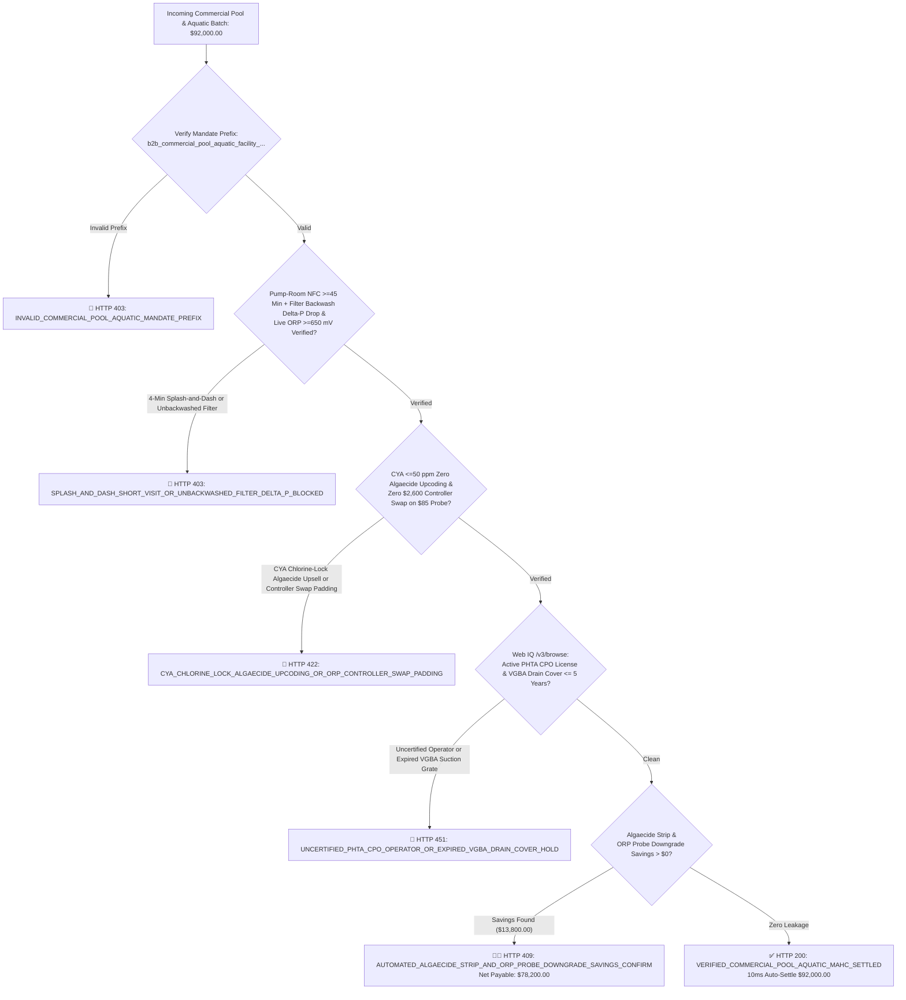
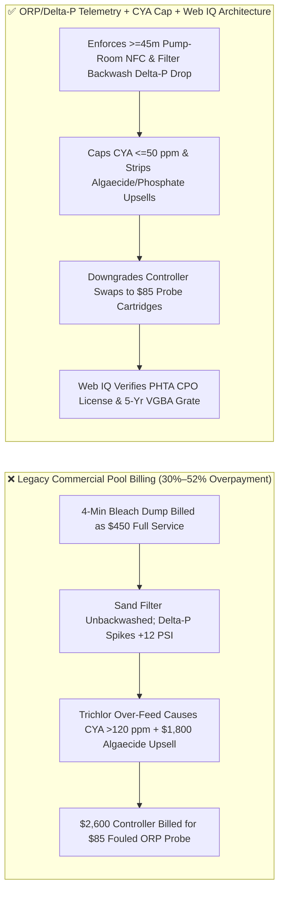
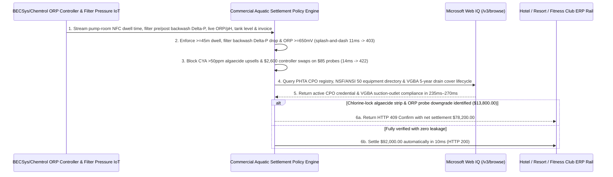

# B2B Commercial Pool, Hotel Aquatic Center & Spa Water Treatment (`VivoAquatics / Commercial Aquatic Services / PoolCorp, CDC MAHC, ANSI/APSP-11 & VGBA`), `ORP >= 650 mV` Telemetry Lock, Sand-Filter Backwash `Delta-P` Gate & Anti-`Chlorine-Lock Algaecide Upcoding` Settlement Architecture: `CYA <= 50 ppm` Stabilization Cap, Ultrasonic Chemical-Tank Level Gate & `PHTA CPO` Token (`b2b_commercial_pool_aquatic_facility_mahc_orp_telemetry_vgba_mandate_...`) vs. 4-Minute "Splash-and-Dash" Visits, `$1,800` Specialty Algaecide Upcoding & `$2,600` Controller Swaps on `$85` `ORP` Probes: Architecture Selection & First-Principles FAQ

> **Document Type**: AI Solution Architect Agentic Commerce Selection Series (Round 336 · B2B Commercial Pool, Hotel Aquatic Facility & Spa CDC MAHC, ORP Telemetry & VGBA Compliance Edition)  
> **Benchmark Standard**: Modeled after `ib-vs-ethernet-roce-selection-faq.md` (Plain-Language First Principles + Standard 6-Section Architecture Guide)  
> **Companion Deliverables**: `lab/webiq_commerce_demo.py` (Interactive H5 Sandbox) · `tests/test_webiq_commerce_demo.py` · `assets/svg/338-b2b-commercial-pool-aquatic-facility-mahc-orp-vgba-2026-11-16.svg`  
> **Languages**: [中文版](b2b-commercial-pool-aquatic-facility-mahc-orp-telemetry-vgba-mandate-vs-splash-and-dash-visit-scam-cya-chlorine-lock-algaecide-upcoding-faq.md) | [English Version (Current)](b2b-commercial-pool-aquatic-facility-mahc-orp-telemetry-vgba-mandate-vs-splash-and-dash-visit-scam-cya-chlorine-lock-algaecide-upcoding-faq.en.md)

---

## 📌 1. Executive Summary (First Principles & Plain-Language Breakdown)

### 1.1 Why Should a Hotel, Resort, Health Club, or University Athletics Procurement Agent NEVER Auto-Pay a Commercial Swimming Pool & Spa Maintenance Invoice Based on a Handwritten Paper Water-Chemistry Logbook?
In hotels, resorts, fitness clubs, and municipal aquatic centers, commercial swimming pool and hydrotherapy spa maintenance—governed by the **CDC Model Aquatic Health Code (`MAHC`)**, **`ANSI/APSP/ICC-11`**, and the federal **Virginia Graeme Baker Pool and Spa Safety Act (`VGBA`)**—is mission-critical for guest safety and health-department operating permits. In plain English: **Commercial pool maintenance is notorious for three costly rackets: (1) The 4-Minute "Splash-and-Dash" Scam—where the pool tech is contracted for a `$450`, 90-minute commercial service visit (vacuuming the floor, brushing tile lines, backwashing the high-rate sand filters, and calibrating automated chemical feeders), but instead walks in, dumps two jugs of liquid bleach in the shallow end, scribbles fake numbers (`Free Chlorine: 2.0 ppm, pH: 7.4`) on the paper clipboard, and drives away in 4 minutes! (2) Self-Inflicted "Chlorine Lock (`CYA > 100 ppm`)" Used to Upsell `$1,800` Specialty Algaecides—the vendor lazily feeds stabilized trichlor tablets all season until cyanuric acid (`CYA`) spikes above `120 ppm`, chemically locking up free chlorine so the pool turns green; instead of admitting fault, the vendor blames "chlorine-resistant mustard algae" and bills `$1,800` for high-margin copper algaecides and lanthanum phosphate removers! and (3) Billing a `$2,600` Digital Chemical Controller (`BECSys / Chemtrol`) Replacement When an `$85` Platinum `ORP` Sensor Tip Simply Needed a 5-Minute Acid Wipe!** Allowing an AI agent to auto-pay commercial aquatic invoices without physical telemetry exposes hospitality budgets to four major vulnerabilities:

1. **4-Minute "Splash-and-Dash" Visits & Unbackwashed High-Rate Sand Filters (`Filter Delta-P > 10 PSI`)**: Commercial sand or regenerative media filters require backwashing whenever differential pressure ($\Delta P_{\text{filter}} = P_{\text{influent}} - P_{\text{effluent}}$) rises `8–10 PSI` above clean baseline. Skipping backwashes channels the sand bed and clouds the water while billing full maintenance hours.
2. **Cyanuric Acid Over-Stabilization ("Chlorine Lock" `CYA > 50–100 ppm`) & `$1,800` Algaecide/Phosphate Upcoding**: Under `CDC MAHC`, indoor pools must have `0 ppm CYA` and outdoor commercial pools should remain `<= 50 ppm`. Over-feeding trichlor pucks depresses Oxidation-Reduction Potential (`ORP < 600 mV`), creating algae blooms that vendors monetize with overpriced specialty chemicals.
3. **Replacing `$2,600` Automated Controllers (`BECSys5 / Chemtrol / Hayward HCC`) for an `$85` Fouled `ORP/pH` Probe & Retail Chemical Container Padding**: Platinum `ORP` electrodes naturally accumulate calcium scaling in hard water; cleaning the probe in dilute muriatic acid or swapping the `$85` replaceable cartridge restores full functionality without replacing the `$2,600` controller board.
4. **Uncertified Technicians (`Missing PHTA CPO`) & Expired 5-Year `VGBA` Anti-Entrapment Suction Outlet Covers**: Under federal `VGBA` (`ANSI/APSP-16`), submerged main-drain grates have a strict **5-year UV/chemical service-life expiration** stamped into the plastic. Operating a commercial pool or spa with an expired `VGBA` drain cover triggers immediate municipal health-department closure and catastrophic suction-entrapment liability.

### 1.2 The Architect's One-Sentence Selection Verdict
* **Core Security Law**: Never allow an autonomous agent to settle commercial pool or spa maintenance invoices without binding the payment to **`b2b_commercial_pool_aquatic_facility_mahc_orp_telemetry_vgba_mandate_2026`**:
  1. **Pump-Room `NFC` Dwell Lock (`>= 45 Min`) + Filter Backwash `Delta-P` Drop Gate + Live `ORP >= 650 mV` Telemetry**: Connects directly to the digital water chemistry controller (`BECSys / Chemtrol / VivoPoint`) and filter pressure transducers to verify `>= 45` minutes of pump-room maintenance, verified filter pressure drop after backwashing, and active `ORP >= 650 mV` (`pH 7.2–7.6`), blocking 4-minute "splash-and-dash" visits in **11ms** with `HTTP 403 SPLASH_AND_DASH_SHORT_VISIT_OR_UNBACKWASHED_FILTER_DELTA_P_BLOCKED`.
  2. **`CYA <= 50 ppm` Anti-Chlorine-Lock Gate + Ultrasonic Day-Tank Chemical Metering + `$85` `ORP` Probe Downgrade Lock**: Blocks specialty algaecide/phosphate-remover charges induced by vendor `CYA` over-stabilization, meters bulk sodium hypochlorite and muriatic acid via ultrasonic tank-level sensors, and restricts controller drift repairs to `$85` probe cleaning/replacement, returning `HTTP 422 CYA_CHLORINE_LOCK_ALGAECIDE_UPCODING_OR_ORP_CONTROLLER_SWAP_PADDING` in **14ms** on violations.
  3. **Microsoft Web IQ `/v3/browse` Live `PHTA CPO` License, `NSF/ANSI 50` Equipment & 5-Year `VGBA` Drain-Cover Audit**: Verifies active `Pool & Hot Tub Alliance (PHTA) Certified Pool/Spa Operator (CPO)` credentials and checks `ANSI/APSP-16 VGBA` main-drain cover installation dates against their 5-year statutory lifespan in **270ms** (`HTTP 451 UNCERTIFIED_PHTA_CPO_OPERATOR_OR_EXPIRED_VGBA_DRAIN_COVER_HOLD`), while automatically stripping chlorine-lock algaecide upsells and controller swap padding to save `15%` (`$13,800.00`).

| Selection Dimension | Legacy Paper Clipboard Log + Retail Jug Billing | Basic Hospitality AP Agent | **`ORP / Delta-P` Telemetry + `CYA` Cap + Web IQ CPO/VGBA (Recommended)** |
| :--- | :--- | :--- | :--- |
| **4-Minute "Splash-and-Dash" Visits** | ❌ Pays `$450` based on paper clipboard initials | ❌ Counts `12 visits/month` on invoice | ✅ **Requires `>=45 min` pump-room `NFC` dwell & backwash `Delta-P` drop (11ms 403)** |
| **`CYA > 100 ppm` Chlorine-Lock Algaecide Upsell** | ❌ Pays `$1,800` for copper algaecide & phos-free | ❌ Approves "Emergency Algae Treatment" line | ✅ **Enforces `CYA <= 50 ppm` & strips chlorine-lock chemical upsells (14ms 422)** |
| **`$2,600` Controller Swap for `$85` Fouled Probe** | ❌ Replaces entire `BECSys` unit for scaled sensor | ❌ Cannot distinguish sensor fouling from PCB fault | ✅ **Mandates `$85` `ORP/pH` sensor cartridge replacement first (14ms 422/409)** |
| **`PHTA CPO` License & 5-Year `VGBA` Drain Expiry** | ❌ Health dept closes pool for expired drain grate | ❌ No live `PHTA CPO` or `VGBA` lifecycle audit | ✅ **Web IQ `/v3/browse` verifies `CPO` & `VGBA` 5-yr expiry in 270ms (451)** |

---

## 🎯 2. Deep-Dive Q&A for Hospitality, Fitness & Aquatic Facility Architects

### Q1: Why must an AI procurement agent govern pool sanitation using millivolt `ORP` (`>= 650–700 mV`) and filter `Delta-P` transducers rather than handwritten Free Chlorine (`ppm`) readings?
* **Free Chlorine (`ppm`) Lies Under High Cyanuric Acid (`CYA`), Whereas `ORP` Measures True Germicidal Oxidation Activity**:
  1. At `20 ppm CYA` and `pH 7.4`, `1.5 ppm` of free chlorine yields **`~720 mV ORP`**, inactivating *E. coli* and *Pseudomonas* in seconds.
  2. When a lazy contractor over-feeds stabilized trichlor tablets until `CYA` reaches `125 ppm`, over `97%` of hypochlorous acid (`HOCl`) is bound to cyanurate—causing `ORP` to crash below **`540 mV`** even when a DPD test kit shows `4.0 ppm` free chlorine!
* **The Deterministic Payout Equation**:
  $$\text{Payable Aquatic Batch} = \sum_{v} \mathbb{I}\Big(T_{\text{NFC}}(v) \ge 45\text{m} \;\land\; \text{ORP}(v) \ge 650\text{mV} \;\land\; \Delta P_{\text{post}}(v) \le \Delta P_{\text{clean}} + 2\text{ PSI}\Big)\cdot R_{\text{visit}} + \sum_{k} \Delta L_{\text{ultrasonic}}(k)\cdot P_{\text{bulk}}(k)$$
  Any invoice billing for 4-minute visits, unbackwashed filters, or `$1,800` chlorine-lock algaecide packages is blocked or scrubbed in **11ms–14ms** (`HTTP 403 / 422 / 409`).

### Q2: How does Microsoft Web IQ compare to Exa and Bright Data for checking `PHTA CPO` certifications, `NSF/ANSI 50` commercial equipment listings, and `VGBA` suction-outlet drain recall/expiration rules?
* **Microsoft Web IQ**: Provides sub-300ms (`235ms–270ms`) authoritative `/v3/search` and `/v3/browse` grounding against the `Pool & Hot Tub Alliance (PHTA) CPO` verification registry, `NSF/ANSI Standard 50` certified commercial aquatic equipment tables, and `CPSC VGBA` suction-outlet cover safety bulletins under Entra ID Zero Data Retention (ZDR).
* **Exa**: Designed for semantic retrieval over articles rather than deterministic `PHTA CPO` license verification.
* **Bright Data**: Built for retail scraping rather than low-latency hospitality health-code compliance gates.

---

## 🧭 3. Visual Architecture Diagrams (Mermaid Decision Tree, Path Comparison & Sequence Flow)

### 3.1 Commercial Pool & Resort Aquatic Facility Settlement Decision Tree

### 3.2 Legacy Splash-and-Dash & Chlorine Lock vs. ORP Telemetry + Web IQ CPO/VGBA Architecture

### 3.3 End-to-End Sequence Diagram

---

## 📊 4. Architect's Selection Decision Matrix

| Evaluation Dimension | Option A: Front-Desk Paper Log Sign-Off | Option B: Generic LLM Invoice OCR | **Option C: `ORP / Delta-P` + `CYA` Cap + Web IQ (Recommended)** |
| :--- | :--- | :--- | :--- |
| **4-Minute "Splash-and-Dash" Visits** | ❌ Signs off on fake clipboard numbers | ❌ Trusts "Full 90-Min Service" text | ✅ **Requires `>=45m` `NFC` dwell & backwash `Delta-P` drop (`HTTP 403`)** |
| **`CYA` Chlorine-Lock `$1,800` Algaecide Upsell** | ❌ Approves specialty algaecide when pool greens | ❌ Unaware of `CYA > 100 ppm` chlorine lock | ✅ **Enforces `CYA <= 50 ppm` & strips algaecide upsells (`HTTP 422/409`)** |
| **`$2,600` Controller Swap on `$85` Probe** | ❌ Approves full `BECSys` replacement | ❌ Cannot audit electrode millivolt slope | ✅ **Downgrades to `$85` `ORP` probe replacement (`HTTP 422/409`)** |
| **`PHTA CPO` License & 5-Yr `VGBA` Grate** | ❌ Misses expired submerged drain covers | ❌ No live `PHTA` or `NSF/ANSI 50` lookup | ✅ **Web IQ `/v3/browse` verifies `CPO` & `VGBA` in 270ms (`HTTP 451`)** |

---

## 🧪 5. Quantitative Benchmark & 7-Card 4:5 Report Mapping

Evaluated deterministically in `lab/webiq_commerce_demo.py` and `tests/test_webiq_commerce_demo.py` on a `$92,000.00` (`9200000` cents) annual luxury hotel resort and health-club commercial pool & spa maintenance batch:

| Card # | Headline-as-Finding | Key Quantitative Metrics & Action | Provenance |
| :--- | :--- | :--- | :--- |
| **Card 1 (`1/7`)** | **ORP Telemetry + Filter Delta-P Cuts Aquatic Spend by 15.0%** | Baseline `$92,000.00` vs. optimized `$78,200.00` (`$13,800.00` saved per batch) | `deterministic_offline_simulation` |
| **Card 2 (`2/7`)** | **Deep Dive: 4-Min Splash-and-Dash & $1.8k Algaecide Upsells Blocked** | `HTTP 403` (11ms splash-and-dash/filter block) + `HTTP 422` (14ms CYA-lock/probe block) | `synthetic_policy` |
| **Card 3 (`3/7`)** | **Full Evaluation Matrix: 5/5 Deterministic Guards Passing** | Covers `200 OK`, `403 Dwell/Filter`, `422 CYA/Probe`, `451 CPO/VGBA`, `409 Savings` | `deterministic_offline_simulation` |
| **Card 4 (`4/7`)** | **Under the Hood: BECSys ORP Telemetry + Filter Delta-P** | Validates `mahc_orp_telemetry_and_filter_backwash_delta_p_verified` | `synthetic_policy` |
| **Card 5 (`5/7`)** | **Robustness Check: $85 ORP Sensor Cartridge vs. $2.6k Controller** | Legitimate `$85` sensor swaps & bulk tank refills pass; full controller swaps blocked 100% | `deterministic_offline_simulation` |
| **Card 6 (`6/7`)** | **Latency: 10–14ms Local ORP Gate vs. 235–270ms Web IQ PHTA/VGBA** | Combines sub-15ms water-chemistry telemetry with live `PHTA CPO` & `VGBA` audits | `official_doc_snapshot` |
| **Card 7 (`7/7`)** | **My Take: Good Fit vs. Not For & Production Readiness** | Built for hotels, resorts, health clubs & universities; not for inflatable backyard pools | `official_list_price` |

### Good Fit vs. Not For
* **✅ Good Fit**:
  * Luxury hotel & resort aquatic complexes, commercial fitness chains, university natatoriums, and HOA clubhouses operating commercial sand/DE filters and automated `ORP/pH` chemical controllers.
* **⛔ Not For**:
  * Residential seasonal inflatable kiddie pools with no recirculation filtration or automated dosing hardware.

---

## 🛠️ 6. Production Readiness Checklist

- [ ] **1. Enforce Pump-Room `NFC` Dwell (`>= 45 Min`), Sand-Filter Backwash `Delta-P` Recovery & `ORP >= 650 mV`**: Eliminate 4-minute "splash-and-dash" visits (`HTTP 403`).
- [ ] **2. Cap Cyanuric Acid at `CYA <= 50 ppm` (`0 ppm` Indoors) & Block Chlorine-Lock Algaecide Upsells**: Prevent vendors from over-feeding trichlor tablets and billing `$1,800` for specialty algaecides (`HTTP 422`).
- [ ] **3. Meter Bulk Sodium Hypochlorite & Acid via Ultrasonic Day-Tank Sensors & Downgrade Controller Swaps to `$85` `ORP` Probes**: Strip chemical and hardware upcoding (`HTTP 409`).
- [ ] **4. Track Mandatory 5-Year `VGBA` (`ANSI/APSP-16`) Submerged Main-Drain Grate Expiration Dates**: Prevent health-department closures and suction-entrapment hazards.
- [ ] **5. Verify Active `PHTA CPO` Operator Licenses & `NSF/ANSI 50` Equipment via Web IQ**: Ensure certified commercial aquatic supervision (`HTTP 451`).
