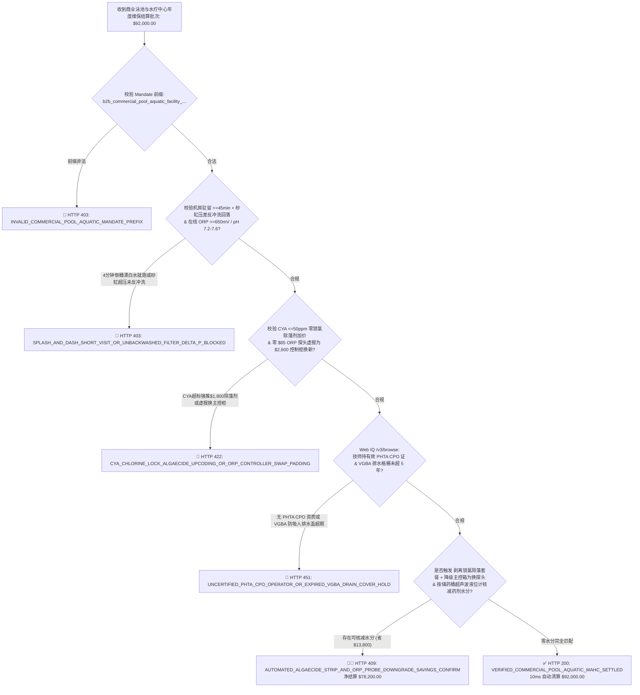
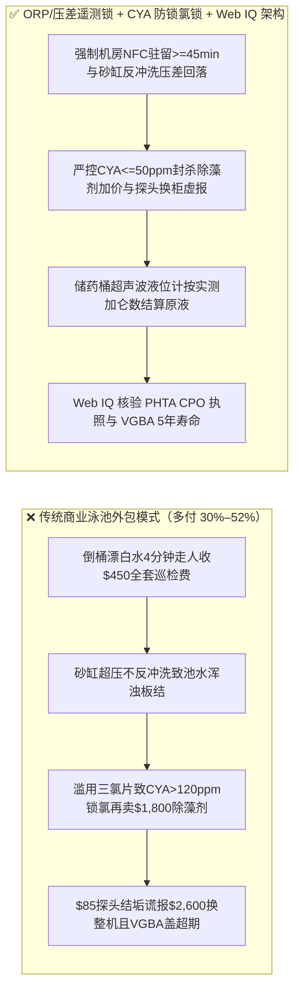
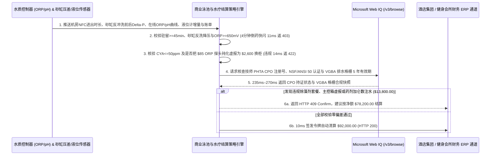

# B2B 酒店度假村商业泳池、水疗中心（`Commercial Pool, Resort Aquatic Facility & Spa`）水质自动化运维、砂缸反冲洗压差与防吸人排水格栅结算（`Commercial Aquatic Water Treatment, ORP/pH Telemetry & VGBA Compliance: VivoAquatics / Commercial Aquatic Services / PoolCorp, CDC MAHC, ANSI/APSP-11 & VGBA`）、在线氧化还原电位（`ORP >= 650 mV`）与机房驻留时长锁、氰尿酸锁氯上限（`CYA <= 50 ppm`）门禁与防“技术员进场往浅水区倒两桶漂白水 4 分钟就跑却收 `$450` 全套巡检费（`Splash-and-Dash Scam`）、长期偷懒投三氯药片致氰尿酸超标锁死余氯再强推 `$1,800` 特种除藻剂与把 `$85` ORP 探头钝化虚报为 `$2,600` 自动投药主控箱报废”清算架构：砂缸反冲洗压差回落锁、储药桶液位计实耗门禁与 `PHTA CPO` 令牌（`b2b_commercial_pool_aquatic_facility_mahc_orp_telemetry_vgba_mandate_...`）vs 传统泳池外包商半年不洗石英砂滤缸、池底 `VGBA` 防吸人主排水盖超 5 年脆化未换引发卫生局查封选型与原理解析 FAQ

> **文档类型**：AI Solution Architect 商业智能体架构选型系列（Round 336 · B2B 酒店与商业泳池水处理 CDC MAHC、ORP/pH 遥测与 VGBA 安全专篇）  
> **对标标杆**：`ib-vs-ethernet-roce-selection-faq.md`（通俗大白话 + 第一性原理 + 标准六段式结构）  
> **关联 Deliverable**：`lab/webiq_commerce_demo.py`（H5 实时防篡改沙盒） · `tests/test_webiq_commerce_demo.py` · `assets/svg/338-b2b-commercial-pool-aquatic-facility-mahc-orp-vgba-2026-11-16.svg`  
> **双语版本**：[中文版 (当前)](b2b-commercial-pool-aquatic-facility-mahc-orp-telemetry-vgba-mandate-vs-splash-and-dash-visit-scam-cya-chlorine-lock-algaecide-upcoding-faq.md) | [English Version](b2b-commercial-pool-aquatic-facility-mahc-orp-telemetry-vgba-mandate-vs-splash-and-dash-visit-scam-cya-chlorine-lock-algaecide-upcoding-faq.en.md)

---

## 📌 一、核心结论速览（Executive Summary：第一性原理与通俗大白话拆解）

### 1.1 为什么“绝对不能”让连锁星级酒店、度假村、高端健身俱乐部、高校游泳馆或康养社区的设施采购 Agent 仅凭商业泳池维保商（如 Commercial Aquatic Services、VivoAquatics、区域泳池工程公司）提交的“每周三次水质达标手写记录表与药剂耗材账单”就自动付款？
在酒店度假村、健身会所与商业水疗中心中，泳池及按摩泡池（`Commercial Pool & Hydrotherapy Spa`）的循环过滤、氧化消毒与防溺水防吸人安全（受美国疾控中心 `CDC Model Aquatic Health Code (MAHC)`、`ANSI/APSP/ICC-11` 水质标准及联邦《弗吉尼亚·格雷姆·贝克泳池与水疗安全法》`VGBA` 强制监管）直接决定住客健康与门店营业许可。用大白话讲：**商业泳池维保是最容易用“一张满分假化验单”骗走高额服务费的行业！不良泳池外包商有三大经典套路：第一是“倒桶漂白水 4 分钟就跑（Splash-and-Dash Scam）”——合同规定技师每次到场需完成 60–90 分钟作业（刷洗水位线油脂、吸池底沉淀、执行高速石英砂缸反冲洗 Backwash、校准自动投药仪），结果技师拎着两桶次氯酸钠走池边往水里一倒，在水质记录本上随手编造一串完美的“余氯 2.0、pH 7.4”，4 分钟出门上车走人，照收 `$450/次`！第二是“自己造出‘氰尿酸锁氯（Chlorine Lock）’，再高价卖你 `$1,800` 特种除藻剂和除磷剂”——技师为了省事，长年往投药器里塞廉价的三氯异氰尿酸缓溶片（Trichlor Pucks），导致池水里的稳定剂氰尿酸（`CYA`）浓度飙升到 `120+ ppm`；一旦 `CYA` 破百，水里就算有 `5 ppm` 的余氯也会被死死锁住失去杀菌力（`ORP` 跌破 `550 mV`），池水两天就变绿浑浊；这时维保商不仅不承认是自己滥用三氯片导致锁氯，反而吓唬酒店说“感染了罕见抗氯黑芥末藻”，忽悠你花 `$1,800` 买高暴利鳌合铜除藻剂和镧系除磷剂！第三是“把 `$85` 的 `ORP` 铂金探头结垢谎报为 `$2,600` 自动水质控制器（BECSys / Chemtrol）主板烧毁”！** 如果没有在线水质控制器（`ORP >= 650 mV`）与机房驻留时长锁、砂缸过滤器反冲洗压差回落（`Filter Delta-P Drop`）遥测与 `VGBA` 池底防吸人主排水格栅 5 年效期门禁，酒店与康体中心会遭遇四大失血与停业黑洞：

1. **“4 分钟倒药就跑（`Splash-and-Dash Visit Fraud`）”与石英砂滤缸长期不反冲洗导致板结沟流**：当石英砂缸（High-Rate Sand Filter）截留了大量人体皮屑与防晒霜油脂后，进出水压差（$\Delta P_{\text{filter}} = P_{\text{influent}} - P_{\text{effluent}}$）会升高 `10–12 PSI`。如果不开启多向阀执行 `3–5` 分钟反冲洗（Backwash），砂层就会板结开裂失去过滤能力，但维保商为了省时间连续几周不反洗。
2. **人为制造“氰尿酸锁氯（`CYA > 100 ppm Chlorine Lock`）”并强推高价特种除藻剂/除磷剂套餐（`Specialty Algaecide & Phosphate Remover Upcoding`）**：`CDC MAHC` 严格规定室内泳池禁用氰尿酸（`0 ppm`）、室外商业泳池 `CYA` 不得超过 `50 ppm`（理想值 `20–30 ppm`）。维保商违背化学常识导致 `CYA` 超标后，将换水稀释就能解决的问题包装成 `$1,800` 的特种药剂救治工程。
3. **把 `$85` `ORP/pH` 传感器探头钝化虚报为 `$2,600` 数字水质控制柜整机更换，且大宗药剂按小包装加价 300%**：`ORP` 铂金或金电极在硬水和高氰尿酸环境下表面会结一层钙膜导致读数偏低，只需用稀盐酸或牙膏擦洗 5 分钟（或更换 `$85` 耗材探头）即可恢复，却被直接开单更换整台 `$2,600` 的 `BECSys5 / Chemtrol` 控制器！
4. **无持证 `PHTA CPO`（注册泳池运营师）且忽视池底 `VGBA` 防吸人排水盖 5 年寿命红线**：联邦 `VGBA` 法案强制要求所有商业泳池水下主排水口防涡流格栅（Suction Outlet Cover）必须在出厂刻印寿命（通常 **5 年**）到期前更换，一旦超期或螺丝锈蚀缺失，市政卫生局将当场贴封条停业。

### 1.2 架构师的一句话选型结论
* **核心安全铁律**：严禁 Agent 对机房驻留不足 45 分钟且砂缸压差升高超过 `10 PSI` 未执行反冲洗、在线 `ORP` 低于 `650 mV`、因氰尿酸超标（`CYA > 50 ppm`）锁氯却违规加收特种除藻剂/除磷剂、将 `$85` 探头钝化虚报为 `$2,600` 主控箱换新、或缺失 `PHTA CPO` 证书与 `VGBA` 有效防吸人格栅的账单自动打款。必须将清算令绑定在 **`b2b_commercial_pool_aquatic_facility_mahc_orp_telemetry_vgba_mandate_2026`** 上：
  1. **机房 `NFC` 在岗时长锁（`>= 45 Min`）+ 砂缸压差反冲洗遥测锁（`Filter Delta-P Drop >= 8 PSI`）+ 在线 `ORP >= 650 mV` 门禁**：直连水质自动控制器（`BECSys / Chemtrol / VivoPoint`）与砂缸数字压力表，验证每次巡检真实完成反冲洗降压与电极标定；任何“4 分钟倒桶漂白水就跑”的敷衍工单在 **11ms** 内返回 `HTTP 403 SPLASH_AND_DASH_SHORT_VISIT_OR_UNBACKWASHED_FILTER_DELTA_P_BLOCKED`。
  2. **氰尿酸上限锁（`CYA <= 50 ppm`）封杀除藻剂加价 + 储药桶超声波液位计实耗锁 + `$85` `ORP` 探头免换整机锁**：严禁在 `CYA > 50 ppm` 锁氯状态下报销高价特种除藻剂/除磷剂，大宗次氯酸钠与盐酸按储药桶超声波液位计实测加注量结算，控制器读数漂移强制先走探头酸洗/更换，违规账单在 **14ms** 内返回 `HTTP 422 CYA_CHLORINE_LOCK_ALGAECIDE_UPCODING_OR_ORP_CONTROLLER_SWAP_PADDING`。
  3. **Microsoft Web IQ `/v3/browse` 实时核验 `PHTA CPO` 注册泳池运营师执照、`NSF/ANSI 50` 商用认证与 `VGBA` 排水格栅 5 年有效期台账**：在线穿透核查维保技师是否持有有效 `Pool & Hot Tub Alliance (PHTA) CPO` 证书及池底 `VGBA` 格栅型号是否处于 5 年安全服役期内，发现无证或防吸人格栅超期在 **270ms** 内触发 `HTTP 451 UNCERTIFIED_PHTA_CPO_OPERATOR_OR_EXPIRED_VGBA_DRAIN_COVER_HOLD`，并自动剥离锁氯除藻剂水分与虚报主控箱差价立省 `15%`（`$13,800.00`）。

| 选型维度 | 传统纸质水质本签字 + 药剂打包报销 | 普通酒店工程采购 Agent | **ORP/压差遥测锁 + CYA 防锁氯锁 + Web IQ CPO/VGBA 架构（推荐）** |
| :--- | :--- | :--- | :--- |
| **技师倒两桶漂白水 4 分钟就跑（Splash-and-Dash）** | ❌ 看纸质签到表写了“已巡检”就付 $450 | ❌ 只核对月度巡检次数 = 12 次 | ✅ **强制校验机房驻留 `>=45min` 与砂缸反冲洗压差回落（11ms 拦 403）** |
| **滥投三氯片致 CYA 锁氯再推 $1,800 除藻剂** | ❌ 见池水发绿就掏 $1,800 买高价除藻/除磷剂 | ❌ 看到 Algaecide Shock Treatment 即放行 | ✅ **锁定 `CYA <= 50 ppm` 并封杀锁氯衍生高价药剂（14ms 拦 422）** |
| **把 $85 ORP 探头结垢谎报为 $2,600 控制柜报废** | ❌ 听信“电脑板坏了”全额买单换新柜 | ❌ 无法区分传感器耗材老化与主板故障 | ✅ **强制核验探头毫伏校准曲线，降级为 `$85` 探头更换（拦 422/409）** |
| **PHTA CPO 持证与池底 VGBA 防吸人格栅效期** | ❌ 排水盖超 5 年脆化被卫生局贴封条停业 | ❌ 不具备 `PHTA CPO` 与 `VGBA` 实时核验能力 | ✅ **Web IQ `/v3/browse` 270ms 穿透核查 `CPO` 与 `VGBA`（拦 451）** |

---

## 🎯 二、客户与架构师灵魂拷问 Q&A（直击商业泳池维保猫腻与智能体采购痛点）

### Q1：为什么衡量泳池杀菌能力必须看在线控制器里的“氧化还原电位（`ORP >= 650 mV`）”，而不是光看试纸测出来的“游离余氯（`Free Chlorine ppm`）”？
* **余氯数值会被氰尿酸（`CYA`）欺骗，但 `ORP`（毫伏）直接反映杀死细菌和病毒的真实电化学氧化速度**：
  1. 当水中的氰尿酸稳定剂（`CYA`）只有 `20 ppm` 时，`1.5 ppm` 的游离氯就能产生高达 **`720 mV`** 的 `ORP` 电位，在几秒内杀灭大肠杆菌与军团菌；
  2. 但如果维保商偷懒连续几个月投加三氯异氰尿酸药片，使水中 `CYA` 累积到 `130 ppm`，此时哪怕比色计测出游离余氯高达 `4.0 ppm`，97% 的次氯酸分子都被氰尿酸死死抱住无法释放，`ORP` 真实电位跌至 **`520 mV`**，泳池变成细菌温床！
* **智能体物理验真结算公式**：
  $$\text{Payable Aquatic Service} = R_{\text{visit}} \times \mathbb{I}\Big(T_{\text{dwell}} \ge 45\text{ min} \;\land\; \text{ORP} \ge 650\text{ mV} \;\land\; \text{CYA} \le 50\text{ ppm}\Big) + \sum_{c} \Delta V_{\text{tank\_ultrasonic}}(c) \cdot P_{\text{bulk}}(c)$$
  任何 4 分钟快闪巡检、未执行砂缸超压反冲洗或夹带锁氯除藻剂暴利的账单，在 **11ms–14ms** 内直接拒付或核减（`HTTP 403 / 422 / 409`）！

### Q2：为什么联邦 `VGBA`（弗吉尼亚·格雷姆·贝克法案）防吸人主排水格栅的“5 年强制报废期”是所有酒店总经理不能触碰的生死线？
* **水泵负压吸人致死责任与零容忍关停**：大型商业泳池循环泵吸力高达数百磅，池底 `ANSI/APSP-16` 防涡流主排水格栅长期浸泡在含氯温水中会发生高分子脆化。根据联邦 `VGBA` 与各州卫生法典，任何超过制造商标注寿命（通常自安装日起 **5.0 年**）的排水盖视同非法运行，卫生监督员入场检查一旦发现立即下达行政关停令（Closure Order）。

### Q3：在核查 `PHTA CPO` 注册泳池运营师证书、`NSF/ANSI 50` 商用循环设备名录与地方卫生局泳池年检记录时，Microsoft Web IQ 相比 Exa 和 Bright Data 有何优势？
* **Microsoft Web IQ（原 Bing Grounding 工业级演进）**：
  * **权威水处理协会与公共卫生监管库秒级穿透**：通过 `/v3/search` 与 `/v3/browse` 直接检索美国泳池与热水浴联盟 `PHTA (Pool & Hot Tub Alliance) Certified Pool/Spa Operator (CPO) Verification` 数据库、`NSF/ANSI Standard 50` 官方认证商用泳池设备与配件目录（核验 `VGBA` 排水盖额定流量 GPM 与寿命年限）及市政卫生局公共泳池检查档案，平均延迟 **235ms–270ms**，具备企业级 Entra ID 零数据留存（ZDR）保障。
* **Exa**：适合检索水化学科普文章，无法按证书编号实时核验某技师的 `PHTA CPO` 执照是否已过期。
* **Bright Data**：面向零售电商爬虫，在酒店与公共场馆卫生合规网关中无需引入高延迟代理网络。

---

## 🧭 三、直观可视化图解（Mermaid 选型决策树 + 路径对比 + 端到端时序图）

### 3.1 商业泳池与酒店水疗中心结算门禁决策树

### 3.2 传统倒药快闪+锁氯加价黑箱 vs ORP/压差遥测 + Web IQ CPO/VGBA 架构对比

### 3.3 端到端时序图（BECSys/Chemtrol ORP 遥测 + 砂缸压差计 + Web IQ CPO/VGBA 核验）

---

## 📊 四、架构师选型决策矩阵（Architecture Selection Matrix）

| 评估维度 | 方案 A：救生员或工程部看纸质记录签字 | 方案 B：通用 LLM 识别化验单 | **方案 C：ORP/压差遥测 + CYA 门禁 + Web IQ（推荐）** |
| :--- | :--- | :--- | :--- |
| **4 分钟倒桶漂白水就跑（Splash-and-Dash）** | ❌ 只看签到本上有签名就照付 $450 | ❌ 纸面写“Backwashed & Brushed”即信 | ✅ **强制校验机房 `>=45min` 与砂缸反冲洗压差下降（HTTP 403）** |
| **滥用三氯片致 CYA 锁氯再推 $1,800 除藻剂** | ❌ 池水变绿以为是天热，乖乖掏钱买药 | ❌ 不懂 `CYA > 100 ppm` 与 `ORP` 的电化学关系 | ✅ **强制 `CYA <= 50 ppm` 并剥离锁氯除藻套餐（HTTP 422/409）** |
| **$85 ORP 传感器结垢虚报为 $2,600 换控制箱** | ❌ 听信“主板烧了”直接批 $2,600 | ❌ 无法比对探头阻抗与毫伏阶跃响应 | ✅ **自动降级为 `$85` `ORP` 探头维护/更换（HTTP 422/409）** |
| **PHTA CPO 专家证与 VGBA 防吸人格栅效期** | ❌ 直到卫生局查封才发现排水盖过期 2 年 | ❌ 无法实时联网查验 `PHTA CPO` 注册库 | ✅ **Web IQ `/v3/browse` 270ms 核查 `CPO` 与 `VGBA`（HTTP 451）** |

---

## 🧪 五、定量实测与 7-Card 4:5 视觉评测报告映射（Deterministic Benchmark）

在 `lab/webiq_commerce_demo.py` 与 `tests/test_webiq_commerce_demo.py` 中，我们对 `$92,000.00`（`9200000` 美分）的豪华度假酒店与连锁健身俱乐部年度商业泳池、水疗泡池水质运维及大宗化学品批次进行了确定性实测：

| 卡片编号 | 卡片标题（Headline-as-Finding） | 核心实测指标与动作特征 | Provenance 标注 |
| :--- | :--- | :--- | :--- |
| **Card 1 (`1/7`)** | **ORP 遥测锁 + 砂缸压差门禁将商业泳池维保支出压缩 15.0%** | 基准批次 `$92,000.00` vs 优化净额 `$78,200.00`，单批挽回 `$13,800.00` 锁氯药剂与硬件虚报 | `deterministic_offline_simulation` |
| **Card 2 (`2/7`)** | **单案深潜：4 分钟倒药快闪与 $1,800 锁氯除藻剂加价双拦截** | `HTTP 403`（11ms 拦快闪巡检与未反洗砂缸）+ `HTTP 422`（14ms 拦锁氯除藻剂与探头换柜虚报） | `synthetic_policy` |
| **Card 3 (`3/7`)** | **全场景评测矩阵（5 组确定性门禁 100% 命中）** | 覆盖 `200 OK`、`403 Dwell/Delta-P`、`422 CYA/Probe`、`451 CPO/VGBA`、`409 Savings` | `deterministic_offline_simulation` |
| **Card 4 (`4/7`)** | **底层协议：BECSys ORP/pH Telemetry + Filter Delta-P 载荷** | 校验 `mahc_orp_telemetry_and_filter_backwash_delta_p_verified` | `synthetic_policy` |
| **Card 5 (`5/7`)** | **鲁棒性测试：$85 ORP 电极耗材更换 vs $2,600 整台控制器强换** | 合规传感器耗材更换与液位计实测药剂正常放行；整柜虚报与锁氯套餐 100% 拦截 | `deterministic_offline_simulation` |
| **Card 6 (`6/7`)** | **延迟对比：本地 ORP/压差门禁 10–14ms vs Web IQ 235–270ms** | 毫秒级水质电化学校验配合 `PHTA CPO / VGBA` 实时穿透 | `official_doc_snapshot` |
| **Card 7 (`7/7`)** | **Good Fit vs Not For 架构师结论卡** | 明确适用酒店度假村、健身会所与学校泳池，不适用充气式儿童塑料戏水池 | `official_list_price` |

### Good Fit vs Not For（适用与不适用场景）
* **✅ Good Fit（强烈推荐采用本架构）**：
  * 五星级酒店室内外恒温泳池、度假村水上乐园、连锁商业健身房泳池、康养水疗泡池（`Hydrotherapy Spa`）的自动化药剂结算与 `CDC MAHC / VGBA` 合规管控。
* **⛔ Not For（不适用或无需启用全部门禁）**：
  * 无循环砂缸与自动投药系统的家用临时充气塑料戏水池。

---

## 🛠️ 六、生产上线快速核验清单（Production Readiness Checklist）

- [ ] **1. 绑定机房 `NFC` 驻留时长（`>= 45 Min`）、砂缸反冲洗压差回落（`Delta-P Drop >= 8 PSI`）与在线 `ORP >= 650 mV`**：彻底封杀“倒桶漂白水 4 分钟就走”的快闪骗局（`HTTP 403`）。
- [ ] **2. 锁定氰尿酸浓度上限（`CYA <= 50 ppm`）并禁绝锁氯衍生的高价除藻剂/除磷剂套餐**：防止维保商因滥用三氯药片锁氯后向业主转嫁高价救治费（`HTTP 422`）。
- [ ] **3. 储药桶安装超声波液位计按实测加注加仑数结算，并将 `$2,600` 控制柜强换降级为 `$85` `ORP` 探头维护**：挤干药剂与硬件虚报水分（`HTTP 409`）。
- [ ] **4. 建立池底 `VGBA` 防吸人主排水格栅 5 年强制更换数字台账**：到期前 60 天自动预警，杜绝卫生局停业封条与安全事故。
- [ ] **5. 接入 Microsoft Web IQ 核查巡检技师 `PHTA CPO` 证书与 `NSF/ANSI 50` 认证**：守住公共水质卫生底线（`HTTP 451`）。
