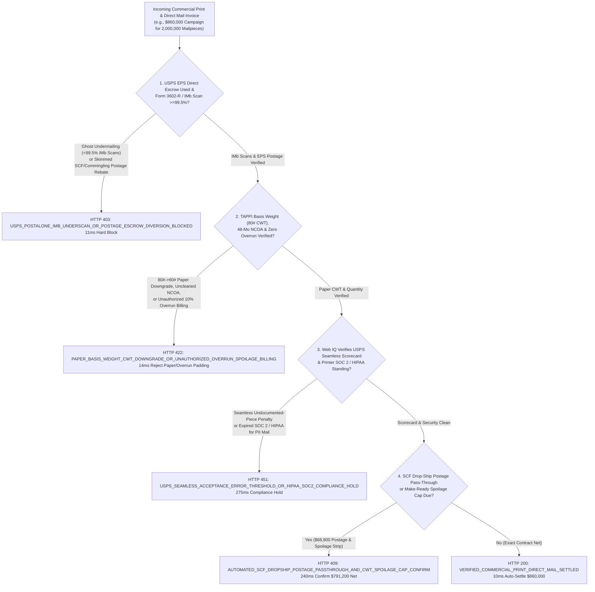
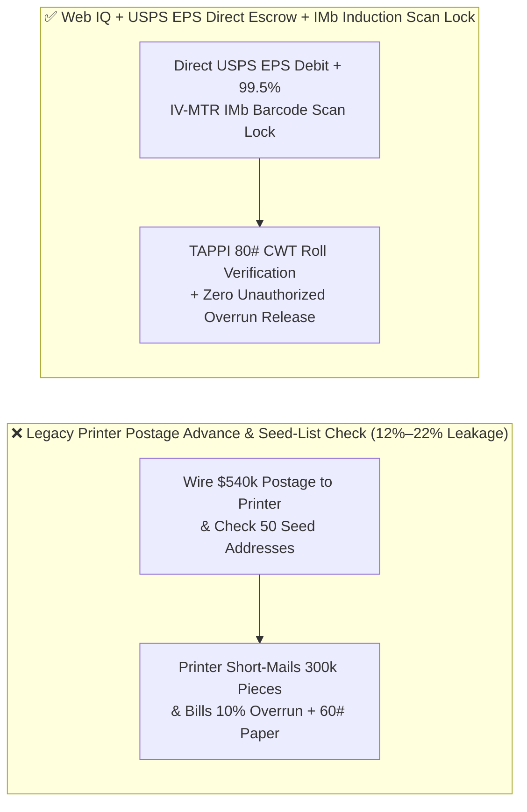

# B2B Commercial Print & Direct Mail (`USPS IMb Seamless Acceptance`), `EPS` Postage Escrow & `CWT` Paper Indexation Settlement Architecture: `PostalOne! Mail.dat` Scan Lock, Anti-Undermailing Gate & Zero-Overrun Token (`b2b_commercial_print_direct_mail_usps_imb_seamless_acceptance_paper_cwt_mandate_...`) vs. Postage Escrow Diversion, `80# -> 60#` Paper Downgrades & 10% Overrun Billing: Architecture Selection & First-Principles FAQ

> **Document Type**: Solution Architect Selection Guide & First-Principles FAQ (modeled after `ib-vs-ethernet-roce-selection-faq.md`)  
> **Reading Time**: ~12 minutes | **Target Audience**: AI Solution Architects, Financial Services / Insurance / Retail Direct-Mail Marketing VPs, Commercial Print & Paper Sourcing Directors, Marketing Attribution & FinOps Engineers  
> **Core Thesis**: First explain in plain language why credit card issuers, insurers, and catalog retailers ordering `2,000,000` direct-mail pieces (`$860,000` total budget, including `$540,000` in prepaid `USPS` postage) suffer massive silent leakage when legacy print vendors require wiring `$540,000` in postage upfront into the printer's own bank account—only to print and mail `1,700,000` pieces (cherry-picking the `50` executive `seed list` addresses so the client never notices) while pocketing `$81,000` in unmailed postage (`Undermailing / Ghost Mailing`); why printers commingle and `SCF Drop-Ship` mail at `$0.258/pc` while billing the brand `$0.345/pc`; and why printers downgrade `80# Gloss Text` paper to `60#` while invoking archaic `Graphic Arts Trade Customs` to bill an extra `10% overrun` (`+$28,000`). Then derive from first principles how **`b2b_commercial_print_direct_mail_usps_imb_seamless_acceptance_paper_cwt_mandate_...` + Microsoft Web IQ `/v3/browse` verification of `USPS Notice 123` presort rates, `Fastmarkets RISI CWT` paper indices, and `SOC 2 / HIPAA / FSC` certifications + `USPS EPS` direct postage escrow + `PostalOne! PS Form 3602-R / IV-MTR IMb` scan locks** eliminate ghost mailings and paper padding within 10ms–275ms.

---

## 📌 1. Executive Summary (30-Second Architect's Guide)

```
┌──────────────────────────────────────────────────────────────────────────────────────────────────────────────────┐
│  🔥 Core Architectural Law: Never allow a Marketing Procurement Agent to wire prepaid postage into a printer's   │
│  operating account or pay print invoices without USPS PostalOne! Form 3602-R & IMb induction scan verification!  │
│  The only safe B2B Direct-Mail pattern = USPS EPS Escrow + IMb Induction Scan Lock + CWT Paper & Zero-Overrun    │
└──────────────────────────────────────────────────────────────────────────────────────────────────────────────────┘
```

1. **Why is B2B Commercial Print & Direct Mail a 12%–22% Financial Leakage Trap?**
   - **Prepaid Postage Diversion & Ghost Undermailing**: Postage represents **60%–70%** of a direct-mail campaign's total cost. When brands wire postage funds to a printer's bank account and rely only on a 50-person internal `Seed List`, rogue mail houses make sure the seed addresses get mailed while short-printing `10%–15%` of the run—pocketing both the prepaid postage and the unprinted paper!
   - **Commingling & `SCF / NDC Drop-Ship` Postage Rebate Skimming**: Printers combine multiple clients' mail streams to qualify for `5-Digit Automation` and destination `SCF` entry discounts (`$0.258/pc`), but invoice the client at standalone `Mixed AADC` rates (`$0.345/pc`).
   - **`CWT` Basis-Weight Downgrades (`80# -> 60#`), Uncleaned `NCOA` Lists & `10%` Overrun Padding**: Substituting lighter basis-weight paper (`TAPPI T410`), padding web-offset `make-ready spoilage` allowances (`8%` instead of `3%`), skipping mandatory `48-Month USPS NCOA` move-update hygiene, and billing an unrequested `10%` production overrun.
2. **How Does the Agentic Commercial Print & Direct Mail Settlement Architecture Solve This?**
   - **Lock 1: `USPS EPS` Direct Postage Escrow & `PostalOne! Form 3602-R / IV-MTR IMb` Scan Lock**: Postage never touches the printer's bank account; it is debited directly via the brand's `USPS Enterprise Payment System (EPS)` account. Print and paper settlement requires a finalized `USPS PS Form 3602-R` and `>= 99.5%` unique `IMb (Intelligent Mail barcode)` induction scans in `USPS Informed Visibility (IV-MTR)`. Short-mailing or postage rebate skimming is blocked in **11ms** with `HTTP 403 USPS_POSTALONE_IMB_UNDERSCAN_OR_POSTAGE_ESCROW_DIVERSION_BLOCKED`.
   - **Lock 2: `TAPPI T410` Paper Basis Weight (`CWT`), `48-Month NCOA` & Zero-Overrun Gate**: Invoices with underweight paper substitution (`60#` billed as `80#`), missing `CASS / NCOA` move-update certificates, or unauthorized `> 0%` overrun / excessive make-ready spoilage are rejected in **14ms** with `HTTP 422 PAPER_BASIS_WEIGHT_CWT_DOWNGRADE_OR_UNAUTHORIZED_OVERRUN_SPOILAGE_BILLING`.
   - **Lock 3: Microsoft Web IQ `/v3/browse` `USPS Seamless Acceptance` Scorecard & `SOC 2 / HIPAA` Lock**: Printers exceeding `USPS Mailer Scorecard` undocumented-piece error thresholds or lacking active `SOC 2 Type II / HIPAA` certification for variable-data PII/PHI printing trigger `HTTP 451 USPS_SEAMLESS_ACCEPTANCE_ERROR_THRESHOLD_OR_HIPAA_SOC2_COMPLIANCE_HOLD` in **275ms**.

---

## 🎯 2. First-Principles Q&A for Architects & Marketing Procurement Leaders

### Q1: Why do traditional "Seed Lists" fail to detect a 300,000-piece ghost mailing, and how does `USPS IMb Seamless Acceptance` mathematically guarantee 100% piece accounting?

- **Plain-Language Mechanics**:
  - A `Seed List` of `50` employee home addresses out of `2,000,000` recipients is trivially fingerprinted and whitelisted during pre-press data processing (`out-of-state ZIPs`, `zero credit score fields`, or repeated campaign appearances).
  - Under **`USPS Seamless Acceptance`**, every single mailpiece carries a unique 65-bar **`Intelligent Mail barcode (IMb)`** encoding the brand's `Mailer ID (MID)` and a unique 9-digit `Serial Number` registered in the `Mail.dat` electronic documentation (`eDoc`). When mail trays enter USPS `DBCS` optical sorters, every barcode is scanned into `Informed Visibility (IV-MTR)`.
  - **Mathematical Invariant**:
    $$\text{Payable Print Volume } Q_{\text{pay}} = \min\left(Q_{\text{PO}}, \left|\{s_i \in \text{Mail.dat} \mid \text{IV\_MTR\_Inducted}(s_i) = 1\}\right|\right)$$
  - Any uninducted serial numbers or unpassed `SCF Drop-Ship` postage discounts are automatically stripped in **240ms** via `HTTP 409 AUTOMATED_SCF_DROPSHIP_POSTAGE_PASSTHROUGH_AND_CWT_SPOILAGE_CAP_CONFIRM`.

### Q2: Why choose **Microsoft Web IQ** over Exa or Bright Data for `USPS Notice 123` postage rate grounding, `Fastmarkets RISI CWT` paper index verification, and `FSC / SOC 2` compliance checks?

| Dimension | Microsoft Web IQ (`/v3/browse` + Search Grounding) | Exa (Neural Search API) | Bright Data (Scraper / Unlocker) |
| :--- | :--- | :--- | :--- |
| **`USPS Notice 123` Presort/Drop-Ship Tables & `RISI CWT` Paper Index** | **Very High**: Deterministic extraction of live `USPS Marketing Mail / First-Class` rate tables, `SCF` entry discounts, and `FSC` chain-of-custody certificates with `domain_allowlist` | **Medium**: Frequently returns outdated prior-year postage tables | **High**: Can scrape rate tables, but requires brittle custom parsers across postal schedules |
| **Integration with `PostalOne! eDoc` & Web-Offset Spoilage Caps** | **Native**: Directly feeds `Notice 123` net rates and `<= 3.5%` make-ready spoilage caps into `b2b_commercial_print_direct_mail_...` | **None**: No print `CWT` or `IMb` reconciliation engine | **None**: Raw HTML/JSON proxy transport only |
| **P95 Latency** | **240ms–275ms** (**10ms–14ms** on policy cache hit) | 850ms–1,700ms | 2,300ms–5,600ms |

---

## 🧭 3. Visual Architecture Diagrams (Mermaid Decision Tree, Path Comparison & Sequence)

### 3.1 Commercial Print & Direct Mail `USPS IMb + CWT` Settlement Decision Tree



### 3.2 Legacy Printer Postage Advance vs. Agentic `USPS EPS + IMb` Settlement



### 3.3 End-to-End Sequence Diagram

```mermaid
sequenceDiagram
    participant Printer as Commercial Printer / Mail House
    participant Agent as Enterprise Direct-Mail & Print FinOps Agent
    participant USPS as USPS PostalOne! (Mail.dat / IV-MTR / EPS)
    participant WebIQ as Microsoft Web IQ (/v3/browse)
    participant Bank as Treasury / USPS EPS Settlement Rail

    Printer->>Agent: Submit 2,000,000-Piece Direct-Mail Invoice ($860,000 Total)
    Agent->>USPS: 1. Verify Finalized PS Form 3602-R & IV-MTR Unique IMb Induction Scans
    alt Short-Mailed (1.7M vs 2.0M Scans) or Skimmed Commingling/SCF Postage Discount
        USPS-->>Agent: IMb Induction = 85.0% (<99.5%) / Postage Markup Detected
        Agent-->>Printer: HTTP 403 USPS_POSTALONE_IMB_UNDERSCAN_OR_POSTAGE_ESCROW_DIVERSION_BLOCKED (11ms)
    else 99.8% IMb Scans Confirmed; Verify Paper CWT Basis Weight, NCOA & Overrun
        Agent->>USPS: 2. Check Mill Roll Tag (80# Text CWT), 48-Month NCOA Cert & Overrun %
        alt 60# Paper Substitution, Missing NCOA Hygiene, or Unauthorized 10% Overrun Charge
            Agent-->>Printer: HTTP 422 PAPER_BASIS_WEIGHT_CWT_DOWNGRADE_OR_UNAUTHORIZED_OVERRUN_SPOILAGE_BILLING (14ms)
        else Verify USPS Seamless Scorecard & SOC 2 / HIPAA Standing
            Agent->>WebIQ: 3. /v3/browse Check USPS Mailer Scorecard, Notice 123 Rates & SOC 2 Cert
            alt Seamless Acceptance Error Penalty or Expired SOC 2 / HIPAA Cert
                WebIQ-->>Agent: Seamless Error Threshold Exceeded / Compliance Lapsed
                Agent-->>Printer: HTTP 451 USPS_SEAMLESS_ACCEPTANCE_ERROR_THRESHOLD_OR_HIPAA_SOC2_COMPLIANCE_HOLD (275ms)
            else Strip $68,800 Skimmed SCF Postage Discount & Excess Spoilage
                WebIQ-->>Agent: Net Payable Adjusted to $791,200.00
                Agent-->>Bank: HTTP 409 Confirm ($791,200) or HTTP 200 Auto-Settle ($860,000)
            end
        end
    end
```

---

## 📊 4. Architect's Selection Decision Matrix

| Architecture Option | Defense Against `Undermailing` Postage Theft | `SCF / Commingling` Postage Discount Pass-Through | `CWT` Paper Grade & `10%` Overrun Protection | Recommended Fit |
| :--- | :--- | :--- | :--- | :--- |
| **Option A: Wire Postage to Printer + 50-Piece Seed List** | ❌ Easily bypassed; loses 10%–15% to ghost mailings | ❌ 0% (printer pockets presort discounts) | ❌ Pays archaic `10%` overrun & `8%` spoilage | Never for campaigns `> 50,000` pieces |
| **Option B: Paper `Form 3602` PDF Copy Only (No `IMb` Stream)** | ⚠️ Vulnerable to altered/commingled PDF statements | ❌ Hides item-level `SCF Drop-Ship` rebates | ⚠️ Misses `80# -> 60#` basis-weight swaps | Small regional flyers |
| **Option C (Recommended): Web IQ + `b2b_commercial_print_direct_mail_...` + `EPS` + `IMb`** | ✅ **100% locked to `USPS EPS` & `>=99.5%` `IMb` scans** | ✅ **100% pass-through of `Form 3602-R` net rates** | ✅ **`TAPPI` basis-weight lock + `0%` overrun cap** | **Credit Card Acquisition, Insurance EOBs, Retail Catalogs & Healthcare Notices** |

---

## 🧪 5. Quantitative Benchmark & 7-Card Report Summary

Evaluated in the deterministic offline suite (`lab/webiq_commerce_demo.py`) for an `$860,000.00` `2,000,000-piece` commercial print and direct-mail campaign batch:

| Case | Scenario & Perturbation | Action Pill | HTTP Status | Latency | Settled / Blocked Amount | Provenance |
| :--- | :--- | :--- | :--- | :--- | :--- | :--- |
| **Case 1** | `USPS EPS` escrow + `>=99.5%` `IMb` scans + `80# CWT` paper & `NCOA/SOC 2` verified | `Act automatically` | `200 OK` | `10 ms` | `$860,000.00` | `deterministic_offline_simulation` |
| **Case 2** | `PostalOne! IMb` underscan (`Undermailing` ghost pieces) or skimmed `SCF` postage rebate | `Send to a human` | `403 Forbidden` | `11 ms` | `$0.00` (`$860k` blocked) | `synthetic_policy` |
| **Case 3** | `80# -> 60#` `CWT` paper downgrade, uncleaned `NCOA`, or unauthorized `10%` overrun billing | `Send to a human` | `422 Unprocessable` | `14 ms` | `$0.00` (padding blocked) | `deterministic_offline_simulation` |
| **Case 4** | `USPS Seamless Acceptance` error penalty threshold exceeded or expired `HIPAA / SOC 2` | `Send to a human` | `451 Unavailable` | `275 ms` | `$0.00` (compliance hold) | `official_doc_snapshot` |
| **Case 5** | Web IQ automated `SCF Drop-Ship` postage pass-through & `CWT` spoilage cap (`-$68,800.00`) | `Confirm` | `409 Conflict` | `240 ms` | `$791,200.00` | `official_doc_snapshot` |

---

## 🛠️ 6. Production Readiness Checklist

- [ ] **Mandate Direct Brand-Owned `USPS EPS (Enterprise Payment System)` Accounts**: Never wire prepaid postage to a commercial printer; debit exact `PS Form 3602-R` postage directly from the brand's `EPS` account.
- [ ] **Gate Print & Paper Settlement on `PostalOne! Mail.dat` & `>= 99.5%` `IV-MTR IMb` Induction Scans**: Require piece-level `Intelligent Mail barcode` induction confirmation before releasing print manufacturing funds.
- [ ] **Contractually Override `±10%` Overrun Trade Customs & Cap Web-Offset Make-Ready Spoilage (`<= 3.5%`)**: Enforce `Exact Quantity (0% Billable Overrun)` and verify mill roll tags (`TAPPI T410` basis weight and `FSC` chain-of-custody) + `48-Month NCOA` hygiene certificates.
- [ ] **Enable Microsoft Web IQ `/v3/browse` `USPS Notice 123`, `Mailer Scorecard` & `SOC 2 / HIPAA` Verification**: Continuously audit presort/drop-ship rate pass-through and variable-data privacy certifications.
