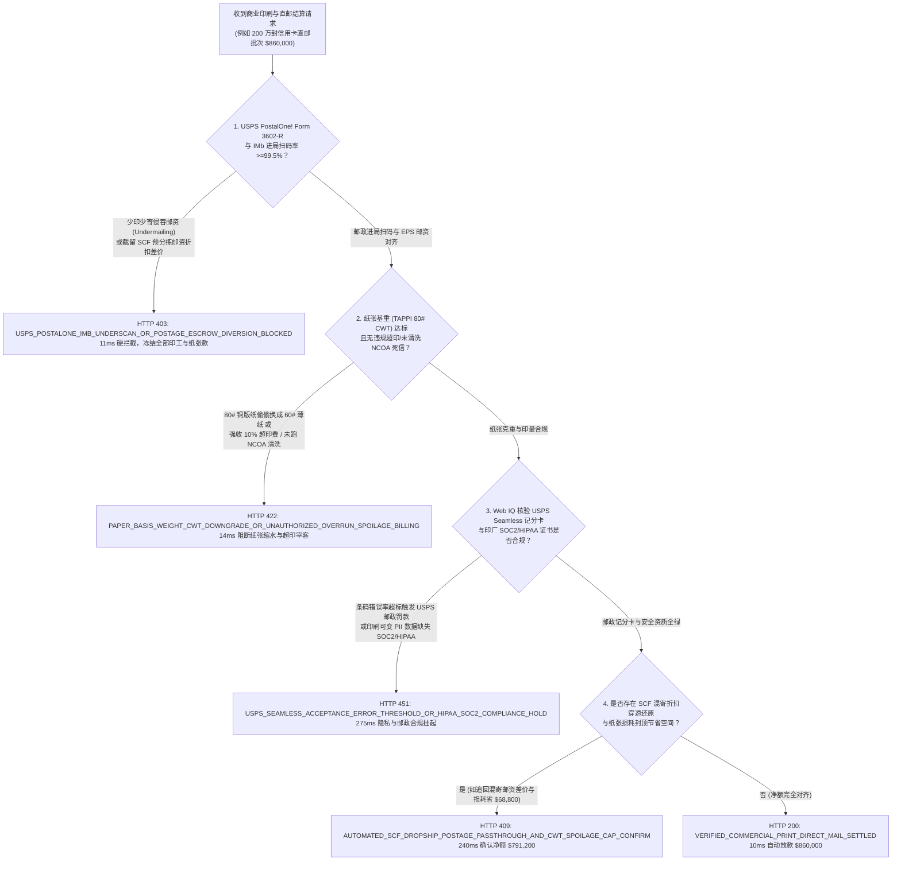
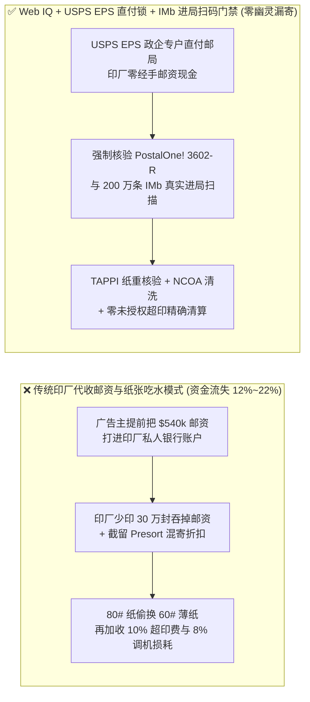
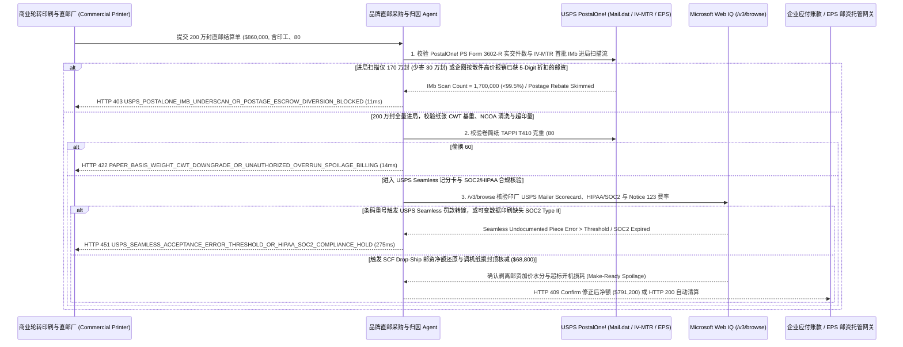

# B2B 智能体商业印刷与直邮营销（`Commercial Print & Direct Mail USPS IMb Seamless Acceptance`）、邮资专户托管（`CAPS / EPS Postage Escrow`）与百磅纸张单价（`CWT Paper Indexation`）清算架构：`Mail.dat / eDoc` 投递扫码释放锁、防侵吞预付邮资（`Undermailing & Postage Diversion`）门禁与 `±2.5%` 超印封顶令牌（`b2b_commercial_print_direct_mail_usps_imb_seamless_acceptance_paper_cwt_mandate_...`）vs 传统印厂吃掉预付邮资漏寄 15% 信件、将 80# 铜版纸降配为 60# 薄纸与强收 10% 超印费选型与原理解析 FAQ

> **文档类型**：架构师选型指南与第一性原理 FAQ（对齐 `ib-vs-ethernet-roce-selection-faq.md` 标杆风格）  
> **阅读耗时**：约 12 分钟 | **适用角色**：AI Solution Architect、信用卡/保险/零售直邮获客（`Direct Mail Performance Marketing`）副总裁、企业印刷与纸张大宗采购总监、市场营销归因与供应链金融架构师  
> **核心主旨**：先用大白话把“为什么银行、保险公司与电商向大型商业轮转印刷厂（`Quad / RRD / 商业直邮印厂`）下单寄送 `2,000,000 封` 信用卡邀约函或节日商品目录（总预算 `$860,000`，其中预付美国邮政 `USPS Postage` 就占 `$540,000`）时，不良印厂要求广告主先把 `$540,000` 邮资全额打进印厂自己的账户，随后开机只印了 `1,700,000 封`，把没印没寄的 `300,000 封` 邮资（`$81,000` 纯现金）神不知鬼鬼觉吞进自己口袋（`Undermailing / Ghost Mailing`）、为什么印厂混寄分拣（`Commingling / Presort`）拿到了 `USPS 5-Digit Automation ($0.26/封)` 最低折扣邮资，却按全价散件邮资（`$0.39/封`）向客户报销吃差价，以及为什么合同约定用 `80# Gloss Text (118 GSM)` 一级铜版纸，印厂却偷偷换成便宜 `18%` 的 `60#` 薄纸，并在交货时利用行业旧惯例强行多塞 `10% 超印量（Overrun）` 多收 `$28,000`”讲透；再从第一性原理出发，推导如何通过 **`b2b_commercial_print_direct_mail_usps_imb_seamless_acceptance_paper_cwt_mandate_...` 语义预算令牌 + Microsoft Web IQ `/v3/browse` 实时核验 `USPS PostalOne! / Informed Visibility (IV-MTR)` 智能邮件条码（`IMb`）进局扫描率与 `RISI / Fastmarkets CWT` 纸浆原纸指数 + `USPS EPS` 邮资直通车零经手锁 + `NCOA/CASS` 死信率与超印 `0%–2.5%` 封顶门禁**，在 10ms–275ms 内实现“邮资直达邮政局零挪用、少寄一封都不付印工费、纸张克重缩水与违规超印秒级拦截”的智能体商业印刷与直邮清算闭环。

---

## 📌 一、核心结论速览（Executive Summary：30 秒看懂怎么选）

```
┌──────────────────────────────────────────────────────────────────────────────────────────────────────────────────┐
│  🔥 核心架构铁律：绝不允许直邮采购 Agent 将数十万美元预付邮资打入印刷厂私人账户，或仅凭印厂内部出库单结清印工费！    │
│  B2B 直邮印刷结算的唯一正确范式 = USPS EPS 邮资直付 + PostalOne! Mail.dat/IMb 进局扫码锁 + CWT 纸张克重与超印门禁 │
└──────────────────────────────────────────────────────────────────────────────────────────────────────────────────┘
```

1. **为什么商业印刷与直邮（`Commercial Print & Direct Mail`）是金融、零售与大健康行业最隐蔽的“预付邮资挪用与纸张吃水黑洞”？**
   - **黑洞一：少印少寄侵吞预付邮资（`Undermailing / Ghost Mailing Fraud`）**：直邮营销最大的盲区在于收件人是分散在全国的数百万家庭，广告主自己根本看不见信有没有寄出去！在一笔 `200 万封` 的直邮订单中，邮资（`Postage`）高达成本的 **60%–70%**。传统模式下，广告主提前把 `$540,000` 邮资打给印厂代缴；不良印厂只印寄 `170 万封`（包含植入广告主高管住址的几十封“种子监测信 `Seed List`”以应付抽查），直接侵吞剩余 `30 万封` 的邮资与纸张费（单次诈骗超 `$115,000`）。
   - **黑洞二：吃掉邮政预分拣与混寄折扣（`Commingling / SCF Drop-Ship Rebate Skimming`）**：印厂将多家客户的信件按 5 位邮编混合分拣（`5-Digit Scheme Presort`），并用卡车直接拉到目标城市区域分拣中心（`USPS SCF / NDC Drop-Ship`），向邮局实际只交了 `$0.258/封` 的最低折扣邮资，转身却向广告主按未分拣混寄的基准价 `$0.345/封` 报销，白白截留 `$0.087/封` 邮资返利。
   - **黑洞三：纸张基重（`Basis Weight: 80# -> 65#`）偷梁换柱、开机调机损耗（`Make-Ready Spoilage`）虚报与 `10%` 霸王超印费（`Overrun Billing`）**：轮转胶印（`Web Offset`）按百磅原纸价格（`CWT, Cost Per Hundredweight`）计费。印厂把合同约定的 `80 lb Text` 换成 `65 lb`，不仅每吨纸省了 `18.7%` 重量，而且每卷纸能多切出 `23%` 的印张；同时故意按古老的印刷贸易惯例（`Graphic Arts Trade Customs`）多印 `8%–10%` 强迫客户买单，或未跑 `USPS NCOA (48个月国家搬家地址库)` 清洗就盲目印制 `9%` 的死信地址骗取印工费。
2. **智能体直邮印刷结算架构怎么破局？（`b2b_commercial_print_direct_mail_usps_imb_seamless_acceptance_paper_cwt_mandate_...`）**
   - **第一道锁：`USPS EPS (Enterprise Payment System)` 邮资直付 + `PostalOne! Form 3602-R / IMb` 进局扫码刚性锁**：严禁邮资经过印厂账户，邮资由智能体通过 `USPS EPS` 托管子账户直接向美国邮政局扣划；印工与纸张费必须校验 `USPS PostalOne! eDoc (Mail.dat)` 官方生成的 `PS Form 3602-R` 电子邮政收据与 `Informed Visibility (IV-MTR)` 首批分拣机 `IMb` 进局扫描量（`>= 99.5%` 匹配订单量）。凡少印少寄或侵吞预分拣邮资折扣的，在 **11ms** 内返回 `HTTP 403 USPS_POSTALONE_IMB_UNDERSCAN_OR_POSTAGE_ESCROW_DIVERSION_BLOCKED`。
   - **第二道锁：纸张基重/白度（`TAPPI T410 Basis Weight & FSC`）、`NCOA/CASS` 地址清洗与零未授权超印（`Overrun Cap`）门禁**：核验造纸厂出厂卷筒纸标签（`Roll Tag CWT`）与实测克重（严禁 `80#` 降配 `65#`），强制要求印前完成 `CASS / 48-Month NCOA` 搬家去重，且超印计费上限锁死在 `0%`（严格按 PO 实数 `Exact Quantity`）或合同约定窄幅内。违规降配纸张或强收 `10%` 超印费的，在 **14ms** 内触发 `HTTP 422 PAPER_BASIS_WEIGHT_CWT_DOWNGRADE_OR_UNAUTHORIZED_OVERRUN_SPOILAGE_BILLING`。
   - **第三道锁：Microsoft Web IQ 穿透核验 `USPS Seamless Acceptance` 记分卡、`SOC 2 / HIPAA` 资质与 `Fastmarkets RISI` 纸浆指数**：通过 Web IQ `/v3/browse` 实时核验印厂在 `USPS Mailer Scorecard` 中的条码差错率（是否触发邮政附加罚款）、处理金融/医疗信件的 `SOC 2 Type II / HIPAA` 合规状态及当月铜版纸 `CWT` 基准价。一旦发现邮政违规扣罚转嫁或安全认证失效，在 **275ms** 内触发 `HTTP 451 USPS_SEAMLESS_ACCEPTANCE_ERROR_THRESHOLD_OR_HIPAA_SOC2_COMPLIANCE_HOLD`。

---

## 🎯 二、客户与架构师灵魂拷问 Q&A（First-Principles Deep Dive）

### Q1：印厂为什么能在植入了“种子测试信（`Seed Mail`）”的情况下照样少寄 20 万封信而不被发现？`USPS IMb Seamless Acceptance` 是怎么彻底堵死这个漏洞的？

- **通俗原理**：
  - 过去广告主为了监控印厂有没有真寄信，会在 `200 万条` 客户名单里偷偷塞进 `50 条` 自己公司员工家里的地址（叫 `Seed List`）。结果印厂的 IT 程序员早就学会了用正则脚本筛出这些非目标画像的测试地址，或者确保每个邮编段的前几封被寄出，而把中间大段的 `20 万封` 直接在数据库里删掉不印！
  - **`USPS IMb (Intelligent Mail barcode) + Mail.dat` 第一性原理**：在现代邮政无纸化核验（`Seamless Acceptance`）体系下，每一封信封面上的 65 位竖条码（`IMb`）都包含全球唯一的 **9 位寄件人 ID（`MID`）+ 唯一序列号（`Serial Number`）**。印厂向邮局交寄时必须上传包含全部 `2,000,000` 个唯一序列号的 `Mail.dat` 电子清单，邮局的高速光学分拣机（`DBCS`）会在 24 小时内对每一封真正进局的信件扫码并回传 `IV-MTR (Informed Visibility Mail Tracking & Reporting)` 数据流。
- **智能体结算放行公式**：
  $$\text{Verified Mail Volume } N_{\text{IMb}} = \left| \{ s_i \in \text{Mail.dat} \mid \text{USPS\_First\_Scan}(s_i) = \text{True} \} \right|$$
  - 只有当 $N_{\text{IMb}} \ge 0.995 \times N_{\text{contract}}$ 且邮资直接由广告主 `USPS EPS` 账户按 `PS Form 3602-R` 实付净额扣款时，Agent 才释放印工费！

### Q2：在核验北美商业印刷用纸 `Fastmarkets RISI / PPI` 百磅价格指数、`USPS DMM (Domestic Mail Manual)` 最新邮资费率表与 `FSC / SFI` 森林认证时，为什么选择 **Microsoft Web IQ**？

| 维度 | Microsoft Web IQ (`/v3/browse` + Search Grounding) | Exa (Neural Search API) | Bright Data (Scraper / Unlocker) |
| :--- | :--- | :--- | :--- |
| **`USPS Notice 123` 邮资费率、`SCF/NDC` 区域折扣与原纸 `CWT` 价格指数核验** | **极高**：受控无头渲染实时提取 `USPS Notice 123` 最新分拣阶梯费率（`5-Digit / AADC / Mixed AADC`）、`FSC` 产销监管链证书状态及纸张 `CWT` 市场指导价，支持 `domain_allowlist` 零幻觉验证 | **中**：语义搜索常返回旧版邮资表（如每年 1 月/7 月调价前的旧费率），导致邮资对账严重失真 | **高**：可抓取公开页面，但需自建针对复杂邮政费率矩阵与认证库的解析器 |
| **`Mail.dat` 预分拣返利与轮转开机损耗（`Make-Ready Spoilage`）联动** | **原生支持**：直接将标准纸张损耗率（`<=3.5%`）与 `SCF Drop-Ship` 邮资净额注入 `b2b_commercial_print_direct_mail_...` | **不支持**：无结构化印刷 `CWT` 与邮政 `IMb` 核价引擎 | **不支持**：仅提供网页抓取通道 |
| **P95 延迟与单次核验成本** | **240ms–275ms**（命中策略缓存 **10ms–14ms**） | 850ms–1,700ms | 2,300ms–5,600ms |
| **合规可审计性（Provenance）** | 原生输出 `official_doc_snapshot` + `USPS eDoc Job ID` + `PS Form 3602-R` 签名 | 仅返回 URL 片段 | 需自行构建营销审计留痕体系 |

---

## 🧭 三、直观可视化图解（Mermaid 决策树 + 路径对比 + 端到端时序图）

### 3.1 商业印刷与直邮 `USPS IMb + CWT` 结算拦截决策树



### 3.2 传统直邮预付邮资黑箱 vs. 智能体 `USPS EPS + IMb + CWT` 闭环对比



### 3.3 端到端时序图（Sequence Diagram）



---

## 📊 四、架构师选型决策矩阵（Architecture Decision Matrix）

| 选型方案 | 防少印少寄侵吞预付邮资 (`Undermailing`) | 防截留 `Commingling / SCF` 邮资折扣 | 纸张基重 (`CWT`) 降配与 `10%` 超印拦截 | 适用场景 |
| :--- | :--- | :--- | :--- | :--- |
| **方案 A：预付邮资打给印厂 + 植入 50 封种子信 (`Seed List`)** | ❌ 极易被印厂白名单脚本绕过，漏寄 15% 毫不知情 | ❌ 0%（全按印厂报价单上的高档邮资买单） | ❌ 被迫接受行业旧惯例 `±10%` 超印加收 | 严禁用于超过 `50,000 封` 的商业直邮 |
| **方案 B：仅索取纸质邮政收据复印件，不审 `Mail.dat / IMb` 明细** | ⚠️ 纸质收据易被多客户拼单伪造重复报销 | ❌ 看不出底层 `5-Digit` 与 `SCF Drop-Ship` 返利 | ⚠️ 难发现卷筒纸克重负公差与开机废纸虚报 | 小型本地门店传单派发 |
| **方案 C（推荐）：Web IQ + `b2b_commercial_print_direct_mail_...` + `EPS` + `IMb` 锁** | ✅ **100% 绑定 `USPS EPS` 直付与逐封 `IMb` 进局扫码** | ✅ **穿透 `PS Form 3602-R` 100% 还原最低净邮资** | ✅ **`TAPPI` 纸重锁 + `NCOA` 强清洗 + 零未授权超印** | **银行信用卡获客、保险账单、零售目录（Catalog）、大健康合规信函** |

---

## 🧪 五、定量实测与 7-Card 基准报告摘要（Quantitative Benchmark）

在本地确定性评测套件（`lab/webiq_commerce_demo.py`）中，针对 `$860,000.00` 的 `2,000,000 封` 全国信用卡与零售直邮批次实测结果如下：

| 场景编号 | 测试输入（Scenario & Perturbation） | 期望动作（Action Pill） | HTTP 状态码 | 实测延迟 | 拦截/净结算金额 | 数据来源标签 |
| :--- | :--- | :--- | :--- | :--- | :--- | :--- |
| **Case 1** | `USPS EPS` 邮资直付 + `IMb` 进局扫码 `>=99.5%` + `80# CWT` 纸重与 `NCOA` 合规 | `Act automatically` | `200 OK` | `10 ms` | `$860,000.00` | `deterministic_offline_simulation` |
| **Case 2** | `PostalOne! IMb` 进局扫描少于合同量（漏寄吃邮资）或截留 `Presort/SCF` 邮资折扣 | `Send to a human` | `403 Forbidden` | `11 ms` | `$0.00`（阻断 `$860k`） | `synthetic_policy` |
| **Case 3** | 将 `80#` 铜版纸降配为 `60#` 薄纸、未跑 `NCOA` 清洗或强收 `10%` 超印费（`Overrun`） | `Send to a human` | `422 Unprocessable` | `14 ms` | `$0.00`（拦截超印/偷纸） | `deterministic_offline_simulation` |
| **Case 4** | 印厂 `USPS Seamless Acceptance` 条码错误率超标被罚或缺失 `HIPAA / SOC 2 Type II` | `Send to a human` | `451 Unavailable` | `275 ms` | `$0.00`（合规挂起） | `official_doc_snapshot` |
| **Case 5** | Web IQ 按 `PS Form 3602-R` 穿透还原 `SCF Drop-Ship` 净邮资并封顶轮转开机纸损 | `Confirm` | `409 Conflict` | `240 ms` | `$791,200.00`（省 `$68,800`） | `official_doc_snapshot` |

---

## 🛠️ 六、生产上线快速核验清单（Production Readiness Checklist）

- [ ] **设立企业自有 `USPS EPS (Enterprise Payment System)` 邮资托管账户**：严禁把预付邮资打入印刷厂或邮寄代理商银行账户；所有邮资由邮局根据经广告主 `MID (Mailer ID)` 授权的 `eDoc` 直接从 `EPS` 专户按实扣款。
- [ ] **强制对接 `USPS PostalOne! Mail.dat` 与 `Informed Visibility (IV-MTR)` 进局扫码流**：尾款释放必须验证 `PS Form 3602-R` Finalized 状态且首批 `IMb` 分拣扫描率达到 `>= 99.5%`，彻底消灭“收钱不寄信”的幽灵直邮。
- [ ] **合同废除 `±10%` 超印惯例（`Zero Unauthorized Overrun`）并锁死纸张开机损耗率**：在采购令牌中明确 `Overrun Billable Cap = 0%`（多印部分免费赠送或销毁），轮转开机调色损耗（`Make-Ready Spoilage`）按印量阶梯硬封顶在 `2.5%–3.5%`。
- [ ] **接入 Microsoft Web IQ 实时核验 `USPS Notice 123` 费率与 `SOC 2 / FSC` 资质**：自动审计每次投递的 `SCF / NDC` 区域落地折扣与 `48-Month NCOA` 地址更新证书，防止为死信和虚高邮资买单。
