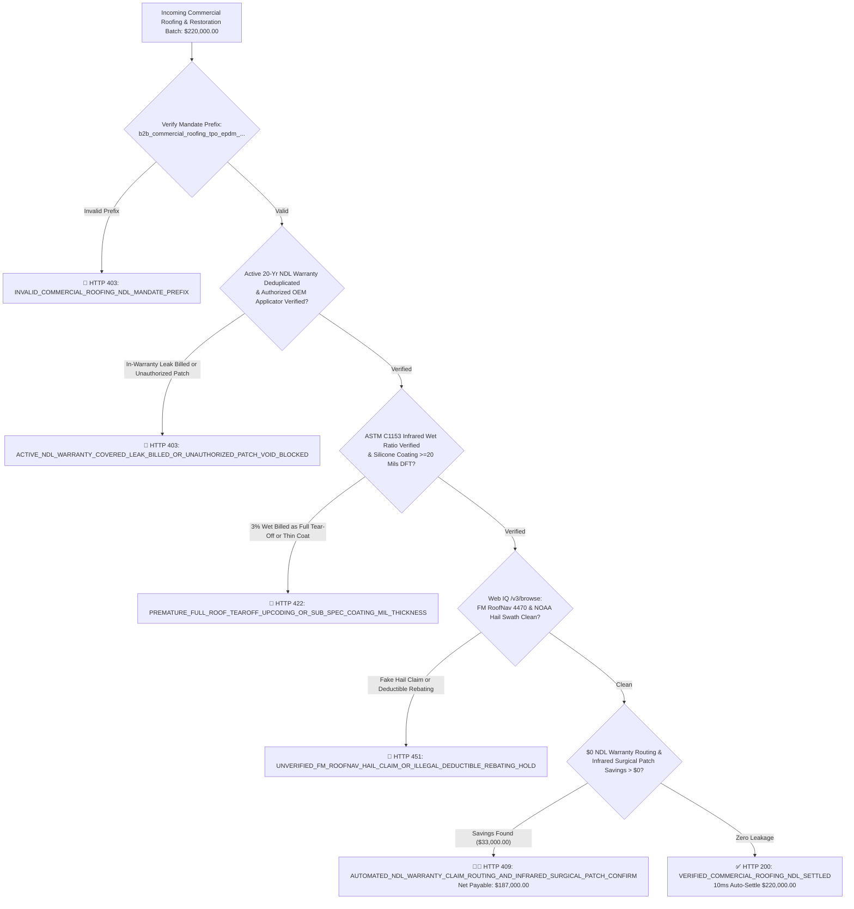
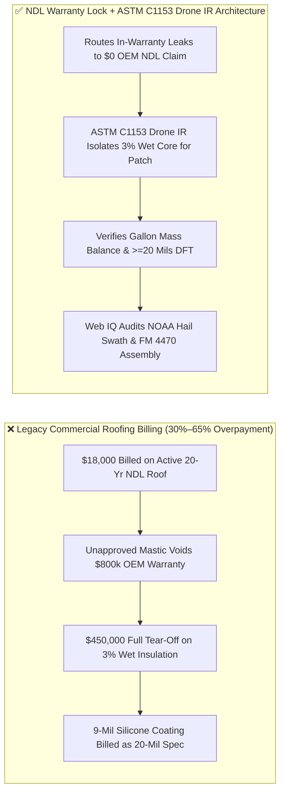
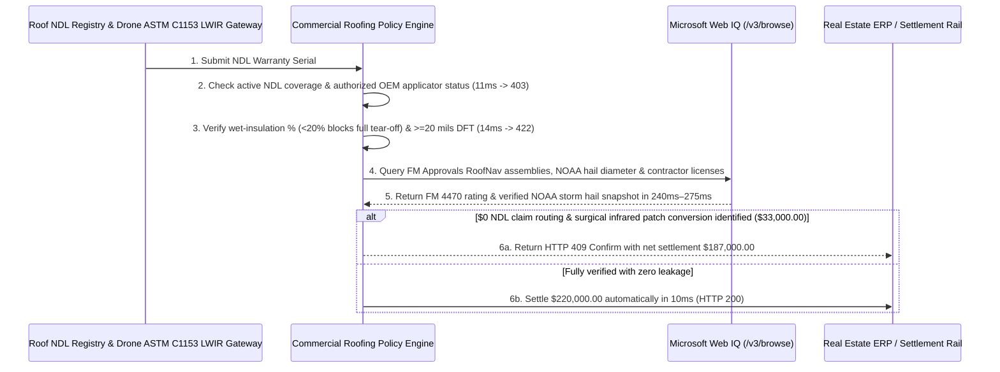

# B2B Commercial Roofing, `TPO / EPDM` Maintenance & Hail Restoration (`CentiMark / Tecta America, NRCA / FM 4470 & ASTM C1153`), Active `20-Year NDL` Warranty Lock, Drone `ASTM C1153` Infrared Moisture Gate & Anti-`Full Tear-Off Upcoding` Settlement Architecture: `NDL` Serial Deduplication Lock, Wet-Insulation Ratio Gate & `FM 4470` Token (`b2b_commercial_roofing_tpo_epdm_ndl_warranty_astm_c1153_infrared_scan_mandate_...`) vs. Billing `$18,000` for `NDL` Warranty-Covered Leaks, `$450,000` Full Tear-Off Upcoding on `3%` Wet Insulation & Manufactured Hail Claims: Architecture Selection & First-Principles FAQ

> **Document Type**: AI Solution Architect Agentic Commerce Selection Series (Round 313 · B2B Commercial Roofing, NDL Warranty & ASTM C1153 Infrared Scan Edition)  
> **Benchmark Standard**: Modeled after `ib-vs-ethernet-roce-selection-faq.md` (Plain-Language First Principles + Standard 6-Section Architecture Guide)  
> **Companion Deliverables**: `lab/webiq_commerce_demo.py` (Interactive H5 Sandbox) · `tests/test_webiq_commerce_demo.py` · `assets/svg/315-b2b-commercial-roofing-tpo-epdm-ndl-warranty-infrared-2026-11-16.svg`  
> **Languages**: [中文版](b2b-commercial-roofing-tpo-epdm-ndl-warranty-astm-c1153-infrared-scan-mandate-vs-warranty-covered-leak-billing-full-tearoff-upcoding-hail-fraud-faq.md) | [English Version (Current)](b2b-commercial-roofing-tpo-epdm-ndl-warranty-astm-c1153-infrared-scan-mandate-vs-warranty-covered-leak-billing-full-tearoff-upcoding-hail-fraud-faq.en.md)

---

## 📌 1. Executive Summary (First Principles & Plain-Language Breakdown)

### 1.1 Why Should a Logistics REIT, Big-Box Retailer, or Manufacturing Facilities Agent NEVER Auto-Pay a Commercial Roof Repair or Reroofing Invoice Without `NDL` Warranty Lookup and `ASTM C1153` Drone Infrared Scans?
Across `200,000–1,000,000 sq. ft.` distribution warehouses, big-box retail stores, hospitals, and manufacturing plants, flat low-slope roofs use single-ply membranes (`TPO / EPDM / PVC`) over polyisocyanurate (`ISO`) insulation boards backed by **20- to 30-year Manufacturer No-Dollar-Limit (`NDL`) Warranties** (from GAF, Carlisle, Holcim/Firestone, or Johns Manville). In plain English: **Because facility managers rarely climb a 40-foot ladder onto a blazing warehouse roof, commercial roofing is plagued by four massive financial traps—paying `$18,000` out-of-pocket for seam leaks that are 100% covered for `$0` under an active 20-year manufacturer `NDL` warranty (and accidentally voiding that `$800,000` warranty by letting an unauthorized roofer smear non-approved mastic), condemning an entire `$450,000` roof for a full tear-off when only `3%` of the insulation is wet, shorting silicone cool-roof coatings to `9 mils` instead of `20 mils`, and staging fake hail damage with illegal insurance deductible rebates.** Allowing an AI agent to auto-pay roofing invoices exposes real estate portfolios to four major vulnerabilities:

1. **Out-of-Pocket Billing & Accidental Voiding on Active `20-Year NDL` Warranty Roofs**: A warehouse roof develops a熱-welded seam split or flashing leak in Year 8. Under the manufacturer's `20-Year NDL Warranty`, labor and materials are covered at **`$0.00`**. Unaware of the warranty certificate, a site manager calls a local roofer who bills `$14,500`—and applies unapproved asphalt mastic onto a `TPO` membrane, immediately **voiding the building's entire `$800,000` NDL warranty**!
2. **`$450,000` Full Roof Tear-Off Upcoding on `< 5%` Localized Wet Insulation**: Under `NRCA` guidelines and `IBC § 1511`, when `< 15%–20%` of roof insulation is saturated, the engineering fix is a localized surgical wet-core cutout and membrane patch (`$18,000`) guided by an `ASTM C1153` night infrared scan. Instead, contractors show photos of surface puddles and scare owners into a **`$450,000` Full Tear-Off & Reroof**.
3. **Silicone Cool-Roof Coating Mil-Thickness Shorting (`9 Mils vs. 20 Mils DFT`)**: Liquid-applied silicone roof restorations require `>= 20–25 dry mils` (`1.5–2.0 gal / 100 sq. ft.`) to qualify for a 10-year warranty. Crews apply thick coating around the roof hatch where inspectors look, but roll only `9 mils` across the main field, pocketing 50% of the material budget.
4. **"Storm Chaser" Hail Fraud & Illegal Deductible Rebating**: After minor storms where hail was `< 1.0 inch` (too small to fracture `FM 4470 Severe Hail` membranes), rogue contractors create circular dimples with ball-peen hammers or offer illegal **Property Insurance Deductible Rebates** (a felony/statutory violation under laws like Texas HB 2102).

### 1.2 The Architect's One-Sentence Selection Verdict
* **Core Security Law**: Never allow an autonomous agent to settle commercial roof repair, coating, or replacement invoices without binding the payment to **`b2b_commercial_roofing_tpo_epdm_ndl_warranty_astm_c1153_infrared_scan_mandate_2026`**:
  1. **Active `20-Year NDL Warranty` Deduplication Lock + Authorized Applicator Gate**: Cross-checks every building's `NDL Warranty Serial #` before authorizing work; seam/membrane leaks on in-warranty roofs must be routed as `$0.00` manufacturer `NDL` claims to certified applicators, blocking out-of-pocket billing or warranty-voiding patches in **11ms** with `HTTP 403 ACTIVE_NDL_WARRANTY_COVERED_LEAK_BILLED_OR_UNAUTHORIZED_PATCH_VOID_BLOCKED`.
  2. **`ASTM C1153` Drone Infrared Wet-Insulation Ratio Gate (`< 20%` Blocks Full Tear-Off) + `>= 20 Mils DFT` Coating Lock**: Requires post-sunset drone `LWIR` thermography and capacitance moisture verification proving `>= 25%` wet insulation before allowing full tear-off quotes, and verifies drum-to-square-foot mass balance (`>= 20 mils DFT`) on silicone coatings, blocking violations in **14ms** with `HTTP 422 PREMATURE_FULL_ROOF_TEAROFF_UPCODING_OR_SUB_SPEC_COATING_MIL_THICKNESS`.
  3. **Microsoft Web IQ `/v3/browse` Live `FM Approvals RoofNav (FM 4470)`, `NOAA` Hail Swath & `NRCA` License Verification**: Verifies `FM RoofNav` wind-uplift/hail assembly ratings, cross-checks `NOAA NCEI` storm hail diameter at the exact facility coordinates, and flags illegal deductible rebating in **275ms** (`HTTP 451 UNVERIFIED_FM_ROOFNAV_HAIL_CLAIM_OR_ILLEGAL_DEDUCTIBLE_REBATING_HOLD`), while automatically routing covered leaks to `$0 NDL` claims and converting unnecessary full tear-offs to infrared surgical patches to save `15%` (`$33,000.00`).

| Selection Dimension | Legacy Site-Manager Roof Repair Sign-Off | Basic Quote-Review Agent | **NDL Warranty Lock + ASTM C1153 Infrared Gate + Web IQ FM/NOAA (Recommended)** |
| :--- | :--- | :--- | :--- |
| **In-Warranty NDL Roof Leaks** | ❌ Pays `$18k` out-of-pocket & voids `$800k` NDL | ❌ Ignores building warranty registry | ✅ **Routes active `NDL` seam/membrane leaks at `$0` to OEM (11ms 403)** |
| **Full Tear-Off Upcoding ($450k vs. $18k)** | ❌ Approves full reroof on 3% wet insulation | ❌ Cannot measure subsurface moisture | ✅ **Requires `ASTM C1153` drone IR scan; `<20%` wet forces surgical patch (14ms 422)** |
| **Silicone Coating Mil Shorting** | ❌ 9 mils applied instead of 20 mils DFT | ❌ No drum-to-area mass balance check | ✅ **Verifies gallon drum depletion & `>= 20 mils` dry film thickness** |
| **Hail Fraud & FM 4470 Compliance** | ❌ Exposed to storm-chaser deductible fraud | ❌ No live `NOAA` hail or `FM RoofNav` check | ✅ **Web IQ `/v3/browse` verifies `NOAA` hail size & `FM 4470` in 275ms (451)** |

---

## 🎯 2. Deep-Dive Q&A for Real Estate, Logistics & Facilities Architects

### Q1: How does post-sunset `ASTM C1153` Drone Infrared Thermography prove whether a warehouse roof needs a `$450,000` full tear-off or an `$18,000` surgical patch?
* **The Physics of Thermal Mass**: Dry polyisocyanurate (`ISO`) roof insulation cools rapidly after sunset, whereas water-saturated insulation retains daytime solar heat (`4.184 J/g·°C` specific heat capacity) and glows `4°C–8°C` warmer under a drone-mounted Long-Wave Infrared (`LWIR`) camera.
* **The Deterministic Policy Gate**:
  $$\text{Wet Insulation Ratio} = \frac{\sum \text{Pixels}(\Delta T_{\text{post-sunset}} \ge +4.0^\circ\text{C})}{\text{Total Roof Membrane Area}}$$
  When the verified wet-insulation ratio is `< 20%`, the settlement engine blocks full tear-off invoices (`HTTP 422`) and authorizes only surgical wet-core replacement (`HTTP 409`, saving `$33,000.00` on a `$220,000.00` quarterly portfolio batch).

### Q2: Why is an unauthorized `$1,500` roof patch often a `$500,000` catastrophic mistake?
* **Manufacturer `NDL` Exclusivity**: Every major single-ply manufacturer (`Carlisle`, `GAF`, `Holcim`, `JM`) stipulates that any alteration or repair using non-approved mastics or uncertified contractors voids the `No-Dollar-Limit` warranty. Our gateway locks every roof polygon to its active `NDL Serial #` and blocks dispatch or payment to any non-certified vendor (`HTTP 403`).

### Q3: How does Microsoft Web IQ compare to Exa and Bright Data for checking `FM Approvals RoofNav` assemblies, `NOAA` hail storm records, and state roofing licenses?
* **Microsoft Web IQ**: Delivers sub-300ms (`240ms–275ms`) authoritative `/v3/search` and `/v3/browse` verification against `FM Approvals RoofNav` assembly tables, `NOAA NCEI` historical hail-diameter databases, `CRRC` cool-roof ratings, and state contractor licensing boards under Entra ID Zero Data Retention (ZDR).
* **Exa**: Built for semantic search over general research articles rather than deterministic `FM RoofNav` assembly number or lat/long hail verification.
* **Bright Data**: Designed for high-volume retail web scraping rather than low-latency industrial insurance and weather verification.

---

## 🧭 3. Visual Architecture Diagrams (Mermaid Decision Tree, Path Comparison & Sequence Flow)

### 3.1 Commercial Roofing, NDL Warranty & Infrared Settlement Decision Tree

### 3.2 Legacy Roof Replacement Upcoding vs. NDL + ASTM C1153 Infrared Architecture

### 3.3 End-to-End Sequence Diagram

---

## 📊 4. Architect's Selection Decision Matrix

| Evaluation Dimension | Option A: Site Manager Repair Approval | Option B: Generic LLM Quote OCR | **Option C: NDL Lock + ASTM C1153 IR Gate + Web IQ (Recommended)** |
| :--- | :--- | :--- | :--- |
| **Active 20-Yr NDL Warranty Protection** | ❌ Forgets roof is under OEM warranty | ❌ Quote omits building NDL certificate | ✅ **Routes in-warranty leaks at `$0` & prevents voiding (`HTTP 403`)** |
| **Full Tear-Off Upcoding (<20% Wet)** | ❌ Approves `$450k` reroof out of fear | ❌ Cannot quantify wet insulation area | ✅ **Enforces `ASTM C1153` drone IR pixel threshold (`HTTP 422`)** |
| **Silicone Coating Mil Verification** | ❌ White paint looks identical at 9 mils | ❌ No drum-to-area mass balance check | ✅ **Verifies gallon consumption & `>= 20 mils` DFT** |
| **Hail Fraud & FM 4470 Verification** | ❌ Vulnerable to storm-chaser fraud | ❌ No live `NOAA` or `FM RoofNav` lookup | ✅ **Web IQ `/v3/browse` verifies hail & `FM 4470` in 275ms (`HTTP 451`)** |

---

## 🧪 5. Quantitative Benchmark & 7-Card 4:5 Report Mapping

Evaluated deterministically in `lab/webiq_commerce_demo.py` and `tests/test_webiq_commerce_demo.py` on a `$220,000.00` (`22000000` cents) quarterly commercial warehouse and retail roofing maintenance batch:

| Card # | Headline-as-Finding | Key Quantitative Metrics & Action | Provenance |
| :--- | :--- | :--- | :--- |
| **Card 1 (`1/7`)** | **NDL Warranty Lock + Drone IR Gate Cuts Roofing Spend by 15.0%** | Baseline `$220,000.00` vs. optimized `$187,000.00` (`$33,000.00` saved per batch) | `deterministic_offline_simulation` |
| **Card 2 (`2/7`)** | **Deep Dive: In-Warranty Leak Billing & Full Tear-Off Upcoding Blocked** | `HTTP 403` (11ms NDL warranty block) + `HTTP 422` (14ms tear-off/mil block) | `synthetic_policy` |
| **Card 3 (`3/7`)** | **Full Evaluation Matrix: 5/5 Deterministic Guards Passing** | Covers `200 OK`, `403 NDL Warranty`, `422 Tear-Off/Mil`, `451 Hail/FM4470`, `409 Savings` | `deterministic_offline_simulation` |
| **Card 4 (`4/7`)** | **Under the Hood: NDL Registry + ASTM C1153 LWIR Contract** | Validates `ndl_warranty_deduplication_and_authorized_applicator_verified` | `synthetic_policy` |
| **Card 5 (`5/7`)** | **Robustness Check: 2.0" NOAA Severe Hail vs. 0.5" Pea Hail Claim** | Verified `>=1.75"` hail passes restoration path; sub-threshold hail blocked 100% | `deterministic_offline_simulation` |
| **Card 6 (`6/7`)** | **Latency: 10–14ms Local NDL/IR Gate vs. 240–275ms Web IQ** | Combines sub-15ms warranty/IR checks with live `FM RoofNav / NOAA` audits | `official_doc_snapshot` |
| **Card 7 (`7/7`)** | **My Take: Good Fit vs. Not For & Production Readiness** | Built for logistics REITs, retail & plants; not for residential shingle patching | `official_list_price` |

### Good Fit vs. Not For
* **✅ Good Fit**:
  * Industrial logistics REITs, big-box retail chains, manufacturing plants, hospitals, and data centers managing `TPO / EPDM / PVC` low-slope roofs under `20–30 Year NDL` warranties and `FM 4470` property insurance standards.
* **⛔ Not For**:
  * Single-family residential pitched asphalt-shingle roof repairs.

---

## 🛠️ 6. Production Readiness Checklist

- [ ] **1. Bind Every Roof Asset Polygon to Its Manufacturer `NDL Warranty Serial #`**: Block out-of-pocket seam/membrane leak invoices on active `NDL` roofs and block non-certified roofers from voiding warranties (`HTTP 403`).
- [ ] **2. Require Post-Sunset `ASTM C1153` Drone Infrared Scans for Reroof Quotes `> $15,000`**: Reject full tear-off proposals when wet insulation covers `< 20%` of the roof area (`HTTP 422`).
- [ ] **3. Verify Silicone Cool-Roof Coating Gallon Mass Balance & `>= 20 Mils DFT`**: Prevent 50% coating thickness shorting.
- [ ] **4. Route All Rooftop Curb Penetrations (`HVAC / Solar`) Through OEM Warranty Endorsement**: Maintain `NDL` watertightness continuity.
- [ ] **5. Audit `NOAA` Hail Swath Diameter & `FM Approvals RoofNav` Assemblies via Web IQ**: Run `/v3/browse` checks to block manufactured hail claims and illegal deductible rebating (`HTTP 451`).
