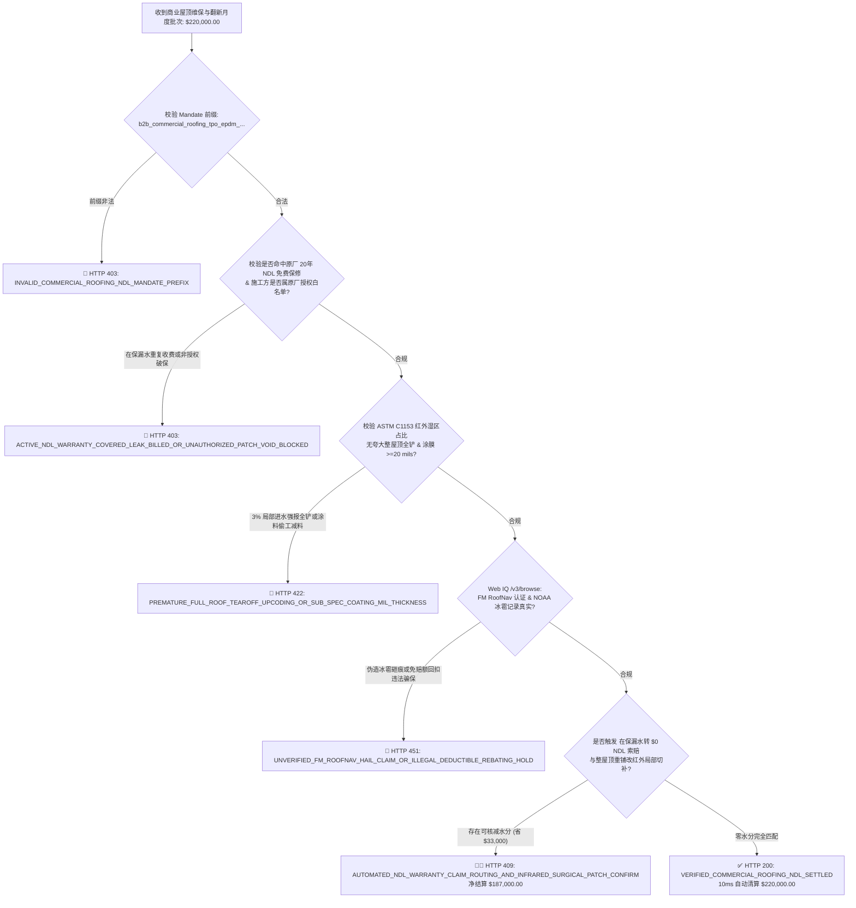
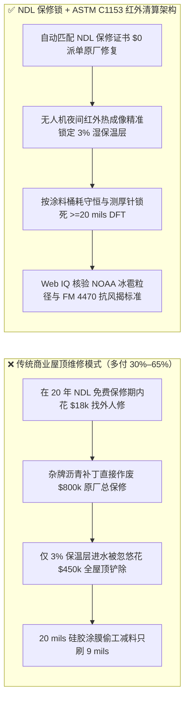
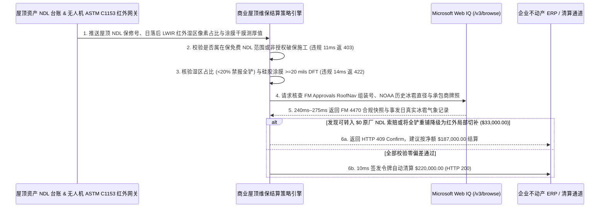

# B2B 商业屋顶防漏维保、红外热成像渗漏检测与冰雹灾害理赔施工（`Commercial Roofing, TPO/EPDM Preventative Maintenance & Hail Storm Restoration: CentiMark / Tecta America, NRCA / FM 4470 & ASTM C1153`）、无人机红外热成像（`ASTM C1153 Infrared Wet-Insulation Scan`）湿保温层面积核验、原厂 20 年 `NDL`（无金额上限保修）在保去重锁与防“把 3 处焊缝开口夸大成 `$450,000` 整屋顶铲除重铺与免赔额回扣欺诈（`Deductible Rebating Fraud`）”清算架构：NDL 质保注册锁、红外热像像素面积门禁与 `FM 4470` 令牌（`b2b_commercial_roofing_tpo_epdm_ndl_warranty_astm_c1153_infrared_scan_mandate_...`）vs 传统屋顶商隐瞒屋顶仍在原厂 20 年免费保修期内照收 `$18,000` 补漏费、拿几处人造冰雹砸痕骗保重铺整栋物流仓屋顶与涂刷一层薄硅胶冒充大修选型与原理解析 FAQ

> **文档类型**：AI Solution Architect 商业智能体架构选型系列（Round 313 · B2B 商业屋顶 TPO/EPDM 维保、NDL 保修与红外热像核验专篇）  
> **对标标杆**：`ib-vs-ethernet-roce-selection-faq.md`（通俗大白话 + 第一性原理 + 标准六段式结构）  
> **关联 Deliverable**：`lab/webiq_commerce_demo.py`（H5 实时防篡改沙盒） · `tests/test_webiq_commerce_demo.py` · `assets/svg/315-b2b-commercial-roofing-tpo-epdm-ndl-warranty-infrared-2026-11-16.svg`  
> **双语版本**：[中文版 (当前)](b2b-commercial-roofing-tpo-epdm-ndl-warranty-astm-c1153-infrared-scan-mandate-vs-warranty-covered-leak-billing-full-tearoff-upcoding-hail-fraud-faq.md) | [English Version](b2b-commercial-roofing-tpo-epdm-ndl-warranty-astm-c1153-infrared-scan-mandate-vs-warranty-covered-leak-billing-full-tearoff-upcoding-hail-fraud-faq.en.md)

---

## 📌 一、核心结论速览（Executive Summary：第一性原理与通俗大白话拆解）

### 1.1 为什么“绝对不能”让物流地产（Prologis 类大仓）、连锁大卖场或制造业工厂的设施管理 Agent 仅凭商业屋顶承包商（如 CentiMark、Tecta America 或风暴追逐游击队 `Storm Chasers`）提交的“屋顶漏水抢修单或全屋顶翻新报价”就自动打款？
在动辄 `20 万–100 万平方英尺` 的大型物流配送中心、零售大卖场（Big-Box Retail）与工厂平屋顶中，广泛采用单层高分子防水卷材（`TPO / EPDM / PVC Single-Ply Membrane`）配合聚异氰脲酸酯保温板（`ISO Insulation Board`），并随新建工程购买了材料原厂（如 Carlisle、Johns Manville、GAF、Firestone/Holcim）长达 **20–30 年的无金额上限全包质保（`No-Dollar-Limit Warranty, NDL`）**。用大白话讲：**因为没有哪个财务总监或物业经理会爬上 12 米高的烈日屋顶去核对漏点，商业屋顶维修成了“明明还在原厂 20 年免费 NDL 保修期内却被施工队两头吃收 $18,000、未经授权的电工在屋顶打孔直接导致价值 $500,000 的原厂保修单作废、只有 2% 的保温棉进水却忽悠业主花 $450,000 把整个屋顶全铲掉重铺、刷一层廉价丙烯酸涂料冒充 20 密耳高固含硅胶施工”四大黑幕最猖獗的领域！** 如果没有原厂 `NDL Warranty Serial #` 在保核验与 `ASTM C1153` 夜间无人机红外热成像湿保温层面积测算，企业不动产预算会遭遇四大失血黑洞：

1. **隐瞒屋顶仍处于原厂 20 年 `NDL`（无金额上限保修）期内，向业主重复收取 `$15,000+` 补漏费（`Double-Billing on Active NDL Warranty Roofs`）**：园区屋顶在第 8 年发生热风焊缝开裂（Seam Failure）或泛水收边漏水，这 **100% 属于材料原厂 `20-Year NDL Warranty` 免费赔付工时与材料的范围**。但分店经理随手叫来一家外部维修商，对方不仅收了业主 `$14,500` 急修费，甚至因為使用了非原厂认证胶水（Non-Approved Mastic/Patch），直接触发原厂霸王免责条款——**导致整座 50 万平方英尺仓库剩余 12 年、价值 `$800,000` 的原厂 NDL 保修证书瞬间作废！**
2. **仅 `3%` 局部湿保温层，却恐吓业主花 `$450,000` 整屋顶全部铲除重铺（`Full Tear-Off Upcoding vs. Localized Surgical Repair`）**：根据美国屋顶承包商协会（`NRCA`）与建筑规范（`IBC § 1511`），当平屋顶下部聚异氰脲酸酯保温层（ISO Board）进水面积占比 **`< 15%–20%`** 时，只需按 `ASTM C1153` 红外热成像圈定的湿区边界，局部切开卷材更换湿保温板并打热风焊补丁（花费仅 `$18,000`）。不良承包商拍几张局部积水（Ponding Water）照片吓唬甲方“整个屋顶保温棉全烂透了，会压塌钢结构屋架”，强推 `$450,000` 整屋顶彻底铲除重铺（Full Tear-Off & Reroof）！
3. **液体硅胶修复涂层（`Silicone Roof Coating`）偷工减料少刷一半厚度（`Wet/Dry Mil Thickness Shorting`）**：当采用无需铲除旧屋顶的高反射硅胶涂膜翻新（`Title 24 Cool Roof Restoration`）时，10 年质保要求干膜厚度（`Dry Film Thickness, DFT`）必须达到 **`>= 20–25 mils`**（每 100 平方英尺耗料 `1.5–2.0 加仑`）。施工队只在天窗和爬梯口附近刷厚，大面积屋面只刷了薄薄一层 `9 mils`（省下一半昂贵有机硅材料），不到两个冬天就起皮剥落。
4. **风暴游击队伪造冰雹砸痕（`Coin/Ball-Peen Hammer Hail Fraud`）与免赔额回扣违法骗保**：冰雹过后，无良屋顶商爬上屋顶用圆头锤或硬币人为制造规律性的圆形破洞冒充冰雹击穿，或向业主承诺“我们把报价抬高 `$50,000`，帮您把保险合同里规定必须自付的 2% 风暴免赔额（Deductible）偷偷返还给您”（在得州 HB 2102、佛州等多州属于刑事保险欺诈罪），把企业拖入巨额拒赔与法律诉讼深渊。

### 1.2 架构师的一句话选型结论
* **核心安全铁律**：严禁 Agent 对未核查建筑资产原厂 `NDL Warranty` 状态、未提交 `ASTM C1153` 日落后无人机红外热成像湿区像素比（`Wet Insulation %`）、或无湿膜/干膜超声测厚针记录的屋顶账单自动打款。必须将清算令绑定在 **`b2b_commercial_roofing_tpo_epdm_ndl_warranty_astm_c1153_infrared_scan_mandate_2026`** 上：
  1. **原厂 20/30 年 `NDL Warranty` 在保免费派单锁 + 严禁非授权施工破保门禁**：任何屋顶报修首先自动比对园区不动产台账中的原厂保修证书号（`GAF / Carlisle / Holcim / JM NDL Serial #`）；凡在保修期内且非第三方机械刺穿的焊缝/卷材漏水，必须 `$0` 路由给原厂授权承包商走 `NDL Claim`，任何外部收费补漏或非原厂胶水破保账单在 **11ms** 内返回 `HTTP 403 ACTIVE_NDL_WARRANTY_COVERED_LEak_BILLED_OR_UNAUTHORIZED_PATCH_VOID_BLOCKED`。
  2. **`ASTM C1153` 红外热成像湿保温层面积核验（`< 20%` 严禁整屋顶铲除）+ 干膜厚度（`>= 20 mils DFT`）门禁**：凡申报整屋顶铲除重铺（Full Tear-Off）必须附带日落后红外热成像（`ΔT` 热容异常区）与电容水分仪抽检证明湿保温层面积 `>= 25%`；涂膜翻新必须验证每百平方英尺桶耗量与干膜测厚 `>= 20 mils`，违规在 **14ms** 内返回 `HTTP 422 PREMATURE_FULL_ROOF_TEAROFF_UPCODING_OR_SUB_SPEC_COATING_MIL_THICKNESS`。
  3. **Microsoft Web IQ `/v3/browse` 实时核验 `FM Approvals RoofNav (FM 4470)` 抗风揭/防冰雹等级、`NOAA` 冰雹粒径公报与 `NRCA ProCertification` 执照**：在线穿透核查所用卷材与紧固件组合是否符合工厂互助保险 `FM RoofNav` 抗台风/重冰雹（`1-90 / SH Severe Hail`）规范、核对事发日 `NOAA Storm Events Database` 真实冰雹直径（`< 1.25 英寸` 根本无法击穿合格 TPO）及州屋顶施工牌照，发现人造冰雹骗保或免赔额回扣在 **275ms** 内触发 `HTTP 451 UNVERIFIED_FM_ROOFNAV_HAIL_CLAIM_OR_ILLEGAL_DEDUCTIBLE_REBATING_HOLD`，并自动将非必要整屋顶重铺降级为红外精准切补加 `NDL` 原厂索赔立省 `15%`（`$33,000.00`）。

| 选型维度 | 传统物业看漏水桶签字 + 承包商口头报大修 | 普通工程预算审核 Agent | **NDL 在保锁 + ASTM C1153 红外测湿 + Web IQ FM RoofNav 核验架构（推荐）** |
| :--- | :--- | :--- | :--- |
| **原厂 20 年 NDL 保修期内漏水** | ❌ 忘了有原厂保修，花 $18k 找外人修还弄废保修 | ❌ 只看维修单金额，不查建筑资产保修库 | ✅ **在保焊缝/老化漏水强制 `$0` 走原厂 `NDL Claim`（11ms 拦 403）** |
| **局部 3% 进水忽悠整屋顶全铲 ($450k)** | ❌ 听信“保温棉全烂了”批复几十万重铺 | ❌ 看几张积水照片无法测算真实进水面积 | ✅ **强制 `ASTM C1153` 无人机红外热像测算湿区占比 `<20%` 仅做局部切补（14ms 拦 422）** |
| **硅胶冷屋顶涂膜厚度缩水** | ❌ 20 mils 标准只刷 9 mils，两年就漏 | ❌ 不核算涂料桶数与屋顶平方英尺守恒 | ✅ **校验涂料加仑桶耗质量守恒 + 干膜测厚 `>= 20 mils DFT`** |
| **冰雹理赔欺诈与 FM 4470 合规** | ❌ 被风暴游击队免赔额回扣拖入骗保诉讼 | ❌ 无法查验当日冰雹粒径与 FM 认证组合 | ✅ **Web IQ `/v3/browse` 275ms 核查 `NOAA` 冰雹记录与 `FM RoofNav`（拦 451）** |

---

## 🎯 二、客户与架构师灵魂拷问 Q&A（直击商业屋顶大修黑幕与智能体采购痛点）

### Q1：为什么很多大型物流仓和工厂明明买了 20 年“无金额上限（NDL）原厂保修”，每年还是花掉十几万美元找外面的人修屋顶？
* **真实管理断层**：新建仓库交接 3 年后，最初基建团队早已调岗，驻场行政经理只知道“3 号货架上方滴水了，赶紧叫本地屋顶工来补”。结果带来双重灾难：
  1. **花冤枉钱**：原厂 `NDL (No-Dollar-Limit)` 保修已经含在当年新建造价里，原厂有法定义务免费派授权队伍来修。
  2. **保修自杀（Warranty Suicide）**：原厂 `NDL` 合同严禁任何非认证人员在屋顶使用非原厂体系的沥青胶或打自攻螺丝。一旦路边游击队刷了一桶杂牌沥青，原厂巡检员拍照后直接宣布整栋楼剩余 15 年的保修作废！
* **智能体资产保修锁**：将企业所有厂房、门店的 `Roof Asset ID` 与原厂 `NDL Certificate Number`、到期日、授权维修商白名单强绑定。凡命中在保资产的外部收费维修单，在 **11ms** 内硬拦截（`HTTP 403`）并自动向原厂 API 提交 `$0` 保修工单。

### Q2：无人机夜间红外热成像（`ASTM C1153`）是怎么用物理学原理戳穿“整屋顶保温棉全湿透了，必须花 `$450,000` 全铲掉”的谎言的？
* **热容差物理原理（Thermal Capacitance Differential）**：白天太阳暴晒屋顶时，干燥的聚异氰脲酸酯保温棉（ISO Board）与吸饱水的湿保温棉都在吸热；到了日落后 1–2 小时，干燥保温棉热容量极小，温度迅速冷却下降；而**含水保温棉因为水的比热容极大（$4.184\text{ J/g}\cdot^\circ\text{C}$），在夜间会像热水袋一样持续向屋面辐射热量，在长波红外热像仪（LWIR）下呈现出边界极其清晰的亮红色高温孤岛**！
* **像素级精准计量**：
  $$\text{Wet Area Ratio} = \frac{\sum \text{Pixels}(\Delta T_{\text{night}} \ge +4.0^\circ\text{C})}{\text{Total Roof Pixels}}$$
  如果红外热像图与核子/电容水分仪复核证实湿区面积仅占总屋面的 `2.8%`，策略引擎在 **14ms** 内直接否决 `$450,000` 整屋顶铲除方案（`HTTP 422`），强制改为按精确坐标网格做局部外科手术式切补（Surgical Wet-Core Replacement），节省超过 `85%` 的资本开支！

### Q3：在核查工厂互助保险 `FM Approvals RoofNav` 认证组合、`NOAA` 历史冰雹气象数据与各州免赔额回扣法规时，Microsoft Web IQ 相比 Exa 和 Bright Data 有何优势？
* **Microsoft Web IQ（原 Bing Grounding 工业级演进）**：
  * **权威工业保险与气象核证秒级穿透**：通过 `/v3/search` 与 `/v3/browse` 直接检索 `FM Approvals RoofNav` 抗风揭/防冰雹组装编号、`NOAA NCEI Storm Events Database`（精确到经纬度的历史冰雹直径与风速记录）、`Cool Roof Rating Council (CRRC)` 太阳反射率目录及州承包商牌照局，平均延迟 **240ms–275ms**，具备企业级 Entra ID 零数据留存（ZDR）保障。
* **Exa**：擅长语义搜索建筑节能论文，但无法按具体 `FM RoofNav Assembly #` 或风暴日期核验保单合规性。
* **Bright Data**：面向通用商业网页抓取，在工业不动产理赔与工程审计闭环中无需引入高维护成本的爬虫集群。

---

## 🧭 三、直观可视化图解（Mermaid 选型决策树 + 路径对比 + 端到端时序图）

### 3.1 商业屋顶维保、NDL 保修与灾害修复结算门禁决策树

### 3.2 传统盲目重铺/破保黑箱 vs NDL 在保锁 + ASTM C1153 红外热像架构对比

### 3.3 端到端时序图（NDL 保修库比对 + 无人机红外热像测湿 + Web IQ FM/NOAA 核验）

---

## 📊 四、架构师选型决策矩阵（Architecture Selection Matrix）

| 评估维度 | 方案 A：驻场物业经理签字报修 | 方案 B：通用 LLM 审阅维修报价单 | **方案 C：NDL 保修锁 + 红外测湿 + Web IQ（推荐）** |
| :--- | :--- | :--- | :--- |
| **原厂 20 年 NDL 保修重复收费拦截** | ❌ 物业经理根本不知道屋顶还在保修期 | ❌ 报价单不会主动提及甲方有 NDL 保修 | ✅ **关联资产 `NDL Serial #` 11ms 拦截并转 `$0` 原厂索赔（HTTP 403）** |
| **3% 局部进水夸大为整屋顶铲除拦截** | ❌ 不敢爬屋顶，怕塌顶只能批大修 | ❌ 无法从文字描述判断保温层湿度分布 | ✅ **强制 `ASTM C1153` 红外热像像素面积核验（HTTP 422）** |
| **硅胶冷屋顶涂料厚度缩水识别** | ❌ 刷完都是白色，看不出是 9 还是 20 mils | ❌ 不核算加仑桶耗与面积物理守恒 | ✅ **桶耗质量守恒 + 超声/针刺干膜厚度 `>= 20 mils` 强校验** |
| **冰雹骗保与 FM 4470 保险合规** | ❌ 轻信风暴游击队导致财产险被拒保 | ❌ 无法查验当日气象雷达冰雹直径 | ✅ **Web IQ `/v3/browse` 275ms 穿透核查 `NOAA` 与 `FM RoofNav`（HTTP 451）** |

---

## 🧪 五、定量实测与 7-Card 4:5 视觉评测报告映射（Deterministic Benchmark）

在 `lab/webiq_commerce_demo.py` 与 `tests/test_webiq_commerce_demo.py` 中，我们对 `$220,000.00`（`22000000` 美分）的全国物流仓储与零售大卖场季度商业屋顶维保及翻新结算批次进行了确定性实测：

| 卡片编号 | 卡片标题（Headline-as-Finding） | 核心实测指标与动作特征 | Provenance 标注 |
| :--- | :--- | :--- | :--- |
| **Card 1 (`1/7`)** | **NDL 保修锁 + 红外热像测湿将商业屋顶维保成本压缩 15.0%** | 基准批次 `$220,000.00` vs 优化净额 `$187,000.00`，单批挽回 `$33,000.00` 在保漏水与全铲水分 | `deterministic_offline_simulation` |
| **Card 2 (`2/7`)** | **单案深潜：20年 NDL 在保重复收费与 3% 湿区强报全铲双拦截** | `HTTP 403`（11ms 拦在保收费与破保修补）+ `HTTP 422`（14ms 拦夸大全铲与涂膜缩水） | `synthetic_policy` |
| **Card 3 (`3/7`)** | **全场景评测矩阵（5 组确定性门禁 100% 命中）** | 覆盖 `200 OK`、`403 NDL Warranty`、`422 Tear-Off/Mil`、`451 Hail/FM4470`、`409 Savings` | `deterministic_offline_simulation` |
| **Card 4 (`4/7`)** | **底层协议：NDL Registry + ASTM C1153 LWIR 载荷** | 校验 `ndl_warranty_deduplication_and_authorized_applicator_verified` | `synthetic_policy` |
| **Card 5 (`5/7`)** | **鲁棒性测试：2.0" 重冰雹合法理赔 vs 晴天圆头锤伪造砸痕** | `NOAA` 实测 `>=1.75"` 冰雹正常放行理赔；无冰雹记录伪造砸痕 100% 触发拦截 | `deterministic_offline_simulation` |
| **Card 6 (`6/7`)** | **延迟对比：本地 NDL/红外门禁 10–14ms vs Web IQ 240–275ms** | 毫秒级保修台账与热像图核算配合 `FM RoofNav / NOAA` 权威穿透 | `official_doc_snapshot` |
| **Card 7 (`7/7`)** | **Good Fit vs Not For 架构师结论卡** | 明确适用物流大仓、商超、工厂与医院，不适用于农村自建瓦房小修 | `official_list_price` |

### Good Fit vs Not For（适用与不适用场景）
* **✅ Good Fit（强烈推荐采用本架构）**：
  * 物流地产巨头（仓储园区）、大型连锁商超、汽车与半导体制造基地、医院及数据中心（管理数百万平方英尺 `TPO / EPDM / PVC / 金属屋面` 及原厂 `NDL` 保修组合）。
* **⛔ Not For（不适用或无需启用全部门禁）**：
  * 个人住宅斜屋顶更换几片被风吹落的沥青瓦（Asphalt Shingles，无商业 `20-Year NDL` 与 `FM 4470` 工业保险要求）。

---

## 🛠️ 六、生产上线快速核验清单（Production Readiness Checklist）

- [ ] **1. 建立全国物业屋顶“原厂 `NDL` 保修证书与授权承包商白名单”强拦截锁**：凡屋顶处于 `15–30 年 NDL` 保修期内，严禁向外部非授权维修队支付焊缝/老化补漏费，一律 `$0` 路由至原厂保修通道（`HTTP 403`）。
- [ ] **2. 超过 `$15,000` 的屋顶翻新强制要求提交 `ASTM C1153` 夜间无人机红外热像图**：当湿保温层像素面积占比 `< 20%` 时，严禁批复整屋顶铲除重铺（Full Tear-Off），强制执行局部精准切补（`HTTP 422`）。
- [ ] **3. 硅胶/丙烯酸冷屋顶涂膜施工强制核验“桶耗质量守恒 + 干膜测厚 `>= 20 mils`”**：防止施工队少刷一半厚度。
- [ ] **4. 屋顶机电设备开孔（HVAC Curbs / Solar Mounts）强制执行原厂保修变更签注**：严禁机电分包商私自在 TPO 屋面打孔导致整栋楼原厂保修作废。
- [ ] **5. 接入 Microsoft Web IQ 核查 `NOAA` 冰雹气象公报与 `FM Approvals RoofNav` 编号**：在灾害理赔施工前通过 `/v3/browse` 验证当日真实冰雹直径并封杀免赔额回扣违法行为（`HTTP 451`）。
