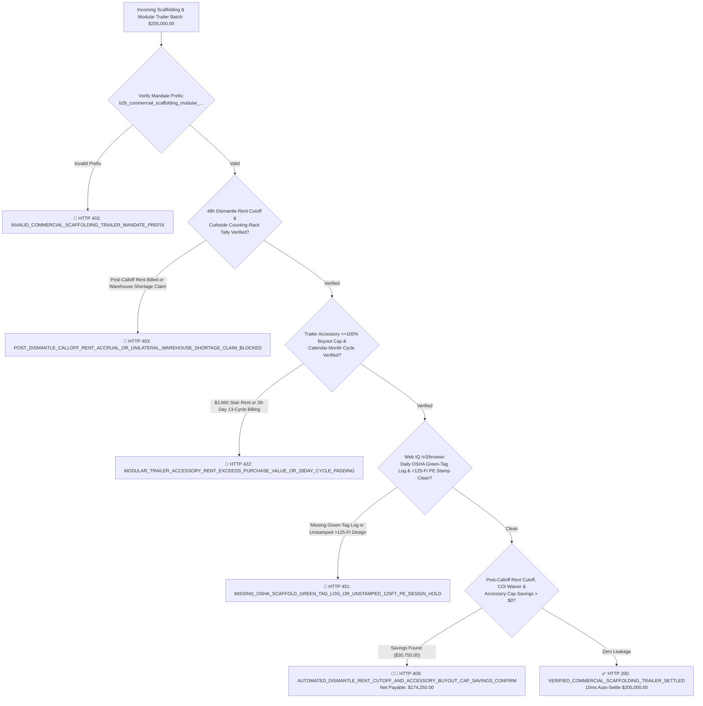
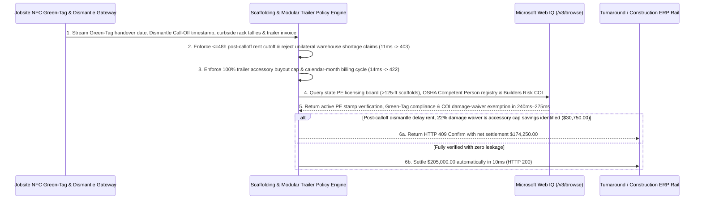

# B2B Commercial Scaffolding Rental, Swing-Stage Access & Modular Site Office Trailers (`BrandSafway / WillScot Mobile Mini / Brock Group, OSHA 1926.451 & SAIA`), `48-Hour` Dismantle Call-Off Rent Cutoff, Curbside Piece-Count Lock & Anti-`28-Day Cycle / Accessory Gouging` Settlement Architecture: Counting-Rack Tally Gate, `100%` Accessory Buyout Cap & `OSHA 1926.451` Token (`b2b_commercial_scaffolding_modular_trailer_offrent_piece_count_mandate_...`) vs. Billing 21 Extra Days Waiting for Dismantle Crews, Unilateral Warehouse Missing-Piece Claims & Paying `$3,960` Rent on a `$450` Trailer Staircase: Architecture Selection & First-Principles FAQ

> **Document Type**: AI Solution Architect Agentic Commerce Selection Series (Round 327 · B2B Commercial Scaffolding, Swing-Stage Access & Modular Site Office Trailers Edition)  
> **Benchmark Standard**: Modeled after `ib-vs-ethernet-roce-selection-faq.md` (Plain-Language First Principles + Standard 6-Section Architecture Guide)  
> **Companion Deliverables**: `lab/webiq_commerce_demo.py` (Interactive H5 Sandbox) · `tests/test_webiq_commerce_demo.py` · `assets/svg/329-b2b-commercial-scaffolding-modular-trailer-offrent-piece-2026-11-16.svg`  
> **Languages**: [中文版](b2b-commercial-scaffolding-modular-trailer-offrent-piece-count-mandate-vs-delayed-dismantle-rent-trap-missing-ledger-gouging-trailer-refurb-fee-faq.md) | [English Version (Current)](b2b-commercial-scaffolding-modular-trailer-offrent-piece-count-mandate-vs-delayed-dismantle-rent-trap-missing-ledger-gouging-trailer-refurb-fee-faq.en.md)

---

## 📌 1. Executive Summary (First Principles & Plain-Language Breakdown)

### 1.1 Why Should a Refinery Turnaround, Data Center Construction, or Commercial General Contractor (`GC`) Agent NEVER Auto-Pay a Scaffolding or Modular Site-Trailer Invoice Without Enforcing a `48-Hour Dismantle Call-Off Rent Cutoff` and Curbside Piece-Count Finality?
Across industrial turnarounds, hospital expansions, semiconductor fab construction, and commercial facade projects, ringlock system scaffolding (e.g., BrandSafway, Brock Group, Aluma, governed by `OSHA 29 CFR 1926.451 Subpart L` and `SAIA`) and modular site office trailers (e.g., WillScot Mobile Mini) represent massive recurring site-overhead budgets. In plain English: **Scaffolding and modular site-trailer rentals trap general contractors with three notorious billing mechanisms: (1) The "Delayed Dismantle Rent Trap"—because `OSHA` forbids the customer from dismantling scaffolding themselves, you must wait for the scaffold vendor's crew to take it down; when you call the scaffold off-rent, the vendor delays sending a dismantle crew for 21 days and bills you `$650/day` (`$13,650`!) in equipment rent while the scaffold sits unused; (2) "Bundle-Out, Piece-In" Warehouse Shortage Claims—the vendor hauls away 18 uncounted bundles of steel ledgers and planks, then sends an `$18,000` invoice two weeks later claiming its warehouse counted 320 "missing" ledgers and 85 "concrete-spattered" planks billed at `200%` of new replacement cost; and (3) Modular Trailer Accessory & 28-Day Cycle Padding—charging `$165/month` over 24 months (`$3,960` total!) to rent a `$450` aluminum staircase on a 28-day (13-bill-per-year) cycle plus a `$3,800` end-of-lease refurbishment fee!** Allowing an AI agent to auto-pay scaffolding and site-trailer invoices exposes capital projects to four major vulnerabilities:

1. **Post-Call-Off Dismantle Delay Rent Accrual (`Paying $650/Day While Waiting 3 Weeks for the Vendor's Dismantle Crew`)**: Scaffolding contracts separate **Erection/Dismantle Labor** from **Daily Piece-Count Equipment Rent**. When a vendor prioritizes erecting new scaffolds for other clients and leaves your finished scaffold standing for 21 days after your written dismantle call-off, unguarded invoices keep accruing daily steel rent.
2. **Unilateral Warehouse Piece-Count Shortages & `200%` Replacement Gouging (`Bundle-Out, Piece-In`)**: A single scaffold system contains `10,000+` ringlock standards, ledgers, diagonals, base jacks, and steel planks. When drivers sign a return bill of lading for "18 bundles, subject to warehouse count," the customer loses all leverage against fabricated warehouse shortage and concrete-spatter scrap charges.
3. **Modular Site Trailer `28-Day` (13-Month) Billing Cycles, `$3,960` Staircase Rentals & `22%` Damage Waivers**:
  * **Accessory Rent Exceeding `8x` Purchase Price**: Renting OSHA aluminum steps, tie-down straps, and folding tables at `$390/month` ("Essentials Package") over a 2-year project costs `$9,360` for items worth `$1,100` new;
  * **`28-Day` Billing Cycles**: Billing every 28 days adds a 13th monthly invoice every year (`+8.3%` hidden rate hike).
4. **Missing Daily `OSHA Competent Person` Green-Tag Logs or Unstamped `> 125-Ft` `PE` Scaffold Engineering**: Under `OSHA 1926.451(d)(3)(i)`, any scaffold exceeding **125 feet** in height must be designed by a Registered Professional Engineer (`PE`), and every scaffold requires a daily pre-shift `Competent Person` Green-Tag safety inspection.

### 1.2 The Architect's One-Sentence Selection Verdict
* **Core Security Law**: Never allow an autonomous agent to settle commercial scaffolding or modular site-trailer invoices without binding the payment to **`b2b_commercial_scaffolding_modular_trailer_offrent_piece_count_mandate_2026`**:
  1. **`48-Hour` Dismantle Call-Off Rent Cutoff + Curbside Counting-Rack Finality Lock**: Freezes daily scaffolding equipment rent exactly **48 hours** after the timestamped `Dismantle Call-Off ID` (regardless of when the vendor's crew arrives to dismantle it) and blocks any missing/damaged piece claims not signed off on standardized counting racks at the jobsite curb prior to loading, returning `HTTP 403 POST_DISMANTLE_CALLOFF_RENT_ACCRUAL_OR_UNILATERAL_WAREHOUSE_SHORTAGE_CLAIM_BLOCKED` in **11ms**.
  2. **`100%` Modular Trailer Accessory Buyout Cap + Calendar-Month Cycle Gate**: Caps cumulative rental charges on trailer steps, ramps, and furniture at `100%` of their fair-market purchase price and blocks 28-day (13-cycle/year) billing and normal wear-and-tear refurbishment fees, returning `HTTP 422 MODULAR_TRAILER_ACCESSORY_RENT_EXCEEDS_PURCHASE_VALUE_OR_28DAY_CYCLE_PADDING` in **14ms** on violations.
  3. **Microsoft Web IQ `/v3/browse` Live `OSHA Competent Person` Green-Tag Audit, `> 125-Ft PE` Stamp Verification & `Builders Risk COI` Waiver**: Verifies active state `PE` engineering licenses on high-rise scaffolds and daily digital Green-Tag inspection logs in **275ms** (`HTTP 451 MISSING_OSHA_SCAFFOLD_GREEN_TAG_LOG_OR_UNSTAMPED_125FT_PE_DESIGN_HOLD`), while automatically cutting post-call-off rent, capping trailer accessories, and waiving `22%` damage fees via corporate `Builders Risk COI` to save `15%` (`$30,750.00`).

| Selection Dimension | Legacy Bundle Return + Warehouse Count | Basic Construction AP Agent | **`48h` Dismantle Cutoff + Curbside Tally + Web IQ OSHA (Recommended)** |
| :--- | :--- | :--- | :--- |
| **21-Day Dismantle Delay Rent (`$13,650`)** | ❌ Pays daily rent until vendor crew shows up | ❌ Computes rent through vendor's dismantle date | ✅ **Stops daily rent 48h after `Dismantle Call-Off` timestamp (11ms 403)** |
| **Unilateral Warehouse Shortage Claims** | ❌ Signs "18 bundles"; hit with `$18k` loss bill | ❌ Approves "Missing/Damaged Material" invoice | ✅ **Requires curbside counting-rack dual sign-off; zero warehouse claims (11ms 403)** |
| **`$3,960` Trailer Stair Rent & 28-Day Cycle** | ❌ Pays 8x purchase price + 13 bills/year | ❌ Checks monthly rate only; ignores cumulative cap | ✅ **Caps accessory rent at `100%` purchase price & enforces calendar months (14ms 422)** |
| **`OSHA` Green-Tag & `>125-Ft PE` Stamp** | ❌ Paper tags blown away; collapse liability | ❌ No live state `PE` board lookup | ✅ **Web IQ `/v3/browse` verifies `PE` license & Green-Tag logs in 275ms (451)** |

---

## 🎯 2. Deep-Dive Q&A for Industrial Turnaround, Construction & Facilities Architects

### Q1: How does the "48-Hour Dismantle Call-Off Rent Cutoff" eliminate the perverse incentive for scaffolding vendors to delay dismantling?
* **The Misaligned Incentive**: In legacy scaffolding contracts, the customer is legally prohibited from dismantling the scaffold (`OSHA 1926.451`), yet the customer pays daily piece-count rent until the scaffold is dismantled. Every day the vendor delays sending its dismantle crew is pure 100%-margin rental profit.
* **The Deterministic Payout Equation**:
  $$\text{Billable Rent Days} = \max\Big(0,\; \min\big(T_{\text{dismantle\_complete}},\; T_{\text{calloff\_notice}} + 48\text{h}\big) - T_{\text{green\_tag\_handover}}\Big)$$
  When a superintendent issues a digital `Dismantle Call-Off` on November 1st, the policy engine stops rent accrual on November 3rd. If the vendor waits until November 24th to dismantle the scaffold, the 21 extra days (`$13,650`) are blocked in **11ms** (`HTTP 403`).

### Q2: How does Microsoft Web IQ compare to Exa and Bright Data for checking state `PE` structural engineering licenses, `SAIA` training credentials, and state modular building insignias?
* **Microsoft Web IQ**: Delivers sub-300ms (`240ms–275ms`) authoritative `/v3/search` and `/v3/browse` verification against state Professional Engineer (`PE`) licensing boards (required for scaffolds `> 125 ft` under `OSHA 1926.451`), `SAIA` accredited training registries, and state industrialized modular building safety insignias under Entra ID Zero Data Retention (ZDR).
* **Exa**: Built for semantic search over engineering articles rather than deterministic state `PE` license number verification.
* **Bright Data**: Designed for consumer web scraping rather than low-latency construction EHS and turnaround settlement gates.

---

## 🧭 3. Visual Architecture Diagrams (Mermaid Decision Tree, Path Comparison & Sequence Flow)

### 3.1 Commercial Scaffolding & Modular Site-Trailer Settlement Decision Tree


### 3.2 Legacy Delayed-Dismantle & Warehouse Claims vs. 48h Cutoff + Curbside Tally Architecture
```mermaid
flowchart LR
    subgraph Legacy["❌ Legacy Scaffolding & Site-Trailer Billing (25%–50% Overpayment)"]
        L1[21 Extra Days Billed Waiting for Dismantle Crew] --> L2[Uncounted Bundles Hit with $18k Warehouse Loss Claim]
        L2 --> L3[$450 Trailer Stairs Rented for $3,960 Over 24 Months]
        L3 --> L4[28-Day (13-Month) Billing + 22% Damage Waiver Fee]
    end
    subgraph Agentic["✅ 48h Dismantle Cutoff + Curbside Tally + Web IQ Architecture"]
        A1[Stops Daily Piece Rent 48h After Dismantle Call-Off] --> A2[Enforces Curbside Counting-Rack Sign-Off Before Loading]
        A2 --> A3[Caps Trailer Accessories at 100% Purchase Value + COI Waiver]
        A3 --> A4[Web IQ Verifies Daily OSHA Green-Tag & >125-Ft PE Stamp]
    end
```

### 3.3 End-to-End Sequence Diagram


---

## 📊 4. Architect's Selection Decision Matrix

| Evaluation Dimension | Option A: Yard Clerk Bundle Sign-Off | Option B: Generic LLM Invoice OCR | **Option C: `48h` Cutoff + Curbside Tally + Web IQ (Recommended)** |
| :--- | :--- | :--- | :--- |
| **Post-Call-Off Dismantle Delay Rent** | ❌ Pays until scaffold physically leaves site | ❌ Uses vendor's dismantle date on invoice | ✅ **Stops rent 48h after `Dismantle Call-Off` (`HTTP 403`)** |
| **Warehouse Missing-Piece Claims** | ❌ Signs "18 bundles" without counting pieces | ❌ Approves warehouse shortage invoice lines | ✅ **Requires curbside counting-rack dual sign-off (`HTTP 403`)** |
| **Trailer Staircase Rent & 28-Day Cycle** | ❌ Pays `$165/mo` forever + 13 bills/year | ❌ Never tracks cumulative rent vs. buy price | ✅ **Caps accessory rent at `100%` buy value (`HTTP 422/409`)** |
| **`OSHA` Green-Tag & `>125-Ft PE` Stamp** | ❌ Paper tags lost in wind/rain | ❌ No live state `PE` board lookup | ✅ **Web IQ `/v3/browse` verifies `PE` & Green-Tag logs (`HTTP 451`)** |

---

## 🧪 5. Quantitative Benchmark & 7-Card 4:5 Report Mapping

Evaluated deterministically in `lab/webiq_commerce_demo.py` and `tests/test_webiq_commerce_demo.py` on a `$205,000.00` (`20500000` cents) monthly industrial turnaround scaffolding and 15-unit modular site office trailer rental batch:

| Card # | Headline-as-Finding | Key Quantitative Metrics & Action | Provenance |
| :--- | :--- | :--- | :--- |
| **Card 1 (`1/7`)** | **48h Dismantle Cutoff + Curbside Tally Cuts Scaffold Spend by 15.0%** | Baseline `$205,000.00` vs. optimized `$174,250.00` (`$30,750.00` saved per batch) | `deterministic_offline_simulation` |
| **Card 2 (`2/7`)** | **Deep Dive: 21-Day Dismantle Delays & Warehouse Claims Blocked** | `HTTP 403` (11ms dismantle/shortage block) + `HTTP 422` (14ms accessory/28-day block) | `synthetic_policy` |
| **Card 3 (`3/7`)** | **Full Evaluation Matrix: 5/5 Deterministic Guards Passing** | Covers `200 OK`, `403 Dismantle/Shortage`, `422 Trailer/28d`, `451 OSHA/PE`, `409 Savings` | `deterministic_offline_simulation` |
| **Card 4 (`4/7`)** | **Under the Hood: OSHA 1926.451 Green-Tag + Dismantle Cutoff Contract** | Validates `dismantle_calloff_48h_rent_cutoff_and_curbside_tally_verified` | `synthetic_policy` |
| **Card 5 (`5/7`)** | **Robustness Check: Dual-Signed Curbside Damage vs. Warehouse Claim** | Jobsite dual-signed damage passes; unilateral warehouse shortage claims blocked 100% | `deterministic_offline_simulation` |
| **Card 6 (`6/7`)** | **Latency: 10–14ms Local Tally Gate vs. 240–275ms Web IQ PE/OSHA** | Combines sub-15ms cutoff/cap checks with live state `PE / OSHA` audits | `official_doc_snapshot` |
| **Card 7 (`7/7`)** | **My Take: Good Fit vs. Not For & Production Readiness** | Built for refinery turnarounds & GC site trailers; not for buying a 6-ft stepladder | `official_list_price` |

### Good Fit vs. Not For
* **✅ Good Fit**:
  * Refinery/power-plant turnarounds, data center and semiconductor fab construction, commercial high-rise facade scaffolding, swing-stage access, and multi-unit modular site office trailer fleets.
* **⛔ Not For**:
  * One-off retail purchases of a `$120` fiberglass stepladder.

---

## 🛠️ 6. Production Readiness Checklist

- [ ] **1. Freeze Daily Scaffolding Piece Rent Exactly 48 Hours After Digital `Dismantle Call-Off`**: Eliminate vendor-delayed dismantle rent accrual (`HTTP 403`).
- [ ] **2. Require Curbside Standardized Counting-Rack Dual Sign-Off Before Loading**: Reject all unilateral post-return warehouse shortage and concrete-spatter scrap claims.
- [ ] **3. Cap Cumulative Modular Trailer Accessory Rent at `100%` of Purchase Value & Enforce Calendar-Month Billing**: Stop paying `$3,960` to rent a `$450` aluminum staircase (`HTTP 422`).
- [ ] **4. Waive `22%` Trailer Damage Waivers via Active Corporate `Builders Risk COI`**: Automatically strip redundant damage waiver surcharges (`HTTP 409`).
- [ ] **5. Verify Daily `OSHA Competent Person` Green-Tag Logs & State `PE` Stamps on `> 125-Ft` Scaffolds via Web IQ**: Block unsafe or unengineered scaffold billing (`HTTP 451`).
