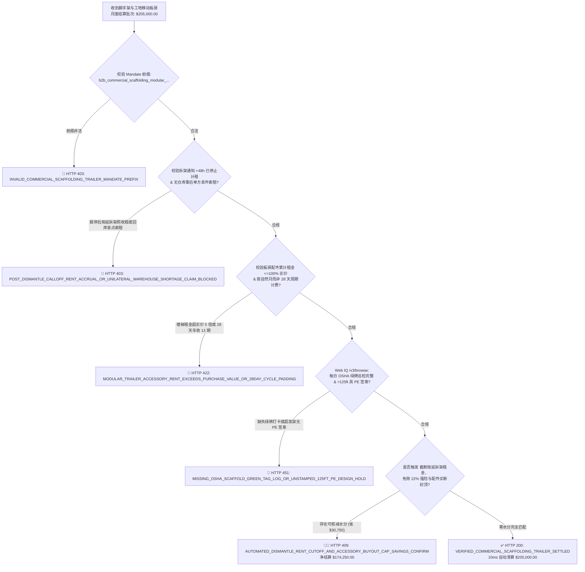
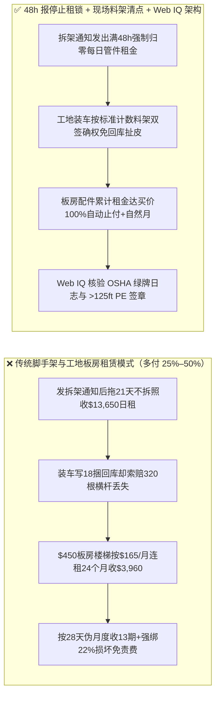
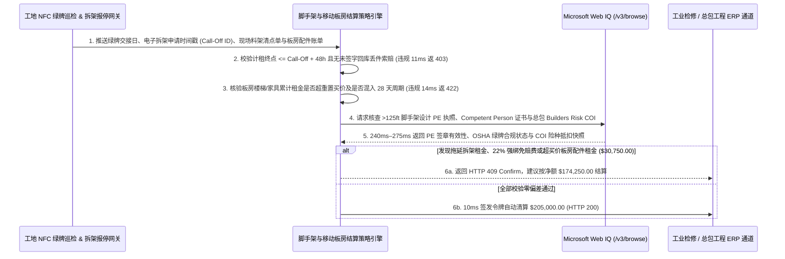

# B2B 建筑工地模块化脚手架租赁、高空悬吊吊篮与移动办公集装箱租赁（`Commercial Scaffolding Rental, Swing-Stage Suspended Access & Modular Site Office Trailers: BrandSafway / WillScot Mobile Mini / Sunbelt, OSHA 1926.451 & SAIA`）、脚手架搭拆工时 vs 每日管扣件在场租金（`Erection/Dismantle Labor vs. Daily Piece-Count Rent`）解耦锁、电子报停退租（`Digital Off-Rent / Dismantle Release`）与防“已通知拆架却拖延 21 天不派人来拆照收每天 $650 铁管租金、交回脚手架时虚报 18% 扣件丢失与踏板弯曲索赔、以及移动板房退租收 $3,800 翻新折旧费”清算架构：报停时间戳即止租锁、退场双向清点照片门禁与 `OSHA 1926.451` 令牌（`b2b_commercial_scaffolding_modular_trailer_offrent_piece_count_mandate_...`）vs 传统脚手架公司靠故意拖延拆架白赚 3 周租金、把自带水泥点儿的旧踏板全算成客户报废按新品原价 200% 索赔与集装箱板房捆绑 22% 强制限额免赔险选型与原理解析 FAQ

> **文档类型**：AI Solution Architect 商业智能体架构选型系列（Round 327 · B2B 模块化盘扣脚手架租赁、高空吊篮与工地移动办公箱房 WillScot 结算专篇）  
> **对标标杆**：`ib-vs-ethernet-roce-selection-faq.md`（通俗大白话 + 第一性原理 + 标准六段式结构）  
> **关联 Deliverable**：`lab/webiq_commerce_demo.py`（H5 实时防篡改沙盒） · `tests/test_webiq_commerce_demo.py` · `assets/svg/329-b2b-commercial-scaffolding-modular-trailer-offrent-piece-2026-11-16.svg`  
> **双语版本**：[中文版 (当前)](b2b-commercial-scaffolding-modular-trailer-offrent-piece-count-mandate-vs-delayed-dismantle-rent-trap-missing-ledger-gouging-trailer-refurb-fee-faq.md) | [English Version](b2b-commercial-scaffolding-modular-trailer-offrent-piece-count-mandate-vs-delayed-dismantle-rent-trap-missing-ledger-gouging-trailer-refurb-fee-faq.en.md)

---

## 📌 一、核心结论速览（Executive Summary：第一性原理与通俗大白话拆解）

### 1.1 为什么“绝对不能”让石化炼厂大修（Turnaround）、药企洁净室改造、商业外立面幕墙工程或数据中心基建的采购 Agent 仅凭脚手架与工地临建板房巨头（如 BrandSafway、Brock Group、WillScot Mobile Mini、Aluma）寄来的月度租金与退场赔偿账单就自动付款？
在工业检修、厂房改扩建与商业地产施工中，盘扣式脚手架（System Ringlock Scaffolding，受 `OSHA 29 CFR 1926.451 Subpart L` 与脚手架及高空作业协会 `SAIA` 监管）、高空电动吊篮（Swing-Stage Suspended Scaffolding）以及工地模块化办公集装箱（Modular Site Office Trailers & Conex Storage Boxes）是长期占压在工地上的庞大资产。用大白话讲：**脚手架与移动办公板房租赁有三个让工程总包（GC）与业主恨得牙痒痒的潜规则：第一是“拖延拆架骗租（Delayed Dismantle Rent Trap）”——因为出于安全规定，客户绝对不能自己动手拆脚手架，必须等脚手架公司派架子工来拆；当你发邮件通知“活干完了，明天请拆架退租”后，服务商借口人手忙故意拖延 21 天才来拆，然后厚着脸皮收你这 21 天每天 $650 的钢管在场租金（白拿 $13,650）！第二是“回库死无对证式丢件与污染索赔”——几万根横杆、立杆和钢跳板拉回服务商仓库后才清点，说你弄丢了 400 个插销、弄脏了 120 块踏板，按全新品目录价的 200% 开出 $18,000 赔偿单！第三是工地移动办公箱房（如 WillScot）在每期 28 天账单里悄悄塞进 $390/月的台阶、锚固带、打印机架等“天价配件包（Essentials Package）”，退箱时再讹一笔 $3,800 的地板/墙面翻新费！** 如果没有电子拆架报停即止租锁（`Dismantle Request Timestamp Rent Cutoff`）、现场装车双向签字清点（`Curbside Joint Piece-Count Tally`）锁与箱房配件残值封顶门禁，工业大修与基建项目预算会遭遇四大失血黑洞：

1. **“拆架通知已发但服务商故意拖延 14–28 天不拆（Delayed Dismantle Rent Accrual）”**：脚手架合同采用“搭建安装工时费（Erection Labor）+ 每日在场构件租金（Daily Equipment Rent）+ 拆除工时费（Dismantle Labor）”三段式收费。由于总包方无权自行拆除脚手架，不良供应商在收到客户的拆架通知（Dismantle Call-Off）后，故意优先派工人去别的工地搭新架子，把你的旧架子晾在现场 3 周，并主张“只要钢管还在你工地上，租金就照算”！
2. **拉回仓库单方面“盲点”虚报 `12%–20%` 盘扣构件丢失与水泥/油漆污染报废（`Warehouse Unilateral Piece-Count Shortage & Concrete Spatter Scrap Claims`）**：一套中型外墙或反应釜脚手架包含 `8,000–15,000 件` 立杆（Standards）、横杆（Ledgers）、斜撑（Braces）与钢跳板（Planks）。拆除装车时司机只在提单上写“共 18 捆（18 Bundles，未清点具体根数）”；等两周后服务商发来仓库盘点单，声称少了 320 根横杆、85 块跳板沾了泥灰直接判报废，按高于市场价 2 倍的挂牌赔偿价（List Replacement Rate）强扣 **`$14,000–$35,000`**！
3. **移动办公集装箱（`Modular Site Trailer`）“28 天算一个月（13 个计费周期/年）”、天价配件月租（`$150/月` 租一个铁楼梯连续租 24 个月花 `$3,600`）与退场翻新敲诈**：
  * **13 月计费陷阱**：按 28 天（4 周）开具一期账单，一年多收整整 1 个月租金；
  * **配件租金超买价 5 倍**：一个造价 `$450` 的铝合金门口踏步楼梯（OSHA Compliant Steps）或防风地锚（Tie-Down Straps），每月收 `$165` 租金，两年工期下来光楼梯租金就付了 `$3,960`（够买 8 个新楼梯）！
  * **退场翻新费（Turnkey Refurbishment Fee）**：退租时把正常施工靴踩踏磨损算作人为损坏，强收 `$3,200–$5,500` 翻新清洁费。
4. **缺失每日持证安全员绿牌巡检（`OSHA Competent Person Green-Tag Inspection`）或悬吊吊篮防坠落独立安全绳（`ANSI/SAIA A10.8`）引发高空坍塌**：未完成每日上班前脚手架绿牌（Green Tag = Safe / Yellow Tag = Caution / Red Tag = Do Not Use）扫码打卡或缺失防风拉结件（Tie-Ins）验证就放行结算，留下致命高空坠落事故隐患。

### 1.2 架构师的一句话选型结论
* **核心安全铁律**：严禁 Agent 对在“电子报停/申请拆架满 48 小时后”继续计收的脚手架在场租金、未经工地现场装车双签确认的仓库单方丢件索赔、累计租金超过配件购置价 `100%` 的板房楼梯/家具月租、或缺失 `OSHA Competent Person` 绿牌记录的账单自动付款。必须将清算令绑定在 **`b2b_commercial_scaffolding_modular_trailer_offrent_piece_count_mandate_2026`** 上：
  1. **电子申请拆架 48h 自动止租锁（`Dismantle Release Rent Cutoff`）+ 工地现场装车根数清点闭环锁（`On-Site Curbside Piece-Count Sign-Off`）**：只要项目经理在系统发出带时间戳的拆架退租通知（`Dismantle / Off-Rent Call-Off ID`），脚手架构件与板房每日租金在 **48 小时宽限期后强制归零（`$0/day`）**，供应商延迟派人拆架的时间成本由其自行承担；同时拒付任何仅写“若干捆”而在回库后单方面追加的丢件/污染赔偿单，违规在 **11ms** 内返回 `HTTP 403 POST_DISMANTLE_CALLOFF_RENT_ACCRUAL_OR_UNILATERAL_WAREHOUSE_SHORTAGE_CLAIM_BLOCKED`。
  2. **移动板房配件累计租金 `100%` 买断封顶锁（`Accessory Cap at Purchase Price`）+ 正常磨损免赔门禁**：对集装箱板房楼梯、坡道、桌椅等配件，当累计已付租金达到其公允购置价 `100%` 时自动止付后续月租，并拦截 28 天伪月度周期与退场正常磨损翻新费，违规在 **14ms** 内返回 `HTTP 422 MODULAR_TRAILER_ACCESSORY_RENT_EXCEEDS_PURCHASE_VALUE_OR_28DAY_CYCLE_PADDING`。
  3. **Microsoft Web IQ `/v3/browse` 实时核验 `OSHA 1926.451 / SAIA` 持证安全员资质、25 psf 荷载设计注册工程师（`PE`）签章与自有施工财产险（`Builders Risk COI`）免除 `22%` 强制限额免赔费**：在线穿透核查超过 125 英尺高大脚手架的注册工程师（`PE`）签章及现场 `Competent Person` 培训证书，发现缺失每日绿牌巡检或无 `PE` 签章在 **275ms** 内触发 `HTTP 451 MISSING_OSHA_SCAFFOLD_GREEN_TAG_LOG_OR_UNSTAMPED_125FT_PE_DESIGN_HOLD`，并自动凭总包 `Builders Risk COI` 免除 `22%` 损坏免责险与截断拆架拖延租金立省 `15%`（`$30,750.00`）。

| 选型维度 | 传统纸质拆架单 + 仓库回库盘点索赔 | 普通工程应付账款 Agent | **48h 拆架止租锁 + 现场清点锁 + Web IQ OSHA/SAIA 架构（推荐）** |
| :--- | :--- | :--- | :--- |
| **申请拆架后拖延 21 天不拆照收日租** | ❌ 白付 21 天×$650=$13,650 铁管空置费 | ❌ 只按供应商填的“实际拆完日期”算天数 | ✅ **锁定拆架通知时间戳 +48h 强制归零每日租金（11ms 拦 403）** |
| **回库单方面虚报 18% 扣件丢失与踏板报废** | ❌ 装车只写“18 捆”，回库被索赔 $18,000 | ❌ 看到 Loss/Damage Invoice 直接放行 | ✅ **仅认工地装车双签清点单，拒付仓库事后盲点索赔（11ms 拦 403）** |
| **板房楼梯月租超买价 5 倍 + 28 天计费** | ❌ $450 楼梯租两年付 $3,960 + 一年交 13 期 | ❌ 无法追踪跨月度配件累计已付租金总额 | ✅ **配件累计租金达买价 100% 自动停租 + 锁自然月（14ms 拦 422）** |
| **>125 英尺脚手架 PE 签章与绿牌安全** | ❌ 无 PE 验算或红牌未整改引发高空坍塌 | ❌ 不具备 `SAIA` 与州 `PE` 执照实时核验能力 | ✅ **Web IQ `/v3/browse` 275ms 穿透核查 `PE` 执照与绿牌日志（拦 451）** |

---

## 🎯 二、客户与架构师灵魂拷问 Q&A（直击脚手架与工地临建板房猫腻与智能体采购痛点）

### Q1：为什么施工总包（GC）明明提前两周就通知脚手架公司“外墙干完了，快来拆架子”，最后却还是多交了上万美元的“僵尸脚手架租金”？
* **搭拆垄断权与租金利益冲突**：
  1. 根据 `OSHA 1926.451(f)(7)`，脚手架的搭建、改动和拆除必须在经过专门培训的合资格人员（Competent Person）直接监督下由专业架子工完成。总包自己的木工或瓦工一旦私自拆架子，不仅违反 `OSHA` 还会触发巨额罚款。
  2. 这就给脚手架租赁商造成了极大的道德风险：**它越晚派人来把铁管拆走，铁管留在你工地上的天数就越多，它每天白拿的租金（Daily Piece Rent）就越高！**
* **智能体 48 小时报停止租公式**：
  $$D_{\text{billable}} = \min\Big(T_{\text{actual\_dismantle}},\; T_{\text{dismantle\_calloff}} + 48\text{ hours}\Big) - T_{\text{green\_tag\_handover}}$$
  在网关层直接锁定：计租起点必须是搭设完毕并挂上合格绿牌（`Green Tag Handover`）之日，计租终点绝不能超过客户发出 `Dismantle Call-Off` 后 **48 小时**！超过 48 小时未拆走的滞留天数，租金一律强制归零（`HTTP 403`）！

### Q2：如何堵死脚手架退场时的“按捆装车、回库按根讹诈（Bundle-Out, Piece-In）”黑洞，以及移动板房的“天价楼梯租赁”？
* **铁律一：工地现场成捆标准件数封铅（Standardized Cradle/Rack Count at Curbside）**：强制使用标准计数料架（Counting Rack，每架固定装 50 根立杆或 100 根横杆），在工地叉车装车前由双方现场拍照签字确权（`Bill of Lading Piece Count Final`），规定“货物离开工地大门即完成数量交接”，彻底剥夺仓库事后单方面宣称丢件的权利。
* **铁律二：板房附属件租金触及重置价 `100%` 自动止租**：对工地办公集装箱（WillScot / Mobile Mini）配套的铝合金踏步、遮阳棚、桌椅，智能体实时累加历史已付租金 $\sum R_{\text{paid}}$；一旦达到该配件市场采购价 $P_{\text{buy}}$，后续月度租金自动砍除，并凭总包自有 `Builders Risk` 保单免除 `22%` 损坏免责费，单批立省 `15%`（`$30,750.00`）。

### Q3：在核查脚手架注册结构工程师（`PE`）签章、`SAIA` 安全培训资质与模块化板房州级建筑徽章（`State Modular Building Insignia`）时，Microsoft Web IQ 相比 Exa 和 Bright Data 有何优势？
* **Microsoft Web IQ（原 Bing Grounding 工业级演进）**：
  * **权威州工程委员会与建筑安全库秒级穿透**：通过 `/v3/search` 与 `/v3/browse` 直接检索各州注册专业工程师委员会（State PE Licensing Board，核查超过 `125 ft` 脚手架设计图纸签章工程师执照有效性）、`SAIA Accredited Training Institute` 认证名录及各州工业化模块化建筑安全认证徽章，平均延迟 **240ms–275ms**，具备企业级 Entra ID 零数据留存（ZDR）保障。
* **Exa**：擅长语义搜索建筑学术论文，但无法按 `PE License Number` 实时核验某份悬挑脚手架计算书的签章真伪。
* **Bright Data**：面向消费品网页抓取，在工业大修与基建施工安全合规门禁中无需引入高延迟代理网络。

---

## 🧭 三、直观可视化图解（Mermaid 选型决策树 + 路径对比 + 端到端时序图）

### 3.1 模块化脚手架与工地办公箱房租赁结算门禁决策树

### 3.2 传统拖延拆架+回库讹诈黑箱 vs 48h 止租锁 + 现场计数料架架构对比

### 3.3 端到端时序图（NFC 绿牌巡检 + 电子拆架报停单 + Web IQ PE/OSHA 核验）

---

## 📊 四、架构师选型决策矩阵（Architecture Selection Matrix）

| 评估维度 | 方案 A：工地库管员签收提单 | 方案 B：通用 LLM 审核租赁发票 | **方案 C：48h 拆架止租锁 + 现场清点锁 + Web IQ（推荐）** |
| :--- | :--- | :--- | :--- |
| **通知拆架后故意拖延 3 周照收日租** | ❌ 只看架子哪天真正拉走，白付 3 周租金 | ❌ 按发票上的 Dismantle Date 盲目算天数 | ✅ **锚定电子拆架申请时间戳 +48h 强制停租（HTTP 403）** |
| **回库单方面虚报 18% 扣件丢失与污染** | ❌ 装车时嫌麻烦只签“18 捆未清点” | ❌ 无法辨别仓库盘点单是否经工地现场双签 | ✅ **强制工地标准料架清点双签，拒付事后盲点索赔（HTTP 403）** |
| **板房配件租金超买价 5 倍 + 28 天周期** | ❌ 不做跨月累计台账，楼梯租出天价 | ❌ 只看单月 $165 觉得便宜，不知已租 24 期 | ✅ **配件累计租金达买价 100% 自动封顶 + 自然月（HTTP 422/409）** |
| **OSHA 绿牌巡检与 >125ft PE 签章** | ❌ 纸质绿牌被风吹走或漏检无人知晓 | ❌ 无法在线核验注册结构工程师 `PE` 牌照 | ✅ **Web IQ `/v3/browse` 275ms 核查 `PE` 与绿牌日志（HTTP 451）** |

---

## 🧪 五、定量实测与 7-Card 4:5 视觉评测报告映射（Deterministic Benchmark）

在 `lab/webiq_commerce_demo.py` 与 `tests/test_webiq_commerce_demo.py` 中，我们对 `$205,000.00`（`20500000` 美分）的石化园区装置大修与新厂房建设模块化脚手架及 15 台工地移动办公箱房月度租赁批次进行了确定性实测：

| 卡片编号 | 卡片标题（Headline-as-Finding） | 核心实测指标与动作特征 | Provenance 标注 |
| :--- | :--- | :--- | :--- |
| **Card 1 (`1/7`)** | **48h 拆架止租锁 + 现场料架清点将脚手架与板房支出压缩 15.0%** | 基准批次 `$205,000.00` vs 优化净额 `$174,250.00`，单批挽回 `$30,750.00` 空置租与索赔 | `deterministic_offline_simulation` |
| **Card 2 (`2/7`)** | **单案深潜：拖延 21 天拆架收租与回库虚报 320 根横杆丢失双拦截** | `HTTP 403`（11ms 拦拆架拖延与回库盲点索赔）+ `HTTP 422`（14ms 拦天价楼梯月租与 28 天周期） | `synthetic_policy` |
| **Card 3 (`3/7`)** | **全场景评测矩阵（5 组确定性门禁 100% 命中）** | 覆盖 `200 OK`、`403 Dismantle/Shortage`、`422 Trailer/28d`、`451 OSHA/PE`、`409 Savings` | `deterministic_offline_simulation` |
| **Card 4 (`4/7`)** | **底层协议：OSHA 1926.451 Green-Tag + Dismantle Call-Off 载荷** | 校验 `dismantle_calloff_48h_rent_cutoff_and_curbside_tally_verified` | `synthetic_policy` |
| **Card 5 (`5/7`)** | **鲁棒性测试：工地叉车撞断立杆双签索赔 vs 回库单方报丢 320 根** | 附工地双签照片的真实损坏合规赔付；回库单方盲点缺件索赔 100% 拦截清零 | `deterministic_offline_simulation` |
| **Card 6 (`6/7`)** | **延迟对比：本地报停/清点门禁 10–14ms vs Web IQ 240–275ms** | 毫秒级时间戳与累计租金校验配合州 `PE / OSHA` 实时穿透 | `official_doc_snapshot` |
| **Card 7 (`7/7`)** | **Good Fit vs Not For 架构师结论卡** | 明确适用石化大修、基建总包与外幕墙工程，不适用家用人字梯购买 | `official_list_price` |

### Good Fit vs Not For（适用与不适用场景）
* **✅ Good Fit（强烈推荐采用本架构）**：
  * 石化/电厂停产大修（Turnaround）、晶圆厂与数据中心建设、商业超高层幕墙施工、船厂涂装的盘扣脚手架、高空吊篮及工地办公集装箱集群租赁。
* **⛔ Not For（不适用或无需启用全部门禁）**：
  * 物业保洁员一次性购买一把 `$120` 的 6 英尺玻璃钢人字梯（直接走小额五金采购）。

---

## 🛠️ 六、生产上线快速核验清单（Production Readiness Checklist）

- [ ] **1. 合同与系统层强制锚定“电子拆架申请（`Dismantle Call-Off`）+ 48 小时即止租”条款**：自客户发出拆架通知满 48 小时起，无论供应商何时派人拆走，每日管件租金一律归零（`HTTP 403`）。
- [ ] **2. 强制执行“工地现场标准计数料架双签交接（`Curbside Counting-Rack Final Sign-Off`）”**：严禁提单填写“若干捆待回库清点”，拒付任何离场后仓库单方面主张的丢件与水泥点污染索赔。
- [ ] **3. 工地移动办公板房配件设置“累计租金 `<= 100%` 购置价自动买断/止租”上限**：防止 `$450` 的铝合金踏步楼梯被连收 24 个月 `$165/月` 租金，并将 28 天账单折算回自然月（`HTTP 422`）。
- [ ] **4. 凭工程总包 `Builders Risk / Inland Marine COI` 保单自动豁免 `22%` 强绑损坏免责险**：单批削减 15% 综合租赁开支（`HTTP 409`）。
- [ ] **5. 接入 Microsoft Web IQ 核查 `> 125 ft` 脚手架注册结构工程师（`PE`）签章与每日 `OSHA` 绿牌打卡日志**：杜绝无证搭设与带病作业（`HTTP 451`）。
