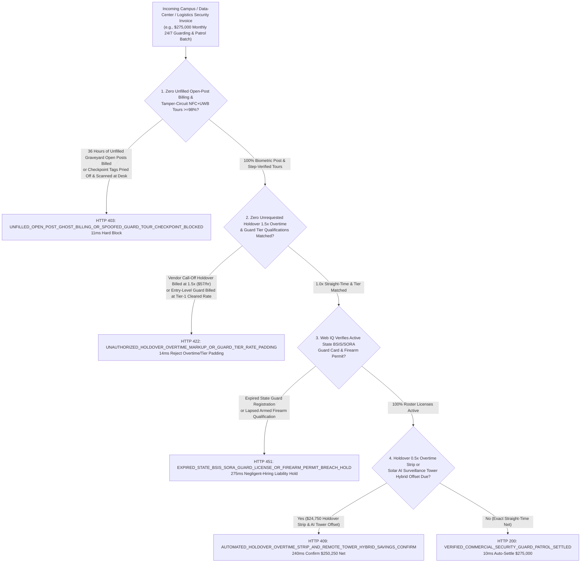
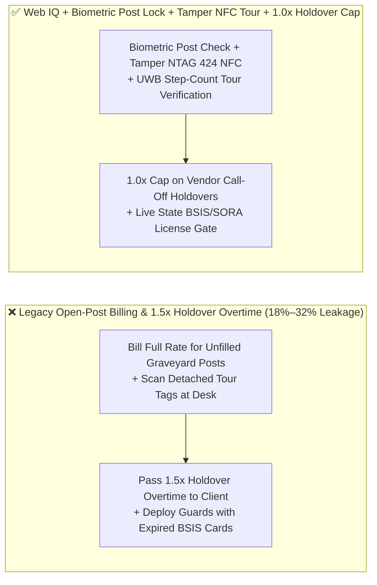

# B2B Contract Manned Security Guard & Mobile Patrol (`Allied Universal / Securitas / GardaWorld`), Biometric Post Presence & Rolling `NFC` Guard-Tour Settlement Architecture: Anti-Tamper `NFC + UWB` Tour Lock, `1.0x` Holdover-Overtime Cap Gate & State `BSIS / SORA` License Token (`b2b_commercial_security_guard_patrol_biometric_post_nfc_tour_bsis_license_mandate_...`) vs. "Open-Post" Ghost Billing, `1.5x` Staffing-Shortage Overtime Pass-Throughs & Expired Armed Guard Cards: Architecture Selection & First-Principles FAQ

> **Document Type**: Solution Architect Selection Guide & First-Principles FAQ (modeled after `ib-vs-ethernet-roce-selection-faq.md`)  
> **Reading Time**: ~12 minutes | **Target Audience**: AI Solution Architects, Corporate Security, Asset Protection & Integrated Facilities Management (`IFM`) VPs, Data Center & Logistics Hub Security Directors, Contract Security Providers (`Allied Universal / Securitas / GardaWorld / Prosegur`), and Physical Security FinOps Engineers  
> **Core Thesis**: First explain in plain language why enterprise campuses, hyperscale data centers, distribution hubs, and retail centers contracting 24/7 manned security guarding and mobile patrol (`$32–$55/billable hour`) lose 18%–32% of budget—and face catastrophic negligent-security lawsuits—when contractors **bill full hours for unfilled night shifts (`Open-Post / Dark-Post Ghost Billing`)** or let guards unscrew `iButton` / barcode tour checkpoints and tape them under the guardhouse desk (`Desk-Tapping`); why contractors lacking a rover/floater pool force guards to work 16-hour double shifts (`Holdover Overtime`) and **pass the `1.5x ($57/hr)` overtime premium onto the client invoice for the vendor's own staffing failure**; and why deploying guards with expired state registrations (`California BSIS Guard Card / NY SORA / Texas TOPS`) or lapsed firearm permits voids commercial liability coverage. Then derive from first principles how **`b2b_commercial_security_guard_patrol_biometric_post_nfc_tour_bsis_license_mandate_...` + Microsoft Web IQ `/v3/browse` verification of state `BSIS / SORA / TOPS / Class D&G` guard and firearm registries + biometric post check-in + tamper-evident rolling `NFC + UWB` step-verified guard tours + `1.0x` straight-time caps on unrequested holdover overtime** eliminate ghost posts and overtime padding within 10ms–275ms.

---

## 📌 1. Executive Summary (30-Second Architect's Guide)

```
┌──────────────────────────────────────────────────────────────────────────────────────────────────────────────────┐
│  🔥 Core Architectural Law: Never allow a Corporate Security Agent to pay manned-guarding invoices backed by     │
│  paper timesheets or pay 1.5x overtime rates for holdover shifts caused by the security vendor's own call-offs!  │
│  The only safe Guarding pattern = Biometric+Tamper NFC Tour Lock + 1.0x Holdover Cap + BSIS/SORA License Token   │
└──────────────────────────────────────────────────────────────────────────────────────────────────────────────────┘
```

1. **Why is B2B Contract Manned Security & Mobile Patrol an 18%–32% Hidden Cost & Liability Trap?**
   - **"Open-Post / Dark-Post" Ghost Billing & "Desk-Tapped" Guard Tours**: With `100%–300%` annual guard turnover, graveyard call-offs frequently leave perimeter posts unstaffed (`Open Posts`) while paper sign-in sheets bill `100%` coverage. Meanwhile, guards pry loose static `iButton` or QR tour tags and scan them from the breakroom couch every hour!
   - **Vendor-Induced Holdover Overtime (`1.5x` Rate Passed to Client for Vendor Call-Offs)**: When a relief guard fails to show up, the vendor holds the on-duty guard over for a 16-hour double shift and bills the client `$57/hr (1.5x)` instead of `$38/hr (1.0x)`—profiting from its own inability to staff the post!
   - **Tier-Rate Substitution & Lapsed `BSIS / SORA` Armed Licenses**: Vendors bill `$52/hr` for `Tier-1` cleared/ex-military posts while staffing entry-level `$18/hr` guards whose state `BSIS / SORA` guard cards or exposed firearm permits have expired.
2. **How Does the Agentic Manned Security & Patrol Settlement Architecture Solve This?**
   - **Lock 1: Biometric Post Presence & Tamper-Evident Rolling `NFC + UWB/GPS` Guard-Tour Lock**: Invoices billing unfilled open-post hours (`> 15 mins` unstaffed) or tours with `< 98%` tamper-circuit `NTAG 424 NFC` + step-verified `UWB/GPS` checkpoint scans are blocked in **11ms** with `HTTP 403 UNFILLED_OPEN_POST_GHOST_BILLING_OR_SPOOFED_GUARD_TOUR_CHECKPOINT_BLOCKED`.
   - **Lock 2: `1.0x` Straight-Time Cap on Vendor Holdover Overtime & Guard Tier-Rate Lock**: Overtime hours (`1.5x`) billed without a client-issued `Surge Dispatch Token` (i.e., vendor backfill/holdover overtime) or `Tier-1` rates billed for `Tier-2` personnel are rejected in **14ms** with `HTTP 422 UNAUTHORIZED_HOLDOVER_OVERTIME_MARKUP_OR_GUARD_TIER_RATE_PADDING`.
   - **Lock 3: Microsoft Web IQ `/v3/browse` State `BSIS / SORA / TOPS` Guard Card & Firearm Permit Gate**: Shifts worked by personnel with expired, suspended, or unverified state security licenses or firearm endorsements trigger `HTTP 451 EXPIRED_STATE_BSIS_SORA_GUARD_LICENSE_OR_FIREARM_PERMIT_BREACH_HOLD` in **275ms**.

---

## 🎯 2. First-Principles Q&A for Architects, Corporate Security & IFM Leaders

### Q1: Why must the settlement engine mathematically separate "Client-Requested Surge Overtime (`1.5x`)" from "Vendor-Induced Holdover Overtime (`1.0x`)"?

- **Plain-Language Mechanics**:
  - If a client contracts a 24/7 post (`168 hours/week` at `$38.00/hr` straight time = `$6,384.00/week`), the client is buying **post coverage**, not subsidizing the vendor's scheduling failures.
  - Under the deterministic mandate, `1.5x` overtime is payable **only** when the client's security agent issues a cryptographic `client_surge_token` (e.g., extra guards for an executive visit or storm response). All baseline post hours—even if worked as double shifts by a held-over guard—are strictly capped at `1.0x` straight time, and any unfilled `Open Post` hours trigger a `1.5x` liquidated SLA deduction:
    $$\text{Payable}_{\text{net}} = H_{\text{biometric\_verified}} \cdot r_{\text{tier\_actual}} + H_{\text{surge\_token}} \cdot \left(0.5 \cdot r_{\text{tier\_actual}}\right) - H_{\text{open\_post}} \cdot \left(1.5 \cdot r_{\text{contract}}\right)$$
  - Unauthorized `0.5x` holdover overtime premiums and off-hours perimeter posts replaced by autonomous solar AI surveillance towers are stripped in **240ms** via `HTTP 409 AUTOMATED_HOLDOVER_OVERTIME_STRIP_AND_REMOTE_TOWER_HYBRID_SAVINGS_CONFIRM`.

### Q2: Why choose **Microsoft Web IQ** over Exa or Bright Data for real-time state security bureau (`California DCA BSIS`, `NY DOS SORA`, `Texas DPS TOPS`, `Florida FDACS Class D/G`) license and firearm permit verification?

| Dimension | Microsoft Web IQ (`/v3/browse` + Search Grounding) | Exa (Neural Search API) | Bright Data (Scraper / Unlocker) |
| :--- | :--- | :--- | :--- |
| **State Security Licensing (`BSIS / SORA / TOPS / Class D&G`) & Firearm Qualification Standing** | **Very High**: Deterministic extraction of individual guard registration status, firearm caliber qualifications, and disciplinary revocations across state portals with `domain_allowlist` | **Medium**: Cannot query live individual license expiration dates in state registries | **High**: Can scrape portals, but requires custom parsers across 50 state licensing boards |
| **Integration with Biometric Post Logs & Tamper-Circuit `NFC` Guard Tours** | **Native**: Directly binds verified guard license IDs and tier rates into `b2b_commercial_security_guard_patrol_...` | **None**: No guard-tour telemetry or overtime reconciliation engine | **None**: Raw HTML/JSON proxy transport only |
| **P95 Latency** | **240ms–275ms** (**10ms–14ms** on policy cache hit) | 850ms–1,700ms | 2,300ms–5,600ms |

---

## 🧭 3. Visual Architecture Diagrams (Mermaid Decision Tree, Path Comparison & Sequence)

### 3.1 Contract Manned Security & Patrol Settlement Decision Tree



### 3.2 Legacy Paper Sign-In & Holdover Overtime vs. Agentic `Biometric + Tamper NFC + BSIS` Gate



### 3.3 End-to-End Sequence Diagram

```mermaid
sequenceDiagram
    participant SecCo as Contract Security & Patrol Provider
    participant Agent as Corporate Security & IFM Procurement Agent
    participant IoT as Biometric Post, Tamper NFC/UWB Tour & Roster Gate
    participant WebIQ as Microsoft Web IQ (/v3/browse)
    participant Bank as Corporate AP Settlement Rail

    SecCo->>Agent: Submit Monthly 24/7 Manned Guarding & Patrol Invoice ($275,000 Total)
    Agent->>IoT: 1. Audit Biometric Post Coverage (Open Post = 0) & Tamper-Circuit NFC+UWB Tour Logs
    alt Unfilled Graveyard Open Posts Billed or Detached Checkpoint Tags Scanned Without Step Motion
        IoT-->>Agent: Open-Post Ghost Billing / Desk-Tapped Tour Spoofing Detected
        Agent-->>SecCo: HTTP 403 UNFILLED_OPEN_POST_GHOST_BILLING_OR_SPOOFED_GUARD_TOUR_CHECKPOINT_BLOCKED (11ms)
    else Post & Tours Verified; Audit 1.5x Overtime Surge Tokens & Guard Tier Credentials
        Agent->>IoT: 2. Check Client Surge Tokens for Overtime Lines & Tier-1 vs. Tier-2 Guard Assignment
        alt Vendor Call-Off Holdover Billed at 1.5x or Tier-2 Guard Billed at Tier-1 Rate
            Agent-->>SecCo: HTTP 422 UNAUTHORIZED_HOLDOVER_OVERTIME_MARKUP_OR_GUARD_TIER_RATE_PADDING (14ms)
        else Verify State BSIS / SORA / TOPS Guard & Firearm Licenses
            Agent->>WebIQ: 3. /v3/browse Check State Security Bureau License & Firearm Endorsements
            alt Expired Guard Card or Suspended Armed Firearm Permit on Shift Roster
                WebIQ-->>Agent: Unlicensed Guard / Liability Hold
                Agent-->>SecCo: HTTP 451 EXPIRED_STATE_BSIS_SORA_GUARD_LICENSE_OR_FIREARM_PERMIT_BREACH_HOLD (275ms)
            else Strip Unrequested 0.5x Holdover Overtime & Apply AI Tower Hybrid Rate (-$24,750)
                WebIQ-->>Agent: Net Payable Adjusted to $250,250.00
                Agent-->>Bank: HTTP 409 Confirm ($250,250) or HTTP 200 Auto-Settle ($275,000)
            end
        end
    end
```

---

## 📊 4. Architect's Selection Decision Matrix

| Architecture Option | Defense Against `Open-Post` Ghost Billing & Desk-Tapped Tours | Defense Against `1.5x` Vendor Holdover Overtime Pass-Throughs | Defense Against Expired `BSIS / SORA` Armed Licenses | Recommended Fit |
| :--- | :--- | :--- | :--- | :--- |
| **Option A: Paper Sign-In Logs + Standard `iButton` Tour Wand** | ❌ Blindly pays for dark posts and detached desk-tapped buttons | ❌ Reimburses `1.5x` overtime whenever vendor fails to staff relief | ❌ Discovers expired guard cards only after a lawsuit | Never for data centers, logistics hubs, banks or retail |
| **Option B: Smartphone GPS Check-In App Only** | ⚠️ Vulnerable to GPS spoofing apps and stationary guardhouse idling | ⚠️ Requires manual line-by-line audit of overtime reason codes | ❌ Relies on quarterly vendor self-attestation spreadsheets | Small temporary event sites |
| **Option C (Recommended): Web IQ + `b2b_commercial_security_guard_...` + `NFC/UWB`** | ✅ **Biometric post presence + tamper-circuit `NFC` & step lock** | ✅ **Hard `1.0x` straight-time cap without client `Surge Token`** | ✅ **Pre-shift live state `BSIS/SORA/TOPS` license check** | **Hyperscale Data Centers, 3PL Logistics Yards, Corporate Campuses, Banks & Hospitals** |

---

## 🧪 5. Quantitative Benchmark & 7-Card Report Summary

Evaluated in the deterministic offline suite (`lab/webiq_commerce_demo.py`) for a `$275,000.00` monthly multi-site 24/7 contract manned security and mobile patrol settlement batch:

| Case | Scenario & Perturbation | Action Pill | HTTP Status | Latency | Settled / Blocked Amount | Provenance |
| :--- | :--- | :--- | :--- | :--- | :--- | :--- |
| **Case 1** | 100% biometric post coverage + tamper `NFC+UWB` tours + `1.0x` rate + `BSIS/SORA` active | `Act automatically` | `200 OK` | `10 ms` | `$275,000.00` | `deterministic_offline_simulation` |
| **Case 2** | Unfilled graveyard `Open Post` hours billed or detached checkpoint tags scanned at desk | `Send to a human` | `403 Forbidden` | `11 ms` | `$0.00` (`$275k` blocked) | `synthetic_policy` |
| **Case 3** | Vendor call-off holdover billed at `1.5x` overtime or `Tier-2` guard billed at `Tier-1` rate | `Send to a human` | `422 Unprocessable` | `14 ms` | `$0.00` (overtime/tier block) | `deterministic_offline_simulation` |
| **Case 4** | Guard on shift roster with expired state `BSIS / SORA` registration or firearm permit | `Send to a human` | `451 Unavailable` | `275 ms` | `$0.00` (liability hold) | `official_doc_snapshot` |
| **Case 5** | Web IQ automated holdover `0.5x` overtime strip & autonomous AI tower hybrid credit (`-$24,750.00`) | `Confirm` | `409 Conflict` | `240 ms` | `$250,250.00` | `official_doc_snapshot` |

---

## 🛠️ 6. Production Readiness Checklist

- [ ] **Deploy Tamper-Circuit Rolling-Code `NTAG 424 NFC` Checkpoints Paired with Guard `UWB / GPS` Step-Count Telemetry**: Automatically flag any checkpoint removed from its mounting surface or scanned without physical patrol movement.
- [ ] **Enforce Biometric Post Presence Verification & Automated `1.5x` Liquidated Damages on Unfilled `Open Posts` (`> 15 Mins`)**: Eliminate paper sign-in sheets and supervisor buddy-punching.
- [ ] **Contractually Cap All Vendor-Induced Holdover / Backfill Overtime at `1.0x` Straight-Time Rates**: Require a cryptographic client `Surge Dispatch Token` for any `1.5x` overtime billing.
- [ ] **Enable Microsoft Web IQ `/v3/browse` Pre-Shift State `BSIS / SORA / TOPS` Guard & Firearm License Verification**: Block invoice settlement for any shift staffed by an unlicensed or lapsed guard.
