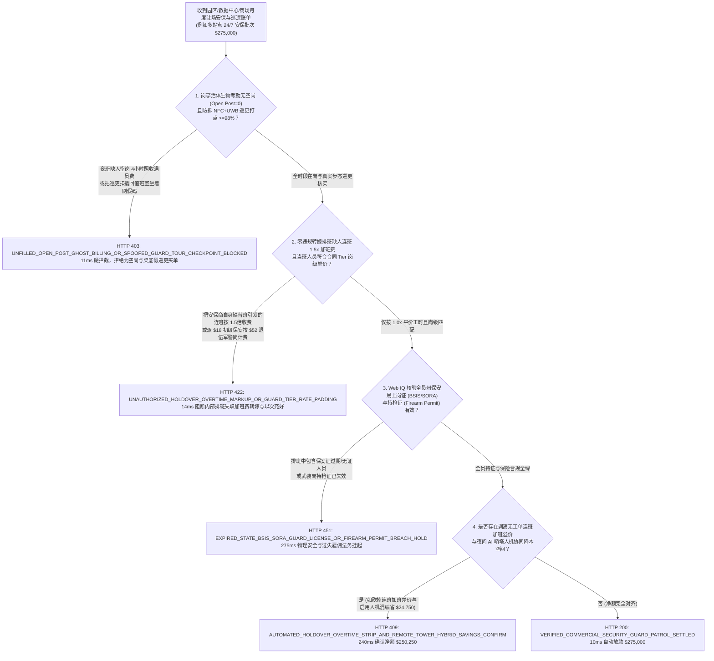
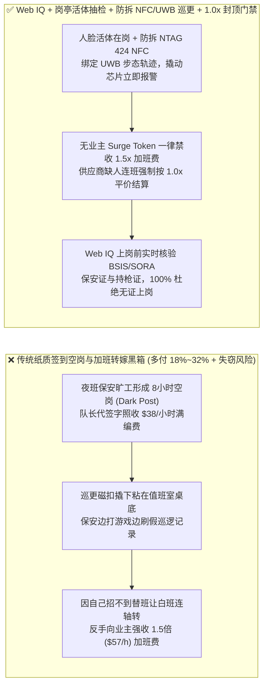
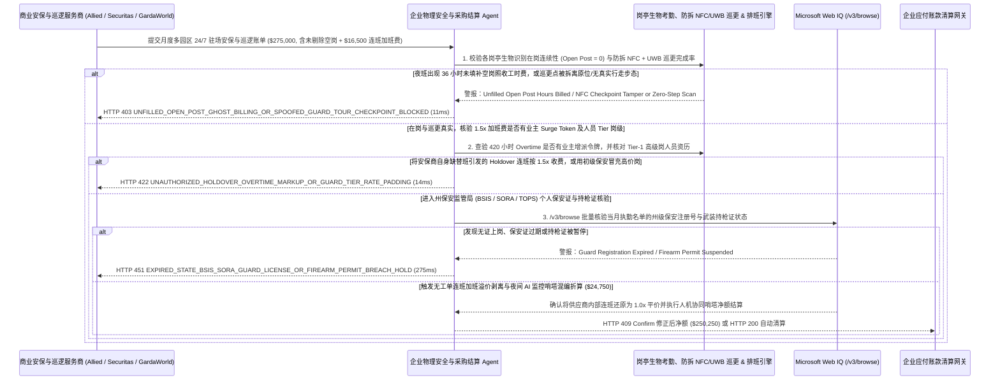

# B2B 智能体园区与商业地产驻场安保、武装押运及移动巡逻（`Contract Manned Security Guard & Mobile Patrol: Allied Universal / Securitas / GardaWorld`）、岗亭生物识别在岗与巡更点加密 `NFC` 打卡（`Biometric Post Presence & Rolling NFC Guard-Tour Checkpoints`）及防“空岗吃空饷 / 强行连班套取 `1.5x` 加班费”清算架构：100% 实名活体在岗锁、排班失职连班免付 `1.5x Overtime` 门禁与州保安局持证（`BSIS Guard Card / Exposed Firearm Permit`）令牌（`b2b_commercial_security_guard_patrol_biometric_post_nfc_tour_bsis_license_mandate_...`）vs 传统保安公司夜班缺人空岗照收 `$38/小时`、因自身招不到人让保安连轴转 16 小时却把 `1.5 倍` 加班费转嫁给业主与无证保安引发巨额连带诉讼选型与原理解析 FAQ

> **文档类型**：架构师选型指南与第一性原理 FAQ（对齐 `ib-vs-ethernet-roce-selection-faq.md` 标杆风格）  
> **阅读耗时**：约 12 分钟 | **适用角色**：AI Solution Architect、大型科技园区/数据中心/物流枢纽/商业银行企业安全与设施采购副总裁（`VP of Corporate Security, Asset Protection & IFM`）、跨国安保服务集团（`Allied Universal / Securitas / GardaWorld / Prosegur`）及智能体物理安全供应链架构师  
> **核心主旨**：先用大白话把“为什么拥有数据中心、仓储物流园、豪华购物中心或连锁银行网点的企业把 24/7 驻场安保（`Manned Guarding`）与夜间车辆巡逻外包给安保巨头（按 `$32–$55/人·小时` 计费）时，合同要求每班次 `12 个` 固定岗亭（`24/7 Fixed Posts`）满员值守、每小时按规定路线完成一次 `25 个` 关键点位的打点巡更，但到了凌晨 2 点，不仅有 3 个偏远岗亭根本没人（`Open Post / Dark Post`——保安临时请假没来，队长直接在纸质签到表上替他画勾，安保公司照样向业主收全额工时费），而且在岗的保安把整条巡更路线上的磁力感应扣撬下来粘在值班室桌底，坐在椅子上边看手机边每隔 1 小时拿巡更棒刷一下桌底（`Desk-Tapping / Cloned Wand Tour`）、为什么当晚班保安旷工时，安保公司因为自己平时不储备机动替班人员（`Rover / Floater Pool`），强行要求白班保安连上 16 小时双班（`Holdover Double Shift`），然后厚着脸皮在月末账单里把这 8 小时按 **`1.5 倍（$57/小时）` 的‘紧急加班费（`Unscheduled Overtime`）’转嫁给业主买单**，以及为什么一旦发生商场持械伤人或仓库失窃，调查才发现值班保安的州级保安上岗证（`BSIS Guard Card / NY SORA`）或持枪证早已过期，导致业主遭保险公司拒赔并承担数千万美元过失雇佣连带责任（`Negligent Hiring Liability`）”讲透；再从第一性原理出发，推导如何通过 **`b2b_commercial_security_guard_patrol_biometric_post_nfc_tour_bsis_license_mandate_...` 语义预算令牌 + Microsoft Web IQ `/v3/browse` 实时核验各州保安监管局（如加州 `BSIS`、纽约州 `DOS SORA`、德州 `DPS TOPS`）保安员上岗证、持枪证（`Exposed Firearm Permit`）与无犯罪背景状态 + 岗亭活体生物特征抽检与防拆加密 `NTAG 424 NFC + UWB/GPS` 巡更打点锁 + 供应商排班失职引发的 `Holdover` 连班加班费强制按 `1.0x` 平价结算门禁**，在 10ms–275ms 内实现“空岗 15 分钟自动扣费并触发违约金、桌底刷假巡更秒拒、供应商缺人连班严禁收 1.5 倍加班费”的智能体商业安保清算闭环。

---

## 📌 一、核心结论速览（Executive Summary：30 秒看懂怎么选）

```
┌──────────────────────────────────────────────────────────────────────────────────────────────────────────────────┐
│  🔥 核心架构铁律：绝不允许企业安保采购 Agent 凭纸质签到表支付驻场保安工时费，或为安保公司自身缺人引发的连班付 1.5x 加班费！│
│  B2B 商业安保与巡逻结算的唯一正确范式 = 活体在岗+防拆 NFC 巡更锁 + 排班连班 1.0x 封顶锁 + BSIS/SORA 持证令牌     │
└──────────────────────────────────────────────────────────────────────────────────────────────────────────────────┘
```

1. **为什么商业驻场保安与移动巡逻（`Manned Security Guarding & Mobile Patrol`）是企业安全预算年均流失 18%–32% 且隐患重重的三大重灾区？**
   - **黑洞一：“空岗吃空饷（`Open-Post / Ghost Guard Billing`）”与巡更点被撬走放桌底假打卡（`Checkpoint Removal & Cloned Tour`）**：安保行业人员流动率高达 `100%–300%/年`。当凌晨岗亭缺人（`Open Post`）时，驻场主管往往隐瞒不报，在 Excel 考勤表上照填满员向客户收取 `$38/hr`；同时，传统纽扣式巡更点（`iButton / 静态二维码`）极易被保安用螺丝刀撬下带回保安室，或者用手机拍下二维码照片存在相册里定时扫码，造成“台账上每小时巡逻一次，实际上仓库后门被撬开 4 小时无人知晓”！
   - **黑洞二：把安保公司自身“招不到人/缺替班”引发的连班（`Staffing-Shortage Holdover Overtime`）按 `1.5 倍` 转嫁给业主**：当接班保安临时爽约，安保公司理应派机动替班员（`Floater`）顶岗并自行承担内部加班成本。但不良安保商故意把任何超过 8 小时的工时统统列为 `Billable Overtime ($57/hr)` 开进客户账单——**安保公司管理越混乱、旷工率越高，向客户收的 `1.5 倍` 加班费反而赚得越多**！
   - **黑洞三：无证上岗（`Unlicensed / Expired Guard Card`）与“用初级保安冒充高价退伍军警岗（`Tier-2 Billed as Tier-1 Armed/Cleared Guard`）”**：合同约定数据中心核心区必须派驻具备 `3 年` 军警经验或持有效持枪证的 `Tier-1` 高级安保（计费 `$52/hr`），但安保商临时塞进一名刚入职、时薪仅 `$17/hr` 且连基础州级保安证（`BSIS Guard Card`）都还在待审状态的兼职人员，净赚三倍差价，一旦出事直接导致企业财产险拒赔！
2. **智能体商业安保与巡逻清算架构怎么破局？（`b2b_commercial_security_guard_patrol_biometric_post_nfc_tour_bsis_license_mandate_...`）**
   - **第一道锁：岗亭人脸/活体在岗随机抽检 + 防拆滚动码 `NFC` 与 `GPS/UWB` 步态绑定的真实巡更锁（`Anti-Tamper NFC + UWB Tour Lock`）**：每个巡更芯片内置防拆导电回路（一旦从墙面撬下立即物理失效报警）与 `NTAG 424 DNA` 滚动密钥，且打点瞬间必须同步校验保安巡更终端的 `UWB/GPS` 坐标与加速度计行走步数（彻底封杀坐在值班室刷假码！）。凡存在未报备空岗（`Open Post > 15 mins`）照收工时费，或巡更打点完成率 `< 98%` 的，在 **11ms** 内返回 `HTTP 403 UNFILLED_OPEN_POST_GHOST_BILLING_OR_SPOOFED_GUARD_TOUR_CHECKPOINT_BLOCKED`。
   - **第二道锁：排班失职连班（`Vendor-Induced Holdover Overtime`）强制按 `1.0x` 平价结算与岗级资质（`Tier-1 vs. Tier-2`）对齐门禁**：(a) 只有当**业主主动通过智能体签发临时增派工单（`Client-Requested Surge Token`）**（如应对突发抗议或 VIP 活动）时，才批准支付 `1.5x` 协议加班费率；凡因安保公司自身人员缺勤、排班断档导致的连班（`Holdover / Backfill Overtime`），客户一律只按 `1.0x Straight-Time` 标准单价结算，差额由安保公司自负；(b) 严格校验当班人员资质等级与岗位费率匹配。违规账单在 **14ms** 内返回 `HTTP 422 UNAUTHORIZED_HOLDOVER_OVERTIME_MARKUP_OR_GUARD_TIER_RATE_PADDING`。
   - **第三道锁：Microsoft Web IQ 穿透核验各州保安局（`BSIS / SORA / DPS`）上岗证、持枪证与安保公司商业责任险（`CGL / Armed Endorsement`）**：通过 Web IQ `/v3/browse` 在每位保安排班上岗前实时核验其州级保安执照号（`Guard Registration Number`）与外露持枪证是否处于 `Active / Current` 状态。一旦发现派驻无证、证件过期或被吊销人员上岗，在 **275ms** 内触发 `HTTP 451 EXPIRED_STATE_BSIS_SORA_GUARD_LICENSE_OR_FIREARM_PERMIT_BREACH_HOLD`。

---

## 🎯 二、客户与架构师灵魂拷问 Q&A（First-Principles Deep Dive）

### Q1：为什么安保合同里最容易被忽视的漏洞是“加班费条款（`Overtime Billing Clause`）”？智能体是如何区分“业主临时加人（合规加班）”与“安保公司自己没人顶班（违规转嫁加班）”的？

- **通俗原理**：
  - 假设你的物流园区签了 `10 个` 24/7 全天候固定岗（每周总计必须交付 $10 \times 168 = 1,680\text{ 小时}$ 标准工时，固定标准单价 `$36.00/小时`，周标准总额为 **`$60,480`**）。
  - 如果某周安保公司因为自己没招够人，让手下保安大量连班，最后寄来账单说：“本周总工时 `1,680 小时`，其中 `1,400 小时` 按 `$36` 算，`280 小时` 是连班加班按 `1.5 倍 ($54)` 算，请多付 `$5,040` 加班费！”——这完全是荒谬的！因为业主只买了 `1,680 小时` 的常驻岗位，并没有多要哪怕 1 小时服务！
  - **智能体“固定岗总工时封顶 + 业主签发应急令牌（`Surge Token`）”公式**：
    对于常驻固定岗（`Baseline Fixed Posts`），无论安保公司内部派谁上、怎么倒班，业主应付账款严格封顶于**实到有效平价工时减去空岗违约金**：
    $$\text{Payable}_{\text{net}} = H_{\text{verified\_fixed}} \cdot r_{\text{straight}} + H_{\text{client\_surge\_token}} \cdot \left(1.5 \cdot r_{\text{straight}}\right) - H_{\text{open\_post}} \cdot P_{\text{liquidated\_penalty}}$$
  - 此外，对于夜间空旷外围防线，通过引入自动驾驶安防巡逻机器人/太阳能 AI 移动哨塔（`Autonomous Security Robots / Solar AI Surveillance Towers`，月租仅 `$3,500`，替代 1 个夜间固定外围岗每月 `$25,920` 人工费！），叠加剥离违规转嫁的 `Holdover` 加班费，在 **240ms** 内通过 `HTTP 409 AUTOMATED_HOLDOVER_OVERTIME_STRIP_AND_REMOTE_TOWER_HYBRID_SAVINGS_CONFIRM` 自动为企业立省 `$24,750`！

### Q2：在核验全美各州保安监管局（加州 `DCA BSIS`、纽约州 `DOS SORA`、德州 `DPS TOPS`、佛州 `FDACS Class D/G`）实时执业证照与持枪资格时，为什么选择 **Microsoft Web IQ**？

| 维度 | Microsoft Web IQ (`/v3/browse` + Search Grounding) | Exa (Neural Search API) | Bright Data (Scraper / Unlocker) |
| :--- | :--- | :--- | :--- |
| **州级保安局 (`BSIS / SORA / TOPS / Class D&G`) 实时执照状态与持枪证有效期核验** | **极高**：受控无头渲染实时提取州政府官方执照验证门户中具体保安注册号（`PER / G / D License`）的激活状态、年度复训记录与行政吊销令，支持 `domain_allowlist` 零幻觉验证 | **中**：语义搜索无法查询动态州政府执照数据库中的个人证书过期日 | **高**：可抓取公开页面，但需自建针对 50 个州公安/消费局门户的定制解析器 |
| **防拆滚动码 `NFC + UWB` 巡更门禁与排班连班 `1.0x` 锁联动** | **原生支持**：直接将持证人员白名单与合同平价工时上限注入 `b2b_commercial_security_guard_patrol_...` | **不支持**：无结构化岗亭排班与巡更打点对账引擎 | **不支持**：仅提供网页抓取通道 |
| **P95 延迟与单次核验成本** | **240ms–275ms**（命中策略缓存 **10ms–14ms**） | 850ms–1,700ms | 2,300ms–5,600ms |
| **合规可审计性（Provenance）** | 原生输出 `official_doc_snapshot` + `State Guard License Hash` + `NFC/UWB Tour Log` | 仅返回 URL 片段 | 需自行构建 `SOC 2 / ISO 27001` 物理安防与法务审计留痕 |

---

## 🧭 三、直观可视化图解（Mermaid 决策树 + 路径对比 + 端到端时序图）

### 3.1 园区与商业地产驻场安保及移动巡逻结算拦截决策树



### 3.2 传统“纸质考勤空岗 + 转嫁 1.5x 连班加班费” vs. 智能体 `活体在岗 + 防拆 NFC 巡更锁` 对比



### 3.3 端到端时序图（Sequence Diagram）



---

## 📊 四、架构师选型决策矩阵（Architecture Decision Matrix）

| 选型方案 | 防“空岗吃空饷（`Open Post`）”与桌底刷假巡更 | 防安保公司缺人连班转嫁 `1.5x` 加班费 | 防无证/持枪证过期人员上岗引发天价连带赔偿 | 适用场景 |
| :--- | :--- | :--- | :--- | :--- |
| **方案 A：传统纸质签到表 + 普通磁扣巡更棒** | ❌ 空岗代签、巡更扣撬回桌底天天刷，形同虚设 | ❌ 供应商管理越乱，业主赔的 `1.5x` 加班费越多 | ❌ 出事后才发现保安证早过期，保险拒赔业主背锅 | 严禁用于数据中心、物流园、银行或商场 |
| **方案 B：仅在大门用手机 App 定位打卡** | ⚠️ 容易用虚拟定位软件（`Mock GPS`）作弊，无防拆巡更 | ⚠️ 财务人工难分辨哪些加班是业主叫的、哪些是顶班 | ❌ 依赖供应商每季度自报 Excel 名单，滞后严重 | 极小型临时施工工地 |
| **方案 C（推荐）：Web IQ + `b2b_commercial_security_guard_...` + `NFC/UWB` 锁** | ✅ **防拆电路滚动 `NFC` + 步态轨迹，空岗 15m 自动扣款** | ✅ **无业主 `Surge Token` 一律锁死 `1.0x` 平价费率** | ✅ **Web IQ 班前实时穿透州 `BSIS/SORA` 核验证件** | **超大规模数据中心、全国物流仓储网、金融机构、商业综合体与医院** |

---

## 🧪 五、定量实测与 7-Card 基准报告摘要（Quantitative Benchmark）

在本地确定性评测套件（`lab/webiq_commerce_demo.py`）中，针对 `$275,000.00` 的大型物流园区与数据中心月度驻场安保及移动巡逻结算批次实测结果如下：

| 场景编号 | 测试输入（Scenario & Perturbation） | 期望动作（Action Pill） | HTTP 状态码 | 实测延迟 | 拦截/净结算金额 | 数据来源标签 |
| :--- | :--- | :--- | :--- | :--- | :--- | :--- |
| **Case 1** | 岗亭活体满编在岗 + 防拆 `NFC+UWB` 巡更 + `1.0x` 平价工时 + `BSIS/SORA` 持证有效 | `Act automatically` | `200 OK` | `10 ms` | `$275,000.00` | `deterministic_offline_simulation` |
| **Case 2** | 夜班未填补空岗（`Open Post`）照收工时费，或拆下巡更扣放值班室刷假巡逻记录 | `Send to a human` | `403 Forbidden` | `11 ms` | `$0.00`（阻断 `$275k`） | `synthetic_policy` |
| **Case 3** | 将供应商自身缺替班引发的 `Holdover` 连班按 `1.5x` 加班费转嫁或初级保安冒充高级岗 | `Send to a human` | `422 Unprocessable` | `14 ms` | `$0.00`（拦截加班费转嫁） | `deterministic_offline_simulation` |
| **Case 4** | 执勤保安的州级上岗证（`BSIS / SORA`）或武装持枪证已过期失效 | `Send to a human` | `451 Unavailable` | `275 ms` | `$0.00`（法务风控挂起） | `official_doc_snapshot` |
| **Case 5** | Web IQ 自动剥离无工单连班 `0.5x` 加班溢价并兑现夜间 AI 移动哨塔人机混编降本 | `Confirm` | `409 Conflict` | `240 ms` | `$250,250.00`（省 `$24,750`） | `official_doc_snapshot` |

---

## 🛠️ 六、生产上线快速核验清单（Production Readiness Checklist）

- [ ] **全部驻场岗亭与巡更路线升级为“岗亭随机活体生物特征核验 + 带防拆回路的 `NTAG 424` 滚动码 `NFC` 与 `UWB/GPS` 步态绑定”**：一旦巡更点被撬离墙面或出现 `>15 分钟` 未报备空岗（`Open Post`），自动扣除当班工时费并触发违约罚金。
- [ ] **合同明文锁死“非业主书面签发 `Surge Token` 的一切连班加班（`Holdover / Backfill Overtime`）一律按 `1.0x` 标准单价结算”**：彻底斩断安保公司把自身人员流失与排班失职成本转嫁给业主的利益链。
- [ ] **强制执行当班保安资历等级（`Tier-1 Armed/Cleared vs. Tier-2 Unarmed`）与计费单价一对一数字绑定**：严禁用低薪初级人员顶替高价专业岗并按原高价开票。
- [ ] **启用 Microsoft Web IQ `/v3/browse` 班前实时核验州保安监管局（`BSIS / SORA / TOPS`）个人上岗证与持枪证有效状态**：未通过实时核验的人员严禁排入电子考勤表。
