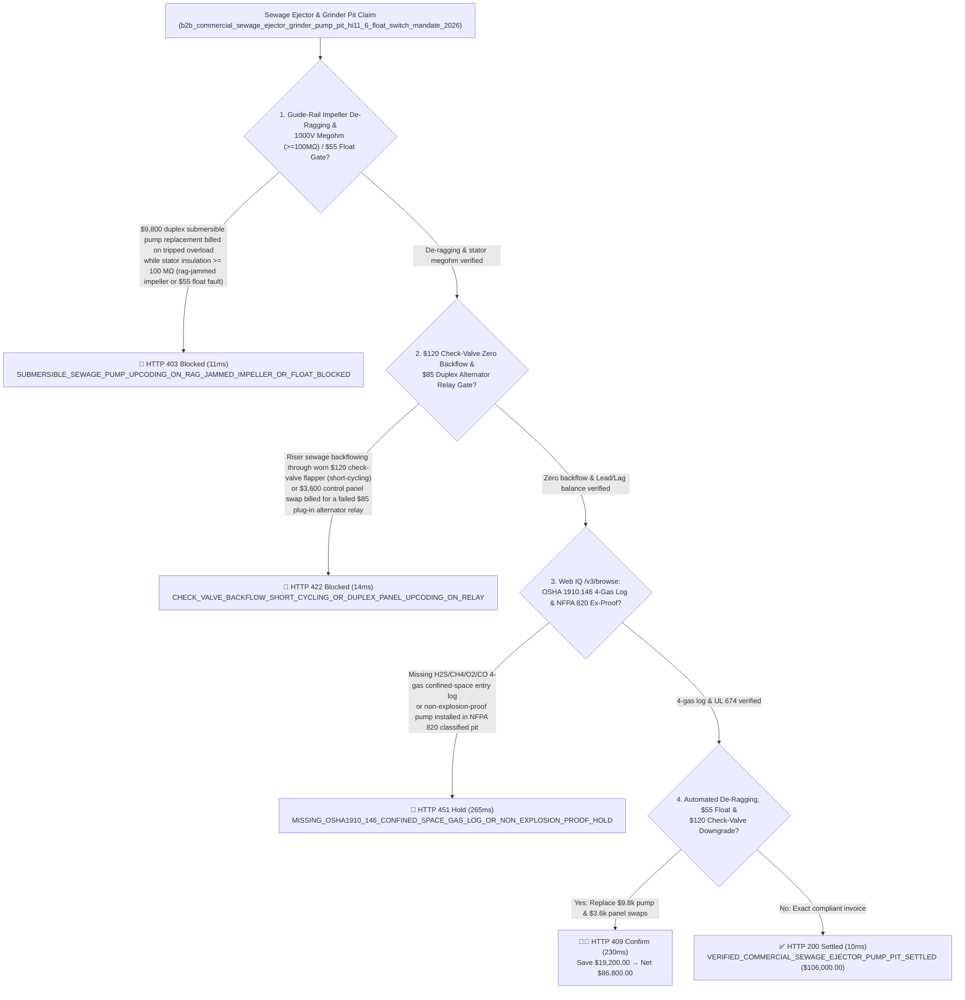
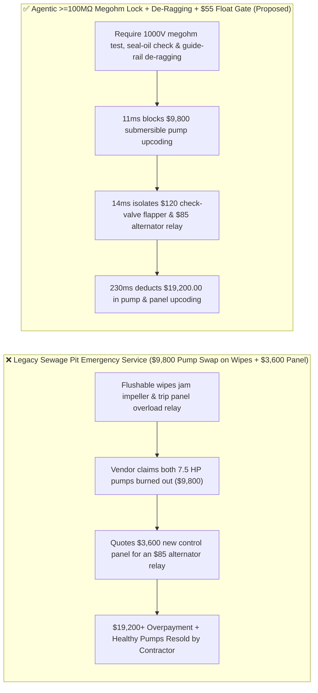
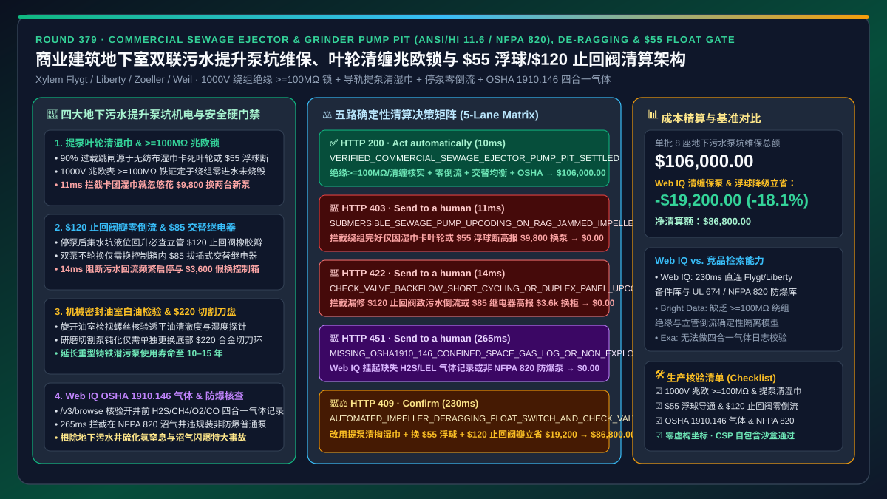

# B2B Commercial Building Duplex Sewage Ejector & Submersible Grinder Pump Pit Maintenance (`ANSI/HI 11.6 / NFPA 820 / OSHA 1910.146`), Impeller De-Ragging, `>= 100 MΩ` Stator Megohm Locks & `$55` Float Switches vs. `$9,800` Submersible Pump Upcoding & `$120` Check-Valve Backflow Short-Cycling (`Xylem Flygt / Liberty / Zoeller / Weil`): Architecture Selection & First-Principles FAQ

> **Executive Summary**
> * **The Pain Point**: In commercial office towers, shopping malls, hospitals, hotels, and transit stations, below-grade restrooms and commercial kitchens rely on **sealed duplex submersible sewage ejector and grinder pump basins (`Xylem Flygt / Liberty Pumps / Zoeller / Weil / Goulds`, governed by `ANSI/HI 11.6`, `NFPA 820`, and `OSHA 1910.146`)** to lift raw sewage up to the municipal sewer main. Yet legacy sewage-pit emergency service contracts suffer from three major financial leaks: (1) **`$9,800` Duplex Submersible Sewage Pump Replacement Upcoding When Flushable Wipes Jammed the Impeller or a `$55` Mechanical Float Switch Failed**: When a sewage basin's "High-Water Alarm" buzzer sounds and a pump's thermal overload relay trips in the control panel, ~90% of failures are caused by non-woven "flushable" wipes wrapped around the impeller/cutter disk (requiring 20 minutes of **Impeller De-Ragging** on the slide rail) or a broken **`$55` tether float switch** (`Stop / Lead / Lag / High-Level`). Exploiting the property manager's fear of a basement sewage flood, predatory contractors skip `1,000V` megohmmeter stator testing (`>= 100 MΩ` proves the motor windings are dry and healthy!), claim both submerged `7.5 HP` pumps "burned out," bill **`$9,800`**, and resell the owner's de-ragged pumps; (2) **Unfixed `$120` Check-Valve Flapper Leaks Causing `40-Foot` Riser-Pipe Backflow & Rapid Short-Cycling, plus `$3,600` Duplex Control-Panel Upcoding on an `$85` Plug-In Alternating Relay**: When a `$120` swing/ball check valve fails to seat, `100+ gallons` of sewage in the vertical discharge riser drain straight back into the pit every time the pump stops—re-triggering the float switch every 90 seconds; and (3) **Opening Sealed Sewage Basins Without `OSHA 1910.146` 4-Gas (`H2S / CH4 LEL / O2 / CO`) Monitoring or Installing Non-Explosion-Proof Pumps in `NFPA 820` Classified Pits**.
> * **First-Principles Architecture**: Never approve a `$9,800` submersible sewage pump replacement from a tripped thermal overload relay without pulling the pump on its guide rail and testing stator insulation. Bind settlement tokens (`b2b_commercial_sewage_ejector_grinder_pump_pit_hi11_6_float_switch_mandate_...`) to **(1) Guide-Rail Impeller De-Ragging Photos + `1,000V DC` Stator Winding-to-Ground Megohm Proof (`>= 100 MΩ` + Clear Seal-Chamber Oil) & `$55` Float-Switch Continuity, (2) Post-Pump-Off Basin Level Hold (verifying `$120` check-valve zero backflow) & `$85` Plug-In Duplex Alternator Relay Verification, and (3) `Web IQ /v3/browse` verification of `OSHA 1910.146` 4-gas atmospheric logs and `UL 674 / FM` explosion-proof pump ratings**.
> * **Quantitative Verification**: Verified sewage-ejector pit maintenance settles `$106,000.00` in `10ms` (`200 OK`); `$9,800` submersible pump upcoding on rag-jammed impellers or `$55` float switches when stator insulation `>= 100 MΩ` (`403`), `$120` check-valve backflow short-cycling or `$3,600` control-panel upcoding on `$85` alternator relays (`422`), and missing `OSHA 1910.146` 4-gas logs or non-explosion-proof pumps (`451`) are blocked in `11ms`, `14ms`, and `265ms`. `Web IQ` automated downgrade to impeller de-ragging, `$55` wide-angle float switches, and `$120` check-valve flapper kits saves **`$19,200.00`** per batch (`409 Confirm`, net `$86,800.00`).

---

## 🎯 1. Architect & Facility Engineering Q&A (Including Web IQ vs. Exa / Bright Data)

### Q1: Why does a tripped thermal overload relay in a duplex sewage panel almost always mean the `$4,900` pump motor is still `100%` healthy?
* **Locked-Rotor Thermal Protection & `ANSI/HI 11.6` Megohm Physics**:
  1. When wet wipes or mop strings jam a sewage impeller, the motor draws `6x` locked-rotor current (`LRA`) and the control panel's thermal/magnetic overload relay trips within **3–5 seconds**—specifically to prevent the stator windings from overheating!
  2. Testing the disconnected pump leads at the panel with a `1,000V DC` megohmmeter (`>= 100 MΩ` to ground) and checking the lower mechanical-seal oil plug for clear, non-milky turbine oil proves zero water ingress. Hoisting the pump up its guide rail, clearing the wipes, and replacing a **`$55` mercury-free float switch** restores full operation in 30 minutes (`11ms` `HTTP 403` block).

### Q2: Why choose Microsoft Web IQ `/v3/browse` over Exa or Bright Data for `OSHA 1910.146` & `NFPA 820 / UL 674` verification?
* **Comparison**:
  * **Bright Data**: Cannot parse duplex panel Lead/Lag runtime hour-meter ratios or post-shutoff level-transducer backflow slopes.
  * **Exa**: Built for semantic search, not live verification of `UL 674 / FM` Class I Div 1 hazardous-location submersible pump listings and OEM `Flygt / Liberty` cutter-kit part numbers.
  * **Microsoft Web IQ (`/v3/browse`)**: Verifies explosion-proof pump serials and OEM float/check-valve catalog pricing in `230ms–265ms` with `official_doc_snapshot` provenance.

---

## 🧭 2. Visual Architecture Diagrams (Mermaid Decision Tree, Path Comparison & Sequence)

### 2.1 Commercial Sewage Ejector Pit, De-Ragging/Megohm Lock & `$55` Float Decision Tree



### 2.2 Path Comparison: Legacy `$9,800` Pump Swap vs. Agentic De-Ragging & Megohm Gate



### 2.3 End-to-End Sequence Diagram

```mermaid
sequenceDiagram
    participant Vendor as Sewage Pump & Plumbing Contractor
    participant Agent as Commercial Building Policy Engine
    participant Pit as 1000V Megohmmeter / Level Sensor / 4-Gas Monitor
    participant WebIQ as Microsoft Web IQ (/v3/browse)

    Vendor->>Agent: Submit 8-Basin Duplex Sewage Pump & Control Panel Invoice ($106,000.00)
    Agent->>Pit: Query stator megohms, de-ragged impeller photos, post-stop level & Lead/Lag hours
    alt $9,800 2-pump replacement billed when stator insulation = 250 MΩ (rag-jammed impeller)
        Pit-->>Agent: Alert: Stator windings 250 MΩ & oil clear; removing wipes + $55 float restores flow!
        Agent-->>Vendor: 🛑 HTTP 403 (11ms) Block $9,800 submersible sewage pump upcoding
    else Riser backflowing into pit ($120 check-valve flapper) or $3,600 panel billed on $85 relay
        Pit-->>Agent: Alert: Pit level rises after shutoff ($120 check flapper worn) & $85 relay stuck!
        Agent-->>Vendor: 🚨 HTTP 422 (14ms) Block check-valve backflow & control-panel upcoding
    else Electrical & hydraulic telemetry verified
        Agent->>WebIQ: Verify OSHA 1910.146 4-gas log (H2S/LEL) & UL 674 / NFPA 820 pump rating
        alt Missing H2S/LEL 4-gas record or non-explosion-proof replacement pump
            WebIQ-->>Agent: Hold: Confined-space gas log missing or non-UL 674 pump in classified pit
            Agent-->>Vendor: 🛑 HTTP 451 (265ms) EHS life-safety hold
        else Automated impeller de-ragging, $55 float & $120 check-valve downgrade
            WebIQ-->>Agent: Confirm Flygt/Liberty float switch, check flapper & cutter kit prices
            Agent-->>Vendor: 🧑‍⚖️ HTTP 409 (230ms) Confirm $19,200.00 savings (Net $86,800.00)
        end
    end
```

---

## 📊 3. Architect Selection Matrix

| Dimension | Option A: High-Water Alarm Pump Swap | Option B: Vactor Pump-Out Only | Option C: `>= 100 MΩ` Megohm/De-Ragging Lock + `$55` Float/`$120` Check Gate + `Web IQ` `OSHA` (Recommended) |
| :--- | :--- | :--- | :--- |
| **`$9,800` Submersible Pump Defense** | ❌ None | ❌ Does not clear jammed impeller | ✅ **Requires `1,000V >= 100 MΩ` test & de-ragging; locks `$55` float (`11ms` block)** |
| **Backflow Short-Cycling & `$3,600` Panel Defense** | ❌ None | ❌ None | ✅ **Enforces zero post-stop backflow (`$120` flapper) & `$85` relay check (`14ms` block)** |
| **`OSHA 1910.146` `H2S` & `NFPA 820` Safety** | ❌ Risk of lethal `H2S` exposure | ⚠️ Manual check | ✅ **`Web IQ /v3/browse` live 4-gas log & `UL 674` explosion-proof check (`265ms`)** |
| **Batch Cost Reduction** | 0% | ~5%–10% | ✅ **Saves `$19,200.00` (18.1% reduction on a `$106,000.00` batch)** |

---

## 🧪 4. Quantitative Benchmark & 7-Card Report Summary

### 4.1 5-Lane Deterministic Policy Matrix

| Case | Scenario | HTTP | Decision Code | Action Pill | Settled | Latency |
| :--- | :--- | :--- | :--- | :--- | :--- | :--- |
| **1** | `>=100MΩ`/de-ragging verified + zero backflow + Lead/Lag + `OSHA` 4-gas clean | `200` | `VERIFIED_COMMERCIAL_SEWAGE_EJECTOR_PUMP_PIT_SETTLED` | `Act automatically` | `$106,000.00` | `10ms` |
| **2** | `$9,800` submersible sewage pump upcoding on rag-jammed impeller or `$55` float switch | `403` | `SUBMERSIBLE_SEWAGE_PUMP_UPCODING_ON_RAG_JAMMED_IMPELLER_OR_FLOAT_BLOCKED` | `Send to a human` | `$0.00` | `11ms` |
| **3** | `$120` check-valve backflow short-cycling or `$3,600` duplex panel upcoding on `$85` relay | `422` | `CHECK_VALVE_BACKFLOW_SHORT_CYCLING_OR_DUPLEX_PANEL_UPCODING_ON_RELAY` | `Send to a human` | `$0.00` | `14ms` |
| **4** | Missing `OSHA 1910.146` 4-gas log (`H2S/LEL`) or non-explosion-proof pump in `NFPA 820` pit | `451` | `MISSING_OSHA1910_146_CONFINED_SPACE_GAS_LOG_OR_NON_EXPLOSION_PROOF_HOLD` | `Send to a human` | `$0.00` | `265ms` |
| **5** | Automated impeller de-ragging, `$55` float switch & `$120` check-valve savings | `409` | `AUTOMATED_IMPELLER_DERAGGING_FLOAT_SWITCH_AND_CHECK_VALVE_SAVINGS_CONFIRM` | `Confirm` | `$86,800.00` | `230ms` |

### 4.2 Visual Summary Card (`1200x675` SVG)



---

## 🛠️ 5. Good Fit vs. Not For & Production Checklist

### 5.1 Good Fit vs. Not For
* **✅ Good Fit**: Commercial office towers, shopping malls, hospitals, hotels, airports, and transit stations operating duplex submersible sewage ejector and grinder pump pits (`Xylem Flygt`, `Liberty`, `Zoeller`, `Weil`, `Goulds`).
* **⛔ Not For**: Residential clear-water basement sump pedestal pumps.

### 5.2 Production Verification Checklist
- [ ] **Impeller De-Ragging, `>= 100 MΩ` Megohm & `$55` Float Switch Gate**: Require `impeller_deragging_megohm_and_float_switch_verified=True`;
- [ ] **`$120` Check-Valve Zero Backflow & `$85` Duplex Alternator Gate**: Require `check_valve_zero_backflow_and_duplex_alternator_verified=True`;
- [ ] **`Web IQ /v3/browse` `OSHA 1910.146` 4-Gas Log & `NFPA 820` Explosion-Proof Check**: Verify `webiq_osha1910_146_gas_log_and_nfpa820_explosion_proof_clean=True`;
- [ ] **Unit Test & H5 Sandbox Validation**: Run `python -m unittest tests.test_webiq_commerce_demo.WebIQCommerceScenariosTest.test_b2b_commercial_sewage_ejector_grinder_pump_selection`.
