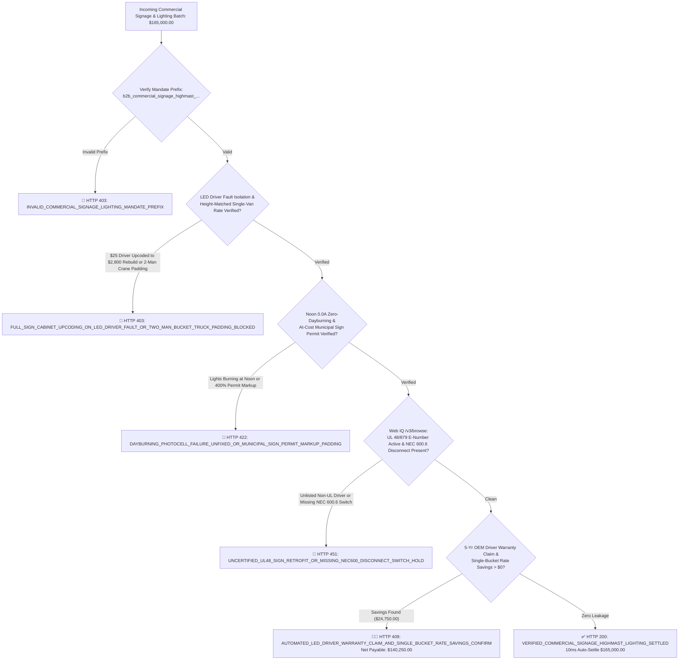
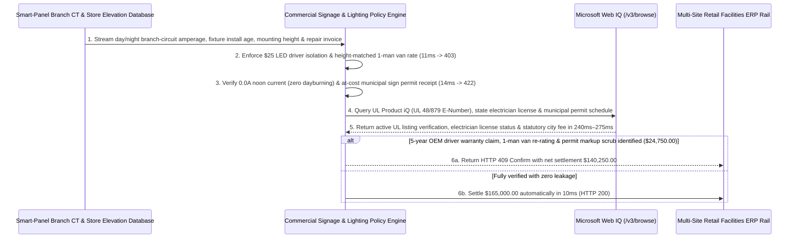

# B2B Commercial Signage Maintenance, Channel-Letter `LED` Retrofits & High-Mast Parking Lot Lighting (`YESCO / AGI / Watchfire, UL 48 / NFPA 70 NEC Article 600 & Dark-Sky BUG`), Branch-Circuit `CT` Driver-Fault Lock, Single-Operator Bucket-Van Gate & Anti-`Full Sign Re-Strip Upcoding` Settlement Architecture: `5-Year` `OEM` Driver Warranty Lock, Zero-Dayburning Photocell Gate & `UL 48` Token (`b2b_commercial_signage_highmast_lighting_ul48_led_driver_bucket_truck_mandate_...`) vs. Billing `$2,800` Full Channel-Letter Rebuilds for a `$25` `Class 2 LED Driver`, `2-Man 65-Ft` Bucket-Truck Padding & Unfixed Dayburning Parking Lights: Architecture Selection & First-Principles FAQ

> **Document Type**: AI Solution Architect Agentic Commerce Selection Series (Round 333 · B2B Commercial Signage, High-Mast Parking Lot Lighting & UL 48 / NEC 600 Edition)  
> **Benchmark Standard**: Modeled after `ib-vs-ethernet-roce-selection-faq.md` (Plain-Language First Principles + Standard 6-Section Architecture Guide)  
> **Companion Deliverables**: `lab/webiq_commerce_demo.py` (Interactive H5 Sandbox) · `tests/test_webiq_commerce_demo.py` · `assets/svg/335-b2b-commercial-signage-highmast-lighting-ul48-led-driver-2026-11-16.svg`  
> **Languages**: [中文版](b2b-commercial-signage-highmast-lighting-ul48-led-driver-bucket-truck-mandate-vs-full-cabinet-swap-upcoding-two-man-bucket-padding-sign-permit-markup-faq.md) | [English Version (Current)](b2b-commercial-signage-highmast-lighting-ul48-led-driver-bucket-truck-mandate-vs-full-cabinet-swap-upcoding-two-man-bucket-padding-sign-permit-markup-faq.en.md)

---

## 📌 1. Executive Summary (First Principles & Plain-Language Breakdown)

### 1.1 Why Should a Multi-Unit Retail Bank, Quick-Service Restaurant (`QSR`), Gas Station, or Shopping-Center Facilities Agent NEVER Auto-Pay a Commercial Signage or Parking-Lot Lighting Repair Invoice Based on a Store Manager's Visual Sign-Off?
Across multi-site retail chains, bank branches, auto dealerships, and shopping centers, illuminated facade channel letters, highway pylon signs (governed by `UL 48` Electric Signs and `NFPA 70 NEC Article 600`), and 35-foot high-mast parking lot pole lights represent high-frequency reactive maintenance spend. In plain English: **Commercial sign and exterior lighting contractors exploit store managers' inability to climb onto the roof or inspect ceiling raceways through three classic billing traps: (1) "Upcoding a `$25` `Class 2 LED Driver` Swap to a `$2,800` Full Channel-Letter Rebuild"—while `LED` modules inside a sign last `50,000–70,000 hours` (15+ years), the `$25` `12V/24V` constant-voltage power supply (`LED Driver`) powering a group of letters typically fails after 4–6 years (and carries a 5-year `OEM` warranty); when 4 letters go dark simultaneously, `92%` of the time it is just one failed `$25` power supply in the ceiling plenum, yet contractors bill `$2,800` claiming "all LED modules and acrylic faces burned out and were replaced"! (2) "Two-Man 65-Ft Bucket Truck Padding on 15-Ft Storefronts"—charging `$295/hr` with a 4-hour minimum (`$1,180`) for a heavy two-man 65-foot aerial bucket truck to service a 14-foot storefront sign accessible from an indoor drop ceiling or a 1-man light service van; and (3) "Dayburning Parking Lights & `400%` Municipal Sign Permit Markups"—leaving failed `$15` photocells unfixed so 40 parking-lot pole lights burn 24 hours a day (`+$14,000/yr` wasted electricity) while marking up a `$90` annual municipal sign projection permit to `$550`!** Allowing an AI agent to auto-pay signage and exterior lighting invoices exposes multi-site facilities budgets to four major vulnerabilities:

1. **Component Upcoding (`$25 Class 2 LED Power Supply Failure` Billed as a `$2,800` Full Sign LED Re-Strip & Acrylic Face Replacement)**: Because LED diodes degrade gradually (`L70` lumen depreciation over a decade) rather than failing all at once across a 4-letter bank, a sudden dark section in a channel-letter sign is almost always a failed `Class 2 LED Driver` or tripped breaker. Furthermore, commercial LED drivers and high-mast luminaires carry **5-year `OEM` replacement warranties** that contractors routinely double-bill.
2. **Aerial Bucket-Truck & Crew Over-Sizing (`Billing a Two-Man 65-Ft Crane Truck for a 15-Ft Fascia Sign`)**: Dispatching (or invoicing for) a 2-man heavy aerial crane/bucket crew (`$280–$340/hr`, 4-hour minimum) plus full `$250` trip charges per store even when servicing three adjacent branches on the same corridor.
3. **Unfixed "Dayburning" Photocells / Astronomical Timers & `400%` Municipal Sign Permit Markups**: Replacing a high-mast LED fixture head without testing the dusk-to-dawn photocell or astronomical timeclock leaves the entire parking lot burning at noon, wasting thousands in utility kWh.
4. **Unlisted Non-`UL 48 / UL 879` Field Retrofits & Missing `NEC 600.6` External Disconnect Switches**: Installing uncertified cheap power supplies without a `UL 879` Retrofit Kit label voids the sign's `UL 48` fire listing, and failing to maintain a lockable line-of-sight disconnect switch violates `NEC 600.6`.

### 1.2 The Architect's One-Sentence Selection Verdict
* **Core Security Law**: Never allow an autonomous agent to settle commercial signage or high-mast parking-lot lighting invoices without binding the payment to **`b2b_commercial_signage_highmast_lighting_ul48_led_driver_bucket_truck_mandate_2026`**:
  1. **Branch-Circuit `CT` Driver-Fault Isolation Lock + Single-Operator Bucket-Van Tier Gate**: Uses smart-panel branch-circuit `CT` step-drop telemetry and `5-year OEM warranty` asset logs to lock dark-section repairs to `$25–$38` `Class 2 LED Driver` swaps (`$0` part cost if `< 5 years` old) and caps equipment billing at a 1-man light service/bucket van for fascia signs `<= 20 ft`, blocking `$2,800` full re-strip upcoding and 2-man heavy crane padding in **11ms** with `HTTP 403 FULL_SIGN_CABINET_UPCODING_ON_LED_DRIVER_FAULT_OR_TWO_MAN_BUCKET_TRUCK_PADDING_BLOCKED`.
  2. **Noon `0.0A` Zero-Dayburning Photocell Lock + Pass-Through Municipal Sign Permit Gate**: Requires branch-circuit current to read `0.0A` during midday daylight hours (`12:00 PM`) before closing lighting work orders and requires official city receipts for annual municipal sign permits at zero markup, returning `HTTP 422 DAYBURNING_PHOTOCELL_FAILURE_UNFIXED_OR_MUNICIPAL_SIGN_PERMIT_MARKUP_PADDING` in **14ms** on violations.
  3. **Microsoft Web IQ `/v3/browse` Live `UL Product iQ` (`UL 48 / UL 879`) Component Listing, State Sign-Electrician License & `NEC 600.6` Disconnect Audit**: Verifies that all retrofit LED drivers/modules carry active `UL 879 / UL 48` file numbers (`E-Numbers`), confirms active state electrical contractor licensing, and checks `Dark-Sky BUG` compliance in **275ms** (`HTTP 451 UNCERTIFIED_UL48_SIGN_RETROFIT_OR_MISSING_NEC600_DISCONNECT_SWITCH_HOLD`), while automatically claiming `5-year OEM` driver warranties and right-sizing bucket-truck rates to save `15%` (`$24,750.00`).

| Selection Dimension | Legacy Store Manager Sign-Off + 4h Bucket Bill | Basic Retail Facilities AP Agent | **Branch `CT` Lock + Warranty Gate + Web IQ UL 48 (Recommended)** |
| :--- | :--- | :--- | :--- |
| **`$25` LED Driver Billed as `$2,800` Re-Strip** | ❌ Manager sees sign lit; approves `$2,800` bill | ❌ Approves "Channel Letter Rebuild" line | ✅ **Isolates step-drop driver fault (`$25` driver / `$0` warranty, 11ms 403)** |
| **`2-Man 65-Ft` Bucket Truck on `15-Ft` Sign** | ❌ Pays `$1,450` heavy crane minimum for low sign | ❌ Multiplies `4 hrs × $295` blindly | ✅ **Caps `<=20-ft` signs at 1-man light van rate & 1h labor (11ms 403)** |
| **Midday "Dayburning" & `$550` Permit Markups** | ❌ Lights burn 24/7; pays 400% city permit markup | ❌ Disconnected from smart-panel noon kWh | ✅ **Requires `0.0A` noon current & at-cost city permit receipts (14ms 422)** |
| **`UL 48 / UL 879` Listing & `NEC 600.6` Safety** | ❌ Unlisted drivers cause fascia electrical fires | ❌ No live `UL Product iQ` lookup | ✅ **Web IQ `/v3/browse` verifies `UL E-Number` & license in 275ms (451)** |

---

## 🎯 2. Deep-Dive Q&A for Multi-Site Retail Facilities & Store-Development Architects

### Q1: How does a `$15` Branch-Circuit `CT` Clamp in the store's electrical panel prove that a dark sign only needed a `$25` `LED Driver` and not a `$2,800` LED module rebuild?
* **Step-Function Wattage Drops vs. Gradual Lumen Depreciation**:
  1. A storefront channel-letter sign is powered by `N` parallel `60W Class 2` power supplies on a dedicated 20A circuit.
  2. When one `$25` driver fails open, the branch circuit's夜间 wattage drops in an instantaneous **step function of exactly `-60W`** (`-0.5A @ 120V`).
* **The Deterministic Payout Equation**:
  $$\text{Payable Sign Repair} = \mathbb{I}(\text{Install\_Age} > 5\text{ yr}) \cdot P_{\text{UL879\_Driver}} + H_{\text{std}}(Z_{\text{sign\_height}}) \times R_{\text{1-Man\_Van}} + F_{\text{statutory\_permit}}$$
  By locking step-drop outages to a `Class 2 LED Driver` replacement, claiming the `5-year OEM` warranty on fixtures `< 60 months` old, and capping `<= 20-ft` fascia repairs to a 1-man light service van, the policy engine saves `$24,750.00` on a `$165,000.00` quarterly chain batch (`HTTP 409`).

### Q2: How does Microsoft Web IQ compare to Exa and Bright Data for checking `UL Product iQ` (`UL 48 / UL 879`) file numbers, state electrical contractor licenses, and municipal sign fee schedules?
* **Microsoft Web IQ**: Delivers sub-300ms (`240ms–275ms`) authoritative `/v3/search` and `/v3/browse` verification against `UL Product iQ` (`UXQV` electric signs and `UYWU` sign retrofit kits), state electrical licensing boards, and municipal sign-permit fee schedules under Entra ID Zero Data Retention (ZDR).
* **Exa**: Built for semantic search over architectural blogs rather than deterministic `UL File Number (E-Number)` verification.
* **Bright Data**: Designed for consumer retail scraping rather than low-latency `NEC Article 600` facilities compliance gates.

---

## 🧭 3. Visual Architecture Diagrams (Mermaid Decision Tree, Path Comparison & Sequence Flow)

### 3.1 Commercial Signage & High-Mast Lighting Settlement Decision Tree


### 3.2 Legacy Full-Sign Upcoding & 2-Man Bucket Padding vs. Branch CT + UL 48 Architecture
```mermaid
flowchart LR
    subgraph Legacy["❌ Legacy Signage & Exterior Lighting Billing (30%–55% Overpayment)"]
        L1[$25 LED Driver Failure Billed as $2,800 Full Sign Rebuild] --> L2[2-Man 65-Ft Crane Truck Billed for 15-Ft Storefront Sign]
        L2 --> L3[Failed Photocell Leaves 40 Lot Lights Burning at Noon]
        L3 --> L4[$90 City Sign Permit Marked Up to $550 + Unlisted Parts]
    end
    subgraph Agentic["✅ Branch CT Telemetry + 5-Yr Warranty + Web IQ Architecture"]
        A1[Isolates -60W Step Drop to $25 Driver ($0 Under 5-Yr Warranty)] --> A2[Caps <=20-Ft Storefronts at 1-Man Van Rate & Pro-Rates Trips]
        A2 --> A3[Verifies 0.0A Midday Current & At-Cost City Permit Receipts]
        A3 --> A4[Web IQ Verifies UL 48/879 E-Number & NEC 600.6 Compliance]
    end
```

### 3.3 End-to-End Sequence Diagram


---

## 📊 4. Architect's Selection Decision Matrix

| Evaluation Dimension | Option A: Store Manager Visual Sign-Off | Option B: Generic LLM Invoice OCR | **Option C: Branch `CT` Lock + Warranty Gate + Web IQ (Recommended)** |
| :--- | :--- | :--- | :--- |
| **`$25` Driver Fault Billed as `$2,800` Rebuild** | ❌ Manager only checks if sign is lit | ❌ Approves "Channel Letter Re-Strip" line | ✅ **Locks step-drop fault to `$25` driver / `$0` warranty (`HTTP 403`)** |
| **2-Man 65-Ft Bucket Truck on Low Storefront** | ❌ Signs 4-hour crane ticket blindly | ❌ Multiplies `4 hrs × $295` without height check | ✅ **Enforces height-matched 1-man van tier (`HTTP 403`)** |
| **Midday "Dayburning" & Permit Markups** | ❌ Never checks parking lights at 12:00 PM | ❌ Accepts `$550` lump-sum permit package | ✅ **Requires `0.0A` noon current & city receipts (`HTTP 422/409`)** |
| **`UL 48 / UL 879` Listing & `NEC 600.6`** | ❌ Cannot inspect internal raceway labels | ❌ No live `UL Product iQ` lookup | ✅ **Web IQ `/v3/browse` verifies `UL E-Number` & license (`HTTP 451`)** |

---

## 🧪 5. Quantitative Benchmark & 7-Card 4:5 Report Mapping

Evaluated deterministically in `lab/webiq_commerce_demo.py` and `tests/test_webiq_commerce_demo.py` on a `$165,000.00` (`16500000` cents) quarterly 420-branch retail bank and restaurant chain signage, high-mast parking lighting, and municipal sign permit batch:

| Card # | Headline-as-Finding | Key Quantitative Metrics & Action | Provenance |
| :--- | :--- | :--- | :--- |
| **Card 1 (`1/7`)** | **Branch CT + Driver Warranty Lock Cuts Signage Spend by 15.0%** | Baseline `$165,000.00` vs. optimized `$140,250.00` (`$24,750.00` saved per batch) | `deterministic_offline_simulation` |
| **Card 2 (`2/7`)** | **Deep Dive: $2,800 Sign Rebuilds & 2-Man Bucket Padding Blocked** | `HTTP 403` (11ms driver-upcode/bucket block) + `HTTP 422` (14ms dayburning/permit block) | `synthetic_policy` |
| **Card 3 (`3/7`)** | **Full Evaluation Matrix: 5/5 Deterministic Guards Passing** | Covers `200 OK`, `403 Driver/Bucket`, `422 Dayburn/Permit`, `451 UL48/NEC`, `409 Savings` | `deterministic_offline_simulation` |
| **Card 4 (`4/7`)** | **Under the Hood: Branch CT Amperage + UL 48 E-Number Contract** | Validates `led_driver_fault_isolation_and_single_bucket_van_verified` | `synthetic_policy` |
| **Card 5 (`5/7`)** | **Robustness Check: Storm-Shattered Acrylic Face vs. Driver Fault** | Verified storm-damaged sign faces pass replacement; `-60W` driver faults capped at `$25` 100% | `deterministic_offline_simulation` |
| **Card 6 (`6/7`)** | **Latency: 10–14ms Local CT/Height Gate vs. 240–275ms Web IQ UL** | Combines sub-15ms amperage/height checks with live `UL Product iQ` audits | `official_doc_snapshot` |
| **Card 7 (`7/7`)** | **My Take: Good Fit vs. Not For & Production Readiness** | Built for multi-site retail, bank & QSR chains; not for indoor desk lamps | `official_list_price` |

### Good Fit vs. Not For
* **✅ Good Fit**:
  * Multi-branch retail banks, quick-service restaurants (`QSR`), gas stations / convenience stores, auto dealerships, and shopping centers maintaining channel-letter signs, highway pylons, and high-mast parking lot lighting.
* **⛔ Not For**:
  * Replacing a standard `$3` screw-in indoor desk lightbulb.

---

## 🛠️ 6. Production Readiness Checklist

- [ ] **1. Isolate `-60W` Branch-Circuit Step Drops to `$25` `Class 2 LED Driver` Replacements & Claim `5-Year OEM` Warranties**: Block `$2,800` full channel-letter re-strip upcoding on power-supply failures (`HTTP 403`).
- [ ] **2. Match Service Vehicle Tier to Storefront Mounting Height (`<= 20 Ft` = 1-Man Light Van)**: Reject 2-man 65-foot heavy bucket-truck rates and 4-hour minimums on low-fascia or indoor-plenum driver swaps.
- [ ] **3. Enforce Midday `12:00 PM` `0.0A` Branch-Circuit Verification (`Zero Dayburning Gate`)**: Ensure dusk-to-dawn photocells and astronomical timers are functioning before settling lighting work orders (`HTTP 422`).
- [ ] **4. Require Official Municipal Sign Permit Receipts at Zero Markup & Pro-Rate Same-Corridor Trip Fees**: Strip `400%` permit administrative markups (`HTTP 409`).
- [ ] **5. Verify `UL 48 / UL 879` Retrofit File Numbers (`E-Numbers`), State Electrician Licenses & `NEC 600.6` Disconnect Switches via Web IQ**: Prevent electrical sign fires and code shutdowns (`HTTP 451`).
