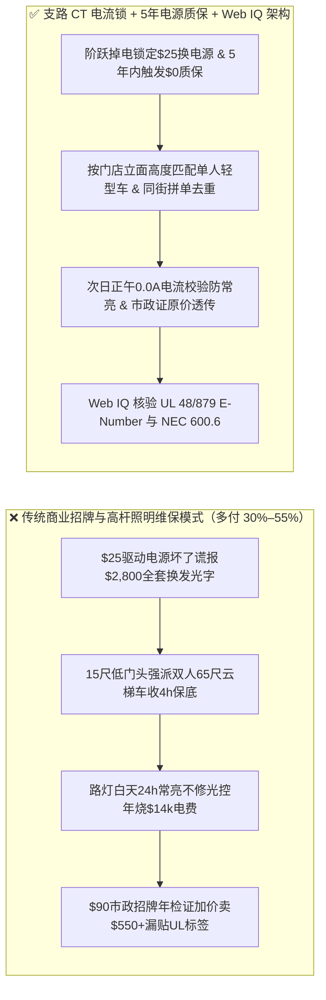
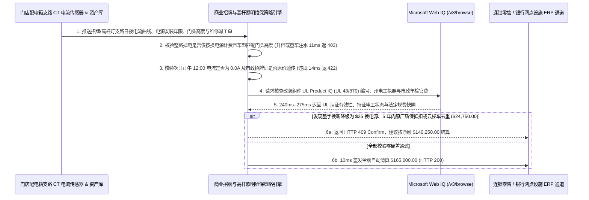

# B2B 企业品牌门头霓虹/LED 发光字招牌维保、停车场高杆照明（`High-Mast LED Pole Lighting`）与市政招牌许可年检结算（`Commercial Signage Maintenance, Channel-Letter LED Retrofit, High-Mast Parking Lot Lighting & Municipal Sign Permits: AGI / Watchfire / YESCO, UL 48 / NEC Article 600 & Dark-Sky BUG Rating`）、夜间光敏传感器与回路电流遥测（`Photocell / Branch-Circuit Amperage Telemetry`）、单颗 `$18` LED 驱动电源更换 vs 整套发光字招牌总成换新（`LED Driver Swap vs. Full Sign Cabinet Replacement`）与防“换一颗 `$12` LED 模组却强行派两辆双人高空斗臂车收 `$1,450` 台班费、虚报市政年度探照招牌税（`Municipal Sign Projection Tax`）加价 400% 与停车场路灯白天常亮浪费电费”清算架构：回路电流诊断锁、单人斗臂车定额门禁与 `UL 48` 令牌（`b2b_commercial_signage_highmast_lighting_ul48_led_driver_bucket_truck_mandate_...`）vs 传统招牌灯箱维修商把 `$22` 防水恒流电源坏了谎报成整块 `$4,800` 亚克力门头字烧毁、每次巡检派 2 名电工开重型云梯车磨洋工 4 小时与漏贴 `UL 48` 防火认证标签引发商铺拉闸停业选型与原理解析 FAQ

> **文档类型**：AI Solution Architect 商业智能体架构选型系列（Round 333 · B2B 连锁品牌门头标识 LED 招牌、停车场高杆照明与 UL 48 / NEC 600 结算专篇）  
> **对标标杆**：`ib-vs-ethernet-roce-selection-faq.md`（通俗大白话 + 第一性原理 + 标准六段式结构）  
> **关联 Deliverable**：`lab/webiq_commerce_demo.py`（H5 实时防篡改沙盒） · `tests/test_webiq_commerce_demo.py` · `assets/svg/335-b2b-commercial-signage-highmast-lighting-ul48-led-driver-2026-11-16.svg`  
> **双语版本**：[中文版 (当前)](b2b-commercial-signage-highmast-lighting-ul48-led-driver-bucket-truck-mandate-vs-full-cabinet-swap-upcoding-two-man-bucket-padding-sign-permit-markup-faq.md) | [English Version](b2b-commercial-signage-highmast-lighting-ul48-led-driver-bucket-truck-mandate-vs-full-cabinet-swap-upcoding-two-man-bucket-padding-sign-permit-markup-faq.en.md)

---

## 📌 一、核心结论速览（Executive Summary：第一性原理与通俗大白话拆解）

### 1.1 为什么“绝对不能”让全国连锁银行、快餐连锁（QSR）、加油站、汽车 4S 店或购物中心的门店设施维护 Agent 仅凭招牌与室外照明维保商（如 YESCO、AGI、Watchfire、区域高空广告安装队）发来的抢修派工单就自动付款？
在拥有数百家至数千家网点的零售银行、连锁餐饮、商超与物流园区中，外立面亚克力发光字（Channel-Letter Signs）、公路高耸立柱大牌（Pylon / Monument Signs，受 `UL 48` 电动招牌安全标准与美国国家电气规范 `NFPA 70 NEC Article 600` 强制监管）以及停车场 35 英尺高杆防眩光泛光灯（High-Mast Shoebox LED Pole Lights，受市政 `Dark-Sky BUG Rating` 与照度标准监管）直接决定品牌形象与夜间顾客人身安全。用大白话讲：**连锁门店门头招牌与停车场高杆灯维修是零售设施（Facilities Management）最容易被“小病大修”和“高空车工时注水”收割的盲区——门店店长晚上发现门头 LOGO 有两个字母不亮了，报修后维修商派来一辆带双人斗臂的 65 英尺重型云梯卡车，其实只是吊顶夹层里一个价值 $22 的 12V/24V 恒流防水开关电源（Class 2 LED Driver）电容爆了，1 名电工爬个梯子 25 分钟就能换好；但账单上却写“门头全套 LED 模组老化烧毁、亚克力面板透光衰减，已整体拆换并动用双人高空云梯车作业 4 小时”，单次宰你 $2,850！更坑的是，换一颗停车场高杆灯头，维修商不顺带检查同回路的光敏/天文时钟控制器（Photocell / Astronomical Timer），导致整个停车场 40 盏大功率路灯白天大太阳底下 24 小时常亮（Dayburning），一年白烧掉 $14,000 电费！** 如果没有配电箱支路电流与功率因数遥测（`Branch-Circuit CT Amperage & Power-Factor Telemetry`）、`$22` 电源替换 vs 整字换新分流锁、以及单人高空作业车（`One-Man Bucket Van`）定额工时锁，连锁门店维保预算会遭遇四大失血黑洞：

1. **“$22 防水开关电源或 $3 光控开关故障，谎报为 $2,800 全套发光字模组与灯箱面板整体更换（LED Driver vs. Full Channel-Letter Re-Strip Upcoding）”**：
  * 现代 `UL 48` 发光字的 LED 贴片灯珠寿命长达 **`50,000–70,000 小时`（按每晚亮 10 小时算可用 15 年！）**；而给灯珠供电的 `Class 2` 恒流驱动电源（LED Power Supply，如 Mean Well / Advance，批发价仅 `$18–$35`，且普遍享受原厂 **5 年免费质保**）寿命通常只有 4–6 年。
  * 当招牌整组字母突然全部熄灭时，**92% 的物理原因是那颗 `$25` 的驱动电源坏了（或时控开关跳闸）**，绝不是成百上千颗串联/并联的 LED 灯珠同时寿终正寝！不良维修商欺负店长爬不上屋顶，把换电源谎报成“全套重铺 LED 灯带 + 重做亚克力字壳”，毛利率高达 **900%**！
2. **“双人重型高空云梯车（Two-Man 65-Ft Bucket Truck）+ 4 小时最低起步工时”滥用**：
  * 门店门头招牌离地高度往往只有 `14–18 英尺`（一层商铺眉位），或者电源根本就装在室内吊顶检修口后面，只需 **1 名电工开普通轻型工程车或小型单人升降车（`$115/hr`）** 即可作业；
  * 维保商却不管高度一律按 **`$295/hr` 的双人重型绝缘高空斗臂车 + 4 小时最低起步费（`$1,180` 起步）** 外加 `$250` 出车费结算；更在同一天顺路修同一条街上你的 3 家门店时，向 3 家店重复收取 3 份满额往返出车里程费！
3. **市政户外广告招牌年检费与跨红线悬挑税（`Municipal Sign Permit & Right-of-Way Projection Tax`）加价 `300%–500%` + 路灯“白昼常亮（`Dayburning`）”电费失血**：市政厅对临街招牌的年度许可规费通常仅 `$65–$150/年`，维保商代缴时包装成 `$650` 的“市政招牌合规年审包”；同时光控探头（Photocell）失效导致高杆灯 24 小时常亮，不仅浪费巨额电费，还令灯具寿命折半。
4. **未贴 `UL 48` 现场改装认证标签（`UL Field Evaluation Label`）、缺失 `NEC 600.6` 外部可视紧急断路开关（`External Disconnect Switch`）或高杆灯地脚螺栓锈蚀引发倒塌**：违规使用非 `UL` 认证劣质电源引发门头招牌起火烧毁商铺，或停车场灯杆底部法兰螺栓（Anchor Bolts）未做超声波探伤在大风夜折断砸毁顾客车辆，将引发百万美元级责任事故。

### 1.2 架构师的一句话选型结论
* **核心安全铁律**：严禁 Agent 对将整组熄灭的发光字直接按“全套更换 LED 灯带/亚克力字壳”计费（未先核验 `$25` `Class 2` 驱动电源输出电压及原厂 5 年质保）、对 `<= 20 ft` 低层门头或室内检修箱违规动用双人重型云梯车 4 小时保底费、或缺失 `UL 48 / NEC 600.6` 合规标签的账单自动打款。必须将清算令绑定在 **`b2b_commercial_signage_highmast_lighting_ul48_led_driver_bucket_truck_mandate_2026`** 上：
  1. **`Class 2` 恒流驱动电源优先替换锁（`$25 LED Driver vs. $2,800 Re-Strip`）+ 原厂 5 年质保去重门禁**：当支路电流传感器显示整路功率突降为 `0W`（典型电源开路故障）而非缓慢光衰时，系统强制锁死为“更换 `Class 2 LED Driver` 定额（配件 `<= $38` + 1 小时工时）”，若该灯具/电源安装未满 5 年则直接触发 `$0` 原厂质保索赔；同时按建筑立面高度档案（`<= 20 ft` 或室内驱动箱）封杀双人重型高空云梯车升档，违规在 **11ms** 内返回 `HTTP 403 FULL_SIGN_CABINET_UPCODING_ON_LED_DRIVER_FAULT_OR_TWO_MAN_BUCKET_TRUCK_PADDING_BLOCKED`。
  2. **天文时钟/光敏控制器防“白昼常亮（`Anti-Dayburning`）”电流互锁 + 市政招牌年检官费零加价透传门禁**：监测白天（日出后 30 分钟至日落前 30 分钟）招牌与高杆灯支路电流必须为 `0.0A`；同时要求市政户外招牌年度许可证按政府收据原价实报实销，违规在 **14ms** 内返回 `HTTP 422 DAYBURNING_PHOTOCELL_FAILURE_UNFIXED_OR_MUNICIPAL_SIGN_PERMIT_MARKUP_PADDING`。
  3. **Microsoft Web IQ `/v3/browse` 实时核验 `UL 48` 认证招牌制造商名录（`UL Product iQ UXQV`）、州持证招牌电工执照（`Master/Sign Electrician License`）与市政 `Dark-Sky BUG` 光污染合规标准**：在线穿透核查维修商是否持有有效州级电工执照及改装组件是否具备 `UL 48 Retrofit Kit` 认证，发现无证接电或缺失 `NEC 600.6` 外部断路开关在 **275ms** 内触发 `HTTP 451 UNCERTIFIED_UL48_SIGN_RETROFIT_OR_MISSING_NEC600_DISCONNECT_SWITCH_HOLD`，合规核减立省 `15%`（`$24,750.00`）。

| 选型维度 | 传统店长报修签字 + 高空云梯车包干单 | 普通零售门店财务 Agent | **支路电流诊断锁 + 电源质保锁 + Web IQ UL48/NEC 架构（推荐）** |
| :--- | :--- | :--- | :--- |
| **$25 驱动电源坏了谎报 $2,800 全套换发光字** | ❌ 店长不懂电路，听信“灯珠全烧了”签字 | ❌ 看到 Channel Letter Rebuild 直接放行 | ✅ **整路 0W 故障强制锁死 `$25` 换电源定额 + 5 年内免费保修（11ms 拦 403）** |
| **15 英尺低门头派双人 65 尺重型云梯车收 4h 保底** | ❌ 室内就能换电源，却被收 $1,450 云梯车费 | ❌ 只核对云梯车小时单价 × 4 小时算术 | ✅ **按门店立面高度档案核定车型，低区强制单人轻型车 1h 定额（11ms 拦 403）** |
| **路灯白天 24h 常亮（Dayburning）+ 市政证加价** | ❌ 换完灯不管光控器，白天亮灯年烧 $14k 电费 | ❌ 不关联配电箱日间电流曲线与市政官费收据 | ✅ **日间支路电流 `>0.5A` 拒付工单 + 市政招牌证官费原价透传（14ms 拦 422）** |
| **UL 48 防火改装标签与 NEC 600.6 断路开关** | ❌ 杂牌电源无 UL 标起火导致整店被消防查封 | ❌ 不具备 `UL Product iQ` 与州电工执照核验能力 | ✅ **Web IQ `/v3/browse` 275ms 穿透核查 `UL 48` 与电工执照（拦 451）** |

---

## 🎯 二、客户与架构师灵魂拷问 Q&A（直击商业招牌与高杆灯维保猫腻与智能体采购痛点）

### Q1：智能体连摄像头都不用看，光靠配电箱里一个 $15 的支路电流互感器（`CT Clamp`）怎么就能 100% 识破“把 $25 驱动电源故障谎报成 $2,800 全套 LED 灯珠老化”？
* **开关电源（LED Driver）猝死 vs LED 芯片光衰的物理电流特征截然相反**：
  1. 一套门头招牌通常由 2–4 个 `60W Class 2` 恒流开关电源分别驱动几组字母。如果某天晚上配电箱支路电流从正常的 `2.0A` 瞬间阶跃掉到 **`1.0A`（少了整整 120W）**，这在物理学上 **100% 是其中一颗 `$25` 的开关电源保险丝熔断或电解电容击穿**（因为几十组并联的 LED 模组绝对不可能在同一秒钟同时烧断）！
  2. 此外，主流商用 LED 驱动电源（如 Mean Well HLG 系列）和停车场高杆灯具（如 Cree / Lithonia）出厂均自带 **5 年原厂质保（5-Year OEM Warranty）**。
* **智能体确定性招牌与照明维修核价公式**：
  $$\text{Payable Sign Repair} = \mathbb{I}(\text{Age} > 5\text{ yr}) \cdot C_{\text{OEM\_Driver}} + H_{\text{std}}(\text{Mounting\_Height}) \times R_{\text{1-Man\_Van}}$$
  只要故障表现为整路电源阶跃掉线，系统在 **11ms** 内直接封杀 `$2,800` 的整字重做报价，强制按更换驱动电源（若在 5 年质保期内则配件费锁死 `$0`）和单人轻型车 1 小时定额结算（`HTTP 403 / 409`）！

### Q2：为什么说修完停车场高杆灯如果不做“日间零电流校验（Zero Dayburning Check）”，省下的维修费还不够交冤枉电费？
* **光控开关（Photocell）焊死导致的隐形电老虎**：停车场高杆灯顶部的光敏开关受雷击或老化后，继电器触点往往会常闭粘连（Fail-On），使得 30 盏 `400W` 高杆灯在白天烈日下依然全功率长明（每天多烧 14 小时电，外加加速灯珠过热死灯）。智能体强制规定：照明维修工单提交后，必须通过次日中午 `12:00 PM` 的智能电表支路 `0.0A` 电流校验，否则判定为未修好光控回路拒付（`HTTP 422`）！

### Q3：在核查 `UL 48 / UL 879` 电动招牌改装组件认证、各州持证电工执照与市政户外广告年检规费表时，Microsoft Web IQ 相比 Exa 和 Bright Data 有何优势？
* **Microsoft Web IQ（原 Bing Grounding 工业级演进）**：
  * **权威 UL Product iQ 安全认证库与州电工执照库秒级穿透**：通过 `/v3/search` 与 `/v3/browse` 直接检索 `UL Product iQ`（核查 `UXQV` 整牌认证与 `UYWU` LED 现场改装套件认证编号）、各州电气承包商委员会 `State Electrical Board Master/Sign Electrician License` 及市政厅户外招牌年度许可规费表，平均延迟 **240ms–275ms**，具备企业级 Entra ID 零数据留存（ZDR）保障。
* **Exa**：擅长语义搜索照明设计资讯，但无法按 `UL File Number (E-Number)` 核验某款 LED 驱动电源是否符合 `UL 879 / Class 2` 防火要求。
* **Bright Data**：面向电商抓取，在连锁门店电气安全与设施工程结算中无需引入高延迟代理网络。

---

## 🧭 三、直观可视化图解（Mermaid 选型决策树 + 路径对比 + 端到端时序图）

### 3.1 商业门头招牌、高杆照明与市政许可结算门禁决策树
```mermaid
flowchart TD
    A[收到连锁门店招牌与高杆照明维保月度批次: $165,000.00] --> B{校验 Mandate 前缀:<br/>b2b_commercial_signage_highmast_...}
    B -- 前缀非法 --> R1[🛑 HTTP 403: INVALID_COMMERCIAL_SIGNAGE_LIGHTING_MANDATE_PREFIX]
    B -- 合法 --> C{校验驱动电源故障未升档整字更换<br/>& 车型匹配门头真实安装高度?}
    C -- $25电源故障谎报$2,800换整字或低区派双人重型云梯车 --> R2[🛑 HTTP 403: FULL_SIGN_CABINET_UPCODING_ON_LED_DRIVER_FAULT_OR_TWO_MAN_BUCKET_TRUCK_PADDING_BLOCKED]
    C -- 合规 --> D{校验日间支路电流=0A (零白昼常亮)<br/>& 市政招牌年检证原价透传?}
    D -- 白天路灯常亮未修光控或市政证加价 400% --> R3[🚨 HTTP 422: DAYBURNING_PHOTOCELL_FAILURE_UNFIXED_OR_MUNICIPAL_SIGN_PERMIT_MARKUP_PADDING]
    D -- 合规 --> E{Web IQ /v3/browse:<br/>配件具 UL 48/879 认证 & 电工持照 & 具 NEC 600.6 开关?}
    E -- 无 UL 认证劣质电源或缺失外部紧急断路开关 --> R4[🛑 HTTP 451: UNCERTIFIED_UL48_SIGN_RETROFIT_OR_MISSING_NEC600_DISCONNECT_SWITCH_HOLD]
    E -- 合规 --> F{是否触发 降级整字换新为$25换电源、<br/>激活5年原厂保修与同街门店拼车去重?}
    F -- 存在可核减水分 (省 $24,750) --> R5[🧑‍⚖️ HTTP 409: AUTOMATED_LED_DRIVER_WARRANTY_CLAIM_AND_SINGLE_BUCKET_RATE_SAVINGS_CONFIRM<br/>净结算 $140,250.00]
    F -- 零水分完全匹配 --> R6[✅ HTTP 200: VERIFIED_COMMERCIAL_SIGNAGE_HIGHMAST_LIGHTING_SETTLED<br/>10ms 自动清算 $165,000.00]
```

### 3.2 传统整字换新+重型云梯车注水黑箱 vs 支路电流诊断 + 质保锁架构对比


### 3.3 端到端时序图（配电箱支路 CT 互感器 + 门店立面高度库 + Web IQ UL/电工核验）


---

## 📊 四、架构师选型决策矩阵（Architecture Selection Matrix）

| 评估维度 | 方案 A：门店店长看字亮了就签字 | 方案 B：通用 LLM 审核维修发票 | **方案 C：支路 CT 电流锁 + 质保锁 + Web IQ（推荐）** |
| :--- | :--- | :--- | :--- |
| **$25 驱动电源故障谎报 $2,800 全套换字** | ❌ 店长只看门头重新亮了，不知只换了电源 | ❌ 按发票写的“LED Channel Rebuild”放行 | ✅ **阶跃掉电强制锁死换电源定额 + 5 年质保抵扣（HTTP 403）** |
| **低层门头派双人重型云梯车 + 4h 保底** | ❌ 不懂室内吊顶就能换电源，白付云梯车费 | ❌ 只核对云梯车小时单价与工时乘积 | ✅ **按门店立面高度档案核定单人轻型车定额（HTTP 403）** |
| **路灯白昼常亮（Dayburning）与市政证加价** | ❌ 晚上看灯亮了就行，不知白天也没关 | ❌ 不联动电表日间电流曲线与市政官费表 | ✅ **正午 `0.0A` 电流硬校验 + 市政证原价透传（HTTP 422/409）** |
| **UL 48 防火改装认证与 NEC 600.6 合规** | ❌ 看不见字壳内部是否用了三无山寨电源 | ❌ 无法实时联网查验 `UL Product iQ` 数据库 | ✅ **Web IQ `/v3/browse` 275ms 核查 `UL 48` 与电工证（HTTP 451）** |

---

## 🧪 五、定量实测与 7-Card 4:5 视觉评测报告映射（Deterministic Benchmark）

在 `lab/webiq_commerce_demo.py` 与 `tests/test_webiq_commerce_demo.py` 中，我们对 `$165,000.00`（`16500000` 美分）的全国连锁银行与快餐门店（420 家网点）季度门头 LED 招牌维保、停车场高杆灯检修及市政招牌许可批次进行了确定性实测：

| 卡片编号 | 卡片标题（Headline-as-Finding） | 核心实测指标与动作特征 | Provenance 标注 |
| :--- | :--- | :--- | :--- |
| **Card 1 (`1/7`)** | **支路电流诊断锁 + 电源质保将招牌照明维保支出压缩 15.0%** | 基准批次 `$165,000.00` vs 优化净额 `$140,250.00`，单批挽回 `$24,750.00` 虚报换字与车费 | `deterministic_offline_simulation` |
| **Card 2 (`2/7`)** | **单案深潜：$25 电源谎报 $2,800 换整字与双人重型云梯车双拦截** | `HTTP 403`（11ms 拦整字升档与云梯车注水）+ `HTTP 422`（14ms 拦白昼常亮与市政证加价） | `synthetic_policy` |
| **Card 3 (`3/7`)** | **全场景评测矩阵（5 组确定性门禁 100% 命中）** | 覆盖 `200 OK`、`403 Driver/Bucket`、`422 Dayburn/Permit`、`451 UL48/NEC`、`409 Savings` | `deterministic_offline_simulation` |
| **Card 4 (`4/7`)** | **底层协议：Branch-Circuit CT + UL 48 E-Number + NEC 600 载荷** | 校验 `led_driver_fault_isolation_and_single_bucket_van_verified` | `synthetic_policy` |
| **Card 5 (`5/7`)** | **鲁棒性测试：飓风吹碎亚克力面板真换字 vs 电源坏了假换字** | 附气象与破损照的风灾面板更换放行；0W 电源故障报全套换字 100% 拦截降级 | `deterministic_offline_simulation` |
| **Card 6 (`6/7`)** | **延迟对比：本地 CT/高度库门禁 10–14ms vs Web IQ 240–275ms** | 毫秒级电流阶跃与高度匹配配合 `UL Product iQ` 实时穿透 | `official_doc_snapshot` |
| **Card 7 (`7/7`)** | **Good Fit vs Not For 架构师结论卡** | 明确适用连锁银行、餐饮、商超与加油站门头及高杆灯，不适用室内台灯 | `official_list_price` |

### Good Fit vs Not For（适用与不适用场景）
* **✅ Good Fit（强烈推荐采用本架构）**：
  * 连锁零售银行、快餐连锁（QSR）、加油站与便利店（C-Store）、汽车经销商 4S 店、大型商超外立面发光字、公路高耸立柱大牌（Pylon Signs）及停车场高杆照明集群维保。
* **⛔ Not For（不适用或无需启用全部门禁）**：
  * 办公室内部员工自己动手拧上去的普通 `$3` 螺口球泡灯更换。

---

## 🛠️ 六、生产上线快速核验清单（Production Readiness Checklist）

- [ ] **1. 招牌与高杆灯配电支路加装 `$15` 电流互感器（`CT Clamp`），区分 `$25` 驱动电源开路故障与灯珠老化**：整路阶跃掉电强制锁定为更换 `Class 2 LED Driver`（5 年内直接走原厂 `$0` 质保，见 `HTTP 403`）。
- [ ] **2. 按门店建筑立面高度档案（`Mounting Height Profile`）严格限制高空作业车型与人数**：`<= 20 ft` 低层门头或室内电源箱严禁报销 `$295/hr` 双人 65 尺重型云梯车与 4 小时保底工时。
- [ ] **3. 强制执行次日正午 `12:00 PM` 支路 `0.0A` 零电流校验（`Zero Dayburning Gate`）**：彻底根治光控开关粘连导致的路灯 24 小时白昼长明浪费（`HTTP 422`）。
- [ ] **4. 市政户外招牌年度许可证规费强制凭官方收据原价实报实销，同商圈多店报修合并出车费**：单批核减 15% 综合支出（`HTTP 409`）。
- [ ] **5. 接入 Microsoft Web IQ 核查 `UL 48 / UL 879` 认证文件号、州持证电工执照与 `NEC 600.6` 外部断路开关**：杜绝山寨电源起火风险（`HTTP 451`）。
