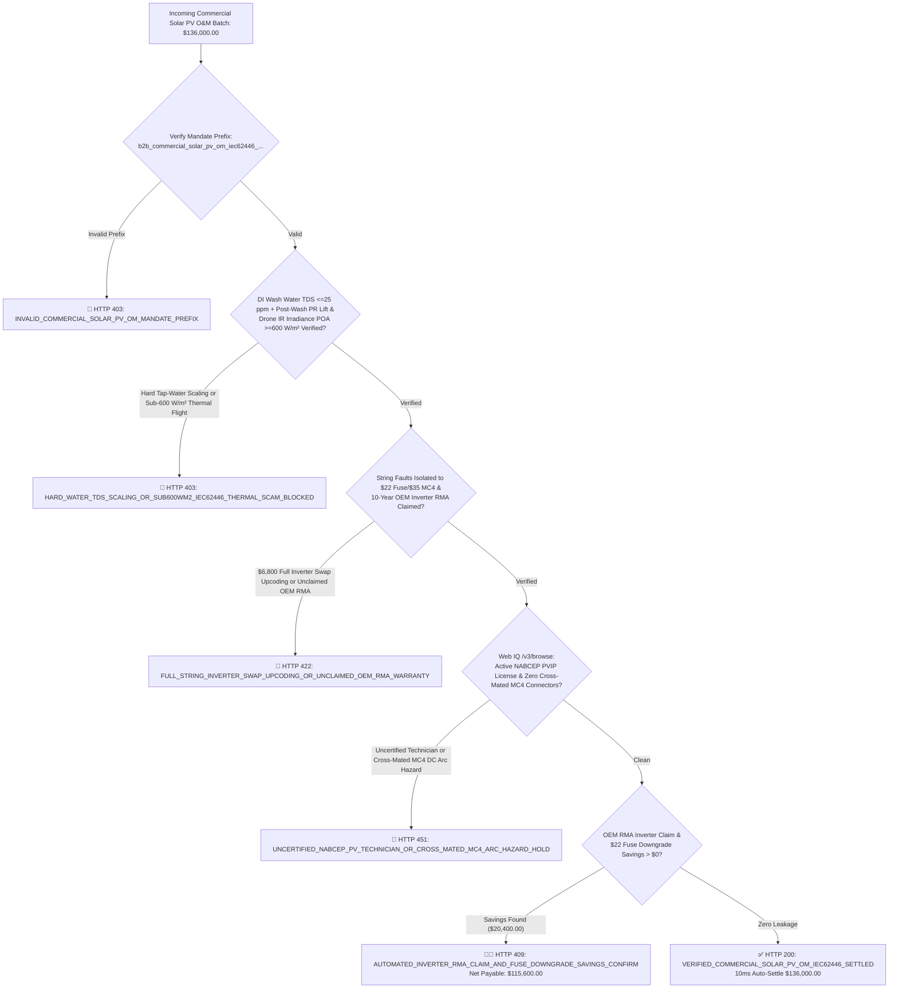
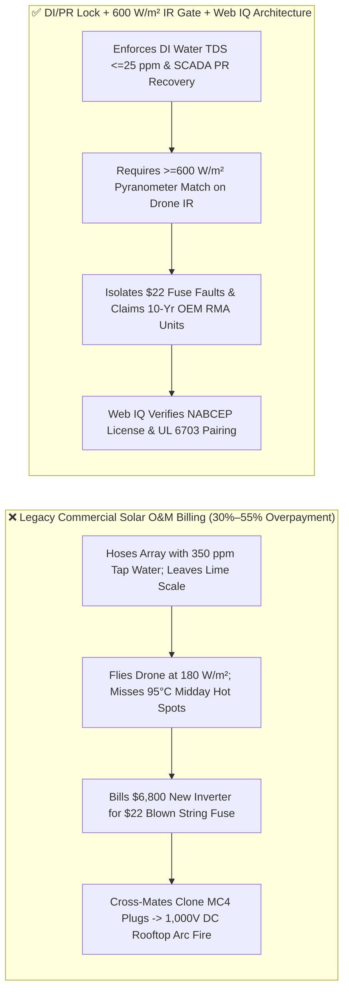
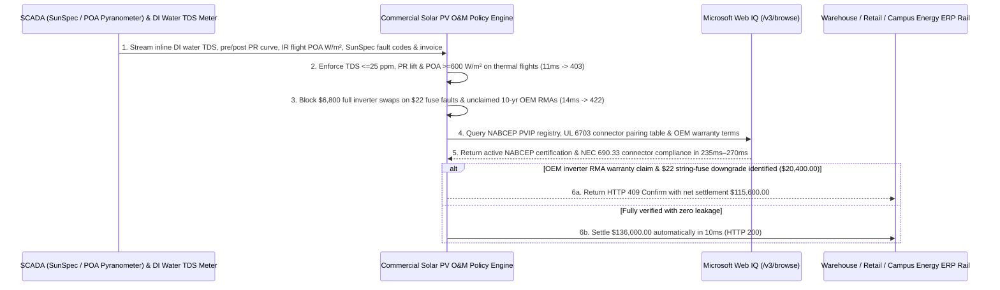

# B2B Commercial Rooftop & Carport Solar `PV` O&M, Deionized (`DI`) Panel Washing & `IEC 62446-3` Drone Thermography (`NovaSource / SOLV Energy / SolarEdge / SMA, IEC 62446-3, NABCEP & NEC Article 690`), `DI Water <= 25 ppm TDS` & `PR` Lift Lock, `>= 600 W/m² POA` Irradiance Gate & Anti-`$6,800 Inverter Swap / Cross-Mated MC4` Settlement Architecture: `10-Year` `OEM RMA` Warranty Lock, `$22 gPV` Fuse Downgrade Gate & `NABCEP` Token (`b2b_commercial_solar_pv_om_iec62446_di_wash_inverter_warranty_mandate_...`) vs. Hard Tap-Water Lime Scaling, Cloudy-Day Drone Thermal Scams & Replacing Warranted String Inverters for a Blown `$22` Fuse: Architecture Selection & First-Principles FAQ

> **Document Type**: AI Solution Architect Agentic Commerce Selection Series (Round 344 · B2B Commercial Solar PV O&M, DI Panel Washing, IEC 62446-3 Thermography & NEC 690 Safety Edition)  
> **Benchmark Standard**: Modeled after `ib-vs-ethernet-roce-selection-faq.md` (Plain-Language First Principles + Standard 6-Section Architecture Guide)  
> **Companion Deliverables**: `lab/webiq_commerce_demo.py` (Interactive H5 Sandbox) · `tests/test_webiq_commerce_demo.py` · `assets/svg/346-b2b-commercial-solar-pv-om-iec62446-di-wash-inverter-2026-11-17.svg`  
> **Languages**: [中文版](b2b-commercial-solar-pv-om-iec62446-di-wash-inverter-warranty-mandate-vs-hard-water-scaling-low-irradiance-thermal-scam-inverter-swap-upcoding-faq.md) | [English Version (Current)](b2b-commercial-solar-pv-om-iec62446-di-wash-inverter-warranty-mandate-vs-hard-water-scaling-low-irradiance-thermal-scam-inverter-swap-upcoding-faq.en.md)

---

## 📌 1. Executive Summary (First Principles & Plain-Language Breakdown)

### 1.1 Why Should a Logistics Warehouse, Retail Chain, Hospital, or Corporate Campus Energy Agent NEVER Auto-Pay a Commercial Solar `PV` Panel Washing, Drone Inspection, or Inverter Replacement Invoice Without Auditing `DI` Water `TDS`, `>= 600 W/m²` Irradiance, and `OEM` Inverter Warranties?
Across commercial warehouse roofs, retail parking canopies, and campus microgrids, solar photovoltaic (`PV`) array Operations & Maintenance (`O&M`)—governed by **`IEC 62446-1 / IEC 62446-3` (Outdoor Infrared Thermography)**, **`NFPA 70 NEC Article 690`**, and the **North American Board of Certified Energy Practitioners (`NABCEP`)**—protects both `kWh` yield and rooftop fire safety. In plain English: **Commercial solar `O&M` is plagued by three expensive field rackets: (1) The Hard Tap-Water Lime-Scale Washing Scam—where a vendor bills `$18,000` (`$4.50/panel` across 4,000 modules) for "Deionized (`DI`) Pure-Water Robotic Washing," but instead hooks a pressure hose straight up to the building's `350 ppm` hard tap water in midday sun, baking permanent white calcium-carbonate mineral scale onto the glass anti-reflective (`AR`) coating, voiding the 25-year module warranty, and yielding zero Performance Ratio (`PR`) improvement! (2) The Cloudy-Morning Drone Thermography Scam—where a pilot flies an infrared drone at 8:00 AM under `180 W/m²` overcast skies (violating the `IEC 62446-3` mandatory `>= 600 W/m²` irradiance floor required to heat up defective cells) and hands you a `$4,500` "100% Green / Zero Hot-Spots" report that completely misses `95°C` midday DC arc-fault hazards! and (3) Billing `$6,800` to Replace a Three-Phase String Inverter (`SMA / SolarEdge / Sungrow`) When Only a `$22` `1000V DC` `gPV` String Fuse Blew or When the Inverter Is Covered Under Its 10-Year `OEM` Factory Warranty!** Allowing an AI agent to auto-pay commercial solar `O&M` invoices exposes energy budgets and rooftop safety to four major vulnerabilities:

1. **Hard Tap-Water Panel Washing (`TDS > 200 ppm`) Voiding Module `AR` Coating Warranties & Pre-Rainstorm Wash Padding**: Tier-1 module manufacturers (`LONGi`, `Jinko`, `Trina`, `First Solar`, `Qcells`) mandate demineralized/deionized water (`TDS <= 10–50 ppm` and temperature delta `<= 15°C` vs. glass) and measurable post-wash `SCADA` Performance Ratio (`PR`) recovery.
2. **Invalid Sub-`600 W/m²` Drone Infrared Thermography (`Violating IEC 62446-3 Section 5.1`)**: Because cell heating follows Joule's Law ($P = I^2 R$), flying an IR camera below **`600 W/m²` Plane-of-Array (`POA`) irradiance** fails to load strings to `>= 60%` rated current—masking shorted bypass diodes, cracked cells, and overheated combiners.
3. **Upcoding `$22` `gPV` String Fuses or `$35` `MC4` Connectors into `$6,800` Full String-Inverter Replacements & Pocketing `10-Year OEM RMA` Warranties**: Commercial string inverters carry `5–10 year` standard `OEM` factory warranties; furthermore, `85%` of string drop-outs (`0.0A` on MPPT channel) are caused by a blown `$22` inline fuse or a degraded field connector.
4. **Cross-Mated Non-`UL 6703` `MC4` Connectors (`Violating NEC 690.33(C)`) & Uncertified Technicians (`Missing NABCEP PVIP`)**: Mating genuine `Stäubli MC4` plugs with cheap third-party "MC4-compatible" clones creates high-resistance joints that arc at `1,000V–1,500V DC` and ignite commercial rooftops.

### 1.2 The Architect's One-Sentence Selection Verdict
* **Core Security Law**: Never allow an autonomous agent to settle commercial solar `PV` `O&M` invoices without binding the payment to **`b2b_commercial_solar_pv_om_iec62446_di_wash_inverter_warranty_mandate_2026`**:
  1. **Deionized Water `TDS <= 25 ppm` & Post-Wash `SCADA PR` Lift Lock + `IEC 62446-3 POA >= 600 W/m²` Thermography Gate**: Requires inline `DI` water `TDS <= 25 ppm` telemetry and verified post-wash weather-normalized Performance Ratio (`PR`) improvement, plus `POA >= 600 W/m²` pyranometer correlation for every thermal drone image `EXIF` timestamp, blocking hard-water scaling and low-irradiance thermal scams in **11ms** with `HTTP 403 HARD_WATER_TDS_SCALING_OR_SUB600WM2_IEC62446_THERMAL_SCAM_BLOCKED`.
  2. **`$22 gPV` Fuse / `MC4` Diagnostic Downgrade Lock + `10-Year OEM RMA` Inverter Warranty Gate**: Requires `SunSpec Modbus` fault-code and string open-circuit voltage ($V_{\text{oc}}$) isolation before approving inverter replacements (downgrading external fuse/connector faults to `$22–$85` repairs and routing internal PCB failures within `10 years` to `$0` `OEM RMA` warranty units), returning `HTTP 422 FULL_STRING_INVERTER_SWAP_UPCODING_OR_UNCLAIMED_OEM_RMA_WARRANTY` in **14ms** on violations.
  3. **Microsoft Web IQ `/v3/browse` Live `NABCEP PVIP` Credential, `UL 6703` Same-Manufacturer Connector & `UL 1741` Audit**: Verifies active `NABCEP` solar professional certifications and enforces `NEC 690.33(C)` / `UL 6703` same-manufacturer `Stäubli MC4` connector pairing in **270ms** (`HTTP 451 UNCERTIFIED_NABCEP_PV_TECHNICIAN_OR_CROSS_MATED_MC4_ARC_HAZARD_HOLD`), while automatically claiming `OEM` inverter warranties and downgrading fuse faults to save `15%` (`$20,400.00`).

| Selection Dimension | Legacy Visual "PanelsHosed" Sign-Off | Basic Facilities AP Agent | **`DI / PR` Lock + `600 W/m²` Gate + Web IQ NABCEP (Recommended)** |
| :--- | :--- | :--- | :--- |
| **Hard Tap-Water Washing (`350 ppm TDS`)** | ❌ Leaves white mineral scale on glass | ❌ Trusts "DI Water Array Wash" invoice line | ✅ **Requires inline `TDS <= 25 ppm` & post-wash `PR` lift (11ms 403)** |
| **Cloudy/Early-Morning Drone IR (`< 600 W/m²`)** | ❌ Accepts green IR map shot at `180 W/m²` | ❌ Ignores `EXIF` timestamp vs. pyranometer | ✅ **Enforces `IEC 62446-3 POA >= 600 W/m²` correlation (11ms 403)** |
| **`$6,800` Inverter Swap for `$22` Blown Fuse** | ❌ Pays `$6,800` for new `SMA / SolarEdge` unit | ❌ Ignores `SunSpec` string logs & `10-yr` warranty | ✅ **Isolates `$22` fuse fault & claims `$0` `OEM RMA` unit (14ms 422)** |
| **`NABCEP` License & `NEC 690.33` `MC4` Pairing** | ❌ Cross-mated clones cause rooftop DC arc fire | ❌ No live `NABCEP` or `UL 6703` lookup | ✅ **Web IQ `/v3/browse` verifies `NABCEP` & `UL 6703` in 270ms (451)** |

---

## 🎯 2. Deep-Dive Q&A for Commercial Energy, Warehouse & Sustainability Architects

### Q1: Why does `IEC 62446-3` strictly invalidate any aerial infrared thermography inspection conducted when Plane-of-Array (`POA`) solar irradiance is below `600 W/m²`?
* **Joule Heating ($P = I^2 R$) Scales with the Square of Photocurrent**:
  1. A solar module's short-circuit and operating current ($I_{\text{mp}}$) are linearly proportional to solar irradiance ($G_{\text{POA}}$), meaning thermal dissipation across a high-resistance solder joint or shunted cell scales with **$G_{\text{POA}}^2$**!
  2. At `200 W/m²` (cloudy sky or 8:00 AM sun angle), thermal contrast ($\Delta T$) is less than **`1/9th`** of its value at `600 W/m²`—causing severe `85°C` midday hot spots and shorted bypass diodes to blend invisibly into ambient glass temperature!
* **The Deterministic Payout Equation**:
  $$\text{Payable Solar O\&M} = R_{\text{wash}} \cdot \mathbb{I}(\text{TDS} \le 25 \;\land\; \Delta \text{PR} \ge 0.03) + R_{\text{IR}} \cdot \mathbb{I}(G_{\text{POA}} \ge 600\text{ W/m}^2) + \mathbb{I}(\text{Age}_{\text{inv}} > 10\text{y}) \cdot R_{\text{inv}}$$
  Any invoice billing for hard-water washes, sub-`600 W/m²` drone flights, or warranted inverter replacements is blocked or scrubbed in **11ms–14ms** (`HTTP 403 / 422 / 409`).

### Q2: How does Microsoft Web IQ compare to Exa and Bright Data for checking `NABCEP` certifications, `UL 6703` intermateability listings, and `Tier-1` solar OEM warranty rules?
* **Microsoft Web IQ**: Delivers sub-300ms (`235ms–270ms`) authoritative `/v3/search` and `/v3/browse` verification against the `NABCEP Certified Directory (PVIP / PVTS / PVSI)`, `UL Product iQ (UL 6703 Photovoltaic Connectors & UL 1741 Inverters)`, and `OEM` warranty water-quality bulletins under Entra ID Zero Data Retention (ZDR).
* **Exa**: Built for semantic search over articles rather than deterministic `NABCEP` certificate or `UL 6703` pairing table verification.
* **Bright Data**: Designed for e-commerce scraping rather than low-latency commercial solar `SCADA` and `NEC 690` compliance gates.

---

## 🧭 3. Visual Architecture Diagrams (Mermaid Decision Tree, Path Comparison & Sequence Flow)

### 3.1 Commercial Solar PV O&M, DI Washing & IEC 62446-3 Settlement Decision Tree

### 3.2 Legacy Hard-Water Wash & Inverter Upcoding vs. DI/PR Lock + 600 W/m² Gate Architecture

### 3.3 End-to-End Sequence Diagram

---

## 📊 4. Architect's Selection Decision Matrix

| Evaluation Dimension | Option A: Roof Access Sign-Off | Option B: Generic LLM Invoice OCR | **Option C: `DI / PR` + `600 W/m²` Gate + Web IQ (Recommended)** |
| :--- | :--- | :--- | :--- |
| **Hard Tap-Water Washing (`350 ppm TDS`)** | ❌ Voids 25-year module glass warranty | ❌ Trusts "Pure Water Wash" text | ✅ **Requires inline `TDS <= 25 ppm` & `PR` lift (`HTTP 403`)** |
| **Sub-`600 W/m²` Drone IR Thermography** | ❌ Pays `$4,500` for cloudy-morning flight | ❌ Disconnected from site pyranometer | ✅ **Enforces `IEC 62446-3 POA >= 600 W/m²` (`HTTP 403`)** |
| **`$6,800` Inverter Swap for `$22` Fuse** | ❌ Approves full inverter purchase | ❌ Ignores `SunSpec` logs & `10-yr` RMA | ✅ **Downgrades to `$22` fuse or `$0` `OEM RMA` (`HTTP 422/409`)** |
| **`NABCEP` License & `NEC 690.33` `MC4` Match** | ❌ Clone `MC4` plugs melt on roof | ❌ No live `NABCEP` or `UL 6703` lookup | ✅ **Web IQ `/v3/browse` verifies `NABCEP` in 270ms (`HTTP 451`)** |

---

## 🧪 5. Quantitative Benchmark & 7-Card 4:5 Report Mapping

Evaluated deterministically in `lab/webiq_commerce_demo.py` and `tests/test_webiq_commerce_demo.py` on a `$136,000.00` (`13600000` cents) annual 5MW commercial rooftop and parking-canopy solar `PV` array `O&M`, `DI` washing, `IEC 62446-3` drone thermography, and inverter maintenance batch:

| Card # | Headline-as-Finding | Key Quantitative Metrics & Action | Provenance |
| :--- | :--- | :--- | :--- |
| **Card 1 (`1/7`)** | **DI/PR Lock + Inverter RMA Cuts Solar O&M Spend by 15.0%** | Baseline `$136,000.00` vs. optimized `$115,600.00` (`$20,400.00` saved per batch) | `deterministic_offline_simulation` |
| **Card 2 (`2/7`)** | **Deep Dive: Hard-Water Scaling & $6.8k Inverter Swaps Blocked** | `HTTP 403` (11ms hard-water/<600W/m² block) + `HTTP 422` (14ms inverter-swap/RMA block) | `synthetic_policy` |
| **Card 3 (`3/7`)** | **Full Evaluation Matrix: 5/5 Deterministic Guards Passing** | Covers `200 OK`, `403 TDS/Irradiance`, `422 Inverter/RMA`, `451 NABCEP/MC4`, `409 Savings` | `deterministic_offline_simulation` |
| **Card 4 (`4/7`)** | **Under the Hood: SunSpec Modbus + POA >=600 W/m² + DI TDS** | Validates `di_water_tds_pr_lift_and_iec62446_600wm2_verified` | `synthetic_policy` |
| **Card 5 (`5/7`)** | **Robustness Check: $22 gPV String Fuse vs. $6.8k Inverter** | Legitimate `$22` fuse swaps & `Stäubli MC4` repairs pass; full inverter swaps blocked 100% | `deterministic_offline_simulation` |
| **Card 6 (`6/7`)** | **Latency: 10–14ms Local SCADA Gate vs. 235–270ms Web IQ NABCEP** | Combines sub-15ms `SunSpec`/pyranometer checks with live `NABCEP` & `UL 6703` audits | `official_doc_snapshot` |
| **Card 7 (`7/7`)** | **My Take: Good Fit vs. Not For & Production Readiness** | Built for warehouse roofs, solar carports & campuses; not for `$10` pocket calculators | `official_list_price` |

### Good Fit vs. Not For
* **✅ Good Fit**:
  * Commercial distribution center rooftops, retail solar parking canopies, hospital microgrids, and corporate campuses operating `500 kW – 50 MW` solar `PV` arrays.
* **⛔ Not For**:
  * Pocket solar calculators or `$15` decorative residential garden path stake lights.

---

## 🛠️ 6. Production Readiness Checklist

- [ ] **1. Enforce Deionized Water (`TDS <= 25 ppm`) & Post-Wash `SCADA` Performance Ratio (`PR`) Recovery**: Prevent hard-water mineral scale from voiding 25-year module warranties (`HTTP 403`).
- [ ] **2. Require `IEC 62446-3` Plane-of-Array Irradiance (`POA >= 600 W/m²`) Correlation on All Aerial Drone Thermography**: Reject low-irradiance morning/overcast thermal flights (`HTTP 403`).
- [ ] **3. Audit `SunSpec Modbus` String Telemetry for `$22 gPV` Fuse / `MC4` Faults & Claim `10-Year OEM RMA` Inverter Warranties**: Stop `$6,800` out-of-pocket inverter swap upcoding (`HTTP 422 / 409`).
- [ ] **4. Prohibit Cross-Mating Different Brands of `MC4` Connectors (`NEC 690.33(C)` / `UL 6703`)**: Eliminate `1,000V DC` rooftop arc-fault fires (`HTTP 451`).
- [ ] **5. Verify Active `NABCEP PVIP` Credentials via Web IQ**: Ensure certified high-voltage solar `O&M` execution.
