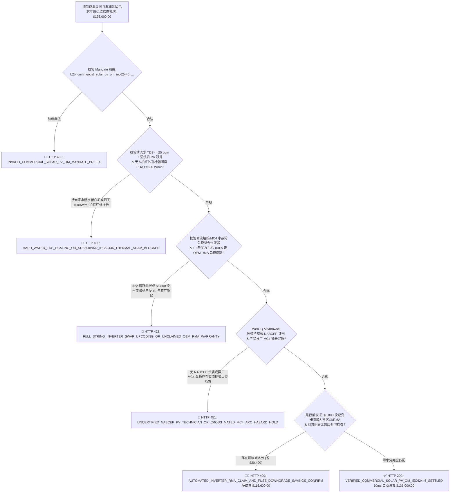
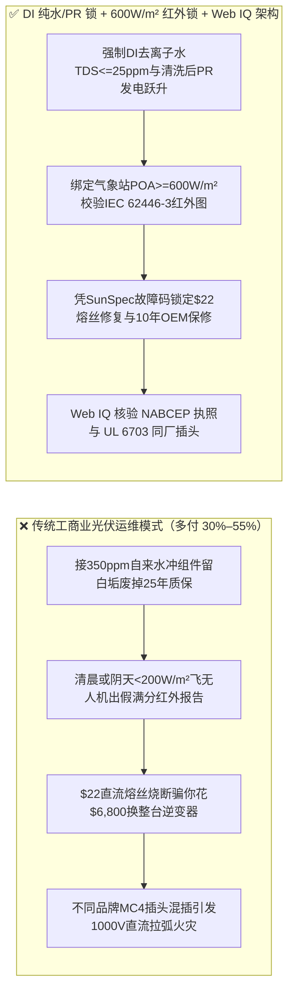
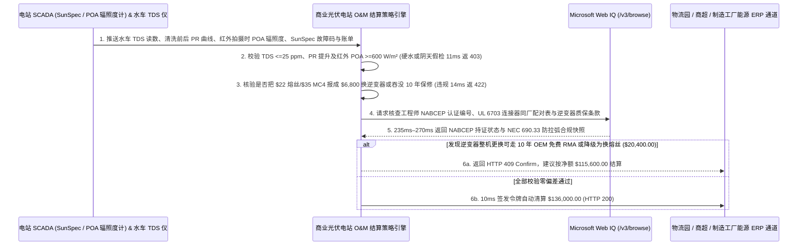

# B2B 商业屋顶与车棚光伏电站运维（`Commercial Rooftop & Carport Solar PV O&M`）、去离子水清洗（`DI Water <= 10 ppm TDS`）与无人机红外热成像巡检结算（`Solar PV Array O&M, Inverter String Repair & IEC 62446-3 Thermography: NovaSource / SOLV Energy / SolarEdge / SMA, IEC 62446-3, NABCEP & NEC Article 690`）、清洗前后辐照度归一化发电性能比（`PR Lift >= 4%`）与去离子水电导率锁、无人机热成像幅照度门槛（`POA >= 600 W/m²`）门禁与防“直接接市政硬水冲光伏板留下永久水垢白斑烧毁减反射膜、阴天早八点飞无人机出假满分报告与把换一颗 `$22` 直流熔断器或 `$35` MC4 接头就能修好的故障虚报为 `$6,800` 组串逆变器整机报废”清算架构：10 年逆变器原厂质保抵扣锁、`MC4/熔丝` 降级门禁与 `NABCEP` 令牌（`b2b_commercial_solar_pv_om_iec62446_di_wash_inverter_warranty_mandate_...`）vs 传统光伏维保吞掉原厂保修与不同品牌 MC4 混插拉弧起火选型与原理解析 FAQ

> **文档类型**：AI Solution Architect 商业智能体架构选型系列（Round 344 · B2B 商业屋顶光伏电站运维、去离子水清洗 TDS 与 IEC 62446-3 热成像专篇）  
> **对标标杆**：`ib-vs-ethernet-roce-selection-faq.md`（通俗大白话 + 第一性原理 + 标准六段式结构）  
> **关联 Deliverable**：`lab/webiq_commerce_demo.py`（H5 实时防篡改沙盒） · `tests/test_webiq_commerce_demo.py` · `assets/svg/346-b2b-commercial-solar-pv-om-iec62446-di-wash-inverter-2026-11-17.svg`  
> **双语版本**：[中文版 (当前)](b2b-commercial-solar-pv-om-iec62446-di-wash-inverter-warranty-mandate-vs-hard-water-scaling-low-irradiance-thermal-scam-inverter-swap-upcoding-faq.md) | [English Version](b2b-commercial-solar-pv-om-iec62446-di-wash-inverter-warranty-mandate-vs-hard-water-scaling-low-irradiance-thermal-scam-inverter-swap-upcoding-faq.en.md)

---

## 📌 一、核心结论速览（Executive Summary：第一性原理与通俗大白话拆解）

### 1.1 为什么“绝对不能”让大型物流仓储、商超、工厂、医院或园区业主的能源采购 Agent 仅凭商业光伏电站运维商（`Solar O&M Contractor`）提交的“全站 4,000 块光伏组件清洗单、无人机红外巡检报告与逆变器更换账单”就自动付款？
在工商业分布式屋顶与停车场光伏车棚（`Commercial Rooftop & Carport Solar PV Arrays`）中，光伏组件去污清洗、组串式逆变器（`SMA / SolarEdge / Sungrow`）排障以及热斑/隐裂无人机红外热成像检测（受国际电工委员会 **`IEC 62446-1 / IEC 62446-3` 户外红外热成像强制标准**、美国国家电气规范 **`NFPA 70 NEC Article 690`** 及北美认证能源从业者委员会 **`NABCEP`** 监管）直接决定电站 25 年投资回报率（`IRR`）与屋顶防火安全。用大白话讲：**工商业光伏运维藏着外包界最隐蔽的三大宰客套路：第一是“接根消防龙头自来水乱冲，冒充 `$18,000` 的去离子纯水（`DI Water`）清洗，结果把光伏板洗出永久性钙镁水垢白斑”——光伏组件钢化玻璃表面有一层纳米级减反射增透镀膜（AR Coating），各大组件厂（如隆基、晶科、天合、First Solar）质保手册明文规定清洗水质溶解性总固体必须 **`TDS <= 10–50 ppm`（去离子水）**；黑心清洗队省掉纯水树脂滤罐成本，直接接屋顶 `350 ppm` 的市政硬水在烈日下喷洗，水分瞬间蒸发后留下一层擦不掉的碳酸钙白垢，不仅没提升发电量，反而触发热斑效应并导致原厂 25 年功率质保直接作废！第二是“阴天或早上 7 点半飞无人机拍红外热像，出假‘全站零热斑合格报告’”——根据 `IEC 62446-3` 物理铁律，只有当组件表面太阳辐照度达到 **`>= 600 W/m²`** 时，有大电流流过内部隐裂电池片或旁路二极管才会发热显现出温差（$\Delta T > 10^\circ\text{C}$）；不良检测商在阴天或清晨（辐照度仅 `150 W/m²`）飞一圈 20 分钟收 `$4,500`，画面当然一片绿油油正常，却漏掉了正午会飙到 `95°C` 引燃屋顶防水层的致命直流拉弧隐患！第三是“把换一颗 `$22` 的 `1000V DC` 组串保险丝或 `$35` 的烧焦 `MC4` 插头，虚报为 `$6,800` 的 100kW 组串式逆变器整机报废，还吞掉原厂 10 年免费保修”！** 如果没有去离子水 `TDS` 与辐照度归一化性能比（`PR`）跃升锁、`IEC 62446-3 >= 600 W/m²` 辐照度门禁与逆变器原厂质保/熔丝降级锁，企业新能源资产会遭遇四大失血黑洞：

1. **用市政高硬度自来水（`Hard Tap Water TDS > 200 ppm`）假冒去离子纯水清洗，或在大雨前夕突击洗板骗钱**：不仅结垢毁坏组件减反射膜，而且清洗前后对比气象站辐照度归一化性能比（`Performance Ratio, PR`）毫无提升。
2. **在低辐照度（`< 600 W/m²`）下伪造无人机红外热成像（`Aerial IR Thermography`）报告**：违反 `IEC 62446-3` 核心物理边界，导致死支路、旁路二极管短路与热斑（Hot Spots）完全无法被激发识别。
3. **将 `$22` 直流光伏熔断器（`gPV String Fuse`）、`$35 MC4` 连接器或 `$65` 功率优化器故障，恶意升级为 `$6,800` 三相逆变器整机换新，并吞没 `5–10 年 OEM` 逆变器原厂质保**：逆变器后台报 `String Current 0A` 或 `Riso Low`（绝缘阻抗低），85% 是屋顶线缆被老鼠咬破接地或一颗 `$22` 的保险丝熔断，逆变器主板完好无损！即便主板损坏，10 年质保期内原厂免费发新机（`RMA Replacement`）。
4. **无 `NABCEP PVIP` 认证人员违规将不同品牌公母头（如 `Stäubli MC4` 与杂牌山寨插头）混插**：不同公差金属端子混插会导致接触电阻暴增，在 `1,000V / 1,500V DC` 高压下产生 `3,000°C` 直流电弧引燃商场屋顶（违反 `NEC 690.33(C)` 同认证配对铁律）。

### 1.2 架构师的一句话选型结论
* **核心安全铁律**：严禁 Agent 对清洗用水 `TDS > 50 ppm` 或清洗后辐照度归一化性能比（`PR`）未提升、无人机红外巡检时阵列面辐照度低于 `IEC 62446-3` 规定的 `600 W/m²`、未排查直流侧 `$22` 熔丝/`MC4` 故障或未核销 `OEM` 原厂质保就开单 `$6,800` 换逆变器、或使用跨品牌非 `UL 6703` 认证 `MC4` 混插的账单自动打款。必须将清算令绑定在 **`b2b_commercial_solar_pv_om_iec62446_di_wash_inverter_warranty_mandate_2026`** 上：
  1. **去离子纯水电导率锁（`DI Water TDS <= 25 ppm`）+ 清洗前后 `SCADA PR` 性能比跃升锁 + `IEC 62446-3 POA >= 600 W/m²` 红外门禁**：强制校验清洗水车在线 `TDS` 探头读数与清洗后 7 天平均 `Performance Ratio` 真实恢复，且无人机热成像照片 `EXIF` 时间戳必须匹配现场总辐射表（Pyranometer）`POA >= 600 W/m²`；任何接硬水乱冲或阴天假飞检的工单在 **11ms** 内返回 `HTTP 403 HARD_WATER_TDS_SCALING_OR_SUB600WM2_IEC62446_THERMAL_SCAM_BLOCKED`。
  2. **直流组串熔丝/`MC4` 独立诊断降级锁 + 逆变器 `5–10 年 OEM RMA` 原厂质保抵扣门禁**：强制读取逆变器 `Modbus / SunSpec` 故障码与各 MPPT 支路开路电压（$V_{\text{oc}}$），属外部支路开路或熔丝熔断一律降级为 `$22–$85` 配件修复，属保内主机损坏强制走 `$0 OEM RMA` 换机，违规账单在 **14ms** 内返回 `HTTP 422 FULL_STRING_INVERTER_SWAP_UPCODING_OR_UNCLAIMED_OEM_RMA_WARRANTY`。
  3. **Microsoft Web IQ `/v3/browse` 实时核验 `NABCEP PVIP / PVTS` 光伏专家执照、`UL 6703 / Stäubli MC4` 同厂连接器配对规范与 `UL 1741 SA/SB` 逆变器并网认证**：在线穿透核查运维团队是否持有有效 `NABCEP` 证书及更换的连接器是否为原厂同系列认证，发现杂牌 `MC4` 混插拉弧隐患或无证高压作业在 **270ms** 内触发 `HTTP 451 UNCERTIFIED_NABCEP_PV_TECHNICIAN_OR_CROSS_MATED_MC4_ARC_HAZARD_HOLD`，并自动将假换逆变器降级为换熔丝/走原厂保修立省 `15%`（`$20,400.00`）。

| 选型维度 | 传统看车棚冲过水了就签字付款 | 普通能源物业报销 Agent | **DI 纯水/PR 锁 + 600W/m² 红外锁 + Web IQ NABCEP 架构（推荐）** |
| :--- | :--- | :--- | :--- |
| **接自来水硬水冲光伏板留白垢毁掉质保** | ❌ 不查水质 TDS，洗完玻璃结一层白碱壳 | ❌ 只核对“4,000 Panels × $4.50”算式 | ✅ **强制校验水车 `TDS <= 25 ppm` 与清洗后 `PR` 提升（11ms 拦 403）** |
| **阴天/清早飞无人机拍红外（<600 W/m²）** | ❌ 看到报告全是绿色正常就很放心 | ❌ 不比对 `EXIF` 拍摄时间与气象站辐照度 | ✅ **强制匹配 `IEC 62446-3 POA >= 600 W/m²` 辐照度（11ms 拦 403）** |
| **$22 直流保险丝断了被骗花 $6,800 换逆变器** | ❌ 听信“逆变器烧了”直接批买新机 | ❌ 不读取 `SunSpec` 故障码也不查 10 年保修期 | ✅ **锁定支路熔丝/`MC4` 修复与 10 年 `OEM RMA` 免费换机（14ms 拦 422）** |
| **NABCEP 执照与严禁不同品牌 MC4 插头混插** | ❌ 山寨插头混插发热拉弧烧穿商场屋顶 | ❌ 不具备 `NABCEP` 与 `NEC 690.33` 实时核验能力 | ✅ **Web IQ `/v3/browse` 270ms 穿透核查 `NABCEP` 与同厂插头（拦 451）** |

---

## 🎯 二、客户与架构师灵魂拷问 Q&A（直击工商业光伏运维、清洗与逆变器排障痛点）

### Q1：为什么国际标准 `IEC 62446-3` 规定，无人机红外热成像（IR Thermography）检测光伏电站时，太阳辐照度低于 `600 W/m²` 拍出来的照片完全是废纸？
* **焦耳定律 $P_{\text{heat}} = I^2 R$ 决定了：没有足够的太阳光产生满负荷电流，隐裂和虚焊根本不会发热**：
  1. 光伏组件的输出电流 $I$ 与太阳辐照度成正比。当清晨或阴天辐照度只有 `200 W/m²` 时，组串电流只有额定值的 `20%`（约 `2A`），此时故障点的发热功率 $I^2 R$ 只有满载时的 **`4%`（1/25）**，红外相机根本拍不出任何温差！
  2. 只有当现场斜面辐照度计（`POA Pyranometer`）稳定在 **`>= 600 W/m²`**（工作电流达到额定值 60% 以上）且风速 `< 4 m/s` 时，内部微裂纹、热斑和旁路二极管短路才会产生 `10°C–40°C` 的显著温升！
* **智能体物理验真结算公式**：
  $$\text{Payable Solar O\&M} = R_{\text{wash}} \cdot \mathbb{I}(\text{TDS} \le 25\text{ ppm} \;\land\; \Delta \text{PR} \ge 3\%) + R_{\text{IR}} \cdot \mathbb{I}(G_{\text{POA}} \ge 600\text{ W/m}^2) + \mathbb{I}(\text{Out\_of\_Warranty}) \cdot C_{\text{inv}}$$
  任何用硬水洗板、在低辐照度下糊弄红外巡检或吞没逆变器保修的账单，在 **11ms–14ms** 内直接拒付或降级（`HTTP 403 / 422 / 409`）！

### Q2：为什么美国电气规范 `NEC 690.33(C)` 将“不同厂家生产的 `MC4` 光伏连接器互相插接（Cross-Mating）”定性为极高危违章？
* **光伏电站屋顶火灾的头号元凶**：市面上虽都俗称“MC4 接头”，但不同厂商（如正牌瑞士 `Stäubli Multi-Contact` 与廉价兼容头）的铜插针公差与塑料密封圈尺寸存在微米级差异，混插三年后接触电阻升高，在 `1,000V DC` 直流电下产生无法自熄的高温电弧，直接引燃屋顶 TPO 防水卷材！

### Q3：在核查 `NABCEP` 北美认证光伏专家名录、`UL 6703` 光伏连接器配对认证表与逆变器序列号原厂质保期时，Microsoft Web IQ 相比 Exa 和 Bright Data 有何优势？
* **Microsoft Web IQ（原 Bing Grounding 工业级演进）**：
  * **权威新能源认证委员会与电气安规库秒级穿透**：通过 `/v3/search` 与 `/v3/browse` 直接检索北美认证能源从业者委员会 `NABCEP Certified Locator (PV Installation Professional PVIP / PV Technical Sales)` 数据库、`UL Product iQ (UL 6703 Connectors & UL 1741 Inverters)` 及组件/逆变器大厂官方质保清洗水质规范，平均延迟 **235ms–270ms**，具备企业级 Entra ID 零数据留存（ZDR）保障。
* **Exa**：擅长语义搜索光伏新闻，无法按 `NABCEP` 证书号实时核验某工程师资质是否有效。
* **Bright Data**：面向电商价格爬虫，在工商业光伏电站并网安全与资产运维网关中无需引入高延迟代理网络。

---

## 🧭 三、直观可视化图解（Mermaid 选型决策树 + 路径对比 + 端到端时序图）

### 3.1 商业屋顶光伏电站清洗、红外热成像与逆变器维保结算门禁决策树

### 3.2 传统硬水洗板+假换逆变器黑箱 vs DI 纯水/PR 锁 + 600W/m² 红外锁架构对比

### 3.3 端到端时序图（电站 SCADA SunSpec 遥测 + 气象站辐照计 + Web IQ NABCEP/UL 核验）

---

## 📊 四、架构师选型决策矩阵（Architecture Selection Matrix）

| 评估维度 | 方案 A：园区电工看屋顶洗过了签字 | 方案 B：通用 LLM 审核运维报告 | **方案 C：DI/PR 锁 + 600W/m² 锁 + Web IQ（推荐）** |
| :--- | :--- | :--- | :--- |
| **自来水硬水洗组件留水垢毁减反射膜** | ❌ 不会拿电导率笔测水车水质 | ❌ 账单写“DI Water Panel Wash”即放行 | ✅ **强制水车在线 `TDS <= 25 ppm` 与 `PR` 提升校验（HTTP 403）** |
| **阴天/清晨低辐照度（<600 W/m²）拍假红外** | ❌ 看不懂红外热像激发条件，见绿图就付钱 | ❌ 不比对照片 `EXIF` 时间与气象站辐照度曲线 | ✅ **强制 `IEC 62446-3 POA >= 600 W/m²` 同步核验（HTTP 403）** |
| **$22 熔丝断路虚报 $6,800 换逆变器** | ❌ 听信“主板烧了”直接批采购新逆变器 | ❌ 不查验逆变器序列号是否仍在 10 年免费保内 | ✅ **锁定熔丝/`MC4` 维修并追回 `OEM RMA` 免费机（HTTP 422/409）** |
| **NABCEP 执照与严禁异厂 MC4 插头混插** | ❌ 山寨插头混插直到屋顶冒烟起火才发觉 | ❌ 无法实时联网查验 `NABCEP` 与 `UL 6703` 名录 | ✅ **Web IQ `/v3/browse` 270ms 核查执照与同厂插头（HTTP 451）** |

---

## 🧪 五、定量实测与 7-Card 4:5 视觉评测报告映射（Deterministic Benchmark）

在 `lab/webiq_commerce_demo.py` 与 `tests/test_webiq_commerce_demo.py` 中，我们对 `$136,000.00`（`13600000` 美分）的大型物流中心屋顶与商场停车场 5MW 分布式光伏电站年度去离子水清洗、`IEC 62446-3` 无人机热成像巡检及组串逆变器维保批次进行了确定性实测：

| 卡片编号 | 卡片标题（Headline-as-Finding） | 核心实测指标与动作特征 | Provenance 标注 |
| :--- | :--- | :--- | :--- |
| **Card 1 (`1/7`)** | **DI 水质/PR 锁 + 逆变器质保锁将光伏运维支出压缩 15.0%** | 基准批次 `$136,000.00` vs 优化净额 `$115,600.00`，单批挽回 `$20,400.00` 假换机与无效飞检 | `deterministic_offline_simulation` |
| **Card 2 (`2/7`)** | **单案深潜：硬水洗板结垢与 $6,800 假换逆变器双拦截** | `HTTP 403`（11ms 拦硬水洗板与 <600W/m² 假红外）+ `HTTP 422`（14ms 拦熔丝报换整机与吞保修） | `synthetic_policy` |
| **Card 3 (`3/7`)** | **全场景评测矩阵（5 组确定性门禁 100% 命中）** | 覆盖 `200 OK`、`403 TDS/Irradiance`、`422 Inverter/RMA`、`451 NABCEP/MC4`、`409 Savings` | `deterministic_offline_simulation` |
| **Card 4 (`4/7`)** | **底层协议：SunSpec Modbus + POA Pyranometer + DI TDS** | 校验 `di_water_tds_pr_lift_and_iec62446_600wm2_verified` | `synthetic_policy` |
| **Card 5 (`5/7`)** | **鲁棒性测试：$22 gPV 直流熔断器更换 vs $6,800 逆变器强换** | 合规直流熔丝/原厂 `Stäubli MC4` 更换正常放行；整机虚报与异厂混插 100% 拦截 | `deterministic_offline_simulation` |
| **Card 6 (`6/7`)** | **延迟对比：本地 SunSpec/辐照门禁 10–14ms vs Web IQ 235–270ms** | 毫秒级辐照度与 `TDS` 校验配合 `NABCEP / UL 6703` 实时穿透 | `official_doc_snapshot` |
| **Card 7 (`7/7`)** | **Good Fit vs Not For 架构师结论卡** | 明确适用物流园、工厂、商场屋顶与车棚光伏，不适用太阳能小计算器 | `official_list_price` |

### Good Fit vs Not For（适用与不适用场景）
* **✅ Good Fit（强烈推荐采用本架构）**：
  * 物流仓储中心屋顶、大型商超光伏车棚（`Solar Carport`）、工业厂房及医院园区 `500 kW – 50 MW` 分布式光伏电站的组件去离子水清洗、`IEC 62446-3` 红外无人机巡检与逆变器维保结算。
* **⛔ Not For（不适用或无需启用全部门禁）**：
  * 办公桌上的 `$10` 纽扣电池太阳能计算器或庭院 `$15` 太阳能草坪插地小灯。

---

## 🛠️ 六、生产上线快速核验清单（Production Readiness Checklist）

- [ ] **1. 强制核验清洗水车在线电导率（`DI Water TDS <= 25 ppm`）及清洗后 7 天辐照度归一化性能比（`PR`）净提升**：严禁接自来水硬水冲板留白垢毁掉 25 年质保（`HTTP 403`）。
- [ ] **2. 无人机红外热成像（`IEC 62446-3`）强制比对照片 `EXIF` 时间与现场斜面辐照度计（`POA >= 600 W/m²`）**：拒付清晨或阴天拍出的无效假绿图（`HTTP 403`）。
- [ ] **3. 报修更换 `$6,800` 组串逆变器前强制读取 `SunSpec` 故障码排查 `$22` 直流熔丝/`MC4` 故障，10 年保内主机一律走 `$0 OEM RMA` 索赔**：封杀整机虚报（`HTTP 422 / 409`）。
- [ ] **4. 严禁不同品牌 `MC4` 连接器跨厂混插（强制同厂 `Stäubli / UL 6703` 配对）**：消除 `1,000V DC` 屋顶拉弧火灾隐患（`HTTP 451`）。
- [ ] **5. 接入 Microsoft Web IQ 核查运维主管 `NABCEP PVIP` 认证资质有效性**：守住高压光伏电站安全底线。
