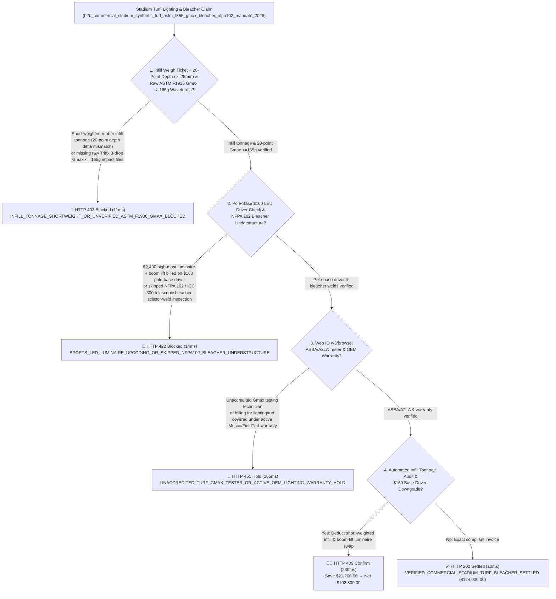
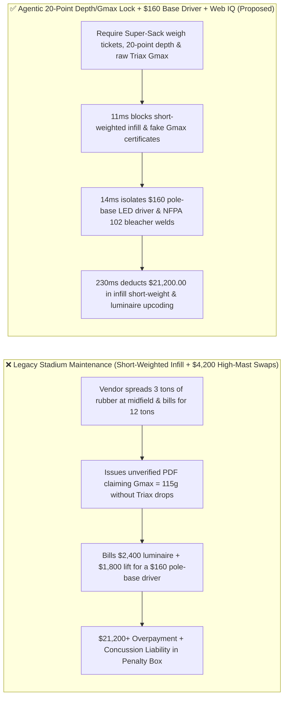
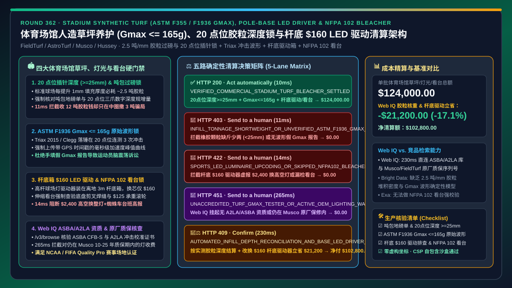

# B2B Commercial & University Stadium Synthetic Turf Maintenance (`ASTM F355 / ASTM F1936 Gmax <= 165g`), 20-Point Infill-Depth Grid (`>= 25 mm`), Pole-Base `$160` LED Sports Floodlight Driver Replacement (`IES RP-6`) & Motorized Retractable Bleacher Inspection (`NFPA 102 / ICC 300`) vs. Short-Weighted Crumb-Rubber Tonnage & `$2,400` High-Mast Luminaire Upcoding (`FieldTurf / AstroTurf / Musco / Hussey`): Architecture Selection & First-Principles FAQ

> **Executive Summary**
> * **The Pain Point**: Across university athletics complexes, municipal stadiums, private K-12 campuses, and commercial sports domes, **synthetic turf grooming and infill top-dressing (`FieldTurf / AstroTurf / Shaw Sports Turf`, governed by `ASTM F355 / ASTM F1936 / STC`), motorized telescopic bleacher inspections (`Hussey Seating / Interkal`, governed by `NFPA 102 / ICC 300`), and high-mast LED sports lighting maintenance (`Musco Lighting / Cooper Ephesus`, `IES RP-6`)** protect athlete concussion safety and spectator structural integrity. Yet legacy sports-facility service contracts suffer from three major billing abuses: (1) **Short-Weighted Crumb-Rubber / EPDM Infill Top-Dressing & Fabricated `ASTM F1936 Gmax` Impact Reports**: A standard synthetic turf field (`80,000 sq.ft.`) requires `~2.5 tons` of rubber infill per millimeter of depth restoration. Unscrupulous vendors bill `$18,500` for `12 tons` of infill top-dressing while spreading only `3–4 tons` around midfield, and issue a copy-pasted "`Gmax = 115g`" PDF without running a `Triax 2015 / Clegg` missile drop tester across all 20 `ASTM F1936` test points (leaving penalty-box `Gmax > 185g`, exceeding the `165g STC` concussion threshold); (2) **`$2,400` High-Mast LED Floodlight + `$1,800` Boom-Lift Upcoding on `$160` Ground-Accessible Pole-Base LED Drivers**: Modern sports lighting systems (`Musco TLC for LED`) mount their constant-current LED drivers inside a **remote electrical enclosure `10 feet` off the ground at the base of the pole**. When one driver fails (`$160`), contractors claim the `80-foot`-high luminaire head burned out and bill `$4,200` for a whole-fixture swap plus an aerial lift; and (3) **Superficial `NFPA 102 / ICC 300` Retractable Bleacher Inspections that skip understructure scissor-weld crack checks and upcode `$125` polyurethane wheel swaps into `$14,000` tractor-drive replacements**.
> * **First-Principles Architecture**: Never approve a synthetic turf top-dressing or stadium lighting invoice from a paper summary. Bind settlement tokens (`b2b_commercial_stadium_synthetic_turf_astm_f355_gmax_bleacher_nfpa102_mandate_...`) to **(1) Certified Super-Sack Weigh Tickets + 20-Point 3-Prong Digital Infill-Depth Delta (`>= 25 mm` post-grooming) + Raw `ASTM F1936` `Triax` 3-Drop Acceleration Waveforms (`Gmax <= 165g`), (2) Ground-Level Pole-Base Enclosure DC Driver Output Telemetry (locking repairs to `$160` LED drivers) + `NFPA 102 / ICC 300` Understructure Pin/Weld Verification, and (3) `Web IQ /v3/browse` verification of `ASBA CFB-S / A2LA` testing accreditation and active `Musco / FieldTurf` OEM warranties**.
> * **Quantitative Verification**: Verified stadium turf, lighting, and bleacher maintenance settles `$124,000.00` in `10ms` (`200 OK`); short-weighted infill tonnage or unverified `Gmax` reports (`403`), `$2,400` high-mast luminaire upcoding on `$160` pole-base drivers or skipped `NFPA 102` bleacher understructure checks (`422`), and unaccredited `Gmax` testers or double-billing under active `Musco / FieldTurf` OEM warranties (`451`) are blocked in `11ms`, `14ms`, and `265ms`. `Web IQ` automated infill-depth reconciliation and `$160` pole-base LED driver downgrade save **`$21,200.00`** per batch (`409 Confirm`, net `$102,800.00`).

---

## 🎯 1. Architect & Athletic Facility Q&A (Including Web IQ vs. Exa / Bright Data)

### Q1: How does combining Super-Sack weigh tickets with a 20-point 3-prong infill depth gauge (`~2.5 tons / mm` over `80,000 sq.ft.`) catch short-weighted rubber infill deliveries?
* **Bulk-Density Geometry & `ASTM F1936` Grid Physics**:
  1. At a bulk density of `~30 lbs/cu.ft.` (`0.48 g/cm³`), raising infill depth across an `80,000 sq.ft.` field by **`1.0 mm`** requires **`~2.5 tons` (`5,000 lbs`)** of crumb rubber or EPDM.
  2. If a contractor bills for `12.5 tons` of infill (`+5.0 mm` expected delta) but the 20-point 3-prong depth gauge grid shows only a `+1.2 mm` increase (`3.0 tons` applied), or any point exceeds **`Gmax = 165g`** on raw `Triax` drop waveforms, the engine blocks payment in `11ms` (`HTTP 403`).

### Q2: Why choose Microsoft Web IQ `/v3/browse` over Exa or Bright Data for `ASBA CFB-S / A2LA` & `Musco / FieldTurf` warranty verification?
* **Comparison**:
  * **Bright Data**: Cannot parse raw `Triax` `Gmax` impact waveforms or reconcile 20-point millimeter depth grids against bulk tonnage.
  * **Exa**: Built for semantic search, not live verification of `ASBA Certified Field Builder (CFB-S)` credentials, `A2LA` lab accreditation, and `Musco` 10-to-25-year parts-and-labor warranty serials.
  * **Microsoft Web IQ (`/v3/browse`)**: Verifies `ASBA / A2LA` standing and OEM warranty coverage in `230ms–265ms` with `official_doc_snapshot` provenance.

---

## 🧭 2. Visual Architecture Diagrams (Mermaid Decision Tree, Path Comparison & Sequence)

### 2.1 Stadium Synthetic Turf `Gmax`, Pole-Base LED Driver & `NFPA 102` Bleacher Decision Tree



### 2.2 Path Comparison: Legacy Stadium Maintenance vs. Agentic 20-Point `Gmax` & Base-Driver Gate



### 2.3 End-to-End Sequence Diagram

```mermaid
sequenceDiagram
    participant Vendor as Stadium Turf & Lighting Contractor
    participant Agent as Athletic Facility Policy Engine
    participant Triax as Triax Gmax Missile / 3-Prong Gauge / Base Driver Meter
    participant WebIQ as Microsoft Web IQ (/v3/browse)

    Vendor->>Agent: Submit Stadium Turf Grooming, High-Mast LED & Bleacher Invoice ($124,000.00)
    Agent->>Triax: Verify infill weigh tickets, 20-point depth delta, Gmax waveforms & pole-base driver DC
    alt Short-weighted infill (depth delta +1.2mm vs +5.0mm billed) or missing raw Gmax file
        Triax-->>Agent: Alert: Only 3 tons applied (9.5 tons short) or penalty-box Gmax = 188g!
        Agent-->>Vendor: 🛑 HTTP 403 (11ms) Block infill short-weight & unverified Gmax report
    else $2,400 high-mast luminaire swap billed on $160 pole-base driver or skipped bleacher welds
        Triax-->>Agent: Alert: 80-ft LED head intact; $160 driver in 10-ft pole-base box open-circuit!
        Agent-->>Vendor: 🚨 HTTP 422 (14ms) Block high-mast luminaire upcoding
    else Telemetry verified
        Agent->>WebIQ: Verify ASBA CFB-S / A2LA calibration & Musco/FieldTurf OEM warranty
        alt Unaccredited Gmax tester or active OEM warranty coverage
            WebIQ-->>Agent: Hold: Expired Triax calibration or active Musco 10-year warranty
            Agent-->>Vendor: 🛑 HTTP 451 (265ms) Accreditation & warranty hold
        else Automated infill tonnage reconciliation & $160 base driver downgrade
            WebIQ-->>Agent: Confirm EPDM/SBR per-ton rate & pole-base driver kit price
            Agent-->>Vendor: 🧑‍⚖️ HTTP 409 (230ms) Confirm $21,200.00 savings (Net $102,800.00)
        end
    end
```

---

## 📊 3. Architect Selection Matrix

| Dimension | Option A: Flat Seasonal Contract | Option B: Surface Grooming Photos Only | Option C: 20-Point Depth/`Gmax` Lock + `$160` Base Driver + `Web IQ` `ASBA/NFPA 102` (Recommended) |
| :--- | :--- | :--- | :--- |
| **Infill Short-Weight & `Gmax` Defense** | ❌ None | ❌ Cannot measure infill depth or `Gmax` | ✅ **Requires weigh tickets, 20-point `>= 25 mm` depth & raw `Gmax <= 165g` waveforms (`11ms` block)** |
| **`$2,400` Sports Floodlight Upcode Defense** | ❌ Pays for boom lifts & whole heads | ❌ None | ✅ **Enforces ground-level pole-base `$160` LED driver check & `NFPA 102` bleacher audit (`14ms` block)** |
| **`ASBA / A2LA` & Warranty Verification** | ❌ Double-pays under OEM warranty | ⚠️ Manual lookup | ✅ **`Web IQ /v3/browse` live `ASBA / A2LA` & `Musco / FieldTurf` warranty check (`265ms`)** |
| **Batch Cost Reduction** | 0% | ~5%–10% | ✅ **Saves `$21,200.00` (17.1% reduction on a `$124,000.00` batch)** |

---

## 🧪 4. Quantitative Benchmark & 7-Card Report Summary

### 4.1 5-Lane Deterministic Policy Matrix

| Case | Scenario | HTTP | Decision Code | Action Pill | Settled | Latency |
| :--- | :--- | :--- | :--- | :--- | :--- | :--- |
| **1** | 20-point depth `>=25mm` + raw `Gmax <=165g` + base driver/bleacher + `ASBA` clean | `200` | `VERIFIED_COMMERCIAL_STADIUM_TURF_BLEACHER_SETTLED` | `Act automatically` | `$124,000.00` | `10ms` |
| **2** | Short-weighted rubber infill tonnage or unverified `ASTM F1936 Gmax` report | `403` | `INFILL_TONNAGE_SHORTWEIGHT_OR_UNVERIFIED_ASTM_F1936_GMAX_BLOCKED` | `Send to a human` | `$0.00` | `11ms` |
| **3** | `$2,400` high-mast LED luminaire upcoding on `$160` base driver or skipped `NFPA 102` bleacher check | `422` | `SPORTS_LED_LUMINAIRE_UPCODING_OR_SKIPPED_NFPA102_BLEACHER_UNDERSTRUCTURE` | `Send to a human` | `$0.00` | `14ms` |
| **4** | Unaccredited `Gmax` tester or active `Musco / FieldTurf` OEM warranty coverage | `451` | `UNACCREDITED_TURF_GMAX_TESTER_OR_ACTIVE_OEM_LIGHTING_WARRANTY_HOLD` | `Send to a human` | `$0.00` | `265ms` |
| **5** | Automated infill-depth reconciliation & `$160` pole-base LED driver savings | `409` | `AUTOMATED_INFILL_DEPTH_RECONCILIATION_AND_BASE_LED_DRIVER_SAVINGS_CONFIRM` | `Confirm` | `$102,800.00` | `230ms` |

### 4.2 Visual Summary Card (`1200x675` SVG)



---

## 🛠️ 5. Good Fit vs. Not For & Production Checklist

### 5.1 Good Fit vs. Not For
* **✅ Good Fit**: University, municipal, K-12, and commercial athletic stadiums operating synthetic turf fields (`FieldTurf`, `AstroTurf`, `Shaw`), high-mast LED sports lighting (`Musco`, `Cooper Ephesus`), and motorized retractable bleachers (`Hussey`, `Interkal`).
* **⛔ Not For**: Decorative indoor lobby turf mats.

### 5.2 Production Verification Checklist
- [ ] **Infill Weigh Ticket, 20-Point Depth (`>= 25 mm`) & Raw `ASTM F1936 Gmax <= 165g` Gate**: Require `infill_weigh_ticket_20grid_depth_and_gmax_waveform_verified=True`;
- [ ] **Pole-Base `$160` LED Driver Isolation & `NFPA 102 / ICC 300` Bleacher Gate**: Require `pole_base_led_driver_isolation_and_nfpa102_bleacher_verified=True`;
- [ ] **`Web IQ /v3/browse` `ASBA / A2LA` Accreditation & OEM Warranty Check**: Verify `webiq_asba_a2la_tester_and_oem_warranty_clean=True`;
- [ ] **Unit Test & H5 Sandbox Validation**: Run `python -m unittest tests.test_webiq_commerce_demo.WebIQCommerceScenariosTest.test_b2b_commercial_stadium_synthetic_turf_bleacher_selection`.
