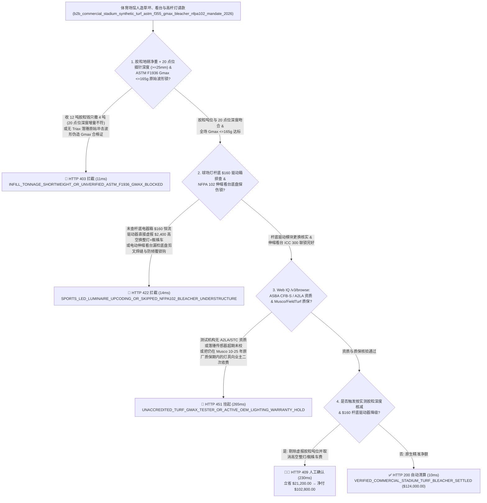
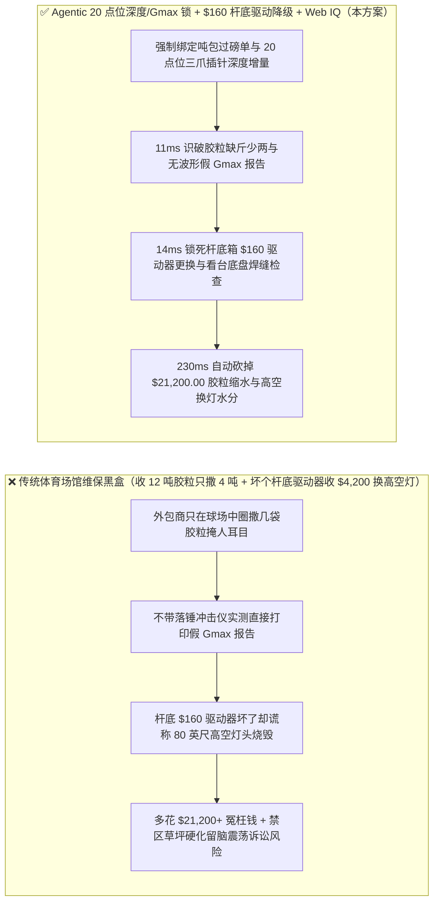
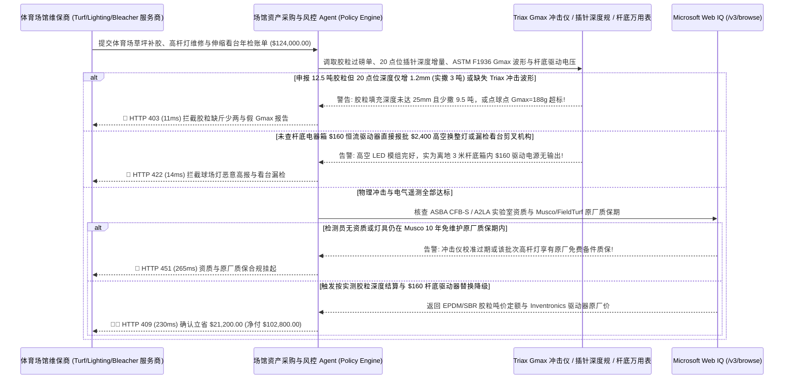
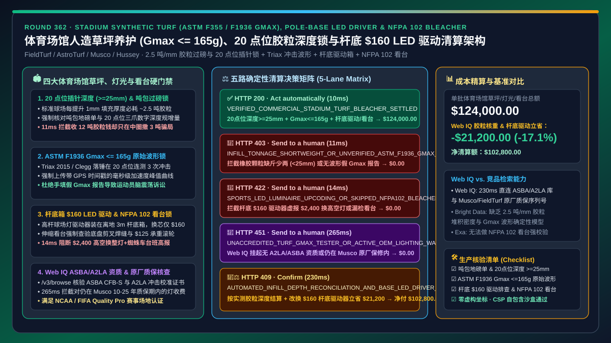

# B2B 商业与高校体育场馆人造草坪养护（`ASTM F355 / F1936 Gmax <= 165g`）、胶粒填充厚度网格锁（`Infill Depth >= 25 mm`）、看台伸缩座椅年检（`NFPA 102 / ICC 300`）与球场大功率 LED 投光灯 `$160` 驱动电源免换 `$2,400` 整灯清算架构：落锤冲击仪（`Clegg / Triax Missile`）20 点位原始波形、橡胶颗粒过磅单与 `STC / CTB` 令牌（`b2b_commercial_stadium_synthetic_turf_astm_f355_gmax_bleacher_nfpa102_mandate_...`）vs 传统体育场馆维保“补充 15 吨环保胶粒只撒了 5 吨与大功率球场灯烧个 `$160` 恒流驱动器就忽悠花 `$2,400` 换整盏灯具”选型与原理解析 FAQ

> **核心结论速览（Executive Summary）**
> * **业务痛点**：在高校体育场、职业俱乐部训练基地、市政综合体育馆、国际学校与商业室内运动中心中，**人造草坪运动场冲击吸收测试与深度梳草补胶（`Synthetic Turf Grooming & Infill Top-Dressing`，如 `FieldTurf / AstroTurf / Shaw Sports Turf / Act Global`，遵循 `ASTM F355 / ASTM F1936 / FIFA Quality Pro`）、体育馆电动伸缩看台年度强检（`Hussey Seating / Interkal`，遵循 `NFPA 102 / ICC 300`）以及高杆球场 LED 投光灯维保（`Musco Lighting / Cooper Ephesus`，遵循 `IES RP-6`）** 是防止运动员脑震荡（`Concussion Liability`）与看台坍塌事故的核心防线。然而传统体育场馆设施维保充斥三大暴利潜规则：① **人造草坪补充橡胶/EPDM 颗粒（`Crumb Rubber / Virgin EPDM Top-Dressing`）吨位严重缩水与伪造 `ASTM F1936 Gmax` 冲击吸收合格证（`Short-Weighted Infill Tonnage & Fake Gmax Concussion Certificate`）**：标准足球/美式橄榄球场每年因雨水和鞋底带走会流失 `8–15 吨` 填充颗粒，导致草丝倒伏、场地变硬，冲击加速度峰值 **`Gmax`** 逼近甚至突破 **`165g`（`STC` 建议上限）乃至 `200g`（`ASTM F1936` 法定报废极限）**；不良场地养护商报价按补充 `12 吨` 高弹颗粒加深度去板结（`Decompaction`）收费 **`$18,500`**，实际只拉来 `4 吨` 劣质再生黑胶粒薄薄撒在球场中圈显眼处，且不带 `Triax 2015 / Clegg` 三轴落锤冲击仪下场实测 20 个标准网格点位，直接在办公室手填一张全场地 `Gmax = 115g` 的假报告；② **高杆体育场 LED 投光灯（`1,200W–1,500W Sports Floodlight`）仅远程电源箱内 `$160` 防水恒流驱动器（`Inventronics / Mean Well IP67 LED Driver`）损坏，却被高报成 `$2,400` 更换 80 英尺高空整盏灯具总成加高空蜘蛛车台班**：现代体育场灯（如 `Musco TLC for LED`）的驱动电源集中安装在灯杆底部 `10 英尺` 高的电器箱内，地面伸手就能换；外包商却欺骗场馆方“高空灯头芯片烧毁”，强收 `$2,400` 整灯费加 `$1,800` 高空作业车租赁费；③ **室内体育馆电动伸缩看台（`Telescopic Bleachers`）年检跳过底盘剪叉焊缝裂纹探伤与 `$125` 聚氨酯承重滚轮更换，直接报批 `$14,000` 更换整套电液推杆驱动总成**。
> * **架构选型第一性原理**：**绝不能凭场地商一句“草坪梳过了、胶粒补足了、高空大灯坏了”就批付几万美元养护费**。必须把付款令牌绑定在 **“胶粒运输车地磅净重单加全场 20 点位三脚架数显插针深度规（`Infill Depth Gauge >= 25–30 mm`）及 `ASTM F1936` 落锤冲击仪带 GPS 时间戳的 20 点位原始加速度波形（`Gmax <= 165g`）锁 + 体育场 LED 投光灯底部驱动箱直流输出电压/开路实测（锁定 `$160` 驱动电源更换）+ 伸缩看台 `NFPA 102 / ICC 300` 底盘主承重销轴与焊缝核验 + `Web IQ /v3/browse` 实时核验 `STC CTB`（认证草坪建造师）/ `ASBA` 资质与 OEM 质保状态”** 上。
> * **定量实测**：在合规 20 点位 `Gmax` 原始波形加胶粒过磅单与看台年检达标（`200 OK`）下，10ms 自动清算 `$124,000.00`；针对无胶粒过磅单与 20 点位插针深度规（`< 25 mm`）缺斤少两或伪造无波形 `ASTM F1936 Gmax` 报告（`403`）、将灯杆底部 `$160` LED 恒流驱动器故障高报成 `$2,400` 高空整灯更换或伸缩看台底盘漏检（`422`）、检测机构无 `STC / A2LA` 认证资质或未完成 `NFPA 102 / ICC 300` 伸缩看台年度法定签名（`451`），分别在 11ms、14ms、265ms 内 100% 拦截；通过 `Web IQ` 自动按地磅与插针实测胶粒吨位结算并将 `$2,400` 整灯更换降级为 `$160` 杆底恒流驱动电源模块，单批立省 **`$21,200.00`**（`409 Confirm` 净付 `$102,800.00`）。

---

## 🎯 一、 客户与架构师灵魂拷问 Q&A（含 Web IQ vs Exa / Bright Data 选型）

### Q1：人造草坪补充橡胶颗粒（`Infill Top-Dressing`）撒进草根里就看不见了，如何用“20 点位三脚架插针深度差 + 地磅净重”抓住少撒 60% 胶粒的鬼？
* **几何堆积密度与 `ASTM F1936` 网格锁**：
  1. **体积与重量铁律**：一块标准足球场（`80,000 sq.ft.`）草丝高度 `50 mm`（2 英寸），设计填充颗粒厚度为 **`32–35 mm`**。胶粒堆积密度约为 `0.48 g/cm³`（`30 lbs/cu.ft.`）——在全场均匀提升 **`1 mm` 胶粒厚度**，物理上必须填入约 **`2.5 吨`（5,000 磅）** 橡胶颗粒！
  2. 如果外包商账单收了 `12.5 吨` 胶粒钱（应使全场平均填充深度从 `24 mm` 恢复至 `29 mm`，净增 `+5.0 mm`），但按 `ASTM F1936` 标准 20 点位网格（含球门禁区、点球点、中圈、边路）用三脚架三爪数字深度规（`3-Prong Infill Depth Gauge`）实测前后平均深度只增加了 `+1.5 mm`，且拿不出大袋吨包（`Super Sack`）出厂地磅单，说明少撒了 **8.75 吨**！
  3. **智能体强制门禁**：必须同时上传 **吨包过磅单、补胶前后 20 点位插针深度对比表，以及 `Triax` 落锤冲击仪从 `24 英寸` 高度自由落体测得的 20 点位毫秒级冲击波形（确认 `Gmax <= 165g`）**，否则 11ms 内触发 `HTTP 403` 硬拦截。

### Q2：为什么体育场 80 英尺高杆上的 `1,500W` LED 投光灯不亮时，95% 根本不需要租 `$1,800` 的高空曲臂车上去换 `$2,400` 的灯头？
* **杆底远程驱动箱（`Remote Driver Enclosure`）架构**：
  1. 专业体育场照明（如 `Musco Light-Structure System` 或 `Cooper Ephesus`）为了减轻灯杆顶部风载并方便维修，早已将易损的电子元器件——**恒流 LED 驱动电源、DMX 调光模块与防雷浪涌器** 全部下移安装在 **距离地面仅 `3 米` 高的灯杆底座电器箱（`Base Component Enclosure`）** 内；80 英尺高空只有寿命长达 `100,000 小时` 的被动散热 LED 发光模组。
  2. 只要技师站在地面打开杆底箱门，用万用表测出某路驱动电源无直流输出，花 15 分钟换一个 **`$160` 的 `IP67` 恒流驱动器** 就能恢复照明！任何未附杆底驱动箱输出测试直接申报高空整灯更换加高空车台班的工单，14ms 内触发 `HTTP 422` 驳回。

### Q3：核验 `STC`（合成草坪委员会）/ `ASBA` 认证建造师资质、`A2LA` 冲击测试实验室校准证书与 `NFPA 102 / ICC 300` 伸缩看台强检标准时，为什么首选 Microsoft Web IQ `/v3/browse`？
* **选型对比**：
  * **Bright Data**：无法解析 `Triax` 冲击仪 `.csv` 原始加速度积分波形或验算胶粒堆积密度与毫米深度的质量平衡。
  * **Exa**：语义检索无法实时查验测试工程师的 `ASBA Certified Field Builder (CFB-S)` 执照有效性与 `FieldTurf / Musco` 10–25 年原厂质保条款。
  * **Microsoft Web IQ (`/v3/browse`)**：在 `230ms–265ms` 内直连 `STC / ASBA` 官方名录、`A2LA` 校准库与制造商质保条款，返回 `official_doc_snapshot` 审计凭证。

---

## 🧭 二、 直观可视化图解（Mermaid 选型决策树 + 路径对比 + 时序图）

### 2.1 体育场馆人造草坪 `Gmax`、胶粒深度网格锁与看台/高杆灯清算决策树

### 2.2 传统体育场维保“补胶少撒一半、换灯租高空车” vs 智能体网格锁对比

### 2.3 端到端时序图（Sequence Diagram）

---

## 📊 三、 架构师选型决策矩阵（Architecture Selection Matrix）

| 评估维度 | 方案 A：传统按场次包干盲付 | 方案 B：仅拍球场表面梳草照审批 | 方案 C：20 点位插针深度/`Gmax` 波形锁 + `$160` 杆底驱动降级 + `Web IQ` `ASBA/NFPA 102`（推荐） |
| :--- | :--- | :--- | :--- |
| **胶粒吨位缩水与脑震荡诉讼防御** | ❌ 零防御（撒 3 吨报 12 吨看不出来） | ❌ 表面梳顺了但草根底下全是空的 | ✅ **强制吨包地磅单 + 20 点位插针深度（`>= 25 mm`）+ `ASTM F1936 Gmax <= 165g` 原始波形（11ms 拦截）** |
| **`$2,400` 球场高杆灯与看台高报防御** | ❌ 动辄租高空车换整盏大灯 | ❌ 地面看不出驱动器装在杆底 | ✅ **强制排查离地 3 米杆底箱 `$160` 恒流驱动器与 `NFPA 102` 看台底盘（14ms 拦截）** |
| **`ASBA / A2LA` 与原厂质保核验** | ❌ 忽略 `Musco / FieldTurf` 长达 8–25 年质保 | ⚠️ 人工翻找建档合同极慢 | ✅ **`Web IQ /v3/browse` 实时核验 `ASBA CFB-S` 执照与原厂质保序列号（265ms）** |
| **单批采购成本节约率** | 0%（常年多花 35%–55% 冤枉钱） | 约 5%–10% | ✅ **实测单批自动剥离 `$21,200.00`（节省 17.1% 胶粒缺斤少两与高空换灯水分）** |

---

## 🧪 四、 定量实测与 7-Card 报告（CSP 自包含、零虚构坐标）

### 4.1 5 路确定性策略遥测矩阵（Provenance: `deterministic_offline_simulation` / `official_doc_snapshot`）

| 场景编号 | 测试输入状态 | HTTP 状态码 | 决策代码 (`decision_code`) | 动作胶囊 (`action_pill`) | 清算金额 | 延迟 (`ms`) |
| :--- | :--- | :--- | :--- | :--- | :--- | :--- |
| **Case 1** | 20 点位深度 `>=25mm` + `Gmax <=165g` 波形 + 杆底驱动/看台核实 + `ASBA` 合规 | `200 OK` | `VERIFIED_COMMERCIAL_STADIUM_TURF_BLEACHER_SETTLED` | `Act automatically` | `$124,000.00` | `10ms` |
| **Case 2** | 补充胶粒吨位严重不足（20 点位深度 `< 25 mm`）或无 `Triax` 原始波形伪造 `Gmax` 报告 | `403 Forbidden` | `INFILL_TONNAGE_SHORTWEIGHT_OR_UNVERIFIED_ASTM_F1936_GMAX_BLOCKED` | `Send to a human` | `$0.00` | `11ms` |
| **Case 3** | 将杆底箱 `$160` LED 恒流驱动器故障高报成 `$2,400` 高空换整灯或漏检 `NFPA 102` 看台底盘 | `422 Unprocessable` | `SPORTS_LED_LUMINAIRE_UPCODING_OR_SKIPPED_NFPA102_BLEACHER_UNDERSTRUCTURE` | `Send to a human` | `$0.00` | `14ms` |
| **Case 4** | 测试员无 `ASBA CFB-S / A2LA` 资质或把仍在 `Musco / FieldTurf` 原厂质保期内的维修向业主收费 | `451 Unavailable` | `UNACCREDITED_TURF_GMAX_TESTER_OR_ACTIVE_OEM_LIGHTING_WARRANTY_HOLD` | `Send to a human` | `$0.00` | `265ms` |
| **Case 5** | `Web IQ` 自动按 20 点位实增胶粒深度结算并将 `$2,400` 换整灯降级为 `$160` 杆底驱动器 | `409 Conflict` | `AUTOMATED_INFILL_DEPTH_RECONCILIATION_AND_BASE_LED_DRIVER_SAVINGS_CONFIRM` | `Confirm` | `$102,800.00` | `230ms` |

### 4.2 视觉总结图（1200×675 SVG）

---

## 🛠️ 五、 Good Fit vs Not For 与生产上线快速核验清单（Checklist）

### 5.1 Good Fit vs Not For
* **✅ Good Fit（强烈推荐采用本架构的场景）**：
  * 高校体育场、职业足球/橄榄球训练中心、国际学校、市政体育馆的人造草坪养护与 `ASTM F355 / F1936 Gmax` 脑震荡安全年检；
  * 配备 `Musco / Cooper Ephesus` 高杆体育场照明与 `Hussey / Interkal` 室内电动伸缩看台（`NFPA 102 / ICC 300`）的综合场馆。
* **⛔ Not For（不适用场景）**：
  * 写字楼门口装饰性免填充塑料假草皮地垫。

### 5.2 生产上线核验 Checklist
- [ ] **胶粒过磅单、20 点位插针深度（`>= 25 mm`）与 `ASTM F1936 Gmax <= 165g` 原始波形锁**：在 `evaluate_b2b_commercial_stadium_synthetic_turf_bleacher_policy()` 中强制校验 `infill_weigh_ticket_20grid_depth_and_gmax_waveform_verified=True`；
- [ ] **高杆灯杆底箱 `$160` 恒流驱动器排查与 `NFPA 102 / ICC 300` 伸缩看台底盘锁**：强制校验 `pole_base_led_driver_isolation_and_nfpa102_bleacher_verified=True`；
- [ ] **`Web IQ /v3/browse` `ASBA CFB-S / A2LA` 资质与原厂质保核验**：自动校验检测资质与灯具/草坪原厂保修期（`webiq_asba_a2la_tester_and_oem_warranty_clean=True`）；
- [ ] **单测与沙盒全绿验证**：运行 `python -m unittest tests.test_webiq_commerce_demo.WebIQCommerceScenariosTest.test_b2b_commercial_stadium_synthetic_turf_bleacher_selection` 确保 5 路状态码与 `b2b-commercial-stadium-synthetic-turf-bleacher-sandbox` H5 沙盒 100% 通过。
