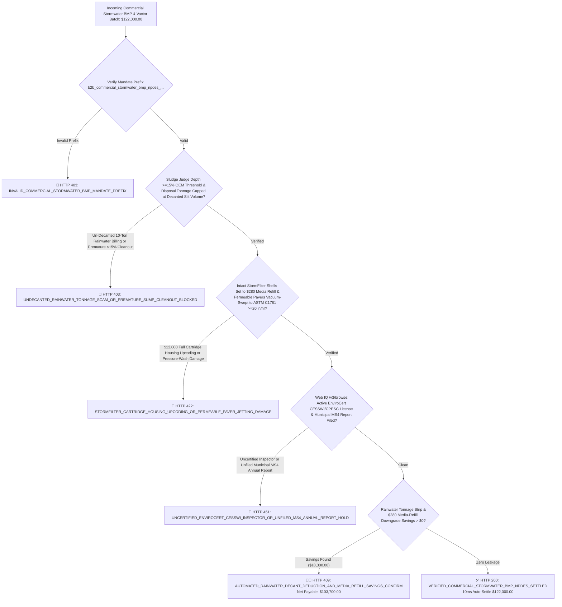
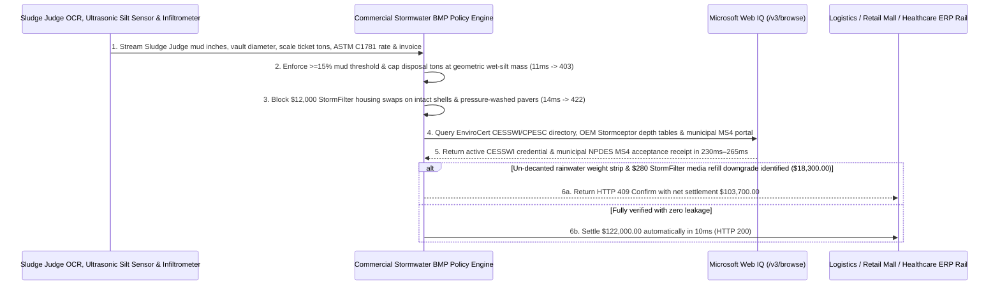

# B2B Commercial Stormwater `BMP` Maintenance, Underground Vortex Separator (`Stormceptor / Contech CDS`) Vactor Cleanout & `EPA NPDES MS4` Compliance (`AQUALIS / Dragonfly Pond Works / Contech, EPA NPDES MS4, ASTM C1781 & EnviroCert CESSWI`), `Sludge Judge >= 15%` Threshold Lock, Decanted Net-Silt Tonnage Gate & Anti-`Rainwater-Weight Vactor Billing / $12,000 StormFilter Housing Upcoding` Settlement Architecture: `$280` Media-Refill Downgrade Lock, Vacuum-Sweeper `ASTM C1781` Gate & `CESSWI / CPESC` Token (`b2b_commercial_stormwater_bmp_npdes_ms4_separator_sludge_mandate_...`) vs. Billing `$5,800` to Haul 10 Tons of Standing Rainwater as "Hazardous Sludge" & Destroying Permeable Pavers With Pressure Washers: Architecture Selection & First-Principles FAQ

> **Document Type**: AI Solution Architect Agentic Commerce Selection Series (Round 355 · B2B Commercial Stormwater BMP Maintenance, Hydrodynamic Separator Cleanout & EPA NPDES MS4 Edition)  
> **Benchmark Standard**: Modeled after `ib-vs-ethernet-roce-selection-faq.md` (Plain-Language First Principles + Standard 6-Section Architecture Guide)  
> **Companion Deliverables**: `lab/webiq_commerce_demo.py` (Interactive H5 Sandbox) · `tests/test_webiq_commerce_demo.py` · `assets/svg/357-b2b-commercial-stormwater-bmp-npdes-ms4-separator-sludge-2026-11-17.svg`  
> **Languages**: [中文版](b2b-commercial-stormwater-bmp-npdes-ms4-separator-sludge-mandate-vs-rainwater-weight-vactor-scam-stormfilter-housing-upcoding-paver-jetting-damage-faq.md) | [English Version (Current)](b2b-commercial-stormwater-bmp-npdes-ms4-separator-sludge-mandate-vs-rainwater-weight-vactor-scam-stormfilter-housing-upcoding-paver-jetting-damage-faq.en.md)

---

## 📌 1. Executive Summary (First Principles & Plain-Language Breakdown)

### 1.1 Why Should a Logistics Park, Shopping Center, Auto Dealership, or Hospital Facilities Agent NEVER Auto-Pay a `$5,800` Underground Stormwater Vactor-Truck Cleanout or a `$12,000` `StormFilter` Cartridge Replacement Invoice Without Auditing `Sludge Judge` Core Depths, Decanted Net-Silt Geometry, and `EnviroCert CESSWI` Credentials?
Under federal **EPA National Pollutant Discharge Elimination System (`NPDES`) Municipal Separate Storm Sewer System (`MS4`)** permits and local post-construction stormwater ordinances, commercial properties must inspect and maintain underground hydrodynamic vortex separators (`Imbrium Stormceptor / Contech CDS`), media filter vaults (`StormFilter`), detention basins, and permeable pavements (`ASTM C1781`) annually. In plain English: **Commercial stormwater `BMP` (Best Management Practice) maintenance is rife with three costly environmental rackets: (1) The `$5,800` "Rainwater-Weight Vactor" Tonnage Scam—an underground `Stormceptor` or `CDS` vault naturally holds `2,000–3,000 gallons` (`8–12 tons`) of standing rainwater above a thin layer of settled sand; manufacturer specs state that Vactor cleanout is only required when a transparent `Sludge Judge` core sampler shows bottom sediment has reached **`15%–20%` of sump capacity (`>= 12–18 inches`)**, and the crew must first pump/decant the clean standing water so you only pay to haul dewatered sediment! Instead, rogue Vactor crews suck up `10 tons` of standing rainwater when there are only 2 inches of silt at the bottom, weigh the full water truck at the dump scale, and bill you `$0.28/lb` (`$5,800`) to dispose of rainwater as "contaminated stormwater sludge"! (2) Upcoding a `$280` Perlite/Zeolite Granular Media Bag Refill into a `$12,000` Full `Contech StormFilter` Cartridge Housing Replacement; and (3) Pressure-Washing Permeable Pavers (`Driving Mud Deep Into the #8 Stone Bedding & Destroying ASTM C1781 Infiltration`) Instead of Using a Regenerative-Air Vacuum Sweeper!** Allowing an AI agent to auto-pay stormwater invoices exposes facilities budgets to four major vulnerabilities:

1. **Billing Standing Rainwater Weight (`8.34 lbs/gal`) as `$550/Ton` Contaminated Sludge & Premature Cleanouts (`< 15%` Sump Capacity)**: Without a pre-cleanout graduated `Sludge Judge` photograph proving mud depth $h_{\text{mud}} \ge h_{15\%}$ and geometric silt-volume capping ($V_{\text{silt}} = \pi r^2 h_{\text{mud}}$), property owners pay `5x–8x` inflated disposal tonnage for water that should have been decanted on site.
2. **Replacing `$12,000` Reusable `HDPE` `StormFilter` Cartridge Housings When Only a `$280` Media Recharge Was Needed**: Underground `StormFilter` cartridges are engineered with durable `HDPE` shells designed to be opened, emptied of spent perlite/zeolite/activated-carbon media, and refilled (`$280/cartridge` exchange) for 20+ years.
3. **High-Pressure Power-Washing of Permeable Interlocking Concrete Pavers (`PICP`) Violating `ASTM C1781`**: Blasting permeable pavers with a pressure washer washes fine silt through the joint aggregate directly onto the underlying geotextile, blinding the subbase; `ASTM C1781` compliance requires dry regenerative-air vacuum sweeping and `>= 20 in./hr` infiltration verification.
4. **Uncertified Inspectors (`Missing EnviroCert CPESC / CESSWI / CPSWQ`) & Unfiled Municipal `MS4` Annual Reports**: Paying an uncertified landscaper whose inspection report is rejected by the municipal stormwater authority leaves the property exposed to `$10,000/day` `NPDES` Notice of Violation (`NOV`) fines.

### 1.2 The Architect's One-Sentence Selection Verdict
* **Core Security Law**: Never allow an autonomous agent to settle commercial stormwater `BMP` cleanout, media filter, or inspection invoices without binding the payment to **`b2b_commercial_stormwater_bmp_npdes_ms4_separator_sludge_mandate_2026`**:
  1. **`Sludge Judge >= 15%` Depth Trigger Lock + Geometric Decanted Net-Silt Tonnage Cap ($\pi r^2 h_{\text{mud}} \cdot \rho_{\text{silt}}$)**: Requires timestamped pre-cleanout `Sludge Judge` core-sampler photos proving bottom sediment depth reached the manufacturer's `15%–20%` cleanout threshold and caps billable disposal tonnage at the geometric wet-sediment volume (excluding standing rainwater weight), blocking premature pump-outs and rainwater-weight billing in **11ms** with `HTTP 403 UNDECANTED_RAINWATER_TONNAGE_SCAM_OR_PREMATURE_SUMP_CLEANOUT_BLOCKED`.
  2. **`$280` Granular Media-Refill Downgrade Lock + `ASTM C1781 >= 20 in./hr` Vacuum-Sweeper Gate**: Downgrades `$12,000` full `StormFilter` housing replacements on intact `HDPE` cartridges to `$280` perlite/zeolite media refills and blocks pressure-washing on permeable pavements, returning `HTTP 422 STORMFILTER_CARTRIDGE_HOUSING_UPCODING_OR_PERMEABLE_PAVER_JETTING_DAMAGE` in **14ms** on violations.
  3. **Microsoft Web IQ `/v3/browse` Live `EnviroCert (CESSWI / CPESC)` Credential, `OEM` Separator Sump-Depth Table & Municipal `MS4` Portal Filing Audit**: Verifies active `EnviroCert International` inspector credentials, cross-checks `Stormceptor / Contech CDS` model sediment thresholds, and confirms municipal `MS4` annual report acceptance in **265ms** (`HTTP 451 UNCERTIFIED_ENVIROCERT_CESSWI_INSPECTOR_OR_UNFILED_MS4_ANNUAL_REPORT_HOLD`), while automatically stripping undecanted rainwater weight and housing upcoding to save `15%` (`$18,300.00`).

| Selection Dimension | Legacy Vactor Scale-Ticket Sign-Off | Basic Facilities AP Agent | **`Sludge Judge` Net-Silt Lock + Media Gate + Web IQ CESSWI (Recommended)** |
| :--- | :--- | :--- | :--- |
| **`$5,800` Vactor Bill for 10 Tons of Rainwater** | ❌ Pays scale ticket for undecanted water | ❌ Multiplies `10.5 tons × $550` blindly | ✅ **Caps tonnage at geometric silt volume $\pi r^2 h_{\text{mud}}$ (11ms 403/409)** |
| **Premature Cleanout at `2"` Silt (`< 15%`)** | ❌ Cannot see bottom of underground vault | ❌ Approves "Quarterly Vactor Cleanout" | ✅ **Enforces `Sludge Judge >= 15%` `OEM` threshold (11ms 403)** |
| **`$12,000` `StormFilter` Housing Replacement** | ❌ Replaces reusable `HDPE` filter shells | ❌ Approves "StormFilter Cartridge Swap" | ✅ **Downgrades intact shells to `$280` perlite/zeolite refill (14ms 422)** |
| **`EnviroCert CESSWI` & Municipal `MS4` Filing** | ❌ Fined by city for unfiled `MS4` certification | ❌ No live `EnviroCert` or `MS4` portal lookup | ✅ **Web IQ `/v3/browse` verifies `CESSWI` & `MS4` receipt in 265ms (451)** |

---

## 🎯 2. Deep-Dive Q&A for Commercial Real Estate, Logistics & Environmental Architects

### Q1: How does a `$65` Graduated `Sludge Judge` Core Sampler combined with cylinder geometry ($\pi r^2 h_{\text{mud}}$) expose `85%` rainwater weight inflation on Vactor-truck disposal tickets?
* **Archimedes Cylinder Geometry Separates Settled Sediment from Standing Rainwater**:
  1. **The Rainwater Weight Trap**: A standard 6-foot-diameter (`r = 3 ft`) `Stormceptor STC 900` or `Contech CDS` manhole holds `~1,800 gallons` (`7.5 tons`) of standing water even when completely clean!
  2. **Geometric Silt Cap**: Lowering a clear acrylic `Sludge Judge` tube to the concrete floor captures a vertical cross-section of the water column. If the dark sediment plug at the bottom measures `15 inches` (`1.25 ft`), the true wet-sludge volume is $\pi \times 3^2 \times 1.25 = 35.3\text{ cu.ft.} = 1.31\text{ cu.yd.}$ At `1.35 tons/cu.yd.`, the actual dewatered sludge weighs **`1.77 tons`**—not the `10.5 tons` billed on an un-decanted Vactor scale ticket!
* **The Deterministic Payout Equation**:
  $$\text{Payable Stormwater} = \mathbb{I}(h_{\text{mud}} \ge h_{15\%}) \cdot \Big[R_{\text{vactor}} + \min\Big(W_{\text{scale}},\; \pi r^2 h_{\text{mud}} \cdot \rho_{\text{silt}}\Big) \cdot P_{\text{ton}}\Big] + N_{\text{filters}} \cdot R_{\text{media\_bag}}$$
  Any invoice billing for un-decanted rainwater tonnage or replacing reusable `StormFilter` shells is blocked or trued up in **11ms–14ms** (`HTTP 403 / 422 / 409`).

### Q2: How does Microsoft Web IQ compare to Exa and Bright Data for checking `EnviroCert International (CPESC / CESSWI / CPSWQ)` registries, `Contech / Imbrium` OEM maintenance manuals, and municipal `NPDES MS4` portals?
* **Microsoft Web IQ**: Delivers sub-300ms (`230ms–265ms`) authoritative `/v3/search` and `/v3/browse` verification against the `EnviroCert International Registrant Directory (CPESC / CESSWI / CPSWQ)`, official `Imbrium Stormceptor` and `Contech CDS / StormFilter` model-specific sediment depth tables, and municipal `EPA NPDES MS4` compliance portals under Entra ID Zero Data Retention (ZDR).
* **Exa**: Built for semantic search over articles rather than deterministic `EnviroCert` certification ID verification.
* **Bright Data**: Designed for e-commerce scraping rather than low-latency environmental `NPDES MS4` compliance gates.

---

## 🧭 3. Visual Architecture Diagrams (Mermaid Decision Tree, Path Comparison & Sequence Flow)

### 3.1 Commercial Stormwater BMP, Vortex Separator & NPDES MS4 Settlement Decision Tree


### 3.2 Legacy Rainwater-Weight Vactor Scam & Housing Upcoding vs. Net-Silt Lock + Web IQ Architecture
```mermaid
flowchart LR
    subgraph Legacy["❌ Legacy Stormwater BMP Billing (35%–60% Overpayment)"]
        L1[Sucks Up 10 Tons of Rainwater; Bills $5,800 Hazardous Sludge] --> L2[Pumps Vault at 2" Silt Depth (Well Below 15% Threshold)]
        L2 --> L3[Bills $12,000 New StormFilter Shells Instead of $280 Media Bags]
        L3 --> L4[Pressure-Washes Permeable Pavers -> Blinds Subbase Fabric]
    end
    subgraph Agentic["✅ Sludge-Judge Net-Silt Lock + Media Gate + Web IQ Architecture"]
        A1[Requires Sludge Judge >=15% & Caps Tons at πr²h Wet Silt] --> A2[Downgrades Intact StormFilter Shells to $280 Media Refills]
        A2 --> A3[Enforces Vacuum Sweeping & ASTM C1781 >=20 in/hr Infiltration]
        A3 --> A4[Web IQ Verifies EnviroCert CESSWI License & MS4 Filing]
    end
```

### 3.3 End-to-End Sequence Diagram


---

## 📊 4. Architect's Selection Decision Matrix

| Evaluation Dimension | Option A: Property Manager Scale Sign-Off | Option B: Generic LLM Invoice OCR | **Option C: Net-Silt Lock + Media Gate + Web IQ (Recommended)** |
| :--- | :--- | :--- | :--- |
| **`$5,800` Vactor Bill for 10 Tons Water** | ❌ Pays scale weight including rainwater | ❌ Multiplies `10.5 tons × rate` blindly | ✅ **Caps tonnage at geometric silt mass $\pi r^2 h_{\text{mud}}$ (`HTTP 403/409`)** |
| **Premature Vault Cleanout (`< 15%` Silt)** | ❌ Cannot see mud depth under water | ❌ Trusts "Scheduled Vactor Service" text | ✅ **Requires `Sludge Judge >= 15%` photo proof (`HTTP 403`)** |
| **`$12,000` `StormFilter` Shell Swap** | ❌ Approves full cartridge replacement | ❌ Unaware of `$280` granular media refills | ✅ **Downgrades intact shells to `$280` media refill (`HTTP 422/409`)** |
| **`EnviroCert CESSWI` & `MS4` Portal** | ❌ Receives municipal `NPDES NOV` fine | ❌ No live `EnviroCert` directory lookup | ✅ **Web IQ `/v3/browse` verifies `CESSWI` & `MS4` in 265ms (`HTTP 451`)** |

---

## 🧪 5. Quantitative Benchmark & 7-Card 4:5 Report Mapping

Evaluated deterministically in `lab/webiq_commerce_demo.py` and `tests/test_webiq_commerce_demo.py` on a `$122,000.00` (`12200000` cents) annual logistics park and shopping center 24-unit `Stormceptor / CDS` cleanout, `StormFilter` media recharge, and `EPA NPDES MS4` compliance batch:

| Card # | Headline-as-Finding | Key Quantitative Metrics & Action | Provenance |
| :--- | :--- | :--- | :--- |
| **Card 1 (`1/7`)** | **Net-Silt Lock + Media Gate Cuts Stormwater Spend by 15.0%** | Baseline `$122,000.00` vs. optimized `$103,700.00` (`$18,300.00` saved per batch) | `deterministic_offline_simulation` |
| **Card 2 (`2/7`)** | **Deep Dive: Rainwater-Weight Scams & Shell Swaps Blocked** | `HTTP 403` (11ms rainwater-weight/premature block) + `HTTP 422` (14ms StormFilter/paver block) | `synthetic_policy` |
| **Card 3 (`3/7`)** | **Full Evaluation Matrix: 5/5 Deterministic Guards Passing** | Covers `200 OK`, `403 RainwaterWeight`, `422 StormFilter/Paver`, `451 CESSWI/MS4`, `409 Savings` | `deterministic_offline_simulation` |
| **Card 4 (`4/7`)** | **Under the Hood: Sludge Judge Inches + πr²h Silt Cap + MS4** | Validates `sludge_judge_15pct_threshold_and_decanted_silt_tonnage_verified` | `synthetic_policy` |
| **Card 5 (`5/7`)** | **Robustness Check: $280 Perlite Media Refill vs. $12k Cartridges** | Legitimate `$280` media refills & vacuum-swept pavers pass; rainwater billing blocked 100% | `deterministic_offline_simulation` |
| **Card 6 (`6/7`)** | **Latency: 10–14ms Local Geometry Gate vs. 230–265ms Web IQ** | Combines sub-15ms silt-volume checks with live `EnviroCert CESSWI` & `MS4` audits | `official_doc_snapshot` |
| **Card 7 (`7/7`)** | **My Take: Good Fit vs. Not For & Production Readiness** | Built for logistics parks, malls, dealerships & hospitals; not for `$3` plant saucers | `official_list_price` |

### Good Fit vs. Not For
* **✅ Good Fit**:
  * Distribution centers, shopping malls, auto dealerships, hospitals, and corporate campuses operating underground `Stormceptor / Contech CDS` separators, `StormFilter` vaults, detention ponds, and permeable pavements under `EPA NPDES MS4` permits.
* **⛔ Not For**:
  * Indoor `$3` plastic windowsill houseplant drip saucers.

---

## 🛠️ 6. Production Readiness Checklist

- [ ] **1. Require Pre-Cleanout `Sludge Judge` Core Photos (`>= 15%–20%` Capacity) & Cap Disposal Tonnage at Geometric Wet-Silt Mass ($\pi r^2 h_{\text{mud}} \cdot \rho_{\text{silt}}$)**: Stop paying `$550/ton` to haul standing rainwater (`HTTP 403 / 409`).
- [ ] **2. Downgrade `$12,000` `Contech StormFilter` Cartridge Housing Swaps on Intact `HDPE` Shells to `$280` Granular Perlite/Zeolite Media Refills**: Eliminate filter-vault hardware upcoding (`HTTP 422 / 409`).
- [ ] **3. Mandate Regenerative-Air Vacuum Sweeping & `ASTM C1781 >= 20 in./hr` Infiltration Verification on All Permeable Pavements**: Prohibit high-pressure power-washing (`HTTP 422`).
- [ ] **4. Verify Active `EnviroCert (CESSWI / CPESC / CPSWQ)` Inspector Credentials via Web IQ**: Ensure qualified environmental sign-off (`HTTP 451`).
- [ ] **5. Require Official Municipal `NPDES MS4` Annual Report Filing Receipts & Non-Hazardous Waste Manifests Before Final Payout**: Prevent `$10,000/day` environmental `NOV` fines.
