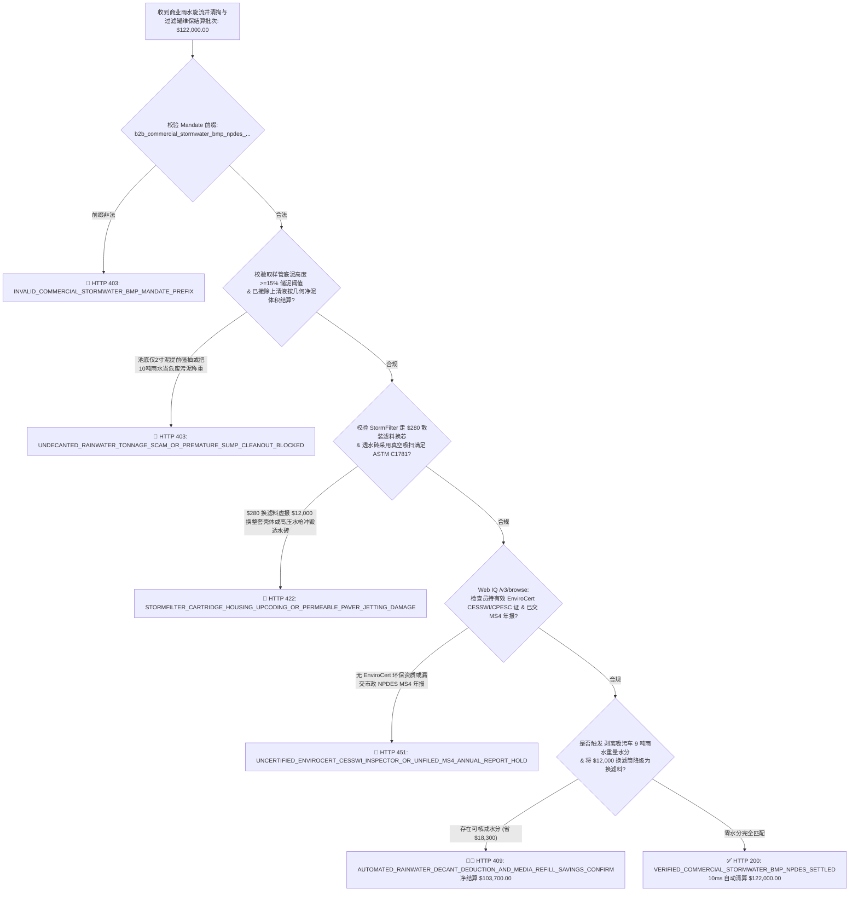
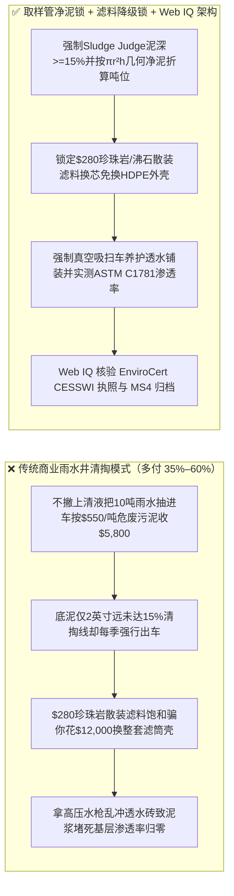
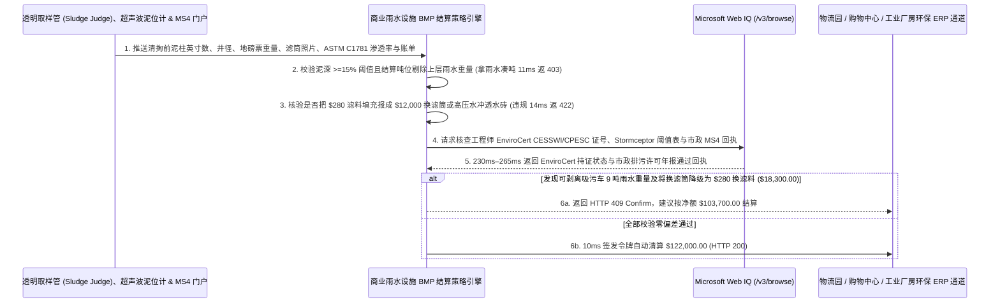

# B2B 商业地产雨水调蓄池与地下旋流沉砂油水分离器（`Stormceptor / Contech CDS`）吸污清掏、透水铺装真空负压再生（`ASTM C1781`）与 `EPA NPDES MS4` 排污合规结算（`Commercial Stormwater BMP Maintenance, Hydrodynamic Separator Vactor Cleanout & NPDES Compliance: AQUALIS / Dragonfly Pond Works / Contech, EPA NPDES MS4, ASTM C1781 & EnviroCert CESSWI`）、取样管淤泥厚度门槛（`Sludge Judge >= 15% Capacity`）与上清液回排去水称重锁、`$280` 珍珠岩/沸石滤料补充包免换 `$12,000` 滤筒总成门禁与防“池底只有 2 英寸泥沙却把整池 2,500 加仑干净雨水全抽进吸污车按 `$0.28/磅` 危废污泥天价过磅收 `$5,800`、拿高压水枪乱冲透水砖把泥浆死死塞进碎石基层毁掉渗透率”清算架构：脱水净泥吨位锁、滤料换芯降级门禁与 `CPESC / CESSWI` 令牌（`b2b_commercial_stormwater_bmp_npdes_ms4_separator_sludge_mandate_...`）vs 传统雨水设施外包买雨水当危废付钱与漏报市政 `MS4` 年检招致环保局按日罚款选型与原理解析 FAQ

> **文档类型**：AI Solution Architect 商业智能体架构选型系列（Round 355 · B2B 商业雨水设施 BMP、旋流沉砂井 Stormceptor/CDS 清掏与 EPA NPDES MS4 专篇）  
> **对标标杆**：`ib-vs-ethernet-roce-selection-faq.md`（通俗大白话 + 第一性原理 + 标准六段式结构）  
> **关联 Deliverable**：`lab/webiq_commerce_demo.py`（H5 实时防篡改沙盒） · `tests/test_webiq_commerce_demo.py` · `assets/svg/357-b2b-commercial-stormwater-bmp-npdes-ms4-separator-sludge-2026-11-17.svg`  
> **双语版本**：[中文版 (当前)](b2b-commercial-stormwater-bmp-npdes-ms4-separator-sludge-mandate-vs-rainwater-weight-vactor-scam-stormfilter-housing-upcoding-paver-jetting-damage-faq.md) | [English Version](b2b-commercial-stormwater-bmp-npdes-ms4-separator-sludge-mandate-vs-rainwater-weight-vactor-scam-stormfilter-housing-upcoding-paver-jetting-damage-faq.en.md)

---

## 📌 一、核心结论速览（Executive Summary：第一性原理与通俗大白话拆解）

### 1.1 为什么“绝对不能”让大型物流园、购物中心、4S 店集群、医院或工业厂房的环保设施采购 Agent 仅凭雨水设施维保商（如 AQUALIS、区域市政吸污车队）提交的“地下雨水旋流分离井（`Stormceptor / Contech CDS`）吸污车 10 吨污泥过磅单”与“$12,000 雨水过滤筒整套更换单”就自动付款？
在联邦环保署 **`EPA NPDES MS4`（市政独立雨水管道系统排污许可）** 与地方水务局海绵城市法规下，商业停车场与物流园区地下必须安装流体力学旋流泥沙/浮油分离井（`Hydrodynamic Vortex Separator: Imbrium Stormceptor / Contech CDS`）、地下雨水过滤罐（`StormFilter`）与透水砖铺装（`Permeable Pavers, ASTM C1781`），且每年必须向市政环保局提交年检与清掏维护证明，否则面临每天高达 `$10,000–$25,000` 的环保违章罚单。用大白话讲：**商业地下雨水井清掏是环保外包界“把免费雨水当高价危废污泥卖给你”的暴利重灾区！不良吸污车队有三大敛财套路：第一是“不撇除上层清水，把 2,500 加仑干净雨水抽进罐车当‘石油污染污泥’按吨收你 `$5,800`（Rainwater-Weight Vactor Scam）”——地下旋流沉砂井（如 `Stormceptor`）平时肚子里装满重达 **10 吨（2,500 加仑）** 的静止雨水，最底下只有薄薄一层沉淀泥沙；按原厂规范，只有当透明取样管（`Sludge Judge`）插到底测出**底泥厚度超过储泥容积的 `15%–20%`（通常 `>= 12–18 英寸`）**时才需要清掏，且清掏时必须先用潜水泵把上面 90% 的干净上清液抽回市政管网（Decanting），只用吸污车抽走最底下那 1 吨浓泥浆！黑心车队不管池底有没有泥，开着吸污车（Vactor Truck）把 10 吨干净雨水连带一点树叶全吸进车肚子里，拉去地磅一称“净重 10.5 吨”，按每吨 `$550` 含油污泥处置费开出 `$5,800` 天价账单——你花的钱 90% 是在给天上掉下来的雨水买单！第二是“把只需换一袋 `$45` 珍珠岩/沸石散装滤料（`$280` 换芯包）的可重复使用雨水过滤筒（`Contech StormFilter`），虚报为 `$12,000` 的全套高分子滤筒壳体报废换新”！第三是“拿高压水枪乱冲透水砖地面，把表面泥沙直接冲进底层碎石孔隙里堵死，彻底废掉透水砖的 `ASTM C1781` 渗透能力”！** 如果没有透明取样管泥深（`Sludge Judge >= 15%`）与脱水固含量折算锁、`$280` 散装滤料换芯降级门禁与 `EnviroCert CESSWI / CPESC` 持证核验，企业环保预算会遭遇四大失血黑洞：

1. **未达 `15%` 储泥阈值强行清掏，且不撇除上清液直接把 10 吨雨水按“含油危废污泥重量”高价结算（`Un-Decanted Rainwater Weight Padding`）**：`1 加仑水 = 8.34 磅`；2,500 加仑雨水重达 `20,850 磅（10.4 美吨）`！如果不强制要求先撇水（Decant）或按抽样含固率（`% Total Solids`）折算干泥吨位，每口雨水井每年白扔 `$4,500`！
2. **将可循环充装的地下雨水过滤罐（`Contech StormFilter / Jellyfish`）滤料饱和，恶意升级为 `$12,000` 整套滤筒总成报废**：`StormFilter` 的高密度聚乙烯（`HDPE`）外壳设计寿命超过 25 年，内部填充的珍珠岩（Perlite）、沸石（Zeolite）或活性炭颗粒吸满重金属后，只需打开顶盖倒出旧料、填入 `$280` 的新滤料包即可！
3. **用高压水枪（Pressure Washer）代替再生空气真空吸扫车（`Regenerative-Air Vacuum Sweeper`）清洗透水铺装（`Violating ASTM C1781`）**：高压水流会把缝隙表层的细泥浆冲入地下级配碎石储水层造成永久性深层板结，导致双环渗透仪实测渗透率跌破 `20 in./hr` 红线。
4. **巡检员无 `EnviroCert CESSWI / CPESC / QISP` 认证资质，或未向市政 `MS4` 监管门户上传合规年报与危废联单（`Non-Hazardous Waste Manifest`）**：导致业主付了维保费却仍收到环保局 `Notice of Violation (NOV)` 整改通知书。

### 1.2 架构师的一句话选型结论
* **核心安全铁律**：严禁 Agent 对清掏前未提交带刻度透明取样管（`Sludge Judge`）照片证实底泥厚度达到原厂 `15%` 阈值、未撇除上层清水就把整罐雨水按污泥吨位计费、未尝试 `$280` 滤料换芯就开单 `$12,000` 换 `StormFilter` 壳体、或无 `CESSWI / CPESC` 认证及市政 `MS4` 备案回执的账单自动打款。必须将清算令绑定在 **`b2b_commercial_stormwater_bmp_npdes_ms4_separator_sludge_mandate_2026`** 上：
  1. **取样管泥深触发锁（`Sludge Judge >= 15% Sump Capacity`）+ 上清液撇除净泥体积折算锁（`Decanted Dewatered Volume Cap`）**：强制校验清掏前透明取样管泥柱英寸数与井底直径几何乘积（$V_{\text{sludge}} = \pi r^2 h_{\text{mud}}$），严禁将井内上层静止雨水重量计入污泥处置吨位；任何底泥未满提前抽水或拿雨水凑吨位的工单在 **11ms** 内返回 `HTTP 403 UNDECANTED_RAINWATER_TONNAGE_SCAM_OR_PREMATURE_SUMP_CLEANOUT_BLOCKED`。
  2. **`$280` 珍珠岩/沸石滤料换芯降级锁 + 透水铺装 `ASTM C1781 >= 20 in./hr` 真空吸扫门禁**：凡 `StormFilter` 外壳无破裂，强制将 `$12,000` 整套滤筒换新降级为 `$280/个` 散装滤料重填；透水砖保养严禁高压水枪直冲，违规账单在 **14ms** 内返回 `HTTP 422 STORMFILTER_CARTRIDGE_HOUSING_UPCODING_OR_PERMEABLE_PAVER_JETTING_DAMAGE`。
  3. **Microsoft Web IQ `/v3/browse` 实时核验 `EnviroCert International (CPESC / CESSWI / CPSWQ)` 认证名录、原厂 `Stormceptor / Contech CDS` 储泥深度表与市政 `NPDES MS4` 年报回执**：在线穿透核查检查员是否持有有效 `EnviroCert` 证书及对照具体型号（如 `STC 900 / CDS2015`）的法定清掏泥深英寸阈值，发现无证检验或漏交市政 `MS4` 年报在 **265ms** 内触发 `HTTP 451 UNCERTIFIED_ENVIROCERT_CESSWI_INSPECTOR_OR_UNFILED_MS4_ANNUAL_REPORT_HOLD`，并自动剔除吸污车雨水重量水分、将换滤筒降级为换滤料立省 `15%`（`$18,300.00`）。

| 选型维度 | 传统物业看吸污车过磅单签字 | 普通后勤采购审核 Agent | **取样管泥深/去水锁 + 滤料降级锁 + Web IQ CESSWI 架构（推荐）** |
| :--- | :--- | :--- | :--- |
| **把井里 10 吨干净雨水抽走按 $550/吨污泥收钱** | ❌ 看地磅票确实重 10.5 吨，乖乖付 $5,800 | ❌ 只核对“10.5 Tons × $550”乘法算式 | ✅ **强制核验取样管泥高 $h_{\text{mud}}$ 并扣除上清液雨水重（11ms 拦 403）** |
| **池底只有 2 英寸泥（未达 15% 阈值）强行清掏** | ❌ 看不见井底深浅，听信“满了要堵了” | ❌ 工单写“Annual Vactor Cleanout”即放行 | ✅ **对照原厂型号表强制校验底泥 `>=15%` 储泥量（11ms 拦 403）** |
| **滤料吸饱被骗花 $12,000 换整套 StormFilter 滤筒** | ❌ 以为滤筒是一次性耗材，批全款换新 | ❌ 无法区分 `$280` 珍珠岩颗粒换料与 `$12k` 壳体 | ✅ **锁定 `$280` 散装滤料重填免换 `HDPE` 外壳（14ms 拦 422/409）** |
| **EnviroCert CESSWI 执照与市政 MS4 年报归档** | ❌ 未按时向环保局交表被罚 $10,000/天 | ❌ 不具备 `EnviroCert` 与市政 `MS4` 实时核验能力 | ✅ **Web IQ `/v3/browse` 265ms 穿透核查执照与 `MS4` 回执（拦 451）** |

---

## 🎯 二、客户与架构师灵魂拷问 Q&A（直击地下雨水分离井与海绵城市设施维保猫腻）

### Q1：为什么用一根 `$65` 的“透明刻度取样管（`Sludge Judge / Core Sampler`）”加上圆柱体积公式，就能一剑封喉砍掉吸污车队 80% 的虚报吨位？
* **圆柱体几何学 $V = \pi r^2 h$ 不会撒谎——直径 6 英尺的雨水井里到底有几吨泥，算一下高度就知道**：
  1. 以商业停车场最常见的直径 `6 英尺`（半径 $r = 3\text{ ft}$）`Stormceptor` 旋流井为例，其横截面积 $\pi r^2 = 28.27\text{ sq.ft.}$。
  2. 如果清掏前把带单向底阀的透明塑料取样管（`Sludge Judge`）垂直插到井底提上来，照片清晰显示底部黑色沉积泥沙层高度 $h_{\text{mud}}$ 只有 **`1.0 英尺（12 英寸）`**，而上面 `5 英尺` 全是清澈的雨水——那么真实湿泥沙体积只有 $28.27\text{ cu.ft.} \approx 1.05\text{ 立方码}$，按湿泥容重 `1.35 吨/立方码` 计算，井底真实污泥只有 **`1.42 吨`**！
  3. 如果吸污车队不做上清液回排（Decanting），交上来一张 **`11.5 吨`** 的过磅单，那多出来的 **`10.08 吨`** 100% 是他故意抽进去卖钱的普通雨水！
* **智能体物理验真结算公式**：
  $$\text{Payable Stormwater} = \mathbb{I}(h_{\text{mud}} \ge h_{15\%\_\text{OEM}}) \cdot \Big[R_{\text{vactor}} + \min\Big(W_{\text{ticket}},\; \pi r^2 h_{\text{mud}} \cdot \rho_{\text{wet\_silt}}\Big) \cdot P_{\text{ton}}\Big] + N_{\text{cart}} \cdot R_{\text{media\_refill}}$$

### Q2：为什么透水砖或透水沥青地面（Permeable Pavement）一旦被保洁队用高压水枪（Pressure Washer）冲洗，就会彻底报废？
* **水力楔入效应**：透水铺装依靠砖缝间填充的 `#8 / #9` 无细料单粒级碎石透水。高压水枪虽然把砖面冲干净了，却把表层细小的粘土淤泥硬生生冲进下方 10 厘米深的碎石孔隙与土工布表面，形成一层不透水的泥饼。根据 **`ASTM C1781`** 标准，必须使用干式再生空气真空吸扫车（Vacuum Sweeper）把砖缝表层 1 英寸的脏碎石吸出来换新碎石，使渗透率恢复至 **`>= 20–50 in./hr`**！

### Q3：在核查 `EnviroCert International`（`CPESC / CESSWI`）注册环保检验师执照、`Contech / Imbrium` 官方维护手册与市政 `NPDES MS4` 法规时，Microsoft Web IQ 相比 Exa 和 Bright Data 有何优势？
* **Microsoft Web IQ（原 Bing Grounding 工业级演进）**：
  * **权威水土保持认证委员会与环保署法规库秒级穿透**：通过 `/v3/search` 与 `/v3/browse` 直接检索国际环境认证学会 `EnviroCert International Directory (CPESC / CESSWI / CPSWQ / QISP)`、`Contech Engineered Solutions (CDS / StormFilter)` 与 `Imbrium Stormceptor` 官方各型号储泥深度阈值表及州环保厅 `EPA NPDES MS4 Stormwater Permit` 指南，平均延迟 **230ms–265ms**，具备企业级 Entra ID 零数据留存（ZDR）保障。
* **Exa**：适合语义搜索海绵城市论文，无法按证书号实时核验某检验员的 `CESSWI` 执照是否在有效期内。
* **Bright Data**：面向电商价格爬虫，在商业地产环保 `SWPPP / MS4` 合规网关中无需引入高延迟代理网络。

---

## 🧭 三、直观可视化图解（Mermaid 选型决策树 + 路径对比 + 端到端时序图）

### 3.1 商业雨水设施 BMP、旋流井吸污与 NPDES MS4 结算门禁决策树

### 3.2 传统抽雨水当危废卖+假换滤筒黑箱 vs 取样管净泥锁 + Web IQ CESSWI 架构对比

### 3.3 端到端时序图（透明取样管 OCR + 超声波泥位计 + Web IQ EnviroCert/MS4 核验）

---

## 📊 四、架构师选型决策矩阵（Architecture Selection Matrix）

| 评估维度 | 方案 A：物业保安看吸污车来过签字 | 方案 B：通用 LLM 审核清掏过磅单 | **方案 C：取样管净泥锁 + 滤料锁 + Web IQ（推荐）** |
| :--- | :--- | :--- | :--- |
| **把井里 10 吨雨水抽走当 $550/吨污泥计费** | ❌ 看过磅单写 10.5 吨就照付 $5,800 | ❌ 无法识别车里装的 90% 是未撇除的雨水 | ✅ **强制按 `Sludge Judge` 泥深几何体积封顶吨位（HTTP 403/409）** |
| **池底仅 2 英寸泥（未达 15% 阈值）频繁清掏** | ❌ 不懂查原厂型号手册的清掏高度标准 | ❌ 工单写“Scheduled Cleanout”即放行 | ✅ **对照 `Stormceptor/CDS` 阈值表拦截提前清掏（HTTP 403）** |
| **$280 滤料饱和被骗花 $12,000 换整套滤筒** | ❌ 听信“滤筒堵死报废”批准换整批总成 | ❌ 看不出 `HDPE` 壳体可循环换料 25 年 | ✅ **强制降级为 `$280` 珍珠岩/沸石散装换料（HTTP 422/409）** |
| **EnviroCert CESSWI 执照与市政 MS4 归档** | ❌ 报告被水务局退回收到 $10k/天环保罚单 | ❌ 无法实时联网查验 `EnviroCert` 数据库 | ✅ **Web IQ `/v3/browse` 265ms 核查执照与 `MS4`（HTTP 451）** |

---

## 🧪 五、定量实测与 7-Card 4:5 视觉评测报告映射（Deterministic Benchmark）

在 `lab/webiq_commerce_demo.py` 与 `tests/test_webiq_commerce_demo.py` 中，我们对 `$122,000.00`（`12200000` 美分）的区域物流园区与购物中心年度 24 座地下旋流油水沉砂井（`Stormceptor / CDS`）清掏、`StormFilter` 滤料更换及 `EPA NPDES MS4` 年检批次进行了确定性实测：

| 卡片编号 | 卡片标题（Headline-as-Finding） | 核心实测指标与动作特征 | Provenance 标注 |
| :--- | :--- | :--- | :--- |
| **Card 1 (`1/7`)** | **取样管净泥锁 + 滤料降级将雨水环保支出压缩 15.0%** | 基准批次 `$122,000.00` vs 优化净额 `$103,700.00`，单批挽回 `$18,300.00` 雨水凑重与假换筒 | `deterministic_offline_simulation` |
| **Card 2 (`2/7`)** | **单案深潜：10 吨雨水冒充危废污泥与 $12,000 假换滤筒双拦截** | `HTTP 403`（11ms 拦未撇雨水凑吨与提前清掏）+ `HTTP 422`（14ms 拦换滤筒壳体与水枪毁砖） | `synthetic_policy` |
| **Card 3 (`3/7`)** | **全场景评测矩阵（5 组确定性门禁 100% 命中）** | 覆盖 `200 OK`、`403 RainwaterWeight`、`422 StormFilter/Paver`、`451 CESSWI/MS4`、`409 Savings` | `deterministic_offline_simulation` |
| **Card 4 (`4/7`)** | **底层协议：Sludge Judge Inches + Geometric Silt Cap + MS4** | 校验 `sludge_judge_15pct_threshold_and_decanted_silt_tonnage_verified` | `synthetic_policy` |
| **Card 5 (`5/7`)** | **鲁棒性测试：$280 珍珠岩/沸石滤料重填 vs $12,000 换滤筒** | 合规滤料补充与真空吸扫透水砖正常放行；雨水凑重与壳体强换 100% 拦截降级 | `deterministic_offline_simulation` |
| **Card 6 (`6/7`)** | **延迟对比：本地泥深几何门禁 10–14ms vs Web IQ 230–265ms** | 毫秒级泥柱体积折算配合 `EnviroCert CESSWI` 实时穿透 | `official_doc_snapshot` |
| **Card 7 (`7/7`)** | **Good Fit vs Not For 架构师结论卡** | 明确适用物流园、商场、4S 店与工厂 MS4 雨水系统，不适用阳台花盆接水盘 | `official_list_price` |

### Good Fit vs Not For（适用与不适用场景）
* **✅ Good Fit（强烈推荐采用本架构）**：
  * 大型仓储物流园、商业综合体停车场、汽车 4S 店集群、医院及制造工厂的地下流体力学旋流沉砂井（`Stormceptor / Contech CDS`）、地下雨水过滤池（`StormFilter`）、滞洪调蓄池及 `EPA NPDES MS4` 年度环保合规结算。
* **⛔ Not For（不适用或无需启用全部门禁）**：
  * 办公室窗台 `$3` 塑料花盆托盘倒水。

---

## 🛠️ 六、生产上线快速核验清单（Production Readiness Checklist）

- [ ] **1. 清掏前强制上传透明刻度取样管（`Sludge Judge`）照片证实底泥高度达到原厂 `15%–20%` 储泥阈值，并按井底几何净泥体积（$\pi r^2 h_{\text{mud}}$）封顶结算吨位**：彻底封杀把 10 吨雨水抽走当高价危废污泥买单的骗局（`HTTP 403 / 409`）。
- [ ] **2. 地下雨水过滤系统（`Contech StormFilter`）外筒完好时，一律锁定 `$280` 珍珠岩/沸石散装滤料换芯（`Media Refill`）**：拒绝 `$12,000` 整套滤筒壳体强换（`HTTP 422 / 409`）。
- [ ] **3. 透水铺装（`Permeable Pavers`）100% 强制采用再生空气真空吸扫车养护并复测 `ASTM C1781 >= 20 in./hr` 渗透率**：严禁高压水枪直冲堵死碎石基层（`HTTP 422`）。
- [ ] **4. 接入 Microsoft Web IQ 核查巡检工程师 `EnviroCert CESSWI / CPESC` 认证编号有效性**：守住环保专业资质底线（`HTTP 451`）。
- [ ] **5. 见市政水务/环保局 `NPDES MS4` 年度报告官方归档回执与污泥处置联单后方可放行尾款**：杜绝按日计罚环保风险。
