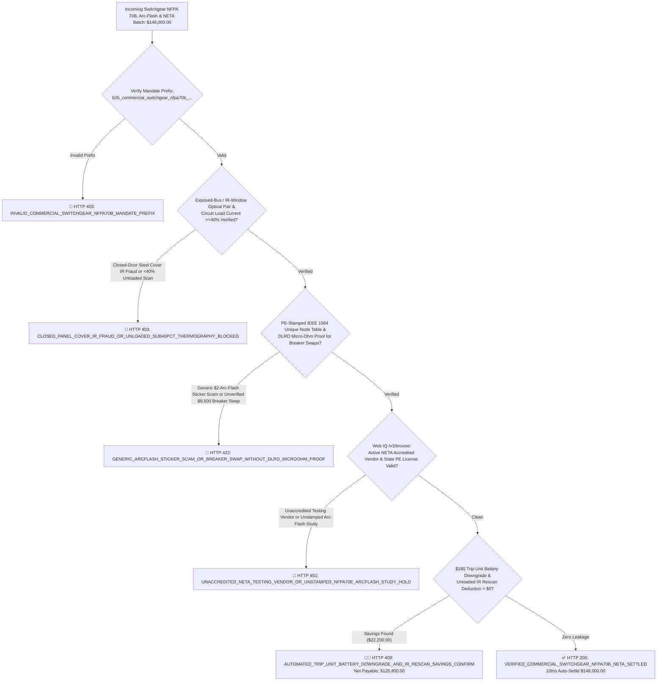
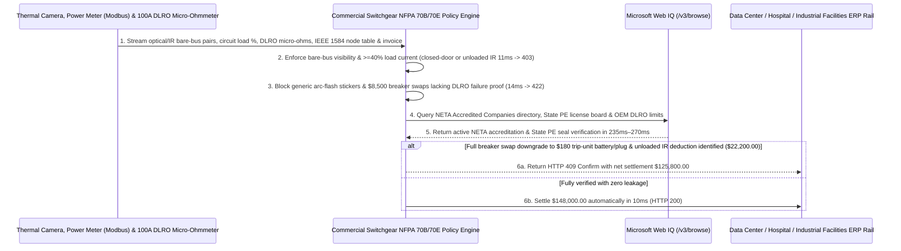

# B2B Commercial Electrical Switchgear Preventative Maintenance (`NFPA 70B-2023`), `IEEE 1584` Arc-Flash Engineering Studies (`NFPA 70E`) & `ANSI/NETA MTS` Breaker Testing (`Schneider Electric / Eaton / Vertiv / Shermco, NFPA 70B, NFPA 70E, IEEE 1584-2018 & NETA MTS`), Exposed-Bus `>= 40%` Load Thermography Lock, `DLRO` Micro-Ohm Gate & Anti-`Generic Arc-Flash Sticker / Breaker Swap Upcoding` Settlement Architecture: `PE`-Stamped `ETAP/SKM` Model Lock, `$180` Trip-Unit Downgrade Gate & `NETA` Token (`b2b_commercial_switchgear_nfpa70b_thermography_nfpa70e_arcflash_neta_mandate_...`) vs. Shooting IR Photos of Closed Steel Panel Doors, `$2` Generic "40 cal/cm²" Sticker Scams & Replacing `$8,500` Air Circuit Breakers for a Dead `$180` Trip Battery: Architecture Selection & First-Principles FAQ

> **Document Type**: AI Solution Architect Agentic Commerce Selection Series (Round 346 · B2B Commercial Electrical Switchgear NFPA 70B Thermography, NFPA 70E / IEEE 1584 Arc-Flash & NETA MTS Edition)  
> **Benchmark Standard**: Modeled after `ib-vs-ethernet-roce-selection-faq.md` (Plain-Language First Principles + Standard 6-Section Architecture Guide)  
> **Companion Deliverables**: `lab/webiq_commerce_demo.py` (Interactive H5 Sandbox) · `tests/test_webiq_commerce_demo.py` · `assets/svg/348-b2b-commercial-switchgear-nfpa70b-nfpa70e-arcflash-neta-2026-11-17.svg`  
> **Languages**: [中文版](b2b-commercial-switchgear-nfpa70b-thermography-nfpa70e-arcflash-neta-mandate-vs-closed-panel-unloaded-ir-scam-generic-arcflash-sticker-breaker-upcoding-faq.md) | [English Version (Current)](b2b-commercial-switchgear-nfpa70b-thermography-nfpa70e-arcflash-neta-mandate-vs-closed-panel-unloaded-ir-scam-generic-arcflash-sticker-breaker-upcoding-faq.en.md)

---

## 📌 1. Executive Summary (First Principles & Plain-Language Breakdown)

### 1.1 Why Should a Data Center, Hospital, Semiconductor Fab, or Commercial High-Rise Facilities Agent NEVER Auto-Pay an `NFPA 70B` Infrared Switchgear Survey, an `NFPA 70E` Arc-Flash Study, or an `$8,500` Breaker Replacement Invoice Without Auditing Load Current (`>= 40%`), `PE`-Stamped `IEEE 1584` Models, and `DLRO` Micro-Ohm Readings?
Since **`NFPA 70B` (Standard for Electrical Equipment Maintenance)** converted from a voluntary recommended practice into a **mandatory national code standard in 2023**—alongside **`NFPA 70E` (5-Year Arc-Flash Risk Assessment Cycle)**, **`IEEE 1584-2018`**, and **`ANSI/NETA MTS`**—commercial switchgear testing is strictly audited by both `OSHA` and FM Global / commercial property insurers. In plain English: **Commercial electrical preventative maintenance (`EPM`) is plagued by three brazen contractor rackets: (1) The "Closed-Steel-Door & Unloaded Sunday-Night" Infrared Scam—infrared thermal cameras cannot see through solid painted sheet steel! Yet rogue contractors walk through electrical rooms taking thermal photos of *closed* steel panelboard covers (without removing deadfronts or looking through crystal `IR Windows`), or scan switchgear at 2:00 AM on Sunday when building load is `< 10%` of rated ampacity (violating the `NETA MTS >= 40%` load rule required to generate $I^2 R$ heat), and bill `$12,000` for an "All-Green `NFPA 70B` Thermal Report"! (2) The `$22,000` Fake "Generic 40 cal/cm² Sticker" Arc-Flash Scam—instead of having a licensed Professional Engineer (`PE`) model utility fault current, transformer impedance, and breaker clearing times in `ETAP / SKM PowerTools` per `IEEE 1584-2018`, a contractor slaps identical `$2` pre-printed "DANGER: >40 CAL/CM²" stickers on 150 panels and bills `$22,000` for an "Arc-Flash Study"! and (3) Billing `$8,500` to Replace a `1,600A` Air/Insulated-Case Circuit Breaker (`Square D MasterPact / Eaton Magnum`) When `DLRO` Contact Resistance Is Perfect and Only a `$180` `MicroLogic` Trip-Unit Battery or Shunt Coil Failed!** Allowing an AI agent to auto-pay electrical testing invoices exposes facilities budgets and uptime to four major vulnerabilities:

1. **Closed-Cover IR Photography & Sub-`40%` Unloaded Thermography (`Violating NFPA 70B Chapter 9 & ANSI/NETA MTS`)**: Long-wave infrared radiation (`8–14 μm`) reflects off opaque metal doors. Valid thermography requires optical + IR paired images of exposed busbars/terminations (via deadfront removal or `UL`-listed `IR Windows`) under **`>= 40%` of rated circuit load**.
2. **Un-Engineered Generic Arc-Flash Stickers Billed as a `$22,000` `IEEE 1584-2018` Coordination & Incident-Energy Study**: `NFPA 70E Article 130.5(H)` forbids generic hazard stickers; every panel label must reflect its unique calculated incident energy (`cal/cm²`), arc-flash boundary, and upstream breaker clearing time signed by a state-licensed `PE`.
3. **Upcoding `$180` Electronic Trip-Unit Batteries, Rating Plugs, or Shunt Coils into `$8,500` Full Circuit-Breaker Replacements**: Without a `100A DC` Digital Low-Resistance Ohmmeter (`DLRO`) test proving main contact resistance ($\mu\Omega$) exceeds manufacturer tolerances or deviates `> 50%` between phases, the breaker frame and contacts are structurally sound.
4. **Unaccredited Testing Crews (`Missing NETA Level III/IV`) & Skipped Transformer Oil Dissolved Gas Analysis (`ASTM D3612 DGA`)**: Operating medium-voltage switchgear without certified `NETA` technicians or ignoring acetylene (`C2H2`) arcing gas in liquid-filled transformers invites catastrophic switchgear explosions.

### 1.2 The Architect's One-Sentence Selection Verdict
* **Core Security Law**: Never allow an autonomous agent to settle commercial switchgear maintenance, infrared thermography, or arc-flash study invoices without binding the payment to **`b2b_commercial_switchgear_nfpa70b_thermography_nfpa70e_arcflash_neta_mandate_2026`**:
  1. **Exposed-Busbar Optical/IR Pair Lock + `>= 40%` Rated-Load Current Gate (`NFPA 70B / NETA MTS`)**: Requires every thermal image to include a paired visible-light photo proving direct line-of-sight to bare terminations/busbars (or through an `IR Window`) plus concurrent smart-meter/clamp-ammeter telemetry proving circuit load `>= 40%` of design rating, blocking closed-door and unloaded IR scams in **11ms** with `HTTP 403 CLOSED_PANEL_COVER_IR_FRAUD_OR_UNLOADED_SUB40PCT_THERMOGRAPHY_BLOCKED`.
  2. **`PE`-Stamped `IEEE 1584-2018` Unique-Node Model Lock + `DLRO` Micro-Ohm Breaker-Swap Gate**: Blocks generic copy-pasted arc-flash labels lacking a native `ETAP / SKM / EasyPower` node table and requires `100A DC DLRO` micro-ohm contact-resistance failure proof before approving `$8,500` circuit-breaker replacements (downgrading trip-unit battery/coil faults to `$180–$450` repairs), returning `HTTP 422 GENERIC_ARCFLASH_STICKER_SCAM_OR_BREAKER_SWAP_WITHOUT_DLRO_MICROOHM_PROOF` in **14ms** on violations.
  3. **Microsoft Web IQ `/v3/browse` Live `NETA Accredited Company` Credential, State `PE` License & Breaker Recall Audit**: Verifies active `InterNational Electrical Testing Association (NETA)` accreditation and state Professional Engineer (`PE`) license validity in **270ms** (`HTTP 451 UNACCREDITED_NETA_TESTING_VENDOR_OR_UNSTAMPED_NFPA70E_ARCFLASH_STUDY_HOLD`), while automatically downgrading unnecessary breaker swaps to trip-unit repairs to save `15%` (`$22,200.00`).

| Selection Dimension | Legacy Visual Report Sign-Off | Basic Facilities AP Agent | **Exposed-Bus/`40%` Load Lock + `DLRO / PE` Gate + Web IQ NETA (Recommended)** |
| :--- | :--- | :--- | :--- |
| **Closed-Door or `< 15%` Load IR Scans** | ❌ Sees blue IR photo of steel door; pays `$12k` | ❌ Trusts "NFPA 70B IR Survey" invoice line | ✅ **Requires bare-bus optical/IR pair & `>= 40%` load current (11ms 403)** |
| **`$2` Generic Stickers Billed as `$22k` Study** | ❌ Sees warning stickers on panels; approves bill | ❌ Approves "NFPA 70E Arc-Flash Study" text | ✅ **Requires `PE`-stamped `IEEE 1584` unique node `cal/cm²` table (14ms 422)** |
| **`$8,500` Breaker Swap for `$180` Trip Battery** | ❌ Replaces intact `1,600A MasterPact` breaker | ❌ Cannot audit micro-ohm contact resistance | ✅ **Requires `DLRO` micro-ohm failure proof; downgrades to `$180` kit (14ms 422)** |
| **`NETA` Accreditation & State `PE` License** | ❌ Insurer rejects uncertified report; hikes rate | ❌ No live `NETA` or State `PE` board lookup | ✅ **Web IQ `/v3/browse` verifies `NETA` & `PE` license in 270ms (451)** |

---

## 🎯 2. Deep-Dive Q&A for Data Center, Healthcare & Industrial Power Architects

### Q1: Why do `NFPA 70B` and `ANSI/NETA MTS` require `>= 40%` rated load current and exposed-busbar line of sight for every infrared thermography image?
* **Stefan-Boltzmann Emissivity and $I^2 R$ Joule Heating Govern Electrical Fault Detection**:
  1. **Opaque Metal Reflection**: Painted steel switchgear doors have low infrared transmittance (`0%`) and high reflectivity—meaning an IR camera pointed at a closed panel door is merely photographing the reflection of the technician's own body heat!
  2. **The `40%` Load Law**: Because thermal rise across a loose bolted busbar joint is proportional to $I^2 R$, a circuit running at `10%` load generates only **`1/16th`** of the temperature rise it produces at `40%` load, completely hiding loose lugs that will melt under peak summer cooling loads.
* **The Deterministic Payout Equation**:
  $$\text{Payable Switchgear} = R_{\text{IR}} \cdot \mathbb{I}(\text{Exposed\_Bus} = 1 \;\land\; I \ge 0.40 I_{\text{rated}}) + R_{\text{arc}} \cdot \mathbb{I}(\text{PE\_IEEE1584} = 1) + \mathbb{I}(R_{\text{DLRO}} > 1.5 R_{\text{OEM}}) \cdot R_{\text{ACB}}$$
  Any invoice submitting closed-door/unloaded IR scans, generic arc-flash stickers, or unverified breaker replacements is blocked or downgraded in **11ms–14ms** (`HTTP 403 / 422 / 409`).

### Q2: How does Microsoft Web IQ compare to Exa and Bright Data for checking `NETA Accredited Company` directories, state `Professional Engineer (PE)` licensing boards, and `UL / CPSC` switchgear recalls?
* **Microsoft Web IQ**: Delivers sub-300ms (`235ms–270ms`) authoritative `/v3/search` and `/v3/browse` verification against the `InterNational Electrical Testing Association (NETA) Accredited Companies` registry, state `Board of Professional Engineers (PE License Verification)` portals, and `OEM` (`Schneider Electric / Eaton / ABB`) `DLRO` micro-ohm tolerance tables under Entra ID Zero Data Retention (ZDR).
* **Exa**: Built for semantic search over articles rather than deterministic state `PE` license or `NETA` accreditation verification.
* **Bright Data**: Designed for e-commerce scraping rather than low-latency mission-critical power infrastructure compliance gates.

---

## 🧭 3. Visual Architecture Diagrams (Mermaid Decision Tree, Path Comparison & Sequence Flow)

### 3.1 Commercial Switchgear NFPA 70B, IEEE 1584 Arc-Flash & NETA Settlement Decision Tree


### 3.2 Legacy Closed-Door IR & Generic Stickers vs. Exposed-Bus/40% Load + DLRO Gate Architecture
```mermaid
flowchart LR
    subgraph Legacy["❌ Legacy Switchgear EPM Billing (35%–60% Overpayment)"]
        L1[Shoots IR Photos of Closed Steel Doors or at 10% Night Load] --> L2[Slaps $2 Generic "40 cal/cm²" Stickers; Bills $22k Study]
        L2 --> L3[Bills $8,500 Full 1,600A Breaker Swap for $180 Trip Battery]
        L3 --> L4[Insurer Rejects Unstamped Report & Hikes Property Premium]
    end
    subgraph Agentic["✅ Exposed-Bus/40% Load Lock + DLRO/PE Gate + Web IQ Architecture"]
        A1[Requires Bare-Bus Optical/IR Pair & >=40% Load Current] --> A2[Audits PE-Stamped IEEE 1584 ETAP/SKM Node Tables]
        A2 --> A3[Requires 100A DC DLRO Micro-Ohm Proof Before Breaker Swap]
        A3 --> A4[Web IQ Verifies NETA Accreditation & State PE License]
    end
```

### 3.3 End-to-End Sequence Diagram


---

## 📊 4. Architect's Selection Decision Matrix

| Evaluation Dimension | Option A: Chief Engineer Binder Sign-Off | Option B: Generic LLM Report OCR | **Option C: `>= 40%` Load IR + `DLRO / PE` + Web IQ (Recommended)** |
| :--- | :--- | :--- | :--- |
| **Closed-Door or `< 40%` Load IR Scans** | ❌ Accepts blue IR photos of steel covers | ❌ Trusts "No Hot Spots Found" summary | ✅ **Requires bare-bus optical pair & `>= 40%` load (`HTTP 403`)** |
| **`$2` Generic Arc-Flash Stickers (`$22k`)** | ❌ Sees labels on panels; pays invoice | ❌ Does not audit node-by-node `cal/cm²` | ✅ **Requires `PE`-stamped `IEEE 1584` node table (`HTTP 422`)** |
| **`$8,500` Breaker Swap for `$180` Battery** | ❌ Approves full `1,600A` breaker swap | ❌ Ignores missing `DLRO` micro-ohm data | ✅ **Downgrades intact-contact breakers to `$180` kit (`HTTP 422/409`)** |
| **`NETA` Accreditation & State `PE` Seal** | ❌ Fails FM Global insurer audit | ❌ No live `NETA` or State `PE` lookup | ✅ **Web IQ `/v3/browse` verifies `NETA / PE` in 270ms (`HTTP 451`)** |

---

## 🧪 5. Quantitative Benchmark & 7-Card 4:5 Report Mapping

Evaluated deterministically in `lab/webiq_commerce_demo.py` and `tests/test_webiq_commerce_demo.py` on a `$148,000.00` (`14800000` cents) annual data center, hospital, and industrial campus `NFPA 70B` switchgear maintenance, `NFPA 70E / IEEE 1584` arc-flash study, and `NETA MTS` testing batch:

| Card # | Headline-as-Finding | Key Quantitative Metrics & Action | Provenance |
| :--- | :--- | :--- | :--- |
| **Card 1 (`1/7`)** | **40% Load IR + DLRO Lock Cuts Switchgear Spend by 15.0%** | Baseline `$148,000.00` vs. optimized `$125,800.00` (`$22,200.00` saved per batch) | `deterministic_offline_simulation` |
| **Card 2 (`2/7`)** | **Deep Dive: Closed-Door IR Fraud & Generic Stickers Blocked** | `HTTP 403` (11ms closed-door/unloaded IR block) + `HTTP 422` (14ms sticker/DLRO block) | `synthetic_policy` |
| **Card 3 (`3/7`)** | **Full Evaluation Matrix: 5/5 Deterministic Guards Passing** | Covers `200 OK`, `403 IR/Load`, `422 ArcFlash/DLRO`, `451 NETA/PE`, `409 Savings` | `deterministic_offline_simulation` |
| **Card 4 (`4/7`)** | **Under the Hood: NFPA 70B >=40% Load + IEEE 1584 + DLRO** | Validates `exposed_bus_ir_and_40pct_load_current_verified` | `synthetic_policy` |
| **Card 5 (`5/7`)** | **Robustness Check: $180 MicroLogic Trip Battery vs. $8.5k ACB** | Legitimate `$180` trip-unit repairs & `PE`-stamped studies pass; full ACB swaps blocked 100% | `deterministic_offline_simulation` |
| **Card 6 (`6/7`)** | **Latency: 10–14ms Local Modbus/DLRO Gate vs. 235–270ms Web IQ** | Combines sub-15ms load/micro-ohm checks with live `NETA` & State `PE` audits | `official_doc_snapshot` |
| **Card 7 (`7/7`)** | **My Take: Good Fit vs. Not For & Production Readiness** | Built for data centers, hospitals, plants & high-rises; not for `$12` desk power strips | `official_list_price` |

### Good Fit vs. Not For
* **✅ Good Fit**:
  * Data centers, hospitals, semiconductor fabs, cold-storage warehouses, and Class-A office towers operating `480V–35kV` switchgear under mandatory `NFPA 70B-2023`, `NFPA 70E`, and property-insurance `EPM` requirements.
* **⛔ Not For**:
  * Consumer `$12` plug-in desktop surge-protector power strips.

---

## 🛠️ 6. Production Readiness Checklist

- [ ] **1. Require Optical + Thermal Image Pairs of Exposed Busbars (or `IR Windows`) at `>= 40%` Rated Load (`NFPA 70B / NETA MTS`)**: Block closed-cover steel-door IR photos and unloaded night scans (`HTTP 403`).
- [ ] **2. Require `PE`-Stamped `IEEE 1584-2018` `ETAP / SKM` Node Calculations & Time-Current Coordination Curves for All `NFPA 70E` Labels**: Reject `$2` generic pre-printed hazard stickers (`HTTP 422`).
- [ ] **3. Mandate `100A DC DLRO` Micro-Ohm Contact-Resistance Proof Before Approving `$8,500` Circuit-Breaker Replacements**: Downgrade healthy-contact breakers to `$180–$450` trip-unit battery/coil repairs (`HTTP 422 / 409`).
- [ ] **4. Verify Active `NETA Accredited Company` Status & State `PE` Licenses via Web IQ**: Ensure full property-insurer and `OSHA` compliance (`HTTP 451`).
- [ ] **5. Audit Annual Transformer Oil Dissolved Gas Analysis (`ASTM D3612 DGA` Zero Acetylene)**: Prevent catastrophic transformer arcing failures.
