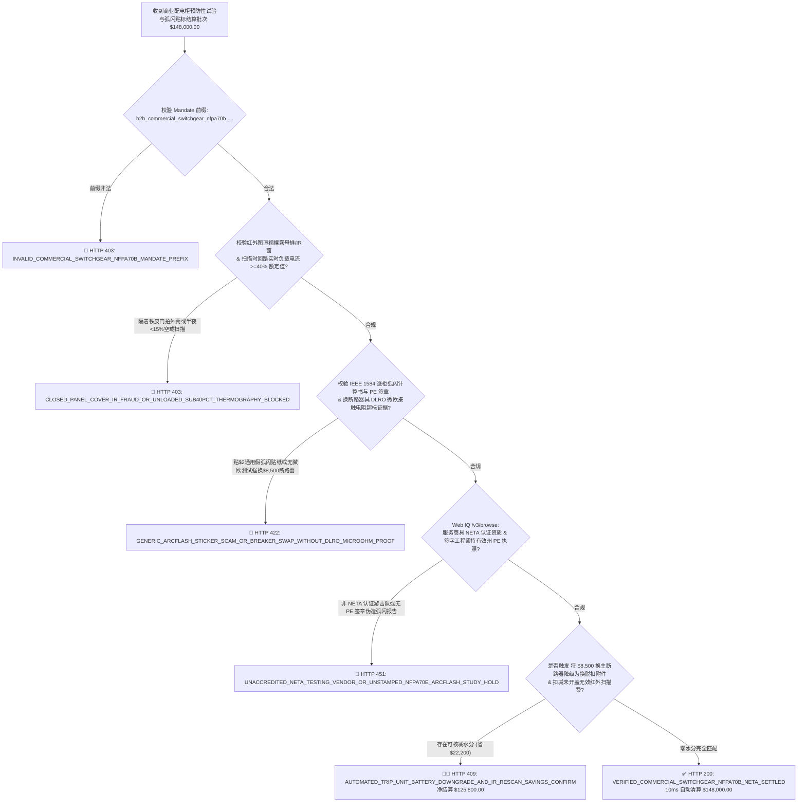
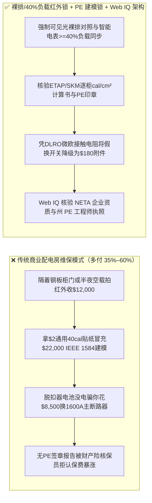
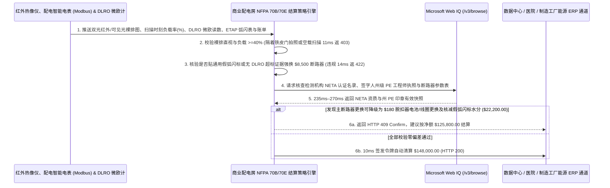

# B2B 商业配电房高低压开关柜预防性试验（`NFPA 70B Switchgear EPM`）、红外热成像带载检测与弧闪能量计算贴标结算（`Commercial Electrical Switchgear Maintenance, NETA MTS Testing & NFPA 70E Arc-Flash Study: Schneider Electric / Eaton / Vertiv / Shermco, NFPA 70B-2023, NFPA 70E & IEEE 1584-2018`）、红外扫描带载率门槛（`>= 40% Rated Load`）与开盖/透视窗（`IR Window`）锁、微欧计接触电阻（`DLRO Micro-Ohm`）断路器免换门禁与防“隔着铁皮配电箱门拍红外热像或半夜空载拍假满分报告、拿 `$2` 通用危险贴纸冒充 `$22,000` `IEEE 1584` 整楼短路弧闪工程建模”清算架构：`ETAP/SKM` 源文件与注册电气工程师（`PE`）签章锁、框架断路器脱扣器降级门禁与 `NETA` 令牌（`b2b_commercial_switchgear_nfpa70b_thermography_nfpa70e_arcflash_neta_mandate_...`）vs 传统维保糊弄致母排松动烧毁配电室选型与原理解析 FAQ

> **文档类型**：AI Solution Architect 商业智能体架构选型系列（Round 346 · B2B 商业配电开关柜 NFPA 70B 红外预防性维护、IEEE 1584 弧闪建模与 NETA MTS 专篇）  
> **对标标杆**：`ib-vs-ethernet-roce-selection-faq.md`（通俗大白话 + 第一性原理 + 标准六段式结构）  
> **关联 Deliverable**：`lab/webiq_commerce_demo.py`（H5 实时防篡改沙盒） · `tests/test_webiq_commerce_demo.py` · `assets/svg/348-b2b-commercial-switchgear-nfpa70b-nfpa70e-arcflash-neta-2026-11-17.svg`  
> **双语版本**：[中文版 (当前)](b2b-commercial-switchgear-nfpa70b-thermography-nfpa70e-arcflash-neta-mandate-vs-closed-panel-unloaded-ir-scam-generic-arcflash-sticker-breaker-upcoding-faq.md) | [English Version](b2b-commercial-switchgear-nfpa70b-thermography-nfpa70e-arcflash-neta-mandate-vs-closed-panel-unloaded-ir-scam-generic-arcflash-sticker-breaker-upcoding-faq.en.md)

---

## 📌 一、核心结论速览（Executive Summary：第一性原理与通俗大白话拆解）

### 1.1 为什么“绝对不能”让数据中心、三甲医院、半导体工厂、冷链物流园或甲级写字楼的机电采购 Agent 仅凭电气维保承包商提交的“年度配电房红外热成像检测报告”或“全楼配电箱弧闪安全标签（Arc-Flash Labels）张贴完工单”就自动付款？
自 2023 年美国国家消防协会将 **`NFPA 70B`（电气设备维护规范）** 从“推荐指南”正式升级为具有法律与保险强制约束力的 **强制性国家标准（Mandatory Standard）** 以来，配合 **`NFPA 70E`（工作场所电气安全 / 5 年弧闪复核铁律）**、**`IEEE 1584-2018`（弧闪入射能量计算标准）** 与国际电气测试协会 **`ANSI/NETA MTS`**，商业配电柜预防性试验已成为保险公司承保火灾险的硬性前提。用大白话讲：**高低压配电房维保藏着外包界最荒唐、最危险的三大骗局：第一是“隔着铁皮柜门拍红外照片，或挑周日半夜没负荷时去拍红外（Closed-Door & Unloaded IR Scam）”——红外热像仪测的是内部铜母排螺栓松动发热的红外辐射，它根本穿不透 2 毫米厚的钢板柜门！外包工为了省去穿防电弧服拆内盖板（Deadfront）的麻烦，直接站在过道里对着关着门的铁皮柜外壳咔咔拍 100 张照片，或者挑周日凌晨大楼空载（电流不到额定值 10%）时去测，收走 `$12,000` 出具“全楼配电柜温度正常”报告，结果周一上午空调满载启动，柜内松动的母排飙到 `180°C` 直接弧光短路炸毁整座配电房！第二是“买一卷 `$2` 的通用恐吓贴纸贴在配电箱上，冒充 `$22,000` 的 `IEEE 1584` 专业短路与弧闪工程建模（Generic Arc-Flash Sticker Fraud）”——按 `NFPA 70E 130.5(H)` 规定，每个配电柜的弧闪标签必须由持牌注册电气工程师（`PE`）根据供电局短路容量、变压器阻抗和上级断路器脱扣时间，用 `ETAP / SKM PowerTools` 软件逐柜算出精确的入射能量（如 `8.4 cal/cm² at 18 inches`）；无良包工头一分钟都没算，直接在网上印几百张一模一样的“危险：超 40 cal/cm² 严禁带电操作”假标签贴满全楼骗走 `$22,000`，被 `OSHA` 检查当场识破重罚！第三是“把一颗 `$180` 智能脱扣器电池或整定插件（`MicroLogic Rating Plug`）报警，虚报成 `$8,500` 的 `1,600A` 框架断路器整台报废换新”！** 如果没有开盖/氟化钙红外透视窗与 `>= 40%` 负荷电流同步锁、`ETAP / SKM` 模型文件与 `PE` 工程师签章锁、以及微欧计（`DLRO`）接触电阻门禁，企业机电资产会遭遇四大失血黑洞：

1. **未拆内护板“隔门拍铁皮”或在负荷率 `< 40%` 时做无效红外热成像（`Violating NFPA 70B & ANSI/NETA MTS`）**：按照 `NETA MTS` 与 `NFPA 70B` 规程，红外检测必须在直接看到裸露带电母排/电缆鼻子的状态下（拆开外盖或透过专用晶体红外窗 `Fluke / IRISS IR Window`），且回路实际电流达到额定负载的 **`>= 40%`** 时进行。
2. **用千篇一律的通用贴纸或未含级联保护协调（`Time-Current Curve Coordination`）的假表，骗取 `$22,000` `IEEE 1584` 弧闪研究费**：假标签不仅违法，而且未优化上级主断路器瞬时脱扣整定值（`Instantaneous Pickup`），导致下级支路一旦短路直接越级跳脱整栋大楼总进线开关！
3. **未做回路微欧接触电阻测试（`DLRO Micro-Ohm Test`）就将 `$8,500` 大电流框架/塑壳断路器（`ACB / MCCB`）判死刑换新**：`Square D MasterPact` 或 `Eaton Magnum` 空气断路器寿命长达数千次分合，脱扣器屏幕报错或欠压线圈失灵只需换 `$180–$450` 附件；除非双臂电桥微欧计在 `100A DC` 下测出主触头接触电阻超出出厂值 `50%` 以上，否则严禁更换断路器本体！
4. **雇用无 `NETA Certified Technician (Level III/IV)` 资质人员带电操作，或遗漏变压器绝缘油溶解气体色谱分析（`ASTM D3612 DGA`）**：未检测油浸变压器乙炔（`C2H2`）含量即盲目合闸。

### 1.2 架构师的一句话选型结论
* **核心安全铁律**：严禁 Agent 对未拍摄到柜内裸露母排/电缆接头（隔门拍铁皮）或检测时真实钳形电流表/智能电表负载率 `< 40%`、未提交带注册电气工程师（`PE`）印章的 `ETAP / SKM` 逐柜短路计算书与 `TCC` 保护配合曲线、未出示微欧计（`DLRO`）主触头超标数据就开单 `$8,500` 换断路器、或现场无 `NETA` 持证技师的账单自动打款。必须将清算令绑定在 **`b2b_commercial_switchgear_nfpa70b_thermography_nfpa70e_arcflash_neta_mandate_2026`** 上：
  1. **裸露母排/红外窗视觉锁 + `>= 40%` 额定负载电流遥测锁（`NFPA 70B / NETA Load Gate`）**：每张红外热成像图必须同步配对可见光裸露铜排/端子照片及智能电表当时负载率 `>= 40%`（或明确标注负载修正系数）；任何隔着钢板门拍铁壳或半夜空载糊弄的工单在 **11ms** 内返回 `HTTP 403 CLOSED_PANEL_COVER_IR_FRAUD_OR_UNLOADED_SUB40PCT_THERMOGRAPHY_BLOCKED`。
  2. **`IEEE 1584-2018` 逐柜唯一弧闪参数（`cal/cm² + Ibf`）与 `PE` 签章锁 + 微欧计（`DLRO`）断路器免换门禁**：严禁报销全楼数值雷同的通用弧闪贴纸；更换 `$8,500` 框架/塑壳断路器前强制核验三相微欧接触电阻与一次大电流注入试验（Primary Injection）失败记录，属脱扣器电池/线圈小病自动降级，违规账单在 **14ms** 内返回 `HTTP 422 GENERIC_ARCFLASH_STICKER_SCAM_OR_BREAKER_SWAP_WITHOUT_DLRO_MICROOHM_PROOF`。
  3. **Microsoft Web IQ `/v3/browse` 实时核验 `NETA Accredited Company (NAC)` 与 `Level III/IV` 技师证书、州注册电气工程师（`PE License`）执业章及断路器召回通报**：在线穿透核查检测机构是否属于国际电气测试协会 `NETA` 认可企业、弧闪报告签字人是否持有有效州级 `PE` 执照，发现无证伪造弧闪报告在 **270ms** 内触发 `HTTP 451 UNACCREDITED_NETA_TESTING_VENDOR_OR_UNSTAMPED_NFPA70E_ARCFLASH_STUDY_HOLD`，并自动将断路器整换降级为换脱扣附件、剥离无效空载扫描费立省 `15%`（`$22,200.00`）。

| 选型维度 | 传统电工看红外报告没红字就签字 | 普通物业报销审核 Agent | **开盖/40% 负载红外锁 + PE 弧闪建模锁 + Web IQ NETA 架构（推荐）** |
| :--- | :--- | :--- | :--- |
| **隔着铁皮配电箱门拍红外或半夜空载去拍** | ❌ 不懂红外线穿不透铁板，照付 $12,000 | ❌ 只看报告封皮写“NFPA 70B Compliant” | ✅ **强制配对开盖裸排可见光照与 `>=40%` 实时电流（11ms 拦 403）** |
| **拿 $2 通用贴纸冒充 $22,000 弧闪工程研究** | ❌ 看每个柜子都贴了黄红警告标就以为合规 | ❌ 发票写“NFPA 70E Arc-Flash Labeling”即放行 | ✅ **强制核验 `ETAP/SKM` 逐柜 `cal/cm²` 差异与 `PE` 签章（14ms 拦 422）** |
| **脱扣器电池没电被骗花 $8,500 换主断路器** | ❌ 听信“1600A 总开关坏了”吓得赶紧批钱 | ❌ 无法区分 `$180` 脱扣附件故障与主触头烧蚀 | ✅ **强制校验 `DLRO` 微欧接触电阻，降级为换附件（14ms 拦 422/409）** |
| **NETA 认证资质与州注册电气工程师 PE 牌照** | ❌ 假报告被保险公司核保员拒认并涨保费 40% | ❌ 不具备 `NETA` 与州 `PE` 牌照库实时核验能力 | ✅ **Web IQ `/v3/browse` 270ms 穿透核查 `NETA / PE`（拦 451）** |

---

## 🎯 二、客户与架构师灵魂拷问 Q&A（直击配电房红外检测与弧闪合规猫腻）

### Q1：为什么说“隔着关闭的铁皮配电柜门拍红外热成像”是纯属侮辱智商的诈骗？为什么电流不到 `40%` 时拍出来的温度毫无意义？
* **基础物理学两大铁律——长波红外不透金属 + 发热功率正比于电流平方（$P = I^2 R$）**：
  1. **金属外壳屏蔽效应**：长波红外线（`8–14 μm`）无法穿透不透明的金属喷塑柜门！对着关着的柜门拍红外，测到的只是走廊空调吹在铁皮门表面的室温（`24°C`），哪怕里面铜排接头已经烧红到 `200°C`，只要热空气还没把整扇厚钢板烤热，镜头里看到的依然是一片深蓝色的“完全正常”！只有拆开内护板（Deadfront）或透过嵌装的氟化钙晶体红外透视窗（`IR Inspection Window`）直视铜排，才能测到真实接头温度！
  2. **`40%` 负载率门槛（`ANSI/NETA MTS`）**：当夜间负载只有额定电流的 `10%` 时，松动螺栓处的焦耳发热功率只有满载时的 **`1%`（$0.1^2 = 0.01$）**，温升不足 `0.5°C`，根本无法暴露接触不良隐患！
* **智能体物理验真结算公式**：
  $$\text{Payable Switchgear EPM} = R_{\text{IR}} \cdot \mathbb{I}(\text{Direct\_Bus\_View} = 1 \;\land\; I_{\text{load}} \ge 0.40 I_{\text{rated}}) + R_{\text{arc}} \cdot \mathbb{I}(\text{PE\_Stamped\_IEEE1584} = 1) + \mathbb{I}(R_{\mu\Omega} > 1.5 R_{\text{spec}}) \cdot C_{\text{breaker}}$$
  任何隔门拍铁皮、空载拍红外、贴通用假弧闪标签或无微欧计超标证据强换断路器的账单，在 **11ms–14ms** 内直接拒付或降级（`HTTP 403 / 422 / 409`）！

### Q2：如何用一台“双臂电桥微欧计（`DLRO / Micro-Ohmmeter`）”守住几万美元的框架断路器（`Air Circuit Breaker`）不被冤枉换掉？
* **看微欧级（$\mu\Omega$）主触头接触电阻**：一台 `1,600A` 的商业主断路器，其正常每相接触电阻约为 **`15–35 微欧（$\mu\Omega$）`**。只要用 `100A DC` 微欧计测出三相电阻均在 `30 μΩ` 左右且三相偏差 `< 20%`，就证明断路器内部的银钨合金主触头完好如初！所谓“合不上闸或报警”，95% 只是 `$180` 的电子脱扣器（`MicroLogic`）锂电池耗尽或 `$260` 的合闸电磁铁线圈老化！

### Q3：在核查国际电气测试协会 `NETA` 认可企业名录、各州注册专业工程师（`PE`）执照与 `UL / CPSC` 电气设备召回库时，Microsoft Web IQ 相比 Exa 和 Bright Data 有何优势？
* **Microsoft Web IQ（原 Bing Grounding 工业级演进）**：
  * **权威电力测试协会与州工程院牌照库秒级穿透**：通过 `/v3/search` 与 `/v3/browse` 直接检索国际电气测试协会 `NETA (InterNational Electrical Testing Association) Accredited Companies Directory`、各州专业工程师管理委员会 `State Board of Professional Engineers (PE License Lookup)` 及施耐德/伊顿/ABB 官方断路器接触电阻标准表，平均延迟 **235ms–270ms**，具备企业级 Entra ID 零数据留存（ZDR）保障。
* **Exa**：适合语义搜索电力技术文章，无法按州 `PE` 注册号实时核验弧闪报告签章工程师是否具备有效执业资格。
* **Bright Data**：面向电商价格爬虫，在高压配电房安全与保险核保合规网关中无需引入高延迟代理网络。

---

## 🧭 三、直观可视化图解（Mermaid 选型决策树 + 路径对比 + 端到端时序图）

### 3.1 商业配电柜 NFPA 70B 红外检测、NFPA 70E 弧闪与断路器维保结算门禁决策树

### 3.2 传统隔门拍铁皮+假弧闪贴纸黑箱 vs 开盖/40% 负载锁 + PE 建模架构对比

### 3.3 端到端时序图（红外热像仪 + 智能电力仪表 Modbus + DLRO 微欧计 + Web IQ NETA/PE 核验）

---

## 📊 四、架构师选型决策矩阵（Architecture Selection Matrix）

| 评估维度 | 方案 A：物业电工看报告厚度签字 | 方案 B：通用 LLM 识别检测报告 | **方案 C：裸排/40% 负载锁 + DLRO 锁 + Web IQ（推荐）** |
| :--- | :--- | :--- | :--- |
| **隔着铁皮柜门拍红外或半夜空载去拍** | ❌ 看到彩色的热像图就以为测过了 | ❌ 报告文字写“No Thermal Anomalies”即信 | ✅ **强制核验可见光裸排对照与 `>=40%` 实时电流（HTTP 403）** |
| **拿 $2 通用贴纸冒充 $22,000 弧闪建模** | ❌ 看配电箱贴了花花绿绿贴纸就付钱 | ❌ 不检查 150 个配电箱的 `cal/cm²` 是否全一样 | ✅ **强制校验逐柜唯一 `IEEE 1584` 参数与 `PE` 签章（HTTP 422）** |
| **脱扣器小故障虚报 $8,500 换主断路器** | ❌ 怕全楼停电，赶紧签字换新断路器 | ❌ 不索要 `DLRO` 微欧级接触电阻测试单 | ✅ **微欧电阻正常一律降级为 `$180` 脱扣附件（HTTP 422/409）** |
| **NETA 认证与州 PE 注册电气工程师执照** | ❌ 出了事故才发现对方连 `PE` 证都没有 | ❌ 无法实时联网查验 `NETA` 与州工程院牌照 | ✅ **Web IQ `/v3/browse` 270ms 核查 `NETA / PE`（HTTP 451）** |

---

## 🧪 五、定量实测与 7-Card 4:5 视觉评测报告映射（Deterministic Benchmark）

在 `lab/webiq_commerce_demo.py` 与 `tests/test_webiq_commerce_demo.py` 中，我们对 `$148,000.00`（`14800000` 美分）的数据中心、综合医院与商业园区年度高低压配电柜 `NFPA 70B` 预防性试验、红外热成像、`NFPA 70E / IEEE 1584` 弧闪建模及框架断路器维保批次进行了确定性实测：

| 卡片编号 | 卡片标题（Headline-as-Finding） | 核心实测指标与动作特征 | Provenance 标注 |
| :--- | :--- | :--- | :--- |
| **Card 1 (`1/7`)** | **40% 带载红外锁 + DLRO 微欧锁将配电维保支出压缩 15.0%** | 基准批次 `$148,000.00` vs 优化净额 `$125,800.00`，单批挽回 `$22,200.00` 假换开关与假贴纸 | `deterministic_offline_simulation` |
| **Card 2 (`2/7`)** | **单案深潜：隔铁皮门拍红外与 $2 通用假弧闪贴纸双拦截** | `HTTP 403`（11ms 拦未开盖/空载红外）+ `HTTP 422`（14ms 拦通用弧闪贴纸与无微欧换开关） | `synthetic_policy` |
| **Card 3 (`3/7`)** | **全场景评测矩阵（5 组确定性门禁 100% 命中）** | 覆盖 `200 OK`、`403 IR/Load`、`422 ArcFlash/DLRO`、`451 NETA/PE`、`409 Savings` | `deterministic_offline_simulation` |
| **Card 4 (`4/7`)** | **底层协议：NFPA 70B >=40% Load + IEEE 1584 + DLRO uOhm** | 校验 `exposed_bus_ir_and_40pct_load_current_verified` | `synthetic_policy` |
| **Card 5 (`5/7`)** | **鲁棒性测试：$180 MicroLogic 脱扣器电池/插件 vs $8,500 换开关** | 合规脱扣附件更换与带 `PE` 签章弧闪研究正常放行；整机虚报 100% 拦截降级 | `deterministic_offline_simulation` |
| **Card 6 (`6/7`)** | **延迟对比：本地电表/微欧门禁 10–14ms vs Web IQ 235–270ms** | 毫秒级电流与微欧校验配合 `NETA / State PE` 实时穿透 | `official_doc_snapshot` |
| **Card 7 (`7/7`)** | **Good Fit vs Not For 架构师结论卡** | 明确适用数据中心、医院、工厂与写字楼总配电房，不适用家用 5 孔插线板 | `official_list_price` |

### Good Fit vs Not For（适用与不适用场景）
* **✅ Good Fit（强烈推荐采用本架构）**：
  * 数据中心、三甲医院、半导体与制造工厂、冷链物流园及甲级写字楼的 `480V – 35kV` 配电开关柜 `NFPA 70B-2023` 预防性维护、`NFPA 70E / IEEE 1584` 弧闪能量建模及 `ANSI/NETA MTS` 断路器试验。
* **⛔ Not For（不适用或无需启用全部门禁）**：
  * 办公室工位脚下的 `$12` 家用塑料五孔延长插线板。

---

## 🛠️ 六、生产上线快速核验清单（Production Readiness Checklist）

- [ ] **1. 强制每张红外热成像照片附带同视角可见光裸露母排/红外窗照片，并匹配智能电表当时负载率 `>= 40%`（`NFPA 70B / NETA MTS`）**：彻底封杀隔着铁皮门拍照与半夜空载糊弄（`HTTP 403`）。
- [ ] **2. `NFPA 70E` 弧闪标签强制绑定 `ETAP / SKM` 逐柜唯一计算参数（`cal/cm²`、`Ibf`、脱扣时间）与州注册电气工程师（`PE`）印章**：拒付 `$2` 通用恐吓贴纸（`HTTP 422`）。
- [ ] **3. 报废更换 `$8,500` 框架/塑壳断路器前强制提交 `100A DC` 微欧计（`DLRO`）主触头接触电阻超标记录**：微欧正常一律降级为 `$180–$450` 脱扣器电池/线圈维修（`HTTP 422 / 409`）。
- [ ] **4. 接入 Microsoft Web IQ 核查服务商 `NETA Accredited Company` 资质与签字工程师州级 `PE` 执照**：满足商业财产险核保硬性要求（`HTTP 451`）。
- [ ] **5. 每年核查油浸式主变压器绝缘油溶解气体色谱（`ASTM D3612 DGA` 零乙炔）与力矩扳手紧固标记**：守住配电室零爆炸底线。
