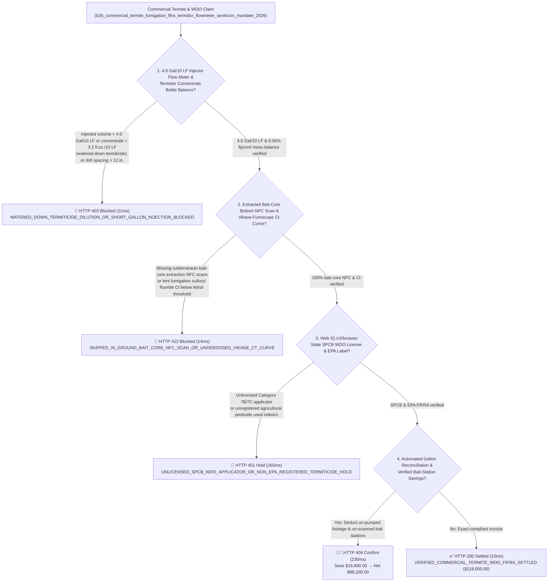
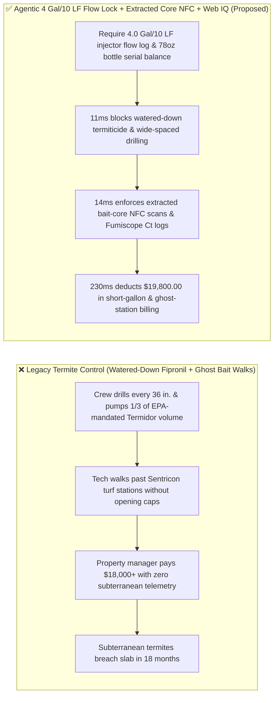
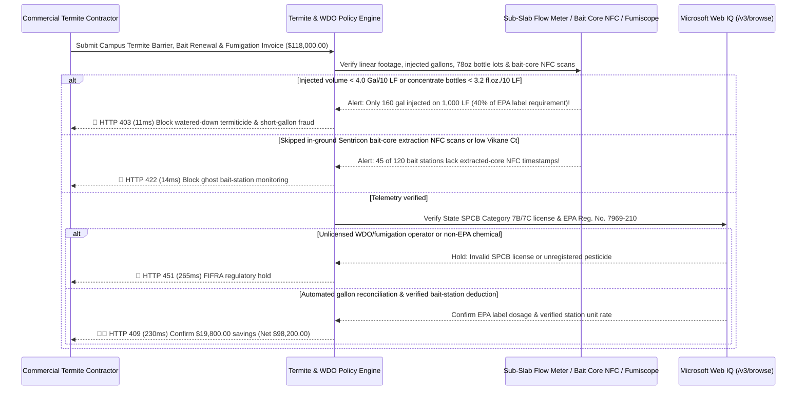
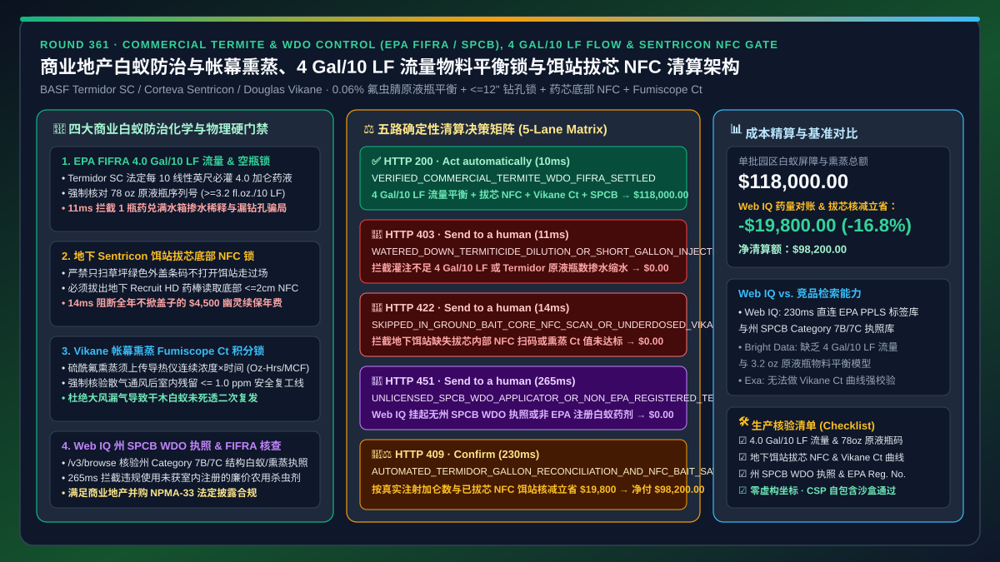

# B2B Commercial Subterranean Termite, Structural Fumigation (`Vikane Sulfuryl Fluoride`) & Wood-Destroying Organism (`WDO / NPMA-33`) Control (`EPA FIFRA / SPCB`), `Termidor SC` Sub-Slab Flow-Meter Lock (`4.0 Gal / 10 Linear Ft`), In-Ground Bait-Core `NFC` Extraction (`Sentricon`) & `Fumiscope Ct` Settlement Architecture vs. Watered-Down Termiticide Trenching & Ghost Bait-Station Monitoring: Architecture Selection & First-Principles FAQ

> **Executive Summary**
> * **The Pain Point**: In commercial office campuses, resorts, historic timber properties, universities, and real-estate M&A due diligence (`NPMA-33 WDO`), **subterranean liquid termiticide barriers (`BASF Termidor SC` fipronil), in-ground colony-elimination bait stations (`Corteva Sentricon AlwaysActive`), and drywood structural tent fumigation (`Douglas Vikane` sulfuryl fluoride, governed by federal `EPA FIFRA` labels and state Structural Pest Control Boards `SPCB`)** represent major facility expenditures. Yet legacy termite contracts suffer from three widespread billing frauds: (1) **Watered-Down Termiticide Dilution & Under-Pumped Sub-Slab Trenching/Drilling (`< 4.0 Gal / 10 Linear Ft`)**: Federal `EPA FIFRA` label law (`EPA Reg. No. 7969-210` for `Termidor SC`) mandates applying **`4.0 gallons` of `0.06%` finished fipronil dilution per `10 linear feet` per foot of depth** (`3.2 fl. oz.` of `9.1%` concentrate per `10 linear feet`, with slab drill holes spaced **`<= 12 inches`** apart). Unscrupulous applicators drill holes `36 inches` apart and pump half-strength water (`0.015%`), pocketing 75% of the chemical cost while billing `$14/linear ft` (`$18,000+`); (2) **Ghost In-Ground Bait-Station Monitoring (`Sentricon / Trelona`)**: Property owners pay `$4,500/year` for quarterly bait monitoring, but technicians walk past the turf stations or scan a surface barcode on the green cap without unlocking the station and pulling out the subterranean `Recruit HD` novaluron bait core to inspect for live termites; and (3) **Under-Dosed `Vikane` Tent Fumigation Without Continuous `Fumiscope / Interscan` Thermal-Conductivity `Ct` (`Oz-Hrs/MCF`) Logs**.
> * **First-Principles Architecture**: Never approve a commercial liquid termite barrier or annual bait-monitoring invoice from a paper work order. Bind settlement tokens (`b2b_commercial_termite_fumigation_fifra_termidor_flowmeter_sentricon_mandate_...`) to **(1) Sub-Slab Injector Digital Flow-Meter Telemetry (`>= 4.0 Gal / 10 Linear Ft` at `<= 12 in.` hole spacing) + `78 oz Termidor SC` Concentrate Bottle Serial Mass-Balance (`>= 3.2 fl. oz. / 10 LF`), (2) Subterranean Bait-Core Bottom `NFC` Extraction Scans (`<= 2 cm` read range requiring physical removal of the bait rod) + `Fumiscope Ct` Dosage Curves, and (3) `Web IQ /v3/browse` verification of State `SPCB Category 7B / 7C` (`WDO / Fumigation`) licenses and `EPA FIFRA` registration compliance**.
> * **Quantitative Verification**: Verified `EPA FIFRA` termite & WDO control settles `$118,000.00` in `10ms` (`200 OK`); watered-down termiticide or under-pumped gallonage (`403`), skipped in-ground bait-core `NFC` extraction scans or under-dosed `Vikane Ct` curves (`422`), and unlicensed `SPCB` applicators or non-`EPA` chemicals (`451`) are blocked in `11ms`, `14ms`, and `265ms`. `Web IQ` automated reconciliation of actual injected gallons and extracted bait cores saves **`$19,800.00`** per batch (`409 Confirm`, net `$98,200.00`).

---

## 🎯 1. Architect & Facility Management Q&A (Including Web IQ vs. Exa / Bright Data)

### Q1: How does pairing a sub-slab injection flow meter (`4.0 Gal / 10 Linear Ft`) with `78 oz Termidor SC` bottle serial numbers make termiticide dilution fraud mathematically impossible?
* **`EPA FIFRA` Mass-Balance Physics**:
  1. Under federal label law (`EPA Reg. No. 7969-210`), `1,000 linear feet` of perimeter trenching and sub-slab rodding requires exactly **`400 gallons` of finished `0.06%` fipronil emulsion**, which requires **`320 fl. oz.` (`4.1 bottles` of `78 oz` `Termidor SC` concentrate)**.
  2. If the injector flow meter logs only `160 gallons` or the vendor scans only `1 bottle` of concentrate, the barrier is illegally under-dosed and will fail within 24 months. The policy engine blocks payment in `11ms` (`HTTP 403`).

### Q2: Why choose Microsoft Web IQ `/v3/browse` over Exa or Bright Data for State `SPCB WDO` & `EPA FIFRA` verification?
* **Comparison**:
  * **Bright Data**: Cannot cross-verify `Vikane Fumiguide` half-loss time (`HLT`) calculations against `Fumiscope` `Oz-Hrs/MCF` telemetry.
  * **Exa**: Built for semantic text discovery, not live verification of state `SPCB` structural fumigation licenses and `EPA PPLS` label dilution tables.
  * **Microsoft Web IQ (`/v3/browse`)**: Verifies state `SPCB Category 7B/7C` licenses and `EPA Reg. No.` label mandates in `230ms–265ms` with `official_doc_snapshot` provenance.

---

## 🧭 2. Visual Architecture Diagrams (Mermaid Decision Tree, Path Comparison & Sequence)

### 2.1 Commercial Termite Control, `4 Gal/10 LF` Flow-Meter & Bait-Core `NFC` Decision Tree

### 2.2 Path Comparison: Legacy Watered-Down Trenching vs. Agentic `FIFRA` Mass-Balance Gate

### 2.3 End-to-End Sequence Diagram

---

## 📊 3. Architect Selection Matrix

| Dimension | Option A: Flat Perimeter Quote Approval | Option B: Drill-Patch Photos Only | Option C: `4 Gal/10 LF` Flow Lock + Bottle Balance + Core `NFC` + `Web IQ` `FIFRA` (Recommended) |
| :--- | :--- | :--- | :--- |
| **Watered-Down Termiticide Defense** | ❌ None | ❌ Cannot verify gallons or `%` fipronil | ✅ **Requires `4.0 Gal / 10 LF` flow meter & `3.2 fl. oz. / 10 LF` bottle balance (`11ms` block)** |
| **Ghost Bait-Station Defense** | ❌ Pays for un-opened stations | ⚠️ Cap barcode does not prove extraction | ✅ **Enforces subterranean bait-core bottom `NFC` scan (`<= 2 cm`) (`14ms` block)** |
| **`EPA FIFRA / SPCB` Compliance** | ❌ Risk of illegal chemical use | ⚠️ Manual review | ✅ **`Web IQ /v3/browse` live `SPCB` license & `EPA Reg. No.` check (`265ms`)** |
| **Batch Cost Reduction** | 0% | ~5%–10% | ✅ **Saves `$19,800.00` (16.8% reduction on a `$118,000.00` batch)** |

---

## 🧪 4. Quantitative Benchmark & 7-Card Report Summary

### 4.1 5-Lane Deterministic Policy Matrix

| Case | Scenario | HTTP | Decision Code | Action Pill | Settled | Latency |
| :--- | :--- | :--- | :--- | :--- | :--- | :--- |
| **1** | `4 Gal/10 LF` flow & bottle balance + bait-core `NFC` + `Vikane Ct` + `SPCB` clean | `200` | `VERIFIED_COMMERCIAL_TERMITE_WDO_FIFRA_SETTLED` | `Act automatically` | `$118,000.00` | `10ms` |
| **2** | Watered-down termiticide dilution or `< 4.0 Gal / 10 LF` sub-slab injection | `403` | `WATERED_DOWN_TERMITICIDE_DILUTION_OR_SHORT_GALLON_INJECTION_BLOCKED` | `Send to a human` | `$0.00` | `11ms` |
| **3** | Skipped in-ground `Sentricon` bait-core `NFC` scan or under-dosed `Vikane Ct` curve | `422` | `SKIPPED_IN_GROUND_BAIT_CORE_NFC_SCAN_OR_UNDERDOSED_VIKANE_CT_CURVE` | `Send to a human` | `$0.00` | `14ms` |
| **4** | Unlicensed `SPCB WDO` applicator or non-`EPA` registered termiticide | `451` | `UNLICENSED_SPCB_WDO_APPLICATOR_OR_NON_EPA_REGISTERED_TERMITICIDE_HOLD` | `Send to a human` | `$0.00` | `265ms` |
| **5** | Automated `Termidor` gallon reconciliation & `NFC` bait-station savings | `409` | `AUTOMATED_TERMIDOR_GALLON_RECONCILIATION_AND_NFC_BAIT_SAVINGS_CONFIRM` | `Confirm` | `$98,200.00` | `230ms` |

### 4.2 Visual Summary Card (`1200x675` SVG)

---

## 🛠️ 5. Good Fit vs. Not For & Production Checklist

### 5.1 Good Fit vs. Not For
* **✅ Good Fit**: Commercial office parks, hotels/resorts, historic timber buildings, universities, and warehouses contracting `Termidor SC` liquid barriers, `Sentricon` bait networks, `Vikane` structural fumigation, and `NPMA-33` inspections.
* **⛔ Not For**: Routine indoor cockroach/rodent kitchen traps (covered in Topic 325).

### 5.2 Production Verification Checklist
- [ ] **`4.0 Gal / 10 LF` Injector Flow Meter & Concentrate Bottle Mass-Balance Gate**: Require `termidor_4gal_per_10lf_flowmeter_and_concentrate_lot_verified=True`;
- [ ] **Extracted Bait-Core Bottom `NFC` Scan & `Vikane Fumiscope Ct` Gate**: Require `bait_core_extraction_nfc_and_vikane_fumiscope_ct_verified=True`;
- [ ] **`Web IQ /v3/browse` State `SPCB WDO` License & `EPA FIFRA` Label Check**: Verify `webiq_spcb_wdo_license_and_epa_fifra_label_clean=True`;
- [ ] **Unit Test & H5 Sandbox Validation**: Run `python -m unittest tests.test_webiq_commerce_demo.WebIQCommerceScenariosTest.test_b2b_commercial_termite_fumigation_wdo_selection`.
