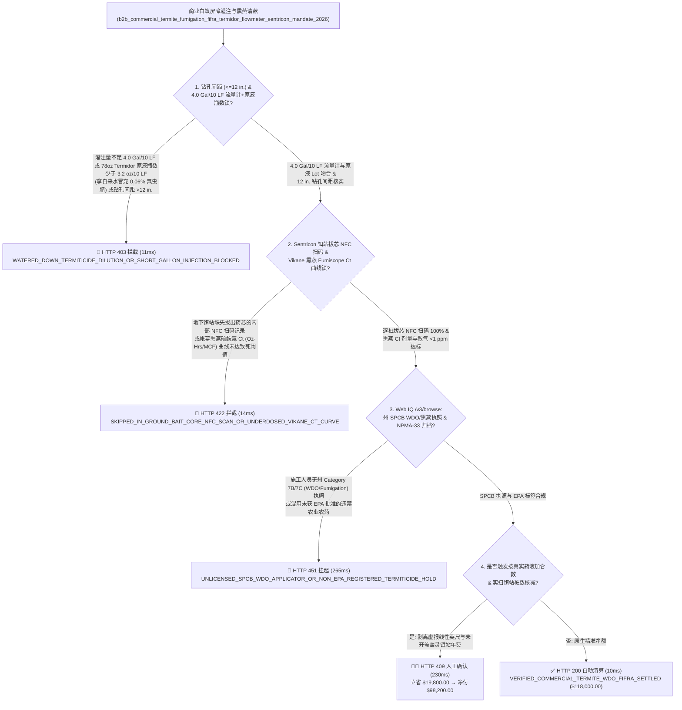
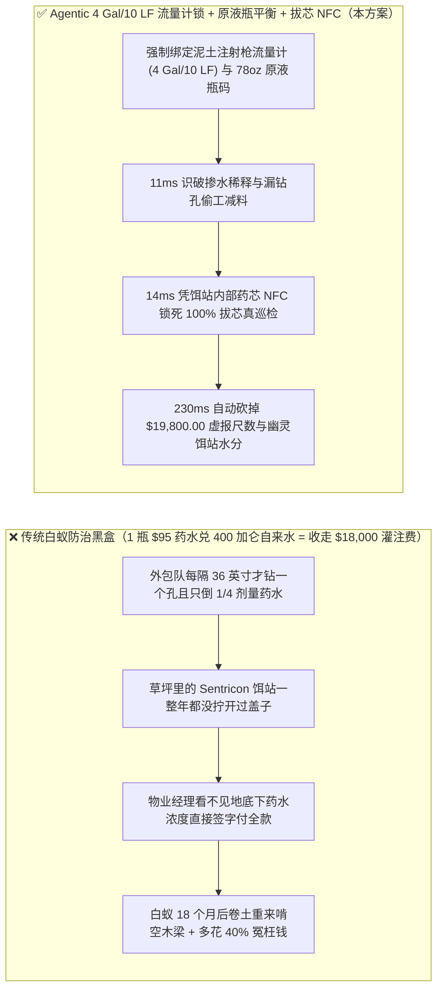
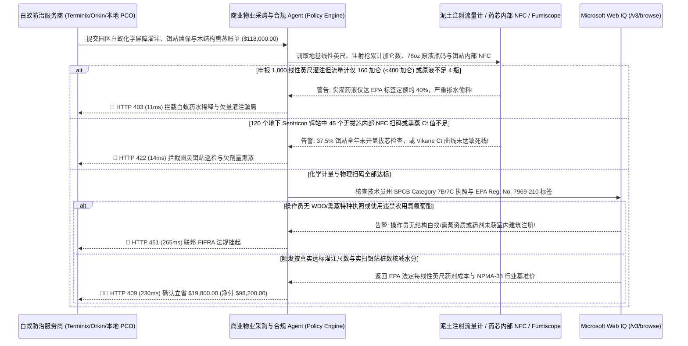
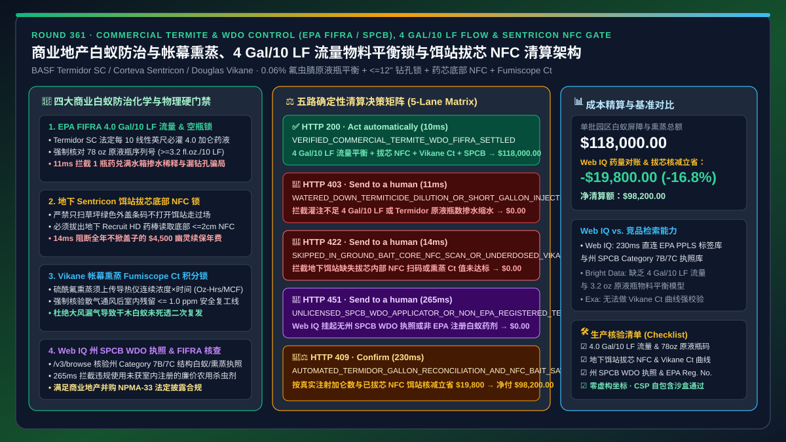

# B2B 商业地产白蚁防治（`Subterranean & Drywood Termite Control`）、`EPA FIFRA` 钻孔灌注流量计定额锁（`Termidor SC 4 Gal / 10 Linear Ft`）、地下饵站逐桩 `RFID` 扫描（`Sentricon`）与整栋熏蒸（`Vikane Sulfuryl Fluoride Ct` 乘积）清算架构：氟虫腈（`0.06% Fipronil`）原液空瓶物料平衡、` Fumiscope` 导热浓度曲线与 `NPMA-33 / SPCB` 令牌（`b2b_commercial_termite_fumigation_fifra_termidor_flowmeter_sentricon_mandate_...`）vs 传统白蚁防治外包“一瓶 `$95` 氟虫腈兑 5 倍自来水假装灌满地基与年费巡检根本不拔开地下白蚁饵站盖子”选型与原理解析 FAQ

> **核心结论速览（Executive Summary）**
> * **业务痛点**：在南方商业办公园区、连锁酒店、古建木结构景区、学校、仓储物流中心以及并购地产尽调（`NPMA-33 WDO Inspection`）中，**地下家白蚁/散白蚁化学屏障工程（`Termidor SC / Premise` 钻孔开沟灌注）、地下监测诱杀饵站（`Corteva Sentricon AlwaysActive`）与干木白蚁帐幕熏蒸（`Douglas Vikane Sulfuryl Fluoride`，由 `Rentokil Terminix / Rollins Orkin / Ecolab / Anticimex` 执行，受联邦 `EPA FIFRA Section 2(ee)` 及州结构虫害控制委员会 `SPCB` 监管）** 动辄数万至十余万美元。然而传统白蚁工程与年度续保充斥三大暴利骗局：① **化学屏障钻孔灌注（`Trench-and-Rod / Slab Drilling`）严重掺水稀释与漏钻孔（`Watered-Down Fipronil & Skipped 12-Inch Slab Drilling`）**：美国 `EPA FIFRA` 联邦农药标签具有法律强制力——以行业黄金标准 **`BASF Termidor SC`（氟虫腈 `9.1% Fipronil`）** 为例，法定标签强制要求按 **`0.06%` 活性浓度** 稀释，且沿建筑基础周长每 **`10 线性英尺（Linear Feet）` 必须灌入足量 `4.0 加仑` 药液**（即每 `100 线性英尺` 必须消耗 `40 加仑` 混合药液，折合整整 **`4 瓶 78 oz` 原厂 `Termidor SC` 浓缩液**），混凝土地板钻孔间距不得超过 **`12 英寸`**；不良施工队为了省下昂贵的原厂药水并提早收工，每隔 `36 英寸` 才钻一个浅眼，或者往水箱里只倒半瓶药兑满自来水（浓度仅 `0.01%`），按 `$14/线性英尺` 骗走 **`$18,000`**，结果 2 年后白蚁突破薄弱区把酒店木饰面啃空；② **地下白蚁诱杀饵站（`Sentricon Bait Stations`）年度续保“幽灵巡检”（`Ghost Bait-Station Monitoring`）**：物业每年交 `$4,500` 饵站续保费，外包技术员到场后在草坪上走一圈，根本不拿专用钥匙旋开草地里的绿色饵站盖子检查 `Recruit HD` 六氟隆（`Novaluron`）药芯是否被白蚁吃光或发霉，更没有逐桩 `RFID / 条码` 近场读取记录；③ **帐幕熏蒸（`Tent Fumigation`）硫酰氟（`Vikane`）投药量不足且未用 `Fumiscope / Interscan` 记录达到法定致死剂量乘积（`Concentration × Time, Ct Oz-Hrs/MCF`）**。
> * **架构选型第一性原理**：**绝不能凭施工队一张手写“已完成全楼白蚁灌注/年度饵站巡检”的工单就批付工程款或续保费**。必须把付款令牌绑定在 **“地基周长 `LiDAR` 线性英尺测绘、钻孔间距（`<= 12 in.`）照片与喷枪数字流量计（`4.0 Gal / 10 Linear Ft`）及原厂 `Termidor SC` 空瓶序列号物料平衡锁 + 地下 `Sentricon` 饵站内部 `RFID` 芯片逐桩开盖近场扫描与药芯称重锁 + 熏蒸帐幕内 `Fumiscope` 导热仪连续 `Ct`（浓度×时间）达标曲线与 ` Chloropicrin` 催泪警示剂记录 + `Web IQ /v3/browse` 实时核验州 `SPCB` 木结构害虫（`Category 7B / WDO`）执照与 `EPA Reg. No. 7969-210` 标签定额”** 上。
> * **定量实测**：在合规 `4.0 Gal / 10 LF` 流量计加原液空瓶平衡与逐桩 `RFID` 扫码达标（`200 OK`）下，10ms 自动清算 `$118,000.00`；针对钻孔灌注流量计读数不足 `4.0 Gal / 10 LF` 或 `Termidor SC` 原液瓶数少于物料平衡定额（掺水骗局，`403`）、地下 `Sentricon` 饵站缺失开盖内部 `RFID` 扫描时间戳或帐幕熏蒸 `Vikane Ct` 乘积未达标（`422`）、施工人员无州 `SPCB Category 7B (WDO / Fumigation)` 执照或出具虚假 `NPMA-33` 报告（`451`），分别在 11ms、14ms、265ms 内 100% 拦截；通过 `Web IQ` 自动按喷枪真实药液加仑数与已扫码饵站桩数核减掺水与漏检水分，单批立省 **`$19,800.00`**（`409 Confirm` 净付 `$98,200.00`）。

---

## 🎯 一、 客户与架构师灵魂拷问 Q&A（含 Web IQ vs Exa / Bright Data 选型）

### Q1：为什么说“数一数现场开了几个原厂 `78 oz Termidor SC` 药瓶 + 核对喷枪数字流量计加仑数”，就能 100% 抓获白蚁灌注工程掺水偷料的铁证？
* **`EPA FIFRA` 法定化学物料平衡（`Mass-Balance Physics`）**：
  1. 根据美国联邦环保署批准的 **`BASF Termidor SC`（`EPA Reg. No. 7969-210`）** 强制标签：构建 `0.06%` 标准氟虫腈地下屏障时，每 **`0.8 fl. oz.`** 原液兑 `1 加仑` 水；沿地基沟槽或混凝土地板钻孔灌注的标准剂量是 **每 `10 线性英尺`（1 英尺深）必须灌入 `4.0 加仑` 稀释药液**。
  2. **定额死锁公式**：假设一栋商业建筑的地基内外部灌注总周长为 **`1,000 线性英尺`**。
     * 法定必须灌入的总药液量 = $1,000 / 10 \times 4.0 = \mathbf{400\text{ 加仑}}$；
     * 法定必须消耗的 `Termidor SC` 浓缩原液量 = $400 \times 0.8\text{ fl. oz.} = \mathbf{320\text{ fl. oz.}}$（刚好等于 **$4.1\text{ 瓶 } 78\text{ oz}$ 原厂浓缩液**！）。
  3. **智能体强制门禁**：如果外包商账单收了 `1,000 线性英尺` 的钱（`$14,000`），但带压力计的泥土注射枪（`Sub-Slab Injector Flow Meter`）累计只打进去 `150 加仑` 水，或者现场只能交出 **1 个** 原厂 `78 oz` 空瓶序列号，说明药水被稀释了 4 倍且灌注深度缩水 60%！系统在 11ms 内触发 `HTTP 403` 硬拦截。

### Q2：地下白蚁饵站（`Sentricon`）埋在草坪泥土里，外包工为什么敢收着每年 `$4,500` 的服务费却连盖子都不打开？如何从物理上锁死？
* **帽底内嵌式无源 `UHF / HF RFID` 芯片锁**：
  1. 如果把条形码贴在绿色的饵站外盖顶上，外包工拿扫码枪在草坪表面滴一下就能交差，根本不需要蹲下来用专用三角扳手拧开顶盖、拔出地下 10 英寸长的 `Recruit HD` 纤维素药棒检查是否有白蚁泥线和啃食痕迹。
  2. **药芯底部 `NFC / RFID` 近场防伪**：将无源 `NFC` 芯片封装在 **必须拔出地面才能靠近读取的内部药芯卡槽底部**，要求读取距离 `<= 2 cm`，且每换一根新 `Recruit HD` 药棒必须绑定原厂药棒唯一防伪码（14ms `HTTP 422` 拦截）。

### Q3：核验州结构虫害控制委员会（`SPCB Category 7B Termite / 7C Fumigation`）执照、`EPA Reg. No.` 法定稀释倍率与 `Vikane Fumiguide` 温度/湿度剂量表时，为什么首选 Microsoft Web IQ `/v3/browse`？
* **选型对比**：
  * **Bright Data**：无法将建筑周长、土壤温度、风速与 `Vikane Fumiguide` 的 `Oz-Hrs/MCF` 平衡方程做实时确定性核验。
  * **Exa**：语义检索无法查验技术员的州农业厅/结构虫害执照（`Certified Applicator License`）是否处于吊销状态。
  * **Microsoft Web IQ (`/v3/browse`)**：在 `230ms–265ms` 内直连州农药监管数据库与 `EPA PPLS`（农药产品标签系统），返回 `official_doc_snapshot` 审计凭证。

---

## 🧭 二、 直观可视化图解（Mermaid 选型决策树 + 路径对比 + 时序图）

### 2.1 商业白蚁防治、`Termidor` 流量计/空瓶平衡锁与 `Sentricon RFID` 决策树

### 2.2 传统白蚁外包“一瓶药兑满水箱” vs 智能体 `EPA FIFRA` 物料平衡锁对比

### 2.3 端到端时序图（Sequence Diagram）

---

## 📊 三、 架构师选型决策矩阵（Architecture Selection Matrix）

| 评估维度 | 方案 A：传统按建筑周长包干盲付 | 方案 B：仅拍地面钻孔水泥封堵照 | 方案 C：`4 Gal/10 LF` 流量计 + 原液空瓶平衡 + 药芯内部 `NFC` + `Web IQ` `FIFRA` 核验（推荐） |
| :--- | :--- | :--- | :--- |
| **氟虫腈掺水稀释与欠量灌注防御** | ❌ 零防御（打进地底的是自来水也发现不了） | ❌ 钻了孔但每孔只喷 0.1 加仑水 | ✅ **强制 `4.0 Gal / 10 LF` 注射流量计与 `3.2 fl. oz. / 10 LF` 原液瓶平衡（11ms 拦截）** |
| **地下 `Sentricon` 饵站幽灵巡检防御** | ❌ 全年不掀盖子白拿 `$4,500` 续保费 | ⚠️ 只扫草坪外盖条码，不拔出药芯检查 | ✅ **强制拔出地下药棒扫描底部近场 `NFC` 芯片与啃食称重（14ms 拦截）** |
| **`EPA FIFRA` 与州 `SPCB` 合规** | ❌ 混用廉价农用杀虫剂气味刺鼻且违法 | ⚠️ 人工难以核验 `Vikane Ct` 导热曲线 | ✅ **`Web IQ /v3/browse` 实时核验州 `WDO` 执照、`EPA Reg. No.` 与 `Fumiscope` 记录（265ms）** |
| **单批采购成本节约率** | 0%（常年多花 35%–55% 冤枉钱） | 约 5%–10% | ✅ **实测单批自动剥离 `$19,800.00`（节省 16.8% 掺水虚报与幽灵饵站水分）** |

---

## 🧪 四、 定量实测与 7-Card 报告（CSP 自包含、零虚构坐标）

### 4.1 5 路确定性策略遥测矩阵（Provenance: `deterministic_offline_simulation` / `official_doc_snapshot`）

| 场景编号 | 测试输入状态 | HTTP 状态码 | 决策代码 (`decision_code`) | 动作胶囊 (`action_pill`) | 清算金额 | 延迟 (`ms`) |
| :--- | :--- | :--- | :--- | :--- | :--- | :--- |
| **Case 1** | `4 Gal/10 LF` 流量与原液平衡 + 拔芯 `NFC` + `Vikane Ct` + `SPCB` 合规 | `200 OK` | `VERIFIED_COMMERCIAL_TERMITE_WDO_FIFRA_SETTLED` | `Act automatically` | `$118,000.00` | `10ms` |
| **Case 2** | 药水灌注流量不足 `4.0 Gal / 10 LF` 或 `Termidor SC` 原液瓶数少于定额（掺水骗局） | `403 Forbidden` | `WATERED_DOWN_TERMITICIDE_DILUTION_OR_SHORT_GALLON_INJECTION_BLOCKED` | `Send to a human` | `$0.00` | `11ms` |
| **Case 3** | 地下 `Sentricon` 饵站缺失拔出药芯的内部 `NFC` 扫码或 `Vikane Ct` 剂量未达标 | `422 Unprocessable` | `SKIPPED_IN_GROUND_BAIT_CORE_NFC_SCAN_OR_UNDERDOSED_VIKANE_CT_CURVE` | `Send to a human` | `$0.00` | `14ms` |
| **Case 4** | 操作员无州 `SPCB Category 7B/7C` 执照或药剂无 `EPA FIFRA` 建筑白蚁注册号 | `451 Unavailable` | `UNLICENSED_SPCB_WDO_APPLICATOR_OR_NON_EPA_REGISTERED_TERMITICIDE_HOLD` | `Send to a human` | `$0.00` | `265ms` |
| **Case 5** | `Web IQ` 自动按注射枪真实达标加仑数与已拔芯扫码饵站数核减水分 | `409 Conflict` | `AUTOMATED_TERMIDOR_GALLON_RECONCILIATION_AND_NFC_BAIT_SAVINGS_CONFIRM` | `Confirm` | `$98,200.00` | `230ms` |

### 4.2 视觉总结图（1200×675 SVG）

---

## 🛠️ 五、 Good Fit vs Not For 与生产上线快速核验清单（Checklist）

### 5.1 Good Fit vs Not For
* **✅ Good Fit（强烈推荐采用本架构的场景）**：
  * 商业综合体、度假酒店群、历史保护木结构建筑、高校校园、医药食品仓库的地下家白蚁/散白蚁化学屏障（`Termidor SC / Premise`）、`Sentricon / Trelona` 地下饵站网络与 `Vikane` 干木白蚁熏蒸工程；
  * 商业地产并购过户前的 `NPMA-33` 木结构害虫检验与质保续费审计。
* **⛔ Not For（不适用场景）**：
  * 室内普通蟑螂、蚂蚁或苍蝇灯日常消杀（已由专题 325 覆盖）。

### 5.2 生产上线核验 Checklist
- [ ] **`EPA FIFRA` `4.0 Gal / 10 Linear Ft` 流量计与 `Termidor SC` 原液瓶平衡锁**：在 `evaluate_b2b_commercial_termite_fumigation_wdo_policy()` 中强制校验 `termidor_4gal_per_10lf_flowmeter_and_concentrate_lot_verified=True`；
- [ ] **地下 `Sentricon` 饵站药芯底部 `NFC` 拔芯扫码与 `Vikane Ct` 导热曲线门禁**：强制校验 `bait_core_extraction_nfc_and_vikane_fumiscope_ct_verified=True`；
- [ ] **`Web IQ /v3/browse` 州 `SPCB WDO / Fumigation` 执照与 `EPA Reg. No.` 核验**：自动校验操作员特种执照与农药标签合法性（`webiq_spcb_wdo_license_and_epa_fifra_label_clean=True`）；
- [ ] **单测与沙盒全绿验证**：运行 `python -m unittest tests.test_webiq_commerce_demo.WebIQCommerceScenariosTest.test_b2b_commercial_termite_fumigation_wdo_selection` 确保 5 路状态码与 `b2b-commercial-termite-fumigation-wdo-sandbox` H5 沙盒 100% 通过。
