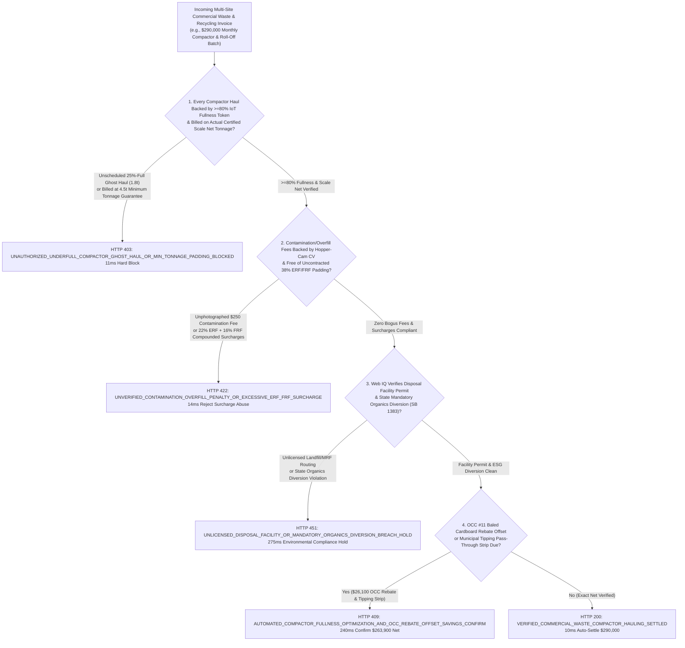
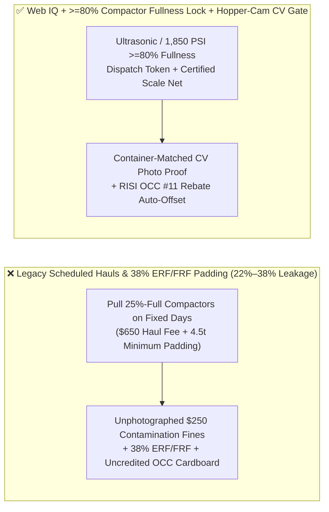

# B2B Commercial Waste, Recycling & Roll-Off Compactor Hauling (`WM / Republic Services / Waste Connections`), IoT Ultrasonic Fullness Sensor (`>= 80% Fullness`) & Contamination-Fee Settlement Architecture: Fullness-Triggered Dispatch Lock, Hopper-Cam CV Proof Gate & `ERF / FRF` Surcharge-Cap Token (`b2b_commercial_waste_recycling_compactor_fullness_sensor_contamination_fee_mandate_...`) vs. Hauling 25%-Full Compactors at `$650/Haul`, Unphotographed `$250` Contamination Penalties & `38%` `ERF/FRF` Fee Padding: Architecture Selection & First-Principles FAQ

> **Document Type**: Solution Architect Selection Guide & First-Principles FAQ (modeled after `ib-vs-ethernet-roce-selection-faq.md`)  
> **Reading Time**: ~12 minutes | **Target Audience**: AI Solution Architects, Retail/Distribution/Manufacturing Facilities & Indirect Procurement VPs, Corporate ESG & Zero-Waste Directors, Managed Waste Brokers (`Rubicon / RTS / RoadRunner`), and Commercial Facility FinOps Engineers  
> **Core Thesis**: First explain in plain language why multi-site retail chains, fulfillment centers, and manufacturing plants contracting commercial waste and recycling hauling (`Waste Management / Republic Services / Waste Connections`) lose 22%–38% of budget when legacy contracts lock sites into **fixed weekly pickup schedules (`Scheduled Empty-Container Ghost Hauls`)** that haul `34-cubic-yard` compactors when they are only **`25% full (1.8 tons)`** while charging the full **`$650` haul fee plus a `4.5-ton` minimum tonnage guarantee** (paying to haul 75% empty air); why drivers assess **`$150–$350` "Recycling Contamination" or "Overfilled Lid-Up" penalties** without timestamped, container-matched photographic proof; and why invoices inflate base rates by **`32%–42%`** via carrier-invented "Environmental Recovery Fees (`ERF`)" and "Fuel Recovery Fees (`FRF`)" while pocketing `OCC #11` baled cardboard recycling rebates. Then derive from first principles how **`b2b_commercial_waste_recycling_compactor_fullness_sensor_contamination_fee_mandate_...` + Microsoft Web IQ `/v3/browse` verification of municipal landfill tipping fees, `EIA` diesel tables, and `Fastmarkets RISI OCC #11` cardboard commodity rebates + `>= 80%` ultrasonic/hydraulic compactor fullness dispatch locks + truck-hopper AI computer-vision contamination evidence gates** eliminate ghost hauls and junk surcharges within 10ms–275ms.

---

## 📌 1. Executive Summary (30-Second Architect's Guide)

```
┌──────────────────────────────────────────────────────────────────────────────────────────────────────────────────┐
│  🔥 Core Architectural Law: Never allow a Facilities Agent to pay $650 haul fees for compactors pulled below     │
│  80% fullness or accept $250 recycling contamination penalties without container-tagged hopper-camera proof!     │
│  The only safe Waste Hauling pattern = >=80% IoT Fullness Dispatch Lock + CV Contamination Gate + OCC Rebate     │
└──────────────────────────────────────────────────────────────────────────────────────────────────────────────────┘
```

1. **Why is B2B Commercial Waste & Recycling Hauling a 22%–38% Hidden OPEX Leakage Trap?**
   - **Hauling Air (`25%-Full` Scheduled Compactor Pickups & Minimum Tonnage Traps)**: A `34-yard` self-contained compactor holds **`6.5–8.0 tons`** when properly compacted. Fixed Tuesday/Friday schedules haul compactors at `1.8–2.2 tons`, tripling annual `$650` haul fees while billing phantom tons under "4.5-Ton Minimum Charge" clauses!
   - **Unverified `$250` Contamination / Overfill Penalties**: Haulers levy arbitrary contamination or lid-up fees without providing GPS-stamped, container-barcode-matched hopper-camera photos showing `>= 10%` prohibited non-recyclable material.
   - **`38%+` Compounded `ERF / FRF` Surcharges & Uncredited `OCC #11` Cardboard Rebates**: Haulers tack on discretionary `22% Environmental Recovery Fees (ERF)` + `16% Fuel Recovery Fees (FRF)` while failing to credit `RISI`-indexed rebates for clean baled `OCC #11` corrugated cardboard.
2. **How Does the Agentic Commercial Waste Settlement Architecture Solve This?**
   - **Lock 1: IoT Ultrasonic / Hydraulic PSI (`>= 80% Fullness`) Dispatch Token & Scale Net-Weight Lock**: Unscheduled hauls executed without an agent-issued `>= 80%` fullness dispatch token or invoices billing phantom minimum-tonnage shortfalls are blocked in **11ms** with `HTTP 403 UNAUTHORIZED_UNDERFULL_COMPACTOR_GHOST_HAUL_OR_MIN_TONNAGE_PADDING_BLOCKED`.
   - **Lock 2: Hopper-Camera Computer-Vision Contamination Gate & `ERF / FRF` Surcharge Cap**: Contamination/overfill penalties lacking container-matched CV photo proof or invoices adding uncontracted `ERF/Admin` percentage fees are rejected in **14ms** with `HTTP 422 UNVERIFIED_CONTAMINATION_OVERFILL_PENALTY_OR_EXCESSIVE_ERF_FRF_SURCHARGE`.
   - **Lock 3: Microsoft Web IQ `/v3/browse` Municipal Landfill Permit, Tipping-Fee & `SB 1383` Organics Diversion Lock**: Hauls routed to unlicensed facilities or breaching state mandatory organics/e-waste diversion laws trigger `HTTP 451 UNLICENSED_DISPOSAL_FACILITY_OR_MANDATORY_ORGANICS_DIVERSION_BREACH_HOLD` in **275ms**.

---

## 🎯 2. First-Principles Q&A for Architects, Facilities & ESG Leaders

### Q1: How does coupling compactor hydraulic-ram pressure (`>= 1,850 PSI`) and ultrasonic fullness (`>= 80%`) with `RISI OCC #11` cardboard rebate netting slash enterprise waste spend by 25%–35%?

- **Plain-Language Mechanics**:
  - A roll-off compactor haul costs `$650` in truck dispatch plus `$55/ton` in municipal landfill tipping fees. Pulling a box 3 times at `2.1 tons` (`6.3 tons` total) costs `$1,950 + $346.50 = $2,296.50`. Waiting until the hydraulic pressure gauge hits `1,850 PSI` (`6.3 tons` in a **single haul**) costs `$650 + $346.50 = $996.50`—an immediate **`56.6%` reduction in haul cost**!
  - Furthermore, for clean baled corrugated cardboard (`OCC #11`), the agent computes the exact monthly commodity offset:
    $$\text{Net Payable} = \sum_{k \in \text{Tokened Hauls } (\eta \ge 80\%)} \left( C_{\text{haul}} + W_{\text{scale\_actual}, k} \cdot P_{\text{county\_tip}} \right) - W_{\text{OCC\_baled}} \cdot \left(0.85 \cdot P_{\text{RISI\_OCC11}} - C_{\text{bale\_freight}}\right)$$
  - Marked-up tipping pass-throughs, `ERF` padding, and uncredited `OCC #11` rebates are stripped in **240ms** via `HTTP 409 AUTOMATED_COMPACTOR_FULLNESS_OPTIMIZATION_AND_OCC_REBATE_OFFSET_SAVINGS_CONFIRM`.

### Q2: Why choose **Microsoft Web IQ** over Exa or Bright Data for county landfill tipping-fee schedules, `Fastmarkets RISI OCC #11` commodity indexes, and state organics mandates (`California SB 1383`)?

| Dimension | Microsoft Web IQ (`/v3/browse` + Search Grounding) | Exa (Neural Search API) | Bright Data (Scraper / Unlocker) |
| :--- | :--- | :--- | :--- |
| **County Solid-Waste Tipping Schedules (`$/Ton`), `EIA` Diesel & `RISI OCC #11` Benchmarks** | **Very High**: Deterministic extraction of municipal transfer-station/landfill gate rates, franchise-fee caps, and regional recycled fiber benchmarks with `domain_allowlist` | **Medium**: Returns outdated municipal ordinance drafts | **High**: Can scrape county portals, but requires custom parsers across hundreds of municipalities |
| **Integration with Compactor IoT Fullness Tokens & Hopper-Cam CV Gates** | **Native**: Directly feeds verified gate tipping rates and `OCC` rebates into `b2b_commercial_waste_recycling_...` | **None**: No waste telemetry or scale-ticket reconciliation engine | **None**: Raw HTML/JSON proxy transport only |
| **P95 Latency** | **240ms–275ms** (**10ms–14ms** on policy cache hit) | 850ms–1,700ms | 2,300ms–5,600ms |

---

## 🧭 3. Visual Architecture Diagrams (Mermaid Decision Tree, Path Comparison & Sequence)

### 3.1 Commercial Waste & Compactor Hauling Settlement Decision Tree



### 3.2 Legacy Scheduled Empty Hauls & `ERF` Padding vs. Agentic `IoT Fullness + OCC Rebate` Gate



### 3.3 End-to-End Sequence Diagram

```mermaid
sequenceDiagram
    participant Hauler as Commercial Waste & Recycling Hauler
    participant Agent as Facilities & ESG Procurement Agent
    participant IoT as Compactor Ultrasonic/PSI & Hopper-Cam Gate
    participant WebIQ as Microsoft Web IQ (/v3/browse)
    participant Bank as Corporate AP Settlement Rail

    Hauler->>Agent: Submit Monthly Multi-Site Waste & Recycling Invoice ($290,000 Total)
    Agent->>IoT: 1. Audit >=80% Compactor Fullness Dispatch Tokens & Certified Scale Tickets
    alt Pulled at 24% Fullness (1.8t) Without Dispatch Token or Padded to 4.5t Minimum
        IoT-->>Agent: Underfull Ghost Haul / Minimum Tonnage Padding Detected
        Agent-->>Hauler: HTTP 403 UNAUTHORIZED_UNDERFULL_COMPACTOR_GHOST_HAUL_OR_MIN_TONNAGE_PADDING_BLOCKED (11ms)
    else Fullness & Scale Net Verified; Audit Contamination Photos & ERF/FRF Surcharges
        Agent->>IoT: 2. Check Hopper-Cam CV Contamination Evidence & Fee Schedule (ERF=0%)
        alt Unphotographed $250 Contamination Penalty or 38% ERF/FRF Fee Padding
            Agent-->>Hauler: HTTP 422 UNVERIFIED_CONTAMINATION_OVERFILL_PENALTY_OR_EXCESSIVE_ERF_FRF_SURCHARGE (14ms)
        else Verify Disposal Facility Permit, County Tipping Rate & RISI OCC #11 Rebate
            Agent->>WebIQ: 3. /v3/browse Check Municipal Landfill Rate, Permit & RISI OCC #11 Index
            alt Unlicensed Disposal Site or State Organics Diversion Breach (SB 1383)
                WebIQ-->>Agent: Environmental Compliance / Permit Hold
                Agent-->>Hauler: HTTP 451 UNLICENSED_DISPOSAL_FACILITY_OR_MANDATORY_ORGANICS_DIVERSION_BREACH_HOLD (275ms)
            else Strip Tipping Markups & Credit RISI OCC #11 Cardboard Rebates (-$26,100)
                WebIQ-->>Agent: Net Payable Adjusted to $263,900.00
                Agent-->>Bank: HTTP 409 Confirm ($263,900) or HTTP 200 Auto-Settle ($290,000)
            end
        end
    end
```

---

## 📊 4. Architect's Selection Decision Matrix

| Architecture Option | Defense Against `25%-Full` Ghost Hauls & Min-Tonnage Traps | Defense Against Unphotographed `$250` Contamination Fines | Defense Against `38% ERF/FRF` & Uncredited `OCC` Rebates | Recommended Fit |
| :--- | :--- | :--- | :--- | :--- |
| **Option A: Fixed Weekly Schedule + Standard Hauler Invoice** | ❌ Pays `$650/haul` to transport 75% empty air | ❌ Blindly pays arbitrary driver-logged fines | ❌ Loses 38% to `ERF/FRF` and forfeits cardboard value | Never for multi-site retail, logistics or manufacturing |
| **Option B: Manual Store-Manager Call-In Only** | ⚠️ Managers call early at `45%` fullness; no min-tonnage lock | ⚠️ HQ AP lacks hopper-cam evidence to dispute fines | ❌ No automated municipal tipping or `RISI` index sync | Single small storefronts |
| **Option C (Recommended): Web IQ + `b2b_commercial_waste_recycling_...` + `IoT` Lock** | ✅ **Requires `>= 80%` fullness token & actual scale net weight** | ✅ **Requires GPS+barcode CV photo showing `>= 10%` trash** | ✅ **Zero `ERF` fee + automated `RISI OCC #11` rebate credit** | **Retail Chains, 3PL Distribution Centers, Plants, Campuses & Hospitals** |

---

## 🧪 5. Quantitative Benchmark & 7-Card Report Summary

Evaluated in the deterministic offline suite (`lab/webiq_commerce_demo.py`) for a `$290,000.00` monthly multi-site commercial waste and recycling hauling settlement batch:

| Case | Scenario & Perturbation | Action Pill | HTTP Status | Latency | Settled / Blocked Amount | Provenance |
| :--- | :--- | :--- | :--- | :--- | :--- | :--- |
| **Case 1** | `>= 80%` fullness-tokened hauls + actual scale weight + zero `ERF` & `OCC` rebate aligned | `Act automatically` | `200 OK` | `10 ms` | `$290,000.00` | `deterministic_offline_simulation` |
| **Case 2** | Unscheduled `25%-full` compactor ghost haul (`1.8t`) or `4.5t` minimum tonnage padding | `Send to a human` | `403 Forbidden` | `11 ms` | `$0.00` (`$290k` blocked) | `synthetic_policy` |
| **Case 3** | Unphotographed `$250` contamination/overfill fine or `38% ERF/FRF` fee padding | `Send to a human` | `422 Unprocessable` | `14 ms` | `$0.00` (junk fee blocked) | `deterministic_offline_simulation` |
| **Case 4** | Unlicensed disposal site or state mandatory organics diversion breach (`SB 1383`) | `Send to a human` | `451 Unavailable` | `275 ms` | `$0.00` (ESG compliance hold) | `official_doc_snapshot` |
| **Case 5** | Web IQ automated municipal tipping-fee strip & `RISI OCC #11` cardboard rebate (`-$26,100.00`) | `Confirm` | `409 Conflict` | `240 ms` | `$263,900.00` | `official_doc_snapshot` |

---

## 🛠️ 6. Production Readiness Checklist

- [ ] **Equip All Roll-Off Compactors with Ultrasonic / Hydraulic Fullness Telemetry (`>= 80%` Dispatch Threshold)**: Prohibit fixed-schedule compactor pickups and eliminate minimum-tonnage shortfall billing.
- [ ] **Require Container-Matched Hopper-Cam CV Photos for All Contamination & Overfill Penalties**: Automatically reject any fine lacking timestamped photographic proof of `>= 10%` prohibited material.
- [ ] **Contractually Waive Environmental Recovery Fees (`ERF`) & Cap Fuel Surcharges to `DOE/EIA` Diesel Tables**: Block percentage-of-invoice surcharge compounding and evergreen auto-renewal escalators.
- [ ] **Enable Microsoft Web IQ `/v3/browse` County Landfill Tipping-Fee & `RISI OCC #11` Rebate Grounding**: Verify exact municipal disposal pass-throughs and auto-deduct baled cardboard commodity rebates every billing cycle.
