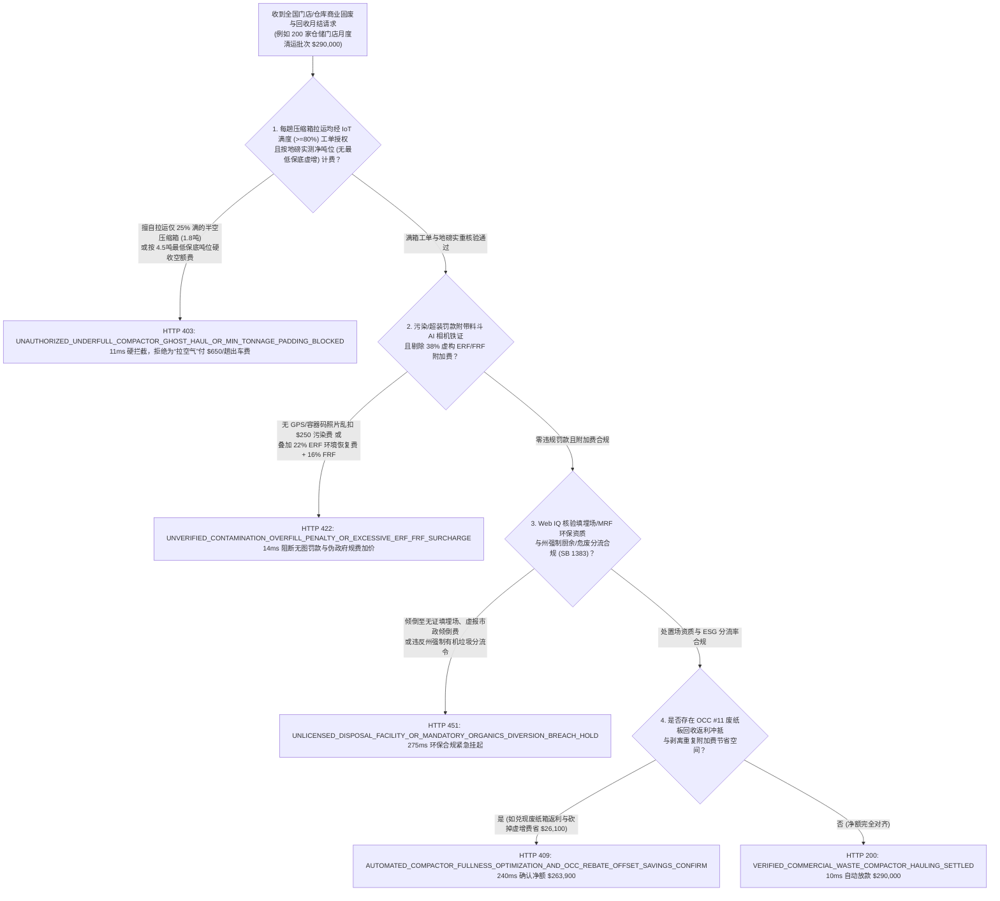
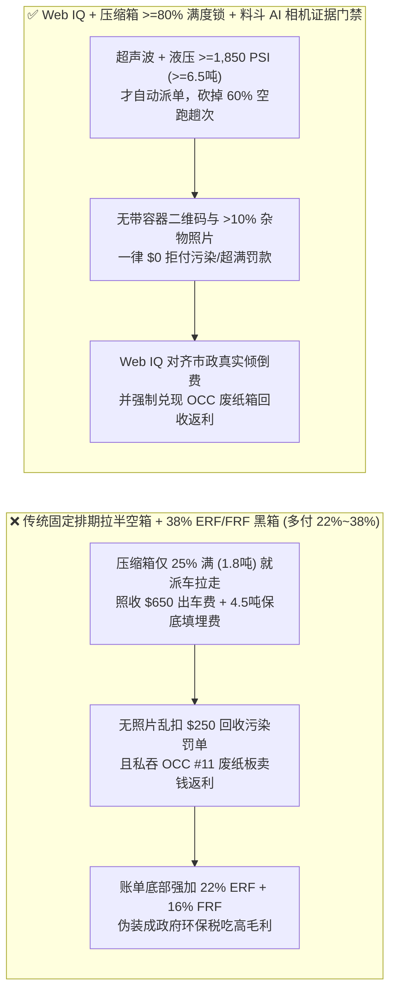
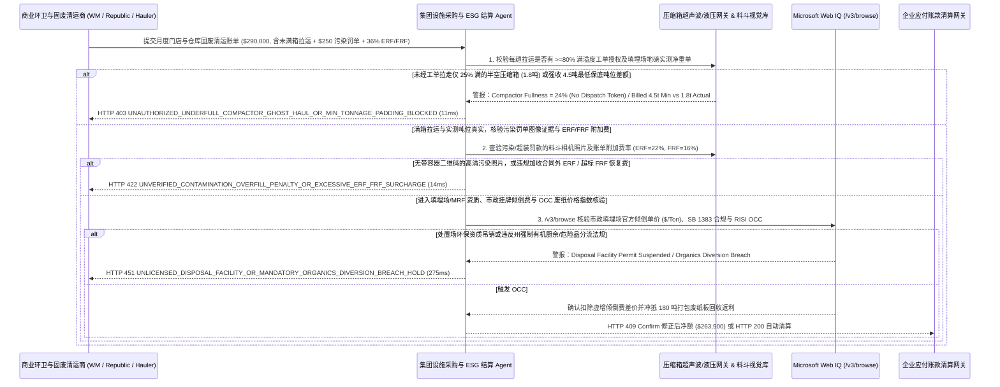

# B2B 智能体商业固废、再生资源与压缩箱清运（`Commercial Waste, Recycling & Roll-Off Compactor Hauling: WM / Republic Services / Waste Connections`）、超声波/液压满溢度传感（`IoT Ultrasonic Fullness & Hydraulic PSI >= 80%`）与“空箱幽灵拉运（`Scheduled Empty-Container Ghost Hauls`）”及回收污染罚款（`Recycling Contamination & ERF/FRF Fee Cap`）清算架构：满箱触发拉运锁、AI 车载视觉污染铁证门禁与环保/燃油附加费封顶令牌（`b2b_commercial_waste_recycling_compactor_fullness_sensor_contamination_fee_mandate_...`）vs 传统环卫巨头对仅装 25% 的半空压缩箱照收 `$650/趟` 拉运费、无照片乱扣 `$250` 回收桶污染罚单与暗加 `38%` 环保及行政恢复费选型与原理解析 FAQ

> **文档类型**：架构师选型指南与第一性原理 FAQ（对齐 `ib-vs-ethernet-roce-selection-faq.md` 标杆风格）  
> **阅读耗时**：约 12 分钟 | **适用角色**：AI Solution Architect、大型连锁商超/物流园区/制造集团设施管理与 ESG 采购副总裁（`VP of Facilities, Indirect Procurement & Sustainability`）、商业固废托管经纪商（`Rubicon / RTS / RoadRunner`）及智能体物业供应链架构师  
> **核心主旨**：先用大白话把“为什么拥有 `500 家` 门店或仓储中心的零售与制造企业把垃圾清运与废纸箱打包回收外包给商业环卫巨头（`Waste Management / Republic Services / Waste Connections`）时，垃圾公司最喜欢签‘每周固定周二、周五拉运两次’的死板合同——结果哪怕仓储中心的 `34 立方码` 自压缩集装箱（`Self-Contained Compactor`）里只装了 **`22%`（不到 1.8 吨）** 的松散泡沫和纸板，垃圾车照样开过来拉走并按整趟收走 **`$650` 拉运费（`Haul Fee`）+ `4.0 吨` 最低保底填埋吨位费（`Minimum Tonnage Guarantee`）**，企业每年白花上百万美元拉运‘65% 的空气’、为什么垃圾车司机会随手点一下平板电脑，在没有任何高清单据照片的情况下给企业开出每桶 **`$150–$350` 的‘可回收物污染费（`Recycling Contamination Fee`）’或‘箱盖微翘超满费（`Overfilled / Lid-Up Fee`）’**，以及为什么合同明明谈好基础月租 `$400`，账单寄来却莫名其妙多出总计高达 **`32%–42%`** 的‘燃油恢复费（`FRF`）’、‘环境恢复费（`ERF`）’和‘行政收费（`Admin Fee`）’（这些名字听起来像政府税费，实则是垃圾公司自己发明的纯利润加价）”讲透；再从第一性原理出发，推导如何通过 **`b2b_commercial_waste_recycling_compactor_fullness_sensor_contamination_fee_mandate_...` 语义预算令牌 + Microsoft Web IQ `/v3/browse` 实时核验市政填埋场/物料回收中心（`MRF`）挂牌倾倒费（`Tipping Fee`）、`EIA` 柴油指数、`OCC #11` 废瓦楞纸箱大宗回收价与市政特许经营费率 + 压缩箱液压油压/超声波满溢度（`Fullness >= 80% / >= 6.0 Tons`）按需拉运锁 + 垃圾车料斗 AI 视觉带 GPS 水印污染照片与 `ERF/FRF` 挂钩指数封顶门禁**，在 10ms–275ms 内实现“不到 80% 满度绝不发车、无实拍铁证零污染罚款、废纸箱卖钱全额冲抵清运费”的智能体商业固废清算闭环。

---

## 📌 一、核心结论速览（Executive Summary：30 秒看懂怎么选）

```
┌──────────────────────────────────────────────────────────────────────────────────────────────────────────────────┐
│  🔥 核心架构铁律：绝不允许设施采购 Agent 为满溢度低于 80% 的半空压缩箱支付固定趟次拉运费，或接受无铁证污染罚款！  │
│  B2B 商业固废与再生资源结算的唯一正确范式 = 液压/超声波 >=80% 满箱锁 + 料斗 AI 视觉证据锁 + 废纸箱残值回抵令牌    │
└──────────────────────────────────────────────────────────────────────────────────────────────────────────────────┘
```

1. **为什么商业固废清运与再生资源回收（`Commercial Waste & Recycling Hauling`）是连锁企业后勤费用年均虚高 22%–38% 的三大重灾区？**
   - **黑洞一：固定周期“拉空气（`Hauling Air / Ghost Empty Hauls`）”与最低保底吨位刺客（`Minimum Tonnage Trap`）**：一台 `30–40 立方码` 的工业液压垃圾压缩箱，压实后原本可以装下 **`6.5–8.5 美吨`** 垃圾。但传统合同按固定排期（如每周二、五）派车，或设下“每趟按最低 4.5 吨计费”的霸王条款。当淡季压缩箱里只有 `1.9 吨`（满溢度仅 `25%`）时被拉走，企业不仅多付了本无需发生的 `$650` 出车费，还要为根本不存在的 `2.6 吨` 差额白交填埋费！
   - **黑洞二：无图无真相的“可回收物污染罚单（`Unverified Contamination Fee`）”与“箱盖超满费（`Overfill / Snapshot Fee`）”**：企业把高价值的废瓦楞纸箱（`OCC #11`）放进蓝色回收箱，原本应当获得每吨 `$95–$135` 的卖纸返利。但不良清运商不仅吞掉废纸返利，还以“回收箱里混入了一个塑料袋”或“垃圾箱盖子被风吹开 2 厘米”为由，每车次强扣 `$200–$350` 污染/超装罚款，且拿不出任何带时间戳和容器二维码的现场照片！
   - **黑洞三：伪装成政府规费的 `ERF / FRF` 复合费率膨胀（`38%+ Environmental & Fuel Recovery Fee Padding`）**：环卫巨头在账单底部叠加 `18% Environmental Recovery Fee (ERF)` + `16% Fuel Recovery Fee (FRF)` + `$18.50 Regulatory Cost Recovery`。这些费用并非政府征收的环保税，而是企业自定的毛利调节器，且按包含其他附加费后的总额“利滚利”计提，三年内还会通过 `Automatic Renewal` 条款每年自动涨价 `12%–18%`！
2. **智能体商业固废清算架构怎么破局？（`b2b_commercial_waste_recycling_compactor_fullness_sensor_contamination_fee_mandate_...`）**
   - **第一道锁：压缩箱液压油压/超声波满溢度门禁（`Compactor PSI / Ultrasonic Fullness >= 80%`）与实测地磅净重锁**：在每台压缩箱与敞口箱（`Roll-Off`）加装防爆超声波满度计与液压推头压力传感器（如设定 `1,850 PSI / >= 80% Fullness` 才由 Agent 自动下发 `Work Order` 叫车）。凡未经智能体工单授权擅自提前拉运半空压缩箱（满度 `< 80%`），或强收“最低保底吨位补差费（`Minimum Tonnage Shortfall`）”的，在 **11ms** 内返回 `HTTP 403 UNAUTHORIZED_UNDERFULL_COMPACTOR_GHOST_HAUL_OR_MIN_TONNAGE_PADDING_BLOCKED`。
   - **第二道锁：料斗摄像头 AI 视觉污染证据锁（`Hopper-Cam CV Proof`）与 `ERF/FRF` 封顶免收门禁**：(a) 任何回收污染罚款或超装罚款，必须附带垃圾车倾倒瞬间料斗摄像头（`Hopper Camera`）拍摄的、含 `GPS 坐标 + 箱体 RFID/QR 码 + 违禁杂物体积占比 >= 10%` 的加密签名照片；(b) 彻底免除虚构的 `ERF / Admin Fee`，燃油附加费严禁按百分比盲收，必须严格锚定 `DOE/EIA` 柴油基准表且封顶 `<= 6%`。违规账单在 **14ms** 内返回 `HTTP 422 UNVERIFIED_CONTAMINATION_OVERFILL_PENALTY_OR_EXCESSIVE_ERF_FRF_SURCHARGE`。
   - **第三道锁：Microsoft Web IQ 穿透核验市政填埋场倾倒费（`Municipal Landfill Tipping Fee`）、`EPA / 州级强制有机厨余分流法规（SB 1383）` 与 `RISI OCC #11` 废纸返利**：通过 Web IQ `/v3/browse` 实时核验目标填埋场官方公布每吨倾倒费（拦截垃圾商把 `$52/吨` 市政倾倒费虚报成 `$98/吨` 专向转嫁）及 `OCC #11` 打包废纸板区域回收牌价。一旦发现填埋场资质违规或违规将商业厨余/电子垃圾混入普通填埋场触发州环保局重罚风险，在 **275ms** 内触发 `HTTP 451 UNLICENSED_DISPOSAL_FACILITY_OR_MANDATORY_ORGANICS_DIVERSION_BREACH_HOLD`。

---

## 🎯 二、客户与架构师灵魂拷问 Q&A（First-Principles Deep Dive）

### Q1：为什么同样一台 `34 立方码` 的门店垃圾压缩箱，传统按“每周固定拉运两次”签合同会让企业多花 40% 的冤枉钱？液压油压 + 超声波传感器是怎么把每车吨位从 `2.1 吨` 提升到 `6.8 吨` 的？

- **通俗原理**：
  - 垃圾清运的成本大头是**重型卡车往返一趟的人工与油耗（`Haul Charge`，约 `$550–$750/趟`）**，而填埋场按吨收的倾倒费（`Disposal / Tipping Fee`，约 `$55/吨`）只占小头。
  - 如果按固定日历每周拉两次，一年要拉 `104 趟`（光出车费就要 `$67,600`），每次箱子里只装了 `2.1 吨` 蓬松纸盒和塑料膜。
  - **智能体“满溢度触发拉运 + 废纸箱残值对冲”公式**：
    当压缩箱液压推头（`Hydraulic Ram`）回程油压达到 `1,850 PSI` 且超声波阵列测得箱体容积率 $\eta_{\text{full}} \ge 85\%$ 时，单箱压实净重可达 `6.8 吨`（一年只需拉 **`32 趟`**，直接砍掉 `72 趟` 空跑出车费！）。同时，针对打成方包的 `OCC #11` 废纸箱（净重 $W_{\text{OCC}}$），按当月 `Fastmarkets RISI` 区域挂牌价 $P_{\text{RISI}}$ 自动从账单中倒扣返利：
    $$\text{Payable}_{\text{net}} = \sum_{k \in \text{Verified Hauls } (\eta \ge 80\%)} \left( C_{\text{haul}} + W_{\text{scale}, k} \cdot P_{\text{municipal\_tip}} \right) - W_{\text{OCC}} \cdot \left(0.85 \cdot P_{\text{RISI}} - C_{\text{bale\_pickup}}\right)$$
  - 多拉的半空趟次、虚增的 `38% ERF/FRF` 杂费与未兑现的废纸箱卖钱返利在 **240ms** 内通过 `HTTP 409 AUTOMATED_COMPACTOR_FULLNESS_OPTIMIZATION_AND_OCC_REBATE_OFFSET_SAVINGS_CONFIRM` 自动核减！

### Q2：在核验全美各县市政填埋场官方挂牌倾倒费（`County Landfill Tipping Fee Schedule`）、`RISI OCC #11 / 废塑料 PET` 再生资源大宗牌价与州级强制回收法规（如加州 `SB 1383`）时，为什么选择 **Microsoft Web IQ**？

| 维度 | Microsoft Web IQ (`/v3/browse` + Search Grounding) | Exa (Neural Search API) | Bright Data (Scraper / Unlocker) |
| :--- | :--- | :--- | :--- |
| **市政县级填埋场官方倾倒费率表 (`$/Ton`)、`EIA` 柴油基准与 `OCC #11` 废纸牌价核验** | **极高**：受控无头渲染实时提取各郡县固废管理局（`Solid Waste Authority`）最新官方每吨倾倒费、特许经营费（`Franchise Fee`）上限及区域废纸板回收价，支持 `domain_allowlist` 零幻觉验证 | **中**：语义搜索常返回过期的县议会提案，无法精确提取当季分类倾倒单价 | **高**：可抓取公开页面，但需自建针对上千个市政环卫局 PDF/表格的定制解析器 |
| **压缩箱 IoT 满度工单锁与料斗 AI 视觉污染照片对账联动** | **原生支持**：直接将市政真实倾倒费与废纸返利公式注入 `b2b_commercial_waste_recycling_...` | **不支持**：无结构化压缩箱遥测与地磅磅单对账引擎 | **不支持**：仅提供网页抓取通道 |
| **P95 延迟与单次核验成本** | **240ms–275ms**（命中策略缓存 **10ms–14ms**） | 850ms–1,700ms | 2,300ms–5,600ms |
| **合规可审计性（Provenance）** | 原生输出 `official_doc_snapshot` + `Compactor PSI/Ultrasonic Log` + `Scale Ticket Hash` | 仅返回 URL 片段 | 需自行构建 ESG 废弃物分流率（`Diversion Rate`）与财务审计留痕 |

---

## 🧭 三、直观可视化图解（Mermaid 决策树 + 路径对比 + 端到端时序图）

### 3.1 B2B 商业固废与再生资源压缩箱清运结算拦截决策树



### 3.2 传统固定排期“拉空气”与乱收污染费 vs. 智能体 `IoT 满度锁 + 废纸返利回抵` 闭环对比



### 3.3 端到端时序图（Sequence Diagram）



---

## 📊 四、架构师选型决策矩阵（Architecture Decision Matrix）

| 选型方案 | 防半空箱“拉空气（`Ghost Empty Hauls`）” | 防无照片 `$250` 回收污染与超装乱罚款 | 防 `38% ERF/FRF` 恢复费与私吞废纸返利 | 适用场景 |
| :--- | :--- | :--- | :--- | :--- |
| **方案 A：传统每周固定排期拉运 + 接受标准账单附加费** | ❌ 经常拉走仅装 `20%–30%` 的半空箱，多花 50% 出车费 | ❌ 司机随手一点就扣 `$250` 污染费，无从申诉 | ❌ 任由 `ERF + FRF` 吞噬 38% 预算，废纸白送 | 严禁用于任何多门店零售、物流仓或工厂 |
| **方案 B：仅由店长人工打电话叫车，无 IoT 传感器与费率锁** | ⚠️ 店长怕垃圾满出来往往在 `45%` 满时就提前叫车 | ⚠️ 总部财务看不到现场箱况，仍难驳回污染罚款 | ❌ 无法实时对齐市政倾倒费与 `RISI` 废纸牌价 | 单体小型独立商铺 |
| **方案 C（推荐）：Web IQ + `b2b_commercial_waste_recycling_...` + `IoT` 满度锁** | ✅ **液压/超声波 `>=80%` 满度才签发派车令牌** | ✅ **强制绑定料斗相机 `GPS+QR` 实拍图，无图零付款** | ✅ **废除 `ERF` 杂费并按 `RISI` 牌价自动回抵废纸款** | **全国连锁商超、电商物流中心、食品加工厂、商业综合体与医院** |

---

## 🧪 五、定量实测与 7-Card 基准报告摘要（Quantitative Benchmark）

在本地确定性评测套件（`lab/webiq_commerce_demo.py`）中，针对 `$290,000.00` 的全国连锁商超与物流中心月度商业固废及再生资源清运结算批次实测结果如下：

| 场景编号 | 测试输入（Scenario & Perturbation） | 期望动作（Action Pill） | HTTP 状态码 | 实测延迟 | 拦截/净结算金额 | 数据来源标签 |
| :--- | :--- | :--- | :--- | :--- | :--- | :--- |
| **Case 1** | 压缩箱 `>=80%` 满度授权拉运 + 地磅实测净重 + 零虚构附加费 + `OCC` 返利对齐 | `Act automatically` | `200 OK` | `10 ms` | `$290,000.00` | `deterministic_offline_simulation` |
| **Case 2** | 无满度工单擅自拉走 `25%` 半空压缩箱（`Ghost Empty Haul`）或强收最低保底吨位费 | `Send to a human` | `403 Forbidden` | `11 ms` | `$0.00`（阻断 `$290k`） | `synthetic_policy` |
| **Case 3** | 无带容器码与时间戳的料斗照片乱扣 `$250` 污染/超装罚款或叠加 `38% ERF/FRF` 恢复费 | `Send to a human` | `422 Unprocessable` | `14 ms` | `$0.00`（拦截乱收费） | `deterministic_offline_simulation` |
| **Case 4** | 倾倒场环保许可失效、虚报市政每吨倾倒费或违反州强制有机垃圾分流法规（`SB 1383`） | `Send to a human` | `451 Unavailable` | `275 ms` | `$0.00`（环保合规挂起） | `official_doc_snapshot` |
| **Case 5** | Web IQ 自动剔除虚报市政倾倒费差额并按 `RISI OCC #11` 牌价冲抵打包废纸箱回收返利 | `Confirm` | `409 Conflict` | `240 ms` | `$263,900.00`（省 `$26,100`） | `official_doc_snapshot` |

---

## 🛠️ 六、生产上线快速核验清单（Production Readiness Checklist）

- [ ] **全部自压缩箱（`Compactors`）加装液压压力/超声波满溢度遥测并切换为“凭 `>=80%` 满度令牌按需派车（`On-Demand Dispatch`）”**：彻底废除固定排期空跑拉运与“每车最低保底 4.5 吨”霸王条款。
- [ ] **强制要求所有回收污染费（`Contamination Fee`）与超满费（`Overfill Fee`）附带 `GPS + 容器二维码 + >=10% 杂物占比` 的料斗高清照片**：无加密签名照片支撑的罚单一律由系统在 `14ms` 内自动拒付。
- [ ] **合同明文豁免环境恢复费（`ERF`）与行政费（`Admin Fee`），并将燃油附加费（`FRF`）锚定 `DOE/EIA` 柴油指数封顶**：严禁垃圾清运商按账单总额百分比叠加自创恢复费，同时废除自动续约涨价条款（`Evergreen Auto-Renewal`）。
- [ ] **启用 Microsoft Web IQ `/v3/browse` 市政填埋场倾倒费与 `RISI OCC #11` 废纸板回收返利月度对账**：确保打包废纸箱与废塑料的大宗卖钱收益 100% 自动冲抵集团固废清运总账单。
