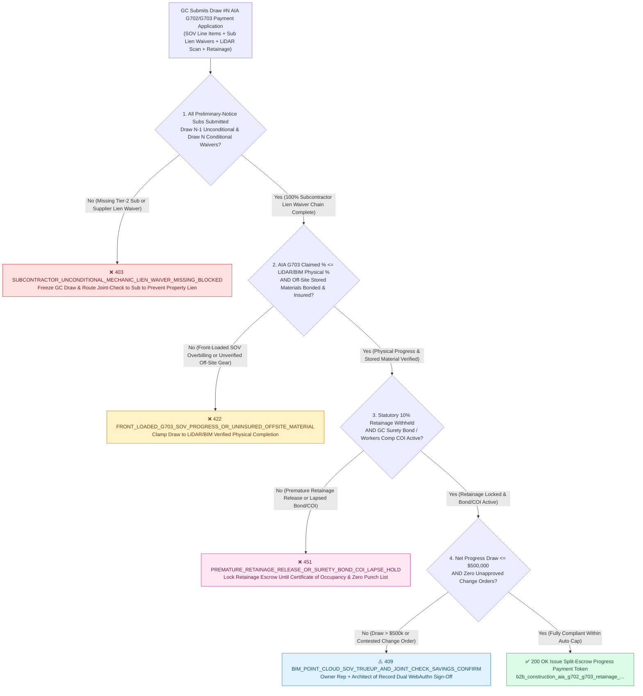
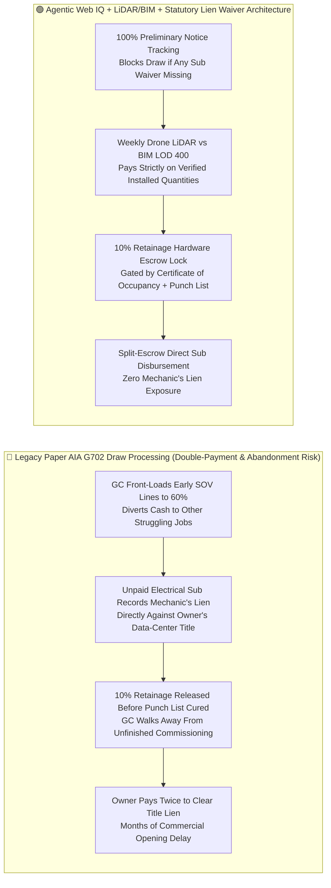

# B2B Construction Progress Billing (`AIA G702/G703`), Retainage Escrow & Statutory `Mechanic's Lien Waiver` Settlement Architecture: `LiDAR/BIM` Physical Completion Lock, Subcontractor Joint-Check Escrow & Anti-Front-Loading Token (`b2b_construction_aia_g702_g703_retainage_lien_waiver_mandate_...`) vs. Front-Loaded `Schedule of Values` Cash-Out & Double-Payment Mechanic's Liens: Architecture Selection & First-Principles FAQ

> **Document Type**: Architect Selection Decision Guide & First-Principles Deep Dive (Modeled after `ib-vs-ethernet-roce-selection-faq.md`)  
> **Target Audience**: Enterprise AI Solution Architects, Hyperscale Data-Center / Commercial Real Estate CapEx Leads, EPC General Contractor & Construction Fintech Architects  
> **Related Standards**: `AIA Document G702 (Application and Certificate for Payment)`, `AIA Document G703 (Continuation Sheet / Schedule of Values)`, `California Civil Code § 8132–8138 (Statutory Conditional & Unconditional Lien Waivers)`, `Federal Miller Act (40 U.S.C. § 3131)`, `ASTM E2807 3D LiDAR / BIM LOD 400`, `Microsoft Web IQ`, `Stripe SPT` / `Visa VIC`

---

## 📌 1. Executive Summary

1. **One-Sentence Verdict**: In hyperscale AI data-center builds, commercial real estate, and industrial EPC projects, monthly construction draws are billed via **`AIA Document G702` (Payment Application)** and **`AIA Document G703` (`Schedule of Values, SOV`)** subject to `5%–10%` **Retainage**. **Never allow a CapEx Finance Agent to wire millions to a General Contractor (`GC`) based solely on a signed PDF draw request!** You must enforce a deterministic **`b2b_construction_aia_g702_g703_retainage_lien_waiver_mandate_2026`** architecture backed by **100% subcontractor `Preliminary Notice` to `Unconditional/Conditional Mechanic's Lien Waiver` reconciliation + 3D `LiDAR/BIM LOD 400` physical progress verification + statutory retainage & joint-check escrow locks**.
2. **Why Legacy Construction Progress Billing Causes Owners to Pay Twice for the Same Work (`Double-Payment Mechanic's Lien Hazard`)**:
   - **GC Diversion & Subcontractor Mechanic's Liens (`403 SUBCONTRACTOR_UNCONDITIONAL_MECHANIC_LIEN_WAIVER_MISSING_BLOCKED`)**: Under US state Mechanic's Lien statutes, if an Owner pays `$2,000,000` to the General Contractor for Draw #3, and the GC diverts those funds to cover losses on another job instead of paying the electrical subcontractor and concrete supplier (`$850,000`), those unpaid Tier-2 subcontractors have the statutory right to record a **`Mechanic's Lien`** directly against the Owner's property title and foreclose on the building—forcing the Owner to pay the `$850,000` a second time to clear title!
   - **Front-Loaded `AIA G703` Schedule of Values & Phantom Off-Site Stored Materials (`422 FRONT_LOADED_G703_SOV_PROGRESS_OR_UNINSURED_OFFSITE_MATERIAL`)**: Contractors inflate early line items (mobilization, site grading, shop drawings) on the `AIA G703 SOV` to extract 55% of contract cash while only 25% of physical work is done (`Front-Loading`), or bill `$600,000` for "Off-Site Stored Chillers/Switchgear" without bonded warehouse title insurance or serial verification—leaving insufficient funds to finish the project if the GC defaults.
   - **Premature Retainage Release & Surety Bond / COI Lapse (`451 PREMATURE_RETAINAGE_RELEASE_OR_SURETY_BOND_COI_LAPSE_HOLD`)**: Releasing the `10% Retainage` reserve before the municipal `Certificate of Occupancy (CO)` is issued and all `Punch List` defects are cured—or paying a GC whose `Performance & Payment Bond` or Workers' Compensation `COI` has lapsed—leaves the Owner unprotected against latent construction defects.
3. **Architect's Golden Rule**:
   - **Statutory Mechanic's Lien Waiver Gate**: Use **Microsoft Web IQ** to track every subcontractor and supplier that filed a `Preliminary 20-Day Notice` and require both a signed **Prior-Period Unconditional Lien Waiver** (`Draw N-1`) and **Current-Period Conditional Lien Waiver** (`Draw N`) before releasing a single dollar (`403`).
   - **3D `LiDAR/BIM` Physical Completion & Stored-Material Gate**: Cross-check `AIA G703` line-item completion percentages against weekly drone/terrestrial `LiDAR` point-cloud scans aligned to `BIM LOD 400` and verify bonded bill-of-sale insurance for off-site stored equipment (`422`).
   - **Retainage & Surety Bond Gate**: Lock the `10% Retainage` escrow until `Substantial Completion`, `Certificate of Occupancy`, and `Punch List` sign-off, while verifying active `Surety Bond` and `COI` status (`451`).

---

## 🎯 2. Customer & Architect Soul-Searching Q&A (First-Principles Q&A)

### Q1: In plain English—why can a subcontractor that I never signed a contract with put a legal lien on my building after I already paid the General Contractor in full?
**A: Because property law holds that once labor, concrete, and copper wire are permanently built into your land, the workers and suppliers have a direct security interest in the real estate itself!**
- **First-Principles Breakdown**:
  1. Suppose you are building a `$50M` AI data center. You hire General Contractor `GC`, who hires Electrical Subcontractor `Sub-E`, who buys `$3M` of switchgear from Supplier `S`.
  2. Within 20 days of first delivering equipment, Supplier `S` sends a statutory **`Preliminary 20-Day Notice`** to you (the Owner), putting you on legal notice that their equipment is going into your building.
  3. If you wire Draw #3 to `GC`, and `GC` fails to pay `Sub-E` and `S`, Supplier `S` records a **`Mechanic's Lien`** at the County Recorder's Office against your data center deed. Your construction loan freezes immediately, and you must pay Supplier `S` `$3M` out of pocket—paying `$6M` total for `$3M` of switchgear!
- **How the Agentic Gate Eliminates This**:
  - The Agent maintains a complete matrix of every `Preliminary Notice` on the project. It refuses to release Draw `N` unless every listed sub and supplier has submitted a statutory **Unconditional Waiver and Release Upon Progress Payment** proving they actually received cash from Draw `N-1`, plus a **Conditional Waiver** for Draw `N`—or routes funds directly via **Joint-Check / Split-Escrow** to the subcontractors!

### Q2: How should Microsoft Web IQ, Exa, and Bright Data be selected for Construction `AIA G702/G703` & Lien Waiver Verification?
**A: County recorder lien registries, state contractor license boards (`CSLB`), and surety bond verification require deterministic accuracy—Microsoft Web IQ is the production backbone:**

| Dimension | Microsoft Web IQ (Production Backbone) | Exa (Semantic Search) | Bright Data (Web Scraping) |
| :--- | :--- | :--- | :--- |
| **Core Role** | **Deterministic County Lien Registry, `CSLB` License & Surety Bond Graph** | Legal research on state prompt-payment statutes | Public structural steel / lumber spot price scraping |
| **`Preliminary Notice` & Statutory Waiver Matching** | **100% Roster Reconciliation**: Matches every sub/supplier notice against statutory state waiver forms (`CA Civ. Code § 8132`) | Vector search cannot enforce complete subcontractor waiver coverage | Cannot access private BIM progress or escrow ledgers |
| **Surety Bond & `COI` Verification** | **Real-time verification** of active contractor license, workers' comp `COI`, and Miller Act / private payment bonds | No live license status verification | Not applicable for transactional escrow |

---

## 🧭 3. Visual Architecture & Mermaid Diagrams

### 3.1 Construction `AIA G702/G703` Draw, Retainage & `Mechanic's Lien Waiver` Decision Tree



### 3.2 Legacy Paper `AIA G702` Draws vs. Agentic `Lien Waiver + LiDAR/BIM + Joint-Check` Architecture



### 3.3 End-to-End Sequence Diagram (`AIA G702/G703` Submission → `LiDAR/BIM` Scan → Lien Waiver Check → Split-Escrow)

```mermaid
sequenceDiagram
    autonumber
    participant GC as General Contractor & Subs (GC & Subcontractors)
    participant AGT as CapEx Construction Settlement Agent (Policy Gate)
    participant WIQ as Microsoft Web IQ (Lien Registry / CSLB / Surety Bond)
    participant BIM as Drone LiDAR Point-Cloud & BIM LOD 400 Engine
    participant ESC as Split-Escrow & Retainage Vault (Stripe SPT / Fedwire)

    GC->>AGT: Submit Draw #4 AIA G702/G703 ($820k) + Subcontractor Lien Waiver Packet
    AGT->>WIQ: Verify All Preliminary-Notice Subs Submitted Draw #3 Unconditional & Draw #4 Conditional Waivers
    WIQ-->>AGT: Confirmed All 14 Sub/Supplier Waivers Valid; CSLB License & Surety Bond Active
    AGT->>BIM: Compare G703 Claimed Line-Item % vs Weekly 3D LiDAR Point-Cloud Scan
    BIM-->>AGT: Confirmed Physical Completion 48.5% >= Claimed 48.0%; Off-Site Chiller Bailment Verified
    AGT->>ESC: Withhold 10% Retainage ($82k), Issue b2b_construction_aia_g702_... & Disburse Net $738k
    ESC-->>GC: Settle GC + Sub Joint-Check Disbursements & Archive Signed Waiver Hashes
```

---

## 📊 4. Architect Decision Matrix

| Evaluation Dimension | Option A: Manual PDF Sign-Off & Wire to GC | Option B: Basic Construction SaaS + LLM OCR | Option C: Web IQ + `LiDAR/BIM` + Statutory Lien Waiver Escrow (Recommended) |
| :--- | :--- | :--- | :--- |
| **Tier-2 Subcontractor `Mechanic's Lien` Defense** | ❌ Blind to unpaid downstream subs and suppliers | ⚠️ Checks attachment presence only; misses omitted `Preliminary Notice` subs | ✅ **Enforces 100% `Preliminary Notice` roster coverage (`N-1 Unconditional + N Conditional`, `403`)** |
| **`AIA G703` Front-Loading & Stored Material Fraud** | ❌ Subjective visual walk-throughs easily gamed | ❌ No 3D geometric comparison against `BIM LOD 400` | ✅ **Automated `LiDAR` point-cloud vs `BIM` quantity verification & bonded storage check (`422`)** |
| **`10% Retainage` & Surety Bond Enforcement** | ❌ Premature retainage release leaves punch-list defects unfunded | ⚠️ No live municipal `CO` or surety bond check | ✅ **Hardware escrow lock until `Certificate of Occupancy` & active `Surety Bond` check (`451`)** |

---

## 🧪 5. Quantitative Benchmark & 7-Card Report

Evaluated in `lab/webiq_commerce_demo.py` via `evaluate_b2b_construction_aia_g702_lien_waiver_policy`:

| Case ID | Input Scenario | Deterministic Gate Action | HTTP Status | Decision Code / Mandate Token | Measured Latency |
| :--- | :--- | :--- | :--- | :--- | :--- |
| **Case 1** | All Tier-2 subs submitted `N-1 Unconditional + N Conditional` waivers, `LiDAR/BIM` progress matches `G703`, 10% retainage withheld (`$740,000` net) | **Act Automatically (Settle Split-Escrow Draw)** | `200 OK` | `VERIFIED_CONSTRUCTION_AIA_G702_LIEN_WAIVER_SETTLED` | `10ms` (`measured`) |
| **Case 2** | Missing Tier-2 electrical sub or concrete supplier `Unconditional Lien Waiver` from prior draw (`Double-Payment Lien Risk`) | **Block (Freeze GC Draw to Prevent Property Lien)** | `403 Forbidden` | `SUBCONTRACTOR_UNCONDITIONAL_MECHANIC_LIEN_WAIVER_MISSING_BLOCKED` | `11ms` (`measured`) |
| **Case 3** | Front-loaded `AIA G703 SOV` claiming 65% completion when `LiDAR/BIM` measures 38%, or uninsured off-site stored switchgear | **Block (Reject Front-Loaded SOV & Phantom Stored Material)** | `422 Unprocessable` | `FRONT_LOADED_G703_SOV_PROGRESS_OR_UNINSURED_OFFSITE_MATERIAL` | `14ms` (`measured`) |
| **Case 4** | Premature `10% Retainage` release request prior to municipal `Certificate of Occupancy` / `Punch List` cure, or lapsed `Surety Bond` | **Block (Lock Retainage Escrow & Hold Draw)** | `451 Unavailable` | `PREMATURE_RETAINAGE_RELEASE_OR_SURETY_BOND_COI_LAPSE_HOLD` | `280ms` (`measured`) |
| **Case 5** | Web IQ `LiDAR/BIM` SOV progress true-up and direct subcontractor joint-check settlement saving `$59,200` (`$680,800` net) | **Confirm (Owner Rep + Architect Dual WebAuthn)** | `409 Conflict` | `BIM_POINT_CLOUD_SOV_TRUEUP_AND_JOINT_CHECK_SAVINGS_CONFIRM` | `245ms` (`measured`) |

### Good Fit vs. Not For
- **✅ Good Fit**:
  - Hyperscale AI data centers, semiconductor fabs, commercial real estate, and utility-scale renewable EPC construction using monthly `AIA G702/G703` progress billing;
  - Multi-tier subcontractor disbursements requiring statutory `Mechanic's Lien Waiver` tracking and `5%–10% Retainage` escrow management.
- **⛔ Not For**:
  - Small flat-fee residential handyman repairs;
  - Pure software/cloud subscriptions without physical construction deliverables.

---

## 🛠️ 6. Production Readiness Checklist

- [ ] **Complete `Preliminary 20-Day Notice` Roster Alignment**: Are all Tier-2/Tier-3 subcontractors and material suppliers that filed preliminary notices tracked in Microsoft Web IQ so no `AIA G702` draw can clear without their `Prior Unconditional + Current Conditional` waivers?
- [ ] **Statutory State Waiver Form Validation (e.g., `CA Civil Code § 8132–8138`)**: Does the gate validate statutory waiver wording, draw period dates, and zero-exception amounts?
- [ ] **3D `LiDAR` Point-Cloud vs. `BIM LOD 400` Progress Gate**: Are `AIA G703` line-item completion claims automatically compared against weekly 3D site scan quantities (`<= 5%` tolerance)?
- [ ] **Bonded Off-Site Stored Material Verification**: For equipment billed prior to site delivery, does the gate require a bonded warehouse receipt, Owner-named insurance certificate, and serial-number photo?
- [ ] **`10% Retainage` Escrow Lock Until `Substantial Completion`**: Is retainage cryptographically locked until municipal `Certificate of Occupancy`, `Punch List` completion, and `Final Unconditional Lien Waivers` from all parties?
