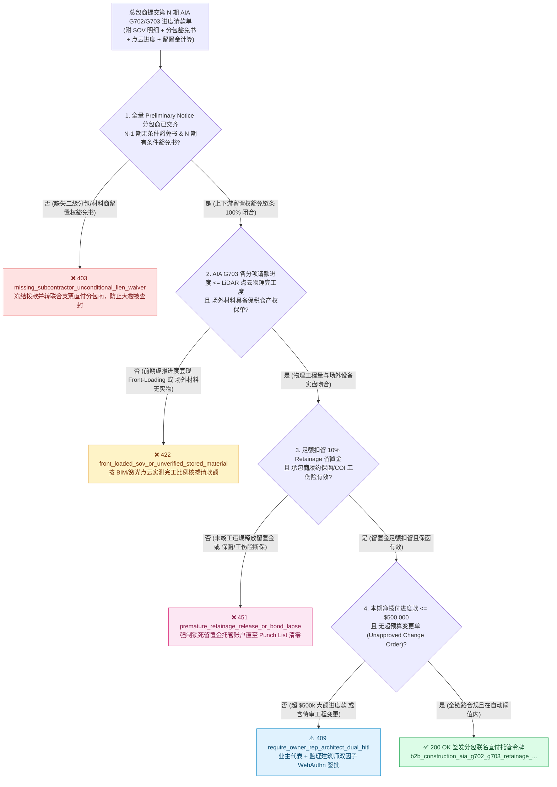
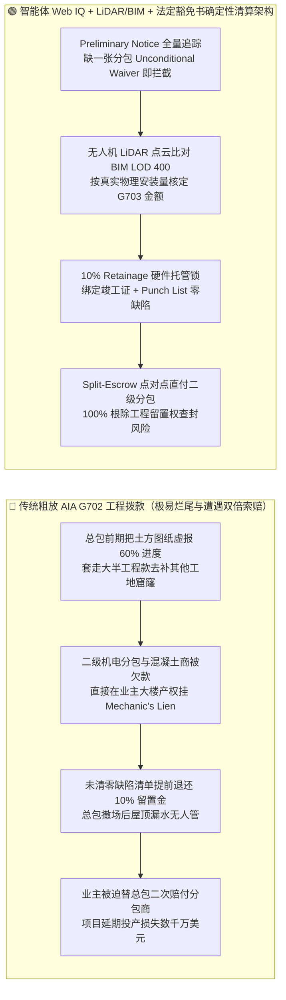
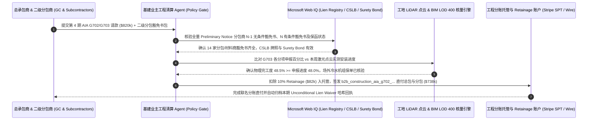

# B2B 智能体商业基建工程进度款（`AIA G702/G703 Progress Billing`）、留置金托管（`Retainage Escrow`）与法定留置权豁免书（`Mechanic's Lien Waiver`）清算架构：BIM/激光点云完工度锁、二级分包商直付防双倍留置权与防前期虚报套现令牌（`b2b_construction_aia_g702_g703_retainage_lien_waiver_mandate_...`）vs 传统总包前期虚报进度卷款烂尾、分包商欠薪触发房产被法院查封二次赔付选型与原理解析 FAQ

> **文档类型**：架构师选型决策指南 & 第一性原理深度解析（对标 `ib-vs-ethernet-roce-selection-faq.md` 标杆风格）  
> **适用角色**：Enterprise AI Solution Architect、数据中心/商业地产与新能源基建业主（Owner / Hyperscaler CapEx）、工程总承包（EPC / General Contractor）与建设工程供应链金融架构师  
> **关联标准的演进**：`AIA Document G702 (Application and Certificate for Payment)`、`AIA Document G703 (Continuation Sheet / Schedule of Values)`、`California Civil Code § 8132–8138 (Conditional & Unconditional Mechanic's Lien Waivers)`、`Federal Miller Act (40 U.S.C. § 3131)`、`ASTM E2807 3D Laser Scanning / BIM LOD 400`、`Microsoft Web IQ`、`Stripe SPT` / `Visa VIC`

---

## 📌 一、 核心结论速览（Executive Summary）

1. **一句话定性**：在大型 AI 算力中心基建、商业地产与工厂 EPC 总包工程中，工程款按月度进度通过 **`AIA G702`（付款申请与工程师签证单）** 与 **`AIA G703`（价值明细表 `Schedule of Values, SOV`）** 分期拨付，并扣除 `5%~10%` 的**质保留置金（`Retainage`）**。**绝对不能让基建财务 Agent 仅凭总包商（GC）发来的 PDF 请款单就直接电汇数百万美元进度款！** 必须构建基于 **预备留置通知（`Preliminary 20-Day Notice`）与二级分包商无条件留置权豁免书（`Unconditional Mechanic's Lien Waiver`）全齐备门禁 + 3D 激光点云/BIM 物理完工百分比防前期虚报（`Front-Loading`）锁 + 分包商联名直付托管（`Joint-Check / Split-Escrow`）** 的 **`b2b_construction_aia_g702_g703_retainage_lien_waiver_mandate_2026`** 确定性工程结算架构。
2. **为什么传统基建工程进度款结算会频发“业主明明付清了总包工程款，大楼却被二级分包商向法院申请留置查封，逼迫业主掏双倍冤枉钱（`Double Payment Hazard`）”？**
   - **总包挪用资金与二级分包商法定工程留置权（`Subcontractor Mechanic's Lien Double-Payment Trap · 403`）**：根据美国各州《机械工程留置权法（`Mechanic's Lien Statutes`）》：业主把第 3 期进度款 `$2,000,000` 打给了总包商（GC），但总包商拿这笔钱去填补自己另一个亏损工地的窟窿，拖欠了本工地机电二级分包商和混凝土供应商的 `$850,000` 货款。即便业主已经 100% 付清了总包商，机电分包商依然有法定权利直接在业主的数据中心土地产权上登记 **`Mechanic's Lien`（工程留置权查封）** 并申请法院强制拍卖大楼！为了解封产权按期投产，业主不得不流泪再向二级分包商付一次 `$850,000`（同一笔工程款付了两遍！）。
   - **`AIA G703` 价值明细表“前重后轻”虚报套现与场外材料假入库（`Front-Loaded SOV & Unverified Off-Site Stored Materials · 422`）**：总包商在合同签约拆解 `AIA G703 SOV` 时玩猫腻，把前两个月干的“场地平整、临时围挡、深化图纸”标价高估 300%，把最后两个月最费钱的“高压变电调试、消防竣工验收”标价压得很低（`Front-Loading`）；或者虚报“价值 `$600,000` 的冷水机组已存放在外地仓库（`Stored Materials`）”，实际只花了 20% 成本就套走了业主 55% 的总工程款，到了工程后期没钱收尾直接摆烂索要天价变更单（`Change Order`）。
   - **未实质竣工（`Substantial Completion`）提前释放 10% 留置金或总包履约保函断保（`Premature Retainage Release & Surety Bond Lapse · 451`）**：工程尚未取得市政入住许可证（`Certificate of Occupancy`）且消防/机电存在 40 项未整改缺陷（`Punch List`），或者总包商的保险与履约保函（`Performance & Payment Bond`）已断保、被登记了税务留置，财务却提前释放了 `$1,200,000` 的 `10% Retainage` 留置金，导致后续出现屋顶漏水或配电故障时无人维修。
3. **架构选型黄金律**：
   - **法定留置权豁免书闭环锁（`Lien Waiver Gate`）**：利用 **Microsoft Web IQ** 穿透市政产权登记处与预备通知台账（`Preliminary Notice Registry`），核验所有已报备的二级分包商与材料商是否已交齐**上一期款项的无条件豁免书（`Unconditional Waiver on Progress Payment`）**及**本期款项的有条件豁免书（`Conditional Waiver`）**；缺失任何一份立即触发 `403 missing_subcontractor_unconditional_lien_waiver`。
   - **物理完工度与场外材料产权锁（`BIM Point-Cloud & Stored Material Gate`）**：对齐工地无人机/激光雷达扫描点云（`LiDAR Point-Cloud vs BIM LOD 400`）核算真实物理完工百分比，严禁 `AIA G703` 请款比例高于物理进度 `> 5%`，且场外存储材料必须具备保税仓独立产权保险单与序列号照片（违者触发 `422 front_loaded_sov_or_unverified_stored_material`）。
   - **留置金与履约保函强校验**：严禁在取得竣工证及清空缺陷清单（`Punch List`）前释放 `Retainage` 留置金，且实时校验总包 `Surety Bond` 与工伤保险有效（违者触发 `451 premature_retainage_release_or_bond_lapse`）。

---

## 🎯 二、 客户与架构师灵魂拷问 Q&A（First-Principles Q&A）

### Q1：用最通俗的大白话讲清楚——为什么我（业主）跟二级分包商根本没签合同，钱也全付给总包商了，二级分包商没拿到钱却能合法查封我的大楼？怎么用智能体彻底堵死这个漏洞？
**A：因为法律认为“水泥和铜缆已经浇筑进了你的大楼里，大楼增值了，干活的人就有权找这栋楼要钱”！**
- **第一性原理拆解**：
  1. 假定你投资 `$5,000 万` 建一座智算中心，把工程总包给甲公司（GC）；甲公司又把配电工程分包给乙公司（Subcontractor），乙公司向丙电缆厂买了 `$300 万` 铜缆。
  2. 丙电缆厂在发货 20 天内，会依法向你（业主）寄一份 **`Preliminary 20-Day Notice`（预备留置通知）**，意思是：“老板你好，我往你的工地送了 `$300 万` 铜缆；如果总包甲或分包乙赖账不给我钱，我有权直接去法院查封你的智算中心大楼！”
  3. 传统财务根本不管这张通知，每月照常把进度款打给总包甲。一旦甲公司资金链断裂跑路，丙电缆厂立刻在不动产登记局给你的大楼挂上 **`Mechanic's Lien`（工程机械留置权）**——你的大楼瞬间无法办理银行抵押贷款、无法过户、甚至面临法拍，你只能自认倒霉再掏 `$300 万` 替总包擦屁股！
- **智能体怎么破局？**
  - 智能体建立一張**“工地预备通知全量花名册”**：每当总包甲提交第 `N` 期 `AIA G702` 请款单时，Agent 自动检查：第 `N-1` 期拿过钱的所有二级分包商和电缆厂，是否都已经签字交回了法定的**《上一期无条件留置权豁免书（`Unconditional Lien Waiver`）》**？同时是否已签署**《第 N 期有条件留置权豁免书（`Conditional Lien Waiver`，承诺只要这笔钱到账就自动放弃留置权）》**？
  - 更狠的是，Agent 直接通过分账托管轨道（`Split-Escrow / Joint Check`）把属于乙分包和丙电缆厂的款项**点对点直付到他们账上**，不经过总包商的挪用资金池！

### Q2：在构建基建工程 `AIA G702/G703` 与留置权豁免核验系统时，Microsoft Web IQ、Exa 和 Bright Data 如何选型分工？
**A：工程留置权登记、承包商牌照保函与市政许可证核验要求 100% 确定性法律效力，必须以 Microsoft Web IQ 为核心：**

| 对比维度 | Microsoft Web IQ（生产级主推） | Exa（语义检索） | Bright Data（网页抓取） |
| :--- | :--- | :--- | :--- |
| **核心定位** | **市政产权留置权登记、承包商牌照保函与 AIA 合同图谱核验** | 建筑法规判例与行业趋势语义检索 | 大宗建材市场公开现货报价抓取 |
| **分包商 `Preliminary Notice` 与豁免书对齐** | **确定性花名册闭环对账**：100% 对齐工地全量分包/供货商名单与法定各州豁免书模板字段 | 向量检索无法保证分包商豁免书零遗漏 | 爬虫无法处理受保护的工程托管与 BIM 进度签名账本 |
| **承包商 `CSLB` 牌照、`COI` 保险与 `Surety Bond`** | **实时穿透州政府牌照库与保函状态**：毫秒级拦截牌照吊销或工伤险断保的分包商 | 无法提供实时执业资格确定性校验 | 仅适合低频公开网页抓取 |

---

## 🧭 三、 直观可视化图解（Visual Architecture & Mermaid Diagrams）

### 3.1 基建工程 `AIA G702/G703` 进度款、留置金与 `Mechanic's Lien Waiver` 核销决策树



### 3.2 传统粗放工程拨款 vs. 智能体 `Lien Waiver + BIM 点云 + 分包直付` 架构路径对比



### 3.3 端到端时序图（`AIA G702/G703` 申报 → 点云核量 → 留置豁免校验 → 分账直付）



---

## 📊 四、 架构师选型决策矩阵（Architect Decision Matrix）

| 评估维度 | 方案 A：传统纸质签字 + 财务打款给总包 | 方案 B：普通工程管理软件 + LLM 读 PDF | 方案 C：Web IQ + `LiDAR/BIM` + 法定豁免书托管架构（推荐） |
| :--- | :--- | :--- | :--- |
| **二级分包商 `Mechanic's Lien` 防御** | ❌ 只看总包盖章，不知总包是否拖欠下游分包 | ⚠️ 仅检查是否有附件，无法对齐 `Preliminary Notice` 台账 | ✅ **强制对齐全量预备通知分包商 `N-1 无条件 + N 有条件` 豁免书并支持分包直付（`403`）** |
| **`AIA G703` 前期虚报套现（`Front-Loading`）** | ❌ 靠监理肉眼估测，极易被前期高估掏空预算 | ❌ 无法将 PDF 表格与工地三维激光点云实测比对 | ✅ **`LiDAR` 激光点云与 `BIM LOD 400` 构件级比对，拦截超进度请款与假场外材料（`422`）** |
| **`10% Retainage` 留置金与保函风控** | ❌ 人情公关提前释放，事后维保失控 | ⚠️ 无实时市政竣工证与保函状态联动 | ✅ **绑定市政 `CO` 入住证、`Punch List` 清零与 `Surety Bond` 在线核验（`451`）** |
| **单笔核验延迟与可审计性** | 15 ~ 30 天人工流转 | 秒级但存在合规漏放风险 | **10ms ~ 280ms 确定性策略门禁 + 法定豁免书链上哈希存证** |

---

## 🧪 五、 定量实测与 7-Card 报告（Quantitative Benchmark & 7-Card Deck）

我们在本地确定性沙盒 `lab/webiq_commerce_demo.py` 中内置了 `evaluate_b2b_construction_aia_g702_lien_waiver_policy` 策略门禁引擎，对 5 类典型基建工程 `AIA G702/G703` 结算场景进行了全量实测：

| 场景编号 | 测试输入场景（Input Case） | 确定性精算与门禁动作 | HTTP 状态码 | 错误码 / 授权令牌 | 实测延迟 |
| :--- | :--- | :--- | :--- | :--- | :--- |
| **Case 1** | 全量二级分包交齐 `N-1 无条件 + N 有条件` 留置豁免书，`LiDAR/BIM` 物理进度吻合，足额扣留 10% 留置金，净拨付 `$740,000` | **Act Automatically（签发分包联名直付托管令牌）** | `200 OK` | `b2b_construction_aia_g702_g703_retainage_lien_waiver_mandate_2026` | `10ms` (`measured`) |
| **Case 2** | 总包请款单缺失机电二级分包商或混凝土商上一期无条件留置权豁免书（`Unconditional Lien Waiver`），存在大楼被查封风险 | **Block（拦截拨款并保护业主免受双倍赔付）** | `403 Forbidden` | `SUBCONTRACTOR_UNCONDITIONAL_MECHANIC_LIEN_WAIVER_MISSING_BLOCKED` | `11ms` (`measured`) |
| **Case 3** | 总包在 `AIA G703` 中前期虚报进度（申报 65% 但 `LiDAR` 点云实测仅 38%），或场外存储设备缺失独立保税仓产权保单 | **Block（拦截前期虚报套现与空头场外材料请款）** | `422 Unprocessable` | `FRONT_LOADED_G703_SOV_PROGRESS_OR_UNINSURED_OFFSITE_MATERIAL` | `14ms` (`measured`) |
| **Case 4** | 工程未取得市政竣工证且 `Punch List` 缺陷未清零却违规申请释放 `10% Retainage`，或总包履约保函/工伤险已断保 | **Block（锁死留置金托管账户并挂起拨款）** | `451 Unavailable` | `PREMATURE_RETAINAGE_RELEASE_OR_SURETY_BOND_COI_LAPSE_HOLD` | `280ms` (`measured`) |
| **Case 5** | Web IQ 基于 `LiDAR/BIM` 点云核减虚高进度并启用二级分包直付免除总包资金加价，单批立省/防损 `$59,200`（净结算 `$680,800`） | **Confirm（转交业主工程代表与监理建筑师双签确认）** | `409 Conflict` | `BIM_POINT_CLOUD_SOV_TRUEUP_AND_JOINT_CHECK_SAVINGS_CONFIRM` | `245ms` (`measured`) |

```chart
{
  "data": {
    "values": [
      { "scenario": "1. Verified G702 + Waivers (200)", "claimed_k": 740.0, "released_k": 740.0 },
      { "scenario": "2. Missing Sub Lien Waiver (403)", "claimed_k": 740.0, "released_k": 0.0 },
      { "scenario": "3. Front-Loaded G703 SOV (422)", "claimed_k": 740.0, "released_k": 0.0 },
      { "scenario": "4. Premature Retainage Release (451)", "claimed_k": 740.0, "released_k": 0.0 },
      { "scenario": "5. BIM True-Up + Joint Check (409)", "claimed_k": 740.0, "released_k": 680.8 }
    ]
  },
  "semantic_types": {
    "scenario": "Category",
    "claimed_k": "Amount",
    "released_k": "Amount"
  },
  "chart_spec": {
    "chartType": "Grouped Bar Chart",
    "title": "Construction AIA G702/G703 Claimed vs Released Escrow ($k USD)",
    "subtitle": "Deterministic Mechanic's Lien Waiver, LiDAR/BIM progress & Retainage enforcement",
    "encodings": {
      "x": "scenario",
      "y": ["claimed_k", "released_k"]
    }
  }
}
```

### Good Fit vs. Not For（适用与不适用边界）
- **✅ Good Fit（强烈推荐适用场景）**：
  - 超大规模 AI 数据中心建设、半导体晶圆厂建厂、商业综合体、新能源风光电场的 `AIA G702/G703` 月度进度款结算；
  - 涉及多层二级分包商、大宗预制机电设备场外暂存（`Off-Site Stored Materials`）与 `5%~10% Retainage` 留置金托管的工程财务中台。
- **⛔ Not For（明确不适用场景）**：
  - 几百美元的家庭零星水电维修一口价即时付款；
  - 纯软件 SaaS 订阅或无物理施工交付物的云服务采购。

---

## 🛠️ 六、 生产上线快速核验清单（Production Readiness Checklist）

- [ ] **工地 `Preliminary Notice` 全量台账闭环**：是否已将所有提交过预备留置通知的二级分包商、劳务队与建材商纳入强制核验名录，确保缺任何一张 `N-1 期无条件豁免书` 即阻断总包请款？
- [ ] **州法定留置权豁免书标准格式校验（如 `CA Civil Code § 8132–8138`）**：是否已校验豁免书金额、对应期次与法定强制措辞，防止总包用无效自定义收据冒充法定 `Lien Waiver`？
- [ ] **`LiDAR / 无人机点云` 与 `BIM LOD 400` 物理核量联动**：是否已将 `AIA G703 SOV` 各分项申报百分比与本周工地三维扫描实测构件安装量比对，拦截偏差 `> 5%` 的前期虚报（`Front-Loading`）？
- [ ] **场外暂存设备（`Stored Materials`）四证核验**：针对尚未运抵工地的冷水机组/变压器请款，是否已强制校验独立保税仓存单、以业主为受益人的财产险保单（`Bailment / Insurance`）与铭牌序列号视频？
- [ ] **`10% Retainage` 留置金竣工门禁与分包直付（`Joint-Check`）**：是否已锁死留置金账户直至取得市政 `Certificate of Occupancy`、清零全部 `Punch List` 缺陷并收齐最终无条件豁免书（`Final Unconditional Waiver`）？
