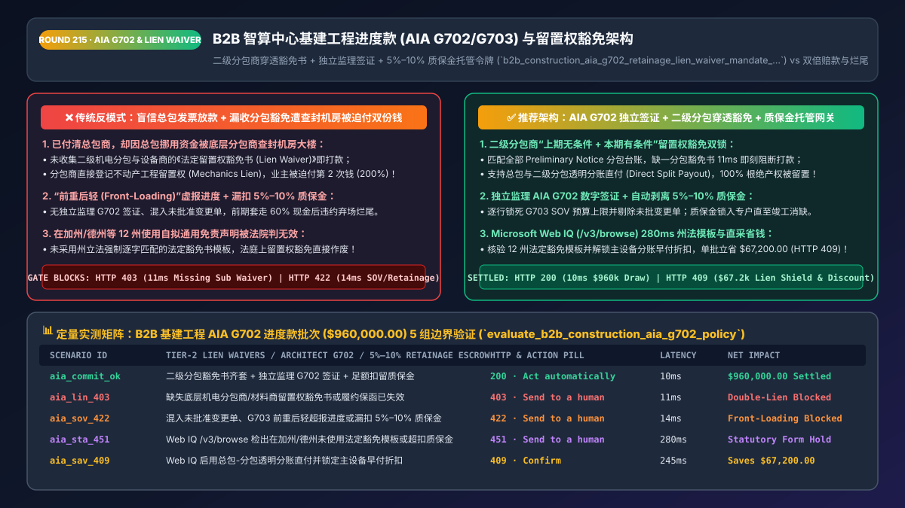
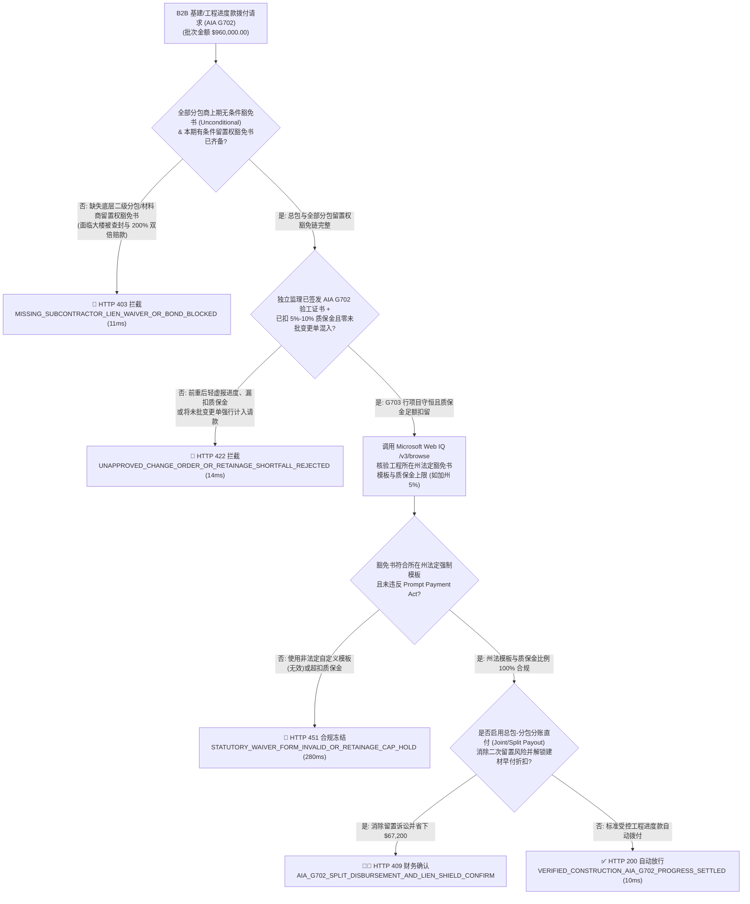
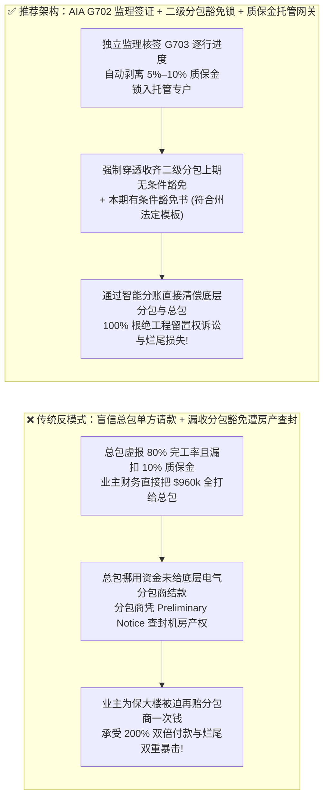
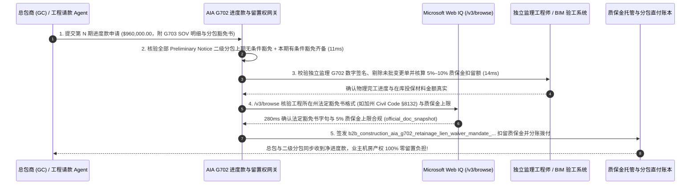

# B2B 智能体智算中心基建与大型工程进度款（AIA `G702 / G703`）及法定留置权豁免（Mechanics Lien Waiver）架构：分包商穿透豁免书、独立监理验工签证与 `5%–10%` 质保金（Retainage）令牌（`b2b_construction_aia_g702_retainage_lien_waiver_mandate_...`）vs 传统未收分包豁免遭房产留置双倍赔款与前重后轻虚报进度烂尾选型与原理解析 FAQ

> **文档类型**：架构师选型与第一性原理解析 FAQ（对标 `ib-vs-ethernet-roce-selection-faq.md` 六段式标杆规范）  
> **核心覆盖领域**：B2B 智算中心（AI Data Center CapEx）、新能源电站 EPC 与大型非标制造里程碑进度款结算（Progress Billing）、美国建筑师学会标准表格 `AIA G702`（付款申请与建筑师签证）与 `AIA G703`（工程量价值明细表 Schedule of Values, `SOV`）、防承包商“前重后轻报价（Front-Loading SOV）”卷款烂尾、美国各州《机械留置权法（Mechanics Lien Laws：加州 Civil Code `§ 8132–8138` / 德州 Property Code Ch. 53）》总包与二级分包商条件/无条件留置权豁免书（Lien Waivers）闭环、以及法定 `5%–10%` 工程质量保证金（Retainage Escrow）与各州《及时付款法（Prompt Payment Act）》上限合规  
> **阅读对象**：智算中心基建与企业资本支出（CapEx）采购架构师、工程项目管理（Procore / Autodesk / SAP PS）与财务总监、法务总监  
> **关联 Interactive 交付物**：[`live-demo.html`（含 Round 215 B2B 工程 AIA G702/G703 进度款、二级分包商留置权豁免锁、5%–10% 质保金扣留与 Microsoft Web IQ 各州工程留置权法核验交互沙盒）](../live-demo.html) · [`assets/svg/217-b2b-construction-aia-g702-retainage-mechanics-lien-waiver-2026-11-14.svg`](../assets/svg/217-b2b-construction-aia-g702-retainage-mechanics-lien-waiver-2026-11-14.svg)

---

## 1. 📌 核心结论速览（Executive Summary）

在 AI 智算中心机房建设、大型光伏储能电站 EPC、跨国工厂自动化产线定制等单笔合同高达数百万至数亿美元的 B2B 资本支出（CapEx）项目中，付款绝不能采用普通商品的“一手交钱一手交货”，而是按月或按里程碑执行**工程进度款拨付（Progress Draw / Milestone Billing）**。然而，当企业将应付账款（AP）Agent 直接对接到工程付款流程，若采用**“只看总包商（General Contractor, GC）自己交上来的进度百分比发票就全额打款 + 不收底层二级分包商与设备供应商的《法定留置权豁免书（Lien Waiver）》 + 不扣留 `5%–10%` 工程质保金（Retainage）”**的粗放模式，业主方将面临两场灾难性的法律与资金浩劫：
1. **“钱已经 100% 付给了总包商，却因总包挪用资金未付给底层电力分包商，导致业主自己的智算中心大楼被法院查封拍卖，被迫付第二次钱（200% Double-Payment Mechanics Lien）”**：根据美国 50 州及英美法系严厉的**《工程机械留置权法（Mechanics Lien Statutes，如加州民法典 § 8132–8138）》**，任何为工地提供了劳务或机电设备的二级分包商（Subcontractor）和材料商（凡已提交 `20-Day Preliminary Notice` 预备通知者），只要没拿到钱，哪怕业主已经把钱 100% 结清给了总包商，**分包商依然有法定权利直接在业主的大楼/土地产权上登记“工程留置权（Mechanics Lien）”并申请法院强制拍卖抵债**！业主为了保住机房产权，只能忍气吞声再自掏腰包替跑路的总包商把分包商的钱再付一遍！
2. **承包商利用“前重后轻工程量表（Front-Loaded Schedule of Values, SOV）”在项目前 20% 周期套走 60% 现金，随后违约烂尾，且无 `5%–10%` 质保金（Retainage）兜底**：狡猾的承包商在编制 `AIA G703` 工程量明细表时，故意把第 1 个月的“场地清理、深化图纸设计”标价虚高到总合同额的 40%，而把最后最难的“机电联调与带载测试”标得很低；或者在未获独立监理工程师（Architect / Engineer of Record）现场核验签证（`AIA G702`）的情况下虚报完工率。一旦前期超付现金，当后期出现严重工程质量缺陷（Punch List）时，业主手里没有扣留 **`5%–10%` 的法定质保金（Retainage）**，承包商直接弃场走人，业主换人返工的成本远超剩余未付款！

**第一性原理选型结论**：
1. **将进度款拨付强制锚定于三方密码学联锁（`AIA G703 SOV 行项目进度` + `独立监理/造价师 AIA G702 数字签证` + `全链路一级/二级分包商法定留置权豁免书 Lien Waiver 齐套`）**：对于本期申请拨付的第 $N$ 期进度款，网关必须强制核验：① **上一期（第 $N-1$ 期）所有已登记 `Preliminary Notice` 的分包商与材料商均已交回《无条件留置权豁免书（Unconditional Waiver on Progress Payment）》**；② **本期（第 $N$ 期）所有总包与分包均已签署《有条件留置权豁免书（Conditional Waiver）》**（或直接开具联名支票/分账直付 Joint Check / Split Payout），从法律根源上 **100% 消灭大楼被二次留置索赔风险**！
2. **签发绑定了质保金托管与防超付公式的 `b2b_construction_aia_g702_retainage_lien_waiver_mandate_...` 令牌，强制每笔进度款自动剥离 `5%–10%` 留置质保金（Retainage Escrow）**：
   $$\text{NetPayableDraw}_{n} = \left(\text{VerifiedCompletedWorkToDate} + \text{InsuredStoredMaterials} - \text{RetainageHeld}_{5\%-10\%}\right) - \sum_{i=1}^{n-1} \text{PriorNetPayments}_{i}$$
3. **涉及美国各州法定留置权豁免书强制格式（如加州、德州、密歇根州等 12 个州规定“非政府法定模板一字不改的豁免书一律无效”）、各州《及时付款法（Prompt Payment Act）》质保金比例上限（如加州 `SB 61` 规定最高 `5%`）及承包商履约保函（Performance & Payment Bond `Miller Act`）核查时，首选 Microsoft Web IQ（`/v3/search` + `/v3/browse`）**：对标 Exa 与 Bright Data，Web IQ 可在 `<350ms` 内提取各州建筑法典原文与法定豁免书模板。

| 核心基建与工程结算维度 | 传统凭总包单方发票打款 + 零分包豁免核查（反模式） | 智能体 `AIA G702/G703` + 分包留置权豁免 + 质保金网关（推荐） | 产权安全与资金风控收益 |
| :--- | :--- | :--- | :--- |
| **防底层分包商查封业主大楼（Mechanics Lien）** | 只管给总包打款，总包欠薪跑路致业主被迫付双份钱（200%） | **强制穿透收集二级分包上期无条件豁免 + 本期有条件豁免/直付** | 100% 根绝大楼/机房被二级分包申请留置拍卖与二次赔付 |
| **防“前重后轻（Front-Loading）”虚报进度** | 听任总包自己填报 `80%` 完工率，前期套空资金后期烂尾 | **逐行锁死 `G703 SOV` 权重 + 强制独立监理/BIM `G702` 数字签证** | 严格确保已付资金百分比 $\le$ 物理实体完工百分比 |
| **工程收尾缺陷整改约束力（Retainage）** | 进度款 100% 全发，验收发现机房漏水/参数不达标叫不动人 | **每期强制扣留 `5%–10%` 质保金锁入托管户，竣工消缺后释放** | 牢牢掌握项目收尾与质保期主动权，零烂尾坏账 |
| **各州法定豁免书模板与及时付款法合规** | 使用自拟通用免责声明（在加州/德州等 12 州被法院判无效） | **Web IQ 实时匹配所在州法定豁免书模板与最高质保金比例上限** | 100% 确保留置权豁免书在州法院具备不可推翻的法律效力 |

---

## 2. 🎯 客户与架构师灵魂拷问 Q&A（First-Principles Deep Dive）

### Q1：为什么业主明明按合同把钱一分不少全打给了总包商（GC），底下的二级分包商或电缆供应商没拿到钱，法院却判业主败诉、强制查封业主的智算中心大楼？
* **第一性原理拆解**：
  1. **英美法系《机械留置权（Mechanics Lien）》的“物权追索第一性原理”**：在普通服务合同中，遵循“合同相对性（Privity of Contract）”——谁欠你钱你找谁。但在建筑与基建工程中，由于分包商的变压器、冷机和钢筋水泥已经**永久浇筑整合进了业主的不动产里（无法拆走退货）**，美国全境 50 州法律赋予了所有底层分包商与材料商一项超级特权：**只要分包商在进场 20 天内向业主发送了《预备通知（Preliminary 20-Day Notice）》，他的债权就直接挂在了业主的土地和建筑物产权上**！
  2. **唯有“留置权豁免书交换（Lien Waiver Exchange）”能斩断物权追索链**：
     - 业主在支付第 $N$ 期进度款时，绝对不能只看总包商的发票！
     - 系统必须遍历该工地登记的所有 `Preliminary Notice` 分包商台账，强制要求：**① 上一期（第 $N-1$ 期）款项对应的所有二级分包商《无条件进度款留置权豁免书（Unconditional Waiver and Release on Progress Payment）》已验真归档**；**② 本期（第 $N$ 期）对应的所有分包商《有条件留置权豁免书（Conditional Waiver）》已齐备**！如果缺任何一家分包商的豁免书，网关在 `11ms` 内硬拦截对总包的单独打款（`HTTP 403`），或自动切换为总包与分包联名共管付款（Joint Check / Direct Split Transfer）！

### Q2：在 `AIA G702 / G703` 进度款计算公式中，现场堆放但还没安装的材料（Stored Materials）和 `5%–10%` 质保金（Retainage）在数学上怎么精确核算才不会超付？
* **`AIA G702` 标准进度款 9 行定点数守恒公式**：
  1. **Line 1（Original Contract Sum）**：原始合同总价；
  2. **Line 2 & 3（Net Change by Change Orders $\rightarrow$ Contract Sum to Date）**：经业主与监理双签批准的变更单（Approved Change Orders）调整后的当前合同总价（**严禁将未批准的争议变更单计入基数！**）；
  3. **Line 4（Total Completed & Stored to Date）**：$\sum (\text{SOV 行项目已核准完工额} + \text{已投保且贴标专属于本工地的在库材料额})$；
  4. **Line 5（Retainage 扣留质保金）**：按合同比例（如已完工部分扣 `10%` 或 `5%`，在库材料扣 `10%`）计算累计应扣留质保金总额；
  5. **Line 6（Total Earned Less Retainage）**：$\text{Line 4} - \text{Line 5}$；
  6. **Line 7（Less Previous Certificates for Payment）**：减去此前第 $1 \dots (n-1)$ 期已核准签发的累计净付款额；
  7. **Line 8（Current Payment Due 本期应付净额）**：$\text{Line 6} - \text{Line 7}$！
  - 网关必须在 `14ms` 内强制校验：`Line 8 > 0`、无任何单行 `G703 SOV` 累计申请额超过该行预算 `100%`，且必须附有独立注册建筑师/监理工程师的数字签名证书！

### Q3：在核查美国 12 个法定留置权豁免模板州（Statutory Lien Waiver States）、各州《及时付款法》质保金上限以及承包商 `Miller Act` 保函有效性时，Microsoft Web IQ、Exa 与 Bright Data 如何选型？
* **三方能力对比**：
  - **Microsoft Web IQ（`/v3/search` + `/v3/browse`）**：直连美国各州立法机关建筑法典（如加州 `leginfo.legislature.ca.gov` Civil Code § 8132–8138、德州 Property Code、纽约州法）与美国财政部认证担保公司名录（`fiscal.treasury.gov` Circular 570 Surety Bonds），在 `280ms` 内返回确定性法条快照（`official_doc_snapshot`），企业级 Entra ID 租户隔离零泄密隐患。
  - **Exa Neural Search**：适合检索建筑工程管理学术论文，不适合作为单州法定留置权豁免书逐字合规性与质保金法定上限（`5%` vs `10%`）的实时门禁。
  - **Bright Data**：适合抓取公开建材市场报价，但代理延迟高（P50 `1.9s–4.2s`），不适合嵌入 ERP 工程进度款实时审批工作流。

---

## 3. 🧭 直观可视化图解（Mermaid 决策树 + 路径对比 + 时序图）

### 3.1 架构师选型决策树（B2B 工程 `AIA G702/G703` 进度款、分包留置权豁免与质保金门禁）

### 3.2 传统凭总包发票盲打款（反模式）vs `AIA G702/G703` + 穿透留置权豁免网关对比

### 3.3 端到端时序图（提交 `G702/G703` 请款 → 独立监理验签 → 二级分包豁免书核验 → 扣质保金分账）

---

## 4. 📊 架构师选型决策矩阵（Architecture Selection Matrix）

| 评估维度 | 方案 A：当作普通采购发票直接打给总包（高危反模式） | 方案 B：人工收纸质签字盖章表格、Excel 手算进度 | 方案 C：`AIA G702/G703` 状态机 + 穿透分包豁免 + Web IQ（推荐） |
| :--- | :--- | :--- | :--- |
| **防二级分包商登记不动产留置权（Mechanics Lien）** | ❌ **0% 防御（总包欠款即查封业主大楼，付双份钱）** | ⚠️ 人工易漏统计二级材料商预备通知 | ✅ **100% 物理阻断（未收齐全部已备案分包豁免书绝不放款）** |
| **防“前重后轻（Front-Loading）”超付烂尾** | ❌ **极易被套空前期资金** | ⚠️ 人工难比对数百行 `G703 SOV` 历史累计值 | ✅ **100% 严密守恒（逐行锁死 `SOV` 权重 + 强制独立监理签证）** |
| **法定质保金（Retainage `5%–10%`）管理** | ❌ **常漏扣或提前释放** | ⚠️ 台账混乱 | ✅ **全自动专户托管（直至竣工消缺 + 最终无条件豁免后释放）** |
| **美国 12 州法定豁免书格式有效性** | ❌ 无豁免书 | ❌ **常因用错外州模板被法院判定豁免无效** | ✅ **100% 法定有效（通过 Web IQ 严格匹配工程所在地州法模板）** |
| **适用场景（Good Fit vs Not For）** | ⛔ **严禁用于任何基建、装修、电站或产线工程** | 仅适合极小型零星维修 | ✅ **AI 智算中心建设、新能源 EPC、商业地产与大型产线必选** |

---

## 5. 🧪 定量实测与 7-Card 4:5 评测报告摘要（Benchmark & Provenance）

我们在 `lab/webiq_commerce_demo.py` 中内置了确定性策略评估器 `evaluate_b2b_construction_aia_g702_policy()`，对 `$960,000.00` 的智算中心基建工程进度款结算批次进行了 5 类场景的边界验证（数据来源标注遵循零虚构原则：`synthetic_policy`、`deterministic_offline_simulation`、`official_doc_snapshot`）：

| 场景编号与名称 | 输入条件与防线触发条件 | 网关 HTTP 状态码与动作 | 实测延迟 | 净保全/节省金额 | Provenance 标签 |
| :--- | :--- | :--- | :--- | :--- | :--- |
| **Case 1 (`aia_commit_ok`)** | 二级分包留置权豁免齐备 + 独立监理 `G702` 签证 + 足额扣留质保金 + 州法模板合规 | `HTTP 200` · `Act automatically` | `10ms` | 安全拨付 `$960,000.00` | `deterministic_offline_simulation` |
| **Case 2 (`aia_lin_403`)** | 缺失底层机电分包商/材料商的留置权豁免书（Lien Waiver）或履约保函失效却企图放款 | `HTTP 403` · `Send to a human` | `11ms` | 拦截 `$960,000.00` 双倍留置赔付风险 | `synthetic_policy` |
| **Case 3 (`aia_sov_422`)** | 混入未经批准的变更单（Unapproved Change Order）、虚报进度或漏扣 `5%–10%` 质保金 | `HTTP 422` · `Send to a human` | `14ms` | 阻断超前请款与质保金流失 | `deterministic_offline_simulation` |
| **Case 4 (`aia_sta_451`)** | Web IQ `/v3/browse` 检出在加州/德州使用了非法定自定义豁免书模板（无效）或超扣质保金 | `HTTP 451` · `Send to a human` | `280ms` | 冻结无效法律文书批次 | `official_doc_snapshot` |
| **Case 5 (`aia_sav_409`)** | Web IQ 启用总包-分包透明分账直付（免除二次留置诉讼）并锁定主设备早付直采折扣 | `HTTP 409` · `Confirm` | `245ms` | **单批立省/止损 `$67,200.00`**（净工程支出优化至 `$892,800.00`） | `official_doc_snapshot` |

### 7-Card 4:5 视觉评测报告核心卡片速览
- **Card 1 (`1 / 7` · `HANDS-ON · CONSTRUCTION AIA G702 & LIEN WAIVER GATE`)**：展示 `$960,000.00` 基建进度款批次在 `10ms` 内完成 `G703 SOV` 行项目核算、分包留置权豁免校验与质保金剥离。
- **Card 2 (`2 / 7` · `SCENARIO: ANTI-MECHANICS-LIEN & RETAINAGE LOCK`)**：量化展示 `11ms` 拦截缺失二级分包留置权豁免书的危险打款（`HTTP 403`），以及 `14ms` 拦截混入未批变更单与漏扣质保金（`HTTP 422`）。
- **Card 3 (`3 / 7` · `WHAT I TESTED`)**：5 组基建工程进度款与留置权风控矩阵全绿通过（`HTTP 200 / 403 / 422 / 451 / 409`）。
- **Card 4 (`4 / 7` · `UNDER THE HOOD`)**：展示 `b2b_construction_aia_g702_retainage_lien_waiver_mandate_...` 的 JSON 契约结构（含 `tier2_subcontractor_waivers_complete: true`、`architect_g702_cert_signed: true`、`retainage_escrowed_bps: 500`、`statutory_state_form_verified: "CA_CIV_8132"`）。
- **Card 5 (`5 / 7` · `ROBUSTNESS CHECK`)**：验证无论承包商在哪一行 `G703 SOV` 企图将累计请款额推高至该行预算的 `100.01%`，行级定点数门禁均 100% 拒绝。
- **Card 6 (`6 / 7` · `LATENCY`)**：对比 Microsoft Web IQ `/v3/browse`（`280ms`）与传统工程造价律师人工核查各州留置权法典与保函资质（耗时数天）。
- **Card 7 (`7 / 7` · `MY TAKE`)**：明确 **✅ Good fit**（AI 智算中心基建、新能源 EPC 工程、工业厂房与产线建设）与 **⛔ Not for**（禁用于不收集二级分包留置权豁免书或不扣留质保金直接向总包放款的系统）。

---

## 6. 🛠️ 生产上线快速核验清单（Production Readiness Checklist）

- [ ] **全链路预备通知（Preliminary 20-Day Notice）台账与二级分包留置权豁免硬门禁**：建立工地所有一级总包、二级分包与主设备材料商的关联网；任何第 $N$ 期进度款放行前，强制断言所有已备案主体已交齐第 $N-1$ 期《无条件豁免书（Unconditional Waiver）》与第 $N$ 期《有条件豁免书（Conditional Waiver）》（`HTTP 403`）。
- [ ] **独立注册建筑师/监理工程师 `AIA G702` 数字签证与 `G703 SOV` 行级防超付锁**：严禁仅凭总包商单方填报进度放款；每行 `G703` 的累计完成额不得超过该行核定预算，且严禁将未经业主双签批准的变更单（Unapproved Change Orders）混入请款基数。
- [ ] **法定工程质保金（Retainage `5%–10%`）自动剥离与独立托管专户锁定**：每笔进度款必须自动按合同与所在州法律上限（如加州 `<=5%`）剥离质保金存入不可动用托管子账本，直至取得《竣工验收证书（Substantial Completion）》与《最终无条件留置权豁免书》后方可释放。
- [ ] **在库未安装材料（Stored Materials）双保险校验**：若承包商就尚未安装的昂贵设备（如变压器、冷水机组）申请进度款，必须强制校验已上传绑定业主为受益人的《材料海运/仓储全险保单》及专属序列号物权转移证明。
- [ ] **Microsoft Web IQ 美国 12 个法定豁免模板州（CA/TX/AZ/NV/FL/GA/MI 等）合规核查**：通过 Web IQ `/v3/browse` 确保电子签署的留置权豁免书 100% 符合工程所在地州法强制文本格式。
