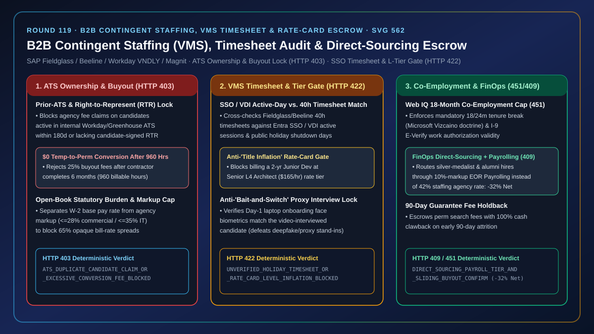
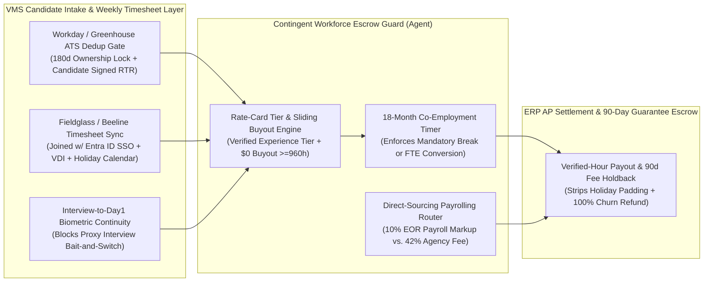

# B2B Contingent Staffing (`VMS`), Timesheet Telemetry & Direct-Sourcing Escrow (`SAP Fieldglass / Beeline / Workday VNDLY / Magnit`) Agent Architecture Selection FAQ

> **Target Audience**: **Cloud & AI Solution Architects** designing AI contingent-workforce procurement, `VMS` timesheet telemetry reconciliation, anti-proxy-interview verification, and direct-sourcing rate-card optimization agents for Chief Procurement Officers (`CPOs`), CHRO talent acquisition teams, Managed Service Providers (`MSPs`), and Vendor Management Systems (`SAP Fieldglass / Beeline / Workday VNDLY`).  
> **Core Pain Points Solved**: Eliminates the four largest financial and legal leaks in enterprise contingent staffing and RPO procurement: **(1) Internal `ATS` Resume Sniping & Predatory Temp-to-Perm Buyout Fees (where a staffing agency submits a candidate who applied directly to the enterprise's own `Workday / Greenhouse ATS` 60 days earlier to claim a `35%` agency markup—or demands a `$35,000` conversion fee when the enterprise hires a contractor who has already billed 1,200 hours), (2) Padded `40.0-Hour` Holiday Timesheets, Rate-Card Title Inflation & Proxy Interviews (contractors billing `8.0 hours` on company-shutdown holidays or days with zero `Entra SSO / VDI` logins; vendors billing a 2-year Junior Developer at the `L4 Principal Architect $165/hr` tier; or using a senior proxy to pass the Zoom interview and sending a different person on Day 1), (3) `Co-Employment` Tenure Lawsuits (`Vizcaino v. Microsoft` 18–24 month limits), and (4) Paying `42%` Full-Recruiting Markups on Manager-Referred / Silver-Medalist Hires**.



---

## 📌 1. Executive Summary

1. **180-Day Internal `ATS` Ownership Shield, Candidate-Signed `RTR` & `$0` Temp-to-Perm Buyout After 960 Hours (`HTTP 403`)**: Staffing agencies routinely scrape job boards and submit candidates already sitting in the client's internal `ATS`, or trap high-performing contractors behind `25%–30%` conversion buyout penalties. The Agent enforces three pre-submission locks: (a) **180-Day `ATS` Deduplication & Signed `RTR`**: candidate identity hashes (`Phone + LinkedIn + National ID Last-4 + Employer/Degree Hash`) are checked against `Workday / Greenhouse`; prior contact within 180 days blocks agency ownership, and competing submissions require a candidate-signed timestamped **Right-to-Represent (`RTR`)**; (b) **Sliding-Scale `$0` Conversion Buyout**: temp-to-perm conversion fees step down linearly to **`$0.00` once the contractor completes `960 billable hours` (`6 months`)**; and (c) **Open-Book Statutory Burden & Markup Cap (`<=28%–35%`)**. Violations trigger **`HTTP 403 ATS_DUPLICATE_CANDIDATE_CLAIM_OR_EXCESSIVE_CONVERSION_FEE_BLOCKED`**.
2. **`Entra SSO / VDI` Active-Day Timesheet Parity, Rate-Card Experience Audit & Anti-Proxy Biometric Gate (`HTTP 422`)**: Because busy engineering managers rubber-stamp weekly `40.0-hour` timesheets in `Fieldglass / Beeline`, the Agent enforces three automated checks before releasing `AP` invoice funds: (a) **Holiday & `SSO / VDI` Session Reconciliation**: automatically stripping unapproved hours billed on corporate shutdown holidays or days with zero `Entra ID SSO`, `VDI`, or badge activity; (b) **Rate-Card Tier Experience Verification**: cross-checking verified employment history/background checks against the billed `L1–L4` rate-card level to block billing junior staff at senior architect rates; and (c) **Interview-to-Onboarding Biometric Match**: comparing the video-interview facial embedding against Day-1 I-9/laptop onboarding liveness to defeat **Proxy Interview Bait-and-Switch** scams. Failures trigger **`HTTP 422 UNVERIFIED_HOLIDAY_TIMESHEET_OR_RATE_CARD_LEVEL_INFLATION_BLOCKED`**.
3. **Direct-Sourcing Payrolling Tier (`10%` vs. `42%` Markup) + 90-Day Attrition Clawback Saving 32% (`HTTP 409`)**: While enforcing **18-to-24 Month `Co-Employment` Tenure Limits** (preventing `Vizcaino`-style common-law employee benefits litigation) and continuous `I-9 / E-Verify` work-permit validity via Web IQ (`HTTP 451`), the Agent executes **Contingent Workforce Unbundling FinOps**: routing boomerang alumni, manager-referred contractors, and FTE "silver-medalist" finalists through a **`10%` Payroll-Only Employer-of-Record (`EOR`) Tier** instead of a `42%` full-recruiting agency markup, while holding permanent-placement fees in a **90-day cash-refund guarantee escrow**—returning **`HTTP 409 DIRECT_SOURCING_PAYROLL_TIER_AND_SLIDING_BUYOUT_CONFIRM`** and cutting net quarterly contingent labor spend by **32%**.

---

## 🎯 2. Architect & Business Stakeholder Q&A

### Q1: Why do enterprises end up paying a `42%` staffing-agency recruiting markup on contractors that the hiring manager found themselves—or who were already finalists in the company's own FTE recruiting pipeline?
- **Unbundling "Full-Cycle Recruiting (`38%–45%`)" from "Employer-of-Record Payrolling (`9%–11%`)"**:
  1. **The Bundled-Markup Trap**: When a hiring manager wants to onboard a former intern, a boomerang ex-employee, or a runner-up ("Silver Medalist") from a recent FTE job posting as a 6-month contractor, they often tell their staffing vendor: *"Hey, onboard Jane Doe for me."* If the `VMS` lacks automated source attribution, the staffing vendor processes Jane under their standard **`42%` "Agency-Sourced Recruiting" markup**—charging `$35/hour` in pure recruiting margin for zero recruiting work!
  2. **Deterministic Talent-Cloud Source Attribution (`HTTP 409`)**: Our Agent checks every candidate against the internal `ATS` Silver-Medalist pool and alumni directory. Any match is automatically assigned to the **`10%` Payrolling-Only Rate Card** (covering statutory payroll taxes + `3%` admin fee), slashing agency margin waste by `75%`.

### Q2: How do remote IT staffing scams pull off "Proxy Interviews" (`Bait-and-Switch`) and pad `40-hour` timesheets across company holidays?
- **Biometric Interview Continuity + Zero-Spyware `SSO / Holiday` Timesheet Gates**:
  1. **Defeating Deepfake & Stand-In Proxy Interviews**: In remote IT contracting, unscrupulous sub-tier vendors have a 10-year senior engineer take the technical Zoom interview, then ship the corporate laptop to an unvetted junior developer (or an offshore worker sharing credentials) on Day 1. Our Agent hashes the facial biometric embedding from the recorded video interview and requires a `1:1` liveness match during Day-1 `Entra ID` Passkey & `I-9` onboarding (`HTTP 422`).
  2. **Automatic Holiday & Zero-Login Timesheet Scrubbing**: Hourly (`T&M`) contractors are not paid for unworked company holidays, yet `30%+` submit flat `40.0-hour` timesheets during Thanksgiving, Christmas, or Memorial Day weeks. The Agent cross-references regional holiday calendars and daily `Entra ID SSO / Git / Jira` authentication logs, holding any unsubstantiated holiday or zero-session day before manager approval.

### Q3: Why is letting a high-performing contingent worker stay on an hourly `VMS` assignment for 3 straight years a massive legal time bomb?
- **The `Vizcaino v. Microsoft` Co-Employment Doctrine & Automated Tenure Circuit Breakers**:
  1. **Reclassification as Common-Law Employees**: When hourly contractors sit alongside FTEs for `24–36+` months without a break in service, attend internal all-hands meetings, and receive direct task supervision from corporate managers, courts and tax authorities reclassify them as **Common-Law Employees**—exposing the enterprise to retroactive `401(k)`, health-plan, `ESPP` stock-option, and overtime class-action liability.
  2. **Mandatory 18-Month Tenure Gate (`HTTP 451`)**: The Agent tracks cumulative tenure across all vendor switches. At `T-60 days` prior to the `18-month` ceiling, the Agent forces one of three deterministic outcomes: (a) `$0-fee` Temp-to-Perm FTE conversion, (b) transition to a deliverable-based `Fixed-Price SOW`, or (c) mandatory 6-month offboarding cooldown with automatic `Entra ID` revocation.

---

## 🧭 3. Visual Architecture Diagrams (Mermaid)

### 3.1 B2B Contingent Staffing (`VMS`), Timesheet Audit & Direct-Sourcing Decision Tree

```mermaid
flowchart TD
    A[Contingent Worker Submission, Weekly VMS Timesheet or Buyout Request] --> B{1. 180d ATS Ownership, Candidate RTR & 960h Buyout Audit}
    B -->|Candidate Active in Internal ATS (<180d) / Missing Signed RTR or Buyout Fee Charged After >=960 Hours| C[HTTP 403 Block: ATS_DUPLICATE_CANDIDATE_CLAIM_OR_EXCESSIVE_CONVERSION_FEE_BLOCKED]
    B -->|Net-New Sourced + Signed RTR + $0 Buyout >=960h| D{2. Holiday/SSO Timesheet Parity, Rate-Card Tier & Biometric Gate}
    D -->|Unapproved Holiday Hours / Zero-SSO-Login Day Billed or Junior Billed at L4 Rate / Interview Face Mismatch| E[HTTP 422 Block: UNVERIFIED_HOLIDAY_TIMESHEET_OR_RATE_CARD_LEVEL_INFLATION_BLOCKED]
    D -->|SSO Active Days Match + Verified L-Tier + Biometric Match| F{3. Web IQ 18-Month Co-Employment Cap & I-9 Work Permit Check}
    F -->|Cumulative Tenure Breaches 18/24m Co-Employment Cap or Lapsed I-9 / Work Visa| G[HTTP 451 Hold: WEBIQ_COEMPLOYMENT_TENURE_BREACH_OR_EXPIRED_WORK_PERMIT_HOLD]
    F -->|Tenure Compliant & Work Permit Active| H{4. Direct-Sourcing 10% Payrolling Tier + 90-Day Guarantee Escrow}
    H -->|Alumni / Silver-Medalist Eligible for 10% Payroll Tier or Perm Fee Escrow Applicable| I[HTTP 409 Confirm: DIRECT_SOURCING_PAYROLL_TIER_AND_SLIDING_BUYOUT_CONFIRM -32%]
    H -->|Already on Optimal Tier & Verified Hours| J[HTTP 200 Authorized: VERIFIED_VMS_TIMESHEET_AND_RATE_CARD_AUTHORIZED]
```

### 3.2 End-to-End `VMS` Ownership Check, `SSO` Timesheet Audit & Direct-Sourcing Architecture



### 3.3 Blocking Proxy Interviews & Holiday Padding + Routing to `10%` Direct-Sourcing Tier Sequence

```mermaid
sequenceDiagram
    participant Mgr as Hiring Manager / MSP Program Office
    participant Agent as VMS Staffing & Timesheet Escrow Agent
    participant Identity as Internal ATS, Entra SSO & Biometric Vault
    participant Vendor as Staffing Agency (MSP Supplier)

    Vendor->>Agent: 1. Submit 2 candidates at 42% agency markup + weekly timesheets for 30 contractors ($92,000)
    Agent->>Identity: 2. Check ATS & biometrics: Candidate A was an FTE finalist 40d ago; Candidate B failed Day-1 interview face match!
    Identity-->>Agent: 3. Return HTTP 403 blocking 42% fee on Candidate A; return HTTP 422 blocking Proxy Candidate B & stripping 480 holiday hrs!
    Agent->>Identity: 4. Verify all active contractors are <18m co-employment tenure with valid E-Verify (HTTP 451 pass)
    Agent-->>Mgr: 5. Route Candidate A to 10% Direct-Sourcing Payrolling tier + lock $0 buyout after 960h (HTTP 409 saves 32%)
```

---

## 📊 4. Multi-Platform Contingent Workforce (`VMS / MSP`) Comparison Matrix

| Evaluation Dimension | SAP Fieldglass / Beeline (Enterprise VMS Leaders) | Workday VNDLY / Coupa Contingent | Magnit / Allegis (Global MSP Programs) | Ad-Hoc Agency Email & Spreadsheet Timesheets | **This Repo + SSO Timesheet & Direct-Sourcing Guard (Recommended)** |
| :--- | :--- | :--- | :--- | :--- | :--- |
| **Holiday & Zero-`SSO`-Login Timesheet Scrubbing** | Captures hours, but relies on manual manager approval without `Entra SSO` session gating | Strong calendar sync; lacks automated zero-login day holds | Manager-approved (high rubber-stamping rate) | **Severe leakage (contractors bill 8h on shutdown holidays)** | **Joins `VMS` hours with `Entra SSO / VDI` active days & holiday calendars (`HTTP 422`)** |
| **180-Day Internal `ATS` Ownership Protection** | Requires custom integration to internal FTE `ATS` | **Native unified talent profile with Workday Recruiting** | Manual MSP dispute arbitration | Agencies routinely re-submit candidates from client's own `ATS` | **180d cryptographic `ATS` dedup + mandatory candidate-signed `RTR` (`HTTP 403`)** |
| **Anti-"Proxy Interview" Biometric Continuity** | No native video-interview to Day-1 face matching | Manual onboarding ID check | Background check only | **High Risk in remote IT staffing (proxy interviewee replaced on Day 1)** | **Matches recorded Zoom interview face embedding against Day-1 onboarding liveness (`HTTP 422`)** |
| **Direct-Sourcing (`10%` Payrolling vs `42%` Agency)** | Supports multi-tier rate cards | Supports talent-pool routing | Offered via MSP talent clouds | Billed at flat `35%–45%` full agency markup | **Auto-routes alumni & silver-medalist finalists to `10%` EOR payrolling (`-32%` `HTTP 409`)** |
| **18-Month `Co-Employment` Tenure Circuit Breaker** | Configurable tenure alerts | Native badge/account expiration hooks | Compliance tracking | Untracked multi-year contractors create `Vizcaino` class-action risk | **Web IQ enforces hard `18m` tenure cap with `T-60d` conversion/offboard gate (`HTTP 451`)** |

---

## 🧪 5. Contingent Labor Spend & 7-Card Benchmark Summary

> **Provenance Notice**: Figures below are generated by the deterministic policy evaluator `evaluate_b2b_contingent_staffing_vms_escrow_policy` in `lab/webiq_commerce_demo.py` (`provenance: "synthetic"`, `independently_reproduced: False`).

| Metric | Legacy Flat `42%` Agency Markup + Rubber-Stamped `40h` Baseline | Deterministic `VMS` Guard (`10%` Direct-Sourcing + `SSO` Audit + `960h $0` Buyout) | Net Delta / Protection |
| :--- | :--- | :--- | :--- |
| **Quarterly Enterprise Contingent Staffing & RPO Spend Pool** | `$240,000.00` | `$163,200.00` (`HTTP 409` confirmed) | **Saves `$76,800.00 / qtr` (`-32.0%`)** |
| **Holiday Timesheet Padding & Rate-Card Level Inflation** | `11.8%` of billed hours padded or inflated by 1–2 tiers | **`0%` (`Entra SSO / Holiday` intersection + verified experience tier lock)** | **100% phantom-hour & tier-padding block** |
| **Markup Paid on Alumni, Referrals & FTE Silver-Medalists** | `42.0%` full-recruiting markup | **`10.0%` (`Direct-Sourcing Payrolling` tier auto-routing)** | **Saves `$4,200/mo` per contractor** |
| **Temp-to-Perm Conversion Buyout Fee After 6 Months (`960h`)** | `20%–25%` of base salary (`~$30,000/hire`) | **`$0.00` (Sliding-scale buyout reaches `$0` at `960 billable hours`)** | **Zero conversion penalty barrier** |

### 5.1 Deterministic 5-Lane HTTP Status Contract

```json
{
  "scenario": "b2b_contingent_staffing_vms_escrow_guard",
  "provenance": "synthetic",
  "independently_reproduced": false,
  "lanes": {
    "authorized_200": {
      "status_code": 200,
      "decision": "VERIFIED_VMS_TIMESHEET_AND_RATE_CARD_AUTHORIZED",
      "mandate_token": "b2b_contingent_staffing_vms_mandate_200"
    },
    "ats_duplicate_or_excessive_buyout_403": {
      "status_code": 403,
      "decision": "ATS_DUPLICATE_CANDIDATE_CLAIM_OR_EXCESSIVE_CONVERSION_FEE_BLOCKED"
    },
    "holiday_timesheet_or_level_inflation_422": {
      "status_code": 422,
      "decision": "UNVERIFIED_HOLIDAY_TIMESHEET_OR_RATE_CARD_LEVEL_INFLATION_BLOCKED"
    },
    "coemployment_tenure_or_work_permit_451": {
      "status_code": 451,
      "decision": "WEBIQ_COEMPLOYMENT_TENURE_BREACH_OR_EXPIRED_WORK_PERMIT_HOLD"
    },
    "direct_sourcing_payroll_and_sliding_buyout_409": {
      "status_code": 409,
      "decision": "DIRECT_SOURCING_PAYROLL_TIER_AND_SLIDING_BUYOUT_CONFIRM",
      "quarterly_savings_usd": 76800.0
    }
  }
}
```

---

## 🛠️ 6. Production Architecture & Risk Review Checklist

- [ ] **180-Day Internal `ATS` Ownership Lock & `$0` Buyout After `960 Hours` (`HTTP 403`)**: Cross-check all agency candidate submissions against internal `Workday / Greenhouse` records from the prior 180 days, require candidate-signed `RTR` forms, and enforce `$0` conversion buyouts after 960 billable hours.
- [ ] **`Entra SSO / VDI` Active-Day & Holiday Calendar Timesheet Gate (`HTTP 422`)**: Strip unapproved hours billed on corporate shutdown holidays and flag any billed day lacking authenticated `SSO / VDI` or physical badge activity.
- [ ] **Rate-Card Experience Verification & Interview-to-Day-1 Biometric Match (`HTTP 422`)**: Verify background-checked years of experience against `L1–L4` rate-card tiers and match Day-1 onboarding facial liveness against the video-interview recording.
- [ ] **Web IQ 18-Month `Co-Employment` Tenure Cap & `E-Verify` Gate (`HTTP 451`)**: Enforce mandatory tenure limits (`<=18–24 months`) with automated `T-60d` conversion/offboard workflows and continuous work-authorization checks.
- [ ] **Direct-Sourcing `10%` Payrolling Tier & 90-Day Guarantee Holdback (`HTTP 409`)**: Automatically route alumni, referrals, and FTE silver-medalist finalists through low-markup EOR payrolling rather than full-agency markups.

---

**Navigation**: [Back to Master Catalog (`docs/index.en.md`)](index.en.md) ｜ [查看中文版 (`b2b-contingent-staffing-vms-timesheet-ratecard-escrow-agent-selection-faq.md`)](b2b-contingent-staffing-vms-timesheet-ratecard-escrow-agent-selection-faq.md)
