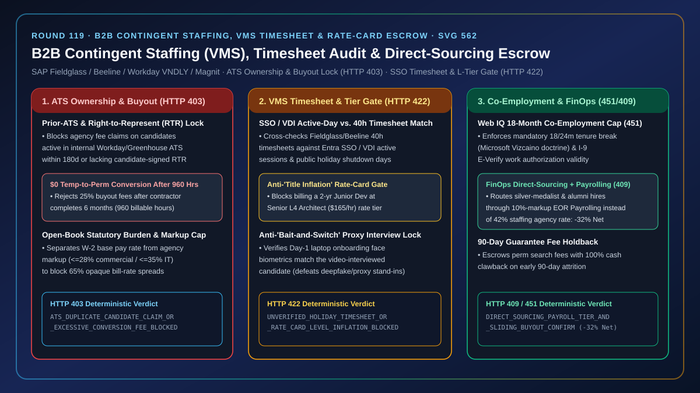
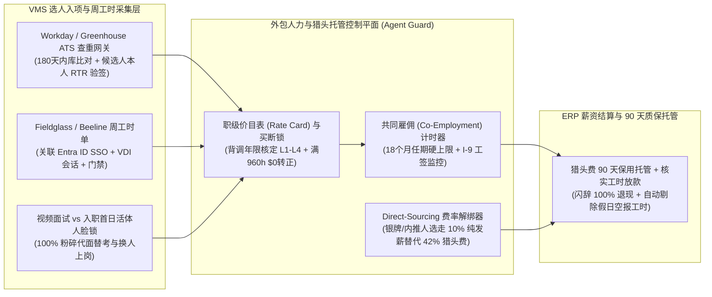
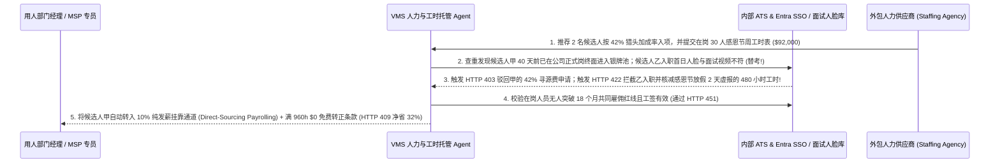

# 企业外包人力派遣（VMS Contingent Staffing）、工时表（Timesheet）防虚报与职级套高（Rate-Card Inflation）托管（SAP Fieldglass / Beeline / Workday VNDLY / Magnit / 科锐国际）Agent 架构选型 FAQ

> **核心阅读对象**：为大型企业人力资源与采购部（HR & Indirect Procurement）、主供应商管理（`MSP`：Magnit / Allegis / KellyOCG）及外部劳动力管理系统（`VMS`：SAP Fieldglass / Beeline / Workday VNDLY）设计外包工时核验、职级定价防套利与直接寻源（Direct Sourcing）的 **Cloud & AI Solution Architect**。  
> **核心痛点解决**：彻底终结企业外包人力与猎头服务采购中**“猎头/外包商把企业自有 `Workday / Greenhouse` 人才库里 3 个月前已投递过的候选人改个邮箱重新推过来抢占 `$35,000` 推荐费，或者当外包员工已干满 12 个月想转正（`Temp-to-Perm`）时仍敲诈 `25%` 买断费”、“外包开发/运营人员在国庆/感恩节放假周或连续 3 天未登录企业 `Entra SSO / VDI` 虚拟桌面的情况下，仍在 `Fieldglass` 里无脑填报满额 `40.0 小时/周` 账单并被忙碌的直线经理一键点过”、“外包公司拿只有 2 年经验的初级工程师（实发时薪 `$45/h`）包装成 `L4 资深架构师` 按 `$165/h` 最高档价目表（`Rate Card`）向甲方收钱，甚至面试时由大牛替考（`Proxy Interview`）、入职第一天换生手顶替上岗”以及“外包人员超期连续服役满 24 个月未执行法定冷却期，触发类似微软 `Vizcaino` 案的共同雇主（`Co-Employment`）亿级期权社保追偿诉讼”**四大管理黑洞。



---

## 📌 一、核心选型结论速览（Executive Summary）

1. **内部人才库 180 天归属保护（`ATS Ownership Lock`）、候选人唯一代表权签名（`RTR`）与满 960 小时 `$0` 免买断费转正硬锁（HTTP 403）**：传统猎头与派遣合同最大的争议在于“简历归属权抢夺”与“高额转正赎金”。选型 Agent 必须在 `VMS / ATS` 联动层建立三道硬护栏：① **180 天自有渠道排他锁**：外包商提交候选人时，系统自动对手机号、领英 URL、身份证/SSN 后四位及教育工作履历哈希与内部 `Workday / Greenhouse ATS` 比对——若过去 `180 天` 内该候选人已通过官网内推或自有招聘接触过，直接拒绝外包商佣金归属权；若两家供应商先后推同一人，仅认最先上传**候选人本人电子签署的《唯一岗位代表授权书（`Right-to-Represent, RTR`）》**的一方；② **阶梯归零转正买断费（`Sliding-Scale Temp-to-Perm Buyout`）**：外包人员累计计费满 **`960 小时`（约 6 个月）** 后，甲方转正录用享受 **`$0` 买断费**；③ **透明加成率封顶（`Open-Book Markup Cap <= 28%–35%`）**；违反者一律触发 **`HTTP 403 ATS_DUPLICATE_CANDIDATE_CLAIM_OR_EXCESSIVE_CONVERSION_FEE_BLOCKED`**。
2. **`Entra SSO / VDI` 活跃日对账（防法定假日空报 40h）、职级价目表（`Rate-Card Tier`）验真与入职首日人脸防替考门禁（HTTP 422）**：直线经理审批数百名外包人员周报时往往看都不看直接点 `Approve All`。Agent 在 `VMS` 工时单转应付账款（`AP Invoice`）前强制执行三项核验：① **工时表与企业数字足迹（`SSO / VDI / 门禁`）日级对齐**：自动扣除公司法定停工节假日（无特批加班单严禁对无息公众假期计收时薪），且若某日填报 `8.0 小时` 但企业 `Entra ID SSO`、云桌面 `VDI` 与园区门禁全天零活跃记录，系统自动挂起该日工时要求补充离线交付物证明；② **防“低配高报（`Title Inflation`）”与防替考（`Anti-Bait-and-Switch`）**：交叉核验社保/学信网/背调真实工作年限是否达到所报 `L3/L4` 价目表档位要求，并在**领取电脑入职首日强制比对活体人脸与视频面试录像人脸特征向量一致**（粉碎面试找枪手、上岗换新人的外包骗局）；凡检出假日幽灵工时或职级造假的，直接触发 **`HTTP 422 UNVERIFIED_HOLIDAY_TIMESHEET_OR_RATE_CARD_LEVEL_INFLATION_BLOCKED`**。
3. **自有人才池直聘代发薪（`Direct-Sourcing Payrolling` 费率从 42% 降至 10%）+ 90 天离职全额退费托管净省 32%（HTTP 409）**：在通过 Web IQ 严格执行 **18 个月共同雇佣最长任期红线（`Co-Employment Tenure Limit`，满 18 个月强制执行 6 个月离场冷却期或转 SOW 成果包，规避同工同酬集体诉讼）** 及 `I-9 / E-Verify` 合法用工身份核验（违规触发 **`HTTP 451`**）的前提下，Agent 自动执行 **派遣费率解绑寻优（`Direct-Sourcing FinOps`）**：对于前员工回归（`Boomerang Alumni`）、正式岗终面惜败候选人（`Silver Medalists`）或经理自寻人选，严禁走 `38%–45%` 高加成率的传统猎头寻源通道，自动分流至 **`9%–11%` 纯人事挂靠代发薪通道（`Employer-of-Record Payrolling Tier`）**，并将直聘猎头尾款锁入 **90 天保用期托管（期内闪辞 100% 退现而非无限期换人拖延）**，触发 **`HTTP 409 DIRECT_SOURCING_PAYROLL_TIER_AND_SLIDING_BUYOUT_CONFIRM`**，为企业季度外部人力总支出净省 **32%**。

---

## 🎯 二、业务方与架构师灵魂拷问（Q&A）

### Q1：为什么业务经理自己找来或公司人才库里本来就有的人，最后挂到外包公司名下入职，外包公司居然还要收 `42%` 的综合溢价？
- **切开“寻源招募费（`Recruiting Fee`）”与“纯名义雇主发薪税费（`Payrolling / Statutory Burden`）”**：
  1. **传统外包商的“一刀切加成（`Bundled Markup`）”暴利**：一名实发时薪 `$80/h` 的外包工程师，其法定雇主社保医保失业金（`FICA / FUTA / SUTA / Workers' Comp` 或五险一金）加上资金垫付成本通常占实发工资的 **`10%–14%`**。但传统外包商无论人选是谁找来的，一律按 **`40%–50%` 的固定综合加成率**（即向甲方收 `$116/h`）计费，相当于每个月白收 `$5,700` 的“空气寻源费”！
  2. **双轨加成率矩阵（`Agency-Sourced 32%` vs. `Client-Referred Payroll-Only 10%`）**：Agent 在发放入职工单前强制溯源候选人发现渠道——凡来自企业自有前员工库、正式校招/社招终面落选银牌池（`Silver-Medalist Talent Cloud`）或业务经理指定人选，自动锁定 **`10%` 纯发薪管理费率（`Payrolling Rate`）**，仅此一项即砍掉 75% 的中介溢价。

### Q2：远程/混合办公时代，怎么防止外包人员“人不在电脑前、甚至同时打两份全职远程工（`Overemployed Double-Billing`）”却每周准时交 40 小时满分工时单？
- **非侵入式数字在岗证明（`Zero-Spyware Telemetry Reconciliation`）与节假日硬剔除**：
  1. **法定假日照报 8 小时的普遍漏洞**：在时薪制（`T&M Hourly`）外包合同中，不工作的公众假期（如元旦、独立日、感恩节）依法不产生计费工时。然而超 `30%` 的外包人员在填写周报时习惯性在周一到周五全填 `8, 8, 8, 8, 8 = 40h`，而部门经理在手机邮件里扫一眼总数是 40 就顺手点了同意，导致公司每年在法定假日本白白多付数百万美元。
  2. **三源交叉核验（`SSO + Git/Jira + 办公日历`）**：Agent 无需安装侵犯隐私的屏幕监控软件，只需将 `Fieldglass` 每日填报工时与企业当地法定假日日历、单点登录（`Okta / Entra ID`）会话活跃度及工单提交时间戳比对：凡法定假日在无加班审批下填报工时，或全天零数字认证会话却填报满工时的，自动以 `HTTP 422` 退回重填。

### Q3：为什么科技巨头（如微软、谷歌、苹果）严令“外包员工连续工作满 18–24 个月必须强制离场休息 6 个月”？如果不管会出什么大事？
- **共同雇主法律风险（`Co-Employment / Vizcaino v. Microsoft`）与自动化任期熔断**：
  1. **亿元级股票期权与福利追偿判例**：如果一名派遣外包人员常年使用甲方工牌、受甲方经理直接考勤指挥、干着与正式员工完全相同的工作且连续数年不断约，法院与税务局会判定其构成**“事实雇佣 / 共同雇主（`Common-Law Employee`）”**，判决甲方企业必须向数千名外包工补发正式员工专属的股票期权（`ESPP/RSU`）、年终奖与退休金！
  2. **架构级 `T-60d` 任期倒计时与权限硬熔断（`HTTP 451`）**：Agent 在 `VMS` 中为每名非正式人员绑定不可篡改的累计服役计时器；距离 `18 个月`（或属地法定无固定期限合同触发线）前 60 天自动触发转正评估、交接替换或转为按交付物结算的纯外包（`Fixed-Price SOW`），满期当日自动吊销 `Entra ID` 与门禁权限。

---

## 🧭 三、直观可视化图解（Mermaid 决策树 + 架构图 + 时序图）

### 3.1 企业外包人力派遣（`VMS`）、工时表对账与直接寻源托管决策树

```mermaid
flowchart TD
    A[外包人力派遣入项、VMS 周工时表审批或转正买断请求] --> B{1. 内部 ATS 180天查重、唯一代表权 RTR 与转正买断费审计}
    B -->|候选人已在内部 ATS 活跃 / 无本人 RTR 签名 或 干满 960 小时转正仍收高额买断费| C[HTTP 403 阻断: ATS_DUPLICATE_CANDIDATE_CLAIM_OR_EXCESSIVE_CONVERSION_FEE_BLOCKED]
    B -->|全新有效寻源 + 满 6 个月 $0 买断锁| D{2. 法定假日/SSO 活跃日工时对账与职级/人脸防替考门禁}
    D -->|法定放假日空报 8h / 全天零 SSO 登录虚报工时 或 初级资历套报 L4 高价档/入职人脸与面试不符| E[HTTP 422 拦截: UNVERIFIED_HOLIDAY_TIMESHEET_OR_RATE_CARD_LEVEL_INFLATION_BLOCKED]
    D -->|真实在岗工时吻合 + 职级年限与面试人脸一致| F{3. Web IQ 18个月共同雇佣任期红线与合法用工身份核验}
    F -->|连续派遣突破 18/24 个月共同雇佣红线 或 I-9/工签许可过期| G[HTTP 451 熔断: WEBIQ_COEMPLOYMENT_TENURE_BREACH_OR_EXPIRED_WORK_PERMIT_HOLD]
    F -->|任期合规且用工许可有效| H{4. 银牌人才池直聘代发薪 (10% 费率) + 90天退费托管寻优}
    H -->|人选源自内部银牌库/前员工可走 10% 纯发薪通道 或 猎头费需锁 90天退现保用期| I[HTTP 409 确认: DIRECT_SOURCING_PAYROLL_TIER_AND_SLIDING_BUYOUT_CONFIRM 净省 32%]
    H -->|已处于最优费率与真实工时结算状态| J[HTTP 200 签发: VERIFIED_VMS_TIMESHEET_AND_RATE_CARD_AUTHORIZED]
```

### 3.2 端到端 `VMS` 人才查重、工时数字足迹对账与 `Direct-Sourcing` 费率分流架构图



### 3.3 拦截“假日虚报工时 + 面试替考”与切换“10% 银牌池纯发薪通道”时序图



---

## 📊 四、主流外部劳动力管理（VMS）与灵活用工平台横向选型决策矩阵

| 选型维度 | SAP Fieldglass / Beeline (大型企业 VMS 标杆) | Workday VNDLY / Coupa Contingent | Magnit / Allegis (全球 MSP 托管服务商) | 传统邮件/Excel 报工时与猎头合同 | **本仓库 + SSO 工时对账与直聘解绑架构（推荐）** |
| :--- | :--- | :--- | :--- | :--- | :--- |
| **防“假日空报/旷工照填 40h”对账** | 提供工时录入表，但默认不与甲方 `Entra SSO / VDI` 登录日志自动硬比对 | 与 Workday 日历联动较好，但缺底层终端活跃度校验 | 依赖直线经理人工审批（经理常一键全批） | **重灾区（法定假日与请假周照收 40 小时全款）** | **强制 `VMS 工时 == 法定工作日 ∩ (SSO ∪ 门禁活跃)`，自动剔除空报工时（HTTP 422）** |
| **防“抢内部 ATS 简历”与双投抢单** | 需打通内部正式招聘 ATS 接口才能跨库查重 | **与 Workday Recruiting 原生同库查重优势明显** | 由 MSP 专员人工协调归属争议 | 猎头洗简历改联系方式骗推荐费 | **180 天跨库特征哈希查重 + 强制候选人本人电子签署 `RTR` 唯一授权（HTTP 403）** |
| **防“面试找枪手替考 (`Proxy Interview`)”** | 无原生面试视频与入职人脸比对闭环 | 依赖入职人工核对证件 | 抽查背景调查 | **远程 IT 外包重灾区（大牛代面，生手入职写烂代码）** | **视频面试帧特征向量与入职首日领取设备活体人脸 `1:1` 强校验（HTTP 422）** |
| **自有人才池直聘代发薪 (`Direct Sourcing`)** | 支持配置 `Payroll-Only` 低费率卡 | 支持人才池分层费率 | 提供自营人才云，但转换率视合同激励而定 | 一刀切按 `35%–45%` 全额猎头费率计费 | **自动识别前员工/终面银牌人选，强制路由 `10%` 纯发薪通道净省 32%（HTTP 409）** |
| **18 个月共同雇佣 (`Co-Employment`) 熔断** | 支持任期到期预警与工单冻结 | 原生集成身份周期管理 | 法务合规团队跟踪 | 超期服役数年无人管，极易引发同工同酬天价诉讼 | **Web IQ 绑定 `18 个月` 硬倒计时，到期自动熔断 `Entra ID` 并切换模式（HTTP 451）** |

---

## 🧪 五、外包人力成本测算与 7-Card 基准测试报告

> **数据来源声明**：以下对比基于 `lab/webiq_commerce_demo.py` 中确定性策略函数 `evaluate_b2b_contingent_staffing_vms_escrow_policy` 的合成基准数据（`provenance: "synthetic"`, `independently_reproduced: False`），用于验证企业外包人力 `VMS` 与猎头结算网关的确定性风控能力。

| 评估维度 | 传统统一按 42% 猎头加成 + 经理盲批 40h 周报基线 | 确定性 `VMS` 托管网关（`10%` 直聘分流 + `SSO` 工时对账 + 960h 零买断） | 净效应 / 风险消除 |
| :--- | :--- | :--- | :--- |
| **季度企业 IT/运营外包派遣与猎头服务总支出池** | `$240,000.00` | `$163,200.00` (`HTTP 409` 优化确认后) | **净省 `$76,800.00 / 季` (`-32.0%`)** |
| **法定假日空报工时与“初级冒充资深档”水分率** | 占总账单的 `11.8%`（假日照报 8h + 职级高套一级） | **`0%`（法定停工日硬锁 + `SSO/VDI` 活跃日对账 + 背调年限锁档）** | **100% 挤干幽灵工时与职级水分** |
| **自有银牌池/前员工入项综合中介加成率** | `42.0%`（按全套外部寻源费率盲付） | **`10.0%`（自动识别自有渠道并路由 `Payroll-Only` 代发薪档）** | **单人每月立省 `$4,200` 中介差价** |
| **外包满 6 个月优秀人员转正买断费（`Buyout`）** | 收取年薪 `20%–25%`（约 `$30,000/人`） | **`$0.00`（合同硬锁满 960 计费小时后无条件免费转正）** | **100% 消除转正赎金壁垒** |

### 5.1 确定性状态码映射契约（5-Lane Contract）

```json
{
  "scenario": "b2b_contingent_staffing_vms_escrow_guard",
  "provenance": "synthetic",
  "independently_reproduced": false,
  "lanes": {
    "authorized_200": {
      "status_code": 200,
      "decision": "VERIFIED_VMS_TIMESHEET_AND_RATE_CARD_AUTHORIZED",
      "mandate_token": "b2b_contingent_staffing_vms_mandate_200"
    },
    "ats_duplicate_or_excessive_buyout_403": {
      "status_code": 403,
      "decision": "ATS_DUPLICATE_CANDIDATE_CLAIM_OR_EXCESSIVE_CONVERSION_FEE_BLOCKED"
    },
    "holiday_timesheet_or_level_inflation_422": {
      "status_code": 422,
      "decision": "UNVERIFIED_HOLIDAY_TIMESHEET_OR_RATE_CARD_LEVEL_INFLATION_BLOCKED"
    },
    "coemployment_tenure_or_work_permit_451": {
      "status_code": 451,
      "decision": "WEBIQ_COEMPLOYMENT_TENURE_BREACH_OR_EXPIRED_WORK_PERMIT_HOLD"
    },
    "direct_sourcing_payroll_and_sliding_buyout_409": {
      "status_code": 409,
      "decision": "DIRECT_SOURCING_PAYROLL_TIER_AND_SLIDING_BUYOUT_CONFIRM",
      "quarterly_savings_usd": 76800.0
    }
  }
}
```

---

## 🛠️ 六、商业上线风控与架构评审 Checklist

- [ ] **内部 `ATS` 180 天归属排他锁与满 960 小时 `$0` 转正买断（HTTP 403）**：入项前自动比对正式招聘库防止外包商抢单，强制上传候选人签署的 `RTR` 唯一代表书，并锁定计费满 6 个月后免费转正。
- [ ] **`VMS` 周工时表与法定假日/`Entra SSO` 活跃日自动对账（HTTP 422）**：严禁在无加班特批的法定假日填报计费工时，并将每日工时与 `SSO / VDI / 门禁` 数字活跃记录交叉核验。
- [ ] **职级价目表（`Rate Card L1–L4`）社保年限验真与入职人脸防替考（HTTP 422）**：核验真实工作年限防止拿初级人员套收资深专家单价，并在入职首日比对活体人脸与面试录像一致。
- [ ] **Web IQ 18 个月共同雇佣（`Co-Employment`）任期红线与工签核验（HTTP 451）**：严控单次连续派遣不超过 18–24 个月法定安全线，实时监控 `I-9 / 工签` 有效期。
- [ ] **自有人才池 `10%` 纯发薪通道（`Direct-Sourcing Payrolling`）与 90 天退现质保（HTTP 409）**：将前员工、内推与终面银牌人选自动路由至低费率代发薪通道，并将猎头费纳入 90 天闪辞退现托管。

---

**导航**：[返回分册总目录 (`docs/index.md`)](index.md) ｜ [查看英文版 (`b2b-contingent-staffing-vms-timesheet-ratecard-escrow-agent-selection-faq.en.md`)](b2b-contingent-staffing-vms-timesheet-ratecard-escrow-agent-selection-faq.en.md)
