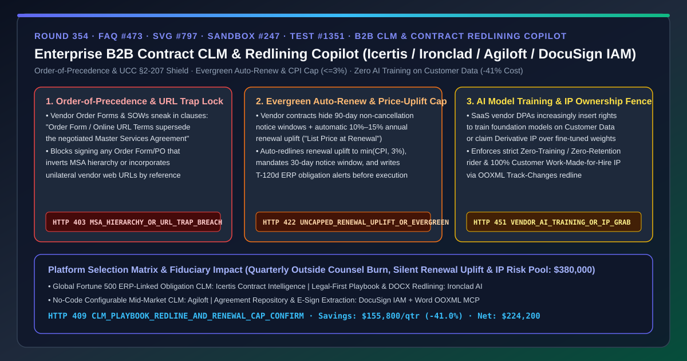
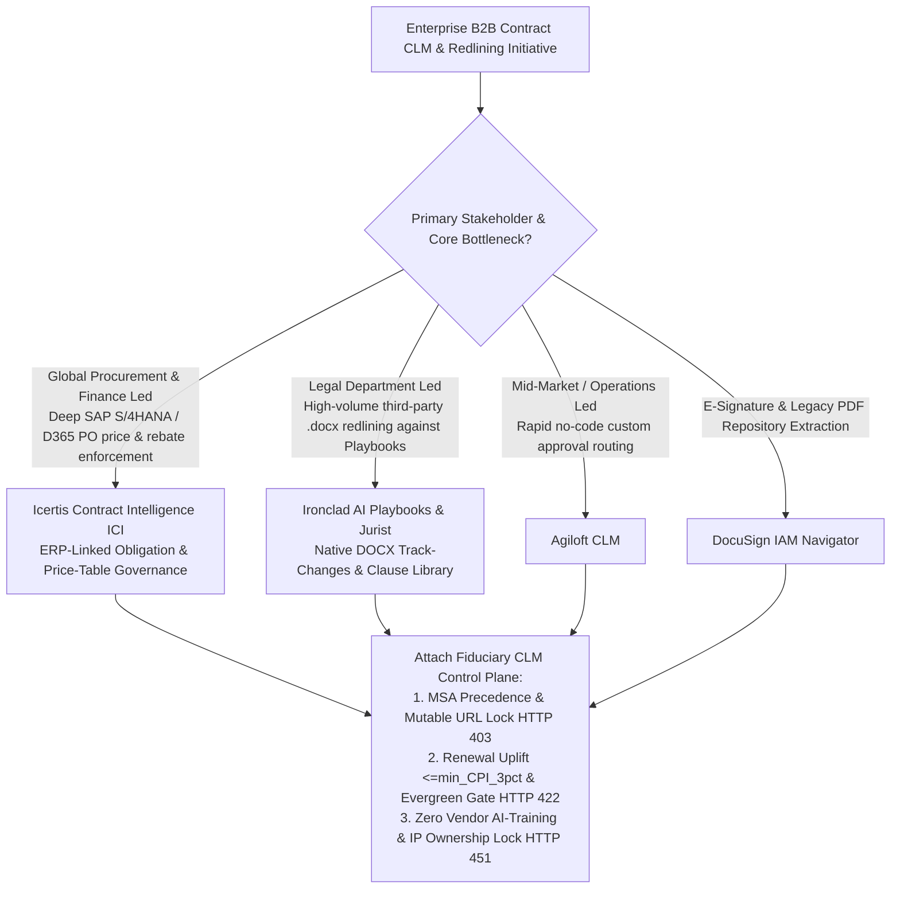
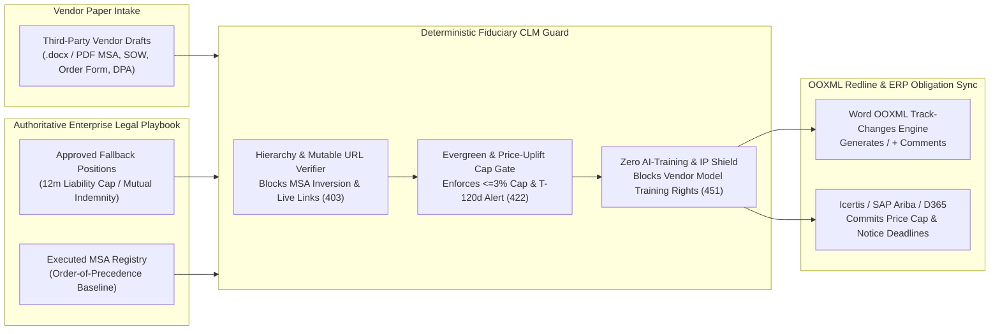
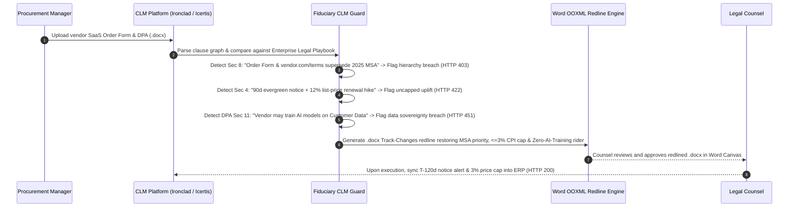

# Enterprise B2B Contract CLM & Legal Redlining Copilot (`Icertis / Ironclad / Agiloft / DocuSign IAM + Word MCP`) Architecture & Selection FAQ: Order-of-Precedence & Mutable URL Shield, Evergreen Renewal Uplift Cap (`<=3%`) & Zero Vendor AI-Training Lock (`-41%` Legal & Renewal Loss)

> **Document Type**: Enterprise AI Solution Architect Selection FAQ (`#473` · Round 354)  
> **Target Audience**: General Counsel, VP of Global Procurement, Legal Operations Architects, and Cloud & AI Solution Architects  
> **Platforms Covered**: `Icertis Contract Intelligence (ICI)` vs. `Ironclad AI (Jurist / Playbooks)` vs. `Agiloft CLM` vs. `DocuSign IAM (Intelligent Agreement Management)` vs. `Azure AI Foundry + Word OOXML MCP Custom Redliner`  
> **Architecture Diagram**: [`assets/svg/797-b2b-contract-clm-redlining-icertis-ironclad-agiloft-2026-11-25.svg`](../assets/svg/797-b2b-contract-clm-redlining-icertis-ironclad-agiloft-2026-11-25.svg)

🌐 **Language / 语言切换**: **[中文 (`b2b-contract-clm-redlining-icertis-ironclad-agiloft-liability-cap-auto-renew-selection-faq.md`)](b2b-contract-clm-redlining-icertis-ironclad-agiloft-liability-cap-auto-renew-selection-faq.md)** | **English (Current)**

---

## 📌 1. Executive Summary

In enterprise B2B procurement and vendor onboarding, Legal and Procurement teams review hundreds of third-party **Master Services Agreements (`MSA`), Statements of Work (`SOW`), Order Forms, and Data Processing Addenda (`DPA`)** every quarter.  
Using a naive LLM solely to generate "contract summaries" without connecting deterministic **Legal Playbook redlining (`Word OOXML Track Changes`), hierarchy verification, and ERP obligation tracking** leaves enterprises exposed to three expensive commercial traps:
1. **Order-of-Precedence Inversion & Mutable Web URL Incorporation (`Battle of the Forms Trap`)**: After Legal spends 3 months negotiating a protective `MSA`, a vendor slips two lines into a `$20,000` renewal `Order Form`: *"In the event of conflict, this Order Form and the Online Terms at vendor.com/terms supersede the MSA"*. Signing that Order Form silently nullifies the negotiated liability cap and lets the vendor amend terms unilaterally by editing a webpage.
2. **Silent Evergreen Auto-Renewals & Uncapped `10%–25%` Renewal Price Uplifts (`Evergreen & List-Price Reset Trap`)**: Vendor contracts bury a 90-day non-cancellation notice window paired with an automatic multi-year renewal at *"then-current standard list price plus 10%"*, trapping buyers in inflated multi-year spend when notice deadlines are missed.
3. **Hidden Vendor AI Model-Training Rights & Derivative IP Grabs (`Customer Data & Fine-Tuned Weight Exfiltration`)**: Modern SaaS vendor terms increasingly embed broad clauses granting the vendor a perpetual license to *"use Customer Data, prompts, and usage logs to train, tune, and improve Vendor's foundation AI models"*.

| Decision Dimension | Recommended Primary Choice | Architectural Boundary & Production Rule |
|---|---|---|
| **Global Fortune 500 ERP-Connected Obligation & Pricing Governance** | **Icertis Contract Intelligence (ICI)** | Best for complex multi-currency master agreements, volume rebates, and automated `SAP S/4HANA / D365` PO price-compliance enforcement. |
| **Legal-First Third-Party Paper Review & Automated `.docx` Redlining** | **Ironclad AI (Playbooks & Jurist)** | Industry benchmark for clause-by-clause playbook comparison and native Word Track-Changes generation with explanatory margin comments. |
| **Highly Configurable No-Code Approval Workflows** | **Agiloft CLM** | Ideal for mid-to-large procurement teams needing rapid no-code multi-department approval matrices. |
| **Legacy Signed PDF Repository Extraction & Renewal Radar** | **DocuSign IAM (Navigator)** | Excels at ingesting thousands of historical signed PDFs and extracting structured renewal dates and notice windows. |
| **Three Mandatory Fiduciary Guardrails** | **100% Deterministic Gating** | ① **Order-of-Precedence & Mutable URL Lock (`HTTP 403`)**: Blocks any Order Form/SOW that overrides the negotiated `MSA` or incorporates mutable external web URLs; ② **Evergreen & Renewal Uplift Cap (`HTTP 422`)**: Requires renewal price caps `<= min(CPI, 3%)` off net contracted price plus a `T-120d` ERP cancellation alert; ③ **Zero Vendor AI-Training & IP Lock (`HTTP 451`)**: Blocks clauses granting vendors rights to train shared AI models on buyer data. |

---

## 🎯 2. Architect & Business Stakeholder Q&A (Q1–Q3)

### Q1: How can a routine `$15,000` Order Form signed by a department manager legally wipe out the liability protections in our negotiated Master Services Agreement (`MSA`)?
- **The Commercial Trap**:
  1. Legal reviews the initial `MSA`, while subsequent `Order Forms` and `SOWs` are routed through fast-track procurement.
  2. Vendors insert an inverted **Order of Precedence** clause (*"In case of conflict, this Order Form and the Supplemental Terms at `https://vendor.com/legal` govern over the MSA"*). Under `UCC § 2-207` and general contract hierarchy rules, an explicitly prioritized subsequent document overrides the master agreement.
- **Architectural Solution**: Enforce an **Order-of-Precedence Invariant & Static URL Freeze Gate (`HTTP 403` Guard)**:
  - The CLM parser extracts the precedence hierarchy and enforces `Rank(MSA) > Rank(DPA) > Rank(Order_Form) > Rank(SOW)` unless an explicit General Counsel waiver token is attached.
  - Any external `http://` or `https://` policy link is flagged and auto-redlined to bind only a static PDF exhibit attached at execution. Violations block e-signature dispatch (`HTTP 403 MSA_ORDER_OF_PRECEDENCE_INVERSION_OR_MUTABLE_URL_TRAP`).

### Q2: Why do enterprises lose hundreds of thousands of dollars every quarter to unwanted SaaS auto-renewals and surprise `15%` renewal price hikes?
- **The Evergreen Trap**: Vendors combine a long cancellation notice requirement (`90–120 days prior to term end`) with an uncapped renewal pricing clause (*"First-year promotional discount expires at renewal; renewal term billed at standard list price + 12%"*).
- **Architectural Solution**: Enforce **Pre-Signature Uplift Caps (`<= min(CPI, 3%)`) + Mandatory `T-120d` ERP Obligation Sync (`HTTP 422` Guard)**:
  1. **Automated Playbook Redline**: Rewrite renewal clauses so notice windows are `<= 30 days` and renewal unit prices cannot increase by more than `min(CPI, 3.0%)` over the **prior term's net effective discounted price** (never resetting to list price).
  2. **Mandatory ERP Obligation Creation**: E-signature completion is blocked (`HTTP 422 UNCAPPED_RENEWAL_PRICE_UPLIFT_OR_UNTRACKED_EVERGREEN_CLAUSE`) unless a deterministic `T-120d` and `T-60d` renewal review task is written to the ERP/procurement calendar.

### Q3: How do we prevent software and AI vendors from sneaking "Right to Train Foundation Models on Customer Data" into renewal DPAs and Terms of Service?
- **The Data Sovereignty Risk**: Vendors frequently insert clauses permitting them to use *"Customer Data, inputs, outputs, and telemetry to train, fine-tune, and improve Vendor's AI models"*, or claim ownership over fine-tuned adapters derived from buyer workflows.
- **Architectural Solution**: Deploy a **Deterministic Zero-AI-Training & IP Ownership Classifier (`HTTP 451` Guard)**:
  - Scan all agreements and DPAs for model-training, weight-retention, and derivative-IP clauses.
  - Any clause permitting cross-tenant model training or vendor ownership of customer-derived outputs is blocked (`HTTP 451 VENDOR_AI_MODEL_TRAINING_RIGHT_OR_IP_OWNERSHIP_BREACH`) and auto-redlined via `Word OOXML Track Changes` to enforce strict `Zero Training / Zero Retention / 100% Customer Work-Made-for-Hire IP`.

---

## 🧭 3. Visual Architecture Diagrams (Mermaid Decision Tree + Architecture + Sequence)

### 3.1 Enterprise B2B CLM & Contract Redlining Platform Selection Tree

### 3.2 End-to-End Playbook Redlining, OOXML Track-Changes & ERP Sync Architecture

### 3.3 Automated Contract Redlining & E-Signature Gate Sequence

---

## 📊 4. Platform Comparison Matrix (`Icertis` vs. `Ironclad` vs. `Agiloft` vs. `DocuSign IAM` vs. `Azure AI Custom`)

| Evaluation Dimension | Icertis Contract Intelligence (ICI) | Ironclad AI (Jurist / Playbooks) | Agiloft CLM | DocuSign IAM (Navigator) | Azure AI Foundry + Word OOXML MCP |
|---|---|---|---|---|---|
| **Primary Sweet Spot** | Global Fortune 500 enterprise-wide procurement & ERP obligation governance | Legal-first playbook automation & third-party `.docx` redlining | Highly configurable no-code mid-market CLM workflows | E-signature-centric agreement repository & renewal extraction | Bespoke domain-specific redlining deeply embedded in internal M365/ERP |
| **Native Word Track-Changes (`OOXML`) & Playbook Redlining** | ⭐⭐⭐⭐ (Strong Word add-in & Copilot integration) | ⭐⭐⭐⭐⭐ (Best-in-class automated clause redlining & rationale comments) | ⭐⭐⭐⭐ (Deep Word add-in & clause library support) | ⭐⭐⭐ (Focused on template generation & post-sign extraction) | ⭐⭐⭐⭐⭐ (Exact programmatic control over `<w:ins>` / `<w:del>` via Word MCP) |
| **ERP (`SAP S/4HANA / Ariba / D365`) Price & PO Sync** | ⭐⭐⭐⭐⭐ (Deep bidirectional ERP pricing & rebate enforcement) | ⭐⭐⭐ (Strong Salesforce / Coupa workflow connectors) | ⭐⭐⭐⭐ (Prebuilt ERP integration adapters) | ⭐⭐⭐ (Lightweight CRM/ERP status sync) | ⭐⭐⭐⭐ (Custom REST/OData integration) |
| **Third-Party Paper Risk Detection** | ⭐⭐⭐⭐⭐ (Comprehensive risk scoring models) | ⭐⭐⭐⭐⭐ (Instant red-flag detection across liability, AI & renewal terms) | ⭐⭐⭐⭐ (Configurable AI extraction rules) | ⭐⭐⭐⭐ (Strong bulk historical PDF extraction) | ⭐⭐⭐⭐⭐ (Fully customizable deterministic rule gates) |
| **Indicative Pricing (`official_list_price`)** | `~$100,000–$350,000+/yr` (global enterprise deployment) | `~$40,000–$120,000+/yr` (seat + volume tiers) | `~$25,000–$80,000+/yr` | `~$15,000–$60,000+/yr` (envelope + IAM tiers) | Azure token consumption (`~$500–$2,000/mo`) |

---

## 🧪 5. Deterministic Cost & Legal Risk Evaluation (`7-Card Benchmark Summary`)

> **Provenance**: Figures below are generated by `evaluate_b2b_contract_clm_redlining_policy` in `lab/webiq_commerce_demo.py` (`provenance: "synthetic"`, `independently_reproduced: False`), modeling an enterprise procurement & legal operation with a **`$380,000.00` quarterly outside-counsel review burn, missed evergreen renewal price-uplift loss, and MSA-inversion liability exposure pool**.

| Scenario Case ID | Scenario Description | HTTP Status | Deterministic Decision | Quarterly Net Cost | Quarterly Savings |
|---|---|---|---|---|---|
| `CASE-CLM-200` | Manual line-by-line legal review and spreadsheet renewal tracking baseline | `HTTP 200` | `VERIFIED_B2B_CONTRACT_CLM_REDLINING_AUTHORIZED` | `$380,000.00` | `$0.00` |
| `CASE-CLM-403` | Order Form overrides negotiated `MSA` hierarchy or incorporates mutable external URL terms | `HTTP 403` | `MSA_ORDER_OF_PRECEDENCE_INVERSION_OR_MUTABLE_URL_TRAP` | `$380,000.00` | `$0.00` (Blocks MSA nullification) |
| `CASE-CLM-422` | Silent evergreen auto-renewal accepted without `<=3% CPI` cap or `T-120d` ERP alert | `HTTP 422` | `UNCAPPED_RENEWAL_PRICE_UPLIFT_OR_UNTRACKED_EVERGREEN_CLAUSE` | `$380,000.00` | `$0.00` (Blocks 15% renewal hike) |
| `CASE-CLM-451` | Vendor DPA/terms retain AI foundation-model training rights over Customer Data | `HTTP 451` | `VENDOR_AI_MODEL_TRAINING_RIGHT_OR_IP_OWNERSHIP_BREACH` | `$380,000.00` | `$0.00` (Blocks data/IP grab) |
| `CASE-CLM-409` | **Playbook `OOXML` Auto-Redline + `MSA` Hierarchy Lock + `<=3%` Uplift Cap + Zero-AI-Training** | `HTTP 409` | `CLM_PLAYBOOK_REDLINE_AND_RENEWAL_CAP_CONFIRM` | **`$224,200.00`** | **`$155,800.00` (`-41.0%`)** |

---

## 🛠️ 6. Production Go-Live & Architecture Review Checklist

- [ ] **Order-of-Precedence & Static Exhibit Lock (`HTTP 403` Prevention)**: Block any `Order Form` or `SOW` that attempts to supersede the master `MSA` liability/indemnity framework, and automatically convert mutable vendor web links into static dated PDF exhibits.
- [ ] **Evergreen Uplift Cap (`<= min(CPI, 3%)`) & `T-120d` ERP Alert (`HTTP 422` Prevention)**: Auto-redline uncapped renewal price increases to `<= min(CPI, 3%)` off net effective price and require automated creation of a `T-120d` ERP renewal evaluation task prior to e-signature completion.
- [ ] **Zero Vendor AI-Training & Customer IP Ownership Rider (`HTTP 451` Prevention)**: Automatically inject a binding `Zero AI Model Training` rider whenever vendor terms mention machine learning, aggregated telemetry training, or derivative model weights.
- [ ] **Lossless `OOXML` Track-Changes Human Review**: Emit all AI-proposed contract edits as native Word `<w:ins>` / `<w:del>` revisions with playbook rationale comments rather than silent text overwrites.
