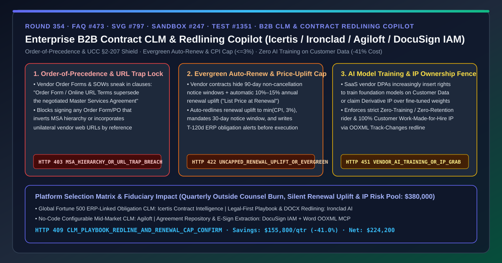
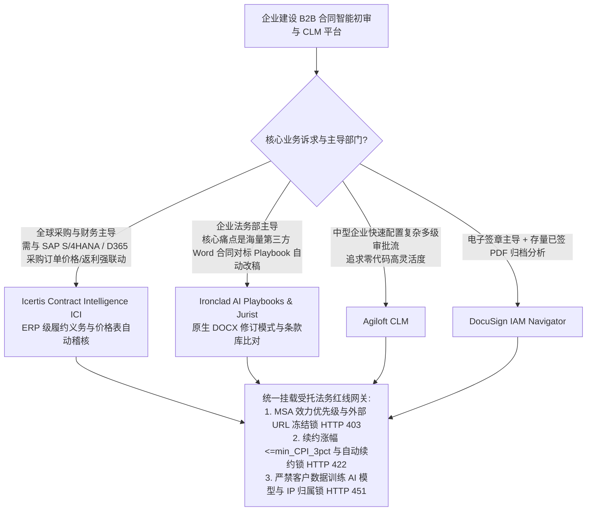
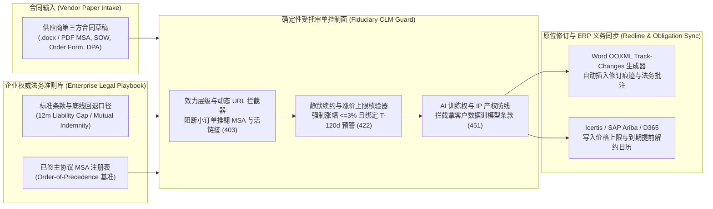
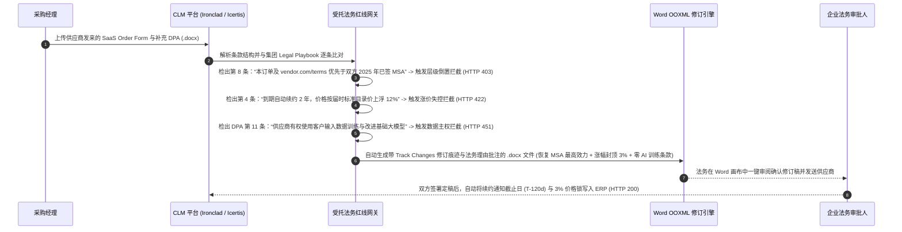

# 企业 B2B 采购合同智能初审、法务红线修订与生命周期管理（`CLM & Redlining Copilot`: `Icertis / Ironclad / Agiloft / DocuSign IAM + Word MCP`）架构与选型对比：主协议效力倒置与网页超链接条款拦截、自动续约涨价锁（`CPI <= 3%`）与禁止拿客户数据训练 AI 模型红线净省 41% 指南

> **文档类型**：企业级 AI Solution Architect 选型决策指南（Selection FAQ · `#473` · Round 354）  
> **适用读者**：集团法务总监（General Counsel）、全球采购副总裁（VP of Procurement）、企业合规架构师与 Cloud & AI Solution Architect  
> **核心覆盖平台**：`Icertis Contract Intelligence (ICI)` vs. `Ironclad AI (Jurist / Playbooks)` vs. `Agiloft CLM` vs. `DocuSign IAM (Intelligent Agreement Management)` vs. `Azure AI Foundry + Word OOXML MCP Custom Redliner`  
> **关联架构图**：[`assets/svg/797-b2b-contract-clm-redlining-icertis-ironclad-agiloft-2026-11-25.svg`](../assets/svg/797-b2b-contract-clm-redlining-icertis-ironclad-agiloft-2026-11-25.svg)

🌐 **语言切换 / Language**: **中文 (当前)** | **[English (`b2b-contract-clm-redlining-icertis-ironclad-agiloft-liability-cap-auto-renew-selection-faq.en.md`)](b2b-contract-clm-redlining-icertis-ironclad-agiloft-liability-cap-auto-renew-selection-faq.en.md)**

---

## 📌 一、核心选型结论速览（Executive Summary）

在企业 B2B 采购寻源与 SaaS 供应商引入流程中，法务与采购团队每天要审阅数十份供应商发来的 **主服务协议（`MSA`）、工作说明书（`SOW`）、订单表格（`Order Form`）与数据处理协议（`DPA`）**。  
如果只用普通大模型做一份“合同摘要总结”，而不将合同条款与 **企业法务谈判手册（`Legal Playbook`）、Word 修订模式（`OOXML Track Changes`）及 ERP 付款/续约挂钩**，企业将频繁遭遇三大隐蔽合同陷阱：
1. **“小订单推翻大合同”与动态网页超链接偷换条款（`Order-of-Precedence Inversion & URL Incorporation Trap`）**：采购与法务耗时 3 个月谈好了严密的 `MSA`，结果供应商在年底一份 `$20,000` 的 `Order Form` 小字里写了一句 `"In the event of conflict, this Order Form and the Online Terms at vendor.com/terms shall supersede the MSA"`——一签字，之前谈好的赔偿上限全部作废，且供应商随时改网页就能单方面改合同！
2. **静默自动续约与次年恢复目录价暴涨 15%（`Evergreen Auto-Renewal & Uncapped Price Uplift`）**：合同夹带“到期前 90 天未发书面挂号信取消则自动续约 3 年，且续约价格按届时公开目录价（`List Price`）或上浮 `12%` 计算”，导致采购部门错过窗口期被强制锁死高价合同。
3. **SaaS 供应商暗藏“用买方业务数据训练大模型”与衍生知识产权侵占条款（`Vendor AI Training & Derivative IP Grab`）**：供应商在附表里写着“有权使用客户上传的数据、日志与使用行为改进和训练其人工智能模型，且生成的微调权重归供应商所有”，直接造成企业核心商业机密泄露与 GDPR 违法。

| 决策维度 | 推荐主选方案 | 适用边界与架构落地准则 |
|---|---|---|
| **跨国集团全生命周期合同管理与 SAP / D365 履约价格联动** | **Icertis Contract Intelligence (ICI)** | 适合财富 500 强级复杂多币种框架协议、返利阶梯与 ERP 采购订单（PO）行项目价格自动稽核。 |
| **法务高频审单、Word 原位修订（Track Changes）与谈判手册执行** | **Ironclad AI (Playbooks & Jurist)** | 法律条款理解与自动生成带批注理由的 `.docx` 修订红线（Redlines）体验极佳，法务团队上手最快。 |
| **高度可配置中大型企业无代码审批工作流** | **Agiloft CLM** | 适合需要在不写代码的前提下快速定制多级财务/安全/法务会签规则的采购组织。 |
| **存量百万份历史签署 PDF 合同结构化提取与到期雷达** | **DocuSign IAM (Navigator)** | 擅长将散落在网盘的已签 PDF 自动解析为结构化续约日期与违约金台账。 |
| **三大确定性风控红线** | **100% 强制拦截** | ① **效力优先级与动态 URL 拦截锁（`HTTP 403`）**：严禁 `Order Form / SOW / 发票背面条款` 优先于已签 `MSA`，严禁引用可单方修改的外部网页条款；② **自动续约与续费涨幅封顶锁（`HTTP 422`）**：拦截无涨价上限的静默续约，强制注入 `Max_Uplift <= min(CPI, 3%)` 及 `T-120d` 提前预警；③ **禁止 AI 模型训练与 IP 归属锁（`HTTP 451`）**：阻断允许供应商用客户数据训练公共模型或侵占定制产出物 IP 的条款。 |



---

## 🎯 二、业务方与架构师灵魂拷问 Q&A（Q1–Q3）

### Q1：为什么我们已经跟供应商签了非常严格的集团主协议（`MSA`），最后打官司时却发现赔偿上限被一张小小的采购订单（`Order Form`）废掉了？
- **法务与采购脱节真相**：
  1. 法务部只审第一次签的 `MSA`，而日常增购的 `Order Form` 或 `SOW` 往往由业务部门或采购专员直接签字。
  2. 许多 SaaS 供应商在 `Order Form` 底部印有两行小字：① `"Order of Precedence: (1) This Order Form, (2) Online Product Terms at https://..., (3) The MSA"`；② 将争议管辖或免责条款指向一个随时可变动的网页链接（`Incorporation by Mutable URL`）。
- **架构解法**：在 CLM 审单管道中内置 **合同效力层级守恒与可变 URL 冻结门禁（`Order-of-Precedence & URL Freeze Gate` · 防 `HTTP 403`）**：
  - 自动解析附件或 `Order Form` 中的优先级条款，必须满足确定性不等式：`Precedence(MSA) > Precedence(DPA) > Precedence(Order_Form) > Precedence(SOW)`（除非经集团法务总监显式特批单次例外）。
  - 凡是正文中出现外部 `http://` 或 `https://` 法律条款链接，Agent 自动通过 Word OOXML Track Changes 将其替换为“以签约当日静态 PDF 快照附件为准，卖方单方网页更新对买方无约束力”。未通过层级校验的订单严禁进入电子签章（`HTTP 403 MSA_ORDER_OF_PRECEDENCE_INVERSION_OR_MUTABLE_URL_TRAP`）。

### Q2：企业每年有上千份 SaaS 与服务合同到期，为什么总是在收到涨价 15% 的新账单时，才发现“提前 90 天解约窗口”昨天刚过？
- **续约黑洞**：供应商深知买方痛点，故意在合同里设计 **不对称锁定期**：提前 `90–120 天` 不发解约通知就自动续期 `12–36 个月`，并且约定“首年折扣仅限首期，续约期自动恢复标准目录价（相当于暴涨 `25%–40%`）或每年固定上浮 `10%`”。
- **架构解法**：实施 **签约前续约涨幅硬封顶修订 + 签约后 ERP 预算日历强绑定（`Evergreen & Uplift Cap Gate` · 防 `HTTP 422`）**：
  1. **审单阶段自动划改（Auto-Redline）**：识别所有 `Auto-Renewal / Renewal Pricing` 段落，强制将通知期缩短至 `<= 30 天`，并将续约价格涨幅锁死在 **`<= min(CPI, 3.0%)` 且基准价为上一期实际折后成交价（非目录价）**；
  2. **签章阶段强制创建双预警任务**：若未将 `Cancellation_Notice_Deadline - 60 days` 写入 `Icertis / Ironclad` 及 ERP 采购续评待办队列，系统拒绝归档并阻断付款（`HTTP 422 UNCAPPED_RENEWAL_PRICE_UPLIFT_OR_UNTRACKED_EVERGREEN_CLAUSE`）。

### Q3：采购 AI 工具或企业 SaaS 时，如何防止供应商通过更新后的隐蔽条款拿我们公司的业务数据去训练他们的底层大模型？
- **新型数字资产流失**：自生成式 AI 普及以来，大量供应商在常规软件合同或 `Service Terms` 中新增了模糊表述：`"Vendor may use Customer Data and Service Usage Data to develop, train, and improve Vendor's machine learning models and artificial intelligence offerings"`，甚至规定利用买方业务知识微调出的行业适配器产权归供应商。
- **架构解法**：部署 **零模型训练与客户数据主权强制附加条款锁（`Zero-AI-Training & IP Ownership Fence` · 防 `HTTP 451`）**：
  - 语义分类器针对合同全文扫描 `train / fine-tune / machine learning / aggregated data / derivative works / intellectual property`；
  - 一旦检出供应商保留模型训练权、跨租户特征提取权或对定制交付物主张非买方排他产权，立即触发 `HTTP 451 VENDOR_AI_MODEL_TRAINING_RIGHT_OR_IP_OWNERSHIP_BREACH`，并自动调用 `Word OOXML MCP` 插入标准红线：`“供应商严禁在未经买方单独书面授权下将任何买方数据、提示词或输出用于训练、微调或改进任何跨客户共享模型”`。

---

## 🧭 三、直观可视化图解（Mermaid 选型决策树 + 自动审单架构图 + 时序图）

### 3.1 企业 B2B 合同 CLM 与法务智能审单平台选型决策树



### 3.2 端到端合同初审、Word OOXML 自动修订与 ERP 履约联动架构图



### 3.3 供应商合同自动对标修订（Auto-Redlining）与签章拦截时序图



---

## 📊 四、主流企业合同生命周期管理（CLM）与 AI 审单平台横向选型矩阵

| 评估维度 | Icertis Contract Intelligence (ICI) | Ironclad AI (Jurist / Playbooks) | Agiloft CLM | DocuSign IAM (Navigator) | Azure AI Foundry + Word OOXML MCP 自研 |
|---|---|---|---|---|---|
| **核心市场定位** | 超大型跨国企业全价值链（采购+销售）ERP 级合同治理 | 法务体验优先（Legal-First）的现代合同协同与 AI 自动修订标杆 | 高可配置性无代码企业合同流程引擎 | 以电子签章为核心延伸的智能协议档案库与到期管理 | 深度嵌入企业内部系统与自定义保密法务规则库的专有引擎 |
| **Word 原位修订（Track Changes）与 Playbook 对标** | ⭐⭐⭐⭐（提供 MS Word 插件与 Copilot 集成） | ⭐⭐⭐⭐⭐（行业标杆，支持按标准/备选底线一键生成带批注红线） | ⭐⭐⭐⭐（支持紧耦合 Word 插件与条款替换） | ⭐⭐⭐（偏签前模板生成与签后提取，复杂谈判改稿较轻） | ⭐⭐⭐⭐⭐（通过原生 Word MCP / OOXML 精确控制每一处 `<w:ins>` 与 `<w:del>`） |
| **ERP 采购订单（SAP / D365）价格与履约联动** | ⭐⭐⭐⭐⭐（深度双向同步 SAP Ariba / S/4HANA / D365 价格主数据） | ⭐⭐⭐（侧重与 Salesforce / Coupa 工作流对接） | ⭐⭐⭐⭐（提供稳健的 ERP 集成连接器） | ⭐⭐⭐（偏轻量化 CRM/ERP 状态回写） | ⭐⭐⭐⭐（可通过自定义 API 强绑定 ERP 预算表） |
| **第三方长尾合同（Third-Party Paper）风险识别** | ⭐⭐⭐⭐⭐（内置丰富行业风险模型） | ⭐⭐⭐⭐⭐（极速识别责任上限、管辖法、AI 训练等偏离项） | ⭐⭐⭐⭐（支持自定义 AI 提取字段） | ⭐⭐⭐⭐（擅长批量历史合同关键条款抽取） | ⭐⭐⭐⭐⭐（可针对企业特殊行业监管定制 100% 确定性规则） |
| **参考定价模式（`official_list_price`）** | 约 `$100,000–$350,000+/年`（大型集团级部署） | 约 `$40,000–$120,000+/年`（按席位与合同量分级） | 约 `$25,000–$80,000+/年` | 按签章包与 IAM 席位订阅（约 `$15,000–$60,000+/年`） | 按 Azure OpenAI / Foundry Token 消耗（约 `$500–$2,000/月`） |

---

## 🧪 五、转化率/成本测算与 7-Card 基准测试报告（Deterministic Evaluation）

> **数据来源说明（Provenance）**：以下季度损益数据来自 `lab/webiq_commerce_demo.py` 中的确定性评估器 `evaluate_b2b_contract_clm_redlining_policy`（`provenance: "synthetic"`, `independently_reproduced: False`），用于量化对比“人工盲签/散乱审阅供应商合同”与“效力优先级锁 + 续约涨幅 `<=3%` 封顶 + 零 AI 训练权修订网关”的财务回报。

### 5.1 基准测试场景输入与确定性状态码矩阵

- **设定场景**：某中型跨国企业每季度新签与续签 `420` 份软件、云服务与外包供应商合同，季度外部律所审单费、错失自动续约解约期导致的被动涨价损失、以及主协议条款被覆盖引发的违约争议风险池（`quarterly_outside_counsel_silent_renewal_uplift_and_ip_risk_pool_usd`）为 **`$380,000.00`**。

| 测试用例 ID | 场景描述 | 触发确定性状态码 | 决策枚举 (`decision`) | 季度净成本 (USD) | 季度净节省 (USD) |
|---|---|---|---|---|---|
| `CASE-CLM-200` | 传统纯人工法务逐行审阅与手工台账记录基线 | `HTTP 200` | `VERIFIED_B2B_CONTRACT_CLM_REDLINING_AUTHORIZED` | `$380,000.00` | `$0.00` |
| `CASE-CLM-403` | `Order Form / SOW` 夹带“优先于已签 MSA”或通过外部可变网页链接引入单方霸王条款 | `HTTP 403` | `MSA_ORDER_OF_PRECEDENCE_INVERSION_OR_MUTABLE_URL_TRAP` | `$380,000.00` | `$0.00` (阻断主协议被架空) |
| `CASE-CLM-422` | 合同含无涨价上限的静默自动续约条款（如续期涨价 `12%`）且未写入 ERP 提前预警 | `HTTP 422` | `UNCAPPED_RENEWAL_PRICE_UPLIFT_OR_UNTRACKED_EVERGREEN_CLAUSE` | `$380,000.00` | `$0.00` (阻断续约涨价黑洞) |
| `CASE-CLM-451` | 供应商 DPA/服务条款保留使用买方业务数据训练公共 AI 大模型或侵占微调 IP 权利 | `HTTP 451` | `VENDOR_AI_MODEL_TRAINING_RIGHT_OR_IP_OWNERSHIP_BREACH` | `$380,000.00` | `$0.00` (阻断数据与 IP 被侵占) |
| `CASE-CLM-409` | **启用 Playbook 自动 OOXML 修订 + MSA 效力锁 + 续约 <=3% 封顶 + 零训练权门禁** | `HTTP 409` | `CLM_PLAYBOOK_REDLINE_AND_RENEWAL_CAP_CONFIRM` | **`$224,200.00`** | **`$155,800.00` (`-41.0%`)** |

### 5.2 核心确定性策略评估代码摘录

```python
@dataclass(frozen=True)
class B2bContractClmRedliningPolicyInput:
    quarterly_outside_counsel_silent_renewal_uplift_and_ip_risk_pool_usd: float = 380000.0
    order_form_supersedes_msa_or_incorporates_mutable_external_url_terms: bool = False
    silent_evergreen_auto_renewal_without_cpi_3pct_uplift_cap: bool = False
    vendor_retains_ai_model_training_rights_on_customer_data_or_ip: bool = False
    playbook_ooxml_redline_msa_hierarchy_and_renewal_cap_ready: bool = False
```

---

## 🛠️ 六、商业上线风控与架构评审 Checklist

- [ ] **主协议（MSA）最高效力不可逆锁（防 `HTTP 403`）**：所有采购 `Order Form` 与 `SOW` 必须通过确定性规则核验，严禁颠覆已签 `MSA` 的责任上限与赔偿条款；凡引用外部网页 URL 的条款必须强制冻结为签约日静态 PDF 附件。
- [ ] **续约涨幅 `<= min(CPI, 3%)` 与 `T-120d` 强制预警（防 `HTTP 422`）**：对含自动续约的合同，自动修订为“以折后实付价为基数、年度涨幅不超过 `min(CPI, 3%)`”，并在签章归档瞬间向 ERP/采购日历写入到期前 120 天与 60 天的强制续评阻塞任务。
- [ ] **禁止使用买方数据训练 AI 模型红线（防 `HTTP 451`）**：对所有 SaaS / AI 供应商合同强制注入 `Zero AI Model Training & Zero Cross-Tenant Fine-Tuning` 标准附件，确保买方业务数据、Prompt 与微调权重 100% 归买方独占。
- [ ] **原位 OOXML 修订与法务双签闭环**：Agent 生成的所有合同修改必须以标准 Word 修订模式（`<w:ins>` / `<w:del>` + 批注原因）呈现，严禁直接静默覆盖原文，且涉及赔偿上限偏离必须由法务人员在 Word Canvas 内显式点击接受。
