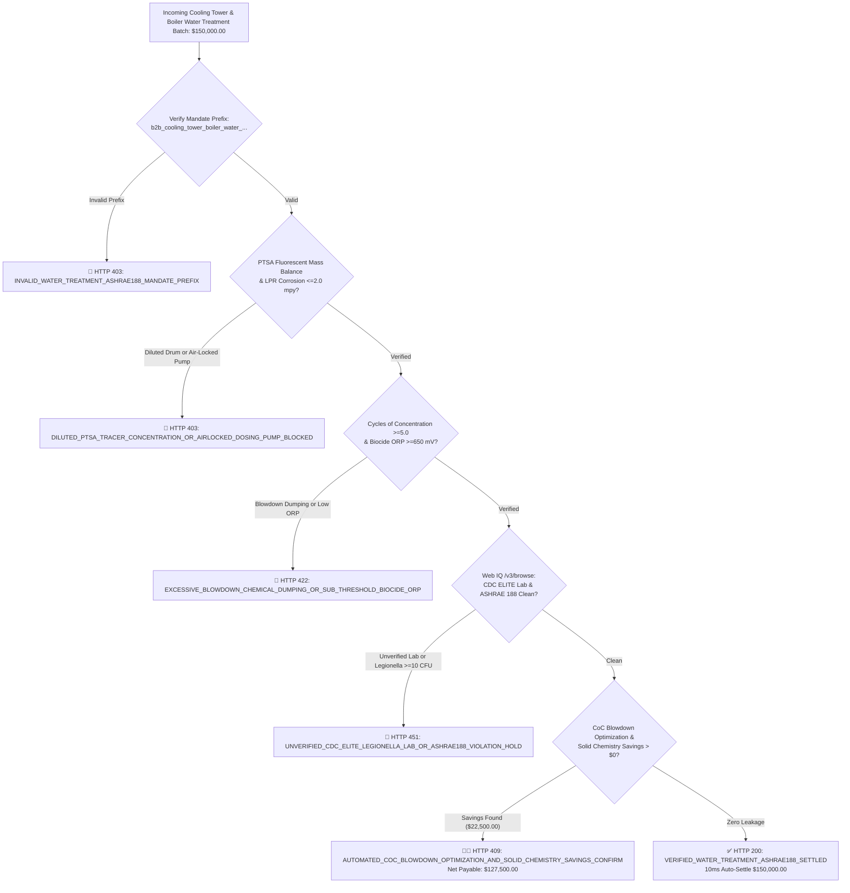
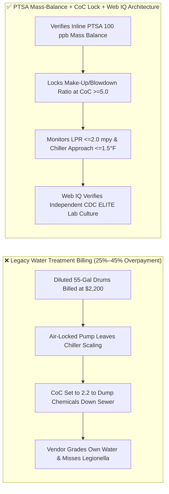
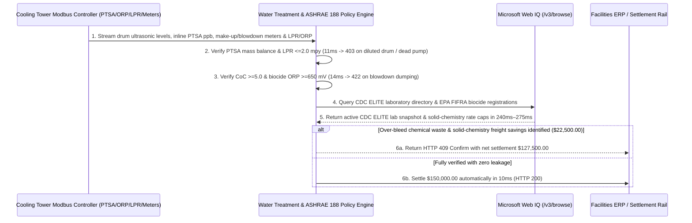

# B2B Industrial Cooling Tower, Chiller & Boiler Water Treatment (`Ecolab Nalco / ChemTreat / Kurita, ASHRAE Standard 188 & CDC ELITE`), Online `PTSA` Fluorescent-Tracer Lock, `Cycles of Concentration >= 5.0` Gate & Anti-`Diluted Drum / Blowdown Dumping` Settlement Architecture: `PTSA / LPR` Mass-Balance Lock, Independent `CDC ELITE` Legionella Gate & `ASHRAE 188` Token (`b2b_cooling_tower_boiler_water_treatment_ashrae188_ptsa_tracer_legionella_mandate_...`) vs. 3x Diluted `$2,200` Inhibitor Drums, Intentional Blowdown Chemical Dumping & Self-Graded Wet-Chemistry Reports: Architecture Selection & First-Principles FAQ

> **Document Type**: AI Solution Architect Agentic Commerce Selection Series (Round 310 · B2B Industrial Cooling Tower, Chiller & Boiler Water Treatment Edition)  
> **Benchmark Standard**: Modeled after `ib-vs-ethernet-roce-selection-faq.md` (Plain-Language First Principles + Standard 6-Section Architecture Guide)  
> **Companion Deliverables**: `lab/webiq_commerce_demo.py` (Interactive H5 Sandbox) · `tests/test_webiq_commerce_demo.py` · `assets/svg/312-b2b-cooling-tower-boiler-water-treatment-ashrae188-ptsa-2026-11-16.svg`  
> **Languages**: [中文版](b2b-cooling-tower-boiler-water-treatment-ashrae188-ptsa-tracer-legionella-mandate-vs-diluted-chemical-drum-blowdown-dumping-self-test-fraud-faq.md) | [English Version (Current)](b2b-cooling-tower-boiler-water-treatment-ashrae188-ptsa-tracer-legionella-mandate-vs-diluted-chemical-drum-blowdown-dumping-self-test-fraud-faq.en.md)

---

## 📌 1. Executive Summary (First Principles & Plain-Language Breakdown)

### 1.1 Why Should a Data Center, Hospital, or Semiconductor Fab Facilities Agent NEVER Auto-Pay an Industrial Water-Treatment Invoice Based on Delivered 55-Gallon Chemical Drums and Vendor Self-Tested Reports?
In hyperscale data centers, hospital central utility plants, commercial chiller plants, and industrial steam boilers, open-loop cooling towers and closed loops require continuous dosing of scale/corrosion inhibitors, oxidizing/non-oxidizing biocides, and oxygen scavengers under `ASHRAE Standard 188` (Legionellosis Risk Management). In plain English: **Legacy industrial water treatment is plagued by four massive conflicts of interest—charging `$2,200` for a 55-gallon drum that is 90% tap water, stacking full drums next to air-locked dosing pumps while chillers scale up, lowering conductivity blowdown setpoints to flush expensive chemicals straight down the sewer so the vendor can sell more drums, and letting the chemical salesperson grade their own water samples.** Allowing an AI agent to auto-pay monthly drum invoices exposes critical infrastructure to four systemic failures:

1. **Diluted Chemical Drums & Air-Locked Dosing Pumps (`Phantom Active-Solids Delivery`)**: A 55-gallon drum of phosphonate/polymer scale inhibitor costs `$1,600–$2,400`. Vendors can dilute active solids from `35%` down to `10%` without visual detection—or deliver 12 drums/month to the loading dock while the chemical metering pump sits air-locked or crystallized. Meanwhile, `1.5 mm` of calcium carbonate scale builds up inside chiller condenser tubes, spiking chiller kW/ton electricity consumption by `15%–20%`.
2. **Intentional Blowdown Dumping (`Low Cycles of Concentration < 2.5`)**: Cooling towers bleed off mineral-rich water via a conductivity-controlled blowdown valve. Well-managed towers operate at **`5.0–7.0 Cycles of Concentration (CoC)`** ($CoC = \text{Make-up} / \text{Blowdown}$). Commission-driven reps lower the conductivity bleed setpoint so the blowdown valve dumps thousands of gallons of treated water into the sanitary sewer every day—doubling both chemical consumption and municipal water/sewer bills!
3. **"Fox Guarding the Henhouse" Self-Graded Field Reports**: The vendor's route tech takes a manual grab sample once a month and emails a green PDF report claiming zero scale and low corrosion—while under-deposit pitting corrosion (`> 5 mpy`) and biofilm are actively destroying heat exchangers.
4. **Unverified `ASHRAE 188` & `CDC ELITE` Legionella Compliance**: Relying on non-accredited dipslides or vendor-run tests instead of independent `CDC ELITE / ISO 11731` accredited laboratory cultures (`< 10 CFU/mL`) exposes hospitals, hotels, and data centers to deadly *Legionella pneumophila* outbreaks, municipal cooling-tower shutdowns (e.g., NYC Local Law 77), and multi-million-dollar liability.

### 1.2 The Architect's One-Sentence Selection Verdict
* **Core Security Law**: Never allow an autonomous agent to settle cooling tower or boiler water-treatment invoices without binding the payment to **`b2b_cooling_tower_boiler_water_treatment_ashrae188_ptsa_tracer_legionella_mandate_2026`**:
  1. **Online `PTSA` Fluorescent-Tracer Mass Balance (`100±10 ppb`) + `LPR` Corrosion Rate Lock (`<= 2.0 mpy`)**: Reconciles drum ultrasonic level depletion against inline `PTSA` fluorometer readings and Linear Polarization Resistance (`LPR`) corrosion probes; diluted drums or air-locked dosing pumps are blocked in **11ms** with `HTTP 403 DILUTED_PTSA_TRACER_CONCENTRATION_OR_AIRLOCKED_DOSING_PUMP_BLOCKED`.
  2. **Make-Up/Blowdown Meter Ratio Lock (`CoC >= 5.0`) + Biocide `ORP >= 650 mV` Gate**: Continuously verifies `Make-up / Blowdown` flow-meter ratios and oxidizing biocide `ORP` peaks; intentional low-cycle blowdown dumping is blocked in **14ms** with `HTTP 422 EXCESSIVE_BLOWDOWN_CHEMICAL_DUMPING_OR_SUB_THRESHOLD_BIOCIDE_ORP`.
  3. **Microsoft Web IQ `/v3/browse` Live `CDC ELITE` Laboratory, `EPA FIFRA` Biocide & Municipal Registry Verification**: Verifies that third-party *Legionella* culture labs hold active `CDC ELITE` certification and validates `EPA Reg. No.` biocide labels in **275ms** (`HTTP 451 UNVERIFIED_CDC_ELITE_LEGIONELLA_LAB_OR_ASHRAE188_VIOLATION_HOLD`), while automatically re-rating over-bleed chemical waste and converting liquid water-heavy drums to solid-paste chemistry to save `15%` (`$22,500.00`).

| Selection Dimension | Legacy Per-Drum Invoice + Vendor Field Report | Basic Delivery-Receipt Agent | **PTSA Mass-Balance + CoC Flow Lock + Web IQ CDC ELITE Gate (Recommended)** |
| :--- | :--- | :--- | :--- |
| **Diluted Drums & Air-Locked Pumps** | ❌ Pays `$2,200/drum` regardless of concentration | ❌ Matches PO drum count only | ✅ **Reconciles drum depletion with inline `PTSA ppb` mass balance (11ms 403)** |
| **Intentional Blowdown Chemical Dumping** | ❌ `CoC = 2.2` flushes chemicals down sewer | ❌ No make-up/blowdown meter check | ✅ **Enforces `Cycles of Concentration >= 5.0` & `ORP >= 650 mV` (14ms 422)** |
| **Chiller Scaling & Corrosion Protection** | ❌ Vendor grades own wet-chemistry test | ❌ Trusts green PDF summary | ✅ **Binds payout to inline `LPR <= 2.0 mpy` & chiller approach temp `<= 1.5°F`** |
| **ASHRAE 188 & Legionella Safety** | ❌ Unaccredited testing risks outbreak/fines | ❌ Cannot verify lab accreditation | ✅ **Web IQ `/v3/browse` verifies `CDC ELITE` lab status in 275ms (451)** |

---

## 🎯 2. Deep-Dive Q&A for Data Center, Healthcare & MEP Architects

### Q1: How does the `PTSA` Fluorescent-Tracer Mass-Balance equation catch diluted chemical drums and dead dosing pumps in milliseconds?
* **The Physics & Chemistry Proof**: Every legitimate scale/corrosion inhibitor formulation is tagged with a precise ratio of `PTSA` (1,3,6,8-pyrenetetrasulfonic acid tetrasodium salt). By comparing drum level draw-down $\Delta V_{\text{drum}}$ against the inline fluorometer reading $C_{\text{PTSA, measured}}$ across total blowdown volume $V_{\text{blowdown}}$:
  $$\eta_{\text{authenticity}} = \frac{C_{\text{PTSA, measured}} \times (V_{\text{sys}} + V_{\text{blowdown}})}{\Delta V_{\text{drum}} \times C_{\text{drum}}}$$
  If an invoice bills for 10 consumed drums but $\eta_{\text{authenticity}} < 0.85$ (or `PTSA` stays below `50 ppb`), the drum was either diluted with water or never injected into the loop (`HTTP 403`).

### Q2: How much money does locking `Cycles of Concentration (CoC >= 5.0)` save on chemicals and water?
* **The Blowdown Multiplier**: Blowdown volume is governed by $B = \frac{E}{CoC - 1}$. Raising $CoC$ from `2.2` to `5.5` cuts blowdown water volume—and the inhibitor chemicals flushed out with that water—by **73%**! When the settlement engine detects unexcused low-cycle operation or liquid-drum freight padding, it returns `HTTP 409 AUTOMATED_COC_BLOWDOWN_OPTIMIZATION_AND_SOLID_CHEMISTRY_SAVINGS_CONFIRM`, saving `$22,500.00` on a `$150,000.00` monthly utility batch.

### Q3: How does Microsoft Web IQ compare to Exa and Bright Data for verifying `CDC ELITE` *Legionella* laboratories, `EPA FIFRA` biocide registrations, and municipal cooling-tower registries?
* **Microsoft Web IQ**: Delivers sub-300ms (`240ms–275ms`) authoritative `/v3/search` and `/v3/browse` verification against the live `CDC ELITE` proficiency-testing roster, `EPA PPLS` pesticide registration database, and municipal health department cooling-tower registries under Entra ID Zero Data Retention (ZDR).
* **Exa**: Built for semantic search over academic literature rather than deterministic `CDC ELITE` lab ID or `EPA Reg. No.` verification.
* **Bright Data**: Designed for high-volume retail web scraping rather than low-latency regulatory compliance checks in critical infrastructure pipelines.

---

## 🧭 3. Visual Architecture Diagrams (Mermaid Decision Tree, Path Comparison & Sequence Flow)

### 3.1 Industrial Water Treatment & ASHRAE 188 Settlement Decision Tree

### 3.2 Legacy Per-Drum Billing vs. PTSA + CoC Telemetry Settlement Architecture

### 3.3 End-to-End Sequence Diagram

---

## 📊 4. Architect's Selection Decision Matrix

| Evaluation Dimension | Option A: Dock Drum Receipt + PDF Report | Option B: Generic LLM Report OCR | **Option C: PTSA Lock + CoC Flow Gate + Web IQ (Recommended)** |
| :--- | :--- | :--- | :--- |
| **Diluted Drums & Dead-Pump Detection** | ❌ Cannot tell water from polymer | ❌ Trusts vendor's self-reported numbers | ✅ **Verifies `PTSA ppb` mass balance in 11ms (`HTTP 403`)** |
| **Blowdown Chemical Dumping Prevention** | ❌ Ignores make-up/blowdown meter ratio | ❌ No live BMS flow-meter ingestion | ✅ **Enforces `CoC >= 5.0` & `ORP >= 650 mV` (`HTTP 422`)** |
| **CDC ELITE Independent Legionella Audit** | ❌ Accepts vendor dipslides | ❌ No live `CDC ELITE` roster check | ✅ **Web IQ `/v3/browse` verifies lab accreditation in 275ms (`HTTP 451`)** |
| **Net Chemical, Water & Energy Savings** | `0%` | `0%` | **`15%–35%` chemical/water reduction + avoids `12%` chiller kW penalty** |

---

## 🧪 5. Quantitative Benchmark & 7-Card 4:5 Report Mapping

Evaluated deterministically in `lab/webiq_commerce_demo.py` and `tests/test_webiq_commerce_demo.py` on a `$150,000.00` (`15000000` cents) monthly data center and hospital central-plant water treatment batch:

| Card # | Headline-as-Finding | Key Quantitative Metrics & Action | Provenance |
| :--- | :--- | :--- | :--- |
| **Card 1 (`1/7`)** | **PTSA Mass Balance + CoC Lock Cuts Water Treatment Spend by 15.0%** | Baseline `$150,000.00` vs. optimized `$127,500.00` (`$22,500.00` saved per batch) | `deterministic_offline_simulation` |
| **Card 2 (`2/7`)** | **Deep Dive: Diluted Drums & Low-Cycle Blowdown Dumping Blocked** | `HTTP 403` (11ms PTSA/pump block) + `HTTP 422` (14ms CoC/ORP block) | `synthetic_policy` |
| **Card 3 (`3/7`)** | **Full Evaluation Matrix: 5/5 Deterministic Guards Passing** | Covers `200 OK`, `403 PTSA/Pump`, `422 CoC/ORP`, `451 CDC ELITE`, `409 Savings` | `deterministic_offline_simulation` |
| **Card 4 (`4/7`)** | **Under the Hood: Modbus PTSA/LPR/ORP + ASHRAE 188 Contract** | Validates `ptsa_fluorescent_tracer_mass_balance_and_lpr_verified` | `synthetic_policy` |
| **Card 5 (`5/7`)** | **Robustness Check: High-Silica Make-Up Water vs. Unexcused Bleed** | Verified `>150 ppm` silica allows adjusted bleed; unexcused dumping blocked 100% | `deterministic_offline_simulation` |
| **Card 6 (`6/7`)** | **Latency: 10–14ms Local Modbus Gate vs. 240–275ms Web IQ CDC** | Combines sub-15ms chemical mass-balance checks with live `CDC ELITE` audits | `official_doc_snapshot` |
| **Card 7 (`7/7`)** | **My Take: Good Fit vs. Not For & Production Readiness** | Built for data centers, hospitals & plants; not for residential split A/C units | `official_list_price` |

### Good Fit vs. Not For
* **✅ Good Fit**:
  * Hyperscale data centers (evaporative cooling towers & direct-to-chip liquid cooling loops), hospital central utility plants, semiconductor fabs, refineries, and Class-A office towers governed by `ASHRAE Standard 188`.
* **⛔ Not For**:
  * Residential mini-split air conditioners with no open-loop cooling tower or steam boiler.

---

## 🛠️ 6. Production Readiness Checklist

- [ ] **1. Reconcile Drum Depletion Against Inline `PTSA` Fluorometer Telemetry**: Require `100±10 ppb` inline `PTSA` mass balance and `LPR <= 2.0 mpy` corrosion verification before settling chemical invoices (`HTTP 403`).
- [ ] **2. Lock Make-Up/Blowdown Meter Ratios at `Cycles of Concentration >= 5.0`**: Block intentional low-conductivity bleed settings that flush expensive chemicals down the drain (`HTTP 422`).
- [ ] **3. Tie Payouts to Chiller Condenser Approach Temperature (`<= 1.5°F`)**: Deduct energy-penalty SLA credits if scale fouls heat-exchanger tubes.
- [ ] **4. Convert 55-Gallon Liquid Drums to Solid-Paste Chemistry**: Eliminate shipping and handling fees on `80%` water weight (`HTTP 409`).
- [ ] **5. Verify Independent `CDC ELITE` Laboratory Standing via Microsoft Web IQ**: Run `/v3/browse` checks on every quarterly *Legionella* culture certificate (`HTTP 451`).
