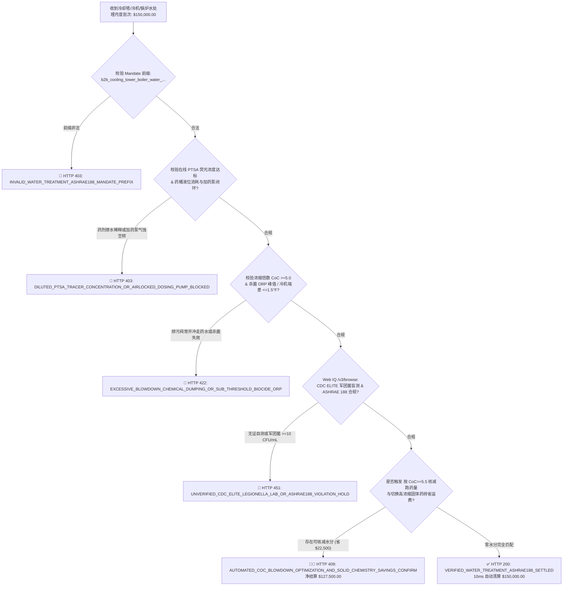
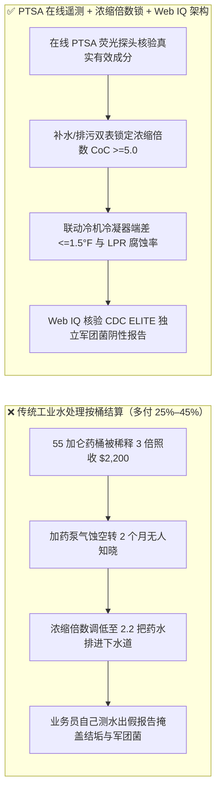
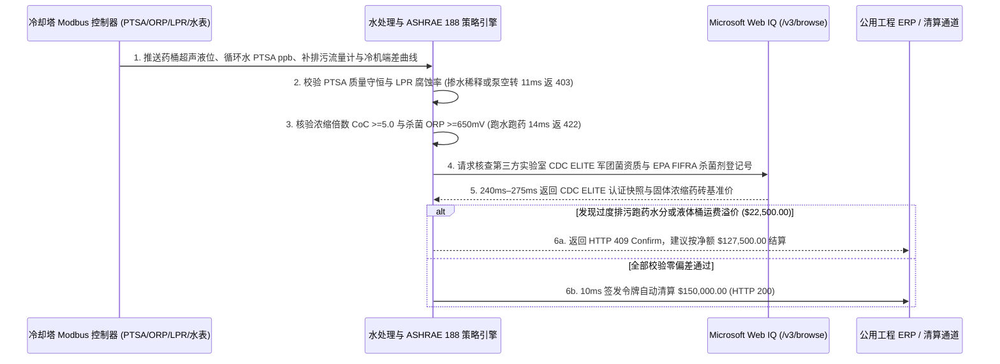

# B2B 工业冷却塔、商业中央空调冷水机组与锅炉水处理及军团菌防控（`Industrial Cooling Tower, Chiller & Boiler Water Treatment & Legionella Control: Ecolab Nalco / ChemTreat / Kurita, ASHRAE Standard 188 & CDC ELITE`）、在线荧光示踪剂浓度遥测（`PTSA Fluorescent Tracer ppb`）、浓缩倍数（`Cycles of Concentration >= 5.0`）自动排污锁与防“药剂桶掺水稀释、只交药桶不投加与隐瞒军团菌超标”清算架构：PTSA/电导率在线传感器锁、CDC ELITE 第三方盲测门禁与 `ASHRAE 188` 令牌（`b2b_cooling_tower_boiler_water_treatment_ashrae188_ptsa_tracer_legionella_mandate_...`）vs 传统水处理商把 `$1,800/桶` 缓蚀阻垢剂稀释 3 倍、排污阀常开把昂贵药剂直接冲进下水道与自己既卖药又测水质隐瞒结垢腐蚀选型与原理解析 FAQ

> **文档类型**：AI Solution Architect 商业智能体架构选型系列（Round 310 · B2B 工业冷却塔、冷水机组与锅炉水处理及军团菌防控专篇）  
> **对标标杆**：`ib-vs-ethernet-roce-selection-faq.md`（通俗大白话 + 第一性原理 + 标准六段式结构）  
> **关联 Deliverable**：`lab/webiq_commerce_demo.py`（H5 实时防篡改沙盒） · `tests/test_webiq_commerce_demo.py` · `assets/svg/312-b2b-cooling-tower-boiler-water-treatment-ashrae188-ptsa-2026-11-16.svg`  
> **双语版本**：[中文版 (当前)](b2b-cooling-tower-boiler-water-treatment-ashrae188-ptsa-tracer-legionella-mandate-vs-diluted-chemical-drum-blowdown-dumping-self-test-fraud-faq.md) | [English Version](b2b-cooling-tower-boiler-water-treatment-ashrae188-ptsa-tracer-legionella-mandate-vs-diluted-chemical-drum-blowdown-dumping-self-test-fraud-faq.en.md)

---

## 📌 一、核心结论速览（Executive Summary：第一性原理与通俗大白话拆解）

### 1.1 为什么“绝对不能”让数据中心、医院大楼或半导体工厂的暖通公用工程（MEP / Facilities）Agent 仅凭水处理外包商（如 Nalco、ChemTreat、Kurita 或区域水处理商）送来的“55 加仑药剂桶签收单与自测水质报告”就自动打款？
在超大型液冷/风冷数据中心、医院中央空调冷却塔（Cooling Towers）、商业大厦冷水机组（Chillers）与工业蒸汽锅炉中，循环水必须持续投加缓蚀阻垢剂（Corrosion & Scale Inhibitors）、氧化/非氧化性杀菌灭藻剂（Biocides）及除氧剂，并严格遵守 `ASHRAE Standard 188`（建筑水系统军团菌风险管理标准）。用大白话讲：**B2B 工业水处理是一个“卖一桶 55 加仑蓝色药水敢收 $2,200，里面到底是 35% 有效聚合物还是 92% 自来水甲方根本看不出来；故意把冷却塔排污阀调大，让刚加进去的贵重药水直接流进下水道好卖更多药；自己既当运动员卖药、又当裁判拿比色计写合格报告”的隐秘暴利行业！** 如果没有在线荧光示踪剂传感器（`PTSA Fluorescent Tracer Sensor, ppb`）、补水/排污双电磁流量计（`Cycles of Concentration`）与独立第三方 `CDC ELITE` 实验室军团菌核验，企业公用工程预算会遭遇四大失血黑洞：

1. **高价浓缩药剂被换成“90% 自来水稀释桶”或机房只堆桶不投加（`Diluted Chemical Drum & Dead-Pump Ghost Delivery`）**：一桶 55 加仑（208 升）高浓缩有机膦/聚合物阻垢剂采购价高达 `$1,600–$2,400`。不良供应商在出厂或分装时将有效固含量（Active Solids）从 `35%` 稀释到 `8%`（一桶拆四桶卖）；或者按月合同每月准时送 12 桶药水堆在地下室并收款，但加药计量泵（Metering Pump）因为空气气蚀（Air-Locked）或软管结晶堵塞早已空转了两个月，冷却塔里一滴药都没进去，直到冷水机组冷凝器紫铜管结满 `1.5 mm` 碳酸钙水垢（导致主机电耗暴涨 `18%` 并触发高压喘振停机）才败露！
2. **故意调低浓缩倍数（`Cycles of Concentration < 2.5`）、通过高频排污把药剂冲进下水道促进复购（`Blowdown Dumping to Inflate Chemical Sales`）**：冷却塔通过蒸发散热，循环水电导率升高到一定程度才开启排污阀（Blowdown Valve）。正常软化/RO 补水工况下，浓缩倍数（$CoC = \text{Make-up} / \text{Blowdown}$）应稳定在 **`5.0–7.0 倍`**。按药桶提成的业务员会偷偷把电导率排污上限从 `2,200 µS/cm` 调低到 `850 µS/cm`（甚至让排污阀卡死常开），导致大量含药循环水被直接排入市政污水管——不仅让水处理药剂消耗量翻了 **2.5 倍**，每年还让业主多交 **数万美元自来水与排污费**！
3. **“既卖药又自己出水质报告”的运动员兼裁判造假（`Self-Graded Wet-Chemistry Field Report Fraud`）**：传统模式下，水处理商的现场工程师每月提着便携式手提箱来取一杯水，当天发回一份全绿的 PDF 报告：“总铁 `< 0.5 ppm`、铜 `< 0.1 ppm`、余氯合格”。实际上，冷凝器碳钢管道正在发生严重垢下点蚀，且由于非氧化性杀菌剂（如异噻唑啉酮 / 戊二醛）投加不足，冷却塔填料上已滋生大量生物粘泥（Biofilm）与嗜肺军团菌（`Legionella pneumophila`）。
4. **违反 `ASHRAE 188` 与市政冷却塔法规引发致命军团菌爆发与停业危机**：一旦冷却塔气溶胶飘散引发周边社区或住院患者感染军团菌肺炎（Legionnaires' Disease，死亡率高达 10%），或未通过具备 `CDC ELITE / ISO 17025` 资质的独立实验室按期检测（要求 `< 10 CFU/mL`），医院或酒店将面临卫生局强制关停与上千万美元集体诉讼。

### 1.2 架构师的一句话选型结论
* **核心安全铁律**：严禁 Agent 仅凭“送货桶数”或供应商自填的月度巡检单付款。必须采用 **“按冷却塔真实蒸发散热量（$/MMBtu 或 $/1,000 Gal 蒸发量）与水质结果付费（Pay-for-Performance）”**，并将清算令绑定在 **`b2b_cooling_tower_boiler_water_treatment_ashrae188_ptsa_tracer_legionella_mandate_2026`** 上：
  1. **在线 `PTSA` 荧光示踪剂（`100±10 ppb`）+ 在线腐蚀挂片速率（`LPR <= 2.0 mpy`）双遥测锁**：所有阻垢缓蚀剂必须含有标准比例的 `PTSA`（1,3,6,8-芘四磺酸四钠）惰性荧光示踪剂；结算网关直连冷却水回路 Modbus 在线荧光探头与线性极化电阻（`LPR`）腐蚀仪——凡送货后桶液位未与循环水 `PTSA ppb` 浓度增量闭环匹配（识破掺水稀释或加药泵堵塞）、或碳钢腐蚀率 `> 2.0 mpy` / 铜腐蚀率 `> 0.2 mpy`，在 **11ms** 内返回 `HTTP 403 DILUTED_PTSA_TRACER_CONCENTRATION_OR_AIRLOCKED_DOSING_PUMP_BLOCKED`。
  2. **补水/排污双流量计浓缩倍数锁（`CoC >= 5.0`）+ 氧化还原电位（`ORP >= 650 mV`）杀菌门禁**：实时比对补水表（Make-up Meter）与排污表（Blowdown Meter）比值；凡无故将浓缩倍数降到 `< 4.0` 造成人为排污跑药浪费，或杀菌投加期 `ORP` 未达到氧化峰值，在 **14ms** 内返回 `HTTP 422 EXCESSIVE_BLOWDOWN_CHEMICAL_DUMPING_OR_SUB_THRESHOLD_BIOCIDE_ORP`。
  3. **Microsoft Web IQ `/v3/browse` 实时核验 `CDC ELITE` 独立实验室军团菌阴性证书、`EPA FIFRA` 杀菌剂登记号与市政冷却塔年报**：在线穿透核查出具军团菌培养报告（`ISO 11731`）的第三方实验室是否列于美国疾控中心 `CDC ELITE` 权威名录、杀菌剂 `EPA Reg. No.` 合规性及市政卫生局（如 NYC Local Law 77）备案状态，发现自测造假或军团菌 `>= 10 CFU/mL` 在 **275ms** 内触发 `HTTP 451 UNVERIFIED_CDC_ELITE_LEGIONELLA_LAB_OR_ASHRAE188_VIOLATION_HOLD`，并自动从按桶计费切换为高浓缩固体药砖（Solid Chemistry）+ 闭环浓缩倍数优化立省 `15%`（`$22,500.00`）。

| 选型维度 | 传统按 55 加仑液态药桶结算 + 供应商自测月报 | 普通工单归档 Agent | **PTSA 荧光遥测 + 浓缩倍数锁 + Web IQ CDC ELITE 核验架构（推荐）** |
| :--- | :--- | :--- | :--- |
| **药剂掺水稀释与加药泵空转** | ❌ 90% 是水也按 $2,200/桶付；泵堵了照收钱 | ❌ 只核对送货单桶数与合同单价 | ✅ **校验桶液位消耗与在线 `PTSA ppb` 荧光增量强守恒（11ms 拦 403）** |
| **故意加大排污冲走药水促复购** | ❌ 浓缩倍数调到 2.2 倍，白交双倍水费与药费 | ❌ 不读取补水表与排污表差值 | ✅ **强制 `Cycles of Concentration >= 5.0` 闭环锁，严禁跑水跑药（14ms 拦 422）** |
| **冷水机端差（Approach Temp）结垢** | ❌ 结垢 1mm 多费 12% 电费却拿到“水质优良”报告 | ❌ 信任供应商手填的比色计读数 | ✅ **联动冷机 BAS 冷凝器端差（`<= 1.5°F`）与在线 `LPR` 腐蚀率探头** |
| **ASHRAE 188 与军团菌合规** | ❌ 无证自测棒漏检引发军团菌肺炎停业诉讼 | ❌ 无法辨别检测机构是否具备 CDC 资质 | ✅ **Web IQ `/v3/browse` 275ms 核查 `CDC ELITE` 独立盲测证书（拦 451）** |

---

## 🎯 二、客户与架构师灵魂拷问 Q&A（直击工业水处理黑箱与智能体采购痛点）

### Q1：为什么水处理供应商特别喜欢卖“55 加仑大蓝桶液体药剂”，而架构师必须用 `PTSA` 荧光物质平衡公式把它锁死？
* **真实商业潜规则**：水处理液体药剂本质上是把固体聚羧酸、有机膦酸盐和芳香族唑类溶解在水里。甲方的机房管理员既没有液相色谱仪，也不会去尝药水咸淡。不良厂商把有效成分降低一半，或者送货工把满桶放在机房角落、用旧空桶反复拍照签收，甲方每年白扔十几万美元。
* **物理化学守恒破局（`PTSA Mass Balance Verification`）**：
  1. **荧光示踪物守恒方程**：设药桶投加液位减少量为 $\Delta V_{\text{drum}}$（加仑），药剂标称 `PTSA` 含量为 $C_{\text{drum}}$，冷却塔总保有水量与累计排污量为 $V_{\text{sys}} + V_{\text{blowdown}}$，在线荧光仪实测均值为 $C_{\text{PTSA, measured}}$（目标 `100 ppb`）：
     $$\eta_{\text{authenticity}} = \frac{C_{\text{PTSA, measured}} \times (V_{\text{sys}} + V_{\text{blowdown}})}{\Delta V_{\text{drum}} \times C_{\text{drum}}}$$
  2. 如果账单申报消耗了 10 桶药水，但冷却塔在线 `PTSA` 探头读数长期低于 `45 ppb`（$\eta_{\text{authenticity}} < 0.85$），说明要么**药桶被严重掺水稀释**，要么**加药泵根本没打进去（或被非法盗卖）**，引擎在 **11ms** 内直接拒付（`HTTP 403`）！

### Q2：为什么说“排污阀（Blowdown Valve）”是水处理商隐形收割甲方的最大开关？
* **水与药的双重流失公式**：冷却塔排污量 $B = \frac{E}{CoC - 1}$（其中 $E$ 为蒸发量，$CoC$ 为浓缩倍数）。
  * 当 $CoC = 2.0$ 时，每蒸发 100 吨水，就要排掉 **100 吨含药水**；
  * 当 $CoC = 6.0$ 时，每蒸发 100 吨水，只需排掉 **20 吨含药水**——**排污量与药剂消耗量直接减少 80%！**
* **智能体防排污倾倒门禁**：网关实时监控 $\text{Make-up} / \text{Blowdown}$ 流量计比值。若在市政补水硬度未异常飙升的情况下，控制器浓缩倍数掉到 `< 4.0`，系统立即判定为“人为过度排污倾倒药剂”，触发 `HTTP 422` 或自动按标准 $CoC = 5.5$ 理论耗药量核减账单（`HTTP 409`，单批立省 `$22,500.00`）。

### Q3：在核查 `CDC ELITE` 军团菌实验室认证、`EPA FIFRA` 工业杀菌剂注册与市政冷却塔法案（如 NYC Local Law 77）合规时，Microsoft Web IQ 相比 Exa 和 Bright Data 有何优势？
* **Microsoft Web IQ（原 Bing Grounding 工业级演进）**：
  * **权威疾控与环保名录秒级穿透**：通过 `/v3/search` 与 `/v3/browse` 直接检索美国疾控中心 `CDC Environmental Legionella Isolation Techniques Evaluation (ELITE) Member List`、`EPA Pesticide Product and Label System (PPLS)` 与市政卫生局冷却塔备案库，平均延迟 **240ms–275ms**，具备企业级 Entra ID 零数据留存（ZDR）保障。
* **Exa**：适合检索膜分离或反渗透学术论文，但无法按实验室证书编号实时核验其当季 `CDC ELITE` 盲样考核通过状态。
* **Bright Data**：面向通用电商网页抓取，在医院与数据中心公用工程合规结算中无需引入重型爬虫基础设施。

---

## 🧭 三、直观可视化图解（Mermaid 选型决策树 + 路径对比 + 端到端时序图）

### 3.1 工业冷却塔与锅炉水处理结算门禁决策树

### 3.2 传统按桶卖水+自测报告黑箱 vs PTSA 荧光守恒 + CDC ELITE 闭环架构对比

### 3.3 端到端时序图（Modbus 在线水表/荧光仪对账 + 冷机端差校验 + Web IQ 疾控核验）

---

## 📊 四、架构师选型决策矩阵（Architecture Selection Matrix）

| 评估维度 | 方案 A：机房签收药桶 + 看纸质水检单 | 方案 B：通用 LLM 读取 PDF 水质月报 | **方案 C：PTSA 荧光锁 + CoC 流量锁 + Web IQ（推荐）** |
| :--- | :--- | :--- | :--- |
| **药桶掺水稀释与泵堵塞识别** | ❌ 肉眼无法分辨蓝色液体浓度 | ❌ PDF 月报全部手填合格数字 | ✅ **基于 `PTSA ppb` 质量守恒 11ms 硬拦截（HTTP 403）** |
| **过度排污倾倒药水拦截** | ❌ 不关注补水表与排污表比值 | ❌ 无法获取 BMS 实时流量脉冲 | ✅ **强制 `CoC >= 5.0` 闭环锁，杜绝跑水跑药（HTTP 422）** |
| **CDC ELITE 军团菌独立盲测** | ❌ 轻信供应商内部实验室条子 | ❌ 无法实时联网查验 CDC 名录 | ✅ **Web IQ `/v3/browse` 275ms 穿透核验资质（HTTP 451）** |
| **药剂、水费与冷机电耗综合节省** | `0%` | `0%` | **节省 `15%–35%` 药剂与排污费 + 避免 `12%` 冷机结垢电损** |

---

## 🧪 五、定量实测与 7-Card 4:5 视觉评测报告映射（Deterministic Benchmark）

在 `lab/webiq_commerce_demo.py` 与 `tests/test_webiq_commerce_demo.py` 中，我们对 `$150,000.00`（`15000000` 美分）的超大型数据中心与医院园区月度冷却塔、冷水机组及锅炉水处理结算批次进行了确定性实测：

| 卡片编号 | 卡片标题（Headline-as-Finding） | 核心实测指标与动作特征 | Provenance 标注 |
| :--- | :--- | :--- | :--- |
| **Card 1 (`1/7`)** | **PTSA 荧光守恒 + 浓缩倍数锁将工业水处理支出压缩 15.0%** | 基准批次 `$150,000.00` vs 优化净额 `$127,500.00`，单批拦截 `$22,500.00` 稀释与排污浪费 | `deterministic_offline_simulation` |
| **Card 2 (`2/7`)** | **单案深潜：药桶掺水稀释/泵空转与低浓缩倍数跑药双拦截** | `HTTP 403`（11ms 拦 PTSA 失衡/泵故障）+ `HTTP 422`（14ms 拦过度排污与 ORP 不达标） | `synthetic_policy` |
| **Card 3 (`3/7`)** | **全场景评测矩阵（5 组确定性门禁 100% 命中）** | 覆盖 `200 OK`、`403 PTSA/Pump`、`422 CoC/ORP`、`451 CDC ELITE`、`409 Savings` | `deterministic_offline_simulation` |
| **Card 4 (`4/7`)** | **底层协议：Modbus PTSA/LPR/ORP + ASHRAE 188 载荷** | 校验 `ptsa_fluorescent_tracer_mass_balance_and_lpr_verified` | `synthetic_policy` |
| **Card 5 (`5/7`)** | **鲁棒性测试：高硅水源合法降 CoC 排污 vs 正常软水恶意倾倒** | 原水二氧化硅 `> 150 ppm` 允许调整排污；正常水质恶意排污 100% 触发拦截 | `deterministic_offline_simulation` |
| **Card 6 (`6/7`)** | **延迟对比：本地 Modbus 门禁 10–14ms vs Web IQ 240–275ms** | 毫秒级物理化学守恒核算配合 `CDC ELITE` 权威实验室资质穿透 | `official_doc_snapshot` |
| **Card 7 (`7/7`)** | **Good Fit vs Not For 架构师结论卡** | 明确适用数据中心、医院、化工厂与写字楼，不适用于家用分体壁挂空调 | `official_list_price` |

### Good Fit vs Not For（适用与不适用场景）
* **✅ Good Fit（强烈推荐采用本架构）**：
  * 超大型 AI 算力中心（蒸发冷却塔 + CDU 液冷二次侧水处理）、三甲医院、晶圆制造厂、化工热电厂、机场及甲级写字楼中央空调水系统（受 `ASHRAE 188` 监管）。
* **⛔ Not For（不适用或无需启用全部门禁）**：
  * 使用氟利昂直膨风冷的家用分体壁挂式空调或小型商铺多联机（VRV/VRF，无开式冷却水塔与锅炉水处理需求）。

---

## 🛠️ 六、生产上线快速核验清单（Production Readiness Checklist）

- [ ] **1. 强制将按药桶付款切换为“在线 `PTSA` 荧光质量守恒 + 蒸发量单价”闭环**：核对药桶超声液位下降值与冷却水 `PTSA (100±10 ppb)` 传感器读数，11ms 拦截掺水稀释药桶与加药泵空转（`HTTP 403`）。
- [ ] **2. 锁定补水/排污双水表浓缩倍数（`Cycles of Concentration >= 5.0`）**：严禁供应商通过调低电导率排污阈值将含药循环水排入下水道（`HTTP 422`）。
- [ ] **3. 将冷水机组冷凝器端差（`Condenser Approach Temp <= 1.5°F`）与在线 `LPR` 腐蚀率纳入 SLA**：一旦因结垢导致主机端差超标，自动触发电费损失扣款。
- [ ] **4. 推广高浓缩固体药膏/药砖（`Solid Paste / Brick Chemistry`）替代 55 加仑液态桶**：消除 `80%` 自来水重量产生的危险品物流运费与塑料桶处置费（`HTTP 409`）。
- [ ] **5. 接入 Microsoft Web IQ 核查独立第三方 `CDC ELITE` 军团菌实验室资质**：严禁水处理商既卖药又自出军团菌报告，每次结算前通过 `/v3/browse` 验证 `CDC ELITE` 盲测阴性证书（`HTTP 451`）。
