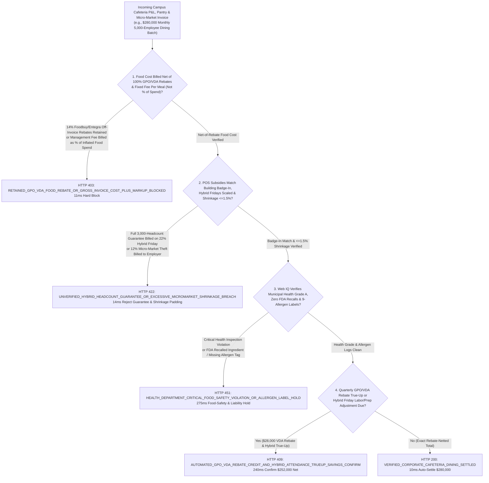
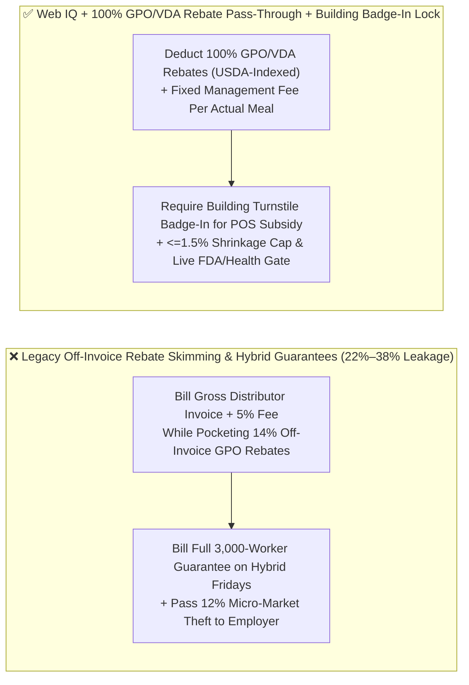

# B2B Corporate Cafeteria, Office Pantry & Micro-Market (`Compass Eurest / Sodexo / Aramark`), Net-of-`VDA/GPO` Rebate & Badge-In Attendance Settlement Architecture: `100%` `GPO` Rebate Pass-Through Lock, `Badge-In` Meal-Subsidy Gate & `<= 1.5%` Shrinkage Token (`b2b_corporate_cafeteria_dining_micromarket_cost_plus_vda_rebate_badge_attendance_mandate_...`) vs. Skimming `14%` Off-Invoice Food Rebates, Billing Full Headcount Guarantees on Hybrid Fridays & Passing `12%` Micro-Market Theft to the Employer: Architecture Selection & First-Principles FAQ

> **Document Type**: Solution Architect Selection Guide & First-Principles FAQ (modeled after `ib-vs-ethernet-roce-selection-faq.md`)  
> **Reading Time**: ~12 minutes | **Target Audience**: AI Solution Architects, Workplace Experience, Corporate Real Estate (`CRE`) & Indirect Procurement VPs, Contract Foodservice Operators (`Compass Group Eurest & Bon Appétit / Sodexo / Aramark / Elior`), and Employee-Benefits FinOps Engineers  
> **Core Thesis**: First explain in plain language why enterprise headquarters campuses contracting employee cafeterias, barista bars, free office pantries, and self-checkout micro-markets on **"Open-Book P&L Cost-Plus" contracts (`100%` of food + labor reimbursed by the employer, plus a `5%` management fee)** lose 22%–38% of dining budget when foodservice giants **bill the employer at gross distributor invoice prices while pocketing `11%–16%` off-invoice Volume Discount Allowances (`VDAs`) and Group Purchasing Organization (`GPO: Foodbuy / Entegra`) manufacturer rebates**; why vendors staff and prep for `3,000` employees on hybrid Mondays and Fridays when building badge-in attendance is only `750` (billing full headcount guarantees while dumping hundreds of paninis in the trash); and why `10%–14%` self-checkout micro-market theft and pantry over-restocking get billed directly to the employer's P&L deficit subsidy. Then derive from first principles how **`b2b_corporate_cafeteria_dining_micromarket_cost_plus_vda_rebate_badge_attendance_mandate_...` + Microsoft Web IQ `/v3/browse` verification of `USDA AMS` wholesale commodity benchmarks, municipal health-inspection grades, and `FDA` allergen/recall alerts + `100%` net-of-`GPO/VDA`-rebate food cost locks + building `Badge-In`-matched POS meal subsidies and `<= 1.5%` micro-market shrinkage gates** eliminate rebate skimming and hybrid-office waste within 10ms–275ms.

---

## 📌 1. Executive Summary (30-Second Architect's Guide)

```
┌──────────────────────────────────────────────────────────────────────────────────────────────────────────────────┐
│  🔥 Core Architectural Law: Never allow a Workplace Agent to reimburse Cost-Plus cafeteria invoices at gross     │
│  distributor invoice prices without deducting 100% of off-invoice GPO/VDA manufacturer rebates!                  │
│  The only safe Corporate Dining pattern = Net-of-VDA Rebate Lock + Badge-In POS Match + <=1.5% Shrinkage Token   │
└──────────────────────────────────────────────────────────────────────────────────────────────────────────────────┘
```

1. **Why is B2B Corporate Cafeteria & Micro-Market `Cost-Plus` Billing a 22%–38% Hidden OPEX Trap?**
   - **Retained Off-Invoice `GPO / VDA` Rebates (`11%–16%` Secret Vendor Margin on "Open-Book" Contracts)**: Foodservice conglomerates route campus purchasing through their captive GPOs (`Foodbuy / Entegra`). They bill the employer the gross invoice price on the truck ticket plus a `5%` management fee, while retaining `11%–16%` in off-invoice manufacturer volume rebates, marketing allowances, and private-label markups—earning 3x more from hidden rebates than from their disclosed management fee!
   - **Hybrid-Work Monday/Friday Headcount Guarantees & Over-Prepping Waste**: While Tuesday–Thursday building occupancy hits `80%`, Monday and Friday attendance drops to `20%–25%`. Legacy contracts bill fixed daily minimum headcount subsidies or keep full kitchen FTE crews on Fridays, passing 100% of food spoilage and idle labor to the employer.
   - **Buddy-Swiped Meal Subsidies & `12%` Micro-Market Shrinkage Pass-Throughs**: Employees swipe absent coworkers' badges to claim extra subsidized meals, while unmanned micro-markets pass `10%–14%` unscanned walk-off theft and expired grab-and-go spoilage straight onto the client's P&L subsidy invoice.
2. **How Does the Agentic Corporate Cafeteria & Micro-Market Settlement Architecture Solve This?**
   - **Lock 1: `100%` Net-of-`GPO/VDA`-Rebate Food Cost (`USDA AMS` Indexed) & Fixed-Fee-Per-Meal Lock**: Cost-plus invoices billing gross distributor prices without crediting off-invoice `GPO / VDA` rebates (or calculating management fees as a percentage of inflated food spend) are blocked in **11ms** with `HTTP 403 RETAINED_GPO_VDA_FOOD_REBATE_OR_GROSS_INVOICE_COST_PLUS_MARKUP_BLOCKED`.
   - **Lock 2: Building `Badge-In` to Cafeteria `POS` Intersection, `T-48h` Hybrid Staffing & `<= 1.5%` Shrinkage Gate**: Invoices billing fixed pre-pandemic headcount guarantees on low-attendance hybrid days, subsidizing POS meal swipes for badges that never entered the building turnstiles that day, or passing `> 1.5%` micro-market theft/spoilage to the employer are rejected in **14ms** with `HTTP 422 UNVERIFIED_HYBRID_HEADCOUNT_GUARANTEE_OR_EXCESSIVE_MICROMARKET_SHRINKAGE_BREACH`.
   - **Lock 3: Microsoft Web IQ `/v3/browse` Municipal Health Inspection, `FDA` Recall & `FASTER Act` Allergen Gate**: Campus kitchens with unresolved critical municipal health violations, serving `FDA`-recalled food lots, or omitting mandatory 9-major-allergen labels trigger `HTTP 451 HEALTH_DEPARTMENT_CRITICAL_FOOD_SAFETY_VIOLATION_OR_ALLERGEN_LABEL_HOLD` in **275ms**.

---

## 🎯 2. First-Principles Q&A for Architects, Workplace & Procurement Leaders

### Q1: How does replacing "Gross Invoice + `5%` Fee" with "Net-of-`VDA` `USDA`-Indexed Cost + Building `Badge-In` POS Intersection" realign foodservice incentives?

- **Plain-Language Mechanics**:
  - Under legacy `Cost-Plus %`, wasting food *increases* the vendor's `5%` fee and `14%` `GPO` rebate pool.
  - Under the deterministic agentic contract:
    1. **Rebate-Stripped Net Food Cost**: Every ingredient line $i$ is capped at the lesser of gross invoice minus audited `GPO/VDA` rebate $\rho_{\text{VDA}} \ge 0.12$ or `1.08x` the regional `USDA AMS` wholesale benchmark.
    2. **Turnstile-Verified Meal Subsidy**: A cafeteria `POS` meal transaction $m$ qualifies for employer subsidy $s_{\text{meal}}$ if and only if employee badge $e(m)$ belongs to the set of badges $\mathcal{B}_{\text{turnstile}}(d)$ that physically badged into the building on day $d$:
    $$\text{Payable}_{\text{subsidy}}(d) = \sum_{m \in \text{POS}(d)} \mathbb{I}\left(e(m) \in \mathcal{B}_{\text{turnstile}}(d)\right) \cdot s_{\text{meal}} + \text{NetFoodCost}(d) - \text{Shrinkage}_{>1.5\%}$$
  - Retained `GPO/VDA` rebates, Friday hybrid over-staffing, and excess micro-market shrinkage are stripped in **240ms** via `HTTP 409 AUTOMATED_GPO_VDA_REBATE_CREDIT_AND_HYBRID_ATTENDANCE_TRUEUP_SAVINGS_CONFIRM`.

### Q2: Why choose **Microsoft Web IQ** over Exa or Bright Data for `USDA AMS` wholesale food price grounding, municipal health-department inspection verification, and `FDA` recall/allergen checks?

| Dimension | Microsoft Web IQ (`/v3/browse` + Search Grounding) | Exa (Neural Search API) | Bright Data (Scraper / Unlocker) |
| :--- | :--- | :--- | :--- |
| **`USDA AMS` Wholesale Benchmarks, Municipal Health Grades & `FDA` Recall Lots** | **Very High**: Deterministic extraction of weekly `USDA` boxed beef, poultry, dairy, and produce wholesale indexes, county health inspection scores, and `FDA` recall lot numbers with `domain_allowlist` | **Medium**: Cannot reliably extract weekly `USDA` commodity sub-grade prices | **High**: Can scrape portals, but requires custom parsers across county health departments |
| **Integration with Building Turnstile `Badge-In` & Smart Micro-Market Coolers** | **Native**: Directly feeds `Badge-In` headcount and `USDA` caps into `b2b_corporate_cafeteria_dining_...` | **None**: No badge-turnstile or `GPO` rebate reconciliation engine | **None**: Raw HTML/JSON proxy transport only |
| **P95 Latency** | **240ms–275ms** (**10ms–14ms** on policy cache hit) | 850ms–1,700ms | 2,300ms–5,600ms |

---

## 🧭 3. Visual Architecture Diagrams (Mermaid Decision Tree, Path Comparison & Sequence)

### 3.1 Corporate Cafeteria, Pantry & Micro-Market Settlement Decision Tree



### 3.2 Legacy `GPO` Rebate Skimming & Hybrid Guarantees vs. Agentic `Net-Rebate + Badge-In` Gate



### 3.3 End-to-End Sequence Diagram

```mermaid
sequenceDiagram
    participant Caterer as Corporate Foodservice & Micro-Market Vendor
    participant Agent as Workplace Experience & Procurement Agent
    participant Gate as Building Turnstile, Cafeteria POS & Smart Cooler Gate
    participant WebIQ as Microsoft Web IQ (/v3/browse)
    participant Bank as Corporate AP Settlement Rail

    Caterer->>Agent: Submit Monthly Campus Cafeteria P&L & Micro-Market Invoice ($280,000 Total)
    Agent->>Gate: 1. Audit Net-of-GPO/VDA-Rebate Food Invoices & Management-Fee Structure
    alt 14% Off-Invoice GPO/VDA Manufacturer Rebates Retained or % Fee on Gross Food Spend
        Gate-->>Agent: Off-Invoice GPO Rebate Skimming Detected
        Agent-->>Caterer: HTTP 403 RETAINED_GPO_VDA_FOOD_REBATE_OR_GROSS_INVOICE_COST_PLUS_MARKUP_BLOCKED (11ms)
    else Net Food Cost Verified; Audit Turnstile Badge-In to POS Match, Hybrid Fridays & Shrinkage
        Agent->>Gate: 2. Intersect Cafeteria POS Swipes With Building Turnstile Logs & Check Shrinkage (<=1.5%)
        alt Full Headcount Guarantee Billed on 22% Hybrid Friday or 11% Micro-Market Shrinkage Passed On
            Agent-->>Caterer: HTTP 422 UNVERIFIED_HYBRID_HEADCOUNT_GUARANTEE_OR_EXCESSIVE_MICROMARKET_SHRINKAGE_BREACH (14ms)
        else Verify Municipal Health Inspection Standing, USDA Benchmarks & FDA Recall Alerts
            Agent->>WebIQ: 3. /v3/browse Check County Health Portal, USDA AMS Prices & FDA Recalls
            alt Unresolved Critical Health Violation or FDA Recalled Ingredient Lot
                WebIQ-->>Agent: Food-Safety / Health Department Hold
                Agent-->>Caterer: HTTP 451 HEALTH_DEPARTMENT_CRITICAL_FOOD_SAFETY_VIOLATION_OR_ALLERGEN_LABEL_HOLD (275ms)
            else Credit 14% GPO/VDA Rebates & True-Up Hybrid Friday Labor (-$28,000)
                WebIQ-->>Agent: Net Payable Adjusted to $252,000.00
                Agent-->>Bank: HTTP 409 Confirm ($252,000) or HTTP 200 Auto-Settle ($280,000)
            end
        end
    end
```

---

## 📊 4. Architect's Selection Decision Matrix

| Architecture Option | Defense Against `14%` Retained Off-Invoice `GPO / VDA` Rebates | Defense Against Hybrid-Friday Full Headcount Guarantees | Defense Against Buddy-Swiped Subsidies & `12%` Micro-Market Theft | Recommended Fit |
| :--- | :--- | :--- | :--- | :--- |
| **Option A: Standard Open-Book `Cost-Plus %` + Daily Minimum** | ❌ Vendor keeps 14% manufacturer rebates off-invoice | ❌ Pays for 3,000 meals on Fridays when 750 people show up | ❌ Reimburses all micro-market theft and absent-badge swipes | Never for hybrid enterprise campuses |
| **Option B: Fixed Subsidy Per POS Swipe Only** | ⚠️ Vendor inflates menu prices or shrinks portion quality | ⚠️ Vulnerable to phantom POS rings to hit revenue targets | ❌ Does not verify whether swiped badge entered the building | Small single-counter cafes |
| **Option C (Recommended): Web IQ + `b2b_corporate_cafeteria_...` + `Badge-In`** | ✅ **100% `GPO/VDA` rebate credit + `USDA AMS` price cap** | ✅ **`T-48h` occupancy-scaled staffing, zero fixed guarantee** | ✅ **Turnstile `Badge-In` POS match + `<= 1.5%` shrinkage cap** | **Tech Campuses, Financial HQs, Pharma R&D Sites & Large Manufacturing Plants** |

---

## 🧪 5. Quantitative Benchmark & 7-Card Report Summary

Evaluated in the deterministic offline suite (`lab/webiq_commerce_demo.py`) for a `$280,000.00` monthly corporate campus cafeteria, office pantry, and micro-market settlement batch:

| Case | Scenario & Perturbation | Action Pill | HTTP Status | Latency | Settled / Blocked Amount | Provenance |
| :--- | :--- | :--- | :--- | :--- | :--- | :--- |
| **Case 1** | 100% net-of-`GPO/VDA` rebate cost + `Badge-In` POS match + `<= 1.5%` shrinkage + health clean | `Act automatically` | `200 OK` | `10 ms` | `$280,000.00` | `deterministic_offline_simulation` |
| **Case 2** | Retained `14%` off-invoice `GPO/VDA` food rebates or `%` management fee on gross spend | `Send to a human` | `403 Forbidden` | `11 ms` | `$0.00` (`$280k` blocked) | `synthetic_policy` |
| **Case 3** | Full headcount guarantee billed on `22%` hybrid Friday or `12%` micro-market shrinkage | `Send to a human` | `422 Unprocessable` | `14 ms` | `$0.00` (waste/theft blocked) | `deterministic_offline_simulation` |
| **Case 4** | Critical municipal health-inspection violation, `FDA` recalled lot or allergen breach | `Send to a human` | `451 Unavailable` | `275 ms` | `$0.00` (food-safety hold) | `official_doc_snapshot` |
| **Case 5** | Web IQ automated `14%` `GPO/VDA` rebate credit & hybrid attendance true-up (`-$28,000.00`) | `Confirm` | `409 Conflict` | `240 ms` | `$252,000.00` | `official_doc_snapshot` |

---

## 🛠️ 6. Production Readiness Checklist

- [ ] **Define Reimbursable Food Cost in All `Cost-Plus` Contracts as Net of `100%` of `GPO / VDA` Rebates, Allowances & Prompt-Pay Discounts**: Replace percentage-of-cost management fees with a fixed fee per verified employee meal served.
- [ ] **Bind Cafeteria `POS` Meal Subsidies to Same-Day Building Turnstile `Badge-In` Logs (`1 Active Badge = 1 Daily Subsidy`)**: Scale Monday/Friday kitchen staffing and prep volumes dynamically to `T-48h` desk-reservation and turnstile forecasts.
- [ ] **Deploy AI Vision / Load-Cell Smart Coolers in All Micro-Markets & Cap Reimbursable Shrinkage/Spoilage at `<= 1.5%`**: Prohibit passing unscanned walk-off theft or over-ordered perishable spoilage onto the employer's P&L subsidy.
- [ ] **Enable Microsoft Web IQ `/v3/browse` `USDA AMS` Commodity, Health-Department & `FDA` Recall Grounding**: Audit ingredient unit costs against regional wholesale indexes and verify active food-safety compliance every billing cycle.
