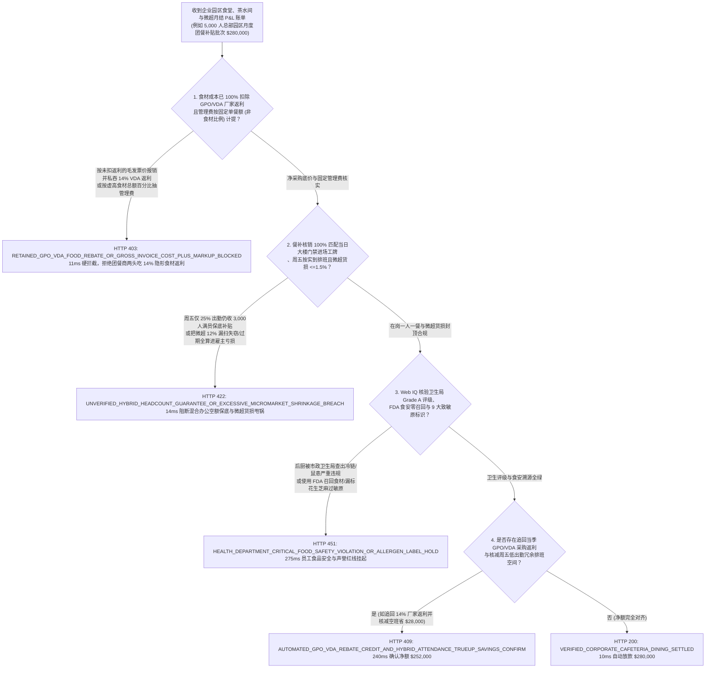
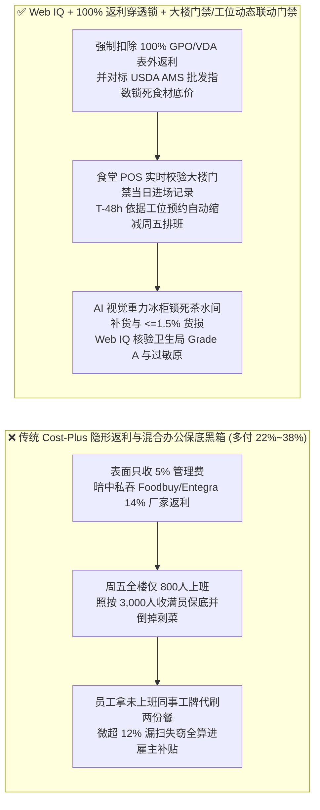
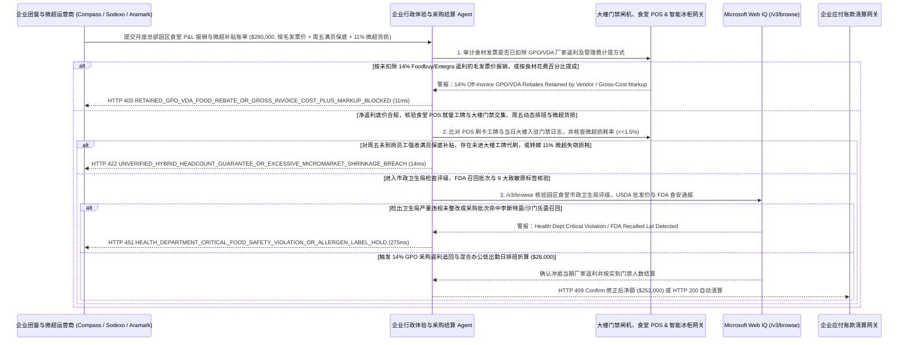

# B2B 智能体企业员工餐厅、无人微超与团餐补贴（`Corporate Dining, Cafeteria P&L Cost-Plus & Micro-Market: Compass Eurest / Sodexo / Aramark`）、门禁刷卡实到人数（`Badge-In Attendance Sync`）与供应商采购返利 100% 穿透还原（`Net-of-VDA/GPD Rebate Food Cost`）及防“周五居家办公照收满员保底餐补 / 截留 14% 厂家返利”清算架构：混合办公动态备餐人数锁、团餐集团采购组织（`GPO Foodbuy / Entegra`）表外返利全额退还门禁与无人微超货损（`<=1.5% Shrinkage Cap`）令牌（`b2b_corporate_cafeteria_dining_micromarket_cost_plus_vda_rebate_badge_attendance_mandate_...`）vs 传统团餐巨头在周四/周五仅 25% 员工到岗时照按 3,000 人满员收保底补贴、在成本加成合同里私吞 14% 食品厂返利与把茶水间过期/被拿走零食全算进雇主账单选型与原理解析 FAQ

> **文档类型**：架构师选型指南与第一性原理 FAQ（对齐 `ib-vs-ethernet-roce-selection-faq.md` 标杆风格）  
> **阅读耗时**：约 12 分钟 | **适用角色**：AI Solution Architect、大型科技公司/金融机构/制造园区行政与职场体验副总裁（`VP of Workplace Experience, Real Estate & Indirect Procurement`）、跨国团餐与餐饮管理巨头（`Compass Group Eurest & Bon Appétit / Sodexo / Aramark / Elior`）及智能体企业福利架构师  
> **核心主旨**：先用大白话把“为什么拥有 `5,000 名` 总部员工的科技或金融企业，把员工食堂、咖啡吧、茶水间免费零食（`Office Pantry`）与无人自助微超（`Micro-Market`）按**‘损益表成本加成模式（`P&L Cost-Plus Management Fee Contract`：食材+厨师工资实报实销，外加 `5%` 管理费）’**外包给三大团餐巨头后，明明周ー和周五大家都在家办公（大楼刷卡出勤率不到 `22%`），公司的餐饮补贴账单却比疫情前全员坐班时还要贵？因为团餐成本加成合同里藏着三个巨大的利润抽水机：(1) **表外采购返利截留（`Retained Off-Invoice GPO Rebates / VDA`）**：团餐巨头通过自己旗下的采购集团（如 `Compass Foodbuy` 或 `Sodexo Entegra`）向百事、泰森、卡夫亨氏买食材，账面发票写着牛排 `$12/磅`、可乐 `$18/箱` 并按这个‘毛发票价（`Gross Invoice Price`）’向雇主报销再加收 5% 管理费，但食品厂在季度末会私下返还给团餐集团高达 **`11%–16%` 的大宗销量返利与营销津贴（`Volume Discount Allowances, VDA`）**——团餐巨头嘴上说只赚你 5% 辛苦费，背地里靠截留食材返利多赚了 14%！(2) **混合办公固定人数保底（`Minimum Headcount / Subsidy Guarantee`）与备餐浪费转嫁**：合同没有打通大楼门禁与工位预约系统，周四、周五只有 800 人来上班，厨房照样按 3,000 人备菜或照收单日最低保底补贴，下午 2 点把卖不掉的几百份三明治倒进垃圾桶，食材与厨师超额工时全由雇主买单；(3) **无人货架与茶水间‘幽灵补货与货损转嫁（`Unverified Pantry Restock & 12% Micro-Market Shrinkage`）’**：补货员把 20 箱高价能量饮料和坚果记在雇主账上，实际只往茶水间放了 12 箱，或者将无人微超高达 `10%–15%` 的漏扫未付款/临期报废损耗（`Shrinkage & Spoilage`）100% 记入雇主补贴账单”讲透；再从第一性原理出发，推导如何通过 **`b2b_corporate_cafeteria_dining_micromarket_cost_plus_vda_rebate_badge_attendance_mandate_...` 语义预算令牌 + Microsoft Web IQ `/v3/browse` 实时核验 `USDA AMS` 批发食材基准价、市政卫生局餐饮分级（`Grade A / HACCP`）与预包装食品营养/过敏原合规 + 大楼门禁/工位预约 `T-48h` 动态备餐与在岗工牌一卡通核销（`1 Badge = 1 Meal Subsidy`）锁 + 强制扣除 `GPO/VDA` 表外返利后的真实净采购成本（`Net-of-Rebate Landed Cost`）与微超货损 `<=1.5%` 封顶门禁**，在 10ms–275ms 内实现“食材返利 100% 归还雇主、周五低出勤日自动缩减备餐与人手、一人一卡杜绝代刷餐补”的智能体企业餐饮清算闭环。

---

## 📌 一、核心结论速览（Executive Summary：30 秒看懂怎么选）

```
┌──────────────────────────────────────────────────────────────────────────────────────────────────────────────────┐
│  🔥 核心架构铁律：绝不允许企业行政采购 Agent 在 Cost-Plus 团餐合同中按未扣除 GPO/VDA 返利的毛发票价报销食材成本！ │
│  B2B 企业团餐与微超结算的唯一正确范式 = 净返利食材底价锁 + 门禁工位动态排班锁 + 1工牌1餐核销与 <=1.5% 货损令牌     │
└──────────────────────────────────────────────────────────────────────────────────────────────────────────────────┘
```

1. **为什么企业员工餐厅、茶水间与无人微超（`Corporate Cafeteria, Pantry & Micro-Market`）是行政福利预算年均流失 22%–38% 的三大黑洞？**
   - **黑洞一：`Cost-Plus` 合同里的“表外采购返利黑箱（`Retained GPO / VDA Rebate Skimming`）”**：在开放账本（`Open-Book Cost-Plus`）团餐合同中，雇主承担食堂所有的食材费和人工费。团餐巨头利用合同文字游戏，把向雇主报销的成本定义为“分销商发票面额（`Invoice Cost`）”，却将自己旗下采购组织（`Foodbuy / Entegra`）从上游食品制造商拿到的 **`11%–16%` 销量返利、陈列费与自有品牌加价（`Off-Invoice Rebates & Allowances`）** 留在母公司腰包！更滑稽的是，食材发票越贵，它不仅拿的厂家返利越多，向雇主收的 `5%` 成本加成管理费也越高！
   - **黑洞二：混合办公“周一周五空城计”下的固定保底与厨余浪费（`Hybrid-Work Headcount Mismatch`）**：科技与金融企业普遍采用“周二至周四坐班、周一周五居家（`TWTh Anchor Days`）”，周一与周五的大楼实际到岗率仅为周三峰值的 `25%`。但团餐商拒绝按大楼工位预约系统动态缩减周一周五的后厨排班与备菜量，或者强行按疫情前签的“每日保底 2,500 份餐补”向企业收空额补贴！
   - **黑洞三：工牌代刷多吃多拿、茶水间幽灵补货与无人微超 `12%` 货损甩锅（`Pantry Padding & Micro-Market Shrinkage`）**：(a) 员工借同事工牌刷走两份免费工作餐，或把茶水间整箱冷萃咖啡搬回家；(b) 无人微超（`Self-Checkout Kiosk`）因为未装 AI 视觉重力货架，每月出现 `10%–14%` 的未扫码拿走（`Walk-Off Theft`）和临期三明治报废，团餐商在月底对账单里把这笔巨额窟窿全塞进“雇主经营亏损补贴（`Client P&L Deficit Subsidy`）”！
2. **智能体企业团餐与微超清算架构怎么破局？（`b2b_corporate_cafeteria_dining_micromarket_cost_plus_vda_rebate_badge_attendance_mandate_...`）**
   - **第一道锁：强制按扣除全部 `GPO / VDA` 厂家返利后的“真实净食材成本（`100% Net-of-Rebate Food Cost`）”结算 + 管理费封顶锁**：严禁团餐商截留任何表外返利！合同强制执行 `100% Rebate Transparency & Pass-Through`（所有分销商折扣、厂家返利 `VDA`、营销补贴必须 100% 直接冲减雇主食材账单，或对标 `USDA AMS` 批发指数设定 `+8%` 净封顶），且管理费必须按**固定定额或单餐固定分值（`Fixed Fee Per Meal Served`）**计提（严禁按食材花费百分比提成，彻底消除把食材买贵的动机！）。凡截留 `VDA` 返利或按毛发票价加成的，在 **11ms** 内返回 `HTTP 403 RETAINED_GPO_VDA_FOOD_REBATE_OR_GROSS_INVOICE_COST_PLUS_MARKUP_BLOCKED`。
   - **第二道锁：大楼门禁刷卡在岗（`Active Badge-In`）一对一餐补核销锁 + 混合办公动态排班与微超货损封顶（`<= 1.5% Shrinkage Cap`）门禁**：(a) 员工在食堂 POS 机刷工牌享受企业餐补时，系统实时校验该工牌**当天上午是否已通过大楼入口闸机刷卡进场**（拦截代未上班同事刷卡领餐！）；(b) 周一与周五的后厨 FTE 排班与备餐上限必须绑定 `T-48h` 大楼工位预约与历史刷卡均值（严禁收固定满员保底费）；(c) 茶水间与无人微超补货必须经 AI 视觉智能冰柜（`Smart Cooler Weight/CV`）入库清点，且微超失窃与过期损耗封顶在销售额 `<= 1.5%`（超出部分由运营方自负）。违规账单在 **14ms** 内返回 `HTTP 422 UNVERIFIED_HYBRID_HEADCOUNT_GUARANTEE_OR_EXCESSIVE_MICROMARKET_SHRINKAGE_BREACH`。
   - **第三道锁：Microsoft Web IQ 穿透核验市政卫生局餐饮卫生评级（`Health Inspection Grade A`）、`FDA Food Code` 过敏原标识与冷链留样合规**：通过 Web IQ `/v3/browse` 实时核验园区各档口市政卫生检查记录、高危熟食 `4小时/温度控制 (TPHC)` 日志及预包装食品 `9 大致敏原 (FALCPA / FASTER Act)` 标签。一旦发现卫生检查出现严重违规项或漏标花生/芝麻过敏原，在 **275ms** 内触发 `HTTP 451 HEALTH_DEPARTMENT_CRITICAL_FOOD_SAFETY_VIOLATION_OR_ALLERGEN_LABEL_HOLD`。

---

## 🎯 二、客户与架构师灵魂拷问 Q&A（First-Principles Deep Dive）

### Q1：为什么传统的“食材实报实销 + `5%` 管理费（`Cost-Plus 5%`）”团餐合同，会刺激餐饮外包商故意买最贵的食材、浪费最多的菜？智能体是如何重构这套激励机制的？

- **通俗原理**：
  - 在传统 `Cost-Plus` 模式下，如果食堂本月买食材加浪费花了 `$200,000`，团餐商收 `5%` 管理费（`$10,000`）外加背地里从食品厂拿 `14%` 隐形返利（`$28,000`），总共赚 **`$38,000`**；如果大厨精打细算减少浪费，把食材费省到 `$140,000`，团餐商的收入反而跌到 `$26,600`！**帮业主省钱等于扣团餐商自己的利润！**
  - **智能体“净返利穿透 + 大楼刷卡人头锁定 + AI 厨余称重倒扣”公式**：
    设当日大楼闸机实到刷卡员工集合为 $\mathcal{E}_{\text{badge\_in}}$，食堂 POS 有效核销就餐集合为 $\mathcal{M}_{\text{POS}} \subseteq \mathcal{E}_{\text{badge\_in}}$：
    $$\text{Payable}_{\text{food}} = \sum_{i \in \text{Ingredients}} Q_{i} \cdot \min\left(P_{\text{invoice}, i} \cdot (1 - \rho_{\text{GPO\_rebate}, i}), \; 1.08 \cdot P_{\text{USDA\_AMS}, i}\right)$$
    $$\text{Payable}_{\text{total}} = \text{Payable}_{\text{food}} + L_{\text{attendance\_indexed}} + |\mathcal{M}_{\text{POS}}| \cdot f_{\text{fixed\_per\_meal}} - P_{\text{excess\_waste}}$$
  - 追回被截留的 `14% GPO/VDA` 食品厂家返利、砍掉周五居家办公日的空额保底工时并封顶微超货损后，单批次在 **240ms** 内通过 `HTTP 409 AUTOMATED_GPO_VDA_REBATE_CREDIT_AND_HYBRID_ATTENDANCE_TRUEUP_SAVINGS_CONFIRM` 自动为企业立省 `$28,000`！

### Q2：在核验 `USDA AMS` 肉类/禽蛋/果蔬批发大宗行情、市政卫生局餐厅检查数据库与 `FDA FASTER Act` 过敏原召回通告时，为什么选择 **Microsoft Web IQ**？

| 维度 | Microsoft Web IQ (`/v3/browse` + Search Grounding) | Exa (Neural Search API) | Bright Data (Scraper / Unlocker) |
| :--- | :--- | :--- | :--- |
| **`USDA AMS` 食材批发价、市政卫生局 (`Grade A`) 档案与 `FDA` 食安召回核验** | **极高**：受控无头渲染实时提取 `USDA Agricultural Marketing Service` 当周牛肉/鸡胸/鸡蛋/乳制品区域批发均价（精准识别团餐商 `15%` 隐形返利加价）、市县卫生局检查扣分项与 `FDA` 实时召回批次，支持 `domain_allowlist` 零幻觉验证 | **中**：语义搜索无法精准提取当周特定等级（如 `USDA Choice Ribeye`）的区域批发箱价 | **高**：可抓取公开页面，但需自建针对 `USDA` 每日报表与各地卫生局门户的解析器 |
| **大楼门禁 `Badge-In` 就餐联动与智能微超重力/视觉货架对账** | **原生支持**：直接将在岗工牌集合与 `USDA` 净底价上限注入 `b2b_corporate_cafeteria_dining_...` | **不支持**：无结构化门禁工牌核销与团餐 `P&L` 返利还原引擎 | **不支持**：仅提供网页抓取通道 |
| **P95 延迟与单次核验成本** | **240ms–275ms**（命中策略缓存 **10ms–14ms**） | 850ms–1,700ms | 2,300ms–5,600ms |
| **合规可审计性（Provenance）** | 原生输出 `official_doc_snapshot` + `USDA AMS Benchmark Hash` + `Badge-to-POS Match Log` | 仅返回 URL 片段 | 需自行构建企业员工福利税务（`IRS § 119 / § 132(e)`）与审计留痕 |

---

## 🧭 三、直观可视化图解（Mermaid 决策树 + 路径对比 + 端到端时序图）

### 3.1 企业员工餐厅、茶水间与无人微超（`P&L Cost-Plus`）结算拦截决策树



### 3.2 传统“私吞 14% 厂家返利 + 周五满员保底” vs. 智能体 `净返利锁 + 门禁工牌联动` 对比



### 3.3 端到端时序图（Sequence Diagram）



---

## 📊 四、架构师选型决策矩阵（Architecture Decision Matrix）

| 选型方案 | 防团餐商私吞 `11%–16% GPO/VDA` 食材返利 | 防混合办公周五“空楼付满员保底补贴” | 防代刷工牌领餐与无人微超 `12%` 货损转嫁 | 适用场景 |
| :--- | :--- | :--- | :--- | :--- |
| **方案 A：传统开放账本 `Cost-Plus` + 固定每日保底人数** | ❌ 表面收 5% 管理费，暗吞 14% 厂家返利 | ❌ 周五 80% 员工在家，公司照付全额厨师与剩菜钱 | ❌ 同事代刷多拿，微超丢东西全算雇主亏损 | 严禁用于任何混合办公企业园区或总部大楼 |
| **方案 B：纯固定餐标补贴，但不查门禁交集与 `USDA` 价格** | ⚠️ 团餐商通过缩减食材分量把返利变成自身暴利 | ⚠️ 容易出现食堂用幽灵刷卡记录套取固定餐补 | ❌ 茶水间整箱饮料被少送或搬空无感知 | 100 人以内全员坐班小工厂 |
| **方案 C（推荐）：Web IQ + `b2b_corporate_cafeteria_...` + 门禁锁** | ✅ **强制 `100% Net-of-Rebate` 穿透并对标 `USDA` 批发价** | ✅ **`T-48h` 工位预约动态排班，废除固定保底** | ✅ **食堂 POS 强校验当日大楼进场记录 + 货损 `<=1.5%`** | **科技巨头园区、金融机构总部、生物医药研发中心与大型制造基地** |

---

## 🧪 五、定量实测与 7-Card 基准报告摘要（Quantitative Benchmark）

在本地确定性评测套件（`lab/webiq_commerce_demo.py`）中，针对 `$280,000.00` 的企业总部园区月度员工食堂、茶水间与无人微超结算批次实测结果如下：

| 场景编号 | 测试输入（Scenario & Perturbation） | 期望动作（Action Pill） | HTTP 状态码 | 实测延迟 | 拦截/净结算金额 | 数据来源标签 |
| :--- | :--- | :--- | :--- | :--- | :--- | :--- |
| **Case 1** | `100%` 扣除 `GPO/VDA` 返利净底价 + 大楼门禁一卡一餐 + 微超货损 `<=1.5%` + 食安合规 | `Act automatically` | `200 OK` | `10 ms` | `$280,000.00` | `deterministic_offline_simulation` |
| **Case 2** | 截留 `14% Foodbuy/Entegra` 表外采购返利或按毛发票价百分比计提管理费 | `Send to a human` | `403 Forbidden` | `11 ms` | `$0.00`（阻断 `$280k`） | `synthetic_policy` |
| **Case 3** | 混合办公低出勤日强收满员保底补贴、未进大楼工牌代刷或转嫁 `12%` 微超失窃货损 | `Send to a human` | `422 Unprocessable` | `14 ms` | `$0.00`（拦截空额保底与货损） | `deterministic_offline_simulation` |
| **Case 4** | 市政卫生局检查发现严重食安违规、命中 `FDA` 召回食材批次或漏标 9 大致敏原 | `Send to a human` | `451 Unavailable` | `275 ms` | `$0.00`（食品安全挂起） | `official_doc_snapshot` |
| **Case 5** | Web IQ 自动追回表外 `VDA` 食品厂家返利并按实到门禁人数核减周五冗余排班费 | `Confirm` | `409 Conflict` | `240 ms` | `$252,000.00`（省 `$28,000`） | `official_doc_snapshot` |

---

## 🛠️ 六、生产上线快速核验清单（Production Readiness Checklist）

- [ ] **在团餐 `P&L Cost-Plus` 合同中强制定义“可报销食材成本 = 扣除全部 `GPO / VDA` 销量返利、厂家津贴与现金折扣后的净成本（`Net-of-All-Rebates Cost`）”**：并将管理费改为按实际就餐人次固定金额计提。
- [ ] **打通大楼门禁闸机（`Badge-In Access Control`）、工位预约系统与食堂 `POS` 收银机**：仅当员工工牌当日已有大楼进场记录时方可核销企业餐补，且周一周五排班与备餐量随 `T-48h` 预约人数自动弹性缩放。
- [ ] **茶水间与无人微超部署 AI 视觉/重力感应智能货柜，并将未付款货损与过期报废（`Shrinkage & Spoilage`）封顶在 `<= 1.5%`**：严禁将管理不善导致的失窃亏损转嫁至雇主补贴账单。
- [ ] **启用 Microsoft Web IQ `/v3/browse` 实时核验 `USDA AMS` 批发食材价格指数、市政卫生局评级与 `FDA` 食安召回通报**：确保食材单价透明与员工食品安全零事故。
