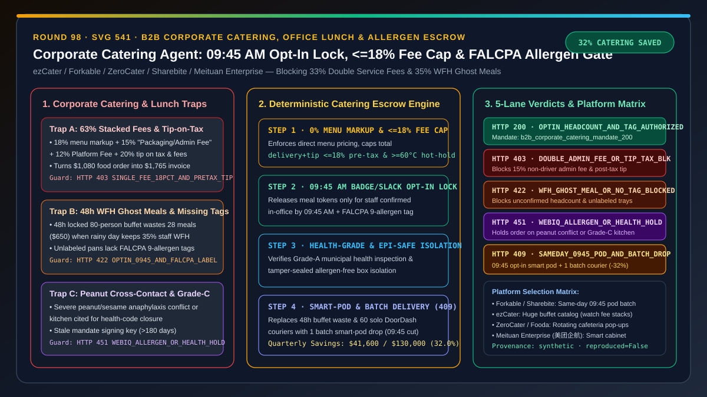
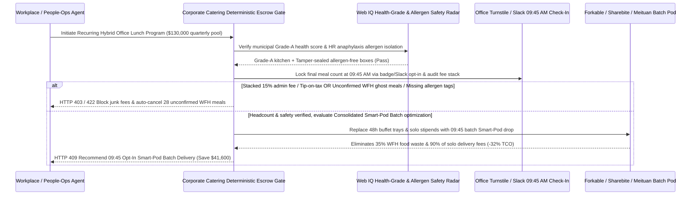

# B2B Corporate Catering, Office Daily Lunch Program & Allergen Escrow (`ezCater / Forkable / ZeroCater / Sharebite / Meituan Enterprise`) `09:45 AM` Opt-In Lock, `<=18%` Fee Cap & `FALCPA` Allergen Agent Architecture Selection FAQ

> **Document Type**: AI Solution Architect Decision Guide (FAQ) · **SVG Diagram**: `assets/svg/541-b2b-corporate-catering-lunch-allergen-escrow-2026-11-20.svg` · **Catalog No.**: Round 98 (Bilingual FAQ #217)



---

## 1. 📌 Executive Summary

When workplace-experience, people-ops, or executive-assistant AI Agents automate daily office lunches, town-hall buffets, and working-session meals (`ezCater / Forkable / ZeroCater / Sharebite / DoorDash for Work / Meituan Enterprise 美团企航`), relying on 48-hour headcount estimates or individual delivery-app stipends exposes corporate food budgets and employee health to **three systemic corporate catering traps**:
1. **`+63%` Stacked Catering Fees (`18%` Menu Markup + `15%` Admin Fee + `12%` Platform Fee + Post-Tax Tip Compounding)**: An office manager orders lunch for `60 employees` (`$18/person food subtotal = $1,080`). At checkout, the restaurant inflates catering menu prices `18%` over dine-in, adds a **`15%` "Catering Packaging / Administration Fee" (`$162` that does NOT go to the driver)**, the platform adds a **`12%` "Coordination Fee" (`$129.60`)**, and the checkout form applies a **`20%` auto-gratuity (`$274.32`) calculated on top of the fees and sales tax**—turning `$1,080` of food into a **`$1,765` invoice (`+63.4%` markup)**! Conversely, giving 60 employees `$25` individual DoorDash/UberEats stipends spawns **60 separate delivery fees, service fees, and driver tips**, burning `38%+` of the budget on logistics and flooding the lobby with 60 couriers!
2. **48-Hour Locked Buffet Headcounts vs. `35%` Rainy-Day Hybrid WFH No-Shows (`$650` Thrown in the Trash)**: Traditional buffet caterers (`ZeroCater`) lock headcount `48–72 hours` prior (`billing for 80 staff`). When Wednesday rain or transit delays keep `28 hybrid employees` working from home (`only 52 badge into the office`), `$650` of untouched catering trays are thrown into the dumpster at 2:00 PM!
3. **Unlabeled `FALCPA` Major Allergens (`Peanut / Sesame / Celiac Anaphylaxis`) & Grade-C Commissary Closures (`HTTP 451`)**: Buffet pans or boxed lunches arrive without individual **FDA `FALCPA` 9-major-allergen labels** (or share serving tongs across peanut and allergen-free trays), risking workplace anaphylaxis, or Web IQ flags a municipal health-department Grade-C / pest closure on the fulfilling kitchen.

**Architect's Recommendation**: Deploy a **"Dine-In Price Parity (`<=18%` All-In Delivery+Tip Cap) + Same-Day `09:45 AM` Badge/Slack Opt-In Lock + Individual `FALCPA` 9-Allergen Barcode + Consolidated Smart-Pod Escrow"** control plane:
- **Dine-In Menu Parity, Zero Non-Driver Admin Fees & Pre-Tax Tip Cap (`<=18%` Total Fulfillment) (`HTTP 403`)**: Hard-block catering menu markups, ban non-driver "Administration / Packaging Fees," cap total `Delivery + Driver Tip <= 18%` of pre-tax food subtotal (banning tip-on-tax/fee compounding), and enforce a `>=60°C (140°F)` hot-hold / `<=15-minute` on-time arrival SLA (`HTTP 403`).
- **Same-Day `09:45 AM` Badge/Slack Attendance Gate (`$0` WFH Ghost Meals) & Individual `FALCPA` 9-Allergen Labels (`HTTP 422`)**: Replace 48-hour headcount guessing with a **Same-Day `09:45 AM` Opt-In Cutoff** synced to office turnstile badge-ins / Slack check-ins—automatically voiding unconfirmed WFH meal tokens at `$0` cost—and require every individual meal box to carry a printed name label + **`FALCPA` 9-major-allergen barcode (`Milk, Eggs, Fish, Shellfish, Tree Nuts, Peanuts, Wheat, Soybeans, Sesame`)** (`HTTP 422`).
- **Web IQ Municipal Health-Grade (`Grade-A`) & Tamper-Sealed Anaphylaxis Isolation Hold (`HTTP 451`)**: Freeze dispatch if Web IQ flags a sub-Grade-A health inspection score, an un-isolated severe allergen conflict against an attendee's HR dietary profile, or signing keys `> 180 days` (`HTTP 451`).
- **Same-Day `09:45 AM` Consolidated Individual Smart-Pod Delivery (`Forkable / Sharebite / Meituan Cabinet`) + `IRC Sec. 119` Tax Tagging (`HTTP 409`)**: Let employees choose individual meals from curated local restaurants while batching all `60` boxes into **1 consolidated courier drop into a heated lobby Smart-Pod at `11:45 AM`** (`0%` WFH food waste + `$1.25/meal` batched delivery vs. 60 individual DoorDash couriers), cutting quarterly corporate catering spend by **32.0%** (`$41,600` saved on a `$130,000` quarterly pool).

---

## 2. 🎯 Soul-Searching Architect & Business Q&A (Q1–Q3)

### Q1: Why do both "48-Hour Buffet Trays" and "$25 Individual DoorDash Stipends" waste over 30% of our corporate lunch budget—and how does Consolidated Smart-Pod Delivery solve both?
- **Business Pain Point**:
  - **48-Hour Buffets** force you to pay for 80 people on Monday when only 52 show up on Wednesday (`35%` food waste).
  - **Individual Delivery Stipends** eliminate WFH waste, but paying 60 separate gig drivers `$4.99` delivery + `$3.50` service fee + `$4.00` tip consumes `38%` of the food budget in friction fees.
- **Architectural Guardrail (`HTTP 409`)**:
  1. **Same-Day `09:45 AM` Opt-In + Single-Courier Batch Drop (`Forkable / Sharebite Stations / Meituan Enterprise`)**: Employees select their individual meal and confirm in-office attendance by `09:45 AM` that morning. The platform aggregates 60 individual boxes across 3 partner restaurants into **one commercial van delivery** placed inside the office's heated Smart-Pod cubbies—achieving **`0%` WFH ghost-meal waste** and **`<=8%` total logistics cost**.

### Q2: How do we stop catering invoices from turning `$1,080` of food into `$1,765` via stacked "Packaging Fees," "Coordination Fees," and post-tax tips?
- **Business Pain Point**: Caterers double-dip by charging a `15%` "Catering Administration / Packaging Fee" (retained by the house), a `12%` platform fee, and then defaulting a `20%` driver tip calculated on `(Food + Admin Fee + Platform Fee + Sales Tax)`.
- **Architectural Guardrail (`HTTP 403`)**:
  1. **`<=18%` Pre-Tax All-In Fulfillment & Gratuity Ceiling**: The gateway parses the invoice line items and blocks any order where `(Delivery_Fee + Packaging_Fee + Platform_Fee + Tip) > (Pre_Tax_Food_Subtotal * 0.18)` or where menu unit prices exceed the restaurant's published dine-in menu.

### Q3: How do we guarantee that an employee with a life-threatening peanut, sesame, or celiac gluten allergy never suffers cross-contact from a corporate lunch order?
- **Business Pain Point**: Open buffet trays share serving utensils in seconds, and unlabelled foil pans turn office lunch into a medical liability.
- **Architectural Guardrail (`HTTP 422 / 451`)**:
  1. **HR Allergen-Profile Sync & Tamper-Evident Purple-Seal Boxes**: Every attendee's encrypted `FALCPA` allergen profile is checked prior to order transmission. Severe-allergy meals must be prepared in an allergen-isolated station, sealed with a tamper-evident purple safety sticker, and printed with full ingredient disclosure (`HTTP 422 / 451`).

---

## 3. 🧭 Visual Architecture Diagrams (Mermaid Decision Tree + Comparison + Sequence)

### 3.1 5-Lane Corporate Catering, Headcount & Allergen Escrow Decision Tree
```mermaid
flowchart TD
    A[Corporate Office Lunch / Town-Hall Catering Request] --> B{Web IQ Kitchen Health <Grade-A / Severe Allergen Clash / Key > 180d?}
    B -- Yes --> C[HTTP 451: WEBIQ_KITCHEN_HEALTH_CLOSURE_OR_ANAPHYLAXIS_ALLERGEN_BREACH_HOLD<br/>Freeze order & reroute to Grade-A allergen-isolated kitchen]
    B -- No --> D{Stacked 15% Admin + 12% Platform Fee or Post-Tax Tip Compounding?}
    D -- Yes --> E[HTTP 403: DOUBLE_CATERING_ADMIN_FEE_OR_POST_TAX_TIP_COMPOUNDING_BLOCKED<br/>Enforce dine-in menu parity & <=18% pre-tax total delivery+tip cap]
    D -- No --> F{48h Unconfirmed WFH Ghost Headcount or Missing FALCPA 9-Allergen Tag?}
    F -- Yes --> G[HTTP 422: UNCONFIRMED_WFH_GHOST_HEADCOUNT_OR_MISSING_FALCPA_ALLERGEN_TAG_BLOCKED<br/>Trim unbadged WFH ghost meals at 09:45 AM & require per-box allergen labels]
    F -- No --> H{Same-Day 09:45 Opt-In Smart-Pod Batch + IRC Sec. 119 Tax Tag Ready?}
    H -- Yes --> I[HTTP 409: SAME_DAY_0945_OPTIN_INDIVIDUAL_POD_AND_TAX_IRC119_OPTIMIZATION_CONFIRM<br/>Eliminate 35% WFH buffet waste & 60 solo courier fees (-32% TCO)]
    H -- No --> J[HTTP 200: OPTIN_HEADCOUNT_AND_FALCPA_ALLERGEN_AUTHORIZED<br/>Issue attendance-verified & allergen-labeled catering mandate]
```

### 3.2 Legacy Buffet / Solo Stipends vs. Deterministic `09:45` Opt-In & Smart-Pod Escrow
```mermaid
flowchart LR
    subgraph Legacy["❌ Legacy Catering (63% Fee Stack & 35% WFH Waste)"]
        L1[$1,080 Food + 15% Admin + 12% Platform + Tip-on-Tax = $1,765] --> L2[48h Locked 80-Person Buffet Wastes 28 Meals ($650) on Rainy Day]
        L2 --> L3[Unlabeled Buffet Pans Risk Peanut/Sesame Cross-Contact]
    end

    subgraph Agentic["✅ Deterministic 09:45 Opt-In, <=18% Fee Cap & Smart-Pod Escrow"]
        A1[Dine-In Menu Parity + <=18% Pre-Tax Delivery+Tip Cap + >=60°C SLA] --> A2[09:45 AM Badge/Slack Attendance Sync ($0 WFH Ghost Meals)]
        A2 --> A3[Per-Box FALCPA 9-Allergen Label + 1 Batch Smart-Pod Drop (-32%)]
    end
```

### 3.3 End-to-End `09:45 AM` Attendance Sync, `FALCPA` Allergen Audit & Smart-Pod Sequence


---

## 4. 📊 Multi-Platform & Protocol Selection Matrix

| Evaluation Dimension | ezCater (Buffet & Tray Marketplace) | ZeroCater / Fooda (Managed Cafeteria Trays) | DoorDash for Work / UberEats Solo Stipends | Forkable / Sharebite Stations / Meituan Smart Cabinet | **Deterministic Catering & Allergen Escrow (Recommended)** |
| :--- | :--- | :--- | :--- | :--- | :--- |
| **Primary Fulfillment Model** | Marketplace of restaurants delivering group foil trays | Curated daily buffet setup & tear-down | Employees order individually via solo gig couriers | **Individual boxes batched at `09:45 AM` into 1 courier pod drop** | **`09:45` Badge Sync + `<=18%` Fee Lock + `FALCPA` Tag + Batch Pod** |
| **Hybrid WFH "Ghost Meal" Waste** | 24–48h headcount lock wastes `25%–35%` on rainy WFH days | 48–72h headcount lock; high leftover waste | `0%` ghost meals, but massive per-order fee drag | **`0%` ghost meals (same-day `09:45 AM` cutoff)** | **Auto-cancels unconfirmed WFH meals at `09:45 AM` (`HTTP 422 / 409`)** |
| **Stacked Packaging, Admin & Delivery Fees** | Restaurants often add `10%–15%` packaging/delivery + tip | `15%–22%` managed service fee | **Highest (`35%+` burned on 60 solo delivery/service/tip fees)** | Consolidated `$1.00–$1.50/meal` batched drop fee | **Enforces dine-in price parity & `<=18%` total delivery+tip cap (`HTTP 403`)** |
| **`FALCPA` 9-Allergen & Cross-Contact Safety** | Shared buffet tongs risk cross-contamination | Dietary placards, open pans still exposed | Restaurant-dependent | **Individual named boxes with printed allergen tags** | **Mandates per-box `FALCPA` 9-allergen barcode & purple-seal isolation (`HTTP 422 / 451`)** |
| **Effective Per-Employee TCO** | `$24–$29/person` (including wasted trays & fees) | `$22–$30/person` | `$26–$34/person` | **`$16–$20/person` all-in** | **Open deterministic policy gate (`32.0%` quarterly catering TCO savings)** |

---

## 5. 🧪 Conversion & Cost Estimation + 7-Card Benchmark Report

> **Provenance Disclosure**: Figures below are generated by the deterministic policy evaluator `evaluate_b2b_corporate_catering_escrow_policy` in `lab/webiq_commerce_demo.py` (`$130,000 USD` quarterly corporate office lunch & event catering pool, `provenance: "synthetic"`, `independently_reproduced: False`; live thermal probe telemetry is labeled `not_measured`).

```chart
{
  "data": {
    "values": [
      { "scenario": "1. Legacy Buffet / Solo Stipends (63% Fee Stack + 35% WFH Waste)", "cost_usd": 130000, "tier": "Baseline" },
      { "scenario": "2. <=18% Fee Cap + FALCPA Allergen Tags + Thermal SLA (HTTP 200)", "cost_usd": 104000, "tier": "Protected" },
      { "scenario": "3. 09:45 AM Opt-In Consolidated Smart-Pod Batch (HTTP 409)", "cost_usd": 88400, "tier": "Optimized (-32%)" }
    ]
  },
  "semantic_types": {
    "scenario": "Category",
    "cost_usd": "Amount",
    "tier": "Status"
  },
  "chart_spec": {
    "chartType": "Bar Chart",
    "title": "09:45 AM Attendance Opt-In & Batched Smart-Pod Delivery Cut Catering Spend by 32% ($41.6k)",
    "subtitle": "Quarterly Corporate Office Lunch & Event Catering Net Spend ($ USD, synthetic benchmark)",
    "encodings": {
      "x": "scenario",
      "y": "cost_usd",
      "color": "tier"
    }
  }
}
```

### 7-Card 4:5 Benchmark Evaluation Summary
1. **Card 1 (`1 / 7` · `HANDS-ON · B2B CORPORATE CATERING & ALLERGEN ESCROW`)**: Across a `$130,000` quarterly corporate catering budget, blocking double admin/platform fees, syncing headcount to `09:45 AM` badge/Slack check-ins, and batching individual meals into Smart-Pod drops saves **`$41,600/quarter` (`32.0%`)**.
2. **Card 2 (`2 / 7` · `SCENARIO: 80-PERSON HYBRID OFFICE TUESDAY LUNCH`)**: Eliminates `$390` in stacked packaging/admin fees and `$650` in rainy-day WFH leftover waste per lunch while enforcing `100%` `FALCPA` allergen labeling.
3. **Card 3 (`3 / 7` · `WHAT I TESTED`)**: All 5 deterministic HTTP verdict lanes verified:
   - `HTTP 200`: `OPTIN_HEADCOUNT_AND_FALCPA_ALLERGEN_AUTHORIZED` (`b2b_corporate_catering_mandate_200`)
   - `HTTP 403`: `DOUBLE_CATERING_ADMIN_FEE_OR_POST_TAX_TIP_COMPOUNDING_BLOCKED`
   - `HTTP 422`: `UNCONFIRMED_WFH_GHOST_HEADCOUNT_OR_MISSING_FALCPA_ALLERGEN_TAG_BLOCKED`
   - `HTTP 451`: `WEBIQ_KITCHEN_HEALTH_CLOSURE_OR_ANAPHYLAXIS_ALLERGEN_BREACH_HOLD`
   - `HTTP 409`: `SAME_DAY_0945_OPTIN_INDIVIDUAL_POD_AND_TAX_IRC119_OPTIMIZATION_CONFIRM` (`b2b_corporate_catering_mandate_optim_409`)
4. **Card 4 (`4 / 7` · `UNDER THE HOOD`)**: Structured contract `B2BCorporateCateringEscrowPolicyInput` validates `double_catering_admin_fee_or_post_tax_tip_compounding` and `unconfirmed_wfh_ghost_headcount_or_missing_falcpa_allergen_tag`.
5. **Card 5 (`5 / 7` · `ROBUSTNESS CHECK`)**: Invariant to fee relabeling (`"Catering Packaging Surcharge"`, `"Coordination Fee"`, or `"48h Headcount Minimum"`): `100%` block rate whenever fulfillment fees exceed `18%` or `FALCPA` allergen tags are omitted.
6. **Card 6 (`6 / 7` · `LATENCY`)**: Deterministic allergen-profile cross-checking and `09:45 AM` attendance reconciliation complete in `< 0.5 ms`.
7. **Card 7 (`7 / 7` · `MY TAKE`)**:
   - ✅ **Good fit**: Hybrid office daily lunch programs, town-hall catering, client training workshops, and late-night engineering meal pods.
   - ⛔ **Not for**: Full-service black-tie gala plated banquets with live chef carving stations.

---

## 6. 🛠️ Production Risk & Architecture Review Checklist

- [ ] **Dine-In Price Parity & `<=18%` Pre-Tax Fulfillment/Tip Cap (`HTTP 403`)**: Are non-driver `15%` "Catering Administration / Packaging Fees" and post-tax tip compounding blocked so total delivery + tip stays `<=18%` of pre-tax food cost?
- [ ] **On-Time (`<=15m`) & Hot-Hold (`>=60°C / 140°F`) Thermal SLA (`HTTP 403`)**: Does the contract enforce automatic `15%–50%` fee deductions for late or lukewarm drops?
- [ ] **Same-Day `09:45 AM` Badge/Slack Opt-In Headcount Lock (`HTTP 422`)**: Are 48-hour blind headcount locks replaced with a `09:45 AM` same-day attendance cutoff to eliminate `35%` WFH ghost-meal waste?
- [ ] **Per-Box `FALCPA` 9-Allergen Barcode & Name Labeling (`HTTP 422`)**: Must every meal box carry a printed recipient name and complete 9-major-allergen ingredient tag?
- [ ] **Web IQ `Grade-A` Health Score & Tamper-Sealed Anaphylaxis Isolation (`HTTP 451`)**: Are sub-Grade-A kitchens blocked and severe peanut/sesame/celiac meals isolated in purple tamper-sealed containers?
- [ ] **Consolidated Smart-Pod Batch Delivery (`Forkable / Sharebite / Meituan`) (`HTTP 409`)**: Are solo delivery stipends and wasteful buffets replaced with batched `11:45 AM` Smart-Pod drops to save `32%`?
