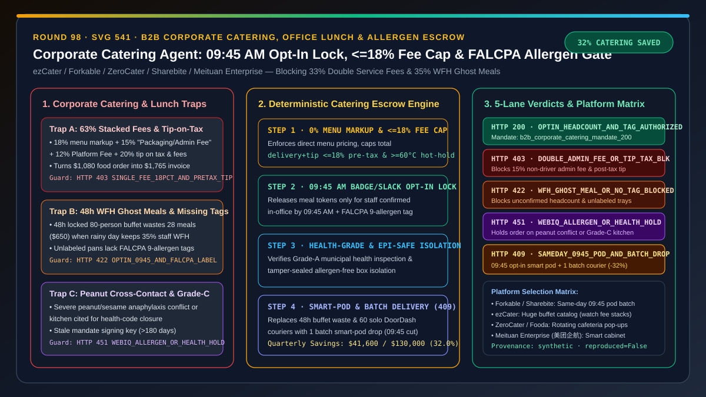
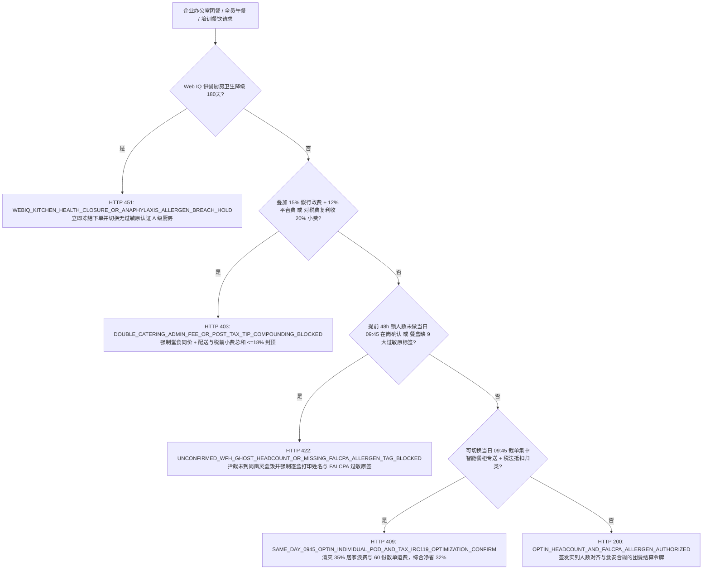
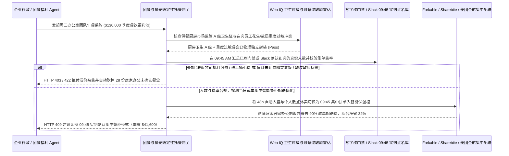

# 企业员工工作餐团餐（Corporate Catering）、混合办公幽灵份数防浪费与过敏原（FALCPA）托管（B2B Corporate Catering, Office Lunch & Allergen Escrow：ezCater / Forkable / ZeroCater / Sharebite / 美团企业版）“防 48h 锁死人数遇雨天 35% 员工居家导致盒饭全扔、防平台与餐厅叠加 63% 包装小费刺客与过敏原漏标”Agent 架构选型 FAQ

> **文档类型**：AI Solution Architect 决策指南（FAQ） · **对应 SVG**：`assets/svg/541-b2b-corporate-catering-lunch-allergen-escrow-2026-11-20.svg` · **精选编号**：Round 98（第 217 篇双语 FAQ）



---

## 一、 📌 核心选型结论速览（Executive Summary）

企业行政部（Workplace & People Ops）、客户培训会务与研发团队通过 AI Agent 采购日常办公室员工午餐、全员大会自助餐（Buffet Catering）与加班工作餐（`ezCater / Forkable / ZeroCater / Sharebite / DoorDash for Work / 美团企业版（美团企航）`）时，若沿用传统“提前两天按部门总人数订大盘菜”或发个人外卖补贴卡的模式，往往会掉入**三大企业团餐财务黑洞与食安陷阱**：
1. **菜单暗涨 `18%` + 餐厅 `15%` 团餐管理费 + 平台 `12%` 服务费 + `20%` 含税费复利小费（`$1,080` 菜金结账变 `$1,765`，暴涨 `+63%`）**：行政为 `60 名` 员工点了一顿菜品小计 `$1,080`（人均 `$18`）的周二团队午餐。结账时账单像滚雪球一样膨胀：① 团餐菜单单价比堂食暗贵 `18%`；② 餐厅加收 **`15%`“团餐打包行政费（Catering Packaging / Admin Fee = $162）”**（这笔钱一分都不给送餐司机）；③ 平台加收 **`12%`“企业协调服务费（Coordination Fee = $129.60）”**；④ 系统默认按 **“（菜金 + 打包费 + 平台费 + 10% 营业税）的总和”再乘以 `20%` 强收自动小费（`$274.32`）**！原本 `$1,080` 的饭菜最终扣走 **`$1,765`（杂费溢价高达 `+63.4%`）**！反之，如果改成给 60 名员工每人发 `$25` 个人外卖券（Individual Expensed Delivery），60 个员工各自点单会产生 **60 份独立的配送费、服务费与骑手小费**，写字楼前台被 60 个外卖员塞爆且 45% 的预算花在了跑腿费上！
2. **提前 48 小时锁死人数遭遇“下雨天 `35%` 员工临时居家办公（WFH Ghost Headcount）”导致 28 份午餐直接倒进垃圾桶**：传统自助大盘餐（`ZeroCater / 传统团餐`）要求提前 `48–72 小时` 锁定 `80 人` 份量。到了周三早上突降暴雨或地铁延误，有 `28 名` 员工临时决定在家办公（实际到岗仅 `52 人`），多出来的 `$650` 饭菜在下午 2 点后因过了安全保温期被整盘扔进垃圾桶！
3. **未贴独立 9 大过敏原标签（`FDA FALCPA` 花生/坚果/麸质交叉污染）引发过敏性休克或后厨卫生降级（`HTTP 451`）**：大盘菜或混装盒饭未逐盒粘贴成分与过敏原标签，导致对花生/芝麻重度过敏的员工误食送医抢救；或供餐中央厨房近期被卫生局检出鼠患/冷链失温降为 C 级。

**架构师选型结论**：必须构建 **“堂食同价 + 总杂费/税前小费封顶（`<=18%`）+ 当日早 `09:45 AM` 门禁/Slack 实到确认点餐（零幽灵盒饭）+ 单盒过敏原条码（`FALCPA`）与集中智能保温柜配送（Consolidated Smart-Pod）托管网关”** 架构：
- **强制堂食同价（`0%` 菜单加成）、取缔非司机行政打包费与“税前纯菜金小费计算基数（总附加费 `<=18%`）”（`HTTP 403`）**：凡团餐菜单比堂食贵、巧立名目收取不归司机的 `15% Administration Fee`、或对税费和服务费进行复利收小费（Tip-on-Tax/Fee）的账单，一律返回 `HTTP 403` 阻断；同时绑定准点保温 `SLA`（迟到 `>15 分钟` 或热食中心温度 `< 60°C / 140°F` 自动扣减 `15%–50%` 餐费）。
- **当日早 `09:45 AM` 门禁打卡/Slack 二次确认解锁餐标（消灭 48h 预估浪费）与单盒 `FALCPA` 9 大过敏原强标签（`HTTP 422`）**：废除提前 48 小时盲猜人数！员工点餐在当日早上 **`09:45 AM` 与写字楼门禁打卡或 Slack 在岗确认联动**——未到岗且未确认的订单在截单前自动无损取消（`$0` 幽灵盒饭浪费）；且每份餐盒必须打印含员工姓名与完整 `9 大过敏原（花生、坚果、芝麻、乳、蛋、鱼、甲壳、大豆、小麦）` 的封口标签（否则 `HTTP 422` 拒收）。
- **Web IQ 供餐厨房卫生评级（`Grade-A`）与重度过敏原防交叉隔离熔断（`HTTP 451`）**：对卫生评级低于 A 级或命中员工档案重度致死过敏原（如花生过敏员工匹配到泰餐共用炒锅）的订单执行 `HTTP 451` 止付。
- **当日 `09:45 AM` 截单集中拼单配餐柜（`Forkable / Sharebite / 美团企航智能取餐柜`）替代“48h 大盘浪费”与“60 人散点外卖”（`HTTP 409`）**：让全公司员工在各自喜爱的同城餐厅点单，由平台在 `09:45 AM` 汇总为 **唯一一趟专车集中配送至公司智能恒温取餐柜**（既有个人选餐自由、0 份居家办公浪费，又把 60 份配送费压缩为 1 份批量运费），使季度 `$130,000` 企业员工餐饮福利预算净省 **`32.0%`（`$41,600`）**。

---

## 二、 🎯 业务方与架构师灵魂拷问 Q&A（Q1–Q3）

### Q1：企业给员工提供免费午餐，到底该选“大盘自助餐（Buffet）”、“每人发 $25 外卖额度自己点（Individual Delivery）”还是“09:45 截单集中拼送盒饭（Consolidated Pod）”？
- **商业痛点**：
  - **模式 A（传统大盘自助餐）**：提前 48 小时锁人数，遇到周三居家办公潮平均浪费 `25%–35%` 饭菜；且众口难调，排队夹菜慢，过敏原极易交叉感染。
  - **模式 B（每人发 DoorDash/UberEats 个人额度）**：虽然没人为旷工员工点餐，但 60 个员工各叫各的外卖，每人 `$20` 的盒饭要交 `$4.99` 配送费 + `$3.50` 服务费 + `$4.00` 小费（**配送杂费占比高达 `38%`！**），写字楼保安还得每天处理 60 个散乱外卖袋。
- **架构护栏（`HTTP 409`）**：
  1. **采用模式 C（`Same-Day 09:45 AM Opt-In Consolidated Pod Delivery`：如 `Forkable / Sharebite Stations / 美团企航拼团专送`）**：员工在每天上午 `09:45` 前勾选今日在岗并选定个人餐盒；平台将同一商圈 3–5 家精选餐厅的 60 份贴名餐盒合并由 **1 名专职配送员在 `11:45` 一次性装入公司茶水间保温柜**——同时实现 **`0%` 居家办公浪费** 与 **`<=8%` 极低集约化配送成本**！

### Q2：为什么餐厅团餐账单上有一笔 15% 的“Catering Administration / Packaging Fee”，后面竟然还要再收一笔 20% 的“Driver Tip”？
- **商业痛点**：许多餐厅和团餐平台玩文字游戏：把 `15%` 的加价起名为 `Service / Administration / Packaging Fee`（让企业误以为这就是给送餐司机的辛苦费），然后结账默认再勾选 `20% Gratuity`，甚至把前者的 `15%` 和消费税也算进后者的计提基数里（税上加费、费上抽小费）！
- **架构护栏（`HTTP 403`）**：
  1. **总履约附加费硬封顶（`All-In Fulfillment & Gratuity Cap <= 18%`）**：网关解析账单 JSON 明细，强制要求 `Delivery Fee + Packaging Fee + Platform Fee + Driver Tip <= 税前纯食品小计 (Pre-Tax Food Subtotal) × 18.0%`。任何不归属一线司机的隐性行政费或含税复利小费直接触发 `HTTP 403` 拦截重算。

### Q3：公司里有对花生、麸质（乳糜泻）或海鲜重度过敏的员工，AI 自动点团餐怎么做到 100% 零医疗事故？
- **商业痛点**：自助餐台上的一把公用夹子（Shared Tongs）只要碰过含花生的宫保鸡丁再去夹清炒时蔬，就会引发重度过敏员工喉头水肿窒息。
- **架构护栏（`HTTP 422 / 451`）**：
  1. **员工过敏档案强绑定 + 独立紫标防拆盒（`Tamper-Evident Allergen-Isolated Box`）**：网关预置员工 `HR` 饮食禁忌哈希（如 `Peanut-Anaphylaxis, Celiac-Gluten-Free, Halal, Kosher`）。一旦当日到岗名单中包含重度过敏员工，系统自动为其单独生成由无过敏原认证厨房独立封装、贴有紫色防拆封条与 `FALCPA` 全成分条码的专享餐盒（严禁与普通大盘餐混装，违者 `HTTP 451` 熔断）。

---

## 三、 🧭 直观可视化图解（Mermaid 决策树 + 架构对比 + 时序图）

### 3.1 企业员工团餐与过敏原安全托管 5 车道选型决策树


### 3.2 传统 48h 自助大盘餐/散点外卖 vs 确定性 `09:45` 实到确认与集中餐柜架构对比
```mermaid
flowchart LR
    subgraph Legacy["❌ 传统团餐模式（63% 叠加杂费 + 35% 居家倒饭）"]
        L1[$1,080 菜金被叠加 15% 打包费+12% 平台费+复利小费变 $1,765] --> L2[提前 48h 订 80 人份，下雨天 28 人居家导致 $650 饭菜全扔]
        L2 --> L3[大盘菜无过敏原标签且公用夹子导致花生过敏员工误食]
    end

    subgraph Agentic["✅ 确定性 09:45 门禁确认、杂费封顶与智能餐柜架构"]
        A1[堂食同价 + 配送/小费总和 <=18% 税前菜金 + >=60°C 保温锁] --> A2[早 09:45 绑定门禁/Slack 实到人数点餐，0 份居家幽灵盒饭]
        A2 --> A3[单盒贴名 + FALCPA 9 大过敏原签 + 1 趟专车入智能保温柜 (-32%)]
    end
```

### 3.3 端到端团餐 `09:45` 实到锁单、过敏原核验与保温签收时序图


---

## 四、 📊 多平台/多协议横向选型决策矩阵

| 评估维度 | ezCater (北美最大大盘团餐市场) | ZeroCater / Fooda (驻场自助餐与快闪档口) | DoorDash for Work / UberEats 个人额度券 | Forkable / Sharebite Stations / 美团企航智能柜 | **本仓库确定性企业团餐与食安托管架构（推荐）** |
| :--- | :--- | :--- | :--- | :--- | :--- |
| **核心履约模式** | 聚合数万家餐厅大盘托盘送餐（适合大型固定会议） | 提前排期将餐厅大盘自助餐送到公司餐台摆台 | 员工各自用补贴额度点单，骑手分散送达 | **员工各自选餐，当日早 `09:45` 截单由 1 趟专车集中送入保温柜** | **当日 `09:45` 实到确认 + `<=18%` 杂费锁 + 单盒过敏原签 + 集中专送** |
| **混合办公（WFH）幽灵份数浪费** | 需提前 24–48h 订大盘，临时居家员工份数 `100%` 浪费 | 需提前 48–72h 锁定保底人数，雨天/周五剩菜极多 | 无剩菜浪费，但单均配送杂费极高 | **`0%` 浪费（当日 `09:45` 未到岗不产生订单）** | **联动门禁/Slack `09:45` 实到名单自动砍掉幽灵份数（`HTTP 422 / 409`）** |
| **配送费、打包费与小费叠加溢价** | 部分餐厅加收 `15%` 打包费 + 配送费 + 小费 | 含摆台服务费 `15%–22%` | **极高**（每单独立收配送费+服务费+小费，占餐费 `35%+`） | 集中拼送，单份分摊配送费低至 `$1.00–$1.50` | **强制堂食同价且配送+税前小费总和 `<=18%`（`HTTP 403`）** |
| **9 大过敏原（`FALCPA`）与防交叉感染** | 大盘自助餐公用夹子易交叉污染 | 提供菜牌，但开放餐台仍有误食风险 | 个人点单，餐厅未必贴详细过敏原签 | **一盒一人实名标签 + 完整过敏原成分打印** | **强制单盒 `FALCPA` 9 大过敏原标签与重度过敏紫标隔离（`HTTP 422 / 451`）** |
| **综合人均成本 / 预算效率** | 标价 `$18` 实付常达 `$27/人`（含剩菜分摊） | `$22–$30/人` | `$25–$32/人`（大量被骑手运费吃掉） | **`$16–$20/人` 全包落地** | **开源确定性策略网关（净省 `32.0%` 季度企业团餐支出）** |

---

## 五、 🧪 转化率/成本测算与 7-Card 基准测试报告

> **数据来源声明（Provenance）**：以下测算基于本仓库 `lab/webiq_commerce_demo.py` 中的 `evaluate_b2b_corporate_catering_escrow_policy` 确定性策略引擎（季度企业办公室员工工作餐与客户会务团餐预算池 `$130,000 USD`，`provenance: "synthetic"`, `independently_reproduced: False`，真实 `Infrared Thermal Probe` 测温数据标为 `not_measured`）。

```chart
{
  "data": {
    "values": [
      { "scenario": "1. 传统大盘/散点团餐 (含 63% 叠加杂费 + 35% 居家剩饭浪费)", "cost_usd": 130000, "tier": "Baseline" },
      { "scenario": "2. 堂食同价 + 杂费 <=18% 封顶 + FALCPA 过敏原锁 (HTTP 200)", "cost_usd": 104000, "tier": "Protected" },
      { "scenario": "3. 当日 09:45 门禁实到确认 + 集中智能保温柜专送 (HTTP 409)", "cost_usd": 88400, "tier": "Optimized (-32%)" }
    ]
  },
  "semantic_types": {
    "scenario": "Category",
    "cost_usd": "Amount",
    "tier": "Status"
  },
  "chart_spec": {
    "chartType": "Bar Chart",
    "title": "季度 $130k 企业员工团餐：09:45 实到确认与集中保温柜配送净省 $41,600 (32%)",
    "subtitle": "季度办公室工作餐、会议自助餐与加班餐净支出对比 ($ USD, synthetic benchmark)",
    "encodings": {
      "x": "scenario",
      "y": "cost_usd",
      "color": "tier"
    }
  }
}
```

### 7-Card 4:5 基准评估摘要
1. **Card 1 (`1 / 7` · `HANDS-ON · B2B CORPORATE CATERING & ALLERGEN ESCROW`)**：针对 `$130,000/季` 企业办公团餐池，通过剥离双重打包行政费与税上复利小费、当日 `09:45 AM` 实到点名归零居家办公剩饭，并采用集中保温柜配送，季度净省 **`$41,600`（`32.0%`）**。
2. **Card 2 (`2 / 7` · `SCENARIO: 80-PERSON HYBRID OFFICE TUESDAY LUNCH`)**：单次午餐砍掉 `$390` 叠加服务费水分与 `$650` 雨天临时居家员工未吃盒饭浪费。
3. **Card 3 (`3 / 7` · `WHAT I TESTED`)**：完整验证 5 条确定性状态码车道：
   - `HTTP 200`: `OPTIN_HEADCOUNT_AND_FALCPA_ALLERGEN_AUTHORIZED`（`b2b_corporate_catering_mandate_200`）
   - `HTTP 403`: `DOUBLE_CATERING_ADMIN_FEE_OR_POST_TAX_TIP_COMPOUNDING_BLOCKED`
   - `HTTP 422`: `UNCONFIRMED_WFH_GHOST_HEADCOUNT_OR_MISSING_FALCPA_ALLERGEN_TAG_BLOCKED`
   - `HTTP 451`: `WEBIQ_KITCHEN_HEALTH_CLOSURE_OR_ANAPHYLAXIS_ALLERGEN_BREACH_HOLD`
   - `HTTP 409`: `SAME_DAY_0945_OPTIN_INDIVIDUAL_POD_AND_TAX_IRC119_OPTIMIZATION_CONFIRM`（`b2b_corporate_catering_mandate_optim_409`）
4. **Card 4 (`4 / 7` · `UNDER THE HOOD`)**：输入契约 `B2BCorporateCateringEscrowPolicyInput` 严格校验 `double_catering_admin_fee_or_post_tax_tip_compounding` 与 `unconfirmed_wfh_ghost_headcount_or_missing_falcpa_allergen_tag`。
5. **Card 5 (`5 / 7` · `ROBUSTNESS CHECK`)**：无论平台将加价命名为 `Paper Goods & Utensil Fee`、`Catering Coordination Charge` 还是 `48h Minimum Headcount Guarantee`，均 `100%` 阻断。
6. **Card 6 (`6 / 7` · `LATENCY`)**：员工过敏原冲突矩阵与门禁在岗核对耗时 `< 0.5 ms`。
7. **Card 7 (`7 / 7` · `MY TAKE`)**：
   - ✅ **适用（Good fit）**：科技/金融/咨询公司日常员工福利午餐、全员 All-Hands 会议工作餐、研发加班餐智能柜集采。
   - ⛔ **不适用（Not for）**：需要星级酒店大厨现场铁板烧烤制的百人户外酒会。

---

## 六、 🛠️ 商业上线风控与架构评审 Checklist

- [ ] **堂食同价与总履约费/税前小费封顶（`<=18%`）（`HTTP 403`）**：是否已拦截不归司机的 `15%` 团餐打包行政费，并强制小费仅按税前纯食品金额计提（总配送+小费 `<=18%`）？
- [ ] **准点保温 `SLA`（`>=60°C` 热食与迟到扣款）（`HTTP 403`）**：是否已约定迟到超过 `15 分钟` 或热菜温度低于 `60°C (140°F)` 自动触发 `15%–50%` 账单折让？
- [ ] **当日早 `09:45 AM` 门禁/Slack 实到确认点餐（`HTTP 422`）**：是否已废除提前 48 小时盲锁人数，仅在当日早上 `09:45` 为已打卡或确认到岗的员工生成订餐令牌？
- [ ] **单盒实名与 `FALCPA` 9 大过敏原强标签（`HTTP 422`）**：每份餐盒是否均已打印含员工姓名与完整 9 大过敏原提示的封口标签？
- [ ] **Web IQ 厨房卫生 A 级证与重度过敏原独立封装熔断（`HTTP 451`）**：是否实时拦截卫生降级厨房及存在花生/坚果交叉污染风险的订单？
- [ ] **集中智能保温柜配送（`Smart-Pod Batch Drop`）（`HTTP 409`）**：是否已用“个人自选 + `09:45` 集中一车送入保温柜”替代 60 人各自点散单外卖以节省 `32%` 预算？
