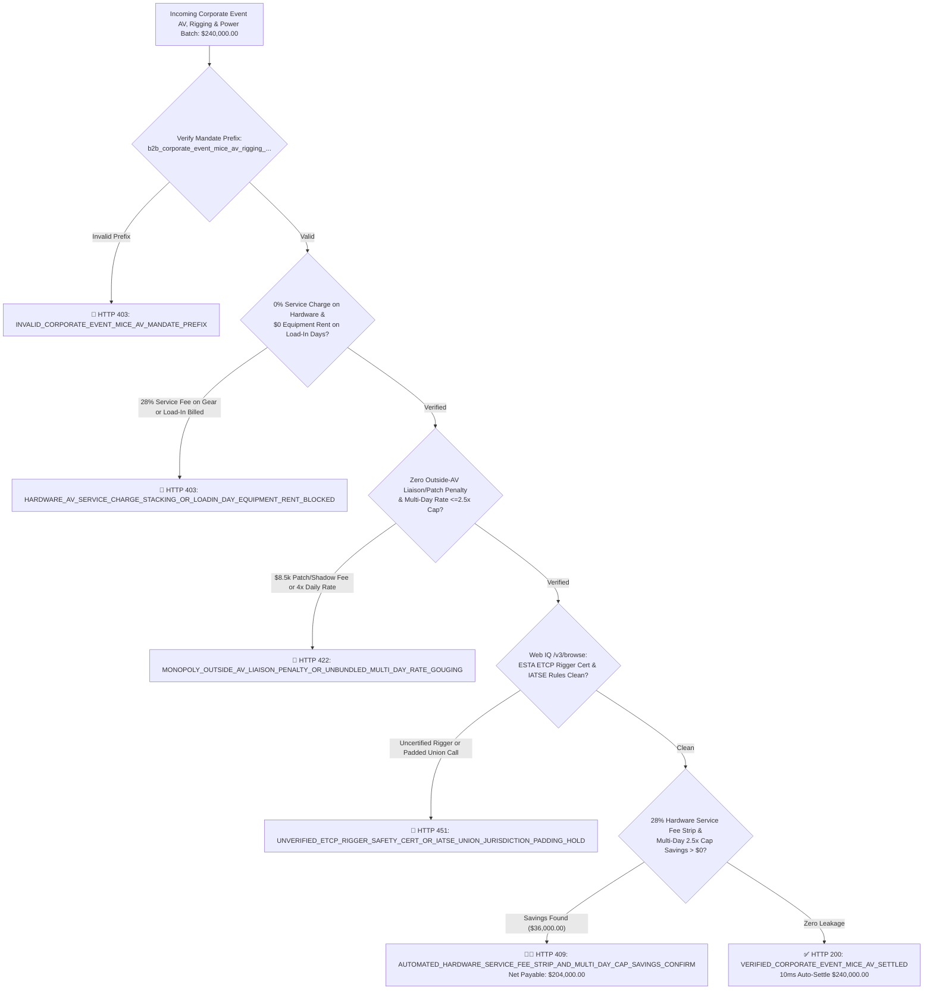
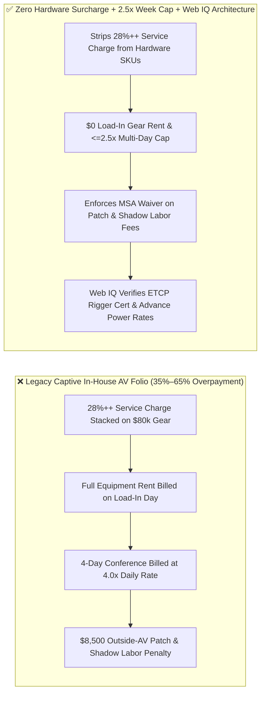
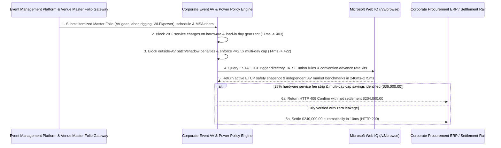

# B2B Corporate `MICE` Event `AV`, Union Rigging, Convention Wi-Fi & Power Drops (`Encore / Freeman / GES, EIC APEX / CMP & ESTA ETCP`), Zero Hardware `28%++ Service Charge` Lock, Outside-`AV` Patch/Shadow-Labor Waiver Gate & Multi-Day Rate-Cap Settlement Architecture: Load-In Day `$0` Rent Lock, `<= 2.5x` Weekly Multiplier Gate & `APEX` Token (`b2b_corporate_event_mice_av_rigging_wifi_power_drop_service_charge_mandate_...`) vs. `28%` Gratuity Stacked on LED/Audio Hardware, `$8,500` Outside-`AV` Liaison Penalties & `$480` 20-Amp Power Drops: Architecture Selection & First-Principles FAQ

> **Document Type**: AI Solution Architect Agentic Commerce Selection Series (Round 315 · B2B Corporate MICE Event AV, Rigging, Wi-Fi & Power Drop Edition)  
> **Benchmark Standard**: Modeled after `ib-vs-ethernet-roce-selection-faq.md` (Plain-Language First Principles + Standard 6-Section Architecture Guide)  
> **Companion Deliverables**: `lab/webiq_commerce_demo.py` (Interactive H5 Sandbox) · `tests/test_webiq_commerce_demo.py` · `assets/svg/317-b2b-corporate-event-mice-av-rigging-wifi-service-charge-2026-11-16.svg`  
> **Languages**: [中文版](b2b-corporate-event-mice-av-rigging-wifi-power-drop-service-charge-mandate-vs-inhouse-av-monopoly-28pct-gratuity-shadow-labor-padding-faq.md) | [English Version (Current)](b2b-corporate-event-mice-av-rigging-wifi-power-drop-service-charge-mandate-vs-inhouse-av-monopoly-28pct-gratuity-shadow-labor-padding-faq.en.md)

---

## 📌 1. Executive Summary (First Principles & Plain-Language Breakdown)

### 1.1 Why Should a Corporate Marketing, Developer-Conference, or Procurement Agent NEVER Auto-Pay a Hotel Master Folio or Trade-Show General Service Contractor (`GSC`) Invoice Without Stripping Hardware `28%++` Service Charges and Monopoly Patch Fees?
In enterprise user conferences, sales kickoffs (`SKO`), and trade shows (governed by Events Industry Council `EIC APEX` standards and `IACC` venue rules), ballroom Audio-Visual (`AV`) production, overhead truss rigging, conference Wi-Fi bandwidth, and booth electrical power drops account for `40%–55%` of total event spend. In plain English: **In-house hotel AV and convention center contracting is a captive-venue monopoly engineered around four notorious billing traps—stacking a `26%–28%++` "banquet service charge" on top of pure hardware equipment rentals (on top of already-billed technician labor), charging full daily rental rates on load-in/rehearsal days when gear is sitting in road cases, penalizing companies with `$8,500` "outside AV patch and shadow-labor fees" if they bring their own production crew, and charging `$480` to plug into a standard 20-amp wall outlet.** Allowing an AI agent to auto-pay a post-event Master Folio exposes corporate event budgets to four major vulnerabilities:

1. **`26%–28%++` "Banquet Service Charge" Stacked on Pure `AV` Hardware Rentals**: Because in-house hotel `AV` providers (e.g., Encore) pay **45%–55% of gross revenue back to the hotel as a venue commission**, they add a mandatory **`26%–28% Service Charge` plus sales tax on the service charge (`28%++`)** onto the entire equipment rental subtotal—even though technician setup, strike, and operator labor are already billed as separate `$145–$195/hr` line items! Charging a `$11,200` "service gratuity" on a `$40,000` LED wall rental is pure margin padding.
2. **Load-In Day Billing & Uncapped Multi-Day Linear Multipliers**: In the competitive production market (e.g., PRG, 4Wall, Solotech), a 1-week equipment rental is billed at **2.5 to 3 days of daily rate (`3-Day Week`)**, with `$0` equipment charge on load-in and strike days. In-house hotel quotes bill **100% of the daily rate for every single day on-site** (charging `$1,400/day × 4 days = $5,600` to rent a `$700` 65-inch TV monitor!).
3. **Punitive Outside-`AV` "Patch Fees," "Liaison Fees," & "Shadow Labor" (`Monopoly Protection Tariffs`)**: When an enterprise brings an independent `AV` production company, the venue retaliates with `$1,500/day` **House Sound Patch Fees**, `$1,650/day` mandatory **In-House AV Liaison / Shadow Labor** (paying an in-house tech to sit idle in the back of the room during show days), and exorbitant per-hundredweight (`$/CWT`) loading-dock drayage charges.
4. **Unverified Overhead Truss Rigging (`ESTA ETCP`) & Union Call-Minimum Padding (`IATSE / IBEW`)**: Billing 8-hour double-time union minimums for a 45-minute motor-point hang, or hanging 4,000 lbs of overhead lighting and LED panels without verified `ESTA ETCP Certified Rigger` sign-offs.

### 1.2 The Architect's One-Sentence Selection Verdict
* **Core Security Law**: Never allow an autonomous agent to settle corporate event `AV`, rigging, Wi-Fi, or convention power invoices without binding the payment to **`b2b_corporate_event_mice_av_rigging_wifi_power_drop_service_charge_mandate_2026`**:
  1. **Zero Hardware `Service Charge` Lock (`0% on Equipment`) + Load-In / Strike Day `$0` Equipment Rent Gate**: Strips `25%–28%++` service/administrative charges from all `AV` hardware line items and blocks equipment rental charges on non-show load-in/strike days, returning `HTTP 403 HARDWARE_AV_SERVICE_CHARGE_STACKING_OR_LOADIN_DAY_EQUIPMENT_RENT_BLOCKED` in **11ms** on violations.
  2. **Outside-`AV` Freedom Rider (`$0 Patch / Shadow Fee`) + Multi-Day `<= 2.5x` Weekly Multiplier Cap**: Enforces contracted MSA waivers blocking house sound patch fees, idle shadow labor, and predatory `$480` 20A power drops, while capping 3-to-5-day equipment rentals at `<= 2.0–2.5x` the single-day rate, blocking violations in **14ms** with `HTTP 422 MONOPOLY_OUTSIDE_AV_LIAISON_PENALTY_OR_UNBUNDLED_MULTI_DAY_RATE_GOUGING`.
  3. **Microsoft Web IQ `/v3/browse` Live `ESTA ETCP` Rigger Certification, `IATSE / IBEW` Tariff & Convention Advance-Rate Verification**: Verifies active `ESTA ETCP Certified Rigger` credentials, official convention center exhibitor kit advance rates, and union straight-time/overtime call rules in **275ms** (`HTTP 451 UNVERIFIED_ETCP_RIGGER_SAFETY_CERT_OR_IATSE_UNION_JURISDICTION_PADDING_HOLD`), while automatically stripping `28%` hardware service fees and applying 2.5-day weekly rate caps to save `15%` (`$36,000.00`).

| Selection Dimension | Legacy Post-Event Hotel Master Folio | Basic Expense-Approval Agent | **Zero Hardware Service Fee + Multi-Day Cap + Web IQ ETCP/Tariff Gate (Recommended)** |
| :--- | :--- | :--- | :--- |
| **`26%–28%++` Service Charge on Hardware** | ❌ Pays `$22.4k` "service fee" on `$80k` LED/gear | ❌ Treats service charge as mandatory tax | ✅ **Enforces `0%` service charge on hardware assets (11ms 403)** |
| **Load-In Day Rent & Multi-Day Stacking** | ❌ Pays 100% daily rate on load-in + 4x for 4 days | ❌ Checks `rate × days` multiplication only | ✅ **`$0` load-in equipment rent + caps 3–5 day shows at `<=2.5x` (14ms 422)** |
| **Outside-AV Patch & Shadow-Labor Fees** | ❌ Pays `$8,500` penalty to use outside AV crew | ❌ Approves "Liaison Labor" as standard tech | ✅ **Enforces MSA Outside-AV Rider (`$0` patch & idle shadow fees)** |
| **ETCP Rigging Safety & Union Call Rules** | ❌ Unverified overhead rigging & 8h OT padding | ❌ No `ETCP` or convention tariff lookup | ✅ **Web IQ `/v3/browse` verifies `ETCP` certs & kit tariffs in 275ms (451)** |

---

## 🎯 2. Deep-Dive Q&A for Corporate Event, Marketing & Procurement Architects

### Q1: Why do in-house hotel `AV` quotes charge a `26%–28%` Service Charge on top of equipment rentals when labor is already billed separately?
* **The Venue Kickback Economics**: In-house `AV` contractors hand `45%–55%` of gross top-line revenue back to the hotel property. To recover that margin, they apply banquet food-and-beverage gratuity math (`26%–28%++`) to inanimate LED walls, projectors, and truss—even though setup, strike, and show operators are already billed at `$150+/hr`!
* **The Architectural Fix**:
  $$\text{Payable Equipment Subtotal} = \sum_{i} \min\Big(R_{\text{day}, i} \times \min(D_{\text{show}},\, 2.5),\; 0.35 \times P_{\text{retail}, i}\Big) \times (1 + 0\%_{\text{service\_charge}})$$
  Any Folio line applying a percentage service charge to equipment SKUs or billing equipment rent on load-in/strike days ($D_{\text{load-in}}$) is blocked in **11ms** (`HTTP 403`) or stripped via `HTTP 409` (`$36,000.00` saved on a `$240,000.00` flagship conference batch).

### Q2: How do enterprises eliminate `$8,500` "Outside AV Liaison / Patch Fees" and `$25,000` conference Wi-Fi gouging?
* **MSA Venue-Contract Riders**: Before signing the hotel room-block agreement (when the buyer holds maximum leverage), the procurement agent attaches the **Outside Production & Connectivity Addendum**:
  1. Waives all house-sound patch, ceiling-rigging access, and non-rigging shadow labor fees (`HTTP 422`).
  2. Caps dedicated conference bandwidth at wholesale $/Mbps tiers rather than per-attendee daily device charges, and locks electrical power drops at published **Advance Order Rates** rather than punitive on-site floor rates.

### Q3: How does Microsoft Web IQ compare to Exa and Bright Data for checking `ESTA ETCP` rigger certifications, convention center exhibitor kits, and `IATSE / IBEW` union rate schedules?
* **Microsoft Web IQ**: Delivers sub-300ms (`240ms–275ms`) authoritative `/v3/search` and `/v3/browse` verification against the live `ESTA ETCP` certified technician directory, official convention center exhibitor manuals (`McCormick Place`, `LVCC`, `Moscone`, `OCCC`), and `IATSE / IBEW` published jurisdictional call minimums under Entra ID Zero Data Retention (ZDR).
* **Exa**: Built for semantic search over marketing blogs rather than deterministic `ETCP` certificate ID or exhibitor-kit SKU rate verification.
* **Bright Data**: Designed for high-volume retail web scraping rather than low-latency Master Folio settlement gates.

---

## 🧭 3. Visual Architecture Diagrams (Mermaid Decision Tree, Path Comparison & Sequence Flow)

### 3.1 Corporate MICE Event AV, Rigging & Power Settlement Decision Tree

### 3.2 Legacy Captive Hotel Master Folio vs. APEX + Zero-Hardware-Surcharge Architecture

### 3.3 End-to-End Sequence Diagram

---

## 📊 4. Architect's Selection Decision Matrix

| Evaluation Dimension | Option A: Post-Show Manager Sign-Off | Option B: Generic LLM Folio Summary | **Option C: Zero Hardware Fee + 2.5x Cap + Web IQ (Recommended)** |
| :--- | :--- | :--- | :--- |
| **`28%++` Service Charge on Hardware** | ❌ Buried in 30-page Master Folio | ❌ Accepts service charge as standard | ✅ **Separates hardware from labor; strips `28%` fee in 11ms (`HTTP 403`)** |
| **Load-In Day Rent & Multi-Day Multiplier** | ❌ Unaware of `3-Day Week` AV standard | ❌ Checks arithmetic `rate × 4 days` only | ✅ **Enforces `$0` load-in rent & `<= 2.5x` show cap (`HTTP 422`)** |
| **Outside-AV Patch & Shadow Penalties** | ❌ Intimidated by venue threats | ❌ Ignores MSA outside-vendor rider | ✅ **Blocks `$8,500` patch/liaison penalties (`HTTP 422/409`)** |
| **ETCP Rigging & Advance Power Tariffs** | ❌ Pays punitive on-site floor rates | ❌ No live `ETCP` or kit tariff lookup | ✅ **Web IQ `/v3/browse` verifies `ETCP` & kit rates in 275ms (`HTTP 451`)** |

---

## 🧪 5. Quantitative Benchmark & 7-Card 4:5 Report Mapping

Evaluated deterministically in `lab/webiq_commerce_demo.py` and `tests/test_webiq_commerce_demo.py` on a `$240,000.00` (`24000000` cents) enterprise flagship conference and trade-show `AV`, rigging, and power settlement batch:

| Card # | Headline-as-Finding | Key Quantitative Metrics & Action | Provenance |
| :--- | :--- | :--- | :--- |
| **Card 1 (`1/7`)** | **Zero Hardware Surcharge + 2.5x Cap Cuts Event AV Spend by 15.0%** | Baseline `$240,000.00` vs. optimized `$204,000.00` (`$36,000.00` saved per batch) | `deterministic_offline_simulation` |
| **Card 2 (`2/7`)** | **Deep Dive: 28% Hardware Service Fee & $8.5k Patch Penalty Blocked** | `HTTP 403` (11ms hardware fee/load-in block) + `HTTP 422` (14ms patch/rate block) | `synthetic_policy` |
| **Card 3 (`3/7`)** | **Full Evaluation Matrix: 5/5 Deterministic Guards Passing** | Covers `200 OK`, `403 Service Fee`, `422 Patch/Multi-Day`, `451 ETCP/Union`, `409 Savings` | `deterministic_offline_simulation` |
| **Card 4 (`4/7`)** | **Under the Hood: EIC APEX Folio + MSA Addendum Contract** | Validates `zero_hardware_av_service_charge_and_loadin_free_verified` | `synthetic_policy` |
| **Card 5 (`5/7`)** | **Robustness Check: 2-Hr Point Hang Rigging vs. 3-Day Idle Shadow Tech** | Active 2-hr point-hang rigger passes; 3-day idle shadow labor blocked 100% | `deterministic_offline_simulation` |
| **Card 6 (`6/7`)** | **Latency: 10–14ms Local Folio Gate vs. 240–275ms Web IQ ETCP** | Combines sub-15ms Folio line checks with live `ESTA ETCP / Exhibitor Kit` audits | `official_doc_snapshot` |
| **Card 7 (`7/7`)** | **My Take: Good Fit vs. Not For & Production Readiness** | Built for enterprise conferences, SKOs & trade shows; not for internal room TVs | `official_list_price` |

### Good Fit vs. Not For
* **✅ Good Fit**:
  * Enterprise developer conferences, global sales kickoffs (`SKO`), pharmaceutical medical congresses, and major trade-show pavilion exhibitors managing `$50,000–$2,000,000+` in ballroom `AV`, overhead truss rigging, Wi-Fi, and electrical drops.
* **⛔ Not For**:
  * Internal 5-person team meetings using an office conference room's built-in HDMI display.

---

## 🛠️ 6. Production Readiness Checklist

- [ ] **1. Decouple `AV` Hardware Rentals from `26%–28%++` Banquet Service Charges**: Configure the settlement gateway to reject any percentage service/administrative charge applied to physical `AV` equipment SKUs (`HTTP 403`).
- [ ] **2. Enforce `$0` Equipment Rent on Load-In/Strike Days & `<= 2.5x` Multi-Day Caps**: Block linear daily rate multiplication across 3-to-5-day conferences.
- [ ] **3. Attach the `Outside AV Freedom Addendum` to Every Venue Room-Block Contract**: Eliminate house sound patch fees, non-rigging shadow labor, and hand-carry drayage penalties (`HTTP 422`).
- [ ] **4. Lock Convention Electrical & Wi-Fi Orders at `21-Day Advance Rates`**: Automatically re-rate punitive on-site floor markups (`HTTP 409`).
- [ ] **5. Verify `ESTA ETCP` Rigger Certifications & `IATSE` Union Rules via Web IQ**: Run `/v3/browse` checks before settling overhead truss rigging invoices (`HTTP 451`).
