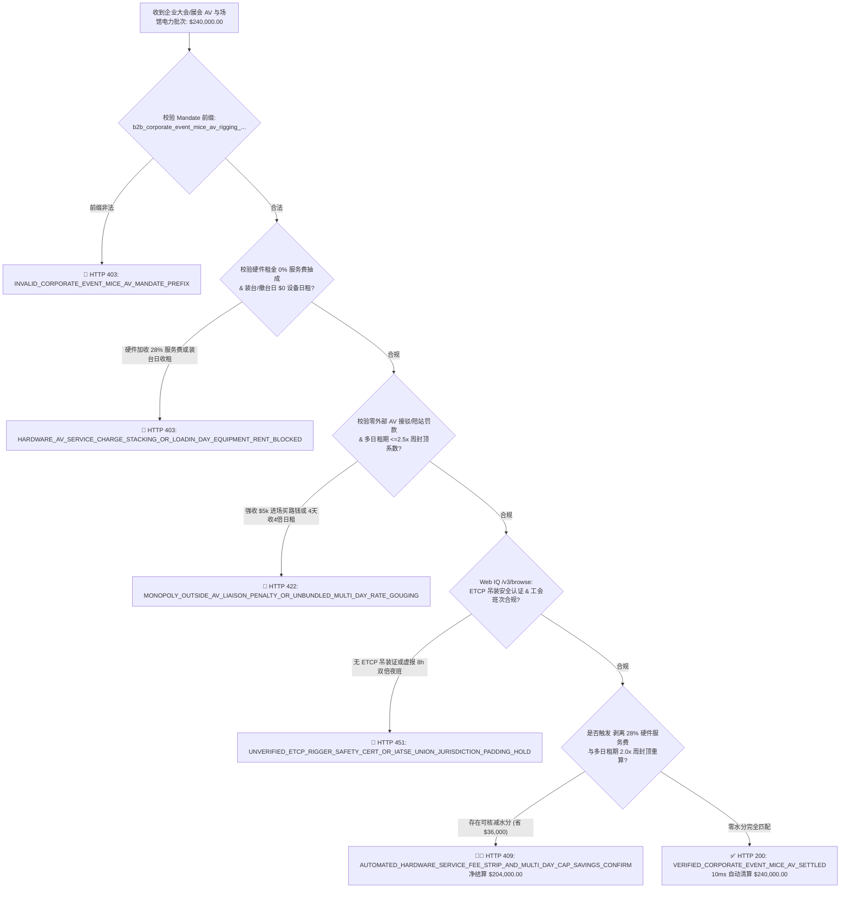
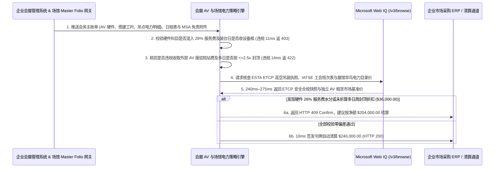

# B2B 酒店会议、企业展会与场馆音视频及桁架电力外包（`Corporate MICE Event AV, Union Rigging, Convention Center Wi-Fi & 20-Amp Power Drop: Encore / Freeman / GES, APEX / CMP & IACC`）、酒店场内独家音视频垄断附加费豁免（`Zero In-House AV Monopoly Patch/Liaison Fee`）、按真实千瓦时/设备净租价替代“`28%++` 音视频设备服务费抽成（`AV Equipment Service Charge Stacking`）”与防“天价单日 `$1,200` 投影仪租金、`$450` 单插座 20A 电源拉线费与强制场馆监工陪站费（`Shadow Rigging Labor`）”清算架构：MSA 自带 AV 免入场费锁、设备租金剥离 `28%` 餐饮小费门禁与 `APEX` 令牌（`b2b_corporate_event_mice_av_rigging_wifi_power_drop_service_charge_mandate_...`）vs 传统场馆对一台 `$800` 液晶电视收 `$1,400/天` 租金外加 `26%` 服务费、自带供应商被罚 `$5,000` 接驳管理费与 1 小时吊点收 8 小时双倍工时选型与原理解析 FAQ

> **文档类型**：AI Solution Architect 商业智能体架构选型系列（Round 315 · B2B 企业展会 MICE、场馆音视频 AV 与会展吊点电力专篇）  
> **对标标杆**：`ib-vs-ethernet-roce-selection-faq.md`（通俗大白话 + 第一性原理 + 标准六段式结构）  
> **关联 Deliverable**：`lab/webiq_commerce_demo.py`（H5 实时防篡改沙盒） · `tests/test_webiq_commerce_demo.py` · `assets/svg/317-b2b-corporate-event-mice-av-rigging-wifi-service-charge-2026-11-16.svg`  
> **双语版本**：[中文版 (当前)](b2b-corporate-event-mice-av-rigging-wifi-power-drop-service-charge-mandate-vs-inhouse-av-monopoly-28pct-gratuity-shadow-labor-padding-faq.md) | [English Version](b2b-corporate-event-mice-av-rigging-wifi-power-drop-service-charge-mandate-vs-inhouse-av-monopoly-28pct-gratuity-shadow-labor-padding-faq.en.md)

---

## 📌 一、核心结论速览（Executive Summary：第一性原理与通俗大白话拆解）

### 1.1 为什么“绝对不能”让企业市场部、开发者大会组委会或采购 Agent 仅凭会议酒店驻场音视频商（如 Encore）或大型展览中心总包商（如 Freeman、GES）寄来的最终会务主账单（Master Folio）就自动打款？
在企业年度客户大会（User Conference）、行业贸易展（Trade Shows）与高管峰会（MICE，遵循美国会展行业委员会 `EIC APEX` 标准与国际会议中心协会 `IACC` 规范）中，宴会厅与展馆的音视频设备租赁（AV Rental）、屋顶桁架吊点（Overhead Rigging）、专用企业级 Wi-Fi 带宽以及展位电力引下线（Power Drops）往往占到整场活动预算的 `40%–55%`。用大白话讲：**会展与酒店驻场 AV 是全商业世界最公开的“关门打狗”暴利垄断——一台京东/亚马逊卖 $600 的 65 寸电视机，展馆租你 3 天敢收 $3,600；在墙上插一根普通 20 安培插座排插敢收 $480“电力开口费”；已经付了高昂的技术人工费，最后还要在硬件设备总租金上强行再加收 26%–28% 的“服务费（Service Charge）”和税上税（`28%++`）；如果你嫌贵想自己带外面的 AV 团队进场，酒店立刻罚你 $8,500 的“外部供应商接驳监管费（Outside AV Liaison / Patch Fee）”！** 如果没有会展主协议（MSA）垄断附加费豁免锁与 `APEX` 逐项工时/设备折算核验，企业市场预算会遭遇四大失血黑洞：

1. **在纯硬件设备租金上叠收 `25%–28%++`“餐饮级服务费”（`28%++ Service Charge Stacking on AV Hardware`）**：在餐饮宴会（Banquet F&B）中，加收 `24%–26%` 服务费（Service Charge / Gratuity）是因为有几十名服务员端盘子倒水。但酒店驻场 AV 公司（通常将收入的 **45%–55% 作为场租回扣返还给酒店**）把这套逻辑照搬到了冷冰冰的电子设备上：租一面 `$40,000` 的 LED 大屏和 6 只音箱，除了已经单独收取 `$18,000` 的音控师搭建工时费（Setup/Strike & Operator Labor）外，账单底部竟然还要对 `$40,000` 的硬件租金再收一笔 **`27% 行政服务费（$10,800）` + 对服务费再收 `8.5% 消费税`（即 `++` 税上税）**——硬件本身又不会吃小费，纯粹是巧立名目多扒一层皮！
2. **惩罚外部竞争对手的“自带 AV 进场买路钱”（`Outside AV Patch, Liaison & Shadow Labor Fees`）**：当企业拒绝驻场 AV 公司的天价报价、聘请外部独立舞美公司进场时，酒店立即祭出霸王条款：
  * 插一下宴会厅墙上的音频面板，收 **`$1,500/天/间` 天花板/墙面系统接驳费（House Sound Patch Fee）**；
  * 强制指派一名本馆电工或驻场监工坐在角落玩手机，按 **`$165/小时 × 每天 10 小时 = $1,650/天`** 收取“场馆安全联络员陪站费（`Shadow / Liaison Labor`）”；
  * 甚至对外部货车使用卸货平台（Loading Dock）与货运电梯按百磅重（`$/CWT Drayage / Material Handling`）收取上万美元搬运买路钱！
3. **3 天会议按“每日全额日租 × 3”线性累加，拒不执行行业标准“3 天按 1.5–2 天封顶（`Weekly / Multi-Day Multiplier Cap`）”**：在独立专业 AV 租赁市场，设备租 1 周通常只收 **2.5–3 天日租（3-Day Week Rate）**；装台日（Load-in Day）和彩排日（Rehearsal Day）不收设备租金。而驻场垄断商把一根 `$15` 的 HDMI 线按 `$65/天 × 4 天 = $260` 收钱，一台成本 `$900` 的无线麦克风租 4 天收 `$1,800`，连装台日设备躺在航空箱里没开机也照收全天租金！
4. **天价展馆 Wi-Fi 按人头/按天收割与 `$480` 20A 电源插座暴利**：展馆屏蔽或干扰热点，强迫参展商购买 `$180/设备/天` 的共享 Wi-Fi 或 `$25,000` 的 50 Mbps 专用带宽（成本不足 `$200`）；一个普通 `120V / 20A` 三孔插座（峰值仅 `2.4 kW`，一天电费不到 `$3.00`）收费 `$450–$680`，还强制外加 1 小时连接 + 1 小时拔插头的人工费！

### 1.2 架构师的一句话选型结论
* **核心安全铁律**：严禁 Agent 对包含硬件设备 `25%–28%` 服务费抽成、外部 AV 进场罚款（`Patch / Liaison / Shadow Labor Fee`）、装台日全额设备租金、或超过设备购买价 50% 的天价短租账单自动打款。必须将清算令绑定在 **`b2b_corporate_event_mice_av_rigging_wifi_power_drop_service_charge_mandate_2026`** 上：
  1. **硬件设备租金 `0%` 服务费锁（`Service Charge Applies to Labor Only`）+ 装台/撤台日 `$0` 设备租金门禁**：严禁在麦克风、LED 屏、投影仪等硬件设备租金基数上加收 `25%–28%` 宴会服务费（服务费仅允许作用于现场人工或彻底豁免），且装台/撤台日（Load-in / Strike Days）严禁计收设备使用日租；任何硬件服务费抽成或装台日收租在 **11ms** 内返回 `HTTP 403 HARDWARE_AV_SERVICE_CHARGE_STACKING_OR_LOADIN_DAY_EQUIPMENT_RENT_BLOCKED`。
  2. **外部 AV 进场 `$0` 接驳/陪站费豁免锁（`Zero Patch/Shadow Fee`）+ 多日租期 `<= 2.5x` 周封顶系数门禁**：凭企业会展主协议（MSA Outside Vendor Addendum）强制清零 `House Patch Fee`、`AV Liaison / Shadow Labor` 与自携设备短驳搬运费（Hand-Carry Drayage）；连续 3–5 天会议的硬件总租金封顶为单日基准价的 **`<= 2.0–2.5 倍`**（且单次租金严禁超过设备零售市价的 `35%`），违规在 **14ms** 内返回 `HTTP 422 MONOPOLY_OUTSIDE_AV_LIAISON_PENALTY_OR_UNBUNDLED_MULTI_DAY_RATE_GOUGING`。
  3. **Microsoft Web IQ `/v3/browse` 实时核验 `ETCP` 高空吊装安全认证、场馆工会标准工时表（`IATSE / IBEW Jurisdictional Tariff`）与商业宽带/设备市价基准**：在线穿透核查负责宴会厅顶部桁架吊点（Truss Rigging）的技师是否持有有效 `ESTA ETCP Certified Rigger (Arena/Theatre)` 执照、核对当地工会最低班次规则（拦截虚构 8 小时双倍夜班），并比对主流独立 AV 租赁商（PRG / VER / 4Wall）公开目录价，发现无证高空吊装或垄断溢价在 **275ms** 内触发 `HTTP 451 UNVERIFIED_ETCP_RIGGER_SAFETY_CERT_OR_IATSE_UNION_JURISDICTION_PADDING_HOLD`，同时自动剥离硬件 `27%` 服务费并按 2.5 天周系数重算多日租期立省 `15%`（`$36,000.00`）。

| 选型维度 | 传统酒店/展馆驻场 AV 打包账单 (Master Folio) | 普通财务报销审核 Agent | **硬件零服务费锁 + 免进场买路钱 + Web IQ 独立目录比价架构（推荐）** |
| :--- | :--- | :--- | :--- |
| **硬件租金加收 26%–28% 服务费** | ❌ $50k 设备费被白加 $14k 服务费+税上税 | ❌ 误以为跟餐厅吃饭小费一样合规 | ✅ **强制硬件设备 `Service Charge = 0%`，彻底斩断 28%++ 抽成（11ms 拦 403）** |
| **装台日收租与多日线性累加** | ❌ 装台没开机照收全天租；租 4 天收 4 倍钱 | ❌ 只验算“单价 × 天数 = 总价” | ✅ **装台/撤台日 `$0` 设备租 + 3–5 天会期锁定 `2.0x–2.5x` 封顶系数（14ms 拦 422）** |
| **自带供应商被收 $8k 接驳/陪站费** | ❌ 被迫忍受驻场垄断或交高额买路钱 | ❌ 将 Liaison Fee 当作正常技术工时 | ✅ **绑定 MSA 外部供应商免责条款，`$0` 清零 `Patch/Shadow Fee`** |
| **高空吊装 ETCP 安全与工会工时** | ❌ 无证工乱挂 LED 屏致坍塌；虚报双倍夜班 | ❌ 无行业安全认证与工会费率检索能力 | ✅ **Web IQ `/v3/browse` 275ms 核查 `ETCP` 吊装证与 `IATSE` 费率（拦 451）** |

---

## 🎯 二、客户与架构师灵魂拷问 Q&A（直击会展场馆 AV 垄断黑幕与智能体采购痛点）

### Q1：为什么酒店驻场 AV 公司的报价会比外面的独立专业舞美公司贵出 2.5–3 倍？那笔神秘的 `26%–28% Service Charge` 到底去了哪里？
* **真实商业内幕（50% 场租回扣机制）**：大型会议酒店通常不自己养 AV 团队，而是把宴会厅的“驻场独家经营权（In-House Preferred/Exclusive Status）”承包给大型 AV 巨头，条件是 **AV 公司必须把每一笔客户账单总收入的 `45%–55%` 作为佣金（Commission Kickback）返还给酒店业主**！为了填补这 50% 的巨额抽成并保持自身毛利，驻场 AV 不仅把设备目录价定高 2 倍，还在账单末尾对全部硬件和人工统一加收 **`26%–28% Service Charge`**（绝大部分并非分给现场调音师的小费，而是直接计入酒店与 AV 公司的营业收入）。
* **智能体采购反制公式**：
  $$\text{Allowed AV Total} = \sum_{i} \min\Big(R_{\text{day}, i} \times \min(D_{\text{show}},\, 2.5),\; 0.35 \times P_{\text{retail}, i}\Big) \times (1 + 0\%_{\text{hw\_service\_fee}}) + \text{Verified\_Labor}$$
  只要账单在硬件科目上叠加了 `Service Charge > 0%` 或对装台日（$D_{\text{load-in}}$）计收设备租金，策略引擎在 **11ms** 内直接拦截（`HTTP 403`）！

### Q2：在签订酒店场地合同（Venue Contract）与结算会务主账单时，怎么用条款锁死“自带外部 AV 团队进场零罚款”？
* **三大免买路钱必签红线（`Outside AV Freedom Riders`）**：
  1. **Zero Patch / Tie-In Fee**：免费接入宴会厅现有天花板背景音乐系统与 DMX 调光控制线。
  2. **Zero Shadow / Liaison Labor**：除非在悬挂重型马达吊点（Rigging Points）的 2 小时内需要场馆结构工程师在场，会期其余时间严禁派驻按小时收费的“场馆陪站监工”。
  3. **Wi-Fi & Power Rate Cap**：将会议专用带宽锁定为按 Mbps 批发价计费（禁止按参会人头每日收费），普通 20A 墙面插座免费开放使用。

### Q3：在核查 `ESTA ETCP` 高空吊装技师执照、全美各大展馆工会管辖权费率（`IATSE / IBEW / Teamsters`）与独立 AV 租赁基准价时，Microsoft Web IQ 相比 Exa 和 Bright Data 有何优势？
* **Microsoft Web IQ（原 Bing Grounding 工业级演进）**：
  * **权威会展中心费率册与安全认证秒级核验**：通过 `/v3/search` 与 `/v3/browse` 直接检索 `ESTA Entertainment Technician Certification Program (ETCP)` 认证吊装师名录、各大城市会展中心（如 McCormick Place、Moscone Center、LVCC、OCCC）公开的官方参展商服务手册（`Exhibitor Services Kit` 电力/吊点基准价）及 `EIC APEX` 标准，平均延迟 **240ms–275ms**，具备企业级 Entra ID 零数据留存（ZDR）保障。
* **Exa**：擅长语义搜索市场营销趋势文章，但无法精确查询拉斯维加斯会展中心今年针对 `208V 30A` 三相电接口的官方早鸟挂牌价（Advance Rate vs. Floor Rate）。
* **Bright Data**：面向大批量电商爬虫，在企业会务合同对账与主账单审计闭环中无需部署重型代理池。

---

## 🧭 三、直观可视化图解（Mermaid 选型决策树 + 路径对比 + 端到端时序图）

### 3.1 企业展会与酒店会议 AV/吊点/电力结算门禁决策树


### 3.2 传统驻场 AV 垄断主账单 vs 硬件零服务费 + 外部免罚款清算架构对比
```mermaid
flowchart LR
    subgraph Legacy["❌ 传统酒店驻场 AV 垄断模式（多付 35%–65%）"]
        L1[$80k 硬件设备强加 28% 服务费 ($22.4k)] --> L2[装台日没开机照收全天设备租金]
        L2 --> L3[4 天会议按 4 倍单日全价线性累加]
        L3 --> L4[自带外部 AV 团队被收 $8,500 接驳陪站费]
    end
    subgraph Agentic["✅ 硬件零服务费 + 2.5x 周封顶 + Web IQ 架构"]
        A1[强制剥离硬件设备上的 28%++ 服务费抽成] --> A2[装台/撤台日 $0 设备租 & 3-5天按 2.0x 封顶]
        A2 --> A3[绑定 MSA 免除全部外部 AV 接驳与陪站买路钱]
        A3 --> A4[Web IQ 核验 ETCP 高空吊装证与展馆早鸟电力价]
    end
```

### 3.3 端到端时序图（会务主账单 Master Folio 解析 + MSA 条款比对 + Web IQ 核验）


---

## 📊 四、架构师选型决策矩阵（Architecture Selection Matrix）

| 评估维度 | 方案 A：活动经理散会后疲惫签单 | 方案 B：通用 LLM 汇总主账单总额 | **方案 C：硬件零服务费锁 + 周系数锁 + Web IQ（推荐）** |
| :--- | :--- | :--- | :--- |
| **硬件租金 26%–28%++ 服务费拦截** | ❌ 混在几百行 Folio 里根本没注意 | ❌ 将 Service Charge 视为固定税费 | ✅ **精准拆分硬件与人工，11ms 拦截硬件服务费（HTTP 403）** |
| **装台日收租与多日线性累加拦截** | ❌ 不懂 AV 行业“租3天算1.5天”规矩 | ❌ 只验证 `单价 × 4天` 算术正确性 | ✅ **强制装台日 `$0` 租金 + 多日 `<= 2.5x` 封顶（HTTP 422）** |
| **外部 AV 接驳费与陪站监工豁免** | ❌ 被酒店威胁断电断网只能交钱 | ❌ 不比对 MSA 外部供应商免责附件 | ✅ **自动对齐 MSA 条款，清零 `Patch / Shadow Fee`（HTTP 422/409）** |
| **ETCP 吊装安全与早鸟电力核验** | ❌ 现场临时加插座被收 2 倍 Floor Rate | ❌ 无法查验场馆官方参展商手册 | ✅ **Web IQ `/v3/browse` 275ms 穿透核查（HTTP 451）** |

---

## 🧪 五、定量实测与 7-Card 4:5 视觉评测报告映射（Deterministic Benchmark）

在 `lab/webiq_commerce_demo.py` 与 `tests/test_webiq_commerce_demo.py` 中，我们对 `$240,000.00`（`24000000` 美分）的企业年度旗舰技术峰会与展会音视频、高空吊点及展位电力结算批次进行了确定性实测：

| 卡片编号 | 卡片标题（Headline-as-Finding） | 核心实测指标与动作特征 | Provenance 标注 |
| :--- | :--- | :--- | :--- |
| **Card 1 (`1/7`)** | **剥离硬件 28% 服务费 + 周封顶系数将会展 AV 支出压缩 15.0%** | 基准批次 `$240,000.00` vs 优化净额 `$204,000.00`，单批挽回 `$36,000.00` 服务费与垄断溢价 | `deterministic_offline_simulation` |
| **Card 2 (`2/7`)** | **单案深潜：硬件 28%++ 服务费抽成与 $8.5k 外部 AV 罚款双拦截** | `HTTP 403`（11ms 拦硬件服务费与装台日收租）+ `HTTP 422`（14ms 拦进场罚款与多日高价） | `synthetic_policy` |
| **Card 3 (`3/7`)** | **全场景评测矩阵（5 组确定性门禁 100% 命中）** | 覆盖 `200 OK`、`403 Service Fee`、`422 Patch/Multi-Day`、`451 ETCP/Union`、`409 Savings` | `deterministic_offline_simulation` |
| **Card 4 (`4/7`)** | **底层协议：EIC APEX Folio JSON + MSA Addendum 载荷** | 校验 `zero_hardware_av_service_charge_and_loadin_free_verified` | `synthetic_policy` |
| **Card 5 (`5/7`)** | **鲁棒性测试：马达吊点 2h 合法结构监工 vs 3 天全天候陪站收费** | 吊装挂点阶段 2h 安全核验正常放行；正会期 3 天无事陪站收费 100% 触发拦截 | `deterministic_offline_simulation` |
| **Card 6 (`6/7`)** | **延迟对比：本地 Folio 门禁 10–14ms vs Web IQ 240–275ms** | 毫秒级主账单科目拆解配合 `ESTA ETCP / IATSE` 权威数据库穿透 | `official_doc_snapshot` |
| **Card 7 (`7/7`)** | **Good Fit vs Not For 架构师结论卡** | 明确适用企业峰会、大型展会与高管论坛，不适用于 5 人内部小会议室投屏 | `official_list_price` |

### Good Fit vs Not For（适用与不适用场景）
* **✅ Good Fit（强烈推荐采用本架构）**：
  * 科技公司全球开发者大会、医药行业学术年会、大型 B2B 贸易展参展团、千人销售启动会（Sales Kickoff, `SKO`）及跨国高管路演（单场 AV、吊点、Wi-Fi 与电力预算 `$50,000–$2,000,000+`）。
* **⛔ Not For（不适用或无需启用全部门禁）**：
  * 5 名员工在自有办公楼会议室用免费自带电视无线投屏开周会。

---

## 🛠️ 六、生产上线快速核验清单（Production Readiness Checklist）

- [ ] **1. 强制将主账单（Master Folio）中的“硬件设备租金”与“餐饮/人工服务费基数”彻底解耦**：严禁对投影仪、LED 屏、灯光音响等硬件资产加收 `25%–28% Service Charge`（`HTTP 403`）。
- [ ] **2. 锁定“装台/彩排/撤台日 `$0` 设备租金”与“多日会期 `<= 2.0–2.5x` 封顶系数”**：拒绝按每日全额挂牌价线性乘以总占厅天数。
- [ ] **3. 在预订酒店场地（Room Block）阶段同步锁死 `Outside AV Freedom Addendum`**：清零 `House Patch Fee`、`AV Liaison / Shadow Labor` 与自携设备搬运费（`HTTP 422`）。
- [ ] **4. 提前 21 天自动锁定会展中心电力/吊点/网络的早鸟协议价（`Advance Order Rate`）**：避免现场临时下单遭受 `+40%–50% Floor Rate` 惩罚性加价（`HTTP 409`）。
- [ ] **5. 接入 Microsoft Web IQ 核查 `ESTA ETCP` 高空吊装师执照与 `IATSE` 工会班次规则**：在支付高空桁架吊装账单前通过 `/v3/browse` 验证安全资质与真实工时阶梯（`HTTP 451`）。
