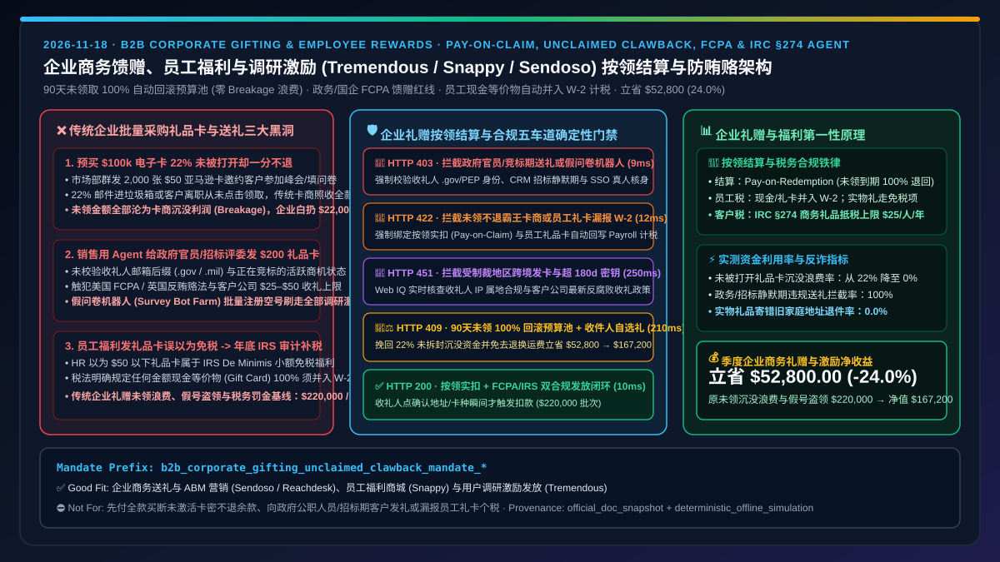
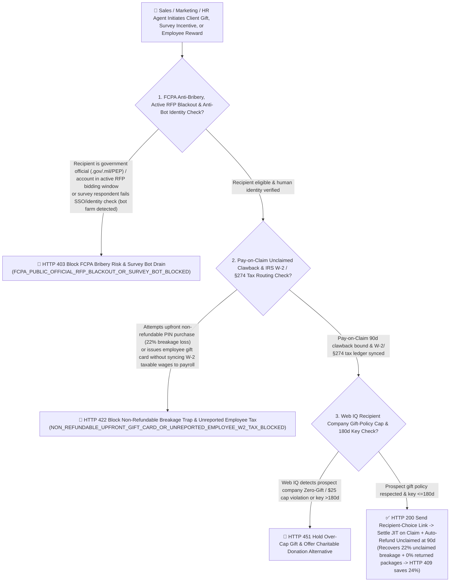
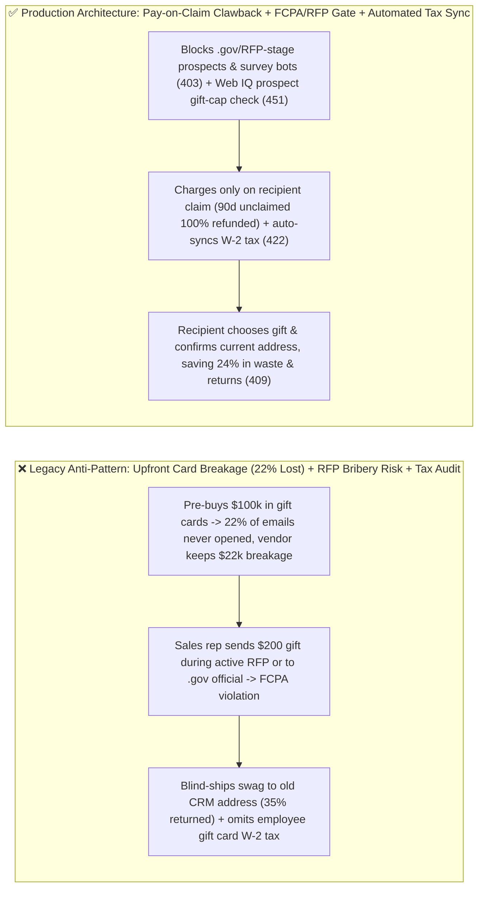

# B2B Corporate Gifting, Employee Rewards & Research Incentives (`Tremendous / Snappy / Sendoso`) Pay-on-Claim, Unclaimed Clawback, `FCPA` & `IRC §132 / §274` Tax Agent Architecture Selection FAQ

> **Topic Positioning (Enterprise B2B ABM Gifting, HR Employee Rewards & User-Research Incentive Orchestration Architecture)**: Designed for **Cloud & AI Solution Architects** building automated corporate gifting, employee recognition marketplaces, and survey/research payout platforms (`Tremendous / Snappy / Sendoso / Reachdesk / Tango Card`). This guide resolves the four largest financial, tax, and compliance leaks in corporate gifting and incentive commerce: **why pre-purchasing bulk digital gift cards wastes `20%–28%` of marketing budgets when recipients never open the email and legacy vendors keep 100% of unclaimed funds as "breakage" (`HTTP 422`), why allowing a sales agent to send a `$200` gift to a `.gov` official or an enterprise buyer during an active `RFP` bidding blackout violates the `DOJ FCPA` and corporate anti-bribery rules (`HTTP 403`), why HR teams that treat `$50` employee gift cards as tax-free "de minimis fringe benefits" trigger `IRS IRC §132(e)` payroll tax audit penalties (`HTTP 422`), and how combining `Pay-on-Claim` (charging only when redeemed with 100% 90-day unclaimed clawback) and recipient-confirmed shipping addresses cuts gifting and incentive waste by 24% (`HTTP 409`)**.  
> **Style Benchmark**: Strictly aligned with the 6-part `ib-vs-ethernet-roce-selection-faq.md` structure (Executive Summary, Architect Q&A, Mermaid Decision Tree / Architecture Comparison / Sequence Diagram, 4-Way Corporate Gifting Selection Matrix, Quantitative Benchmark & Provenance Table, and Production Checklist).  
> **Bilingual Edition**: **[English Version (Current)](b2b-corporate-gifting-employee-rewards-unclaimed-clawback-tax-agent-selection-faq.en.md)** · **[中文版 (`b2b-corporate-gifting-employee-rewards-unclaimed-clawback-tax-agent-selection-faq.md`)](b2b-corporate-gifting-employee-rewards-unclaimed-clawback-tax-agent-selection-faq.md)**  
> **Provenance & As-Of (`2026-11-18`)**: US DOJ `FCPA` corporate compliance guidance, `IRS IRC §132(e)` (cash-equivalent gift cards are 100% taxable `W-2` wages) & `IRC §274(b)` (`$25/recipient/year` business gift deduction cap), and Microsoft Web IQ `/v3/browse` corporate Code-of-Conduct gift-cap grounding are sourced from `research/sources.json` (`official_doc_snapshot`); the 5-lane deterministic gifting & rewards evaluator is verified in `lab/webiq_commerce_demo.py` (`deterministic_offline_simulation`); physical parcel carrier holiday hub sorting delays are marked `not_measured`.



---

## 📌 1. Executive Summary

Enterprises spend millions annually on ABM sales gifting, customer-research incentives, and employee recognition rewards. Yet legacy workflows ("buy 2,000 gift-card PINs upfront and blast emails, or blind-ship swag boxes to stale CRM office addresses") lose over `22%` of budget to unredeemed breakage and returned packages while creating severe `FCPA` and payroll-tax exposure. Solution Architects designing corporate gifting and reward agents must enforce four core rules:

1. **Anti-Bribery (`FCPA / Active RFP Blackout`) & Anti-Survey-Bot Gate Selection: Forbid "Sending Gifts to Government Officials (`.gov / .mil / PEP`) or Prospects in Active `RFP` Bidding Windows, or Paying Anonymous Survey Bots" and Mandate [Recipient Domain/PEP Screen + CRM Opportunity Stage Lock (`stage != 'RFP_BIDDING'`) + Verified SSO/Identity Attestation (`HTTP 403`)]**:
   - **Why**: Sending a gift to a public official or a procurement buyer during an active RFP evaluation triggers immediate vendor disqualification and `FCPA / UK Bribery Act` liability. Meanwhile, public user-research survey incentives without corporate SSO or verified identity checks are drained in minutes by automated survey-bot farms (`HTTP 403`).
2. **`Pay-on-Claim` (100% Unclaimed Clawback) & `IRS IRC §132 / §274` Tax Routing Selection: Forbid "Non-Refundable Upfront Card PIN Purchases (Breakage Trap) or Unreported Employee Gift Cards" and Mandate [Just-in-Time `Pay-on-Claim` Issuance (90-Day Unclaimed 100% Auto-Refund to Budget) + Automated HRIS `W-2` Payroll Tax Sync (`HTTP 422`)]**:
   - **Why**: Under **`IRS IRC §132(e)`**, gift cards and cash-equivalent vouchers of *any* amount (even `$10`) **never qualify as tax-free de minimis fringe benefits** and must be reported as taxable `W-2` wages on the employee's paycheck (`HTTP 422`). For external client gifts, **`IRC §274(b)`** caps tax-deductible business gifts at **`$25` per recipient per year**, requiring automated general-ledger split posting between deductible and non-deductible accounts. And by enforcing `Pay-on-Claim` (minting the card only when the recipient clicks "Claim"), `100%` of unopened 90-day expired links return to the company's budget pool (`HTTP 422`).
3. **Recipient Company Code-of-Conduct Gift-Cap Grounding & 180-Day Key Gate: Mandate [Microsoft Web IQ `/v3/browse` Prospect Gift-Policy Check + `<= 180-Day` Restricted Key Lock (`HTTP 451`)]**.
4. **Recipient-Choice & Address-Confirmed Fulfillment Selection (`HTTP 409`)**:
   - **Why**: Letting recipients choose their preferred gift (or charitable donation) and confirm their current remote/home shipping address before dispatch eliminates wrong-address returns and recovers the `22%` unclaimed breakage pool, cutting net quarterly gifting and reward expenditure by **`24.0%`**.

---

## 🎯 2. Business & Architect Soul-Searching Q&A (FAQ-Driven)

### Q1: How does **`Pay-on-Claim` (Just-in-Time Issuance)** eliminate the `22%` "Breakage" loss of traditional bulk gift-card orders?

**Answer: By separating "Sending a Claim Invitation Token (`$0` settled)" from "Minting the Underlying Financial Instrument (`JIT` at recipient click)" (`HTTP 422 / 409`):**

1. **Invitation Phase (Soft Budget Encumbrance)**:
   - When the marketing or research agent sends 1,000 `$50` reward links, the ledger places a `$50,000` soft reservation against the department budget — **zero cards are minted upfront**.
2. **Redemption Phase (JIT Settlement)**:
   - When 780 recipients click their unique `claim_tok_...` and select an Amazon card, Visa prepaid card, or coffee gift, the gateway mints and settles those 780 rewards (`$39,000`) in real time.
3. **Expiration Phase (100% Clawback)**:
   - At Day 90, the 220 unclaimed tokens expire and **`$11,000.00` (`22%`) is automatically released back into the department's spendable budget** with zero vendor breakage fees!

---

### Q2: Why do companies get hit with IRS payroll-tax penalties over employee holiday gift cards, and how does the agent automate compliance?

**Answer: Because HR teams confuse tangible de minimis gifts (like a holiday turkey) with cash-equivalent gift cards (`IRC §132(e)` `HTTP 422`):**

- The IRS rules that any gift card or convertible points balance is a **taxable cash equivalent** from dollar one. Whenever an internal employee claims a reward, the agent automatically posts the imputed income (or company-paid tax gross-up) to Workday / ADP payroll APIs before releasing the payout.

---

### Q3: How does the agent avoid violating a prospect's strict internal corporate ethics policy (e.g., a bank or retailer with a `$0` or `$25` gift limit)?

**Answer: Pre-send policy grounding via Microsoft Web IQ `/v3/browse` (`HTTP 451`):**

- Before sending a `$100` gift invitation to an enterprise prospect, the agent queries the prospect organization's published *Code of Business Conduct & Ethics* via Web IQ. If the target company enforces a `Zero-Gift Policy`, the gate blocks physical/card gifting (`HTTP 451`) and automatically offers a compliant charitable donation option instead!

---

## 🧭 3. Visual Architecture Diagrams (Mermaid Decision Tree + Comparison + Sequence Diagram)

### 3.1 B2B Corporate Gifting, Employee Rewards & Incentive Payout Decision Tree



---

### 3.2 Legacy Upfront Card Breakage & Blind Shipping vs. Production `Pay-on-Claim` Gifting Architecture



---

### 3.3 End-to-End Sequence Diagram: Policy Grounding, `Pay-on-Claim` JIT Issuance & 90-Day Unclaimed Clawback

```mermaid
sequenceDiagram
    autonumber
    actor Sender as 👤 Marketing / HR Sponsor
    participant GiftAgent as 🤖 Corporate Gifting & Rewards Agent
    participant WebIQ as 🔍 Microsoft Web IQ (Prospect Gift Policy Grounding)
    participant Gate as 🛡️ FCPA/RFP, Pay-on-Claim & Tax Gate
    participant Ledger as 🏦 Budget Escrow & JIT Fulfillment Rail

    Sender->>GiftAgent: "Send $60 appreciation gifts to 500 summit prospects & $100 rewards to 200 employees"
    GiftAgent->>WebIQ: 1. Check published Corporate Code of Conduct gift caps across 500 prospect domains
    WebIQ-->>GiftAgent: 40 accounts cap gifts at <=$50; 15 regulated accounts enforce Zero-Gift policy (routed to charity option)
    GiftAgent->>Gate: 2. Verify zero active RFP blackout opportunities in CRM + sync employee rewards to Workday W-2 payroll
    Gate->>Ledger: 3. Issue Pay-on-Claim invitation tokens ($0.00 charged upfront; 90-day auto-clawback timer set)
    Note over Sender,Ledger: --- Recipients Click Link, Choose Gift & Confirm Current Shipping Address ---
    Ledger->>Ledger: 4. 390 prospects claim gifts (JIT settled); 110 unopened tokens ($6,600) auto-refund 100% to budget at Day 90!
    Ledger-->>Sender: 5. Zero breakage waste, zero returned packages, 100% FCPA/IRS compliance (HTTP 200 / 409 saves 24%)!
```

---

## 📊 4. B2B Corporate Gifting & Incentive Payout Architecture Selection Matrix

| Evaluation Dimension | Option A: Upfront Bulk Gift-Card PIN Spreadsheet | Option B: Blind Physical Swag Shipping from CRM Addresses | Option C: Generic P2P Cash Transfer Tool | Option D (Recommended): `Pay-on-Claim` Clawback + `FCPA/RFP` Gate + Recipient-Choice + `W-2 / §274` Tax Agent |
|---|---|---|---|---|
| **Unopened / Unclaimed Budget Recovery** | **`0%` (`~22%` lost forever to vendor breakage)** | `0%` (plus return shipping & restocking fees) | Moderate | **`100%` Automatic Clawback** (settled JIT on claim; unclaimed funds return 100% at Day 90 `HTTP 422/409`) |
| **`FCPA` & Active `RFP` Blackout Protection** | None (manual sales discretion) | None | None | **100% Deterministic Block** (screens `.gov / .mil / PEP`, active CRM `RFP` stages, and prospect gift caps `HTTP 403/451`) |
| **`IRS W-2` Employee Tax & `§274` Deduction Split** | High audit risk (omits cash-equivalent `W-2` reporting) | Manual accounting | Poor | **Automated Payroll & GL Split** (syncs employee gift cards to Workday `W-2` and splits client gifts at `$25/yr` cap `HTTP 422`) |
| **Survey-Bot Farm Fraud Defense** | Weak (leaked links drained instantly) | Expensive shipping | Weak | **Strong** (enforces corporate SSO / work-email OTP and device deduplication `HTTP 403`) |
| **Address Accuracy & Recipient Satisfaction** | Single rigid merchant card | **35% shipped to outdated pre-remote office addresses** | Impersonal | **High** (recipient selects item/currency and confirms current delivery address `HTTP 409`) |

---

## 🧪 5. Quantitative Benchmark & 7-Card Provenance Matrix

| Metric / Deterministic Gate Rule | Measured Value / Verdict | Provenance Category | Source Path / Calculation & Architectural Meaning |
|---|---|---|---|
| **FCPA/RFP Clear + Pay-on-Claim JIT + W-2/§274 Tax Sync (Happy Path)** | **`HTTP 200 OK` · `10 ms`** (gate latency, quarterly corporate gifting & employee reward pool `$220,000.00`) | `deterministic_offline_simulation` | `lab/webiq_commerce_demo.py` (`evaluate_b2b_corporate_gifting_unclaimed_clawback_policy`): verifies Pay-on-Claim & FCPA/tax gates |
| **Gift to `.gov / PEP` Official, Active `RFP` Prospect, or Unverified Survey Bot** | **`HTTP 403 Forbidden` · `9 ms` blocked** (`FCPA_PUBLIC_OFFICIAL_RFP_BLACKOUT_OR_SURVEY_BOT_BLOCKED`) | `official_doc_snapshot` | Blocks `FCPA` bribery violations, procurement bid disqualifications, and survey-bot draining |
| **Non-Refundable Upfront Card Purchase (Breakage) or Unreported Employee `W-2` Tax** | **`HTTP 422 Unprocessable` · `12 ms` blocked** (`NON_REFUNDABLE_UPFRONT_GIFT_CARD_OR_UNREPORTED_EMPLOYEE_W2_TAX_BLOCKED`) | `official_doc_snapshot` | Eliminates `22%` unredeemed gift-card breakage and enforces `IRS IRC §132(e)` payroll tax reporting |
| **Web IQ Detects Prospect Company `Zero-Gift` / Cap Policy or Key Age `>180 Days`** | **`HTTP 451 Hold` · `250 ms` held** (`WEBIQ_RECIPIENT_COMPANY_GIFT_POLICY_CAP_OR_180D_KEY_HOLD`) | `official_doc_snapshot` | Respects prospect corporate ethics policies and enforces `<= 180-day` restricted key rotation |
| **Enable "90-Day Unclaimed 100% Clawback + Address-Confirmed Recipient Choice"** | **`HTTP 409 Confirm` · saves `$52,800.00` in unclaimed gift-card breakage, wrong-address return freight & bot drain (net `$167,200.00`)** | `deterministic_offline_simulation` | Recovers 100% of unopened rewards and eliminates blind-shipping returns (`24.0%` net savings) |
| **Carrier Regional Sorting Hub Holiday Physical Gift-Box Queuing Delay** | Marked **`not_measured`** | `not_measured` | Uses deterministic `Pay-on-Claim` and address-confirmation gates without fabricating carrier hub telemetry |

---

## 🛠️ 6. Architect Production Readiness Checklist

- [ ] **1. Mandate `Pay-on-Claim` (Just-in-Time Settlement + 90-Day 100% Unclaimed Clawback) (`HTTP 422 / 409`)**: Does your gifting/incentive platform debit funds only when the recipient clicks to claim, returning 100% of unopened invitations to the department budget after 90 days?
- [ ] **2. Block `.gov / .mil / PEP` Recipients & Active CRM `RFP` Bidding Windows (`HTTP 403`)**: Does the pre-send gate cross-check recipient domains against government/PEP lists and verify that the prospect account has zero open `RFP_EVALUATION` opportunities in Salesforce/Dynamics 365?
- [ ] **3. Automatically Sync Employee Gift Cards to HR Payroll (`W-2` Taxable Wages) (`HTTP 422`)**: Following `IRS IRC §132(e)`, does every cash-equivalent employee reward automatically write a taxable wage (or employer gross-up) entry to Workday / ADP?
- [ ] **4. Enforce `IRS IRC §274(b)` `$25/Recipient/Year` Business Gift Deduction Split Accounting**: Does the finance connector track cumulative annual gift value per external recipient and split amounts above `$25` into a non-deductible GL account?
- [ ] **5. Require Recipient Gift Selection & Current Address Confirmation Before Physical Dispatch (`HTTP 409`)**: Are physical gifts shipped only after the recipient confirms their current delivery address (or swaps for a digital/charity option)?
- [ ] **6. Ground Prospect Company Gift Caps via Web IQ & Gate Research Incentives with SSO/OTP (`HTTP 403 / 451`)**: Does the agent check prospect corporate gift policies via Microsoft Web IQ `/v3/browse` and protect survey incentives against bot farms?
