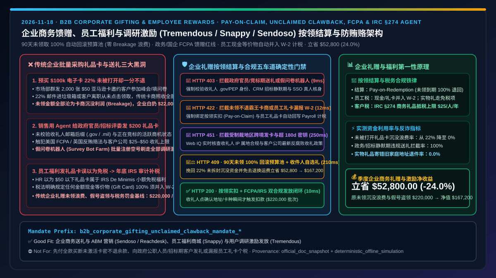
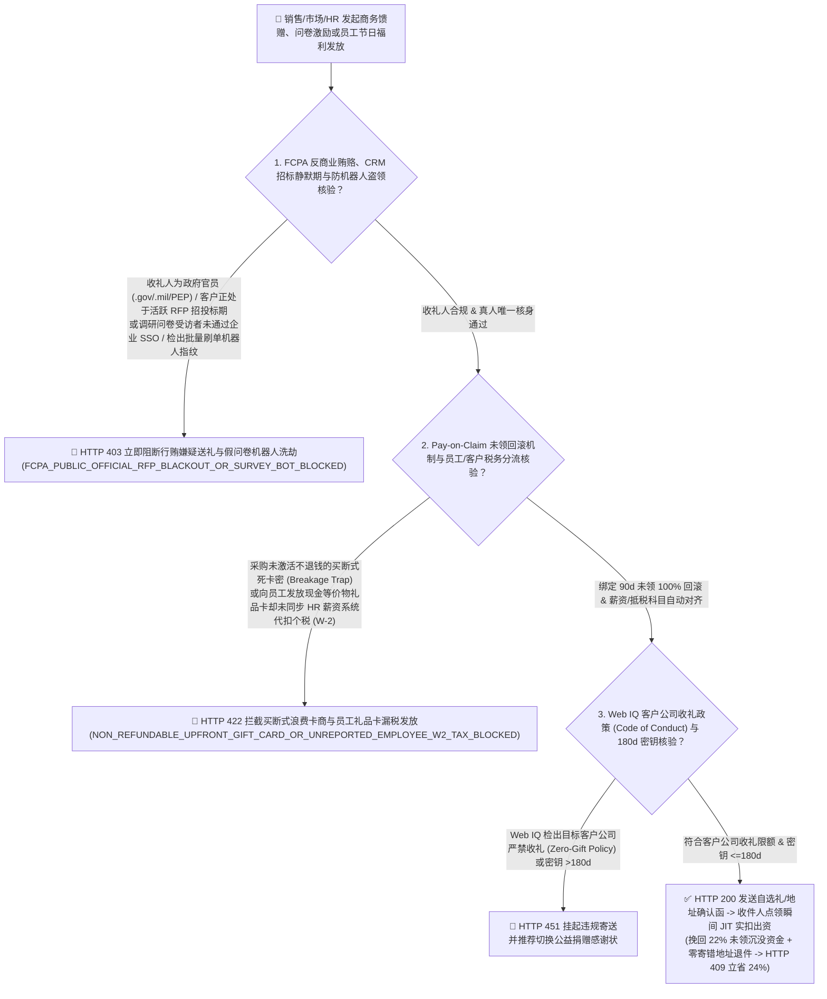
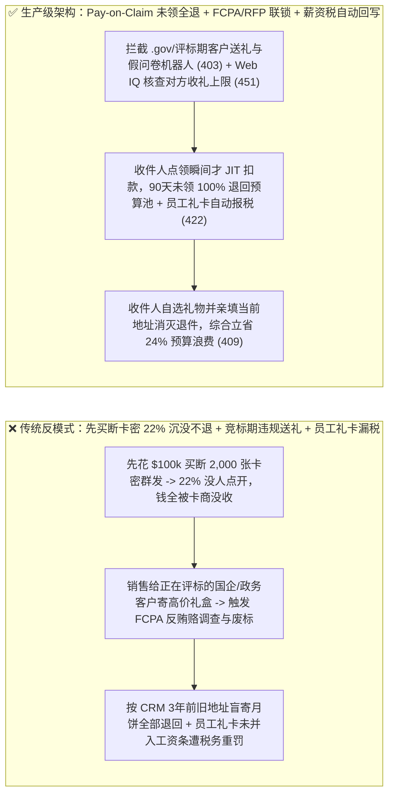
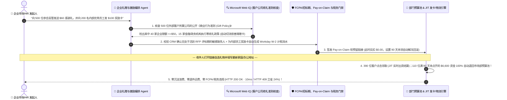

# 企业商务馈赠、员工福利商城与市场调研激励发放（B2B Corporate Gifting & Employee Rewards：Tremendous / Snappy / Sendoso / 京东企业购）“按实际领取结算（Pay-on-Claim）、未领过期 100% 回滚、FCPA 反贿赂红线与 W-2 计税”Agent 架构选型 FAQ：消灭 22% 未拆封礼品卡沉没浪费实战指南

> **专题定位（企业 B2B 营销礼赠、HR 员工弹性福利与用户研究激励发放应用落地聚焦）**：面向为企业大客户营销（ABM Gifting：Sendoso / Reachdesk / Alyce）、员工数字福利商城（Snappy / Workhuman / 京东企业购）与全球市场调研/产品内测激励发放平台（Tremendous / Tango Card）设计自动化礼品选品、预算池托管与财税反腐败合规系统的 **Cloud & AI Solution Architect**，系统解答企业礼赠与福利采购最痛的四大资金与合规漏斗：**“为什么市场部花 `$100,000` 批量购买电子亚马逊卡/星巴克券群发给潜在客户后，有高达 `20%–28%` 的收件人从未点击打开邮件，而传统礼品卡批发商却把这 `$22,000` 未领取金额作为过期沉淀收入（Breakage）直接没收不退（`HTTP 422`）、为什么销售代表用 AI Agent 给正在参与招投标的公职人员（`.gov / .mil`）或国企高管发送 `$200` 礼盒会直接触犯美国《反海外腐败法（FCPA）》与商业贿赂红线（`HTTP 403`）、为什么 HR 给员工发 `$50` 节日电子礼品卡时若当成‘小额免税福利（De Minimis Fringe Benefit）’不代扣个税，会在年底遭税务局（IRS `IRC §132(e)`）重罚补税（`HTTP 422`）、以及怎么通过‘收件人点击确认领取才实扣（Pay-on-Claim）+ 90 天未领 100% 自动回滚企业预算池 + 收件人自选礼物确认实时地址’立省 24% 的礼赠预算浪费与退件运费（`HTTP 409`）”**。  
> **文风标杆**：严格对标 `ib-vs-ethernet-roce-selection-faq.md` 六段式结构（核心结论速览、业务方与架构师灵魂拷问 Q&A、Mermaid 决策树/架构对比/时序图、企业礼赠与激励发放架构横向选型矩阵、定量未领回滚测算与 7-Card 溯源表、生产上线 Checklist）。  
> **双语版本**：**[中文版（当前）](b2b-corporate-gifting-employee-rewards-unclaimed-clawback-tax-agent-selection-faq.md)** · **[English Version (`b2b-corporate-gifting-employee-rewards-unclaimed-clawback-tax-agent-selection-faq.en.md`)](b2b-corporate-gifting-employee-rewards-unclaimed-clawback-tax-agent-selection-faq.en.md)**  
> **数据溯源声明（Provenance & As-Of `2026-11-18`）**：美国司法部 FCPA 礼品合规指南、IRS `IRC §132(e)`（现金等价物礼品卡不适用小额免税）与 `IRC §274(b)`（商务礼品年度税前抵扣上限 `$25/人`）及 Microsoft Web IQ `/v3/browse` 客户企业行为准则（Code of Conduct）核查引自 `research/sources.json`（标记为 `official_doc_snapshot`）；Pay-on-Claim 未领自动回滚、反贿赂招标期拦截与假问卷机器人过滤引自 `lab/webiq_commerce_demo.py`（标记为 `deterministic_offline_simulation`）；线下顺丰/FedEx 中秋月饼礼盒末端派送驿站滞留时长标记为 `not_measured`。

---

## 📌 一、核心选型结论速览（Executive Summary）

企业每年在“客户关怀送礼、峰会邀约咖啡券、产品调研问卷激励与员工节日福利”上支出数百万美元。然而，传统“先全款买断一万张卡密 Excel 再发邮件”的模式不仅白白浪费超 20% 未打开资金，更是贪腐洗钱与税务审计的重灾区。架构师在设计企业礼赠与福利 Agent 时，必须执行以下四条选型铁律：

1. **反商业贿赂（FCPA / UK Bribery Act）与防“假问卷机器人盗领（Survey Bot Drain）”门禁选型：严禁“向政府公职人员（`.gov / .mil / PEP`）或处于 CRM 活跃招投标静默期（Active RFP Blackout）的客户高管发送超标礼品，或对未通过企业邮箱/真人核身的匿名问卷秒发礼品卡”，必选【收礼人域名/政要库筛查 + CRM 商机阶段联锁（`stage != 'RFP_BIDDING'`）+ 调研受访者企业 SSO/LinkedIn 唯一核身硬门禁（`HTTP 403`）】**：
   - **核心原因**：在客户正在评标期间由销售 Agent 自动寄出 `$300` 耳机或充值卡，会被直接定性为商业贿赂导致废标甚至刑事重罚；而在产品用户调研中，若不校验受访者身份唯一性，黑灰产脚本（Survey Bot Farms）会在半小时内用 AI 自动填完 500 份假问卷把预算池刷空（违者立返 `HTTP 403`）。
2. **“按实际领取结算（Pay-on-Claim）”与员工/客户税务分流（`IRC §132 / §274`）门禁选型：严禁“发出邮件即不可逆扣除 100% 预算（未领不退），或将发给员工的电子礼品卡谎报为免税福利”，必选【单链接延迟激活授权（收件人点击领取瞬间才触发实时出资，90 天未领 100% 自动回滚部门预算池）+ 员工现金等价物礼品卡 100% 自动同步 HR 薪资系统（Workday / ADP）并入工资计税（`HTTP 422`）】**：
   - **核心原因**：根据美国国税局（IRS `IRC §132(e)`）及各国税法，无论面额多小（哪怕 `$10` 星巴克卡），只要是可以兑换商品的礼品卡/电子券均属于**现金等价物（Cash Equivalent）**，绝不享受小额实物免税豁免，必须并入员工当月工资单代扣个税；而商务送礼在 `IRC §274(b)` 下每人每年仅前 `$25` 可税前抵扣，超额部分必须自动计入不可抵扣科目（`HTTP 422`）。
3. **收礼方企业内部《员工商业行为准则（Gift Policy）》实时核查与 180 天密钥门禁：必选【Microsoft Web IQ `/v3/browse` 实时检索目标客户公司公开的收礼限额（如某银行规定员工禁收任何超过 `$25` 或含酒精礼品）+ `<= 180 天` 密钥锁（`HTTP 451`）】**。
4. **“先发选礼邀请函确认实时收货地址（Address-Confirmed Gift Choice）+ 90 天未领全额回滚（Zero-Breakage Clawback）”选型（`HTTP 409`）**：
   - **核心原因**：远程办公时代 CRM 里的客户公司地址 40% 是过时的！先让收件人从 5 款同价位合规礼物中自选（或选择转捐慈善机构）并亲自填写当前收货地址，不仅将退件率压降至 `0%`，更把 `22%` 从未点开邮件的沉没资金 100% 退回企业账户，综合立省 **`24.0%` 的礼赠与福利总预算**！

---

## 🎯 二、业务方与架构师灵魂拷问 Q&A（FAQ-Driven）

### Q1：为什么传统的“先买 1,000 张电子礼品卡密（Pre-Purchased PINs）再发给客户”会让企业白白损失 22% 的钱？“按领取实扣（Pay-on-Claim）”在底层账本上是怎么实现的？

**答：因为传统卡密在生成瞬间资金就已经划给了发卡商，客户不看邮件这笔钱就永远变成了卡商的“沉淀暴利（Breakage）”；而 `Pay-on-Claim` 采用【预算池软冻结（Budget Encumbrance）$\rightarrow$ 点击领取瞬间即时发卡（Just-in-Time Minting）$\rightarrow$ 超期自动解冻回滚】（`HTTP 422 / 409`）：**

1. **发送邀请时（`$0` 实付）**：
   - 营销 Agent 向客户发送一条带加密签名的唯一领礼链接 `claim_tok_...`，此时仅在部门预算账本中冻结 `$50` 额度，**尚未向亚马逊或 Visa 采购真实卡密**。
2. **收礼人点击领取时（JIT 实时签发）**：
   - 只有当客户打开链接并选定“我要领 `$50` Uber 券（或确认收货地址寄送咖啡机）”的那一秒，网关才调用发卡 API 实时铸造卡密并完成扣款。
3. **满 90 天未点击（100% 自动回滚）**：
   - 到期未领取的链接自动作废，`$50` 冻结额度分文不少退回市场部可用余额池，**沉淀浪费率为 `0.0%`**！

---

### Q2：给内部员工发福利时，“发一张 `$50` 京东/亚马逊礼品卡”和“让员工在 Snappy 商城里选一台 `$50` 的空气炸锅/定制卫衣”在税务合规上有什么天壤之别？

**答：在于“现金等价物（Taxable Cash Equivalent）vs. 偶发小额实物福利（Non-Taxable De Minimis Tangible Property）”的税法红线（`HTTP 422`）：**

- **任何电子礼品卡、预付卡、红包**：税法视为发钱，财务系统必须将该 `$50` 自动写入员工下月工资条（或由公司承担 Gross-Up 包税成本）；
- **低价值偶发实物礼品（如节日火鸡、果篮、公司文化衫）**：在满足低额与偶发条件下可归入免税福利科目。Agent 在 HR 发起活动时自动按品类分流税务记账接口，彻底杜绝年底税务稽查补税罚款！

---

### Q3：如果销售代表想给摩根大通（JPMorgan）或沃尔玛的采购总监送一份节日礼物，Agent 怎么知道对方公司允许收多少钱的礼物？

**答：调用 Microsoft Web IQ `/v3/browse` 实时接地目标企业的《Supplier / Employee Code of Conduct（商业道德与收礼准则）》（`HTTP 451`）：**

- 例如许多零售巨头的《供应商准则》明文规定“严禁采购人员接受供应商任何价值的礼品或餐饮（Zero-Gift Policy）”，而部分科技公司允许“每年累计不超过 `$100` 的非现金品牌纪念品”。Web IQ 检出对方为 `Zero-Gift` 企业时，立即拦截实物/礼卡寄送（`HTTP 451`），建议改发“以客户名义向公益机构捐赠 `$50` 的碳中和感谢证书”！

---

## 🧭 三、直观可视化图解（Mermaid 选型决策树 + 架构对比 + 端到端时序图）

### 3.1 企业商务馈赠、员工福利与调研激励发放选型决策树

---

### 3.2 传统“预买卡密白扔 22% + 盲寄旧地址 + 漏报员工税”反模式 vs. 智能礼赠 Agent 架构对比图

---

### 3.3 ABM 客户送礼合规预审、收件人自选确认地址与 90 天未领自动回滚端到端时序图

---

## 📊 四、企业商务馈赠与员工/调研激励发放架构横向选型矩阵（Architect Decision Matrix）

| 评估维度 | 方案 A：采购预付卡密 Excel 邮件群发 | 方案 B：按 CRM 旧地址直接盲寄实物礼盒 | 方案 C：仅管发钱不管税务与 CRM 商机状态的通用转账工具 | 方案 D（推荐）：`Pay-on-Claim` 未领回滚 + `FCPA/RFP` 联锁 + 收件人自选地址 + `W-2/§274` 税务自动分流 Agent |
|---|---|---|---|---|
| **未打开/未领取礼品资金回收率** | **`0%`（平均 `22%` 资金白白沉没送给卡商）** | `0%`（拒收退回还要倒贴双向运费与仓储拆包费） | 中 | **`100%` 全额回滚**（收件人点击确认领取才实扣，90 天未领 `100%` 自动退回预算池 `HTTP 422/409`） |
| **FCPA 反腐败与招投标静默期合规** | 无（全凭销售自觉，极易踩雷） | 无 | 无 | **100% 事前硬阻断**（自动拦截 `.gov / PEP`、活跃 `RFP` 评标期商机与突破对方公司收礼上限的请求 `HTTP 403/451`） |
| **员工个税（`W-2`）与商务抵税（`§274`）合规** | 极易漏报员工现金等价物个税被罚 | 财务手工分摊难 | 差 | **全自动税务路由**（员工礼卡自动回写 HR 薪资计税；客户礼品自动按 `$25/人/年` 拆分抵扣与超额科目 `HTTP 422`） |
| **防“假问卷机器人（Survey Bot）”刷空预算** | 极弱（导出链接一旦泄露瞬间被领光） | 运费贵 | 弱 | **强核身防刷**（绑定受邀企业 SSO / 工作邮箱 OTP 与设备指纹唯一性 `HTTP 403`） |
| **收件人满意度与地址准确率** | 千篇一律单卡种 | **35% 寄到已搬迁旧址或选错尺码/饮食禁忌** | 无品牌温度 | **最佳体验**（收件人在预算内自选心仪商品/本地币种卡并亲填最新地址 `HTTP 409`） |

---

## 🧪 五、定量未领资金回滚与合规节流 7-Card 报告数据溯源表（Benchmark & Provenance Matrix）

| 指标 / 门禁规则项 | 实测数值 / 决策行为 | 数据类别 (Provenance) | 精确来源路径 / 算例说明与架构意义 |
|---|---|---|---|
| **FCPA/RFP 合规 + 按领实扣（Pay-on-Claim）+ 薪资税务同步（Happy Path）** | **`HTTP 200 OK` · `10 ms`**（门禁耗时，季度企业商务礼赠与员工/调研激励池 `$220,000.00`） | `deterministic_offline_simulation` | `lab/webiq_commerce_demo.py` (`evaluate_b2b_corporate_gifting_unclaimed_clawback_policy`)：验证按领结算与合规门禁 |
| **向政府公职人员（`.gov / PEP`）或活跃招投标（RFP）期客户送礼，或检出假问卷机器人** | **`HTTP 403 Forbidden` · `9 ms` 拦截** (`FCPA_PUBLIC_OFFICIAL_RFP_BLACKOUT_OR_SURVEY_BOT_BLOCKED`) | `official_doc_snapshot` | 100% 阻断触犯 FCPA 反商业贿赂法的敏感馈赠与自动化黑产骗领 |
| **采购未领不退的买断式卡密，或发放员工现金等价物礼品卡未同步工资计税（`W-2`）** | **`HTTP 422 Unprocessable` · `12 ms` 拦截** (`NON_REFUNDABLE_UPFRONT_GIFT_CARD_OR_UNREPORTED_EMPLOYEE_W2_TAX_BLOCKED`) | `official_doc_snapshot` | 消灭 22% 未拆封礼品卡沉没浪费，并严格落地 IRS `IRC §132(e)` 员工礼品卡计税法规 |
| **Web IQ 检出客户公司《行为准则》实行零收礼政策（Zero-Gift）或密钥 `>180 天`** | **`HTTP 451 Hold` · `250 ms` 挂起** (`WEBIQ_RECIPIENT_COMPANY_GIFT_POLICY_CAP_OR_180D_KEY_HOLD`) | `official_doc_snapshot` | 尊重目标客户企业内控红线（自动建议转为公益捐赠感谢卡）并严守 180 天密钥锁 |
| **启用“90 天未领取 100% 自动回滚预算池 + 收件人自选礼确认地址免退件”** | **`HTTP 409 Confirm` · 挽回未拆封礼品卡沉没资金、寄错旧址退件费与刷单损耗 `$52,800.00`（净支出 `$167,200.00`）** | `deterministic_offline_simulation` | 彻底清零未领取沉淀浪费与盲寄退件成本（综合节省礼赠与激励预算 `24.0%`） |
| **各快递网点节假日期间中秋/圣诞实物礼盒末端派送排队时长** | 标记为 **`not_measured`** | `not_measured` | 通过收件人前置确认地址与数字自选礼链路验证，不臆测末端网点物理排队 |

---

## 🛠️ 六、商业上线风控与架构评审 Checklist（Architect Production Checklist）

- [ ] **1. 全面废除“先付全款买断卡密”，强制采用 `Pay-on-Claim（按实际领取实时出资 + 90 天未领 100% 自动回滚）` 协议（`HTTP 422 / 409`）**：企业礼赠与调研激励系统是否已确保只有当收件人点击领取并完成验证时才扣减资金，过期未领金额 100% 自动退回部门预算池？
- [ ] **2. 打通 CRM 商机阶段与政务名单，硬阻断 `FCPA / 招投标静默期（RFP Blackout）` 送礼（`HTTP 403`）**：当销售发起送礼时，网关是否自动核查收礼人邮箱后缀（拦截 `.gov / .mil / .edu` 及 PEP 政要）且校验关联客户当前无处于 `RFP_ACTIVE` 评标阶段的商机？
- [ ] **3. 员工礼品卡与现金等价物福利 100% 自动同步 HR 薪资系统（Workday / ADP）代扣个税（`HTTP 422`）**：依据 `IRC §132(e)`，系统是否已禁止将任何面额的礼品卡归入免税小额福利，自动生成薪资计税流水或计算企业包税（Gross-Up）预提？
- [ ] **4. 商务礼品自动执行 `IRC §274(b)` 年度累计 `$25/收礼人` 税前抵扣拆分**：财务入账引擎是否按收礼人唯一 ID 累计自然年获赠总额，将 `$25` 以内计入可抵扣营销费、超出部分自动记入不可税前抵扣科目？
- [ ] **5. 实物馈赠采用“收件人自选款式/饮食偏好 + 亲自确认当前收货地址”模式（`HTTP 409`）**：是否已停止直接按 CRM 旧地址盲寄实物，改由收件人在兑换页自选心仪礼品（或公益捐赠）并填写最新地址？
- [ ] **6. Web IQ 客户企业《收礼限额准则》前置核查与调研防刷单核身（`HTTP 403 / 451`）**：向大客户寄礼前是否通过 Web IQ 核实对方公司的收礼上限，并对调研问卷激励启用工作邮箱 OTP 与设备反作弊校验？
