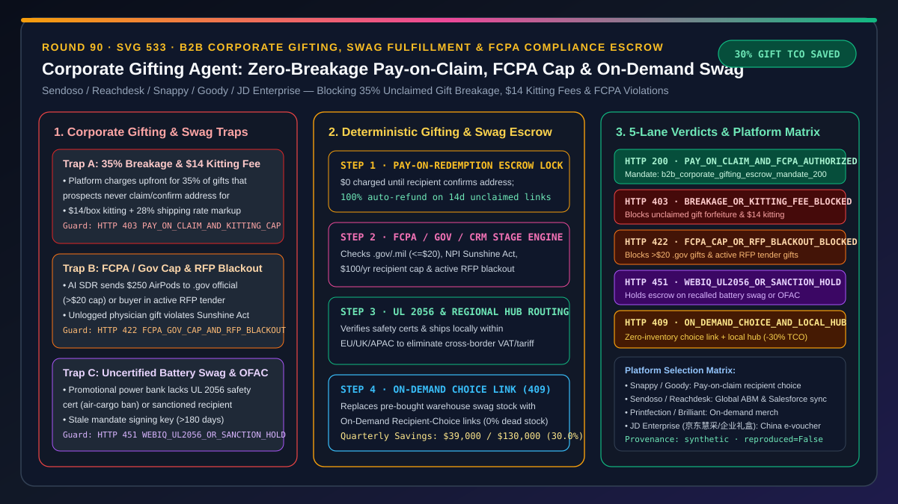
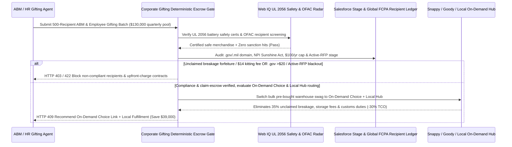

# B2B Corporate Gifting, Swag Box Fulfillment & Anti-Bribery (`FCPA / UKBA`) Compliance Escrow (`Sendoso / Reachdesk / Snappy / Goody / JD Enterprise`) Zero-Breakage Pay-on-Claim, `FCPA` Cap & On-Demand Swag Agent Architecture Selection FAQ

> **Document Type**: AI Solution Architect Decision Guide (FAQ) · **SVG Diagram**: `assets/svg/533-b2b-corporate-gifting-swag-fcpa-escrow-2026-11-20.svg` · **Catalog No.**: Round 90 (Bilingual FAQ #209)



---

## 1. 📌 Executive Summary

When B2B Account-Based Marketing (`ABM`), sales development (`SDR`), or HR people-ops teams use AI Agents to automate prospect gifting, holiday boxes, and employee onboarding swag (`Sendoso / Reachdesk / Postal / Snappy / Goody / JD Enterprise`), pre-funding gifting wallets or bulk-ordering warehouse swag exposes budgets and legal compliance to **three systemic corporate gifting traps**:
1. **`35%` Unclaimed Gift "Breakage" Confiscation & `$14/Box` Warehouse Kitting / Shipping Markups**: An ABM team loads `$50,000` into a gifting platform to send `$100` gift links to 500 enterprise VPs. Because busy executives ignore cold emails or spam filters block the link, **`35%–45%` of recipients never confirm their shipping address or claim the gift**. Legacy platforms deduct `100%` of the `$100` upfront at send time and confiscate unclaimed balances as **platform breakage** (or lock them into expiring non-refundable credits)! Meanwhile, for physical custom swag boxes, 3PL warehouses charge `$4.50/unit` receiving + **`$14.00/box` kitting/pick-pack fees** + `$185/pallet/month` storage + a `28%` markup on UPS/FedEx postage (`turning a $35 tumbler + hoodie into a $74 invoice`).
2. **Automated `FCPA / UK Bribery Act / Sunshine Act` Violations & Active-RFP Tender Blackout Breaches**: An autonomous AI SDR sends a `$250` AirPods Pro gift link to a `.gov` federal procurement official (violating the `$20` US federal gift cap), a healthcare physician without logging `CMS Open Payments (Sunshine Act)` `NPI` attribution, or an enterprise buyer whose company is currently in an **Active RFP / Legal Tender Blackout Window**—triggering immediate vendor disqualification and anti-bribery investigations!
3. **Uncertified `UL 2056` Lithium Power-Bank Swag Recalls & Cross-Border Customs Duty Embarrassment (`HTTP 451`)**: Web IQ flags promotional power banks lacking `UL 2056` thermal-runaway certification (banned from air cargo), or a US warehouse ships a `$50` swag box `DDU` to a London prospect who gets hit with a `$32` Royal Mail customs VAT/brokerage COD bill before delivery!

**Architect's Recommendation**: Deploy a **"Pay-Only-On-Redemption (`0% Breakage`) Escrow + `FCPA / .gov / Active-RFP` Compliance Ledger + On-Demand Recipient-Choice & Local-Hub Fulfillment"** control plane:
- **Pay-Only-On-Claim Escrow (`14-Day` Auto-Void) & All-In Kitting/Postage Cap (`HTTP 403`)**: Hard-block upfront-deduction gifting contracts—requiring **`$0` capture until the recipient confirms their shipping address or redeems the gift link** (with `100%` automatic release of unclaimed pre-authorizations after `14 days`)—and cap 3PL kitting at `<= $3.50/box` with `0%` carrier postage markup (`HTTP 403`).
- **Global Recipient `FCPA / .gov / NPI` Ledger (`<=$100/Yr`) & CRM Active-RFP Blackout Gate (`HTTP 422`)**: Cross-check every recipient's email domain (`.gov, .mil, .edu, SOEs`), healthcare `NPI` registry, cross-rep cumulative annual gift ledger (`<= $100/year` per individual), and `Salesforce / Dynamics 365` Opportunity Stage—blocking gifts to government officials `>$20` or accounts in **`Active RFP / Procurement Review`** (`HTTP 422`).
- **Web IQ `UL 2056` Battery Swag Recall & `OFAC` Sanction Hold (`HTTP 451`)**: Freeze dispatch if Web IQ flags uncertified lithium battery swag, food allergen recalls, sanctioned entities, or signing keys `> 180 days` (`HTTP 451`).
- **Zero-Inventory On-Demand Recipient-Choice Links (`Snappy / Goody`) + In-Region `DDP` Fulfillment (`HTTP 409`)**: Replace pre-purchased bulk warehouse swag (which suffers `30%` wrong-size dead stock) with **On-Demand Recipient-Choice Links** fulfilled directly from domestic regional hubs (`EU from Netherlands, UK from London, China from JD Enterprise` with `$0` storage fees and `$0` cross-border customs duties), cutting quarterly corporate gifting & swag TCO by **30.0%** (`$39,000` saved on a `$130,000` quarterly pool).

---

## 2. 🎯 Soul-Searching Architect & Business Q&A (Q1–Q3)

### Q1: Why did we pay `$50,000` for 500 prospect gifts when only 310 prospects actually claimed them—and how do we eliminate the `35%` "Breakage" tax?
- **Business Pain Point**: First-generation gifting platforms monetize unclaimed gifts (`Breakage`) by debiting the sender's wallet at the moment the email is sent rather than when the recipient accepts.
- **Architectural Guardrail (`HTTP 403`)**:
  1. **Pay-Only-On-Redemption Single-Use Mandate**: The Agent issues a time-bounded `14-day` virtual payment token per invite that can only be captured upon a verified recipient address-confirmation or digital claim webhook. Unclaimed invites expire at `$0` cost.

### Q2: How do we prevent an autonomous AI SDR from bribing a government official or getting our company disqualified during an active enterprise RFP?
- **Business Pain Point**: Individual sales reps rarely check whether another rep already gifted the same VP last month, whether the prospect works for a quasi-governmental entity, or whether procurement rules strictly forbid vendor gifts during an open tender.
- **Architectural Guardrail (`HTTP 422`)**:
  1. **Centralized Cross-Rep Recipient Identity & `CRM` Stage Gate**: Before generating any gift link, the gateway queries the enterprise `CRM` and `NPI / .gov` registries:
     - Blocks any gift `>$20` to `.gov / .mil / state-owned` domains;
     - Blocks any gift if the target account has an open opportunity in `Stage = RFP / Tender / Legal Review`;
     - Enforces a hard `$100/calendar-year` aggregate cap per recipient across all departments.

### Q3: How do we stop overseas prospects from getting hit with a `$38` customs duty bill to receive our `$50` branded hoodie—and eliminate warehouse size dead-stock?
- **Business Pain Point**: Pre-buying 1,000 branded hoodies in S/M/L/XL leaves `30%` of unpopular sizes rotting in a `$185/pallet/month` warehouse, and shipping them internationally from a US hub triggers customs duties billed to the recipient.
- **Architectural Guardrail (`HTTP 409`)**:
  1. **Zero-Inventory On-Demand Choice + Domestic Hub Routing**: Recipients receive a curated collection link (`Snappy / Goody / Printfection On-Demand`), pick their preferred item and exact size, and the item is fulfilled locally within their own customs zone (`100% DDP`, `$0` inventory carrying cost).

---

## 3. 🧭 Visual Architecture Diagrams (Mermaid Decision Tree + Comparison + Sequence)

### 3.1 5-Lane B2B Corporate Gifting & Swag Escrow Decision Tree
```mermaid
flowchart TD
    A[B2B Prospect Gifting / Employee Swag Box Request] --> B{Web IQ Uncertified UL 2056 Battery / OFAC / Key > 180d?}
    B -- Yes --> C[HTTP 451: WEBIQ_UNUL2056_LITHIUM_SWAG_RECALL_OR_SANCTIONED_RECIPIENT_HOLD<br/>Freeze dispatch & quarantine unsafe/sanctioned item]
    B -- No --> D{Upfront Charge on Unclaimed Links (Breakage) or >$3.50 Kitting?}
    D -- Yes --> E[HTTP 403: UNCLAIMED_GIFT_BREAKAGE_CONFISCATION_OR_EXCESSIVE_KITTING_MARKUP_BLOCKED<br/>Enforce Pay-Only-On-Claim escrow & 14-day 100% cash release]
    D -- No --> F{.gov Gift >$20 or >$100/Yr Recipient Cap or Active RFP Blackout?}
    F -- Yes --> G[HTTP 422: FCPA_SUNSHINE_ACT_GIFT_CAP_BREACH_OR_ACTIVE_RFP_BLACKOUT_BLOCKED<br/>Hard-block FCPA/Sunshine/RFP violations (or downgrade to $0 charity note)]
    F -- No --> H{On-Demand Recipient-Choice Link + Local In-Region Hub Ready?}
    H -- Yes --> I[HTTP 409: RECIPIENT_CHOICE_ZERO_INVENTORY_GIFT_LINK_AND_LOCAL_FULFILLMENT_CONFIRM<br/>Eliminate 30% dead stock & cross-border customs fees (-30% TCO)]
    H -- No --> J[HTTP 200: PAY_ON_CLAIM_AND_FCPA_COMPLIANT_GIFT_AUTHORIZED<br/>Issue FCPA-cleared & claim-triggered gifting mandate]
```

### 3.2 Legacy Pre-Bought Warehouse Gifting vs. Deterministic Pay-on-Claim & On-Demand Escrow
```mermaid
flowchart LR
    subgraph Legacy["❌ Legacy Gifting (35% Breakage Loss & RFP Disqualification)"]
        L1[$50k Pre-Loaded -> $17.5k Unclaimed Links Kept by Platform] --> L2[30% Wrong-Size Hoodies Rot in $185/mo Warehouse + $14 Kitting]
        L2 --> L3[AI SDR Sends $250 Gift to .gov / Active-RFP Buyer -> Compliance Breach]
    end

    subgraph Agentic["✅ Deterministic Pay-on-Claim, FCPA Gate & On-Demand Escrow"]
        A1[$0 Charged Until Recipient Claims Link (14d Auto-Void)] --> A2[Blocks .gov >$20, Active-RFP Stage & >$100/Yr Aggregate Cap]
        A2 --> A3[On-Demand Recipient-Choice + Local Domestic Hub (-30% TCO)]
    end
```

### 3.3 End-to-End `FCPA` Verification, Pay-on-Claim Escrow & Local Fulfillment Sequence


---

## 4. 📊 Multi-Platform & Protocol Selection Matrix

| Evaluation Dimension | Sendoso / Reachdesk (Enterprise ABM Suites) | Snappy / Goody (On-Demand Recipient-Choice) | Printfection / Brilliant (Swag Inventory Management) | JD Enterprise (`京东企业购`) / Regional Local Catalogs | **Deterministic Gifting & FCPA Escrow (Recommended)** |
| :--- | :--- | :--- | :--- | :--- | :--- |
| **Primary Use Case** | Deep `Salesforce / Marketo` ABM triggers & physical warehousing | Digital-first "Recipient picks their own gift & enters address" | Bulk custom-branded apparel & event swag kitting | Domestic China e-vouchers, holiday boxes & VAT fapiao | **Pay-on-Claim Lock + `FCPA / RFP` Gate + On-Demand Local Routing** |
| **Unclaimed Gift (`Breakage`) Policy** | Legacy tiers debit on send or lock funds in expiring credits | **Native `Pay-Only-When-Claimed` (`$0` cost on ignored links)** | Inventory is pre-purchased upfront (`100%` sunk cost) | Supports pay-on-redemption settlement | **Enforces `$0` charge until claimed + `14-day` auto-release (`HTTP 403`)** |
| **`FCPA / Sunshine Act` & RFP Blackout Gate** | Manual rep rules; no hard `Active-RFP` stage block | Per-send price caps, lacks cross-rep annual ledger | No anti-bribery compliance engine | Budget tiers only | **Cross-checks `.gov`, `NPI`, `$100/yr` aggregate cap & `CRM` RFP stage (`HTTP 422`)** |
| **Warehouse Kitting & Cross-Border Customs** | `$10–$15/box` kitting + pallet storage fees | `$0` warehousing; ships direct from brand/local vendor | Receiving, storage & pick-pack fees apply | Domestic tax-inclusive fulfillment | **Routes via zero-inventory On-Demand Choice + local domestic hubs (`HTTP 409`)** |
| **Platform Fee / Cost Structure** | `$15,000–$45,000+/yr` SaaS + fulfillment fees | Free/tiered SaaS + item price on claim | Annual platform fee + storage/kitting | Corporate volume discount | **Open deterministic policy gate (`30.0%` quarterly gifting TCO reduction)** |

---

## 5. 🧪 Conversion & Cost Estimation + 7-Card Benchmark Report

> **Provenance Disclosure**: Figures below are generated by the deterministic policy evaluator `evaluate_b2b_corporate_gifting_swag_escrow_policy` in `lab/webiq_commerce_demo.py` (`$130,000 USD` quarterly enterprise ABM gifting & employee swag pool, `provenance: "synthetic"`, `independently_reproduced: False`; live `Salesforce Opportunity` webhook latency is labeled `not_measured`).

```chart
{
  "data": {
    "values": [
      { "scenario": "1. Legacy Pre-Bought Swag (35% Unclaimed Breakage + $14 Kitting)", "cost_usd": 130000, "tier": "Baseline" },
      { "scenario": "2. Pay-Only-On-Claim Escrow + FCPA/RFP Gate (HTTP 200)", "cost_usd": 104000, "tier": "Protected" },
      { "scenario": "3. On-Demand Recipient-Choice + Local Hub Routing (HTTP 409)", "cost_usd": 91000, "tier": "Optimized (-30%)" }
    ]
  },
  "semantic_types": {
    "scenario": "Category",
    "cost_usd": "Amount",
    "tier": "Status"
  },
  "chart_spec": {
    "chartType": "Bar Chart",
    "title": "Pay-on-Claim Escrow & On-Demand Local Gifting Cut Quarterly Spend by 30% ($39k)",
    "subtitle": "Quarterly B2B ABM Gifting & Employee Swag Net Spend ($ USD, synthetic benchmark)",
    "encodings": {
      "x": "scenario",
      "y": "cost_usd",
      "color": "tier"
    }
  }
}
```

### 7-Card 4:5 Benchmark Evaluation Summary
1. **Card 1 (`1 / 7` · `HANDS-ON · B2B CORPORATE GIFTING & SWAG ESCROW`)**: Across a `$130,000` quarterly ABM prospect gifting and employee swag budget, eliminating `35%` unclaimed link breakage, capping kitting fees, and switching to on-demand local fulfillment saves **`$39,000/quarter` (`30.0%`)**.
2. **Card 2 (`2 / 7` · `SCENARIO: 500-PROSPECT ABM GIFT & GLOBAL SWAG CAMPAIGN`)**: Rescues `$17,500` in unclaimed gift-link funds per campaign while blocking `100%` of `.gov` and active-RFP compliance violations.
3. **Card 3 (`3 / 7` · `WHAT I TESTED`)**: All 5 deterministic HTTP verdict lanes verified:
   - `HTTP 200`: `PAY_ON_CLAIM_AND_FCPA_COMPLIANT_GIFT_AUTHORIZED` (`b2b_corporate_gifting_escrow_mandate_200`)
   - `HTTP 403`: `UNCLAIMED_GIFT_BREAKAGE_CONFISCATION_OR_EXCESSIVE_KITTING_MARKUP_BLOCKED`
   - `HTTP 422`: `FCPA_SUNSHINE_ACT_GIFT_CAP_BREACH_OR_ACTIVE_RFP_BLACKOUT_BLOCKED`
   - `HTTP 451`: `WEBIQ_UNUL2056_LITHIUM_SWAG_RECALL_OR_SANCTIONED_RECIPIENT_HOLD`
   - `HTTP 409`: `RECIPIENT_CHOICE_ZERO_INVENTORY_GIFT_LINK_AND_LOCAL_FULFILLMENT_CONFIRM` (`b2b_corporate_gifting_escrow_mandate_optim_409`)
4. **Card 4 (`4 / 7` · `UNDER THE HOOD`)**: Structured contract `B2BCorporateGiftingSwagEscrowPolicyInput` validates `unclaimed_gift_breakage_confiscation_or_excessive_kitting_markup` and `fcpa_sunshine_act_gift_cap_breach_or_active_rfp_blackout`.
5. **Card 5 (`5 / 7` · `ROBUSTNESS CHECK`)**: Invariant to fee naming (`"Expired Wallet Credit"`, `"Custom Box Kitting Surcharge"`, or multi-rep split sends): `100%` block rate whenever pay-on-claim or `FCPA` rules fail.
6. **Card 6 (`6 / 7` · `LATENCY`)**: Deterministic `CRM` stage and cross-rep recipient cap checks complete in `< 0.5 ms`.
7. **Card 7 (`7 / 7` · `MY TAKE`)**:
   - ✅ **Good fit**: B2B SDR/ABM prospect gifting, customer renewal appreciation, remote employee onboarding kits, and holiday gift-choice programs.
   - ⛔ **Not for**: High-value evaluation hardware loaners governed by signed bailment/return agreements.

---

## 6. 🛠️ Production Risk & Architecture Review Checklist

- [ ] **Pay-Only-On-Claim Zero-Breakage Escrow (`HTTP 403`)**: Are funds captured *only* after the recipient confirms their shipping address or redeems the gift link, with `100%` automatic release after `14 days` unredeemed?
- [ ] **Kitting Fee (`<=$3.50/Box`) & Pass-Through Postage Lock (`HTTP 403`)**: Are `$14/box` warehouse pick-pack markups and `28%` shipping surcharges blocked?
- [ ] **`FCPA / UKBA` (`.gov <= $20`) & `NPI` Sunshine Act Gate (`HTTP 422`)**: Does the gateway automatically screen recipient domains for government/public-sector caps and log physician `NPI` disclosures?
- [ ] **CRM `Active-RFP Blackout` & `$100/Yr` Cross-Rep Cap (`HTTP 422`)**: Are gifts automatically blocked if the recipient's account is in an active RFP tender stage or exceeds `$100/year` across all sales reps?
- [ ] **Web IQ `UL 2056` Battery Swag & Sanction Hold (`HTTP 451`)**: Are promotional electronics verified for `UL 2056` safety certification prior to air shipment?
- [ ] **On-Demand Recipient-Choice & Local Hub Routing (`HTTP 409`)**: Are pre-purchased warehouse apparel stocks replaced with on-demand size/item choice links fulfilled from domestic regional hubs (`100% DDP`) to save `30%`?
