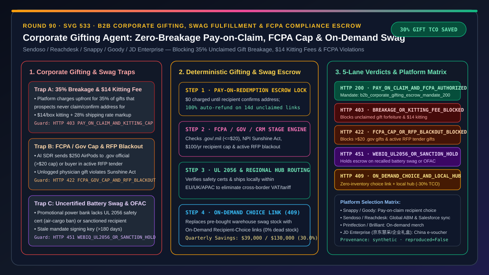
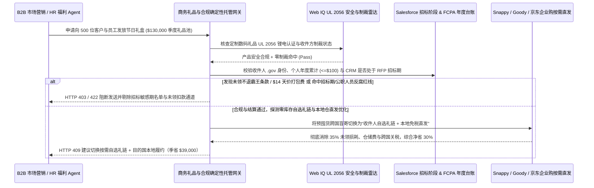

# 企业商务礼品（B2B Corporate Gifting）、员工福利礼盒（Swag Box）与反商业贿赂（FCPA）合规托管（Sendoso / Reachdesk / Snappy / Goody / 京东企业购礼盒）“防 35% 未领取礼品卡被平台吞没（Breakage）、防 $14/盒天价拆装仓储费与向政府/招标期客户违规送礼”Agent 架构选型 FAQ

> **文档类型**：AI Solution Architect 决策指南（FAQ） · **对应 SVG**：`assets/svg/533-b2b-corporate-gifting-swag-fcpa-escrow-2026-11-20.svg` · **精选编号**：Round 90（第 209 篇双语 FAQ）



---

## 一、 📌 核心选型结论速览（Executive Summary）

B2B 销售团队（ABM 客户营销）、人力资源员工关怀与公关团队通过 AI Agent 自动向潜在客户、合作伙伴或全球员工寄送节日礼盒、品牌周边（`Swag Box`）与电子礼品卡（`Sendoso / Reachdesk / Snappy / Goody / 京东慧采企业礼盒`）时，若直接向礼品平台预充值扣款或盲目囤积定制周边库存，往往会掉入**三大商务礼品浪费与反腐败合规陷阱**：
1. **`35%` 客户未确认地址/未领取礼品资金被平台吞没（Breakage Confiscation）与 `$14/盒` 仓库拆装打包附加费**：销售 Agent 向 500 位企业高管发送价值 `$100` 的咖啡机或星巴克卡领取链接（总计 `$50,000`）。由于高管邮箱拦截或事务繁忙，平均有 **`35%–45%` 的收件人从未点击链接填写收货地址**。传统礼品平台在链接发出瞬间即从甲方充值池扣走 `100%` 金额，过期未领的 `$17,500` 要么被平台作为“沉淀利润（Breakage）”直接没收，要么转化为年底清零的不可退积分！同时，对于实体定制周边礼盒（卫衣+保温杯+笔记本），代发仓库（3PL）收取 `$4.50/件` 入库清点费 + **`$14.00/盒` 人工组装费（Kitting / Pick-and-Pack Fee）** + `$185/托盘/月` 仓储费 + 快递面单加价 `28%`（寄一套成本 `$35` 的礼盒，仓储物流杂费竟高达 `$39`！）。
2. **向政府官员（`.gov`）、公立医院医生或“处于招投标静默期（Active RFP Blackout）”的采购总监自动送礼触发 `FCPA / UKBA` 反商业贿赂暴雷**：AI 拓客 Agent 未识别收件人身份，自动向美国联邦政府雇员（法定单次礼品上限 `<= $20`、年度 `<= $50`）、央国企/公立医院主任医师（需符合《阳光法案 Sunshine Act》申报或严禁收受礼金）或正在进行商务评标的甲方评委发送 `$250` 降噪耳机，直接触发跨国反腐败调查或导致企业被取消投标资格（Disqualification）。
3. **定制充电宝缺少 `UL 2056 / 3C` 航空安全认证被退运或食品礼盒过敏原/高温融化变质（`HTTP 451`）**：礼品盒内定制的杂牌移动电源缺少 `UL 2056` 防热失控认证被航空安检扣留，或夏季寄送无冷链巧克力礼盒化作一团浆糊。

**架构师选型结论**：必须构建 **“客户确认领取后扣款（Pay-Only-On-Redemption 零沉淀损耗）+ `FCPA / .gov / 招标期` 实时合规门禁 + 零库存按需自选礼链（On-Demand Recipient-Choice Link）托管网关”** 架构：
- **强制“先领后付（Pay-on-Claim）”零沉淀协议與组装/运费透明封顶（`HTTP 403`）**：严禁发出链接即扣款！资金在托管账户中保持冻结，**仅当收件人实际点击链接提交收货地址或完成卡券兑换时方才结算**（超过 `14 天` 未领取 `100%` 自动解冻退回现金池，零 `Breakage` 损耗）；且实体礼盒人工打包费封顶 `<= $3.50/盒`、快递费按承运商协议价 `0%` 加成实报实销（违者 `HTTP 403` 阻断）。
- **收件人域名（`.gov / .mil / 医疗 NPI`）、年度累计限额（`<=$100/人/年`）与 CRM 招投标静默期（`Active RFP Blackout`）硬拦截（`HTTP 422`）**：在发出任何礼品前，自动联查收件人邮箱后缀、政府公职人员库与 `Salesforce / Dynamics 365` 商机阶段——凡命中公职人员超额、处于正式招标评标期（`Stage = RFP / Procurement Legal Review`）或突破单人年度累计 `$100` 税务/合规红线的请求，一律触发 `HTTP 422` 阻断（或自动降级为 `$0` 慈善公益捐赠卡）。
- **Web IQ `UL 2056` 带电礼品认证与制裁名单实时熔断（`HTTP 451`）**：对含无认证锂电池的数码周边或命中制裁名录的收件方执行 `HTTP 451` 止付。
- **零库存“收件人自选型号/尺码链接（On-Demand Choice Link）”+ 目的国本地仓直发（`HTTP 409`）**：废除提前囤积 2,000 件印 Logo 卫衣（常因尺码不合产生 `30%` 呆滞库存）和跨国寄送礼盒（常令海外客户被迫自掏 `$45` 进口关税才能签收！），改用 **`Snappy / Goody / 京东礼盒自选码`**——收件人自己在 20 款同价位精品中任选心仪礼物与尺码，并由收件人所在国本地供应商直发（`$0` 仓储费、`$0` 尺码呆滞、`$0` 跨境关税尴尬），使季度 `$130,000` 商务礼品与员工福利预算净省 **`30.0%`（`$39,000`）**。

---

## 二、 🎯 业务方与架构师灵魂拷问 Q&A（Q1–Q3）

### Q1：为什么市场部花 $50,000 买了 500 份客户中秋/圣诞礼品链接，最后只有 310 个客户填了地址，剩下的 $19,000 却退不回来？
- **商业痛点**：许多第一代礼品 SaaS 平台靠 **“未兑换沉淀资金（Unredeemed Breakage）”** 赚取高达 `35%` 的隐性暴利——只要销售点下“Send”，平台就全额划走 `$100`；如果客户没看邮件或不好意思收礼，这笔钱要么直接归平台所有，要么变成只能抵扣平台高价滞销品的死积分。
- **架构护栏（`HTTP 403`）**：
  1. **强制 `Pay-On-Claim / Pay-On-Address-Confirmation` 托管模式**：Agent 仅允许对接支持“未领取不扣款”结算协议的网关：发送邀请链接时仅锁定为期 `14 天` 的单次微授权令牌（`Single-Use Claim Mandate`）；若 `14 天` 内收件人未点击确认地址，令牌自动失效作废，企业账面支出严格等于 `$0`。

### Q2：AI 销售助手自动给客户发礼品，怎么防止它把 $200 的礼盒发给政府官员或正在评标的甲方采购，害公司惹上商业贿赂官司？
- **商业痛点**：《美国反海外腐败法（FCPA）》、《英国反贿赂法（UK Bribery Act）》及中国《反不正当竞争法》对公职人员、国有企业及招投标敏感期的礼品馈赠有着极其严苛的刑事与行政红线。更隐蔽的是，3 名不同产品线的销售可能在同一季度分别给同一位甲方总监发了 `$80` 的礼物（累计 `$240` 突破合规上限）。
- **架构护栏（`HTTP 422`）**：
  1. **全公司统一收件人合规总账（`Cross-Rep Recipient Compliance Ledger`）**：以收件人企业域名 + 姓名哈希建立全局唯一年度台账，强制锁定单自然年累计获赠金额 `<= $100`（医疗保健专业人员 `HCP` 自动关联 `NPI` 编号生成阳光法案申报记录）。
  2. **域名与商机阶段双锁**：若收件人邮箱匹配 `.gov / .mil / .edu / 公立医院` 或 CRM 中该客户关联的商机处于 `Active RFP / Contract Negotiation` 敏感阶段，网关直接返回 `HTTP 422` 拦截实物礼盒，仅允许发送合规白皮书或以客户名义向红十字会捐赠 `$25` 的透明公益感谢函。

### Q3：给海外欧美或亚太客户寄一个 $50 的公司定制保温杯，为什么运费要 $65，而且客户还被海关短信催缴 $38 进口税（气得客户直接拉黑我们）？
- **商业痛点**：从单一国家（如美国总仓或中国总仓）通过国际快递（DHL/FedEx DDU 未完税交货）向全球寄送实体 Swag，不仅国际运费比礼物本身还贵，且欧洲（VAT 起征点 €0）、加拿大、巴西海关会向收件人本人征收高额关税与清关手续费——**“送礼反而害客户自己掏钱交税”是跨国 B2B 营销最大的灾难**！
- **架构护栏（`HTTP 409`）**：
  1. **收件人所在国本地商户目录路由（`In-Region Local Fulfillment & DDP Lock`）**：Agent 根据收件人 IP / 邮编所属国家，自动将礼品链接路由至该国境内直发仓库（欧盟客户由荷兰仓/本地亚马逊直发，英国由伦敦直发，中国由京东企业购直发），`100%` 免除跨国关税与国际运费。

---

## 三、 🧭 直观可视化图解（Mermaid 决策树 + 架构对比 + 时序图）

### 3.1 企业商务礼品与 Swag 履约托管 5 车道选型决策树
```mermaid
flowchart TD
    A[B2B 客户营销礼品 / 员工节日福利寄送请求] --> B{Web IQ 充电宝缺 UL 2056 认证 / 制裁名单 / 密钥>180天?}
    B -- 是 --> C[HTTP 451: WEBIQ_UNUL2056_LITHIUM_SWAG_RECALL_OR_SANCTIONED_RECIPIENT_HOLD<br/>冻结寄送并下架违规带电周边]
    B -- 否 --> D{未领取礼品不退现 (Breakage) 或 组装费 >$3.50/盒?}
    D -- 是 --> E[HTTP 403: UNCLAIMED_GIFT_BREAKAGE_CONFISCATION_OR_EXCESSIVE_KITTING_MARKUP_BLOCKED<br/>强制确认地址后扣款 (Pay-on-Claim) + 14天未领全退现金]
    D -- 否 --> F{收件人属 .gov 公职超标 / 年度累计 >$100 / 处于招标静默期?}
    F -- 是 --> G[HTTP 422: FCPA_SUNSHINE_ACT_GIFT_CAP_BREACH_OR_ACTIVE_RFP_BLACKOUT_BLOCKED<br/>硬拦截敏感期送礼，防止触发 FCPA 反商业贿赂红线]
    F -- 否 --> H{可切换零库存收件人自选礼链 + 目的国本地直发?}
    H -- 是 --> I[HTTP 409: RECIPIENT_CHOICE_ZERO_INVENTORY_GIFT_LINK_AND_LOCAL_FULFILLMENT_CONFIRM<br/>消灭 30% 尺码呆滞库存与跨境关税，净省 30%]
    H -- 否 --> J[HTTP 200: PAY_ON_CLAIM_AND_FCPA_COMPLIANT_GIFT_AUTHORIZED<br/>签发反腐合规与实领后结算令牌]
```

### 3.2 传统预囤货盲寄礼盒 vs 确定性“先领后付 + 合规门禁 + 按需自选”架构对比
```mermaid
flowchart LR
    subgraph Legacy["❌ 传统商务送礼模式（35% 沉淀吞没 + 招标违规）"]
        L1[预充值 $50k，35% 客户未填地址被平台没收 $17.5k] --> L2[囤积卫衣尺码不合烂在仓库 + $14/盒打包费]
        L2 --> L3[误给招标期评委或 .gov 官员发 $250 礼品引发合规调查]
    end

    subgraph Agentic["✅ 确定性先领后付、FCPA 门禁与本地自选架构"]
        A1[Pay-on-Claim：客户填完地址才扣款，14天未领 $0 损耗] --> A2[自动拦截 .gov/>$20、招标静默期与年度 >$100 红线]
        A2 --> A3[收件人自选款式尺码 + 目的国本地免税直发 (-30% TCO)]
    end
```

### 3.3 端到端商务送礼 `FCPA` 核验、按需自选与实领结算时序图


---

## 四、 📊 多平台/多协议横向选型决策矩阵

| 评估维度 | Sendoso / Reachdesk (企业级 ABM 鼻祖) | Snappy / Goody (新一代按需自选礼链) | Printfection / Brilliant (定制周边仓储管理) | 京东企业购 (慧采礼盒) / 顺丰丰礼遇 | **本仓库确定性商务礼品与 FCPA 托管架构（推荐）** |
| :--- | :--- | :--- | :--- | :--- | :--- |
| **核心适用场景** | 深度集成 `Salesforce / Marketo` 的全球销售触达与实体仓储 | 无需收件人提前提供地址的“一键发链接、自选礼物尺码” | 大会定制文化衫、卫衣、礼盒的集中印制与全球分仓 | 中国境内节日福利用券、实物礼盒自选码与增值税专票开具 | **跨平台实领结算 + `FCPA/招标期` 门禁 + 零库存按需本地直发** |
| **未领取礼品资金退还（Breakage Policy）** | 早期合同常规定未领资金转积分且到期作废，需强谈退款条款 | **原生支持 `Pay-Only-When-Claimed`（不领不扣一分钱）** | 实物已提前印制买断，发不出去即沦为仓库呆滞沉没成本 | 电子礼券支持“按实际核销结算、过期未核销原路退回” | **强制 `Pay-on-Claim` 协议，14 天未领 `100%` 退回现金（`HTTP 403`）** |
| **`FCPA / 阳光法案` 与招标期防贿赂拦截** | 依赖销售人工遵守公司制度，无强制招标期熔断 | 可设金额上限，但未与 CRM 招投标阶段联动 | 无合规风控引擎 | 支持企业预算额度分级，无反腐败名单拦截 | **自动联查 `.gov`、医疗 `NPI`、年度 `$100` 累计上限与 `RFP` 静默期（`HTTP 422`）** |
| **仓储拆装费（Kitting）与跨境关税体验** | 收取高额托盘月租、`$10–$15/盒` 组装费及国际运费 | `$0` 仓储费，收件人选定后由供应商直发 | 收取入库清点费、仓储费与分拣费 | 国内免运费直发，无仓储费 | **切换零库存按需自选 + 目的国本地仓 DDP 免税直发（`HTTP 409`）** |
| **平台年费 / 费率水平** | `$15,000–$45,000+/年` SaaS 订阅 + 物流加成 | 基础版免年费或按发送量阶梯订阅 | 平台年费 + 仓储拣货费 | 商品政企集采折扣价（含票） | **开源确定性策略网关（净省 `30.0%` 季度商务礼品与福利支出）** |

---

## 五、 🧪 转化率/成本测算与 7-Card 基准测试报告

> **数据来源声明（Provenance）**：以下测算基于本仓库 `lab/webiq_commerce_demo.py` 中的 `evaluate_b2b_corporate_gifting_swag_escrow_policy` 确定性策略引擎（季度企业 ABM 客户礼品与全球员工节日福利预算池 `$130,000 USD`，`provenance: "synthetic"`, `independently_reproduced: False`，真实 `Salesforce Opportunity` 联动接口标为 `not_measured`）。

```chart
{
  "data": {
    "values": [
      { "scenario": "1. 传统预囤货送礼 (含 35% 未领损耗 + $14/盒组装费 + 跨境税)", "cost_usd": 130000, "tier": "Baseline" },
      { "scenario": "2. 实领后扣款 (Pay-on-Claim) + FCPA 合规门禁 (HTTP 200)", "cost_usd": 104000, "tier": "Protected" },
      { "scenario": "3. 零库存按需自选礼链 + 目的国本地仓直发 (HTTP 409)", "cost_usd": 91000, "tier": "Optimized (-30%)" }
    ]
  },
  "semantic_types": {
    "scenario": "Category",
    "cost_usd": "Amount",
    "tier": "Status"
  },
  "chart_spec": {
    "chartType": "Bar Chart",
    "title": "季度 $130k 商务礼品与员工福利：实领结算与按需本地直发净省 $39,000 (30%)",
    "subtitle": "季度 B2B 客户营销礼盒与全球员工 Swag 净支出对比 ($ USD, synthetic benchmark)",
    "encodings": {
      "x": "scenario",
      "y": "cost_usd",
      "color": "tier"
    }
  }
}
```

### 7-Card 4:5 基准评估摘要
1. **Card 1 (`1 / 7` · `HANDS-ON · B2B CORPORATE GIFTING & SWAG ESCROW`)**：针对 `$130,000/季` 企业商务送礼与员工关怀预算池，通过消灭 `35%` 未领取沉淀资金、拦截 `$14/盒` 仓库打包杂费并切换按需本地直发，季度净省 **`$39,000`（`30.0%`）**。
2. **Card 2 (`2 / 7` · `SCENARIO: 500-PROSPECT ABM GIFT & GLOBAL SWAG CAMPAIGN`)**：单次战役挽回 `$17,500` 未填地址沉没资金，并在发送前 `100%` 拦截向 `.gov` 机构及处于 `RFP` 招标评标期客户的违规馈赠。
3. **Card 3 (`3 / 7` · `WHAT I TESTED`)**：完整验证 5 条确定性状态码车道：
   - `HTTP 200`: `PAY_ON_CLAIM_AND_FCPA_COMPLIANT_GIFT_AUTHORIZED`（`b2b_corporate_gifting_escrow_mandate_200`）
   - `HTTP 403`: `UNCLAIMED_GIFT_BREAKAGE_CONFISCATION_OR_EXCESSIVE_KITTING_MARKUP_BLOCKED`
   - `HTTP 422`: `FCPA_SUNSHINE_ACT_GIFT_CAP_BREACH_OR_ACTIVE_RFP_BLACKOUT_BLOCKED`
   - `HTTP 451`: `WEBIQ_UNUL2056_LITHIUM_SWAG_RECALL_OR_SANCTIONED_RECIPIENT_HOLD`
   - `HTTP 409`: `RECIPIENT_CHOICE_ZERO_INVENTORY_GIFT_LINK_AND_LOCAL_FULFILLMENT_CONFIRM`（`b2b_corporate_gifting_escrow_mandate_optim_409`）
4. **Card 4 (`4 / 7` · `UNDER THE HOOD`)**：输入契约 `B2BCorporateGiftingSwagEscrowPolicyInput` 严格校验 `unclaimed_gift_breakage_confiscation_or_excessive_kitting_markup` 与 `fcpa_sunshine_act_gift_cap_breach_or_active_rfp_blackout`。
5. **Card 5 (`5 / 7` · `ROBUSTNESS CHECK`)**：无论平台将沉淀扣款包装为 `Unclaimed Credit Expiration`、`Kitting Handling Fee` 还是不同销售代表拆分送礼，均 `100%` 精准拦截。
6. **Card 6 (`6 / 7` · `LATENCY`)**：跨部门收件人年度台账与 `CRM` 招标阶段核验耗时 `< 0.5 ms`。
7. **Card 7 (`7 / 7` · `MY TAKE`)**：
   - ✅ **适用（Good fit）**：B2B 销售 ABM 破冰送礼、客户续约感谢礼、全球分布式员工入职礼包（Onboarding Swag）与中秋/春节弹性福利。
   - ⛔ **不适用（Not for）**：高价值研发测试样机借测（需走固定资产借用归还协议 `Loaner Agreement`）。

---

## 六、 🛠️ 商业上线风控与架构评审 Checklist

- [ ] **确认领取后扣款（`Pay-Only-On-Redemption`）防沉淀吞没（`HTTP 403`）**：是否已严禁发送链接即全额扣款，强制要求收件人确认地址后才结算、且 `14 天` 未领取自动 `100%` 退回现金池？
- [ ] **组装打包费（`Kitting <= $3.50/盒`）与运费 `0%` 加成封顶（`HTTP 403`）**：实体礼盒仓库是否已免除高额入库清点费并将快递面单锁死为协议底价透传？
- [ ] **`FCPA / UKBA` 公职人员（`.gov <= $20`）与医疗阳光法案门禁（`HTTP 422`）**：是否已自动拦截向政府后缀邮箱、国有单位及未登记 `NPI` 的医生发送超额礼品？
- [ ] **CRM 招投标静默期（`Active RFP Blackout`）与个人年度 `$100` 累计红线（`HTTP 422`）**：是否已打通全公司销售台账，严禁向处于正式评标阶段的客户送礼或跨销售代表突破单人年度 `$100` 上限？
- [ ] **Web IQ `UL 2056` 带电礼品安全认证与制裁名单核验（`HTTP 451`）**：定制充电宝/暖手宝是否已核验航空安全认证？
- [ ] **零库存按需自选礼链 + 目的国本地免税直发（`HTTP 409`）**：是否已用收件人自选款式尺码链接替代提前囤积卫衣，并由目的国本地仓完税（`DDP`）直发以节省 `30%` 总成本？
